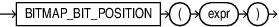

## BITMAP_BIT_POSITION

### Syntax

[Description of the illustration bitmap_bit_position.eps](img_text/bitmap_bit_position.md)

### Purpose

Use `BITMAP_BIT_POSITION` to construct the one-to-one mapping between a number and a bit position.

The argument `expr` is of type `NUMBER`. It is the absolute bit position in the bitmap.

`BITMAP_BIT_POSITION` returns a `NUMBER`, the relative bit position.

If `expr` is NULL, the function returns NULL.

If `expr` is not an integer, you will see the following error message:

    Invalid value has been passed to a BITMAP COUNT DISTINCT related operator.
