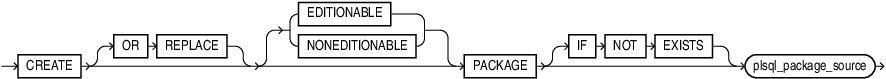

## CREATE PACKAGE

### Purpose

Packages are defined using PL/SQL. Therefore, this section provides some general information but refers to [Oracle Database PL/SQL Language Reference](../lnpls/CREATE-PACKAGE-statement.md) for details of syntax and semantics.

Use the `CREATE` `PACKAGE` statement to create the specification for a stored package, which is an encapsulated collection of related procedures, functions, and other program objects stored together in the database. The package specification declares these objects. The package body, specified subsequently, defines these objects.

**See Also:**

- [CREATE PACKAGE BODY](CREATE-PACKAGE-BODY.md) for information on specifying the implementation of the package

- [CREATE FUNCTION](CREATE-FUNCTION.md) and [CREATE PROCEDURE](CREATE-PROCEDURE.md) for information on creating standalone functions and procedures

- [ALTER PACKAGE](ALTER-PACKAGE.md) and [DROP PACKAGE](DROP-PACKAGE.md) for information on modifying and dropping a package

- [Oracle Database Development Guide](../adfns/coding-subprograms-and-packages.md) and [Oracle Database PL/SQL Packages and Types Reference](../arpls/introduction-to-oracle-supplied-plsql-packages-and-types.md) for detailed discussions of packages and how to use them

### Prerequisites

To create or replace a package in your own schema, you must have the `CREATE` `PROCEDURE` system privilege. To create or replace a package in another user's schema, you must have the `CREATE` `ANY` `PROCEDURE` system privilege.

To embed a `CREATE` `PACKAGE` statement inside an Oracle Database precompiler program, you must terminate the statement with the keyword `END-EXEC` followed by the embedded SQL statement terminator for the specific language.

**See Also:**

[Oracle Database PL/SQL Language Reference](../lnpls/CREATE-PACKAGE-statement.md) for more information

### Syntax

Packages are defined using PL/SQL. Therefore, the syntax diagram in this book shows only the SQL keywords. Refer to [Oracle Database PL/SQL Language Reference](../lnpls/CREATE-PACKAGE-statement.md) for the PL/SQL syntax, semantics, and examples.

### create_package::=

[Description of the illustration create_package.eps](img_text/create_package.md)

(`plsql_package_source`: See [Oracle Database PL/SQL Language Reference](../lnpls/CREATE-PACKAGE-statement.md).)

### Semantics

### OR REPLACE

Specify `OR` `REPLACE` to re-create the package specification if it already exists. Use this clause to change the specification of an existing package without dropping, re-creating, and regranting object privileges previously granted on the package. If you change a package specification, then Oracle Database recompiles it.

Users who had previously been granted privileges on a redefined package can still access the package without being regranted the privileges.

If any function-based indexes depend on the package, then the database marks the indexes `DISABLED`.

**See Also:**

[`ALTER` `PACKAGE`](ALTER-PACKAGE.md) for information on recompiling package specifications

### IF NOT EXISTS

Specifying `IF NOT EXISTS` has the following effects:

- If the package does not exist, a new one is created at the end of the statement.

- If the package exists, it is detected and a new one is not created.

You can only specify `OR REPLACE` or `IF NOT EXISTS` in a statement at a time. Using both `OR REPLACE` with `IF NOT EXISTS` in the very same statement results in an error.

You cannot specify `IF EXISTS` with `CREATE` statements.

### \[ EDITIONABLE \| NONEDITIONABLE \]

Use these clauses to specify whether the package is an editioned or noneditioned object if editioning is enabled for the schema object type `PACKAGE` in `schema`. The default is `EDITIONABLE`. For information about editioned and noneditioned objects, see [Oracle Database Development Guide](../adfns/editions.md).

### plsql_package_source

See [Oracle Database PL/SQL Language Reference](../lnpls/CREATE-PACKAGE-statement.md) for the syntax and semantics of the `plsql_package_source`, including examples.
