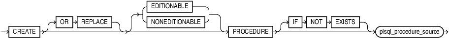

## CREATE PROCEDURE

### Purpose

Procedures are defined using PL/SQL. Therefore, this section provides some general information but refers to [Oracle Database PL/SQL Language Reference](../lnpls/CREATE-PROCEDURE-statement.md) for details of syntax and semantics.

Use the `CREATE` `PROCEDURE` statement to create a standalone stored procedure or a call specification.

A procedure is a group of PL/SQL statements that you can call by name. A call specification (sometimes called call spec) declares a Java method or a third-generation language (3GL) routine so that it can be called from SQL and PL/SQL. The call spec tells Oracle Database which Java method to invoke when a call is made. It also tells the database what type conversions to make for the arguments and return value.

Stored procedures offer advantages in the areas of development, integrity, security, performance, and memory allocation.

**See Also:**

- [Oracle Database Development Guide](../adfns/coding-subprograms-and-packages.md) for more information on stored procedures, including how to call stored procedures and for information about registering external procedures.

- [CREATE FUNCTION](CREATE-FUNCTION.md) for information specific to functions, which are similar to procedures in many ways.

- [CREATE PACKAGE](CREATE-PACKAGE.md) for information on creating packages. The `CREATE` `PROCEDURE` statement creates a procedure as a standalone schema object. You can also create a procedure as part of a package.

- [ALTER PROCEDURE](ALTER-PROCEDURE.md) and [DROP PROCEDURE](DROP-PROCEDURE.md) for information on modifying and dropping a standalone procedure.

- [CREATE LIBRARY](CREATE-LIBRARY.md) for more information about shared libraries.

### Prerequisites

To create or replace a procedure in your own schema, you must have the `CREATE` `PROCEDURE` system privilege. To create or replace a procedure in another user's schema, you must have the `CREATE` `ANY` `PROCEDURE` system privilege.

To invoke a call spec, you may need additional privileges, for example, the `EXECUTE` object privilege on the C library for a C call spec.

To embed a `CREATE` `PROCEDURE` statement inside an Oracle precompiler program, you must terminate the statement with the keyword `END-EXEC` followed by the embedded SQL statement terminator for the specific language.

**See Also:**

[Oracle Database PL/SQL Language Reference](../lnpls/plsql-packages.md) or [Oracle Database Java Developer's Guide](../jjdev/publishing-Java-classes.md) for more information

### Syntax

Procedures are defined using PL/SQL. Therefore, the syntax diagram in this book shows only the SQL keywords. Refer to [Oracle Database PL/SQL Language Reference](../lnpls/CREATE-PROCEDURE-statement.md) for the PL/SQL syntax, semantics, and examples.

### create_procedure::=

[Description of the illustration create_procedure.eps](img_text/create_procedure.md)

(`plsql_procedure_source`: See [Oracle Database PL/SQL Language Reference](../lnpls/CREATE-PROCEDURE-statement.md).)

### Semantics

### OR REPLACE

Specify `OR` `REPLACE` to re-create the procedure if it already exists. Use this clause to change the definition of an existing procedure without dropping, re-creating, and regranting object privileges previously granted on it. If you redefine a procedure, then Oracle Database recompiles it.

Users who had previously been granted privileges on a redefined procedure can still access the procedure without being regranted the privileges.

If any function-based indexes depend on the procedure, then Oracle Database marks the indexes `DISABLED`.

**See Also:**

[ALTER PROCEDURE](ALTER-PROCEDURE.md) for information on recompiling procedures.

### IF NOT EXISTS

Specifying `IF NOT EXISTS` has the following effects:

- If the procedure does not exist, a new one is created at the end of the statement.

- If the procedure exists, it is detected and a new one is not created.

You can only specify `OR REPLACE` or `IF NOT EXISTS` in a statement at a time. Using both `OR REPLACE` with `IF NOT EXISTS` in the very same statement results in an error.

You cannot specify `IF EXISTS` with `CREATE` statements.

### \[ EDITIONABLE \| NONEDITIONABLE \]

Use these clauses to specify whether the procedure is an editioned or noneditioned object if editioning is enabled for the schema object type `PROCEDURE` in `schema`. The default is `EDITIONABLE`. For information about editioned and noneditioned objects, see [Oracle Database Development Guide](../adfns/editions.md).

### plsql_procedure_source

See [Oracle Database PL/SQL Language Reference](../lnpls/CREATE-PROCEDURE-statement.md) for the syntax and semantics of the `plsql_procedure_source`.
