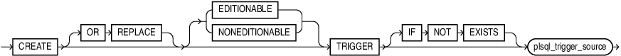

## CREATE TRIGGER

### Purpose

Triggers are defined using PL/SQL. Therefore, this section provides some general information but refers to [Oracle Database PL/SQL Language Reference](../lnpls/CREATE-TRIGGER-statement.md) for details of syntax and semantics.

Use the `CREATE` `TRIGGER` statement to create a database trigger, which is:

- A stored PL/SQL block associated with a table, a schema, or the database or

- An anonymous PL/SQL block or a call to a procedure implemented in PL/SQL or Java

Oracle Database automatically executes a trigger when specified conditions occur.

**See Also:**

[ALTER TRIGGER](ALTER-TRIGGER.md) and [DROP TRIGGER](DROP-TRIGGER.md)

### Prerequisites

To create a trigger in your own schema on a table in your own schema or on your own schema (`SCHEMA`), you must have the `CREATE` `TRIGGER` system privilege.

To create a trigger in any schema on a table in any schema, or on another user's schema (`schema`.`SCHEMA`), you must have the `CREATE` `ANY` `TRIGGER` system privilege.

In addition to the preceding privileges, to create a trigger on `DATABASE`, you must have the `ADMINISTER` `DATABASE` `TRIGGER` system privilege.

To create a trigger on a pluggable database (PDB), the current container must be that PDB and you must have the `ADMINISTER` `DATABASE` `TRIGGER` system privilege. For information about PDBs, see [Oracle Database Administrator's Guide](../multi/overview-of-managing-a-multitenant-environment.md).

In addition to the preceding privileges, to create a crossedition trigger, you must be enabled for editions. For information about enabling editions for a user, see [Oracle Database Development Guide](../adfns/editions.md).

If the trigger issues SQL statements or calls procedures or functions, then the owner of the trigger must have the privileges necessary to perform these operations. These privileges must be granted directly to the owner rather than acquired through roles.

### Syntax

Triggers are defined using PL/SQL. Therefore, the syntax diagram in this book shows only the SQL keywords. Refer to Oracle Database PL/SQL Language Reference for the PL/SQL syntax, semantics, and examples.

### create_trigger::=

[Description of the illustration create_trigger.eps](img_text/create_trigger.md)

(`plsql_trigger_source`: See [Oracle Database PL/SQL Language Reference](../lnpls/CREATE-TRIGGER-statement.md).)

### Semantics

### OR REPLACE

Specify `OR` `REPLACE` to re-create the trigger if it already exists. Use this clause to change the definition of an existing trigger without first dropping it.

### IF NOT EXISTS

Specifying `IF NOT EXISTS` has the following effects:

- If the trigger does not exist, a new one is created at the end of the statement.

- If the trigger exists, it is detected and a new one is not created.

You can only specify `OR REPLACE` or `IF NOT EXISTS` in a statement at a time. Using both `OR REPLACE` with `IF NOT EXISTS` in the very same statement results in an error.

You cannot specify `IF EXISTS` with `CREATE` statements.

### \[ EDITIONABLE \| NONEDITIONABLE \]

Use these clauses to specify whether the trigger is an editioned or noneditioned object if editioning is enabled for the schema object type `TRIGGER` in `schema`. The default is `EDITIONABLE`. For information about editioned and noneditioned objects, see [Oracle Database Development Guide](../adfns/editions.md).

Restriction on NONEDITIONABLE

You cannot specify `NONEDITIONABLE` for a crossedition trigger.

### plsql_trigger_source

See [Oracle Database PL/SQL Language Reference](../lnpls/CREATE-TRIGGER-statement.md) for the syntax and semantics of the `plsql_trigger_source`.
