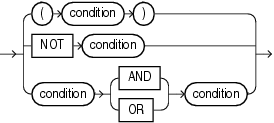

## Compound Conditions

A compound condition specifies a combination of other conditions.

### compound_condition::=

[Description of the illustration compound_condition.eps](img_text/compound_condition.md)

**See Also:**

[Logical Conditions](Logical-Conditions.md) for more information about `NOT`, `AND`, and `OR` conditions
