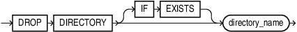

## DROP DIRECTORY

### Purpose

Use the `DROP` `DIRECTORY` statement to remove a directory object from the database.

**See Also:**

[CREATE DIRECTORY](CREATE-DIRECTORY.md) for information on creating a directory

### Prerequisites

To drop a directory, you must have the `DROP` `ANY` `DIRECTORY` system privilege.

**Note:**

Do not drop a directory when files in the associated file system are being accessed by PL/SQL or OCI programs.

### Syntax

### drop_directory::=

[Description of the illustration drop_directory.eps](img_text/drop_directory.md)

### Semantics

### IF EXISTS

Specify `IF EXISTS` to drop an existing directory.

### directory_name

Specify the name of the directory database object to be dropped.

Oracle Database removes the directory object but does not delete the associated operating system directory on the server file system.

### Examples

Dropping a Directory: Example

The following statement drops the directory object `bfile_dir`:

    DROP DIRECTORY bfile_dir;

**See Also:**

"[Creating a Directory: Examples](CREATE-DIRECTORY.md)"
