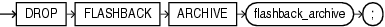

## DROP FLASHBACK ARCHIVE

### Purpose

Use the `DROP` `FLASHBACK` `ARCHIVE` clause to remove a flashback archive from the system. This statement removes the flashback archive and all the historical data in it, but does not drop the tablespaces that were used by the flashback archive.

### Prerequisites

You must have the `FLASHBACK` `ARCHIVE` `ADMINISTER` system privilege to drop a flashback archive.

### Syntax

### drop_flashback_archive::=

[Description of the illustration drop_flashback_archive.eps](img_text/drop_flashback_archive.md)

### Semantics

### flashback_archive

Specify the name of the flashback archive you want to drop.

**See Also:**

[CREATE FLASHBACK ARCHIVE](CREATE-FLASHBACK-ARCHIVE.md) for information on creating flashback archives and for some simple examples of using flashback archives
