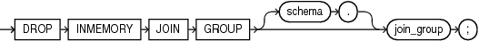

## DROP INMEMORY JOIN GROUP

### Purpose

Use the `DROP` `INMEMORY` `JOIN` `GROUP` statement to remove a join group from the database.

**See Also:**

- [CREATE INMEMORY JOIN GROUP](CREATE-INMEMORY-JOIN-GROUP.md) and [ALTER INMEMORY JOIN GROUP](ALTER-INMEMORY-JOIN-GROUP.md)

- [Oracle Database In-Memory Guide](../inmem/optimizing-queries-with-join-groups.md) for more information on join groups

### Prerequisites

If the join group is in another user’s schema, then you must have the `DROP` `ANY` `TABLE` system privilege.

### Syntax

### drop_inmemory_join_group::=

[Description of the illustration drop_inmemory_join_group.eps](img_text/drop_inmemory_join_group.md)

### Semantics

### schema

Specify the schema containing the join group. If you omit `schema`, then the database assumes the join group is in your own schema.

### join_group

Specify the name of the join group to be dropped.

You can view existing join groups by querying the `DBA_JOINGROUPS` or `USER_JOINGROUPS` data dictionary view. Refer to [Oracle Database Reference](../refrn/DBA_JOINGROUPS.md) for more information on these views.

### Examples

The following statement drops the join group `prod_id1`:

    DROP INMEMORY JOIN GROUP prod_id1;
