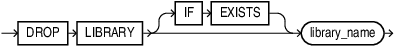

## DROP LIBRARY

### Purpose

Use the `DROP` `LIBRARY` statement to remove an external procedure library from the database.

**See Also:**

[CREATE LIBRARY](CREATE-LIBRARY.md) for information on creating a library

### Prerequisites

You must have the `DROP` `ANY` `LIBRARY` system privilege.

### Syntax

### drop_library::=

[Description of the illustration drop_library.eps](img_text/drop_library.md)

### Semantics

### IF EXISTS

Specify `IF EXISTS` to drop an existing library.

### library_name

Specify the name of the external procedure library being dropped.

### Examples

Dropping a Library: Example

The following statement drops the `ext_lib` library:

    DROP LIBRARY ext_lib;
