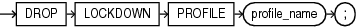

## DROP LOCKDOWN PROFILE

### Purpose

Use the `DROP` `LOCKDOWN` `PROFILE` statement to remove a PDB lockdown profile from the database. A PDB that was assigned the dropped profile will continue to be assigned the profile, but will not be subject to the restrictions imposed by the dropped profile.

If the `PDB_LOCKDOWN` initialization parameter for a CDB, an application root, or a PDB has the value of the dropped lockdown profile, then the restrictions imposed by the dropped profile will be disabled when you drop it. However, the value of the `PDB_LOCKDOWN` initialization parameter will remain until you explicitly unset it.

**See Also:**

- [CREATE LOCKDOWN PROFILE](CREATE-LOCKDOWN-PROFILE.md) and [ALTER LOCKDOWN PROFILE](ALTER-LOCKDOWN-PROFILE.md)

- [Oracle Database Security Guide](../dbseg/configuring-privilege-and-role-authorization.md) for more information on PDB lockdown profiles

### Prerequisites

- You must issue this statement from the CDB Root or the Application Root.

- You must have the `DROP` `LOCKDOWN` `PROFILE` system privilege in the container where you mean to issue the statement.

### Syntax

### drop_lockdown_profile::=

[Description of the illustration drop_lockdown_profile.eps](img_text/drop_lockdown_profile.md)

### Semantics

### profile_name

Specify the name of the PDB lockdown profile to be dropped.

You can find the names of existing PDB lockdown profiles by querying the `DBA_LOCKDOWN_PROFILES` data dictionary view.

**See Also:**

Oracle Database Reference for more information on the [`DBA_LOCKDOWN_PROFILES`](../refrn/DBA_LOCKDOWN_PROFILES.md) data dictionary view and the [`PDB_LOCKDOWN`](../refrn/PDB_LOCKDOWN.md) initialization parameter

### Example

The following statement drops PDB lockdown profile `hr_prof`:

    DROP LOCKDOWN PROFILE hr_prof;
