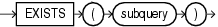

## EXISTS Condition

An `EXISTS` condition tests for existence of rows in a subquery.

[Description of the illustration exists_condition.eps](img_text/exists_condition.md)

Table 6-11 shows the `EXISTS` condition.

Table 6-11 EXISTS Condition

| Type of Condition | Operation                                      | Example                                                                                                                                                                                            |
|:------------------|:-----------------------------------------------|:---------------------------------------------------------------------------------------------------------------------------------------------------------------------------------------------------|
| `EXISTS `         | `TRUE` if a subquery returns at least one row. | `SELECT department_id` `  FROM departments d` `  WHERE EXISTS` `  (SELECT * FROM employees e` `    WHERE d.department_id ` `    = e.department_id)` `   ORDER BY department_id;` |
