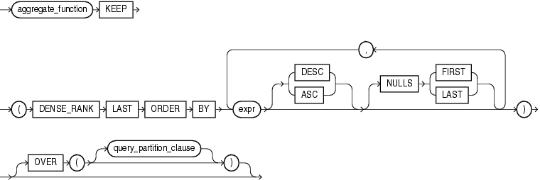

## LAST

### Syntax

### last::=

[Description of the illustration last.eps](img_text/last.md)

**See Also:**

"[Analytic Functions](Analytic-Functions.md)" for information on syntax, semantics, and restrictions of the `query_partitioning_clause`

### Purpose

`FIRST` and `LAST` are very similar functions. Both are aggregate and analytic functions that operate on a set of values from a set of rows that rank as the `FIRST` or `LAST` with respect to a given sorting specification. If only one row ranks as `FIRST` or `LAST`, then the aggregate operates on the set with only one element.

Refer to [FIRST](FIRST.md) for complete information on this function and for examples of its use.
