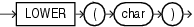

## LOWER

### Syntax

[Description of the illustration lower.eps](img_text/lower.md)

### Purpose

`LOWER` returns `char`, with all letters lowercase. `char` can be any of the data types `CHAR`, `VARCHAR2`, `NCHAR`, `NVARCHAR2`, `CLOB`, or `NCLOB`. The return value is the same data type as `char`. The database sets the case of the characters based on the binary mapping defined for the underlying character set. For linguistic-sensitive lowercase, refer to [NLS_LOWER](NLS_LOWER.md).

**See Also:**

Appendix C in [Oracle Database Globalization Support Guide](../nlspg/appendix-C-collation-derivation-and-determination-rules-for-SQL-operations.md) for the collation derivation rules, which define the collation assigned to the character return value of `LOWER`

### Examples

The following example returns a string in lowercase:

    SELECT LOWER('MR. SCOTT MCMILLAN') "Lowercase"
      FROM DUAL;

    Lowercase
    --------------------
    mr. scott mcmillan
