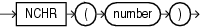

## NCHR

### Syntax

[Description of the illustration nchr.eps](img_text/nchr.md)

### Purpose

`NCHR` returns the character having the binary equivalent to `number` in the national character set. The value returned is always `NVARCHAR2`. This function is equivalent to using the `CHR` function with the `USING` `NCHAR_CS` clause.

This function takes as an argument a `NUMBER` value, or any value that can be implicitly converted to `NUMBER`, and returns a character.

**See Also:**

- [CHR](CHR.md)

- Appendix C in [Oracle Database Globalization Support Guide](../nlspg/appendix-C-collation-derivation-and-determination-rules-for-SQL-operations.md) for the collation derivation rules, which define the collation assigned to the character return value of `NCHR`

### Examples

The following examples return the nchar character 187:

    SELECT NCHR(187)
      FROM DUAL;

    N
    -
    >

    SELECT CHR(187 USING NCHAR_CS)
      FROM DUAL;

    C
    -
    >
