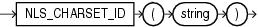

## NLS_CHARSET_ID

### Syntax

[Description of the illustration nls_charset_id.eps](img_text/nls_charset_id.md)

### Purpose

`NLS_CHARSET_ID` returns the character set ID number corresponding to character set name `string`. The `string` argument is a run-time `VARCHAR2` value. The `string` value '`CHAR_CS`' returns the database character set ID number of the server. The `string` value '`NCHAR_CS`' returns the national character set ID number of the server.

Invalid character set names return null.

**See Also:**

[Oracle Database Globalization Support Guide](../nlspg/appendix-A-locale-data.md) for a list of character sets

### Examples

The following example returns the character set ID of a character set:

    SELECT NLS_CHARSET_ID('ja16euc')
      FROM DUAL;

    NLS_CHARSET_ID('JA16EUC')
    -------------------------
                          830
