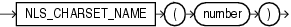

## NLS_CHARSET_NAME

### Syntax

[Description of the illustration nls_charset_name.eps](img_text/nls_charset_name.md)

### Purpose

`NLS_CHARSET_NAME` returns the name of the character set corresponding to ID number `number`. The character set name is returned as a `VARCHAR2` value in the database character set. If `number` is not recognized as a valid character set ID, then this function returns null.

This function returns a `VARCHAR2` value.

**See Also:**

Appendix C in [Oracle Database Globalization Support Guide](../nlspg/appendix-C-collation-derivation-and-determination-rules-for-SQL-operations.md) for the collation derivation rules, which define the collation assigned to the character return value of `NLS_CHARSET_NAME`

### Examples

The following example returns the character set corresponding to character set ID number 2:

    SELECT NLS_CHARSET_NAME(2)
      FROM DUAL;

    NLS_CH
    ------
    WE8DEC
