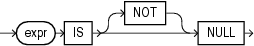

## Null Conditions

A `NULL` condition tests for nulls. This is the only condition that you should use to test for nulls.

### null_condition::=

[Description of the illustration null_condition.eps](img_text/null_condition.md)

Table 6-9 lists the null conditions.

Table 6-9 Null Condition

| Type of Condition | Operation                                       | Example                                                                                                        |
|:------------------|:------------------------------------------------|:---------------------------------------------------------------------------------------------------------------|
| `IS [NOT] NULL `  | Tests for nulls. See Also: [Nulls](Nulls.md) | `SELECT last_name` `  FROM employees` `  WHERE commission_pct` `  IS NULL` `  ORDER BY last_name;` |
