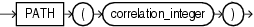

## PATH

### Syntax

[Description of the illustration path.eps](img_text/path.md)

### Purpose

`PATH` is an ancillary function used only with the `UNDER_PATH` and `EQUALS_PATH` conditions. It returns the relative path that leads to the resource specified in the parent condition.

The `correlation_integer` can be any `NUMBER` integer and is used to correlate this ancillary function with its primary condition. Values less than 1 are treated as 1.

**See Also:**

- [EQUALS_PATH Condition](XML-Conditions.md) and [UNDER_PATH Condition](XML-Conditions.md)

- Appendix C in [Oracle Database Globalization Support Guide](../nlspg/appendix-C-collation-derivation-and-determination-rules-for-SQL-operations.md) for the collation derivation rules, which define the collation assigned to the character return value of `PATH`

### Examples

Refer to the related function [DEPTH](DEPTH.md) for an example using both of these ancillary functions of the `EQUALS_PATH` and `UNDER_PATH` conditions.
