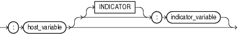

## Placeholder Expressions

A placeholder expression provides a location in a SQL statement for which a third-generation language bind variable will provide a value. You can specify the placeholder expression with an optional indicator variable. This form of expression can appear only in embedded SQL statements or SQL statements processed in an Oracle Call Interface (OCI) program.

### placeholder_expression::=

[Description of the illustration placeholder_expression.eps](img_text/placeholder_expression.md)

Some valid placeholder expressions are:

    :employee_name INDICATOR :employee_name_indicator_var
    :department_location

**See Also:**

Appendix C in [Oracle Database Globalization Support Guide](../nlspg/appendix-C-collation-derivation-and-determination-rules-for-SQL-operations.md) for the collation derivation rules for the placeholder expression with a character data type
