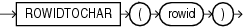

## ROWIDTOCHAR

### Syntax

[Description of the illustration rowidtochar.eps](img_text/rowidtochar.md)

### Purpose

`ROWIDTOCHAR` converts a rowid value to `VARCHAR2` data type. The result of this conversion is always 18 characters long.

**See Also:**

Appendix C in [Oracle Database Globalization Support Guide](../nlspg/appendix-C-collation-derivation-and-determination-rules-for-SQL-operations.md) for the collation derivation rules, which define the collation assigned to the character return value of `ROWIDTOCHAR`

### Examples

The following example converts a rowid value in the `employees` table to a character value. (Results vary for each build of the sample database.)

    SELECT ROWID FROM employees
       WHERE ROWIDTOCHAR(ROWID) LIKE '%JAAB%'
       ORDER BY ROWID;

    ROWID
    ------------------
    AAAFfIAAFAAAABSAAb
