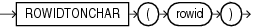

## ROWIDTONCHAR

### Syntax

[Description of the illustration rowidtonchar.eps](img_text/rowidtonchar.md)

### Purpose

`ROWIDTONCHAR` converts a rowid value to `NVARCHAR2` data type. The result of this conversion is always in the national character set and is 18 characters long.

**See Also:**

Appendix C in [Oracle Database Globalization Support Guide](../nlspg/appendix-C-collation-derivation-and-determination-rules-for-SQL-operations.md) for the collation derivation rules, which define the collation assigned to the character return value of `ROWIDTONCHAR`

### Examples

The following example converts a rowid value to an `NVARCHAR2` string:

    SELECT LENGTHB( ROWIDTONCHAR(ROWID) ) Length, ROWIDTONCHAR(ROWID)
       FROM employees
       ORDER BY length;

        LENGTH ROWIDTONCHAR(ROWID
    ---------- ------------------
            36 AAAL52AAFAAAABSABD
            36 AAAL52AAFAAAABSABV
    . . .
