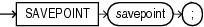

## SAVEPOINT

### Purpose

Use the `SAVEPOINT` statement to create a name for a system change number (SCN), to which you can later roll back.

**See Also:**

- [Oracle Database Concepts](../cncpt/introduction-to-oracle-database.md) for information on savepoints.

- [ROLLBACK](ROLLBACK.md) for information on rolling back transactions

- [SET TRANSACTION](SET-TRANSACTION.md) for information on setting characteristics of the current transaction

### Prerequisites

None.

### Syntax

### savepoint::=

[Description of the illustration savepoint.eps](img_text/savepoint.md)

### Semantics

### savepoint

Specify the name of the savepoint to be created.

Savepoint names must be distinct within a given transaction. If you create a second savepoint with the same identifier as an earlier savepoint, then the earlier savepoint is erased. After a savepoint has been created, you can either continue processing, commit your work, roll back the entire transaction, or roll back to the savepoint.

### Examples

Creating Savepoints: Example

To update the salary for `Banda` and `Greene` in the sample table `hr.employees`, check that the total department salary does not exceed 314,000, then reenter the salary for `Greene`:

    UPDATE employees
        SET salary = 7000
        WHERE last_name = 'Banda';
    SAVEPOINT banda_sal;

    UPDATE employees
        SET salary = 12000
        WHERE last_name = 'Greene';
    SAVEPOINT greene_sal;

    SELECT SUM(salary) FROM employees;

    ROLLBACK TO SAVEPOINT banda_sal;

    UPDATE employees
        SET salary = 11000
        WHERE last_name = 'Greene';

    COMMIT;
