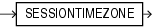

## SESSIONTIMEZONE

### Syntax

[Description of the illustration sessiontimezone.eps](img_text/sessiontimezone.md)

### Purpose

`SESSIONTIMEZONE` returns the time zone of the current session. The return type is a time zone offset (a character type in the format `'[+|-]TZH:TZM'`) or a time zone region name, depending on how the user specified the session time zone value in the most recent `ALTER` `SESSION` statement.

**Note:**

The default client session time zone is an offset even if the client operating system uses a named time zone. If you want the default session time zone to use a named time zone, then set the `ORA_SDTZ` variable in the client environment to an Oracle time zone region name. Refer to [Oracle Database Globalization Support Guide](../nlspg/setting-up-globalization-support-environment.md) for more information on this variable.

**See Also:**

Appendix C in [Oracle Database Globalization Support Guide](../nlspg/appendix-C-collation-derivation-and-determination-rules-for-SQL-operations.md) for the collation derivation rules, which define the collation assigned to the character return value of `SESSIONTIMEZONE`

### Examples

The following example returns the time zone of the current session:

    SELECT SESSIONTIMEZONE FROM DUAL;

    SESSION
    -------
    -08:00
