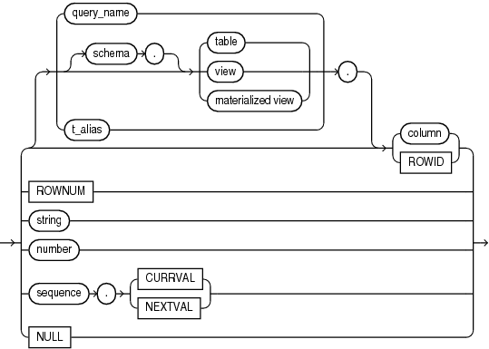

## Simple Expressions

A simple expression specifies a column, pseudocolumn, constant, sequence number, or null.

### simple_expression::=

[Description of the illustration simple_expression.eps](img_text/simple_expression.md)

In addition to the schema of a user, `schema` can also be "`PUBLIC`" (double quotation marks required), in which case it must qualify a public synonym for a table, view, or materialized view. Qualifying a public synonym with "`PUBLIC`" is supported only in data manipulation language (DML) statements, not data definition language (DDL) statements.

You can specify `ROWID` only with a table, not with a view or materialized view. `NCHAR` and `NVARCHAR2` are not valid pseudocolumn data types.

**See Also:**

[Pseudocolumns](Pseudocolumns.md) for more information on pseudocolumns and [subquery_factoring_clause](SELECT.md) for information on `query_name`

Some valid simple expressions are:

    employees.last_name
    'this is a text string'
    10
    N'this is an NCHAR string'
