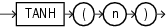

## TANH

### Syntax

[Description of the illustration tanh.eps](img_text/tanh.md)

### Purpose

`TANH` returns the hyperbolic tangent of `n`.

This function takes as an argument any numeric data type or any nonnumeric data type that can be implicitly converted to a numeric data type. If the argument is `BINARY_FLOAT`, then the function returns `BINARY_DOUBLE`. Otherwise the function returns the same numeric data type as the argument.

**See Also:**

[Table 2-8](Data-Type-Comparison-Rules.md) for more information on implicit conversion

### Examples

The following example returns the hyperbolic tangent of .5:

    SELECT TANH(.5) "Hyperbolic tangent of .5"
       FROM DUAL;

    Hyperbolic tangent of .5
    ------------------------
                  .462117157
