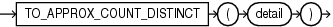

## TO_APPROX_COUNT_DISTINCT

### Syntax

[Description of the illustration to_approx_count_distinct.eps](img_text/to_approx_count_distinct.md)

### Purpose

`TO_APPROX_COUNT_DISTINCT` takes as its input a detail containing information about an approximate distinct value count, and converts it to a `NUMBER` value.

For `detail`, specify a detail of type `BLOB`, which was created by the `APPROX_COUNT_DISTINCT_DETAIL` function or the `APPROX_COUNT_DISTINCT_AGG` function.

**See Also:**

- [APPROX_COUNT_DISTINCT_DETAIL](APPROX_COUNT_DISTINCT_DETAIL.md)

- TO_APPROX_COUNT_DISTINCT

### Examples

Refer to [TO_APPROX_COUNT_DISTINCT: Examples](APPROX_COUNT_DISTINCT_DETAIL.md) for examples of using the `TO_APPROX_COUNT_DISTINCT` function in conjunction with the `APPROX_COUNT_DISTINCT_DETAIL` and `APPROX_COUNT_DISTINCT_AGG` functions.
