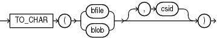

## TO_CHAR (bfile\|blob)

### Syntax

### to_char_bfile_blob::=

[Description of the illustration to_char_bfile_blob.eps](img_text/to_char_bfile_blob.md)

### Purpose

`TO_CHAR` (bfile\|blob) converts `BFILE` or `BLOB` data to the database character set. The value returned is always `VARCHAR2`. If the value returned is too large to fit into the `VARCHAR2` data type, then the data is truncated.

For `csid`, specify the character set ID of the `BFILE` or `BLOB` data. If the character set of the `BFILE` or `BLOB` data is the database character set, then you can specify a value of 0 for `csid`, or omit `csid` altogether.

**See Also:**

Appendix C in [Oracle Database Globalization Support Guide](../nlspg/appendix-C-collation-derivation-and-determination-rules-for-SQL-operations.md) for the collation derivation rules, which define the collation assigned to the character return value of this function

### Example

The following hypothetical example takes as its input a `BFILE` column `media_col` in table `media_tab`, which uses the character set with ID 873. The example returns a `VARCHAR2` value that uses the database character set.

    SELECT TO_CHAR(media_col, 873) FROM media_tab;
