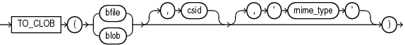

## TO_CLOB (bfile\|blob)

### Syntax

[Description of the illustration to_clob_bfile_blob.eps](img_text/to_clob_bfile_blob.md)

### Purpose

`TO_CLOB` (bfile\|blob) converts `BFILE` or `BLOB` data to the database character set and returns the data as a `CLOB` value.

For `csid`, specify the character set ID of the `BFILE` or `BLOB` data. If the character set of the `BFILE` or `BLOB` data is the database character set, then you can specify a value of 0 for `csid`, or omit `csid` altogether.

For `mime_type`, specify the MIME type to be set on the `CLOB` value returned by this function. If you omit `mime_type`, then a MIME type will not be set on the `CLOB` value.

**See Also:**

Appendix C in [Oracle Database Globalization Support Guide](../nlspg/appendix-C-collation-derivation-and-determination-rules-for-SQL-operations.md) for the collation derivation rules, which define the collation assigned to the character return value of this function

### Example

The following hypothetical example returns the `CLOB` of a `BFILE` column value `docu` in table `media_tab`, which uses the character set with ID 873. It sets the MIME type to `text/xml` for the resulting `CLOB`.

    SELECT TO_CLOB(docu, 873, 'text/xml') FROM media_tab;
