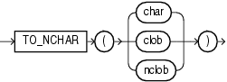

## TO_NCHAR (character)

### Syntax

### to_nchar_char::=

[Description of the illustration to_nchar_char.eps](img_text/to_nchar_char.md)

### Purpose

`TO_NCHAR` (character) converts a character string, `CHAR`, `VARCHAR2`, `CLOB`, or `NCLOB` value to the national character set. The value returned is always `NVARCHAR2`. This function is equivalent to the `TRANSLATE` ... `USING` function with a `USING` clause in the national character set.

**See Also:**

- "[Data Conversion](Data-Type-Comparison-Rules.md)" and [TRANSLATE ... USING](TRANSLATE-USING.md)

- Appendix C in [Oracle Database Globalization Support Guide](../nlspg/appendix-C-collation-derivation-and-determination-rules-for-SQL-operations.md) for the collation derivation rules, which define the collation assigned to the character return value of this function

### Examples

The following example converts `VARCHAR2` data from the `oe.customers` table to the national character set:

    SELECT TO_NCHAR(cust_last_name) FROM customers
       WHERE customer_id=103;

    TO_NCHAR(CUST_LAST_NAME)
    --------------------------------------------------
    Taylor
