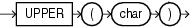

## UPPER

### Syntax

[Description of the illustration upper.eps](img_text/upper.md)

### Purpose

`UPPER` returns `char`, with all letters uppercase. `char` can be any of the data types `CHAR`, `VARCHAR2`, `NCHAR`, `NVARCHAR2`, `CLOB`, or `NCLOB`. The return value is the same data type as `char`. The database sets the case of the characters based on the binary mapping defined for the underlying character set. For linguistic-sensitive uppercase, refer to [NLS_UPPER](NLS_UPPER.md).

**See Also:**

Appendix C in [Oracle Database Globalization Support Guide](../nlspg/appendix-C-collation-derivation-and-determination-rules-for-SQL-operations.md) for the collation derivation rules, which define the collation assigned to the character return value of `UPPER`

### Examples

The following example returns each employee's last name in uppercase:

    SELECT UPPER(last_name) "Uppercase"
       FROM employees;
