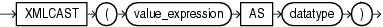

## XMLCAST

### Syntax

[Description of the illustration xmlcast.eps](img_text/xmlcast.md)

### Purpose

`XMLCast` casts `value_expression` to the scalar SQL data type specified by `datatype`. The `value_expression` argument is a SQL expression that is evaluated. The `datatype` argument can be of data type `NUMBER`, `VARCHAR2`, `CHAR`, `CLOB`, `BLOB`, `REF` `XMLTYPE`, and any of the datetime data types.

**See Also:**

- [Oracle XML DB Developer's Guide](../adxdb/query-and-update-XML.md) for more information on uses for this function and examples

- Appendix C in [Oracle Database Globalization Support Guide](../nlspg/appendix-C-collation-derivation-and-determination-rules-for-SQL-operations.md) for the collation derivation rules, which define the collation assigned to the return value of `XMLCAST` when it is a character value
