## Analytic View Expressions

You can use analytic view expressions to create calculated measures within the definition of an analytic view or in a query that selects from an analytic view.

Analytic view expressions differ from other types of expressions in that they reference elements of hierarchies and analytic views rather than tables and columns.

An analytic view expression is one of the following:

- An `av_meas_expression`, which is based on a measure in an analytic view

- An `av_hier_expression`, which returns an attribute value of the related member

You use an analytic view expression as the `calc_meas_expression` parameter in a `calc_measure_clause` in a `CREATE` `ANALYTIC` `VIEW` statement and in the `WITH` or `FROM` clauses of a `SELECT` statement.

In defining a calculated measure, you may also use the following types of expression:

- Simple

- Case

- Compound

- Datetime

- Interval

**Tip:**

You can view and run SQL scripts that create analytic views with calculated measures at the Oracle Live SQL website at <https://livesql.oracle.com/apex/livesql/file/index.html>. The website has scripts and tutorials that demonstrate the creation and use of analytic views.

### Syntax

### av_expression::=

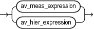
[Description of the illustration av_expression.eps](img_text/av_expression.md)

### av_meas_expression::=

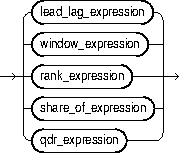
[Description of the illustration av_meas_expression.eps](img_text/av_meas_expression.md)

### lead_lag_expression::=

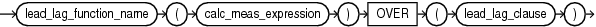
[Description of the illustration lead_lag_expression.eps](img_text/lead_lag_expression.md)

### lead_lag_function_name::=

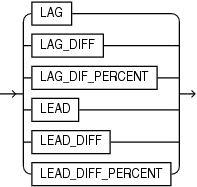
[Description of the illustration lead_lag_function_name.eps](img_text/lead_lag_function_name.md)

### lead_lag_clause::=

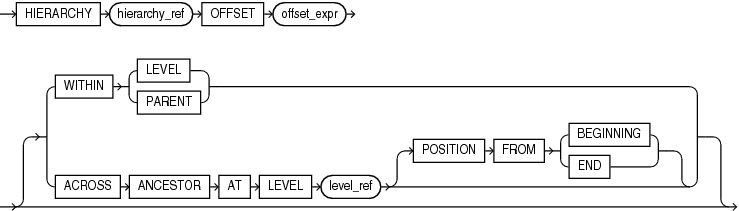
[Description of the illustration lead_lag_clause.eps](img_text/lead_lag_clause.md)

### hierarchy_ref::=

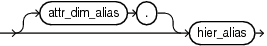
[Description of the illustration hierarchy_ref.eps](img_text/hierarchy_ref.md)

### window_expression::=

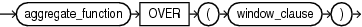
[Description of the illustration window_expression.eps](img_text/window_expression.md)

### window_clause::=

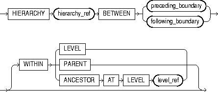
[Description of the illustration window_clause.eps](img_text/window_clause.md)

### preceding_boundary ::=

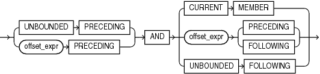
[Description of the illustration preceding_boundary.eps](img_text/preceding_boundary.md)

### following_boundary::=

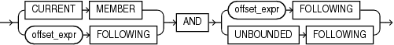
[Description of the illustration following_boundary.eps](img_text/following_boundary.md)

### rank_expression::=

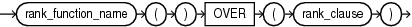
[Description of the illustration rank_expression.eps](img_text/rank_expression.md)

### rank_function_name::=

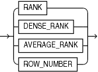
[Description of the illustration rank_function_name.eps](img_text/rank_function_name.md)

### rank_clause::=

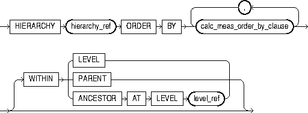
[Description of the illustration rank_clause.eps](img_text/rank_clause.md)

### calc_meas_order_by_clause::=

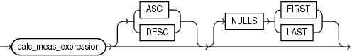
[Description of the illustration calc_meas_order_by_clause.eps](img_text/calc_meas_order_by_clause.md)

### share_of_expression::=

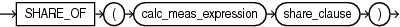
[Description of the illustration share_of_expression.eps](img_text/share_of_expression.md)

### share_clause::=

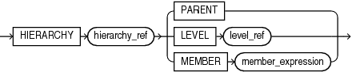
[Description of the illustration share_clause.eps](img_text/share_clause.md)

### member_expression::=

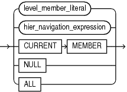
[Description of the illustration member_expression.eps](img_text/member_expression.md)

### level_member_literal::=

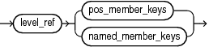
[Description of the illustration level_member_literal.eps](img_text/level_member_literal.md)

### pos_member_keys::=

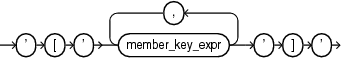
[Description of the illustration pos_member_keys.eps](img_text/pos_member_keys.md)

### named_member_keys::=

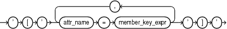
[Description of the illustration named_member_keys.eps](img_text/named_member_keys.md)

### hier_navigation_expression::=

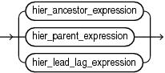
[Description of the illustration hier_navigation_expression.eps](img_text/hier_navigation_expression.md)

### hier_ancestor_expression::=

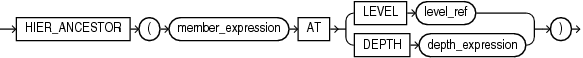
[Description of the illustration hier_ancestor_expression.eps](img_text/hier_ancestor_expression.md)

### hier_parent_expression::=

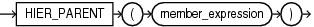
[Description of the illustration hier_parent_expression.eps](img_text/hier_parent_expression.md)

### hier_lead_lag_expression::=

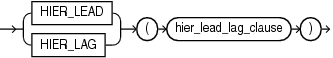
[Description of the illustration hier_lead_lag_expression.eps](img_text/hier_lead_lag_expression.md)

### hier_lead_lag_clause::=

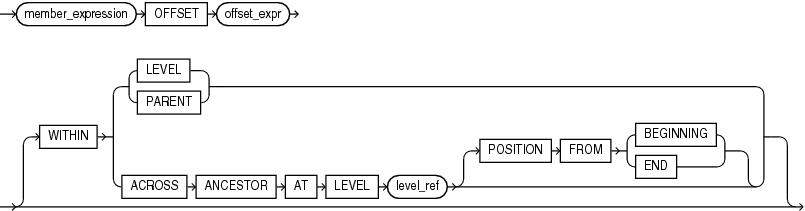
[Description of the illustration hier_lead_lag_clause.eps](img_text/hier_lead_lag_clause.md)

### qdr_expression::=

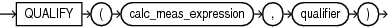
[Description of the illustration qdr_expression.eps](img_text/qdr_expression.md)

### qualifier::=

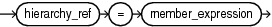
[Description of the illustration qualifier.eps](img_text/qualifier.md)

### av_hier_expression::=

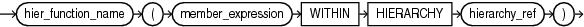
[Description of the illustration av_hier_expression.eps](img_text/av_hier_expression.md)

### hier_function_name::=

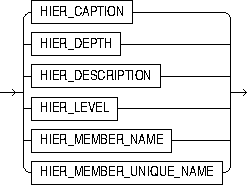
[Description of the illustration hier_function_name.eps](img_text/hier_function_name.md)

### Semantics

### av_meas_expression

An expression that performs hierarchical navigation to locate related measure values.

### lead_lag_expression

An expression that specifies a lead or lag operation that locates a related measure value by navigating forward or backward by some number of members within a hierarchy.

The `calc_meas_expression` parameter is evaluated in the new context created by the `lead_lag_expression`. This context has the same members as the outer context, except that the member of the specified hierarchy is changed to the related member specified by the lead or lag operation. The lead or lag function is run over the hierarchy members specified by the `lead_lag_clause` parameter.

### lead_lag_function_name

The lead or lag function may be one of the following:

- `LAG` returns the measure value of an earlier member.

- `LAG_DIFF` returns the difference between the measure value of the current member and the measure value of an earlier member.

- `LAG_DIFF_PERCENT` returns the percent difference between the measure value of the current member and the measure value of an earlier member.

- `LEAD` returns the measure value of a later member.

- `LEAD_DIFF` returns the difference between the measure value of the current member and the measure value of a later member.

- `LEAD_DIFF_PERCENT` returns the percent difference between the measure value of the current member and the measure value of a later member.

### lead_lag_clause

Specifies the hierarchy to evaluate and an offset value. The parameters of the `lead_lag_clause` are the following:

- `HIERARCHY` `hierarchy_ref` specifies the alias of a hierarchy as defined in the analytic view.

- `OFFSET` `offset_expr` specifies a `calc_meas_expression` that resolves to a number. The number specifies how many members to move either forward or backward from the current member. The ordering of members within a level is determined by the definition of the attribute dimension used by the hierarchy.

- `WITHIN` `LEVEL` specifies locating the related member by moving forward or backward by the offset number of members within the members that have the same level depth as the current member. The ordering of members within the level is determined by the definition of the attribute dimension used by the hierarchy.

  The `WITHIN` `LEVEL` operation is the default if neither the `WITHIN` `LEVEL` nor the `ACROSS` `ANCESTOR` `AT` `LEVEL` keywords are specified.

- `WITHIN` `PARENT` specifies locating the related member by moving forward or backward by the offset number of members within the members that have the same parent as the current member.

- `ACROSS` `ANCESTOR` `AT` `LEVEL` `level_ref` specifies locating the related member by navigating up to the ancestor (or to the member itself if no ancestor exists) of the current member at the level specified by `level_ref`, and noting the position of each ancestor member (including the member itself) within its parent. The `level_ref` parameter is the name of a level in the specified hierarchy.

  Once the ancestor member is found, navigation moves either forward or backward the offset number of members within the members that have the same depth as the ancestor member. After locating the related ancestor, navigation proceeds back down the hierarchy from this member, matching the position within the parent as recorded on the way up (in reverse order). The position within the parent is either an offset from the first child or the last child depending on whether `POSITION` `FROM` `BEGINNING` or `POSITION` `FROM` `END` is specified. The default value is `POSITION` `FROM` `BEGINNING`. The ordering of members within the level is determined by the definition of the attribute dimension used by the hierarchy.

### window_expression

A `window_expression` selects the set of members that are in the specified range starting from the current member and that are at the same depth as the current member. You can further restrict the selection of members by specifying a hierarchical relationship using a WITHIN phrase. Aggregation is then performed over the selected measure values to produce a single result for the expression.

The parameters for a `window_expression` are the following:

- `aggregate_function` is any existing SQL aggregate function except `COLLECT`, `GROUP_ID`, `GROUPING`, `GROUPING_ID`, `SYS_XMLAGG`, `XMLAGG`, and any multi-argument function. A user defined aggregate function is also allowed. The arguments to the aggregate function are `calc_meas_expression` expressions. These expressions are evaluated using the outer context, with the member of the specified hierarchy changed to each member in the related range. Therefore, each expression argument is evaluated once per related member. The results are then aggregated using the `aggregate_function`.

- `OVER` `(``window_clause``)` specifies the hierarchy to use and the boundaries of the window to consider.

**See Also:**

[Aggregate Functions](Aggregate-Functions.md)

### window_clause

The `window_clause` parameter selects a range of members related to the current member. The range is between the members specified by the `preceding_boundary` or `following_boundary` parameters. The range is always computed over members at the same level as the current member.

The parameters for a `window_clause` are the following:

- `HIERARCHY` `hierarchy_ref` specifies the alias of the hierarchy as defined in the analytic view.

- `BETWEEN` `preceding_boundary` or `following_boundary` defines the set of members to relate to the current member.

- `WITHIN` `LEVEL` selects the related members by applying the boundary clause to all members of the current level. This is the default when the `WITHIN` keyword is not specified.

- `WITHIN` `PARENT` selects the related members by applying the boundary clause to all members that share a parent with the current member.

- `WITHIN` `ANCESTOR` `AT` `LEVEL` selects the related members by applying the boundary clause to all members at the current depth that share an ancestor (or is the member itself) at the specified level with the current member. The value of the window expression is `NULL` if the current member is above the specified level. If the level is not in the specified hierarchy, then an error occurs.

### preceding_boundary

The `preceding_boundary` parameter defines a range of members from the specified number of members backward in the level from the current member and forward to the specified end of the boundary. The following parameters specify the range:

- `UNBOUNDED` `PRECEDING` begins the range at the first member in the level.

- `offset_expr` `PRECEDING` begins the range at the `offset_expr` number of members backward from the current member. The `offset_expr` expression is a `calc_meas_expression` that resolves to a number. If the offset number is greater than the number of members from the current member to the first member in the level, than the first member is used as the start of the range.

- `CURRENT` `MEMBER` ends the range at the current member.

- `offset_expr` `PRECEDING` ends the range at the member that is `offset_expr` backward from the current member.

- `offset_expr` `FOLLOWING` ends the range at the member that is `offset_expr` forward from the current member.

- `UNBOUNDED` `FOLLOWING` ends the range at the last member in the level.

### following_boundary

The `following_boundary` parameter defines a range of members from the specified number of members from the current member forward to the specified end of the range. The following parameters specify the range:

- `CURRENT` `MEMBER` begins the range at the current member.

- `offset_expr` `FOLLOWING` begins the range at the member that is `offset_expr` forward from the current member.

- `offset_expr` `FOLLOWING` ends the range at the member that is `offset_expr` forward from the current member.

- `UNBOUNDED` `FOLLOWING` ends the range at the last member in the level.

### hierarchy_ref

A reference to a hierarchy of an analytic view. The `hier_alias` parameter specifies the alias of a hierarchy in the definition of the analytic view. You may use double quotes to escape special characters or preserve case, or both.

The optional `attr_dim_alias` parameter specifies the alias of an attribute dimension in the definition of the analytic view. You may use the `attr_dim_alias` parameter to resolve the ambiguity if the specified hierarchy alias conflicts with another hierarchy alias in the analytic view or if an attribute dimension is used more than once in the analytic view definition. You may use the `attr_dim_alias` parameter even when a name conflict does not exist.

### rank_expression

Hierarchical rank calculations rank the related members of the specified hierarchy based on the order of the specified measure values and return the rank of the current member within those results.

Hierarchical rank calculations locate a set of related members in the specified hierarchy, rank all the related members based on the order of the specified measure values, and then return the rank of the current member within those results. The related members are a set of members at the same level as the current member. You may optionally restrict the set by some hierarchical relationship, but the set always includes the current member. The ordering of the measure values is determined by the `calc_meas_order_by_clause` of the `rank_clause`.

### rank_function_name

Each hierarchical ranking function assigns an order number to each related member based on the `calc_meas_order_by_clause`, starting at 1. The functions differ in the way they treat measure values that are the same.

The functions and the differences between them are the following:

- `RANK`, which assigns the same rank to identical measure values. The rank after a set of tied values is the number of tied values plus the tied order value; therefore, the ordering may not be consecutive numbers.

- `DENSE_RANK`, which assigns the same minimum rank to identical measure values. The rank after a set of tied values is always one more than the tied value; therefore, the ordering always has consecutive numbers.

- `AVERAGE_RANK`, assigns the same average rank to identical values. The next value after the average rank value is the number of identical values plus 1, that sum divided by 2, plus the average rank value. For example, for the series of five values 4, 5, 10, 5, 7, `AVERAGE_RANK` returns 1, 1.5, 1.5, 3, 4. For the series 2, 12, 10, 12, 17, 12, the returned ranks are 1, 2, 3, 3, 3, 5.

- `ROW_NUMBER`, which assigns values that are unique and consecutive across the hierarchy members. If the `calc_meas_order_by_clause` results in equal values then the results are non-deterministic.

### rank_clause

The `rank_clause` locates a range of hierarchy members related to the current member. The range is some subset of the members in the same level as the current member. The subset is determined from the `WITHIN` clause.

Valid values for the `WITHIN` clause are:

- `WITHIN LEVEL`, which specifies that the related members are all the members of the current level. This is the default subset if the `WITHIN` keyword is not specified.

- `WITHIN PARENT`, which specifies that the related members all share a parent with the current member

- `WITHIN ANCESTOR AT LEVEL`, which specifies that the related members are all of the members of the current level that share an ancestor (or self) at the specified level with the current member.

### share_of_expression

A `share_of_expression` expression calculates the ratio of an expression's value for the current context over the expression's value at a related context. The expression is a `calc_meas_expression` that is evaluated at the current context and the related context. The `share_clause` specification determines the related context to use.

### share_clause

A `share_clause` modifies the outer context by setting the member for the specified hierarchy to a related member.

The parameters of the share clause are the following:

- `HIERARCHY` `hierarchy_ref` specifies the name of the hierarchy that is the outer context for the `share_of_expression` calculations.

- `PARENT` specifies that the related member is the parent of the current member.

- `LEVEL` `level_ref` specifies that the related member is the ancestor (or is the member itself) of the current member at the specified level in the hierarchy. If the current member is above the specified level, then `NULL` is returned for the share expression. If the level is not in the hierarchy, then an error occurs.

- `MEMBER` `member_expression` specifies that the related member is the member returned after evaluating the `member_expression` in the current context. If the value of the specified member is `NULL`, then `NULL` is returned for the share expression.

### member_expression

A `member_expression` evaluates to a member of the specified hierarchy. The hierarchy can always be determined from the outer expression (enforced by the syntax). A `member_expression` can be one of the following:

- `level_member_literal` is an expression that evaluates to a hierarchy member.

- `hier_navigation_expr` is an expression that relates one member of the hierarchy to another member.

- `CURRENT` `MEMBER` specifies the member of the hierarchy as determined by the outer context.

- `NULL` is a way to specify a non-existent member.

- `ALL` specifies the single topmost member of every hierarchy.

### level_member_literal

A `level_member_literal` is an expression that resolves to a single member of the hierarchy. The expression contains the name of the level and one or more member keys. The member key or keys may be identified by position or by name. If the specified level is not in the context hierarchy, then an error occurs.

### pos_member_keys

The `member_key_expr` expression resolves to the key value for the member. When specified by position, all components of the key must be given in the order found in the `ALL_HIER_LEVEL_ID_ATTRS` dictionary view. For a hierarchy in which the specified level is not determined by the child level, then all member key values of all such child levels must be provided preceding the current level's member key or keys. Duplicate key components are only specified the first time they appear.

The primary key is used when `level_member_literal` is specified using the `pos_member_keys` phrase. You can reference an alternate key by using the `named_member_keys` phrase.

### named_member_keys

The `member_key_expr` expression resolves to the key value for the member. The `attr_name` parameter is an identifier for the name of the attribute. If all of the attribute names do not make up a key or alternate key of the specified level, then an error occurs.

When specified by name, all components of the key must be given and all must use the attribute name = value form, in any order. For a hierarchy in which the specified level is not determined by the child level, then all member key values of all such child levels must be provided, also using the named form. Duplicate key components are only specified once.

### hier_navigation_expression

A `hier_navigation_expression` expression navigates from the specified member to a different member in the hierarchy.

### hier_ancestor_expression

Navigates from the specified member to the ancestor member (or to the member itself) at the specified level or depth. The depth is specified as an expression that must resolve to a number. If the member is at a level or depth above the specified member or the member is `NULL`, then `NULL` is returned for the expression value. If the specified level is not in the context hierarchy, then an error occurs.

### hier_parent_expression

Navigates from the specified member to the parent member.

### hier_lead_lag_expression

Navigates from the specified member to a related member by moving forward or backward some number of members within the context hierarchy. The `HIER_LEAD` keyword returns a later member. The `HIER_LAG` keyword returns an earlier member.

### hier_lead_lag_clause

Navigates the `offset_expr` number of members forward or backward from the specified member. The ordering of members within a level is specified in the definition of the attribute dimension.

The optional parameters of `hier_lead_lag_clause` are the following:

- `WITHIN` `LEVEL` locates the related member by moving forward or backward `offset_expr` members within the members that have the same depth as the current member. The ordering of members within the level is determined by the definition of the attribute dimension. The `WITHIN` `LEVEL` operation is the default if neither the `WITHIN` nor the `ACROSS` keywords are used.

- `WITHIN` `PARENT` locates the related member by moving forward or backward `offset_expr` members within the members that have the same depth as the current member, but only considers members that share a parent with the current member. The ordering of members within the level is determined by the definition of the attribute dimension.

- `WITHIN` `ACROSS` `ANCESTOR` `AT` `LEVEL` locates the related member by navigating up to the ancestor of the current member (or to the member itself) at the specified level, noting the position of each ancestor member (including the member itself) within its parent. Once the ancestor member is found, navigation moves forward or backward `offset_expr` members within the members that have the same depth as the ancestor member.

  After locating the related ancestor, navigation moves back down the hierarchy from that member, matching the position within the parent as recorded on the way up (in reverse order). The position within the parent is either an offset from the first child or the last child depending on whether `POSITION` `FROM` `BEGINNING` or `POSITION` `FROM` `END` is specified, defaulting to `POSITION` `FROM` `BEGINNING`. The ordering of members within the level is determined by the definition of the attribute dimension.

### qdr_expression

A `qdr_expression` is a qualified data reference that evaluates the specified `calc_meas_expression` in a new context and sets the hierarchy member to the new value.

### qualifier

A qualifier modifies the outer context by setting the member for the specified hierarchy to the member resulting from evaluating `member_expression`. If `member_expression` is `NULL`, then the result of the `qdr_expression` selection is `NULL`.

### av_hier_expression

An `av_hier_expression` performs hierarchy navigation to locate an attribute value of the related member. An `av_hier_expression` may be a top-level expression, whereas a `hier_navigation_expression` may only be used as a `member_expression` argument.

For example, in the following query `HIER_MEMBER__NAME` is an `av_hier_expression` and `HIER_PARENT` is a `hier_navigation_expression`.

    HIER_MEMBER_NAME(HIER_PARENT(CURRENT MEMBER) WITHIN HIERARCHY product_hier))

### hier_function_name

The `hier_function_name` values are the following:

- `HIER_CAPTION`, which returns the caption of the related member in the hierarchy.

- `HIER_DEPTH`, which returns one less than the number of ancestors between the related member and the ALL member in the hierarchy. The depth of the ALL member is 0.

- `HIER_DESCRIPTION`, which returns the description of the related member in the hierarchy.

- `HIER_LEVEL`, which returns as a string value the name of the level to which the related member belongs in the hierarchy.

- `HIER_MEMBER_NAME`, which returns the member name of the related member in the hierarchy.

- `HIER_MEMBER_UNIQUE_NAME`, which returns the member unique name of the related member in the hierarchy.

### Examples of Analytic View Expressions

This topic contains examples that show calculated measures defined in the `MEASURES` clause of an analytic view and in the `ADD` `MEASURES` clause of a `SELECT` statement.

The examples are the following:

- Examples of LAG Expressions

- Example of a Window Expression

- Examples of SHARE OF Expressions

- Examples of QDR Expressions

- Example of an Added Measure Using the RANK Function

For more examples, see the tutorials on analytic views at the SQL Live website at <https://livesql.oracle.com/apex/livesql/file/index.html>.

#### Examples of LAG Expressions

These calculated measures different `LAG` operations.

    -- These calculated measures are from the measures_clause of the
    -- sales_av analytic view.
    MEASURES
     (sales FACT sales,                      -- A base measure
      units FACT units,                      -- A base measure
      sales_prior_period AS                  -- Calculated measures
        (LAG(sales) OVER (HIERARCHY time_hier OFFSET 1)),
      sales_year_ago AS
        (LAG(sales) OVER (HIERARCHY time_hier OFFSET 1
         ACROSS ANCESTOR AT LEVEL year)),
      chg_sales_year_ago AS
        (LAG_DIFF(sales) OVER (HIERARCHY time_hier OFFSET 1
         ACROSS ANCESTOR AT LEVEL year)),
      pct_chg_sales_year_ago AS
        (LAG_DIFF_PERCENT(sales) OVER (HIERARCHY time_hier OFFSET 1
         ACROSS ANCESTOR AT LEVEL year)),
      sales_qtr_ago AS
        (LAG(sales) OVER (HIERARCHY time_hier OFFSET 1
         ACROSS ANCESTOR AT LEVEL quarter)),
      chg_sales_qtr_ago AS
        (LAG_DIFF(sales) OVER (HIERARCHY time_hier OFFSET 1
         ACROSS ANCESTOR AT LEVEL quarter)),
      pct_chg_sales_qtr_ago AS
        (LAG_DIFF_PERCENT(sales) OVER (HIERARCHY time_hier OFFSET 1
         ACROSS ANCESTOR AT LEVEL quarter))
     )

#### Example of a Window Expression

This calculated measure uses a window operation.

    MEASURES
     (sales FACT sales,
      units FACT units,
      sales_qtd AS
        (SUM(sales) OVER (HIERARCHY time_hier
         BETWEEN UNBOUNDED PRECEDING AND CURRENT MEMBER
         WITHIN ANCESTOR AT LEVEL QUARTER)),
      sales_ytd AS
        (SUM(sales) OVER (HIERARCHY time_hier
         BETWEEN UNBOUNDED PRECEDING AND CURRENT MEMBER
         WITHIN ANCESTOR AT LEVEL YEAR))
     )

#### Examples of SHARE OF Expressions

These calculated measures use `SHARE` `OF` expressions.

    MEASURES
     (sales FACT sales,
      units FACT units,
     sales_shr_parent_prod AS
       (SHARE_OF(sales HIERARCHY product_hier PARENT)),
     sales_shr_parent_geog AS
       (SHARE_OF(sales HIERARCHY geography_hier PARENT)),
     sales_shr_region AS
       (SHARE_OF(sales HIERARCHY geography_hier LEVEL REGION))
     )

#### Examples of QDR Expressions

These calculated measures use the `QUALIFY` keyword to specify qualified data reference expressions.

    MEASURES
     (sales FACT sales,
      units FACT units,
      sales_2011 AS
        (QUALIFY (sales, time_hier = year['11'])),
      sales_pct_chg_2011 AS
        ((sales - (QUALIFY (sales, time_hier = year['11']))) /
        (QUALIFY (sales, time_hier = year['11'])))
     )

#### Example of an Added Measure Using the RANK Function

In this example, the units_geog_rank_level measure uses the `RANK` function to rank geography hierarchy members within a level based on units.

    SELECT geography_hier.member_name AS "Region",
           units AS "Units",
           units_geog_rank_level AS "Rank"
      FROM ANALYTIC VIEW (
        USING sales_av HIERARCHIES (geography_hier)
        ADD MEASURES (
          units_geog_rank_level AS (
            RANK() OVER (
              HIERARCHY geography_hier
              ORDER BY units desc nulls last
              WITHIN LEVEL))
        )
      )
      WHERE geography_hier.level_name IN ('REGION')
      ORDER BY units_geog_rank_level;

The following is the result of the query.

    Regions            Units  Rank
    -------------  ---------  ----
    Asia            56017849     1
    South America   23904155     2
    North America   20523698     3
    Africa          12608308     4
    Europe           8666520     5
    Oceania           427664     6
