## JSON_TRANSFORM

### Syntax

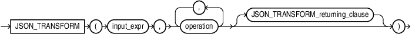
[Description of the illustration json_transform.eps](img_text/json_transform.md)

### JSON_TRANSFORM_returning_clause::=

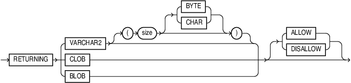
[Description of the illustration json_transform_returning_clause.eps](img_text/json_transform_returning_clause.md)

### JSON_passing_clause::=

For details on `JSON_passing_clause` see [JSON_EXISTS Condition](SQL-JSON-Conditions.md).

### operation ::=

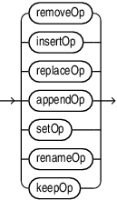
[Description of the illustration operation.eps](img_text/operation.md)

### removeOp ::=

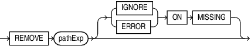
[Description of the illustration remove_op.eps](img_text/remove_op.md)

### insertOp ::=

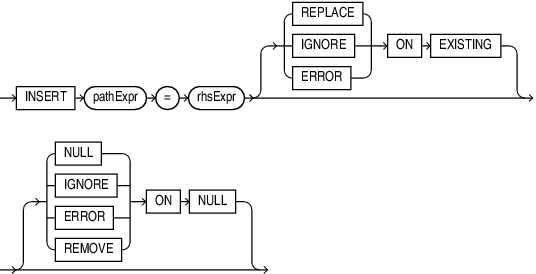
[Description of the illustration insert_op.eps](img_text/insert_op.md)

### replaceOp ::=

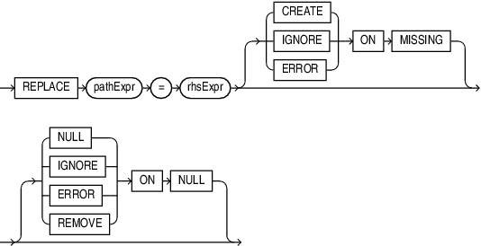
[Description of the illustration replace_op.eps](img_text/replace_op.md)

### rhsExpr ::=

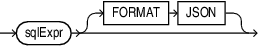
[Description of the illustration rhs_expr.eps](img_text/rhs_expr.md)

### appendOp ::=

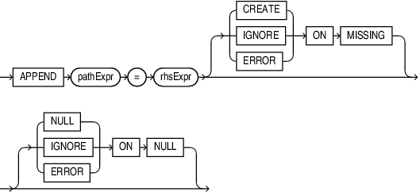
[Description of the illustration append_op.eps](img_text/append_op.md)

### setOp ::=

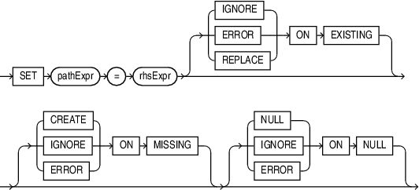
[Description of the illustration set_op.eps](img_text/set_op.md)

### renameOp ::=

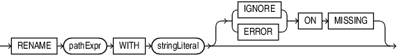
[Description of the illustration rename_op.eps](img_text/rename_op.md)

### keepOp ::=

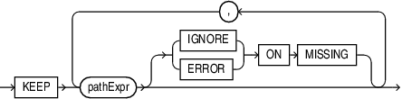
[Description of the illustration keep_op.eps](img_text/keep_op.md)

### Purpose

Use `JSON_TRANSFORM ` to modify JSON documents input to the function. You can change the JSON document (or pieces of the JSON document), by specifying one or more modifying operations that perform changes to the JSON data. The modified JSON document is returned as output.

You can input any SQL data type that supports JSON data. For example, the input can be a `VARCHAR2` column with or without an `IS JSON` check constraint, or a function call returning JSON data.

### Examples

Example 1 : Update a JSON Column with a Timestamp

    UPDATE t SET jcol = JSON_TRANSFORM(jcol, SET '$.lastUpdated' = SYSTIMESTAMP)

Example 2 : Remove a Social Security Number before Shipping JSON to a Client

    SELECT JSON_TRANSFORM (jcol, REMOVE '$.ssn') FROM t WHERE …

### JSON_TRANSFORM_returning_clause

The default output data type matches the data type of the input.

For input data type `VARCHAR2` of any size, the default output data type is `VARCHAR2(4000)`.

For a fuller discussion of `JSON_TRANSFORM ` with examples, see [Oracle SQL Function JSON_TRANSFORM](../adjsn/oracle-sql-function-json_transform.md).
