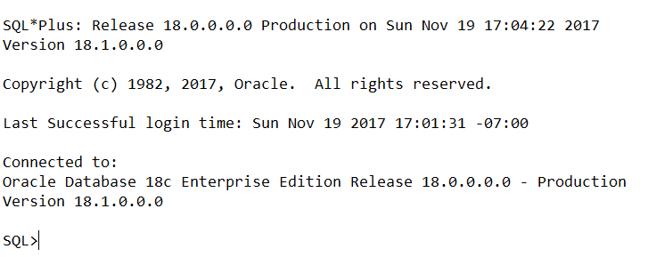

## 1 SQL\*Plus User Interface

This chapter describes the SQL\*Plus command-line user interface. It contains the following topics:

- About The Command-line Screen

- Changing the Command-line Font and Font Size

### 1.1 About The Command-line Screen

The following image shows the SQL\*Plus command-line interface.

The SQL\*Plus command-line interface is standard on all operating systems.

[Description of the illustration cmdline_18_1-png.png](img_text/cmdline_18_1-png.md)

When SQL\*Plus starts, it displays the date and time, the SQL\*Plus version and copyright information before the SQL\*Plus prompt appears. The default prompt for SQL\*Plus command-line is:

    SQL>

### 1.2 Changing the Command-line Font and Font Size

In Windows, from a Command Prompt, open the Command Prompt Properties dialog to set the font and font size used in the SQL\*Plus command-line interface.

#### To Change the Command-line Interface Font and Font Size

1.  Right click in the command-line interface title bar.
2.  Click Properties. The Window Preview box displays the current window's relative size on your monitor based on your font and font size selections. The Selected Font: box displays a sample of the current font.
3.  Click the Font tab.
4.  Select the font size to use from the Size box. Raster font sizes are shown as width by height in pixels. TrueType font sizes are shown as height in pixels.
5.  Select the font to use from the Font box.
6.  Select the Bold Fonts check box to use a bold version of the font.

For more information about changing Command Prompt properties, see Windows Help or click Help in the Command Prompt Properties dialog.
