## A  SQL\*Loader Syntax Diagrams

This appendix describes SQL\*Loader syntax in graphic form (sometimes called railroad diagrams or DDL diagrams).

### How to Read Graphic Syntax Diagrams

Syntax diagrams are drawings that illustrate valid SQL syntax. To read a diagram, trace it from left to right, in the direction shown by the arrows.

For more information about standard SQL syntax notation, see:

[How to Read Syntax Diagrams in Oracle Database SQL Language Reference](../sqlrf/How-to-Read-Syntax-Diagrams.md)

The following diagrams are shown with certain clauses collapsed (such as `pos_spec`). These diagrams are expanded and explained further along in the appendix.

### Options Clause

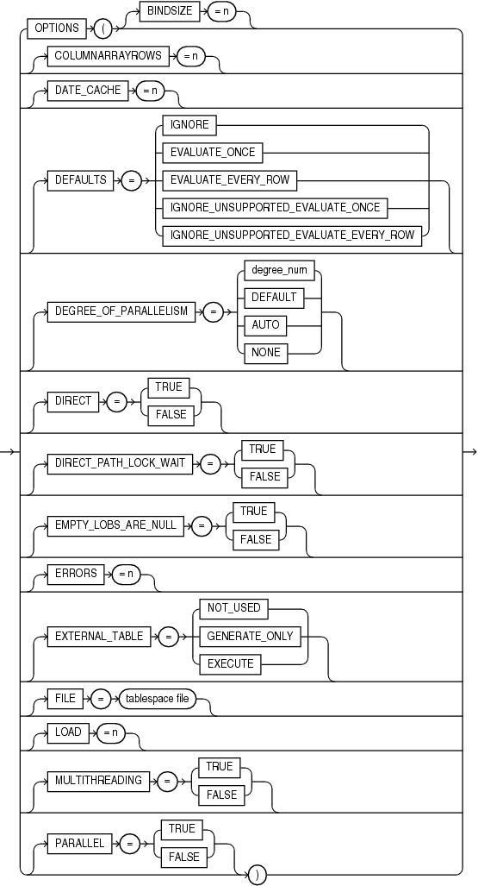
[Description of the illustration options.eps](img_text/options.md)

### Options_Cont

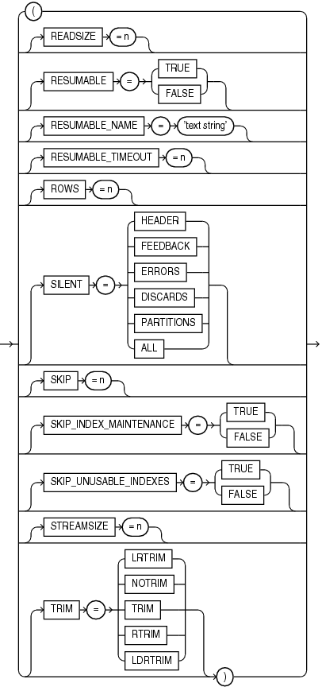
[Description of the illustration options2.eps](img_text/options2.md)

### Load Statement

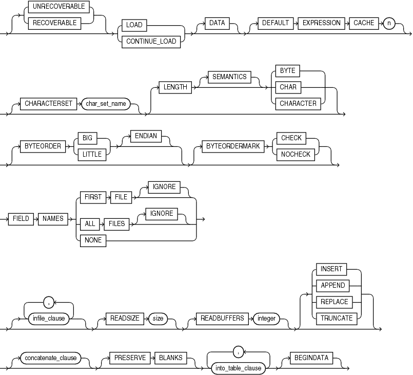
[Description of the illustration load_statement.eps](img_text/load_statement.md)

### infile_clause

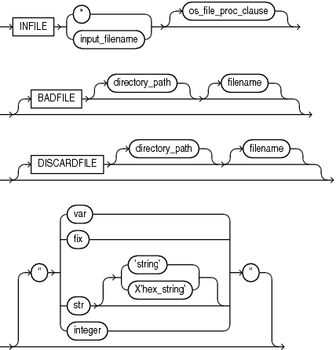
[Description of the illustration infile_clause.eps](img_text/infile_clause.md)

**Note:**

On the `BADFILE` `and DISCARDFILE` clauses, you must specify either a directory path, or a filename, or both.

### concatenate_clause

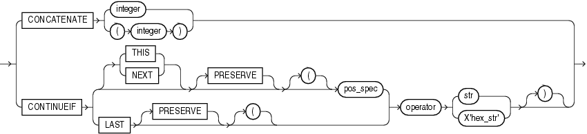
[Description of the illustration concatenate.eps](img_text/concatenate.md)

### into_table_clause

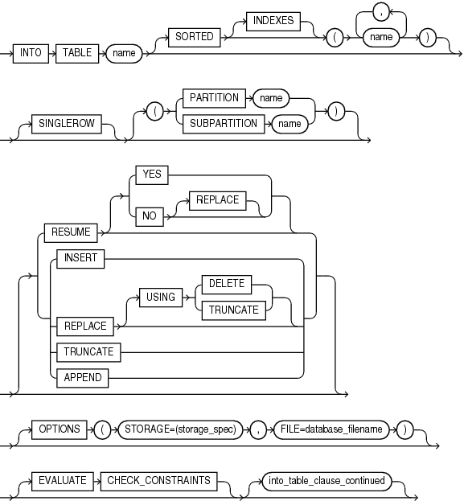
[Description of the illustration intotab_clause.eps](img_text/intotab_clause.md)

### into_table_clause_continued

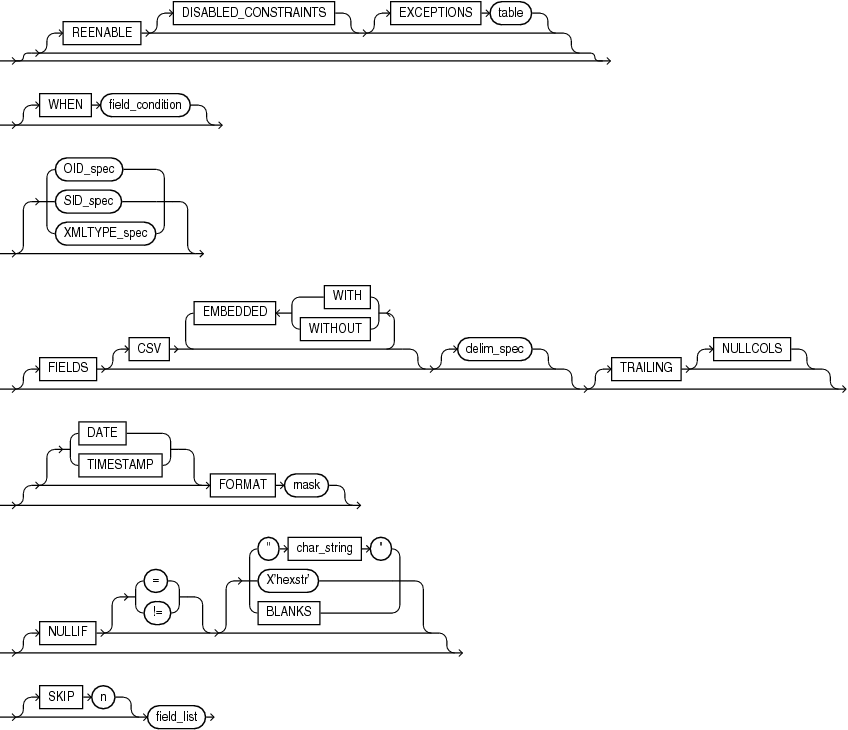
[Description of the illustration intotab_clause_cont.eps](img_text/intotab_clause_cont.md)

### field_condition

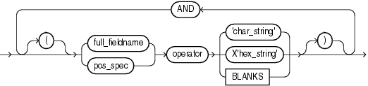
[Description of the illustration fld_cond.eps](img_text/fld_cond.md)

### delim_spec

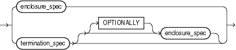
[Description of the illustration delim_spec.eps](img_text/delim_spec.md)

### full_fieldname

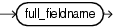
[Description of the illustration fieldname.eps](img_text/fieldname.md)

### termination_spec

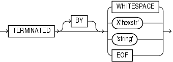
[Description of the illustration terminat.eps](img_text/terminat.md)

### enclosure_spec

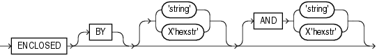
[Description of the illustration enclose.eps](img_text/enclose.md)

### oid_spec

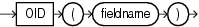
[Description of the illustration oid_spec.eps](img_text/oid_spec.md)

### sid_spec

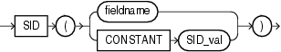
[Description of the illustration sid_spec.eps](img_text/sid_spec.md)

### xmltype_spec

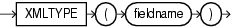
[Description of the illustration xmltype_spec.eps](img_text/xmltype_spec.md)

### field_list

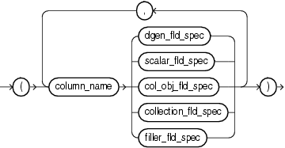
[Description of the illustration field_list.eps](img_text/field_list.md)

### dgen_fld_spec

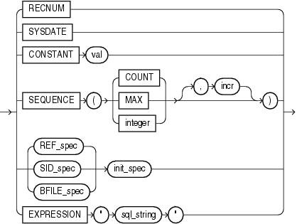
[Description of the illustration dgen_fld.eps](img_text/dgen_fld.md)

### ref_spec

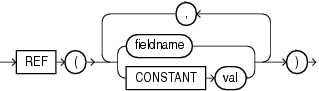
[Description of the illustration ref.eps](img_text/ref.md)

### init_spec

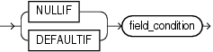
[Description of the illustration init.eps](img_text/init.md)

### bfile_spec

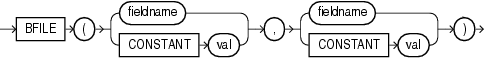
[Description of the illustration bfile.eps](img_text/bfile.md)

### filler_fld_spec

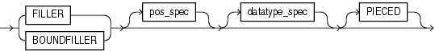
[Description of the illustration filler_fld.eps](img_text/filler_fld.md)

### scalar_fld_spec

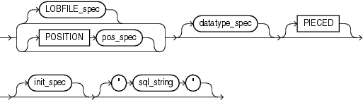
[Description of the illustration scalar.eps](img_text/scalar.md)

### lobfile_spec

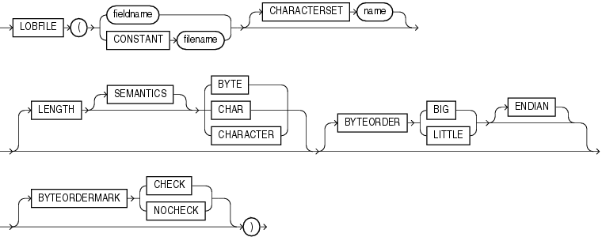
[Description of the illustration lobfile_spec.eps](img_text/lobfile_spec.md)

### lls_field_spec

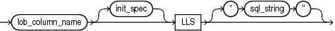
[Description of the illustration lls_field_spec.eps](img_text/lls_field_spec.md)

### pos_spec

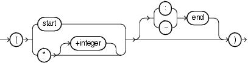
[Description of the illustration pos_spec.eps](img_text/pos_spec.md)

### datatype_spec

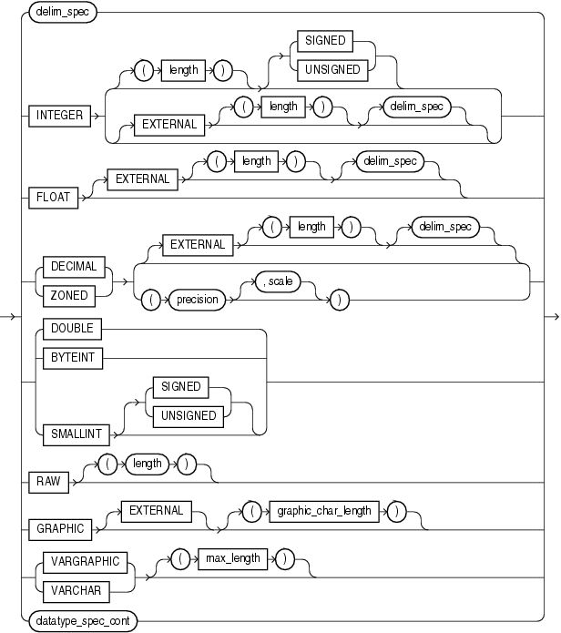
[Description of the illustration datatype_spec.eps](img_text/datatype_spec.md)

### datatype_spec_cont

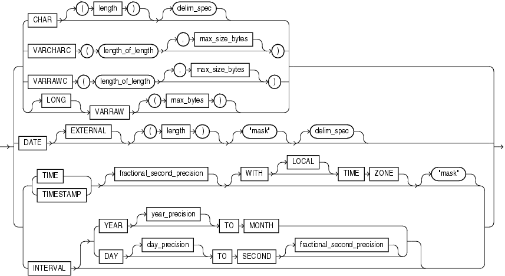
[Description of the illustration datatype_spec_cont.eps](img_text/datatype_spec_cont.md)

### col_obj_fld_spec

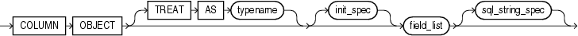
[Description of the illustration col_obj_fld_spec.eps](img_text/col_obj_fld_spec.md)

### collection_fld_spec

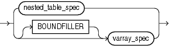
[Description of the illustration coll_fld.eps](img_text/coll_fld.md)

### nested_table_spec

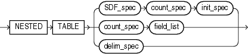
[Description of the illustration nested_table.eps](img_text/nested_table.md)

### varray_spec

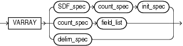
[Description of the illustration varray.eps](img_text/varray.md)

### sdf_spec

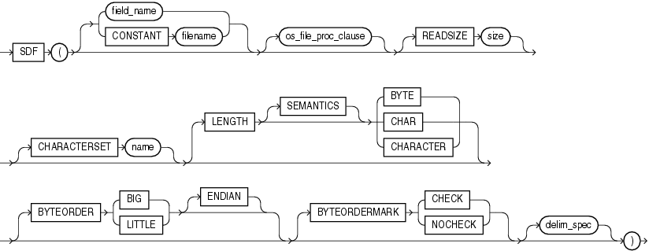
[Description of the illustration sdf.eps](img_text/sdf.md)

### count_spec

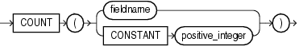
[Description of the illustration count.eps](img_text/count.md)
