## 15  The ORACLE_LOADER Access Driver

Learn how to control the way external tables are accessed by using the ORACLE_LOADER access driver parameters to modify the default behavior of the access driver.

- About the ORACLE_LOADER Access Driver
  The `ORACLE_LOADER` access driver provides a set of access parameters unique to external tables of the type `ORACLE_LOADER`.
- access_parameters Clause
  The `access_parameters` clause contains comments, record formatting, and field formatting information.
- record_format_info Clause
  Learn how to parse, label and manage record information with the `record_format_info` clause and its subclauses.
- field_definitions Clause
  In the `field_definitions` clause, you use the `FIELDS` parameter to name the fields in the data file and specify how to find them in records.
- column_transforms Clause
  The optional `ORACLE_LOADER` access drive `COLUMN TRANSFORMS` clause provides transforms that you can use to describe how to load columns in the external table that do not map directly to columns in the data file.
- Parallel Loading Considerations for the ORACLE_LOADER Access Driver
  The `ORACLE_LOADER` access driver attempts to divide large data files into chunks that can be processed separately.
- Performance Hints When Using the ORACLE_LOADER Access Driver
  This topic describes some performance hints when using the `ORACLE_LOADER` access driver.
- Restrictions When Using the ORACLE_LOADER Access Driver
  This section lists restrictions to be aware of when you use the `ORACLE_LOADER` access driver.
- Reserved Words for the ORACLE_LOADER Access Driver
  When identifiers (for example, column or table names) are specified in the external table access parameters, certain values are considered to be reserved words by the access parameter parser.

**Parent topic:** [External Tables](oracle-external-tables.md)

### 15.1 About the ORACLE_LOADER Access Driver

The `ORACLE_LOADER` access driver provides a set of access parameters unique to external tables of the type `ORACLE_LOADER`.

You can use the access parameters to modify the default behavior of the access driver. The information you provide through the access driver ensures that data from the data source is processed so that it matches the definition of the external table.

To use the external table management features that the ORACLE_LOADER access parameters provide, you must have some knowledge of the file format and record format (including character sets and field data types) of the data files on your platform. You must also know enough about SQL to be able to create an external table, and to perform queries against it.

You can find it helpful to use the `EXTERNAL_TABLE=GENERATE_ONLY` parameter in SQL\*Loader to obtain the proper access parameters for a given SQL\*Loader control file. When you specify `GENERATE_ONLY`, all the SQL statements needed to do the load using external tables, as described in the control file, are placed in the SQL\*Loader log file. You can edit and customize these SQL statements. You can perform the actual load later without the use of SQL\*Loader by executing these statements in SQL\*Plus.

**Note:**

- It is sometimes difficult to understand `ORACLE_LOADER` access driver parameter syntax without reference to other `ORACLE_LOADER` access driver parameters. If you have difficulty understanding the syntax of a particular parameter, then refer to it in context with other referenced parameters.

- Be aware that in ORACLE_LOADER access driver parameter examples that show a `CREATE TABLE...ORGANIZATION EXTERNAL` statement, followed by an example of contents of the data file for the external table, the contents of the data file in the example are not part of the `CREATE TABLE` statement. They are present in the example only to help complete the example.

- When identifiers (for example, column or table names) are specified in the external table access parameters, certain values are considered to be reserved words by the access parameter parser. If a reserved word is used as an identifier, then it must be enclosed in double quotation marks.

**Related Topics**

- [EXTERNAL_TABLE](oracle-sql-loader-commands.md)
- Reserved Words for the ORACLE_LOADER Access Driver
- [Oracle Database Administrator’s Guide](../admin/managing-tables.md)

**Parent topic:** The ORACLE_LOADER Access Driver

### 15.2 access_parameters Clause

The `access_parameters` clause contains comments, record formatting, and field formatting information.

#### Default

None.

#### Syntax

The syntax for the `access_parameters` clause is as follows:

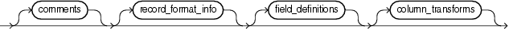
[Description of the illustration et_access_param.eps](img_text/et_access_param.md)

#### Purpose

The description of the data in the data source is separate from the definition of the external table. This means that:

- The source file can contain more or fewer fields than there are columns in the external table
- The data types for fields in the data source can be different from the columns in the external table

The access driver ensures that data from the data source is processed so that it matches the definition of the external table.

**Note:**

These access parameters are collectively referred to as the `opaque_format_spec` in the SQL `CREATE TABLE...ORGANIZATION EXTERNAL` statement.

**See Also:**

[Oracle Database SQL Language Reference](../sqlrf/CREATE-TABLE.md) for information about specifying `opaque_format_spec` when using the SQL `CREATE TABLE...ORGANIZATION EXTERNAL` statement

#### comments

Comments are lines that begin with two hyphens followed by text. Comments must be placed before any access parameters, for example:

    --This is a comment.
    --This is another comment.
    RECORDS DELIMITED BY NEWLINE

All text to the right of the double hyphen is ignored, until the end of the line.

#### record_format_info

The `record_format_info` clause is an optional clause that contains information about the record, such as its format, the character set of the data, and what rules are used to exclude records from being loaded. For a full description of the syntax, see record_format_info Clause.

#### field_definitions

The `field_definitions` clause is used to describe the fields in the data file. If a data file field has the same name as a column in the external table, then the data from the field is used for that column. For a full description of the syntax, see field_definitions Clause.

#### column_transforms

The `column_transforms` clause is an optional clause used to describe how to load columns in the external table that do not map directly to columns in the data file. This is done using the following transforms: `NULL`, `CONSTANT`, `CONCAT`, and `LOBFILE`. For a full description of the syntax, see column_transforms Clause.

**Parent topic:** The ORACLE_LOADER Access Driver

### 15.3 record_format_info Clause

Learn how to parse, label and manage record information with the `record_format_info` clause and its subclauses.

- Overview of record_format_info Clause
  The `record_format_info` clause contains information about the record, such as its format, the character set of the data, and what rules are used to exclude records from being loaded.
- FIXED Length
  Use the `record_format_info` `FIXED` clause to identify the records in external tables as all having a fixed size of length bytes.
- VARIABLE size
  Use the `record_format_info VARIABLE` clause to indicate that the records have a variable length
- DELIMITED BY
  Use the `record_format_info` `DELIMITED BY` clause to delimit the end-of-record character.
- XMLTAG
  Use the `record_format_info` `XMLTAG` clause to specify XML tags that are used to load subdocuments from an XML document.
- CHARACTERSET
  Use the `record_format_info` `CHARACTERSET` clause to specify the character set of the data file.
- EXTERNAL VARIABLE DATA
  To load dump files into the Oracle SQL Connector for HDFS that are generated with the `ORACLE_DATAPUMP` access driver, use the `EXTERNAL VARIABLE DATA` clause.
- PREPROCESSOR
  To specify your own preprocessor program that you want to run for every data file, use the `record_format_info` `PREPROCESSOR` clause.
- LANGUAGE
  The `LANGUAGE` clause allows you to specify a language name (for example, `FRENCH`), from which locale-sensitive information about the data can be derived.
- TERRITORY
  The `TERRITORY` clause allows you to specify a territory name to further determine input data characteristics.
- DATA IS...ENDIAN
  The `DATA IS...ENDIAN` clause indicates the endianness of data whose byte order may vary, depending on the platform that generated the data file.
- BYTEORDERMARK \[CHECK \| NOCHECK\]
  Use the `record_format_info` `BYTEORDERMARK` clause to specify whether the data file should be checked for the presence of a byte-order mark (BOM).
- STRING SIZES ARE IN
  Use the `record_format_info` `STRING SIZES ARE IN` clause to indicate whether the lengths specified for character strings are in bytes or characters.
- LOAD WHEN
  Use the `record_format_info` `LOAD WHEN` clause to identify the records that should be passed to the database.
- BADFILE \| NOBADFILE
  Use the `record_format_info` `BADFILE` clause to name the file to which records are written when they cannot be loaded because of errors.
- DISCARDFILE \| NODISCARDFILE
  Use the `record_format_info` `DISCARDFILE` clause to name the file to which records are written that fail the condition in the `LOAD WHEN` clause.
- LOGFILE \| NOLOGFILE
  Use the `record_format_info` `LOGFILE` clause to name the file that contains messages generated by the external tables utility while it was accessing data in the data file.
- SKIP
  Use the `record_format_info` `SKIP` clause to skip the specified number of records in the data file before loading.
- FIELD NAMES
  Use the `record_format_info` `FIELD NAMES` clause to specify field order in data files.
- READSIZE
  The `READSIZE` parameter specifies the size of the read buffer used to process records.
- DISABLE_DIRECTORY_LINK_CHECK
  The `DISABLE_DIRECTORY_LINK_CHECK` parameter directs the `ORACLE_LOADER` access driver to bypass the symbolic link check.
- DATE_CACHE
- string
  A string is a quoted series of characters or hexadecimal digits.
- condition_spec
  The `condition_spec` specifies one or more conditions that are joined by Boolean operators.
- \[directory object name:\] \[filename\]
  The `[``directory object name``:] [``filename``]` clause is used to specify the name of an output file (`BADFILE`, `DISCARDFILE`, or `LOGFILE`).
- condition
- IO_OPTIONS clause
- DNFS_DISABLE \| DNFS_ENABLE
- DNFS_READBUFFERS
  The `DNFS_READBUFFERS` parameter of the `record_format_info` clause is used to control the number of read buffers used by the Direct NFS Client.

**Parent topic:** The ORACLE_LOADER Access Driver

#### 15.3.1 Overview of record_format_info Clause

The `record_format_info` clause contains information about the record, such as its format, the character set of the data, and what rules are used to exclude records from being loaded.

The `PREPROCESSOR` clause allows you to optionally specify the name of a user-supplied program that will run and modify the contents of a data file so that the `ORACLE_LOADER` access driver can parse it.

The `record_format_info` clause is optional. The syntax for the `record_format_info` clause is as follows:

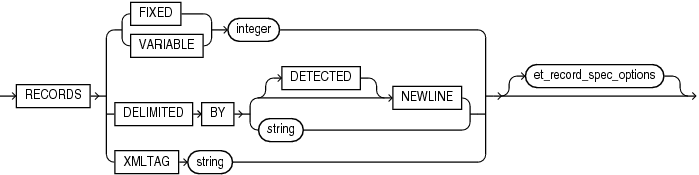
[Description of the illustration et_record_spec.eps](img_text/et_record_spec.md)

The `et_record_spec_options` clause allows you to optionally specify additional formatting information. You can specify as many of the formatting options as you want, in any order. The syntax of the options is as follows:

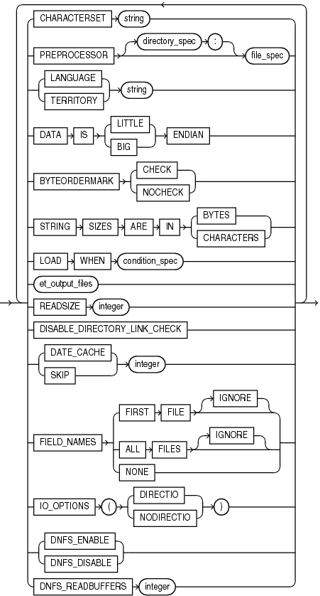
[Description of the illustration et_record_spec_options.eps](img_text/et_record_spec_options.md)

The following `et_output_files` diagram shows the options for specifying the bad, discard, and log files. For each of these clauses, you must supply either a directory object name or a file name, or both.

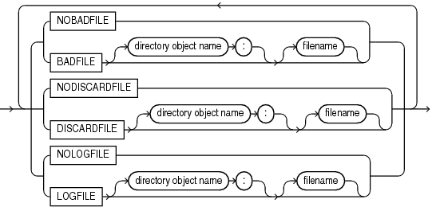
[Description of the illustration et_output_files.eps](img_text/et_output_files.md)

**Parent topic:** record_format_info Clause

#### 15.3.2 FIXED Length

Use the `record_format_info` `FIXED` clause to identify the records in external tables as all having a fixed size of length bytes.

##### Default

None.

##### Purpose

Enables you to identify the records in external tables as all having a fixed size of length bytes.

##### Usage Notes

The size specified for `FIXED` records must include any record termination characters, such as newlines. Compared to other record types, fixed-length fields in fixed-length records are the easiest field and record formats for the access driver to process.

##### Example

The following is an example of using `FIXED` records. In this example, we assume that there is a 1-byte newline character at the end of each record in the data file. After the create table command using `FIXED`, you see an example of the data file that you can load with it.

    CREATE TABLE emp_load (first_name CHAR(15), last_name CHAR(20), year_of_birth CHAR(4))
      ORGANIZATION EXTERNAL (TYPE ORACLE_LOADER DEFAULT DIRECTORY ext_tab_dir
                             ACCESS PARAMETERS (RECORDS FIXED 20 FIELDS (first_name CHAR(7),
                                                                        last_name CHAR(8),
                                                                        year_of_birth CHAR(4)))
                             LOCATION ('info.dat'));

    Alvin  Tolliver1976
    KennethBaer    1963
    Mary   Dube    1973

**Parent topic:** record_format_info Clause

#### 15.3.3 VARIABLE size

Use the `record_format_info VARIABLE` clause to indicate that the records have a variable length

##### Default

None.

##### Purpose

Use the `VARIABLE` clause to indicate that the records have a variable length, and that each record is preceded by a character string containing a number with the count of bytes for the record. The length of the character string containing the count field is the size argument that follows the `VARIABLE` parameter. Note that size indicates a count of bytes, not characters. The count at the beginning of the record must include any record termination characters, but it does not include the size of the count field itself. The number of bytes in the record termination characters can vary depending on how the file is created and on what platform it is created.

##### Example

In the following example of using `VARIABLE` records, there is a 1-byte newline character at the end of each record in the data file. After the SQL example, you see an example of a data file that can be used to load it.

    CREATE TABLE emp_load (first_name CHAR(15), last_name CHAR(20), year_of_birth CHAR(4))
      ORGANIZATION EXTERNAL (TYPE ORACLE_LOADER DEFAULT DIRECTORY ext_tab_dir
                             ACCESS PARAMETERS (RECORDS VARIABLE 2 FIELDS TERMINATED BY ','
                                                 (first_name CHAR(7),
                                                  last_name CHAR(8),
                                                  year_of_birth CHAR(4)))
                             LOCATION ('info.dat'));

    21Alvin,Tolliver,1976,
    19Kenneth,Baer,1963,
    16Mary,Dube,1973,

**Parent topic:** record_format_info Clause

#### 15.3.4 DELIMITED BY

Use the `record_format_info` `DELIMITED BY` clause to delimit the end-of-record character.

##### Default

None

##### Purpose

The `DELIMITED BY` clause is used to indicate the character that identifies the end of a record.

If you specify `DELIMITED BY NEWLINE` then the actual value used is platform-specific. On Unix or Linux operating systems, `NEWLINE` is assumed to be '`\n`'. On Microsoft Windows operating systems, `NEWLINE` is assumed to be '`\r\n`'.

If you are unsure what record delimiter was used when a data file was created, then running an external table query with `DELIMITED BY NEWLINE` can result in files that are incorrectly loaded. The query can be run without identifying what record delimiter was used when the data file was created. For example, you can work on a Unix or Linux operating system and use a file that was created in Windows format. If you specify `RECORDS DELIMITED BY NEWLINE` on the UNIX or Linux operating system, the delimiter is automatically assumed to be '`\n`'. However, because the file was created in Windows format, in which the records are delimited by '`\r\n`', the file is incorrectly uploaded to the UNIX or Linux operating system.

To resolve problems of different record delimiters, use this syntax:

    RECORDS DELIMITED BY DETECTED NEWLINE

With this syntax, the `ORACLE_LOADER` access driver scans the data looking first for a Windows delimiter ('`\r\n`'). If a Windows delimiter is not found, then the access driver looks for a Unix or Linux delimiter ('`\n`'). The first delimiter found is the one used as the record delimiter.

After a record delimiter is found, the access driver identifies that delimiter as the end of the record. For this reason, if the data contains an embedded delimiter character in a field before the end of the record, then you cannot use the `DETECTED` keyword. This is because the `ORACLE_LOADER` access driver incorrectly assumes that the delimiter in the field denotes the end of the record. As a result, the current and all subsequent records in the file cannot parse correctly.

You cannot mix newline delimiters in the same file. When the `ORACLE_LOADER` access driver finds the first delimiter, then that is the delimiter that it identifies for the records in the file. The access driver then processes all subsequent records in the file by using the same newline character as the delimiter..

If you specify `DELIMITED BY ``string`, then `string` can be either text or a series of hexadecimal digits enclosed within quotation marks and prefixed by `OX` or `X`. If the string is text, then the text is converted to the character set of the data file, and the result is used for identifying record boundaries.

If the following conditions are true, then you must use hexadecimal digits to identify the delimiter:

- The character set of the access parameters is different from the character set of the data file.
- Some characters in the delimiter string cannot be translated into the character set of the data file.

The hexadecimal digits are converted into bytes, and there is no character set translation performed on the hexadecimal string.

If the end of the file is found before the record terminator, then the access driver proceeds as if a terminator was found, and all unprocessed data up to the end of the file is considered part of the record.

**Note:**

Do not include any binary data, including binary counts for `VARCHAR` and `VARRAW`, in a record that has delimiters. Doing so could cause errors or corruption, because the binary data will be interpreted as characters during the search for the delimiter.

##### Example

The following is an example of using `DELIMITED BY` records.

    CREATE TABLE emp_load (first_name CHAR(15), last_name CHAR(20), year_of_birth CHAR(4))
      ORGANIZATION EXTERNAL (TYPE ORACLE_LOADER DEFAULT DIRECTORY ext_tab_dir
                             ACCESS PARAMETERS (RECORDS DELIMITED BY '|' FIELDS TERMINATED BY ','
                                                  (first_name CHAR(7),
                                                   last_name CHAR(8),
                                                   year_of_birth CHAR(4)))
                             LOCATION ('info.dat'));

    Alvin,Tolliver,1976|Kenneth,Baer,1963|Mary,Dube,1973

**Related Topics**

- string

**Parent topic:** record_format_info Clause

#### 15.3.5 XMLTAG

Use the `record_format_info` `XMLTAG` clause to specify XML tags that are used to load subdocuments from an XML document.

##### Default

None

##### Purpose

You can use the `XMLTAG` clause of the `ORACLE_LOADER` access driver to specify XML tags that are used to load subdocuments from an XML document. The access driver searches the data file for documents enclosed by the tags you identify with the clause, and loads those documents as separate rows in the external table.

The `XMLTAG` clause accepts a list of one or more strings. The strings are used to build tags that `ORACLE_LOADER` uses to search for subdocuments in the data file. The tags specified in the access parameters do not include the "`<`" and "`>`" delimiters.

The `ORACLE_LOADER` access driver starts at the beginning of the file, and looks for the first occurrence of any of the tags listed in the `XMLTAG` clause. When it finds a match, it then searches for the corresponding closing tag. For example, if the tag is "`ORDER_ITEM`”, then `ORACLE_LOADER` looks for the text string “`<ORDER_ITEM>”`, starting at the beginning of the file. When it finds an occurrence of “`<ORDER_ITEM>`” it then looks for “`</ORDER_ITEM>`”. Everything found between the \<ORDER_ITEM\> and \</ORDER_ITEM\> tags is part of the document loaded for the row. `ORACLE_LOADER` then searches for the next occurrence of any of the tags, starting from the first character after the closing tag.

The `ORACLE_LOADER` access driver is not parsing the XML document to the elements that match the tag names; it is only doing a string search through a text file. If the external table is being accessed in parallel, then `ORACLE_LOADER` splits large files up so that different sections are read independently. When it starts reading a section of the data file, it starts looking for one of the tags specified by `XMLTAG`. If it reaches the end of a section and is still looking for a matching end tag, then `ORACLE_LOADER` continues reading into the next section until the matching end tag is found.

##### Restrictions When Using XMLTAG

- The `XMLTAG` clause cannot be used to load data files that have elements nested inside of documents of the same element. For example, if a data file being loaded with `XMLTAG(‘FOO’)` contains the following data:

      <FOO><BAR><FOO></FOO></BAR></FOO>

  then `ORACLE_LOADER` extracts everything between the first `<FOO>` and the first `</FOO>` as a document, which does not constitute a valid document.

  Similarly, if `XMLTAG(“FOO”,”BAR”)` is specified and the data file contains the following:

      <FOO><BAR></BAR></FOO>

  then `<BAR>` and `</BAR>` are loaded, but as the document for "`FOO`".

- The limit on how large an extracted sub-document can be is determined by the `READSIZE` access parameter. If the `ORACLE_LOADER` access driver sees a subdocument larger than `READSIZE`, then it returns an error.

##### Example Use of the XMLTAG Clause

Suppose you create an external table `T_XT` as follows:

    CREATE TABLE "T_XT"
    (
      "C0" VARCHAR2(2000)
    )
    ORGANIZATION external
    (
      TYPE oracle_loader
      DEFAULT DIRECTORY DMPDIR
      ACCESS PARAMETERS
      (
        RECORDS
        XMLTAG ("home address", "work address"," home phone ")
        READSIZE 1024
        SKIP 0
        FIELDS NOTRIM
        MISSING FIELD VALUES ARE NULL
        (
          "C0" (1:2000) CHAR(2000)
        )
      )
      location
      (
        't.dat'
      )
    )REJECT LIMIT UNLIMITED
    /
    exit;

Assume the contents of the data file are as follows:

    <first name>Lionel</first name><home address>23 Oak St, Tripoli, CT</home address><last name>Rice</last name>

You could then perform the following SQL query:

    SQL> SELECT C0 FROM T_XT;

    C0
    ------------------------------------------------------------------
    <home address>23 Oak St, Tripoli, CT</home address>

**Parent topic:** record_format_info Clause

#### 15.3.6 CHARACTERSET

Use the `record_format_info` `CHARACTERSET` clause to specify the character set of the data file.

##### Default

None.

##### Purpose

The `CHARACTERSET ``string` clause identifies the character set of the data file. If a character set is not specified, then the data is assumed to be in the default character set for the database.

**Note:**

The settings of NLS environment variables on the client have no effect on the character set used for the database.

**Related Topics**

- string
- [Oracle Database Globalization Support Guide](../nlspg/appendix-A-locale-data.md)

**Parent topic:** record_format_info Clause

#### 15.3.7 EXTERNAL VARIABLE DATA

To load dump files into the Oracle SQL Connector for HDFS that are generated with the `ORACLE_DATAPUMP` access driver, use the `EXTERNAL VARIABLE DATA` clause.

##### Default

None.

##### Purpose

When you specify the `EXTERNAL VARIABLE DATA` clause, the `ORACLE_LOADER` access driver is used to load dump files that were generated with the `ORACLE_DATAPUMP` access driver.

**Note:**

The `EXTERNAL VARIABLE DATA` clause is valid only for use with the Oracle SQL Connector for Hadoop Distributed File System (HDFS). See Oracle Big Data Connectors User's Guide for more information about the Oracle SQL Connector for HDFS.

##### Syntax and Description

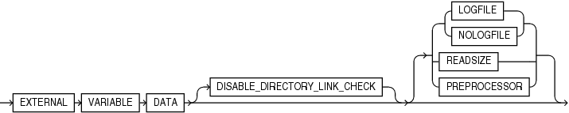
[Description of the illustration et_extvardat.eps](img_text/et_extvardat.md)

You can only use the following access parameters with the `EXTERNAL VARIABLE DATA` clause:

- LOGFILE \| NOLOGFILE
- READSIZE
- PREPROCESSOR

**Note:**

The parameter DISABLE_DIRECTORY_LINK_CHECK is desupported.

##### Example

In the following example of using the `EXTERNAL VARIABLE DATA` clause, the following scenario is true:

- The `deptxt1.dmp` dump file was previously generated by the `ORACLE_DATAPUMP` access driver.
- The `tkexcat` program specified by the `PREPROCESSOR` parameter is a user-supplied program used to manipulate the input data.

<!-- -->

    CREATE TABLE deptxt1
    (
       deptno  number(2),
       dname   varchar2(14),
       loc     varchar2(13)
    )
    ORGANIZATION EXTERNAL
    (
      TYPE ORACLE_LOADER
      DEFAULT DIRECTORY dpump_dir
      ACCESS PARAMETERS
      (
        EXTERNAL VARIABLE DATA
        LOGFILE 'deptxt1.log'
        READSIZE=10000
        PREPROCESSOR tkexcat
      )
      LOCATION ('deptxt1.dmp')
    )
    REJECT LIMIT UNLIMITED
    ;

**Related Topics**

- LOGFILE \| NOLOGFILE
- READSIZE
- PREPROCESSOR

**Parent topic:** record_format_info Clause

#### 15.3.8 PREPROCESSOR

To specify your own preprocessor program that you want to run for every data file, use the `record_format_info` `PREPROCESSOR` clause.

##### Default

None.

##### Purpose

**Caution:**

There are security implications to consider when using the `PREPROCESSOR` clause.

If the file you want to load contains data records that are not in a format supported by the `ORACLE_LOADER` access driver, then use the `PREPROCESSOR` clause to specify a user-supplied preprocessor program that will execute for every data file. Note that the program specification must be enclosed in a shell script if it uses arguments (see the description of `file_spec`).

The preprocessor program converts the data to a record format supported by the access driver and then writes the converted record data to standard output (stdout), which the access driver reads as input.

##### Syntax

The syntax of the `PREPROCESSOR` clause is as follows:

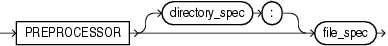
[Description of the illustration et_preprocessor_spec.eps](img_text/et_preprocessor_spec.md)

##### directory_spec

Specifies the directory object containing the name of the preprocessor program to execute for every data file. The user accessing the external table must have the `EXECUTE` privilege for the directory object that is used. If `directory_spec` is omitted, then the default directory specified for the external table is used.

**Caution:**

For security reasons, to store preprocessor programs, Oracle strongly recommends that you use a separate directory. Do not use the default directory. Do not store any other files in the directory in which preprocessor programs are stored.

To maintain security, the preprocessor program must reside in a directory object, so that access to it can be controlled . Your operating system administrator must create a directory corresponding to the directory object, and and must verify that the operating system Oracle user for the database has access to that directory. Database administrators then must ensure that only approved users are granted permissions to the directory object associated with the directory path. Although multiple database users can have access to a directory object, only those with the `EXECUTE` privilege can run a preprocessor in that directory. No existing database user with read-write privileges to a directory object will be able to use the preprocessing feature. As a DBA, you can prevent preprocessors from ever being used by never granting the `EXECUTE` privilege to anyone for a directory object. Refer to Oracle Database SQL Language Reference for information about how to grant the EXECUTE privilege.

##### file_spec

The name of the preprocessor program. It is appended to the path name associated with the directory object that is being used (either the `directory_spec` or the default directory for the external table). The `file_spec` cannot contain an absolute or relative directory path.

If the preprocessor program requires any arguments (for example, `gunzip -c`), then you must specify the program name and its arguments in an executable shell script (or on Microsoft Windows operating systems, in a batch (`.bat`) file). Shell scripts and batch files have certain requirements, as discussed in the following sections.

It is important to verify that the correct version of the preprocessor program is in the operating system directory.

The following is an example of specifying the `PREPROCESSOR` clause without using a shell or batch file:

    SQL> CREATE TABLE xtab (recno varchar2(2000))
         2    ORGANIZATION EXTERNAL (
         3    TYPE ORACLE_LOADER
         4    DEFAULT DIRECTORY data_dir
         5    ACCESS PARAMETERS (
         6    RECORDS DELIMITED BY NEWLINE
         7    PREPROCESSOR execdir:'zcat'
         8    FIELDS (recno char(2000)))
         9    LOCATION ('foo.dat.gz'))
       10    REJECT LIMIT UNLIMITED;
    Table created.

##### Using Shell Scripts With the PREPROCESSOR Clause on Linux Operating Systems

To use shell scripts on Linux, the following conditions must be true:

- The shell script must reside in `directory_spec`.

- The full path name must be specified for system commands such as `gunzip`.

- The preprocessor shell script must have `EXECUTE` permissions.

- The data file listed in the external table `LOCATION` clause should be referred to by `$1`.

The following example shows how to specify a shell script on the `PREPROCESSOR` clause when creating an external table.

    SQL> CREATE TABLE xtab (recno varchar2(2000))
         2    ORGANIZATION EXTERNAL (
         3    TYPE ORACLE_LOADER
         4    DEFAULT DIRECTORY data_dir
         5    ACCESS PARAMETERS (
         6    RECORDS DELIMITED BY NEWLINE
         7    PREPROCESSOR execdir:'uncompress.sh'
         8    FIELDS (recno char(2000)))
         9    LOCATION ('foo.dat.gz'))
       10    REJECT LIMIT UNLIMITED;
    Table created.

##### Using Batch Files With The PREPROCESSOR Clause on Windows Operating Systems

To use shell scripts on Microsoft Windows, the following conditions must be true:

- The batch file must reside in `directory_spec`.

- The full path name must be specified for system commands such as `gunzip`.

- The preprocessor batch file must have EXECUTE permissions.

- The first line of the batch file should contain `@echo off`. The reason for this requirement is that when the batch file is run, the default is to display the commands being executed, which has the unintended side-effect of the echoed commands being treated as input to the external table access driver.

- To represent the input from the location clause, `%1` should be used. (Note that this differs from Unix and Linux-style shell scripts where the location clause is referenced by `$1`.)

- A full path should be specified to any executables in the batch file (`sed.exe` in the following example). Note also that the MKS Toolkit may not exist on all Microsoft Windows installations, so commands such as `sed.exe` may not be available.

  The batch file used on Microsoft Windows must have either a `.bat` or `.cmd` extension. Failure to do so (for example, trying to specify the preprocessor script as `sed.sh`) results in the following error:

      SQL> select * from foo ;
      select * from foo
      *
      ERROR at line 1:

      ORA-29913: error in executing ODCIEXTTABLEFETCH callout
      ORA-29400: data cartridge error
      KUP-04095: preprocessor command
      C:/Temp\sed.sh encountered error
      "CreateProcess Failure for Preprocessor:
      C:/Temp\sed.sh, errorcode: 193

The following is a simple example of using a batch file with the external table `PREPROCESSOR` option on Windows. In this example a batch file uses the stream editor (`sed.exe`) utility to perform a simple transformation of the input data.

    SQL> create table deptXT (deptno char(2),
      2  dname char(14),
      3  loc char(13)
      4  )
      5  organization external
      6  (
      7  type ORACLE_LOADER
      8  default directory def_dir1
      9  access parameters
     10  (
     11  records delimited by newline
     12  badfile 'deptXT.bad'
     13  logfile 'deptXT.log'
     14  preprocessor exec_dir:'sed.bat'
     15  fields terminated by ','
     16  missing field values are null
     17  )
     18  location ('deptXT.dat')
     19  )
     20  reject limit unlimited ;

    Table created.

    select * from deptxt ;

    Where deptxt.dat contains:

    20,RESEARCH,DALLAS
    30,SALES,CHICAGO
    40,OPERATIONS,BOSTON
    51,OPERATIONS,BOSTON

The preprocessor program `sed.bat` has the following content:

    @echo off
    c:/mksnt/mksnt/sed.exe -e 's/BOSTON/CALIFORNIA/' %1

The `PREPROCESSOR` option passes the input data (`deptxt.dat`) to `sed.bat`. If you then select from the `deptxt` table, the results show that the `LOC` column in the last two rows, which used to be `BOSTON`, is now `CALIFORNIA`.

    SQL> select * from deptxt ;

    DE DNAME          LOC
    -- -------------- -------------
    20 RESEARCH,     DALLAS
    30 SALES         CHICAGO
    40 OPERATIONS    CALIFORNIA
    51 OPERATIONS    CALIFORNIA

    4 rows selected.

##### Usage Notes for Parallel Processing with the PREPROCESSOR Clause

External tables treat each data file specified on the `LOCATION` clause as a single granule. To make the best use of parallel processing with the `PREPROCESSOR` clause, Oracle recommends that the data that you want to load is split into multiple files (granules). Note that external tables limits the degree of parallelism to the number of data files present. For example, if you specify a degree of parallelism of 16, but have only 10 data files, then in effect the degree of parallelism is 10; this is because 10 child processes are busy, and 6 are idle. To process data more efficiently, avoid idle child processes. If you do specify a degree of parallelism, then try to ensure that the degree of parallelism you specify is no larger than the number of data files, so that all child processes are kept busy. Refer to Oracle Database VLDB and Partitioning Guide for more information about granules of parallelism.

Also note that you cannot use the same preprocessor script that you use for file system files to process object store data. If you want to use the preprocessor for object store data, then you must write a preprocessor script that can access the object store data, and modify the data. For example, on Linux or Unix systems, in this case, `$1` represents a source such as `https://www.yoururl.example.com/yourdata`:

    @echo off
    #!/bin/sh/your_script_or_plsql_function_to_display_objectstore_contents($1) | sed -e 's/BOSTON/CALIFORNIA/'

With this syntax, the preprocessor obtains your data, and sends it to `stdout`, and pipes it for the access driver to read.

##### Restrictions When Using the PREPROCESSOR Clause

- The `PREPROCESSOR` clause is not available on databases that use the Oracle Database Vault feature.

- The `PREPROCESSOR` clause does not work in conjunction with the `COLUMN` `TRANSFORMS` clause.

<!-- -->

- Using Parallel Processing with the PREPROCESSOR Clause
  Using parallel processing with the `PREPROCESSOR` clause.
- Restrictions When Using the PREPROCESSOR Clause
  Describes restrictions when using the `PREPROCESSOR` clause.

**Related Topics**

- [Guidelines for Securing the ORACLE_LOADER Access Driver](../dbseg/keeping-your-oracle-database-secure.md)
- [Oracle Database SQL Language Reference GRANT](../sqlrf/GRANT.md)

**Parent topic:** record_format_info Clause

##### 15.3.8.1 Using Parallel Processing with the PREPROCESSOR Clause

Using parallel processing with the `PREPROCESSOR` clause.

External tables treat each data file specified on the `LOCATION` clause as a single granule. To make the best use of parallel processing with the `PREPROCESSOR` clause, the data to be loaded should be split into multiple files (granules). This is because external tables limits the degree of parallelism to the number of data files present. For example, if you specify a degree of parallelism of 16, but have only 10 data files, then in effect the degree of parallelism is 10 because 10 slave processes will be busy and 6 will be idle. It is best to not have any idle slave processes. So if you do specify a degree of parallelism, then ideally it should be no larger than the number of data files so that all slave processes are kept busy.

**See Also:**

- [Oracle Database VLDB and Partitioning Guide](../vldbg/parallel-exec-intro.md) for more information about granules of parallelism

**Parent topic:** PREPROCESSOR

##### 15.3.8.2 Restrictions When Using the PREPROCESSOR Clause

Describes restrictions when using the `PREPROCESSOR` clause.

- The `PREPROCESSOR` clause is not available on databases that use the Oracle Database Vault feature.

- The `PREPROCESSOR` clause does not work in conjunction with the `COLUMN` `TRANSFORMS` clause.

**Parent topic:** PREPROCESSOR

#### 15.3.9 LANGUAGE

The `LANGUAGE` clause allows you to specify a language name (for example, `FRENCH`), from which locale-sensitive information about the data can be derived.

The following are some examples of the type of information that can be derived from the language name:

- Day and month names and their abbreviations

- Symbols for equivalent expressions for A.M., P.M., A.D., and B.C.

- Default sorting sequence for character data when the `ORDER BY` SQL clause is specified

- Writing direction (right to left or left to right)

- Affirmative and negative response strings (for example, `YES` and `NO`)

**See Also:**

[Oracle Database Globalization Support Guide](../nlspg/appendix-A-locale-data.md) for a listing of Oracle-supported languages

**Parent topic:** record_format_info Clause

#### 15.3.10 TERRITORY

The `TERRITORY` clause allows you to specify a territory name to further determine input data characteristics.

For example, in some countries a decimal point is used in numbers rather than a comma (for example, 531.298 instead of 531,298).

**See Also:**

[Oracle Database Globalization Support Guide](../nlspg/appendix-A-locale-data.md) for a listing of Oracle-supported territories

**Parent topic:** record_format_info Clause

#### 15.3.11 DATA IS...ENDIAN

The `DATA IS...ENDIAN` clause indicates the endianness of data whose byte order may vary, depending on the platform that generated the data file.

##### Purpose

Indicates the endianness of data whose byte order may vary depending on the platform that generated the data file.

##### Usage Notes

Fields of the following types are affected by this clause:

- `INTEGER`
- `UNSIGNED INTEGER`
- `FLOAT`
- `BINARY_FLOAT`
- `DOUBLE`
- `BINARY_DOUBLE`
- `VARCHAR `(numeric count only)
- `VARRAW `(numeric count only)
- Any character data type in the UTF16 character set
- Any string specified by `RECORDS DELIMITED BY ``string`, and in the UTF16 character set

Microsoft Windows-based platforms generate little-endian data. Big-endian platforms include Oracle Solaris and IBM zSeries Based Linux. If the `DATA IS...ENDIAN` clause is not specified, then the data is assumed to have the same endianness as the platform where the access driver is running. UTF-16 data files can have a mark at the beginning of the file indicating the endianness of the data. If present, then this mark overrides the `DATA IS...ENDIAN` clause.

**Parent topic:** record_format_info Clause

#### 15.3.12 BYTEORDERMARK \[CHECK \| NOCHECK\]

Use the `record_format_info` `BYTEORDERMARK` clause to specify whether the data file should be checked for the presence of a byte-order mark (BOM).

##### Default

`CHECK`

##### Syntax

    BYTEORDERMARK [CHECK | NOCHECK]

##### Purpose

The `BYTEORDERMARK` clause is used to specify whether the data file should be checked for the presence of a byte-order mark (BOM). This clause is meaningful only when the character set is Unicode.

`BYTEORDERMARK NOCHECK` indicates that the data file should not be checked for a BOM and that all the data in the data file should be read as data.

`BYTEORDERMARK CHECK` indicates that the data file should be checked for a BOM. This is the default behavior for a data file in a Unicode character set.

##### Usage Notes

The following are examples of some possible scenarios:

- If the data is specified as being little or big-endian, and `CHECK` is specified, and it is determined that the specified endianness does not match the data file, then an error is returned. For example, suppose you specify the following:

      DATA IS LITTLE ENDIAN
      BYTEORDERMARK CHECK

  If the BOM is checked in the Unicode data file, and the data is actually big-endian, then an error is returned because you specified little-endian.

- If a BOM is not found, and no endianness is specified with the `DATA IS...ENDIAN` parameter, then the endianness of the platform is used.

- If `BYTE ORDER MARK NOCHECK` is specified, and the `DATA IS...ENDIAN` parameter specified an endianness, then that endian value is used. Otherwise, the endianness of the platform is used.

**Related Topics**

- [Understanding how SQL\*Loader Manages Byte Ordering](oracle-sql-loader-field-list-contents.md)

**Parent topic:** record_format_info Clause

#### 15.3.13 STRING SIZES ARE IN

Use the `record_format_info` `STRING SIZES ARE IN` clause to indicate whether the lengths specified for character strings are in bytes or characters.

##### Default

None.

##### Syntax

    STRING SIZES ARE IN [BYTES | CHARACTERS]

##### Purpose

The `STRING SIZES ARE IN` clause is used to indicate whether the lengths specified for character strings are in bytes or characters. If this clause is not specified, then the access driver uses the mode that the database uses. Character types with embedded lengths (such as `VARCHAR`) are also affected by this clause. If this clause is specified, then the embedded lengths are a character count, not a byte count. Specifying `STRING SIZES ARE IN CHARACTERS` is needed only when loading multibyte character sets, such as UTF16.

**Parent topic:** record_format_info Clause

#### 15.3.14 LOAD WHEN

Use the `record_format_info` `LOAD WHEN` clause to identify the records that should be passed to the database.

##### Default

##### Syntax

The syntax of the `LOAD WHEN` clause is as follows, where `condition_spec` are condition specifications:

    LOAD WHEN condition_spec

##### Purpose

The `LOAD WHEN ``condition_spec` clause is used to identify the records that should be passed to the database. The evaluation method varies:

- If the `condition_spec` references a field in the record, then the clause is evaluated only after all fields have been parsed from the record, but before any `NULLIF` or `DEFAULTIF` clauses have been evaluated.

- If the condition specification references only ranges (and no field names), then the clause is evaluated before the fields are parsed. This use case is helpful where the records in the file that you do not want to be loaded cannot be parsed into the current record definition without errors.

##### Example

The following is an examples of using `LOAD WHEN`:

    LOAD WHEN (empid != BLANKS)
    LOAD WHEN ((dept_id = "SPORTING GOODS" OR dept_id = "SHOES") AND total_sales != 0)

**Related Topics**

- condition_spec

**Parent topic:** record_format_info Clause

#### 15.3.15 BADFILE \| NOBADFILE

Use the `record_format_info` `BADFILE` clause to name the file to which records are written when they cannot be loaded because of errors.

##### Default

Create a bad file with default name. See Purpose for details.

##### Syntax

    BADFILE name | NOBADFILE

##### Purpose

The `BADFILE` clause names the file to which records are written when they cannot be loaded because of errors. For example, a record would be written to the bad file if a field in the data file could not be converted to the data type of a column in the external table. The purpose of the bad file is to have one file where all rejected data can be examined and fixed so that it can be loaded. If you do not intend to fix the data, then you can use the `NOBADFILE` option to prevent creation of a bad file, even if there are bad records.

If you specify the `BADFILE` clause, then you must supply either a directory object name or file name, or both. See `[directory object name:] [filename]`.

If you specify `NOBADFILE`, then a bad file is not created.

If neither `BADFILE` nor `NOBADFILE` is specified, then the default is to create a bad file if at least one record is rejected. The name of the file is the table name followed by `_``%p`, where `%p` is replaced with the PID of the process creating the file. The file is given an extension of `.bad`. If the table name contains any characters that could be interpreted as directory navigation (for example, %, /, or \*), then those characters are not included in the output file name.

Records that fail the `LOAD WHEN` clause are not written to the bad file, but instead are written to the discard file. Also, any errors in using a record from an external table (such as a constraint violation when using `INSERT INTO...AS SELECT...` from an external table) will not cause the record to be written to the bad file.

**Related Topics**

- \[directory object name:\] \[filename\]

**Parent topic:** record_format_info Clause

#### 15.3.16 DISCARDFILE \| NODISCARDFILE

Use the `record_format_info` `DISCARDFILE` clause to name the file to which records are written that fail the condition in the `LOAD WHEN` clause.

##### Default

Create a discard file with default name. See Purpose for details.

##### Syntax

    DISCARDFILE name | NODISCARDFILE

##### Purpose

The `DISCARDFILE` clause names the file to which records are written that fail the condition in the `LOAD WHEN` clause. The discard file is created when the first record for discard is encountered. If the same external table is accessed multiple times, then the discard file is rewritten each time. If there is no need to save the discarded records in a separate file, then use `NODISCARDFILE`.

If you specify `DISCARDFILE`, then you must supply either a directory object name or file name, or both. See `[directory object name:] [filename]`.

If you specify `NODISCARDFILE`, then a discard file is not created.

If neither `DISCARDFILE` nor `NODISCARDFILE` is specified, then the default is to create a discard file if at least one record fails the `LOAD WHEN` clause. The name of the file is the table name followed by `_``%p`, where `%p` is replaced with the PID of the process creating the file. The file is given an extension of `.dcs`. If the table name contains any characters that could be interpreted as directory navigation (for example, `%`, `/`, or `*`), then those characters are not included in the file name.

**Related Topics**

- \[directory object name:\] \[filename\]

**Parent topic:** record_format_info Clause

#### 15.3.17 LOGFILE \| NOLOGFILE

Use the `record_format_info` `LOGFILE` clause to name the file that contains messages generated by the external tables utility while it was accessing data in the data file.

##### Default

Use an existing file, or create a log file with default name. See Purpose for details.

##### Syntax

    LOGFILE name | NOLOGFILE

##### Purpose

The `LOGFILE` clause names the file that contains messages generated by the external tables utility while it was accessing data in the data file. If a log file already exists by the same name, then the access driver reopens that log file and appends new log information to the end. This is different from bad files and discard files, which overwrite any existing file. The `NOLOGFILE` clause is used to prevent creation of a log file.

If you specify `LOGFILE`, then you must supply either a directory object name or file name, or both. See `[directory object name:] [filename]`.

If you specify `NOLOGFILE`, then a log file is not created.

If neither `LOGFILE` nor `NOLOGFILE` is specified, then the default is to create a log file. The name of the file is the table name followed by `_``%p`, where `%p` is replaced with the PID of the process creating the file. The file is given an extension of `.log`. If the table name contains any characters that could be interpreted as directory navigation (for example, `%`, `/`, or `*`), then those characters are not included in the file name.

**Related Topics**

- \[directory object name:\] \[filename\]

**Parent topic:** record_format_info Clause

#### 15.3.18 SKIP

Use the `record_format_info` `SKIP` clause to skip the specified number of records in the data file before loading.

##### Default

None (`0`)

##### Syntax

The syntax is as follows, where `num` is the number of records to skip (Default 0).

    SKIP = num

##### Purpose

The `SKIP` clause skips the specified number of records in the data file before loading. You can specify this clause only when nonparallel access is being made to the data. If there is more than one data file in the same location for the same table, then the `SKIP` clause causes the `ORACLE_LOADER` driver to skip the specified number of records in the first data file only.

**Parent topic:** record_format_info Clause

#### 15.3.19 FIELD NAMES

Use the `record_format_info` `FIELD NAMES` clause to specify field order in data files.

##### Default

`NONE`

##### Syntax

    FIELD NAMES {FIRST FILE | FIRST IGNORE | ALL FILES | ALL IGNORE| NONE}

The `FIELD NAMES` options are:

- `FIRST FILE` — Indicates that the first data file contains a list of field names for the data in the first record. This list uses the same delimiter as the data in the data file. This record is read and used to set up the mapping between the fields in the data file and the columns in the target table. This record is skipped when the data is processed. This option can be useful if the order of the fields in the data file is different from the order of the columns in the table.
- `FIRST IGNORE` — Indicates that the first data file contains a list of field names for the data in the first record, but that the information should be ignored. This record is skipped when the data is processed, but is not used for setting up the fields.
- `ALL FILES` — Indicates that all data files contain a list of field names for the data in the first record. The ordering of the fields in the datafiles can be in any order. The order is specified by the first row in each file, which specifies to the access driver that the fields are in a different order than the columns in the external table.
- `ALL IGNORE` — Indicates that all data files contain a list of field names for the data in the first record, but that the information should be ignored. This record is skipped when the data is processed in every data file, but it is not used for setting up the fields.
- `NONE` — Indicates that the data file contains normal data in the first record. This is the default option.

##### Purpose

Use the `FIELD NAMES` clause to specify the field order of data files for the first row of the data file using one of the options. For example, if `FIELD NAMES FIRST FILE` is specified, then only the first data file has the row header. If FIELD NAMES ALL FILES is specified, then all data files will have the row header.

##### Restrictions

- The `FIELD NAMES` clause does not trim whitespace between field names in data files.

  For example, if a data file has field names `deptno, dname, loc` (with whitespace between field names) then specifying `FIELD NAMES` can fail with "KUP-04117: Field name LOC was not found in the access parameter field list or table."

- Field names in data files cannot use quotations. For example, the following column field names are not supported:

  `deptno,"dname",loc`

- Embedded delimiters are not supported in the first column header row.

##### Example

Typically fields in a data file where you want to generate a table with columns (COL1, COL2, COL3) are in the same order in the data file as they will be in the table. However, in the following example, the ordering of data file fields is diffferent in `deptxt1.dat` and `deptxt2.dat`. Specifying `FIELD NAMES ALL FILES` enables data fields in differing field name order in one or more datafiles to be queried correctly:

    [admin@example]$ cat /tmp/deptxt1.dat
    deptno,dname,loc
    10,ACCOUNTING,NEW YORK
    20,RESEARCH,DALLAS
    30,SALES,CHICAGO
    40,OPERATIONS,BOSTON

    [admin@example]$ cat /tmp/deptxt2.dat
    dNamE,lOc,DEPTNO
    ACCOUNTING,NEW YORK,11
    RESEARCH,DALLAS,21
    SALES,CHICAGO,31
    OPERATIONS,BOSTON,41

    [admin@example]$ sql @xt

    Connected.

    Directory created.

    SQL> create table deptXT
       2  (
       3      deptno    number(2),
       4      dname    varchar2(14),
       5      loc    varchar2(13)
       6  )
       7  organization external
       8  (
       9    type ORACLE_LOADER
      10    DEFAULT DIRECTORY DATA_DIR
      11    access parameters
      12    (
      13       records delimited by newline
      14       field names all files
      15       logfile 'deptxt.log'
      16       badfile 'deptxt.bad'
      17       fields terminated by ','
      18       missing field values are null
      19    )
      20    location ('deptxt?.dat')
      21  )
      22  reject limit unlimited
      23  ;

    Table created.

    SQL> Rem returns all 8 rows
    SQL> select deptno, dname, loc from deptxt order by deptno;

    DEPTNO     DNAME          LOC
    ---------- -------------- -------------
         10    ACCOUNTING     NEW YORK
         11    ACCOUNTING     NEW YORK
         20    RESEARCH       DALLAS
         21    RESEARCH       DALLAS
         30    SALES          CHICAGO
         31    SALES          CHICAGO
         40    OPERATIONS     BOSTON
         41    OPERATIONS     BOSTON

**Parent topic:** record_format_info Clause

#### 15.3.20 READSIZE

The `READSIZE` parameter specifies the size of the read buffer used to process records.

The size of the read buffer must be at least as big as the largest input record the access driver will encounter. The size is specified with an integer indicating the number of bytes. The default value is 512 KB (524288 bytes). You must specify a larger value if any of the records in the data file are larger than 512 KB. There is no limit on how large `READSIZE` can be, but practically, it is limited by the largest amount of memory that can be allocated by the access driver.

The amount of memory available for allocation is another limit because additional buffers might be allocated. The additional buffer is used to correctly complete the processing of any records that may have been split (either in the data; at the delimiter; or if multi character/byte delimiters are used, in the delimiter itself).

**Parent topic:** record_format_info Clause

#### 15.3.21 DISABLE_DIRECTORY_LINK_CHECK

The `DISABLE_DIRECTORY_LINK_CHECK` parameter directs the `ORACLE_LOADER` access driver to bypass the symbolic link check.

By default, the `ORACLE_LOADER` access driver checks before opening data and log files to ensure that the directory being used is not a symbolic link. The `DISABLE_DIRECTORY_LINK_CHECK` parameter (which takes no arguments) directs the access driver to bypass this check, allowing you to use files for which the parent directory may be a symbolic link.

**Note:**

Use of this parameter involves security risks because symbolic links can potentially be used to redirect the input/output of the external table load operation.

**Parent topic:** record_format_info Clause

#### 15.3.22 DATE_CACHE

By default, the date cache feature is enabled (for 1000 elements). To completely disable the date cache feature, set it to `0`.

`DATE_CACHE` specifies the date cache size (in entries). For example, `DATE_CACHE=5000` specifies that each date cache created can contain a maximum of 5000 unique date entries. Every table has its own date cache, if one is needed. A date cache is created only if at least one date or timestamp value is loaded that requires data type conversion in order to be stored in the table.

The date cache feature is enabled by default. The default date cache size is 1000 elements. If the default size is used and the number of unique input values loaded exceeds 1000, then the date cache feature is automatically disabled for that table. However, if you override the default and specify a nonzero date cache size and that size is exceeded, then the cache is not disabled.

You can use the date cache statistics (entries, hits, and misses) contained in the log file to tune the size of the cache for future similar loads.

**See Also:**

[Specifying a Value for the Date Cache](oracle-sql-loader-conventional-and-direct-loads.md)

**Parent topic:** record_format_info Clause

#### 15.3.23 string

A string is a quoted series of characters or hexadecimal digits.

##### Syntax

The syntax for a `string` is as follows:

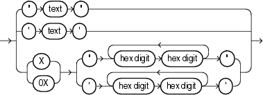
[Description of the illustration et_string.eps](img_text/et_string.md)

##### Purpose

If it is a series of characters, then those characters will be converted into the character set of the data file. If it is a series of hexadecimal digits, then there must be an even number of hexadecimal digits. The hexadecimal digits are converted into their binary translation, and the translation is treated as a character string in the character set of the data file. This means that once the hexadecimal digits have been converted into their binary translation, there is no other character set translation that occurs.

**Parent topic:** record_format_info Clause

#### 15.3.24 condition_spec

The `condition_spec` specifies one or more conditions that are joined by Boolean operators.

This clause is an expression that evaluates to either true or false. The conditions and Boolean operators are evaluated from left to right. (Boolean operators are applied after the conditions are evaluated.) To override the default order of evaluation of Boolean operators, you can use parentheses. The evaluation of `condition_spec` clauses slows record processing, so these clauses should be used sparingly. The syntax for `condition_spec` is as follows:

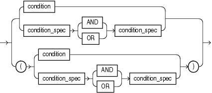
[Description of the illustration et_cond_spec.eps](img_text/et_cond_spec.md)

Note that if the condition specification contains any conditions that reference field names, then the condition specifications are evaluated only after all fields have been found in the record, and after blank trimming has been done. It is not useful to compare a field to `BLANKS` if blanks have been trimmed from the field.

The following are some examples of using `condition_spec`:

    empid = BLANKS OR last_name = BLANKS
    (dept_id = SPORTING GOODS OR dept_id = SHOES) AND total_sales != 0

**See Also:**

condition

**Parent topic:** record_format_info Clause

#### 15.3.25 \[directory object name:\] \[filename\]

The `[``directory object name``:] [``filename``]` clause is used to specify the name of an output file (`BADFILE`, `DISCARDFILE`, or `LOGFILE`).

##### Syntax

    [directory object name:] [filename]

- `directory object name`: The alias for the operating system directory on the database server for reading and writing files.
- `filename`: The name of the file that you want to create in the directory object.

To help make file names unique in parallel loads, the access driver does some symbol substitution. The symbol substitutions supported for the Linux, Unix, and Microsoft Windows operating systems are as follows (other platforms can have different symbols):

- `%p` is replaced by the process ID of the current process.

  For example, if the process ID of the access driver is `12345`, then a filename specified as `exttab_%p.log` becomes `exttab_12345.log.`

- ` %a` is replaced by the agent number of the current process. The agent number is the unique number assigned to each parallel process accessing the external table. This number is padded to the left with zeros to fill three characters.

  For example, if the third parallel agent is creating a file and you specify `bad_data_%a.bad` as the file name, then the agent creates a file named `bad_data_003.bad`.

- ` %%` is replaced by `%`. If there is a need to have a percent sign in the file name, then this symbol substitution is used.

  If the `%` character is encountered followed by anything other than one of the preceding characters, then an error is returned.

##### Purpose

Specifies the name of an output file (`BADFILE`, `DISCARDFILE`, or `LOGFILE`).

##### Usage Notes

To use this clause, you must supply either a directory object name or file name, or both. The directory object name is the name of a directory object where the user accessing the external table has privileges to write. If the directory object name is omitted, then the value specified for the `DEFAULT` `DIRECTORY` clause in the `CREATE` `TABLE...``ORGANIZATION` `EXTERNAL` statement is used.

If `%p` or `%a` is not used to create unique file names for output files, and an external table is being accessed in parallel, then it is possible that output files can be corrupted, or that agents may be unable to write to the files.

If you do not specify `BADFILE `(or `DISCARDFILE` or `LOGFILE`), then the `SQL_LOADER` access driver uses the name of the table, followed by `_%p` as the name of the file. If no extension is supplied for the file, then a default extension is used. For bad files, the default extension is `.bad;` for discard files, the default is `.dsc;` and for log files, the default is `.log`.

**Parent topic:** record_format_info Clause

#### 15.3.26 condition

A `condition` compares a range of bytes or a field from the record against a constant string. The source of the comparison can be either a field in the record or a byte range in the record. The comparison is done on a byte-by-byte basis. If a string is specified as the target of the comparison, then it will be translated into the character set of the data file. If the field has a noncharacter data type, then no data type conversion is performed on either the field value or the string. The syntax for a `condition` is as follows:

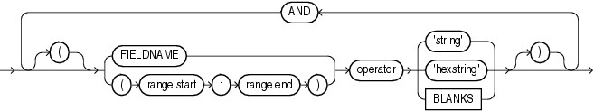
[Description of the illustration condition.eps](img_text/condition.md)

- range start : range end
  The `range start:range end` clause describes a range of bytes or characters in the record, which you want to use for a condition.

**Parent topic:** record_format_info Clause

##### 15.3.26.1 range start : range end

The `range start:range end` clause describes a range of bytes or characters in the record, which you want to use for a condition.

The value entered for the `STRING SIZES ARE` clause determines whether `range` refers to bytes, or to characters. The `range start` and `range end` are byte or character offsets into the record. The `range start` must be less than or equal to the `range end`. Finding ranges of characters is faster for data in fixed-width character sets than it is for data in varying-width character sets. If the range refers to parts of the record that do not exist, then the record is rejected when an attempt is made to reference the range. The `range start:range end` clause must be enclosed in parentheses. For example: `(10:13)`.

**Note:**

The data file should not mix binary data (including data types with binary counts, such as `VARCHAR`) and character data that is in a varying-width character set or more than one byte wide. In these cases, the access driver may not find the correct start for the field, because it treats the binary data as character data when trying to find the start.

The following are some examples of using `condition`:

    LOAD WHEN empid != BLANKS
    LOAD WHEN (10:13) = 0x'00000830'
    LOAD WHEN PRODUCT_COUNT = "MISSING"

**Parent topic:** condition

#### 15.3.27 IO_OPTIONS clause

The `IO_OPTIONS` clause allows you to specify I/O options used by the operating system for reading the data files. The only options available for specification are `DIRECTIO` (the default) and `NODIRECTIO`.

The `DIRECTIO` option is used by default, so an attempt is made to open the data file and read it using direct I/O. If successful, then the operating system and NFS server (if the file is on an NFS server) do not cache the data read from the file. This can improve the read performance for the data file, especially if the file is large. If direct I/O is not supported for the data file being read, then the file is opened and read but the `DIRECTIO` option is ignored.

If the `IO_OPTIONS` clause is specified with the `NODIRECTIO` option, then direct I/O is not used to read the data files.

If the `IO_OPTIONS` clause is not specified at all, then the default `DIRECTIO` option is used.

**Parent topic:** record_format_info Clause

#### 15.3.28 DNFS_DISABLE \| DNFS_ENABLE

Use these parameters to enable and disable use of the Direct NFS Client on input data files during an external tables operation.

The Direct NFS Client is an API that can be implemented by file servers to allow improved performance when Oracle accesses files on those servers.

External tables uses the Direct NFS Client interfaces by default when it reads data files over 1 gigabyte. For smaller files, the operating system's I/O interfaces are used. To use the Direct NFS Client on all input data files, use `DNFS_ENABLE.`

To disable use of the Direct NFS Client for all data files, specify `DNFS_DISABLE.`

**See Also:**

- [Oracle Grid Infrastructure Installation Guide for Linux](../cwlin/index.md) for information about enabling Direct NFS Client Oracle Disk Manager Control of NFS

**Parent topic:** record_format_info Clause

#### 15.3.29 DNFS_READBUFFERS

The `DNFS_READBUFFERS` parameter of the `record_format_info` clause is used to control the number of read buffers used by the Direct NFS Client.

Use `DNFS_READBUFFERS` to control the number of read buffers used by the Direct NFS Client. The Direct NFS Client is an API that can be implemented by file servers to allow improved performance when Oracle accesses files on those servers.

The default value for `DNFS_READBUFFERS` is 4.

Using larger values might compensate for inconsistent I/O from the Direct NFS Client file server, but it may result in increased memory usage.

**See Also:**

- [Oracle Grid Infrastructure Installation Guide for Linux](../cwlin/index.md) for information about enabling Direct NFS Client Oracle Disk Manager Control of NFS

**Parent topic:** record_format_info Clause

### 15.4 field_definitions Clause

In the `field_definitions` clause, you use the `FIELDS` parameter to name the fields in the data file and specify how to find them in records.

If the `field_definitions` clause is omitted, then the following is assumed:

- The fields are delimited by ','

- The fields are of data type `CHAR`

- The maximum length of the field is 255

- The order of the fields in the data file is the order in which the fields were defined in the external table

- No blanks are trimmed from the field

The following is an example of an external table created without any access parameters. It is followed by a sample data file, `info.dat`, that can be used to load it.

    CREATE TABLE emp_load (first_name CHAR(15), last_name CHAR(20), year_of_birth CHAR(4))
     ORGANIZATION EXTERNAL (TYPE ORACLE_LOADER DEFAULT DIRECTORY ext_tab_dir LOCATION ('info.dat'));

    Alvin,Tolliver,1976
    Kenneth,Baer,1963

The syntax for the `field_definitions` clause is as follows:

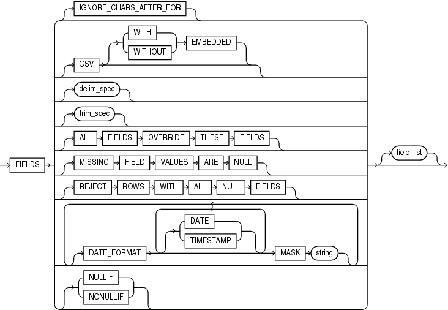
[Description of the illustration et_fields_clause.eps](img_text/et_fields_clause.md)

#### IGNORE_CHARS_AFTER_EOR

This optional parameter specifies that if extraneous characters are found after the last end-of-record but before the end of the file that do not satisfy the record definition, they will be ignored.

Error messages are written to the external tables log file if all four of the following conditions apply:

- The `IGNORE_CHARS_AFTER_EOR` parameter is set or the field allows free formatting. (Free formatting means either that the field is variable length or the field is specified by a delimiter or enclosure characters and is also variable length).

- Characters remain after the last end-of-record in the file.

- The access parameter `MISSING FIELD VALUES ARE NULL` is not set.

- The field does not have absolute positioning.

The error messages that get written to the external tables log file are as follows:

    KUP-04021: field formatting error for field Col1
    KUP-04023: field start is after end of record
    KUP-04101: record 2 rejected in file /home/oracle/datafiles/example.dat

#### CSV

To direct external tables to access the data files as comma-separated-values format files, use the `FIELDS` `CSV` clause. This assumes that the file is a stream record format file with the normal carriage return string (for example, `\n` on UNIX or Linux operating systems and either `\n` or `\r\n` on Windows operating systems). Record terminators can be included (embedded) in data values. The syntax for the `FIELDS` `CSV` clause is as follows:

    FIELDS CSV [WITH EMBEDDED | WITHOUT EMBEDDED] [TERMINATED BY ','] [OPTIONALLY ENCLOSED BY '"']

The following are key points regarding the `FIELDS` `CSV` clause:

- The default is to not use the `FIELDS` `CSV` clause.

- The `WITH` `EMBEDDED` and `WITHOUT` `EMBEDDED` options specify whether record terminators are included (embedded) in the data. The `WITH` `EMBEDDED` option is the default.

- If `WITH` `EMBEDDED` is used, then embedded record terminators must be enclosed, and intra-datafile parallelism is disabled for external table loads.

- The `TERMINATED BY ','` and `OPTIONALLY ENCLOSED BY '"'` options are the defaults and do not have to be specified. You can override them with different termination and enclosure characters.

- When the `CSV` clause is used, a delimiter specification is not allowed at the field level and only delimitable data types are allowed. Delimitable data types include `CHAR`, datetime, interval, and numeric `EXTERNAL`.

- The `TERMINATED` `BY` and `ENCLOSED` `BY` clauses cannot be used at the field level when the CSV clause is specified.

- When the `CSV` clause is specified, the default trimming behavior is `LDRTRIM`. You can override this by specifying one of the other external table trim options (`NOTRIM`, `LRTRIM`, `LTRIM`, or `RTRIM`).

- The `CSV` clause must be specified after the `IGNORE_CHARS_AFTER_EOR` clause and before the `delim_spec` clause.

#### delim_spec Clause

The `delim_spec` clause is used to identify how all fields are terminated in the record. The `delim_spec` specified for all fields can be overridden for a particular field as part of the `field_list` clause. For a full description of the syntax, see delim_spec.

#### trim_spec Clause

The `trim_spec` clause specifies the type of whitespace trimming to be performed by default on all character fields. The `trim_spec` clause specified for all fields can be overridden for individual fields by specifying a `trim_spec` clause for those fields. For a full description of the syntax, see trim_spec.

#### ALL FIELDS OVERRIDE

The `ALL FIELDS OVERRIDE` clause tells the access driver that all fields are present and that they are in the same order as the columns in the external table. You only need to specify fields that have a special definition. This clause must be specified after the optional `trim_spec` clause and before the optional `MISSING FIELD VALUES ARE NULL` clause.

The following is a sample use of thee `ALL` `FIELDS` `OVERRIDE` clause. The only field that had to be specified was the hiredate, which required a data format mask. All the other fields took default values.

    FIELDS TERMINATED BY "," OPTIONALLY ENCLOSED BY '"' LDRTRIM
    ALL FIELDS OVERRIDE
    REJECT ROWS WITH ALL NULL FIELDS
    (
     HIREDATE CHAR(20) DATE_FORMAT DATE MASK "DD-Month-YYYY"
    )

#### MISSING FIELD VALUES ARE NULL

`MISSING FIELD VALUES ARE NULL` sets to null any fields for which position is not explicitly stated and there is not enough data to fill them. For a full description see MISSING FIELD VALUES ARE NULL.

#### REJECT ROWS WITH ALL NULL FIELDS

`REJECT ROWS WITH ALL NULL FIELDS` indicates that a row will not be loaded into the external table if all referenced fields in the row are null. If this parameter is not specified, then the default value is to accept rows with all null fields. The setting of this parameter is written to the log file either as "reject rows with all null fields" or as "rows with all null fields are accepted."

#### DATE_FORMAT

The `DATE_FORMAT` clause allows you to specify a datetime format mask once at the fields level, and have it apply to all fields of that type which do not have their own mask specified. The datetime format mask must be specified after the optional `REJECT ROWS WITH ALL NULL FIELDS` clause and before the `fields_list` clause.

The `DATE_FORMAT` can be specified for the following datetime types: `DATE`, `TIME`, `TIME` `WITH` `TIME` `ZONE`, `TIMESTAMP`, and `TIMESTAMP` `WITH` `TIME` `ZONE`.

The following example shows a sample use of the `DATE_FORMAT` clause that applies a date mask of `DD-Month-YYYY` to any `DATE` type fields:

    FIELDS TERMINATED BY "," OPTIONALLY ENCLOSED BY '"' LDRTRIM
    REJECT ROWS WITH ALL NULL FIELDS
    DATE_FORMAT DATE MASK "DD-Month-YYYY"

        (
           EMPNO,
           ENAME,
           JOB,
           MGR,
           HIREDATE CHAR(20),
           SAL,
           COMM,
           DEPTNO,
           PROJNO,
           ENTRYDATE CHAR(20)
        )

#### NULLIF \| NO NULLIF

The `NULLIF` clause applies to all character fields (for example, `CHAR`, `VARCHAR`, `VARCHARC`, external `NUMBER`, and datetime).

The syntax is as follows:

    NULLIF {=|!=}{"char_string"|x'hex_string'|BLANKS}

If there is a match using the equal or not equal specification for a field, then the field is set to `NULL` for that row.

The `char_string` and `hex_string` must be enclosed in single or double quotation marks.

If a `NULLIF` specification is specified at the field level, it overrides this `NULLIF` clause.

If there is a field to which you do not want the NULLIF clause to apply, you can specify `NO` `NULLIF` at the field level (as shown in the following example).

The `NULLIF` clause must be specified after the optional `REJECT ROWS WITH ALL NULL FIELDS` clause and before the `fields_list` clause.

The following is an example of using the `NULLIF` clause. The `MGR` field is set to `NO` `NULLIF` which means that the `NULLIF="NONE"` clause will not apply to that field.

    FIELDS TERMINATED BY "," OPTIONALLY ENCLOSED BY '"' LDRTRIM
    REJECT ROWS WITH ALL NULL FIELDS
    NULLIF = "NONE"
    (
      EMPNO,
      ENAME,
      JOB,
      MGR
     )

#### field_list Clause

The `field_list` clause identifies the fields in the data file and their data types. For a full description of the syntax, see field_list.

- delim_spec
  The `delim_spec` clause is used to find the end (and if `ENCLOSED BY` is specified, the start) of a field.
- trim_spec
  The `trim_spec` clause is used to specify that spaces should be trimmed from the beginning of a text field, the end of a text field, or both.
- MISSING FIELD VALUES ARE NULL
  The effect of `MISSING FIELD VALUES ARE NULL` depends on whether `POSITION` is used to explicitly state field positions.
- field_list
  The `field_definitions` `field_list` clause identifies the fields in the data file and their data types.
- pos_spec Clause
  The `ORACLE_LOADER` `pos_spec` clause indicates the position of the column within the record.
- datatype_spec Clause
  The `ORACLE_LOADER` `datatype_spec` clause describes the data type of a field in the data file if the data type is different than the default.
- init_spec Clause
  The `init_spec` clause for external tables is used to specify when a field should be set to `NULL`, or when it should be set to a default value.
- LLS Clause

**Parent topic:** The ORACLE_LOADER Access Driver

#### 15.4.1 delim_spec

The `delim_spec` clause is used to find the end (and if `ENCLOSED BY` is specified, the start) of a field.

##### Syntax

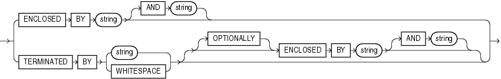
[Description of the illustration et_delim_spec.eps](img_text/et_delim_spec.md)

##### Usage Notes

If you specify `ENCLOSED BY`, then the `ORACLE_LOADER` access driver starts at the current position in the record, and skips over all whitespace looking for the first delimiter. All whitespace between the current position and the first delimiter is ignored. Next, the access driver looks for the second enclosure delimiter (or looks for the first one again if a second one is not specified). Everything between those two delimiters is considered part of the field.

If `TERMINATED BY ``string` is specified with the `ENCLOSED BY` clause, then the terminator string must immediately follow the second enclosure delimiter. Any whitespace between the second enclosure delimiter and the terminating delimiter is skipped. If anything other than whitespace is found between the two delimiters, then the row is rejected for being incorrectly formatted.

If `TERMINATED BY` is specified without the `ENCLOSED BY` clause, then everything between the current position in the record and the next occurrence of the termination string is considered part of the field.

If `OPTIONALLY` is specified, then `TERMINATED BY` must also be specified. The `OPTIONALLY` parameter means the `ENCLOSED BY` delimiters can either both be present or both be absent. The terminating delimiter must be present, regardless of whether the `ENCLOSED BY` delimiters are present. If `OPTIONALLY` is specified, then the access driver skips over all whitespace, looking for the first non-blank character. After the first non-blank character is found, the access driver checks to see if the current position contains the first enclosure delimiter. If it does, then the access driver finds the second enclosure string. Everything between the first and second enclosure delimiters is considered part of the field. The terminating delimiter must immediately follow the second enclosure delimiter (with optional whitespace allowed between the second enclosure delimiter and the terminating delimiter). If the first enclosure string is not found at the first non-blank character, then the access driver looks for the terminating delimiter. In this case, leading blanks are trimmed.

After the delimiters have been found, the current position in the record is set to the spot after the last delimiter for the field. If `TERMINATED BY WHITESPACE` was specified, then the current position in the record is set to after all whitespace following the field.

To find out more about the access driver's default trimming behavior, refer to "Trimming Whitespace." You can override this behavior by using with `LTRIM` and `RTRIM`.

A missing terminator for the last field in the record is not an error. The access driver proceeds as if the terminator was found. It is an error if the second enclosure delimiter is missing.

The string used for the second enclosure can be included in the data field by including the second enclosure twice. For example, if a field is enclosed by single quotation marks, then it could contain a single quotation mark by specifying two single quotation marks in a row, as shown in the word don't in the following example:

    'I don''t like green eggs and ham'

There is no way to quote a terminator string in the field data without using enclosing delimiters. Because the field parser does not look for the terminating delimiter until after it has found the enclosing delimiters, the field can contain the terminating delimiter.

In general, specifying single characters for the strings is faster than multiple characters. Also, searching data in fixed-width character sets is usually faster than searching data in varying-width character sets.

**Note:**

The use of the backslash character (`\`) within strings is not supported in external tables.

- Example: External Table with Terminating Delimiters
  See how to create an external table that uses terminating delimiters, and a data file with terminating delimiters.
- Example: External Table with Enclosure and Terminator Delimiters
  See how to create an external table that uses both enclosure and terminator delimiters.
- Example: External Table with Optional Enclosure Delimiters
  See how to create an external table that uses optional enclosure delimiters.

**Related Topics**

- [Trimming Whitespace](oracle-sql-loader-field-list-contents.md)

**Parent topic:** field_definitions Clause

##### 15.4.1.1 Example: External Table with Terminating Delimiters

See how to create an external table that uses terminating delimiters, and a data file with terminating delimiters.

This table is created to use terminating delimiters. It is followed by an example of a data file that can be used to load the table.

    CREATE TABLE emp_load (first_name CHAR(15), last_name CHAR(20), year_of_birth CHAR(4))
      ORGANIZATION EXTERNAL (TYPE ORACLE_LOADER DEFAULT DIRECTORY ext_tab_dir
                             ACCESS PARAMETERS (FIELDS TERMINATED BY WHITESPACE)
                             LOCATION ('info.dat'));

    Alvin Tolliver 1976
    Kenneth Baer 1963
    Mary Dube 1973

**Parent topic:** delim_spec

##### 15.4.1.2 Example: External Table with Enclosure and Terminator Delimiters

See how to create an external table that uses both enclosure and terminator delimiters.

The following is an example of an external table that uses both enclosure and terminator delimiters. Remember that all whitespace between a terminating string and the first enclosure string is ignored, as is all whitespace between a second enclosing delimiter and the terminator. The example is followed by a sample of the data file that can be used to load it.

    CREATE TABLE emp_load (first_name CHAR(15), last_name CHAR(20), year_of_birth CHAR(4))
      ORGANIZATION EXTERNAL (TYPE ORACLE_LOADER DEFAULT DIRECTORY ext_tab_dir
                            ACCESS PARAMETERS (FIELDS TERMINATED BY "," ENCLOSED BY "("  AND ")")
                            LOCATION ('info.dat'));

    (Alvin) ,   (Tolliver),(1976)
    (Kenneth),  (Baer) ,(1963)
    (Mary),(Dube) ,   (1973)

**Parent topic:** delim_spec

##### 15.4.1.3 Example: External Table with Optional Enclosure Delimiters

See how to create an external table that uses optional enclosure delimiters.

This table is an external table that is created to use optional enclosure delimiters. Note that `LRTRIM` is used to trim leading and trailing blanks from fields. The example is followed by an examplle of a data file that can be used to load the table.

    CREATE TABLE emp_load (first_name CHAR(15), last_name CHAR(20), year_of_birth CHAR(4))
      ORGANIZATION EXTERNAL (TYPE ORACLE_LOADER DEFAULT DIRECTORY ext_tab_dir
                             ACCESS PARAMETERS (FIELDS TERMINATED BY ','
                                                OPTIONALLY ENCLOSED BY '(' and ')'
                                                LRTRIM)
                             LOCATION ('info.dat'));

    Alvin ,   Tolliver , 1976
    (Kenneth),  (Baer), (1963)
    ( Mary ), Dube ,    (1973)

**Parent topic:** delim_spec

#### 15.4.2 trim_spec

The `trim_spec` clause is used to specify that spaces should be trimmed from the beginning of a text field, the end of a text field, or both.

##### Description

Directs the `ORACLE_LOADER` access driver to trim spaces from the beginning of a text field, the end of a text field, or both. Spaces include blanks and other non-printing characters, such as tabs, line feeds, and carriage returns.

##### Default

The default is `LDRTRIM`. Specifying `NOTRIM` yields the fastest performance.

##### Syntax

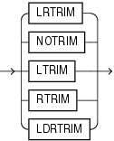
[Description of the illustration et_trim_spec.eps](img_text/et_trim_spec.md)

##### Options

- `NOTRIM` Indicates that you want no characters trimmed from the field.
- `LRTRIM` Indicates that you want both leading and trailing spaces trimmed.
- `LTRIM` Indicates that you want leading spaces trimmed.
- `RTRIM` Indicates that you want trailing spaces trimmed.
- `LDRTRIM` Provides compatibility with SQL\*Loader trim features. It is the same as `NOTRIM` except in the following cases:
  - If the field is not a delimited field, then spaces will be trimmed from the right.
  - If the field is a delimited field with `OPTIONALLY ENCLOSED BY` specified, and the optional enclosures are missing for a particular instance, then spaces are trimmed from the left.

##### Usage Notes

The `trim_spec` clause can be specified before the field list to set the default trimming for all fields. If `trim_spec` is omitted before the field list, then `LDRTRIM` is the default trim setting. The default trimming can be overridden for an individual field as part of the `datatype_spec`.

If trimming is specified for a field that is all spaces, then the field will be set to `NULL`.

In the following example, all data is fixed-length; however, the character data will not be loaded with leading spaces. The example is followed by a sample of the data file that can be used to load it.

    CREATE TABLE emp_load (first_name CHAR(15), last_name CHAR(20),
    year_of_birth CHAR(4))
      ORGANIZATION EXTERNAL (TYPE ORACLE_LOADER DEFAULT DIRECTORY ext_tab_dir
                             ACCESS PARAMETERS (FIELDS LTRIM)
                             LOCATION ('info.dat'));

    Alvin,           Tolliver,1976
    Kenneth,         Baer,    1963
    Mary,            Dube,    1973

**Parent topic:** field_definitions Clause

#### 15.4.3 MISSING FIELD VALUES ARE NULL

The effect of `MISSING FIELD VALUES ARE NULL` depends on whether `POSITION` is used to explicitly state field positions.

For example:

- The default behavior is that if field position is not explicitly stated and there is not enough data in a record for all fields, then the record is rejected. You can override this behavior by using `MISSING FIELD VALUES ARE NULL` to define as NULL any fields for which there is no data available.

- If field position is explicitly stated, then fields for which there are no values are always defined as NULL, regardless of whether `MISSING FIELD VALUES ARE NULL` is used.

In the following example, the second record is stored with a `NULL` set for the `year_of_birth `column, even though the data for the year of birth is missing from the data file. If the `MISSING FIELD VALUES ARE NULL` clause were omitted from the access parameters, then the second row would be rejected because it did not have a value for the `year_of_birth` column. The example is followed by a sample of the data file that can be used to load it.

    CREATE TABLE emp_load (first_name CHAR(15), last_name CHAR(20), year_of_birth INT)
      ORGANIZATION EXTERNAL (TYPE ORACLE_LOADER DEFAULT DIRECTORY ext_tab_dir
                             ACCESS PARAMETERS (FIELDS TERMINATED BY ","
                                                MISSING FIELD VALUES ARE NULL)
                             LOCATION ('info.dat'));

    Alvin,Tolliver,1976
    Baer,Kenneth
    Mary,Dube,1973

**Parent topic:** field_definitions Clause

#### 15.4.4 field_list

The `field_definitions` `field_list` clause identifies the fields in the data file and their data types.

##### Syntax

The syntax for the `field_list` clause is as follows:

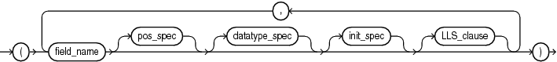
[Description of the illustration et_field_list.eps](img_text/et_field_list.md)

The `field list` clauses are as follows:

- field_name: A string identifying the name of a field in the data file. If the string is not within quotation marks, then the name is uppercased when matching field names with column names in the external table.

  If `field_name` matches the name of a column in the external table that is referenced in the query, then the field value is used for the value of that external table column. If the name does not match any referenced name in the external table, then the field is not loaded but can be used for clause evaluation (for example `WHEN` or `NULLIF`).

- pos_spec: Indicates the position of the column within the record. For a full description of the syntax, see pos_spec Clause.

- datatype_spec: Indicates the data type of the field. If `datatype_spec` is omitted, then the access driver assumes the data type is `CHAR(255)`. For a full description of the syntax, see datatype_spec Clause.

- init_spec: Indicates when a field is `NULL` or has a default value. For a full description of the syntax, see init_spec Clause.

- LLS: When `LLS` is specified for a field, `ORACLE_LOADER` does not load the value of the field into the corresponding column. Instead, it use the information in the value to determine where to find the value of the field. See LLS Clause.

##### Purpose

The `field_list` clause identifies the fields in the data file and their data types. Evaluation criteria for the `field_list` clause are as follows:

- If no data type is specified for a field, then it is assumed to be `CHAR(1)` for a nondelimited field, and `CHAR(255)`for a delimited field.

- If no field list is specified, then the fields in the data file are assumed to be in the same order as the fields in the external table. The data type for all fields is `CHAR(255)` unless the column in the database is `CHAR` or `VARCHAR`. If the column in the database is `CHAR` or `VARCHAR`, then the data type for the field is still `CHAR` but the length is either 255 or the length of the column, whichever is greater.

- If no field list is specified and no `delim_spec` clause is specified, then the fields in the data file are assumed to be in the same order as fields in the external table. All fields are assumed to be `CHAR(255)` and terminated by a comma.

##### Example

This example shows the definition for an external table with no `field_list` and a `delim_spec`. It is followed by a sample of the data file that can be used to load it.

    CREATE TABLE emp_load (first_name CHAR(15), last_name CHAR(20), year_of_birth INT)
      ORGANIZATION EXTERNAL (TYPE ORACLE_LOADER DEFAULT DIRECTORY ext_tab_dir
                             ACCESS PARAMETERS (FIELDS TERMINATED BY "|")
                             LOCATION ('info.dat'));

    Alvin|Tolliver|1976
    Kenneth|Baer|1963
    Mary|Dube|1973

**Parent topic:** field_definitions Clause

#### 15.4.5 pos_spec Clause

The `ORACLE_LOADER` `pos_spec` clause indicates the position of the column within the record.

The setting of the `STRING SIZES ARE IN` clause determines whether `pos_spec` refers to byte positions or character positions. Using character positions with varying-width character sets takes significantly longer than using character positions with fixed-width character sets. Binary and multibyte character data should not be present in the same data file when `pos_spec` is used for character positions. If they are, then the results are unpredictable.

- pos_spec Clause Syntax
  The syntax for the `ORACLE_LOADER` `pos_spec` clause is as follows.
- start
  The `pos_spec` clause `start` parameter indicates the number of bytes from the beginning of the record to where the field begins.
- \*
  The `pos_spec` clause `*` parameter indicates that the field begins at the first byte after the end of the previous field.
- increment
  The `pos_spec` clause `increment` parameter positions the start of the field is a fixed number of bytes from the end of the previous field.
- end
  The `pos_spec` clause `end` parameter indicates the absolute byte offset into the record for the last byte of the field.
- length
  The `pos_spec` clause `length` parameter value indicates that the end of the field is a fixed number of bytes from the start.

**Parent topic:** field_definitions Clause

##### 15.4.5.1 pos_spec Clause Syntax

The syntax for the `ORACLE_LOADER` `pos_spec` clause is as follows.

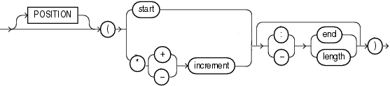
[Description of the illustration et_position_spec.eps](img_text/et_position_spec.md)

**Parent topic:** pos_spec Clause

##### 15.4.5.2 start

The `pos_spec` clause `start` parameter indicates the number of bytes from the beginning of the record to where the field begins.

The `start` parameter enables you to position the start of the field at an absolute spot in the record, rather than relative to the position of the previous field.

**Parent topic:** pos_spec Clause

##### 15.4.5.3 \*

The `pos_spec` clause `*` parameter indicates that the field begins at the first byte after the end of the previous field.

The `*` parameter is useful with `ORACLE_LOADER` where you have a varying-length field followed by a fixed-length field. This option cannot be used for the first field in the record.

**Parent topic:** pos_spec Clause

##### 15.4.5.4 increment

The `pos_spec` clause `increment` parameter positions the start of the field is a fixed number of bytes from the end of the previous field.

The `increment` parameter positions the start of the field at a fixed number of bytes from the end of the previous field. Use `*-``increment` to indicate that the start of the field starts before the current position in the record (this is a costly operation for multibyte character sets). To move the start after the current position, use `*+``increment`

**Parent topic:** pos_spec Clause

##### 15.4.5.5 end

The `pos_spec` clause `end` parameter indicates the absolute byte offset into the record for the last byte of the field.

Use the `end` parameter to set the absolute byte offset into the record for the last byte of the field. If `start` is specified along with `end`, then `end` cannot be less than `start`. If `*` or `increment` is specified along with `end`, and the `start` evaluates to an offset larger than the `end` for a particular record, then that record will be rejected.

**Parent topic:** pos_spec Clause

##### 15.4.5.6 length

The `pos_spec` clause `length` parameter value indicates that the end of the field is a fixed number of bytes from the start.

Use the `length` parameter when you want to set fixed-length fields when the start is specified with `*`. The following example shows various ways of using `pos_spec`. It is followed by an example of a data file that you can use to load it.

    CREATE TABLE emp_load (first_name CHAR(15),
                          last_name CHAR(20),
                          year_of_birth INT,
                          phone CHAR(12),
                          area_code CHAR(3),
                          exchange CHAR(3),
                          extension CHAR(4))
      ORGANIZATION EXTERNAL
      (TYPE ORACLE_LOADER
       DEFAULT DIRECTORY ext_tab_dir
       ACCESS PARAMETERS
         (RECORDS CHARACTERSET we8iso8859p1
          FIELDS RTRIM
                (first_name (1:15) CHAR(15),
                 last_name (*:+20),
                 year_of_birth (36:39),
                 phone (40:52),
                 area_code (*-12: +3),
                 exchange (*+1: +3),
                 extension (*+1: +4)))
       LOCATION ('info.dat'));

    Alvin          Tolliver            1976415-922-1982
    Kenneth        Baer                1963212-341-7912
    Mary           Dube                1973309-672-2341

In this example, the declared `RECORDS CHARACTERSET`, `we8iso8859p1`, is not a multi-byte character set. It is guaranteed that every character is represented as single byte. The `POSITION` clause calculations to determine where the data field starts and ends (including the `*` and `+` operators) are based on bytes rather than characters (that is, characters must only require 1 byte to represent them, such as the Oracle character set `WE8ISO8859P1`). If you use a variable length character set (for example, Unicode variants, `JIS X 0208-1990`, or other multibyte character sets, where the field data contains one or more multibyte characters), then the calculations will be incorrect.

**Parent topic:** pos_spec Clause

#### 15.4.6 datatype_spec Clause

The `ORACLE_LOADER` `datatype_spec` clause describes the data type of a field in the data file if the data type is different than the default.

The data type of the field can be different than the data type of a corresponding column in the external table. The access driver handles the necessary conversions.

- datatype_spec Clause Syntax
  The syntax for the `ORACLE_LOADER` `datatype_spec` clause is as follows:
- \[UNSIGNED\] INTEGER \[EXTERNAL\] \[(len)\]
  The `datatype_spec` clause `[UNSIGNED] INTEGER [EXTERNAL] [(len)]` defines a field as an integer.
- DECIMAL \[EXTERNAL\] and ZONED \[EXTERNAL\]
  The `DECIMAL` clause is used to indicate that the field is a packed decimal number. The `ZONED` clause is used to indicate that the field is a zoned decimal number.
- ORACLE_DATE
  `ORACLE_DATE` is a field containing a date in the Oracle binary date format.
- ORACLE_NUMBER
  `ORACLE_NUMBER` is a field containing a number in the Oracle number format.
- Floating-Point Numbers
  The following four data types, `DOUBLE`, `FLOAT`, `BINARY_DOUBLE`, and `BINARY_FLOAT` are floating-point numbers.
- DOUBLE
  The `DOUBLE` clause indicates that the field is the same format as the C language `DOUBLE` data type on the platform where the access driver is executing.
- FLOAT \[EXTERNAL\]
  The `FLOAT` clause indicates that the field is the same format as the C language `FLOAT` data type on the platform where the access driver is executing.
- BINARY_DOUBLE
  The `datatype_spec` clause value `BINARY_DOUBLE` is a 64-bit, double-precision, floating-point number data type.
- BINARY_FLOAT
  The `datatype_spec` clause value `BINARY_FLOAT` is a 32-bit, single-precision, floating-point number data type.
- RAW
  The `RAW` clause is used to indicate that the source data is binary data.
- CHAR
  The datatype_spec clause data type `CHAR` clause is used to indicate that a field is a character data type.
- date_format_spec
  The `date_format_spec` clause is used to indicate that a character string field contains date data, time data, or both, in a specific format.
- VARCHAR and VARRAW
  The `datatype_spec` clause `VARCHAR` data type defines character data, and the `VARRAW` data type defines binary data.
- VARCHARC and VARRAWC
  The datatype_spec clause VARCHARC data type defines character data, and the VARRAWC data type defines binary data.

**Parent topic:** field_definitions Clause

##### 15.4.6.1 datatype_spec Clause Syntax

The syntax for the `ORACLE_LOADER` `datatype_spec` clause is as follows:

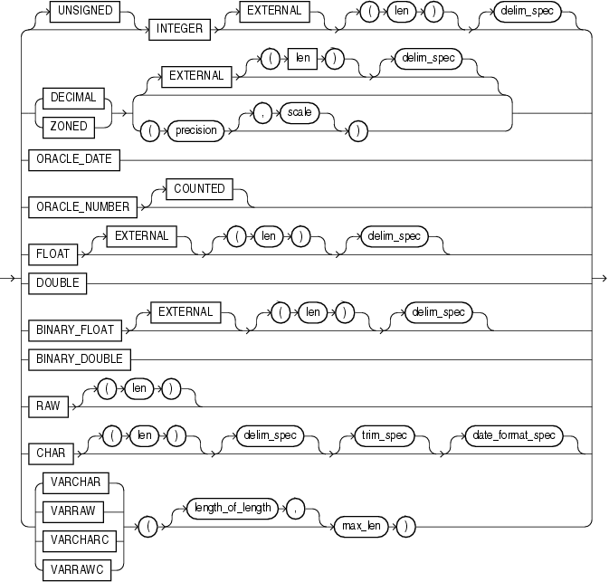
[Description of the illustration et_datatype_spec.eps](img_text/et_datatype_spec.md)

If the number of bytes or characters in any field is 0, then the field is assumed to be `NULL`. The optional `DEFAULTIF` clause specifies when the field is set to its default value. Also, the optional `NULLIF` clause specifies other conditions for when the column associated with the field is set to `NULL`. If the `DEFAULTIF` or `NULLIF` clause is `TRUE`, then the actions of those clauses override whatever values are read from the data file.

**Related Topics**

- init_spec Clause
- [Oracle Database SQL Language Reference](../sqlrf/Data-Types.md)

**Parent topic:** datatype_spec Clause

##### 15.4.6.2 \[UNSIGNED\] INTEGER \[EXTERNAL\] \[(len)\]

The `datatype_spec` clause `[UNSIGNED] INTEGER [EXTERNAL] [(len)]` defines a field as an integer.

This clause defines a field as an integer. If `EXTERNAL` is specified, then the number is a character string. If `EXTERNAL` is not specified, then the number is a binary field. The valid values for `len` in binary integer fields are 1, 2, 4, and 8. If `len` is omitted for binary integers, then the default value is whatever the value of `sizeof(int)` is on the platform where the access driver is running. Use of the `DATA IS {BIG|LITTLE} ENDIAN` clause may cause the data to be byte-swapped before it is stored.

If `EXTERNAL` is specified, then the value of `len` is the number of bytes or characters in the number (depending on the setting of the `STRING SIZES ARE IN BYTES` or `CHARACTERS` clause). If no length is specified, then the default value is 255.

The default value of the `[UNSIGNED] INTEGER [EXTERNAL] [(len)]` data type is determined as follows:

- If no length specified, then the default length is 1.

- If no length is specified and the field is delimited with a `DELIMITED BY NEWLINE` clause, then the default length is 1.

- If no length is specified and the field is delimited with a `DELIMITED BY` clause, then the default length is 255 (unless the delimiter is `NEWLINE`, as stated above).

**Parent topic:** datatype_spec Clause

##### 15.4.6.3 DECIMAL \[EXTERNAL\] and ZONED \[EXTERNAL\]

The `DECIMAL` clause is used to indicate that the field is a packed decimal number. The `ZONED` clause is used to indicate that the field is a zoned decimal number.

The `precision` field indicates the number of digits in the number. The `scale` field is used to specify the location of the decimal point in the number. It is the number of digits to the right of the decimal point. If `scale` is omitted, then a value of 0 is assumed.

Note that there are different encoding formats of zoned decimal numbers depending on whether the character set being used is EBCDIC-based or ASCII-based. If the language of the source data is EBCDIC, then the zoned decimal numbers in that file must match the EBCDIC encoding. If the language is ASCII-based, then the numbers must match the ASCII encoding.

If the `EXTERNAL` parameter is specified, then the data field is a character string whose length matches the precision of the field.

**Parent topic:** datatype_spec Clause

##### 15.4.6.4 ORACLE_DATE

`ORACLE_DATE` is a field containing a date in the Oracle binary date format.

This is the format used by the `DTYDAT` data type in Oracle Call Interface (OCI) programs. The field is a fixed length of 7.

**Parent topic:** datatype_spec Clause

##### 15.4.6.5 ORACLE_NUMBER

`ORACLE_NUMBER` is a field containing a number in the Oracle number format.

The field is a fixed length (the maximum size of an Oracle number field) unless `COUNTED` is specified, in which case the first byte of the field contains the number of bytes in the rest of the field.

`ORACLE_NUMBER` is a fixed-length 22-byte field. The length of an `ORACLE_NUMBER COUNTED` field is one for the count byte, plus the number of bytes specified in the count byte.

**Parent topic:** datatype_spec Clause

##### 15.4.6.6 Floating-Point Numbers

The following four data types, `DOUBLE`, `FLOAT`, `BINARY_DOUBLE`, and `BINARY_FLOAT` are floating-point numbers.

The following four data types, `DOUBLE`, `FLOAT`, `BINARY_DOUBLE`, and `BINARY_FLOAT` are floating-point numbers.

`DOUBLE` and `FLOAT` are the floating-point formats used natively on the platform in use. They are the same data types used by default for the `DOUBLE` and `FLOAT` data types in a C program on that platform. `BINARY_FLOAT` and `BINARY_DOUBLE` are floating-point numbers that conform substantially with the Institute for Electrical and Electronics Engineers (IEEE) Standard for Binary Floating-Point Arithmetic, IEEE Standard 754-1985. Because most platforms use the IEEE standard as their native floating-point format, `FLOAT` and `BINARY_FLOAT` are the same on those platforms and `DOUBLE` and `BINARY_DOUBLE` are also the same.

**Note:**

See [Oracle Database SQL Language Reference](../sqlrf/Data-Types.md) for more information about floating-point numbers

**Parent topic:** datatype_spec Clause

##### 15.4.6.7 DOUBLE

The `DOUBLE` clause indicates that the field is the same format as the C language `DOUBLE` data type on the platform where the access driver is executing.

Use of the `DATA IS {BIG | LITTLE} ENDIAN` clause may cause the data to be byte-swapped before it is stored. This data type may not be portable between certain platforms.

**Parent topic:** datatype_spec Clause

##### 15.4.6.8 FLOAT \[EXTERNAL\]

The `FLOAT` clause indicates that the field is the same format as the C language `FLOAT` data type on the platform where the access driver is executing.

The `FLOAT` clause indicates that the field is the same format as the C language `FLOAT` data type on the platform where the access driver is executing. Use of the `DATA IS {BIG | LITTLE} ENDIAN` clause may cause the data to be byte-swapped before it is stored. This data type may not be portable between certain platforms.

If the `EXTERNAL` parameter is specified, then the field is a character string whose maximum length is 255.

**Parent topic:** datatype_spec Clause

##### 15.4.6.9 BINARY_DOUBLE

The `datatype_spec` clause value `BINARY_DOUBLE` is a 64-bit, double-precision, floating-point number data type.

Each `BINARY_DOUBLE` value requires 9 bytes, including a length byte. See the information in the note provided for the `FLOAT` data type for more details about floating-point numbers.

**Parent topic:** datatype_spec Clause

##### 15.4.6.10 BINARY_FLOAT

The `datatype_spec` clause value `BINARY_FLOAT` is a 32-bit, single-precision, floating-point number data type.

Each `BINARY_FLOAT` value requires 5 bytes, including a length byte. See the information in the note provided for the `FLOAT` data type for more details about floating-point numbers.

**Parent topic:** datatype_spec Clause

##### 15.4.6.11 RAW

The `RAW` clause is used to indicate that the source data is binary data.

The `len` for `RAW` fields is always in number of bytes. When a `RAW` field is loaded in a character column, the data that is written into the column is the hexadecimal representation of the bytes in the `RAW` field.

**Parent topic:** datatype_spec Clause

##### 15.4.6.12 CHAR

The datatype_spec clause data type `CHAR` clause is used to indicate that a field is a character data type.

The length (`len)` for `CHAR` fields specifies the largest number of bytes or characters in the field. The `len` is in bytes or characters, depending on the setting of the `STRING SIZES ARE IN` clause.

If no length is specified for a field of data type `CHAR`, then the size of the field is assumed to be 1, unless the field is delimited:

- For a delimited `CHAR` field, if a length is specified, then that length is used as a maximum.

- For a delimited `CHAR` field for which no length is specified, the default is 255 bytes.

- For a delimited `CHAR` field that is greater than 255 bytes, you must specify a maximum length. Otherwise, you receive an error stating that the field in the data file exceeds maximum length.

The following example shows the use of the `CHAR` clause.

    SQL> CREATE TABLE emp_load
      2    (employee_number      CHAR(5),
      3     employee_dob         CHAR(20),
      4     employee_last_name   CHAR(20),
      5     employee_first_name  CHAR(15),
      6     employee_middle_name CHAR(15),
      7     employee_hire_date   DATE)
      8  ORGANIZATION EXTERNAL
      9    (TYPE ORACLE_LOADER
     10     DEFAULT DIRECTORY def_dir1
     11     ACCESS PARAMETERS
     12       (RECORDS DELIMITED BY NEWLINE
     13        FIELDS (employee_number      CHAR(2),
     14                employee_dob         CHAR(20),
     15                employee_last_name   CHAR(18),
     16                employee_first_name  CHAR(11),
     17                employee_middle_name CHAR(11),
     18                employee_hire_date   CHAR(10) date_format DATE mask "mm/dd/yyyy"
     19               )
     20       )
     21     LOCATION ('info.dat')
     22    );

    Table created.

**Parent topic:** datatype_spec Clause

##### 15.4.6.13 date_format_spec

The `date_format_spec` clause is used to indicate that a character string field contains date data, time data, or both, in a specific format.

This information is used only when a character field is converted to a date or time data type and only when a character string field is mapped into a date column.

The syntax for the `date_format_spec` clause is as follows:

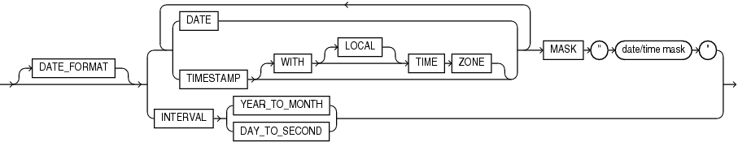
[Description of the illustration et_dateformat.eps](img_text/et_dateformat.md)

For detailed information about the correct way to specify date and time formats, see Oracle Database SQL Reference.

- DATE
  The `DATE` clause indicates that the string contains a date.
- MASK
  The `MASK` clause is used to override the default globalization format mask for the data type.
- TIMESTAMP
  The `TIMESTAMP` clause indicates that a field contains a formatted timestamp.
- INTERVAL
  The `INTERVAL` clause indicates that a field contains a formatted interval.

**Related Topics**

- [Oracle Database SQL Language Reference](../sqlrf/Data-Types.md)

**Parent topic:** datatype_spec Clause

###### 15.4.6.13.1 DATE

The `DATE` clause indicates that the string contains a date.

**Parent topic:** date_format_spec

###### 15.4.6.13.2 MASK

The `MASK` clause is used to override the default globalization format mask for the data type.

If a date mask is not specified, then the settings of NLS parameters for the database (not the session settings) for the appropriate globalization parameter for the data type are used. The `NLS_DATABASE_PARAMETERS` view shows these settings.

- `NLS_DATE_FORMAT` for `DATE` data types

- `NLS_TIMESTAMP_FORMAT` for `TIMESTAMP` data types

- `NLS_TIMESTAMP_TZ_FORMAT` for `TIMESTAMP WITH TIME ZONE` data types

Note the following:

- The database setting for the `NLS_NUMERIC_CHARACTERS` initialization parameter (that is, from the `NLS_DATABASE_PARAMETERS` view) governs the decimal separator for implicit conversion from character to numeric data types.

- A group separator is not allowed in the default format.

**Parent topic:** date_format_spec

###### 15.4.6.13.3 TIMESTAMP

The `TIMESTAMP` clause indicates that a field contains a formatted timestamp.

**Parent topic:** date_format_spec

###### 15.4.6.13.4 INTERVAL

The `INTERVAL` clause indicates that a field contains a formatted interval.

The `INTERVAL` clause indicates that a field contains a formatted interval. The type of interval can be either `YEAR TO MONTH` or `DAY TO SECOND`.

The following example shows a sample use of a complex `DATE` character string and a `TIMESTAMP` character string. It is followed by a sample of the data file that can be used to load it.

    SQL> CREATE TABLE emp_load
      2    (employee_number      CHAR(5),
      3     employee_dob         CHAR(20),
      4     employee_last_name   CHAR(20),
      5     employee_first_name  CHAR(15),
      6     employee_middle_name CHAR(15),
      7     employee_hire_date   DATE,
      8     rec_creation_date    TIMESTAMP WITH TIME ZONE)
      9  ORGANIZATION EXTERNAL
     10    (TYPE ORACLE_LOADER
     11     DEFAULT DIRECTORY def_dir1
     12     ACCESS PARAMETERS
     13       (RECORDS DELIMITED BY NEWLINE
     14        FIELDS (employee_number      CHAR(2),
     15                employee_dob         CHAR(20),
     16                employee_last_name   CHAR(18),
     17                employee_first_name  CHAR(11),
     18                employee_middle_name CHAR(11),
     19                employee_hire_date   CHAR(22) date_format DATE mask "mm/dd/yyyy hh:mi:ss AM",
     20                rec_creation_date    CHAR(35) date_format TIMESTAMP WITH TIME ZONE mask "DD-MON-RR HH.MI.SSXFF AM TZH:TZM"
     21               )
     22       )
     23     LOCATION ('infoc.dat')
     24    );

    Table created.

    SQL> SELECT * FROM emp_load;

    EMPLO EMPLOYEE_DOB         EMPLOYEE_LAST_NAME   EMPLOYEE_FIRST_ EMPLOYEE_MIDDLE
    ----- -------------------- -------------------- --------------- ---------------
    EMPLOYEE_
    ---------
    REC_CREATION_DATE
    ---------------------------------------------------------------------------
    56    november, 15, 1980   baker                mary            alice
    01-SEP-04
    01-DEC-04 11.22.03.034567 AM -08:00

    87    december, 20, 1970   roper                lisa            marie
    01-JAN-02
    01-DEC-02 02.03.00.678573 AM -08:00

    2 rows selected.

The `info.dat` file looks like the following. Note that this is 2 long records. There is one space between the data fields (`09/01/2004`, `01/01/2002`) and the time field that follows.

    56november, 15, 1980  baker             mary       alice      09/01/2004 08:23:01 AM01-DEC-04 11.22.03.034567 AM -08:00
    87december, 20, 1970  roper             lisa       marie      01/01/2002 02:44:55 PM01-DEC-02 02.03.00.678573 AM -08:00

**Parent topic:** date_format_spec

##### 15.4.6.14 VARCHAR and VARRAW

The `datatype_spec` clause `VARCHAR` data type defines character data, and the `VARRAW` data type defines binary data.

The `VARCHAR` data type has a binary count field followed by character data. The value in the binary count field is either the number of bytes in the field or the number of characters. See `STRING SIZES ARE IN` for information about how to specify whether the count is interpreted as a count of characters or count of bytes.

The `VARRAW` data type has a binary count field followed by binary data. The value in the binary count field is the number of bytes of binary data. The data in the `VARRAW` field is not affected by the `DATA IS...ENDIAN`clause.

The `VARIABLE 2` clause in the `ACCESS PARAMETERS` clause specifies the size of the binary field that contains the length.

The optional `length_of_length` field in the specification is the number of bytes in the count field. Valid values for `length_of_length` for `VARCHAR` are 1, 2, 4, and 8. If `length_of_length` is not specified, then a value of 2 is used. The count field has the same endianness as specified by the `DATA IS...ENDIAN` clause.

The `max_len` field is used to indicate the largest size of any instance of the field in the data file. For `VARRAW` fields, `max_len` is number of bytes. For `VARCHAR` fields, `max_len` is either number of characters, or number of bytes, depending on the `STRING SIZES ARE IN` clause.

The following example shows various uses of `VARCHAR` and `VARRAW.` The content of the data file, `info.dat`, is shown following the example.

    CREATE TABLE emp_load
                 (first_name CHAR(15),
                  last_name CHAR(20),
                  resume CHAR(2000),
                  picture RAW(2000))
      ORGANIZATION EXTERNAL
      (TYPE ORACLE_LOADER
       DEFAULT DIRECTORY ext_tab_dir
       ACCESS PARAMETERS
         (RECORDS
            VARIABLE 2
            DATA IS BIG ENDIAN
            CHARACTERSET US7ASCII
          FIELDS (first_name VARCHAR(2,12),
                  last_name VARCHAR(2,20),
                  resume VARCHAR(4,10000),
                  picture VARRAW(4,100000)))
        LOCATION ('info.dat'));

##### Contents of info.dat Data File

The contents of the data file used in the example are as follows:.

    0005Alvin0008Tolliver0000001DAlvin Tolliver's Resume etc. 0000001013f4690a30bc29d7e40023ab4599ffff

It is important to understand that, for the purposes of readable documentation, the binary values for the count bytes and the values for the raw data are shown in the data file in italics, with 2 characters per binary byte. The values in an actual data file would be in binary format, not ASCII. Therefore, if you attempt to use this example by cutting and pasting, then you will receive an error.

**Related Topics**

- STRING SIZES ARE IN

**Parent topic:** datatype_spec Clause

##### 15.4.6.15 VARCHARC and VARRAWC

The datatype_spec clause VARCHARC data type defines character data, and the VARRAWC data type defines binary data.

The `VARCHARC` data type has a character count field followed by character data. The value in the count field is either the number of bytes in the field or the number of characters. See `STRING SIZES ARE IN` for information about how to specify whether the count is interpreted as a count of characters, or acount of bytes. The optional `length_of_length` is either the number of bytes, or the number of characters in the count field for `VARCHARC`, depending on whether lengths are being interpreted as characters or bytes.

The maximum value for `length_of_lengths` for `VARCHARC` is 10 if string sizes are in characters, and 20 if string sizes are in bytes. The default value for `length_of_length` is 5.

The `VARRAWC` data type has a character count field followed by binary data. The value in the count field is the number of bytes of binary data. The `length_of_length` is the number of bytes in the count field.

The `max_len` field is used to indicate the largest size of any instance of the field in the data file. For `VARRAWC` fields, `max_len` is number of bytes. For `VARCHARC` fields, `max_len` is either number of characters or number of bytes depending on the `STRING` `SIZES` `ARE` `IN` clause.

The following example shows various uses of `VARCHARC` and `VARRAWC`. The length of the `picture` field is 0, which means the field is set to `NULL`.

    CREATE TABLE emp_load
                 (first_name CHAR(15),
                  last_name CHAR(20),
                  resume CHAR(2000),
                  picture RAW (2000))
      ORGANIZATION EXTERNAL
      (TYPE ORACLE_LOADER
        DEFAULT DIRECTORY ext_tab_dir
        ACCESS PARAMETERS
          (FIELDS (first_name VARCHARC(5,12),
                   last_name VARCHARC(2,20),
                   resume VARCHARC(4,10000),
                   picture VARRAWC(4,100000)))
      LOCATION ('info.dat'));

    00007William05Ricca0035Resume for William Ricca is missing0000

**Related Topics**

- STRING SIZES ARE IN

**Parent topic:** datatype_spec Clause

#### 15.4.7 init_spec Clause

The `init_spec` clause for external tables is used to specify when a field should be set to `NULL`, or when it should be set to a default value.

The syntax for the `init_spec` clause is as follows:

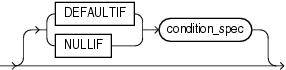
[Description of the illustration et_init_spec.eps](img_text/et_init_spec.md)

Only one `NULLIF` clause and only one `DEFAULTIF` clause can be specified for any field. These clauses behave as follows:

- If `NULLIF ``condition_spec` is specified and it evaluates to `TRUE`, then the field is set to `NULL`.

- If `DEFAULTIF ``condition_spec` is specified and it evaluates to `TRUE`, then the value of the field is set to a default value. The default value depends on the data type of the field, as follows:

  - For a character data type, the default value is an empty string.

  - For a numeric data type, the default value is a 0.

  - For a date data type, the default value is `NULL`.

- If a `NULLIF` clause and a `DEFAULTIF` clause are both specified for a field, then the `NULLIF` clause is evaluated first, and the `DEFAULTIF` clause is evaluated only if the `NULLIF` clause evaluates to `FALSE`.

**Parent topic:** field_definitions Clause

#### 15.4.8 LLS Clause

If a field in a data file is a LOB location Specifier (LLS) field, then you can indicate this by using the `LLS` clause. An LLS field contains the file name, offset, and length of the LOB data in the data file. SQL\*Loader uses this information to read data for the LOB column. The `LLS` clause for `ORACLE_LOADER` has the following syntax:

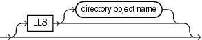
[Description of the illustration et_lls_spec.eps](img_text/et_lls_spec.md)

When the `LLS` clause is used, `ORACLE_LOADER` does not load the value of the field into the corresponding column. Instead, it uses the information in the value to determine where to find the value of the field. The LOB can be loaded in part or in whole and it can start from an arbitrary position and for an arbitrary length. `ORACLE_LOADER` expects the contents of the field to be `filename.ext.nnn.mmm/` where each element is defined as follows:

- `filename.ext` is the name of the file that contains the LOB

- `nnn` is the offset in bytes of the LOB within the file

- `mmm` is the length of the LOB in bytes A value of -1 means the LOB is NULL. A value of 0 means the lob exists, but is empty.

- The forward slash (`/`) terminates the field

The `LLS` clause has an optional `DIRECTORY` clause which specifies an Oracle directory object:

- If `DIRECTORY` is specified, then the file must exist there and you must have `READ` access to that directory object.

- If `DIRECTORY` is not specified, then the file must exist in the same directory as the data file.

An error is returned and the row rejected if any of the following are true:

- The file name contains a relative or absolute path specification.

- The file is not found, the offset is invalid, or the length extends beyond the end of the file.

- The contents of the field do not match the expected format.

- The data type for the column associated with an `LLS` field is not a `CLOB`, `BLOB` or `NCLOB`.

If an `LLS` field is referenced by a clause for any other field (for example a `NULLIF` clause), then in the access parameters, the value used for evaluating the clause is the string in the data file, not the data in the file pointed to by that string.

The character set for the data in the file pointed to by the `LLS` clause is assumed to be the same character set as the data file.

**Parent topic:** field_definitions Clause

### 15.5 column_transforms Clause

The optional `ORACLE_LOADER` access drive `COLUMN TRANSFORMS` clause provides transforms that you can use to describe how to load columns in the external table that do not map directly to columns in the data file.

#### Syntax

The syntax for the `column_transforms` clause is as follows:

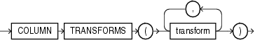
[Description of the illustration et_column_trans.eps](img_text/et_column_trans.md)

**Note:**

The `COLUMN TRANSFORMS` clause does not work in conjunction with the `PREPROCESSOR` clause.

- transform
  Each transform specified in the `transform` clause identifies a column in the external table and then a specifies how to calculate the value of the column.

**Parent topic:** The ORACLE_LOADER Access Driver

#### 15.5.1 transform

Each transform specified in the `transform` clause identifies a column in the external table and then a specifies how to calculate the value of the column.

The syntax is as follows:

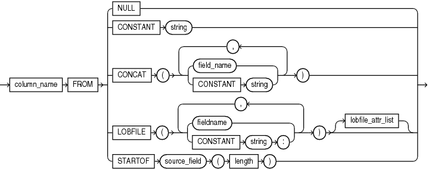
[Description of the illustration et_transform.eps](img_text/et_transform.md)

The `NULL` transform is used to set the external table column to `NULL` in every row. The `CONSTANT` transform is used to set the external table column to the same value in every row. The `CONCAT` transform is used to set the external table column to the concatenation of constant strings and/or fields in the current record from the data file. The `LOBFILE` transform is used to load data into a field for a record from another data file. Each of these transforms is explained further in the following sections.

- column_name FROM
  The `column_name` uniquely identifies a column in the external table that you want to be loaded.
- NULL
  When the `NULL` transform is specified, every value of the field is set to `NULL` for every record.
- CONSTANT
  The `CONSTANT` clause transform uses the value of the string specified as the value of the column in the record.
- CONCAT
  The `CONCAT` transform concatenates constant strings and fields in the data file together to form one string.
- LOBFILE
  The `LOBFILE` transform is used to identify a file whose contents are to be used as the value for a column in the external table.
- lobfile_attr_list
  The `lobfile_attr_list` lists additional attributes of the LOBFILE.
- STARTOF source_field (length)
  The `STARTOF` keyword allows you to create an external table in which a column can be a substring of the data in the source field.

**Parent topic:** column_transforms Clause

##### 15.5.1.1 column_name FROM

The `column_name` uniquely identifies a column in the external table that you want to be loaded.

Note that if the name of a column is mentioned in the `transform` clause, then that name cannot be specified in the `FIELDS` clause as a field in the data file.

**Parent topic:** transform

##### 15.5.1.2 NULL

When the `NULL` transform is specified, every value of the field is set to `NULL` for every record.

**Parent topic:** transform

##### 15.5.1.3 CONSTANT

The `CONSTANT` clause transform uses the value of the string specified as the value of the column in the record.

If the column in the external table is not a character string type, then the constant string will be converted to the data type of the column. This conversion will be done for every row.

The character set of the string used for data type conversions is the character set of the database.

**Parent topic:** transform

##### 15.5.1.4 CONCAT

The `CONCAT` transform concatenates constant strings and fields in the data file together to form one string.

Only fields that are character data types and that are listed in the `fields` clause can be used as part of the concatenation. Other column transforms cannot be specified as part of the concatenation.

**Parent topic:** transform

##### 15.5.1.5 LOBFILE

The `LOBFILE` transform is used to identify a file whose contents are to be used as the value for a column in the external table.

All LOBFILEs are identified by an optional directory object and a file name in the form `directory object:filename`. The following rules apply to use of the `LOBFILE` transform:

- Both the directory object and the file name can be either a constant string or the name of a field in the field clause.

- If a constant string is specified, then that string is used to find the `LOBFILE` for every row in the table.

- If a field name is specified, then the value of that field in the data file is used to find the `LOBFILE`.

- If a field name is specified for either the directory object or the file name and if the value of that field is `NULL`, then the column being loaded by the `LOBFILE` is also set to `NULL`.

- If the directory object is not specified, then the default directory specified for the external table is used.

- If a field name is specified for the directory object, then the `FROM` clause also needs to be specified.

Note that the entire file is used as the value of the LOB column. If the same file is referenced in multiple rows, then that file is reopened and reread in order to populate each column.

**Parent topic:** transform

##### 15.5.1.6 lobfile_attr_list

The `lobfile_attr_list` lists additional attributes of the LOBFILE.

The syntax is as follows:

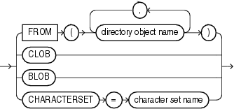
[Description of the illustration et_lobfile_attr.eps](img_text/et_lobfile_attr.md)

The `FROM` clause lists the names of all directory objects that will be used for LOBFILEs. It is used only when a field name is specified for the directory object of the name of the `LOBFILE`. The purpose of the `FROM` clause is to determine the type of access allowed to the named directory objects during initialization. If directory object in the value of field is not a directory object in this list, then the row will be rejected.

The `CLOB` attribute indicates that the data in the `LOBFILE` is character data (as opposed to `RAW` data). Character data may need to be translated into the character set used to store the LOB in the database.

The `CHARACTERSET` attribute contains the name of the character set for the data in the `LOBFILE`s.

The `BLOB` attribute indicates that the data in the `LOBFILE` is raw data.

If neither `CLOB` nor `BLOB` is specified, then `CLOB` is assumed. If no character set is specified for character LOBFILEs, then the character set of the data file is assumed.

**Parent topic:** transform

##### 15.5.1.7 STARTOF source_field (length)

The `STARTOF` keyword allows you to create an external table in which a column can be a substring of the data in the source field.

The length is the length of the substring, beginning with the first byte. It is assumed that length refers to a byte count and that the external table column(s) being transformed use byte length and not character length semantics. (Character length semantics might give unexpected results.)

Only complete character encodings are moved; characters are never split. So if a substring ends in the middle of a multibyte character, then the resulting string will be shortened. For example, if a length of 10 is specified, but the 10th byte is the first byte of a multibyte character, then only the first 9 bytes are returned.

The following example shows how you could use the `STARTOF` keyword if you only wanted the first 4 bytes of the department name (`dname`) field:

    SQL> CREATE TABLE dept (deptno  NUMBER(2),
      2                    dname   VARCHAR2(14),
      3                    loc     VARCHAR2(13)
      4                         )
      5  ORGANIZATION EXTERNAL
      6  (
      7    DEFAULT DIRECTORY def_dir1
      8    ACCESS PARAMETERS
      9    (
     10      RECORDS DELIMITED BY NEWLINE
     11      FIELDS TERMINATED BY ','
     12      (
     13        deptno           CHAR(2),
     14        dname_source     CHAR(14),
     15        loc              CHAR(13)
     16      )
     17      column transforms
     18      (
     19         dname FROM STARTOF dname_source (4)
     20      )
     21    )
     22    LOCATION ('dept.dat')
     23  );

    Table created.

If you now perform a `SELECT` operation from the `dept` table, only the first four bytes of the `dname` field are returned:

    SQL> SELECT * FROM dept;

        DEPTNO DNAME          LOC
    ---------- -------------- -------------
            10 ACCO           NEW YORK
            20 RESE           DALLAS
            30 SALE           CHICAGO
            40 OPER           BOSTON

    4 rows selected.

**Parent topic:** transform

### 15.6 Parallel Loading Considerations for the ORACLE_LOADER Access Driver

The `ORACLE_LOADER` access driver attempts to divide large data files into chunks that can be processed separately.

The following file, record, and data characteristics make it impossible for a file to be processed in parallel:

- Sequential data sources (such as a tape drive or pipe)

- Data in any multibyte character set whose character boundaries cannot be determined starting at an arbitrary byte in the middle of a string

  This restriction does not apply to any data file with a fixed number of bytes per record.

- Records with the `VAR` format

Specifying a `PARALLEL` clause is of value only when large amounts of data are involved.

**Parent topic:** The ORACLE_LOADER Access Driver

### 15.7 Performance Hints When Using the ORACLE_LOADER Access Driver

This topic describes some performance hints when using the `ORACLE_LOADER` access driver.

When you monitor performance, the most important measurement is the elapsed time for a load. Other important measurements are CPU usage, memory usage, and I/O rates.

You can alter performance by increasing or decreasing the degree of parallelism. The degree of parallelism indicates the number of access drivers that can be started to process the data files. The degree of parallelism enables you to choose on a scale between slower load with little resource usage and faster load with all resources utilized. The access driver cannot automatically tune itself, because it cannot determine how many resources you want to dedicate to the access driver.

An additional consideration is that the access drivers use large I/O buffers for better performance (you can use the `READSIZE` clause in the access parameters to specify the size of the buffers). On databases with shared servers, all memory used by the access drivers comes out of the system global area (SGA). For this reason, you should be careful when using external tables on shared servers.

Performance can also sometimes be increased with use of date cache functionality. By using the date cache to specify the number of unique dates anticipated during the load, you can reduce the number of date conversions done when many duplicate date or timestamp values are present in the input data. The date cache functionality provided by external tables is identical to the date cache functionality provided by SQL\*Loader. See DATE_CACHE for a detailed description.

In addition to changing the degree of parallelism and using the date cache to improve performance, consider the following information:

- Fixed-length records are processed faster than records terminated by a string.

- Fixed-length fields are processed faster than delimited fields.

- Single-byte character sets are the fastest to process.

- Fixed-width character sets are faster to process than varying-width character sets.

- Byte-length semantics for varying-width character sets are faster to process than character-length semantics.

- Single-character delimiters for record terminators and field delimiters are faster to process than multicharacter delimiters.

- Having the character set in the data file match the character set of the database is faster than a character set conversion.

- Having data types in the data file match the data types in the database is faster than data type conversion.

- Not writing rejected rows to a reject file is faster because of the reduced overhead.

- Condition clauses (including `WHEN`, `NULLIF`, and `DEFAULTIF`) slow down processing.

- The access driver takes advantage of multithreading to streamline the work as much as possible.

**Parent topic:** The ORACLE_LOADER Access Driver

### 15.8 Restrictions When Using the ORACLE_LOADER Access Driver

This section lists restrictions to be aware of when you use the `ORACLE_LOADER` access driver.

Specifically:

- Exporting and importing of external tables with encrypted columns is not supported.

- Column processing: By default, the external tables feature fetches all columns defined for an external table. This guarantees a consistent result set for all queries. However, for performance reasons you can decide to process only the referenced columns of an external table, thus minimizing the amount of data conversion and data handling required to execute a query. In this case, a row that is rejected because a column in the row causes a data type conversion error will not get rejected in a different query if the query does not reference that column. You can change this column-processing behavior with the `ALTER TABLE` command.

- An external table cannot load data into a `LONG` column.

- SQL strings cannot be specified in access parameters for the `ORACLE_LOADER` access driver. As a workaround, you can use the `DECODE` clause in the `SELECT` clause of the statement that is reading the external table. Alternatively, you can create a view of the external table that uses the `DECODE` clause and select from that view rather than the external table.

- The use of the backslash character (\\ within strings is not supported in external tables. See [Use of the Backslash Escape Character](oracle-sql-loader-concepts.md).

- When identifiers (for example, column or table names) are specified in the external table access parameters, certain values are considered to be reserved words by the access parameter parser. If a reserved word is used as an identifier, then it must be enclosed in double quotation marks.

**Parent topic:** The ORACLE_LOADER Access Driver

### 15.9 Reserved Words for the ORACLE_LOADER Access Driver

When identifiers (for example, column or table names) are specified in the external table access parameters, certain values are considered to be reserved words by the access parameter parser.

If a reserved word is used as an identifier, then it must be enclosed in double quotation marks. The following are the reserved words for the `ORACLE_LOADER` access driver:

- ALL

- AND

- ARE

- ASTERISK

- AT

- ATSIGN

- BADFILE

- BADFILENAME

- BACKSLASH

- BENDIAN

- BIG

- BLANKS

- BY

- BYTES

- BYTESTR

- CHAR

- CHARACTERS

- CHARACTERSET

- CHARSET

- CHARSTR

- CHECK

- CLOB

- COLLENGTH

- COLON

- COLUMN

- COMMA

- CONCAT

- CONSTANT

- COUNTED

- DATA

- DATE

- DATE_CACHE

- DATE_FORMAT

- DATEMASK

- DAY

- DEBUG

- DECIMAL

- DEFAULTIF

- DELIMITBY

- DELIMITED

- DISCARDFILE

- DNFS_ENABLE

- DNFS_DISABLE

- DNFS_READBUFFERS

- DOT

- DOUBLE

- DOUBLETYPE

- DQSTRING

- DQUOTE

- DSCFILENAME

- ENCLOSED

- ENDIAN

- ENDPOS

- EOF

- EQUAL

- EXIT

- EXTENDED_IO_PARAMETERS

- EXTERNAL

- EXTERNALKW

- EXTPARM

- FIELD

- FIELDS

- FILE

- FILEDIR

- FILENAME

- FIXED

- FLOAT

- FLOATTYPE

- FOR

- FROM

- HASH

- HEXPREFIX

- IN

- INTEGER

- INTERVAL

- LANGUAGE

- IS

- LEFTCB

- LEFTTXTDELIM

- LEFTP

- LENDIAN

- LDRTRIM

- LITTLE

- LOAD

- LOBFILE

- LOBPC

- LOBPCCONST

- LOCAL

- LOCALTZONE

- LOGFILE

- LOGFILENAME

- LRTRIM

- LTRIM

- MAKE_REF

- MASK

- MINUSSIGN

- MISSING

- MISSINGFLD

- MONTH

- NEWLINE

- NO

- NOCHECK

- NOT

- NOBADFILE

- NODISCARDFILE

- NOLOGFILE

- NOTEQUAL

- NOTERMBY

- NOTRIM

- NULL

- NULLIF

- OID

- OPTENCLOSE

- OPTIONALLY

- OPTIONS

- OR

- ORACLE_DATE

- ORACLE_NUMBER

- PLUSSIGN

- POSITION

- PROCESSING

- QUOTE

- RAW

- READSIZE

- RECNUM

- RECORDS

- REJECT

- RIGHTCB

- RIGHTTXTDELIM

- RIGHTP

- ROW

- ROWS

- RTRIM

- SCALE

- SECOND

- SEMI

- SETID

- SIGN

- SIZES

- SKIP

- STRING

- TERMBY

- TERMEOF

- TERMINATED

- TERMWS

- TERRITORY

- TIME

- TIMESTAMP

- TIMEZONE

- TO

- TRANSFORMS

- UNDERSCORE

- UINTEGER

- UNSIGNED

- VALUES

- VARCHAR

- VARCHARC

- VARIABLE

- VARRAW

- VARRAWC

- VLENELN

- VMAXLEN

- WHEN

- WHITESPACE

- WITH

- YEAR

- ZONED

**Parent topic:** The ORACLE_LOADER Access Driver
