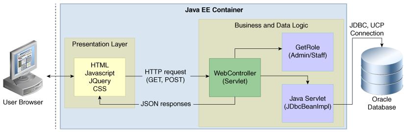

Java is a popular language among developers that is used to build various enterprise solutions.

This guide will help you understand all Java products used to build a Java application. You will learn how to model a Java Web application using MVC design pattern, Oracle JDBC Thin driver, Universal Connection Pool (UCP), and Java in the Database ( using embedded OJVM).

In the next few chapters, you will create a Java web application — ‘HR Web application’. This application will help the HR team of AnyCo Corporation to lookup or modify details of a specific employee, or all employees, delete an employee, or apply a salary raise to all employees.

The application will have two users

hrstaff

hradmin

Each user will have a different set of roles and privileges.

This Chapter contains the following topics:

Architecture of the Web Application

Components of the Application

Tasks for Day 1

Tasks for Day 2

### Architecture of the Application

#### Architecture of the Web Application

The HR Web application uses the MVC (Model, View, Controller) architecture and the latest tools and technologies. A Model View Controllder (MVC) is a design pattern that is easy-to-use. It separates the web application into three simple parts (Model-View-Controller).

The Model stores the data or the information that the web application is meant to operate on. It does not include any information about the user-interface.

The View contains all elements of the user interface (UI). This includes buttons, display box, links, input box etc.

The Controller connects Model and View.

As a user, you will see the interface (View) that could be a JSP page ot an HTML page after you log into the application. The Controller (a Java Servlet) renders the correct View to the user during logging in, or any other flow. When you request for data or an update to the data, the Controller invokes the Model that represents the data in terms of tables or views, and renders the data. The Model represents the user data usually stored in an Oracle Database or any other database.

The Controller then passes on this data to the View to show it to the user in a presentable format.

Table 1-1 Architecture of the Web Application

| Name       | Technologies Used             | Description                                                                                                                                                             |
|:-----------|:------------------------------|:------------------------------------------------------------------------------------------------------------------------------------------------------------------------|
| Model      | Oracle Database, Java Beans   | Represents the information or the data on which the application operates.                                                                                               |
| View       | HTML, JavaScript, JQuery, CSS | User interface that renders the model to the end user. It includes all elements visible to the user such as buttons, links, input, etc.                                 |
| Controller | Java Servlet                  | The controller processes and responds to user actions. It orchestrates the flow based on user input. It also connects Model and View and renders an output to the user. |

Following is a link to the Web application:

You will use HR schema and the Employees to understand the flows in the Web application.

Figure 1-1

[Description of "Figure 1-1 "](img_text/architecture_tdpjd1.md)

### Components and Repositories

The following table lists and describes all the components required for the application.

Table 1-2 Components Required for the Application

| Package Name                          | Description                                                                                   |
|:--------------------------------------|:----------------------------------------------------------------------------------------------|
| src                                   | Contains source files                                                                         |
| target                                | Contains class files                                                                          |
| src/main/java/com/oracle/jdbc/samples | \-                                                                                            |
| /bean/JdbcBean.java                   | Defines the employee details as attributes                                                    |
| /bean/JdbcBeanImpl.java               | Implementation class of the EmployeeBean                                                      |
| src/main/java/com/oracle/jdbc/samples | \-                                                                                            |
| entity/Employee.java                  | Consists of all employee attributes and their defined datatypes                               |
| /web/WebController.java               | Servlet that controls the application flow                                                    |
| /web/GetRole.java                     | Creates HRStaff and HRAdmin roles for the application                                         |
| src/main/resources                    | \-                                                                                            |
| SalaryHikeSP.java                     | Java class to be invoked from Java in the database to process an increment in salary          |
| SalaryHikeSP.sql                      | SQL file with a procedure to increase the salary of the employees based on their salary range |
| src/main/webapp                       | \-                                                                                            |
| about.html                            | Contains the details about the HR Web application                                             |
| login.html                            | Contains the login page for the HR Web application                                            |
| login-failed.html                     | Page to show when the login is unsuccessful                                                   |
| index.html                            | Landing page of the HR Web application                                                        |
| listAll.html                          | HTML page to display all employee records                                                     |
| listByName.html                       | HTML page to display the result when employees are searched by name                           |
| listById.html                         | HTML page to display the result when employees are searched by employee id                    |
| incrementSalary.html                  | HTML page to display the result after an increment is made to the salary                      |
| src/main/webapp                       | \-                                                                                            |
| css/app.cs                            | Contains all style and font details used in the HR Web application                            |
| src/main/webapp                       | \-                                                                                            |
| WEB-INF/web.xml                       | Controller for the HR Web application                                                         |

### Objectives and Tasks for Day 1

At the end of the first day, you will be able to:

a\. Understand the JDBC, UCP, Java in the database and run a simple Java program to get familiar with these products.

b\. Implement the functionality “listAll” to list the details of all the employees.

1 Introduction to JDBC, UCP and Java in the Database: You will familiarize yourself with the products, associated binaries and packages through a sample code.

2 Overview of the HR Web Application: This chapter will discuss the HR Web application in depth and familiarize you with the flows of the Web application, packages and files that you will create as a part of the Application.

3 Getting Started with the Application: You will understand the pre-requisites for building the application and how to get the environment ready. It starts with subscribing to the Oracle Database Service in the cloud or installing the Oracle Database 12c Release 2 on premises. Later, you will install JDeveloper, an IDE to build the application. You will use either web Logic Server that is integrated in the JDeveloper or Tomcat Java EE container to deploy and run the application.

The chapter will also help you download any other tools, such as Maven, that will help you build the application.

4 List All Employees: This chapter will help you how to put all components together and build an initial functionality to connect to the Oracle Database, and retrieve employee details from the database.

### Objectives and Tasks for Day 2

Part II covers all tasks you will complete in Day 2. You will learn how to use Universal Connection Pool (UCP) and Java in the Database (OJVM). You will also learn how to:

1 Search By Employee ID: This chapter provides details on how to implement the ‘Search by Employee ID’ functionality.

2 Update an Employee Record: In this chapter, you will learn how to update employee records. This is two step process. You will first search the employee’s records, based on first name. Once you retrieve the required results, you can update the salary, job ID, firstname, lastname and other details.

3 Delete an Employee Record: In this Chapter, you will learn how to delete an employee record, in a two-step process.

4 Increase Salary to All Employees: You will understand how to provide increment to the salary of the employees listed in the table, using ‘Java in the database’.

5 Creating Application Users: This chapter shows how to create ‘hradmin’ and ‘hrstaff’ users in Tomcat and JDeveloper.

6 Summary: This chapter will summarize all that you have learnt over the two days. It will also provide appropriate references and links for enhancing your use of the Application.
