Automatic Database Diagnostic Monitor (ADDM) automatically detects and reports performance problems with the database. The results are displayed as ADDM findings on the Database Home page in Oracle Enterprise Manager Cloud Control (Cloud Control). Reviewing the ADDM findings enables you to quickly identify the performance problems that require your attention. Before using another performance tuning method described in this guide, first review the results of the ADDM analysis.

Each ADDM finding provides a list of recommendations for reducing the impact of the performance problem. You should review ADDM findings and implement the recommendations every day as part of regular database maintenance. Even when the database is operating at an optimal performance level, you should continue to use ADDM to monitor database performance on an ongoing basis.

This chapter contains the following sections:

- Overview of Automatic Database Diagnostic Monitor

- Configuring Automatic Database Diagnostic Monitor

- Reviewing the Automatic Database Diagnostic Monitor Analysis

- Interpretation of Automatic Database Diagnostic Monitor Findings

- Implementing Automatic Database Diagnostic Monitor Recommendations

- Viewing Snapshot Statistics

**See Also:**

- [Oracle Database Performance Tuning Guide](../tgdba/automatic-performance-diagnostics.md) for information about using the `DBMS_ADVISOR` package to diagnose and tune the database with the Automatic Database Diagnostic Monitor

### 3.1 Overview of Automatic Database Diagnostic Monitor

ADDM is diagnostic software built into Oracle Database. ADDM examines and analyzes data captured in Automatic Workload Repository (AWR) to determine possible database performance problems. ADDM then does the following:

- Locates the root causes of the performance problems

- Provides recommendations for correcting them

- Quantifies the expected benefits

- Identifies areas where no action is necessary.

This section contains the following topics:

- ADDM Analysis

- ADDM Recommendations

- ADDM for Oracle Real Application Clusters

- ADDM for a Multitenant Environment

#### 3.1.1 ADDM Analysis

An ADDM analysis is performed after each AWR snapshot (every hour by default), and the results are saved in the database. You can then view the results using Cloud Control.

The ADDM analysis is performed from the top down, first identifying symptoms and then refining the analysis to reach the root causes of performance problems. ADDM uses the DB time statistic to identify performance problems. Database time (DB) time is the cumulative time spent by the database in processing user requests, including both the wait time and CPU time of all user sessions that are not idle.

The goal of database performance tuning is to reduce the DB time of the system for a given workload. By reducing DB time, the database can support more user requests by using the same or fewer resources. ADDM reports system resources that are using a significant portion of DB time as problem areas and sorts them in descending order by the amount of related DB time spent.

**See Also:**

"[Time Model Statistics](oracle-database-performance-method.md)" for more information about the DB time statistic

#### 3.1.2 ADDM Recommendations

In addition to diagnosing performance problems, ADDM recommends possible solutions. When appropriate, ADDM recommends multiple solutions from which you can choose. ADDM recommendations include the following:

- Hardware changes

  Adding CPUs or changing the I/O subsystem configuration

- Database configuration

  Changing initialization parameter settings

- Schema changes

  Hash partitioning a table or index, or using automatic segment space management (ASSM)

- Application changes

  Using the cache option for sequences or using bind variables

- Using other advisors

  Running SQL Tuning Advisor on high-load SQL statements or running the Segment Advisor on hot objects

ADDM benefits apply beyond production systems. Even on development and test systems, ADDM can provide an early warning of potential performance problems.

Performance tuning is an iterative process. Fixing one problem can cause a bottleneck to shift to another part of the system. Even with the benefit of the ADDM analysis, it can take multiple tuning cycles to reach a desirable level of performance.

#### 3.1.3 ADDM for Oracle Real Application Clusters

In an Oracle Real Application Clusters (Oracle RAC) environment, you can use ADDM to analyze the throughput performance of a database cluster. ADDM for Oracle RAC considers DB time as the sum of database times for all database instances and reports findings that are significant at the cluster level. For example, the DB time of each cluster node may be insignificant when considered individually, but the aggregate DB time may be a significant problem for the cluster as a whole.

**See Also:**

- [Oracle Real Application Clusters Administration and Deployment Guide](../racad/monitoring-performance.md) for information about using ADDM for Oracle RAC

#### 3.1.4 ADDM for a Multitenant Environment

Starting with Oracle Database 12c, ADDM is enabled by default in the root container of a multitenant container database (CDB). Starting with Oracle Database 19c, you can also use ADDM in a pluggable database (PDB).

To use ADDM in a PDB, you must enable automatic snapshots in the PDB by setting the `AWR_PDB_AUTOFLUSH_ENABLED` initialization parameter to `TRUE` and AWR snapshot interval greater than 0.

**See Also:**

[Oracle Database Performance Tuning Guide](../tgdba/automatic-performance-diagnostics.md) for more information about using ADDM in a multitenant environment

### 3.2 Configuring Automatic Database Diagnostic Monitor

This section contains the following topics:

- Setting Initialization Parameters to Enable ADDM

- Setting the DBIO_EXPECTED Parameter

- Managing AWR Snapshots

#### 3.2.1 Setting Initialization Parameters to Enable ADDM

Automatic database diagnostic monitoring is enabled by default and is controlled by the `CONTROL_MANAGEMENT_PACK_ACCESS` and the `STATISTICS_LEVEL` initialization parameters.

Set `CONTROL_MANAGEMENT_PACK_ACCESS` to `DIAGNOSTIC+TUNING` (default) or `DIAGNOSTIC` to enable automatic database diagnostic monitoring. Setting `CONTROL_MANAGEMENT_PACK_ACCESS` to `NONE` disables many Oracle Database features, including ADDM, and is strongly discouraged.

Set `STATISTICS_LEVEL` to `TYPICAL` (default) or `ALL` to enable automatic database diagnostic monitoring. Setting `STATISTICS_LEVEL` to `BASIC` disables many Oracle Database features, including ADDM, and is strongly discouraged.

##### To determine whether ADDM is enabled:

1.  Access the Database Home page.

    See "[Accessing the Database Home Page](introduction.md)" for more information.

2.  From the Administration menu, select Initialization Parameters.

    If the Database Login page appears, then log in as a user with administrator privileges. The Initialization Parameters page appears.

3.  In the Name field, enter `statistics_level` and then click Go.

    The Initialization Parameters table shows the setting of this initialization parameter.

    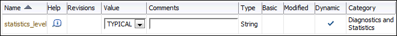
    [Description of the illustration statistics_level.gif](img_text/statistics_level.md)

4.  Do one of the following:

    - If the Value list shows ALL or TYPICAL, then do nothing.

    - If the Value list shows BASIC, then select ALL or TYPICAL, and then click Apply.

5.  In the Name field, enter `control_management_pack_access`, and then click Go.

    The table shows the setting of this initialization parameter.

6.  Do one of the following:

    - If the Value column shows DIAGNOSTIC or DIAGNOSTIC+TUNING, then do nothing.

    - If the Value column shows NONE, then select DIAGNOSTIC or DIAGNOSTIC+TUNING and click Apply.

**See Also:**

- [Oracle Database Reference](../refrn/STATISTICS_LEVEL.md) for information about the `STATISTICS_LEVEL` initialization parameter

- [Oracle Database Reference](../refrn/CONTROL_MANAGEMENT_PACK_ACCESS.md) for information about the `CONTROL_MANAGEMENT_PACK_ACCESS` initialization parameter

#### 3.2.2 Setting the DBIO_EXPECTED Parameter

ADDM analysis of I/O performance partially depends on a single argument, `DBIO_EXPECTED`, that describes the expected performance of the I/O subsystem. The value of `DBIO_EXPECTED` is the average time it takes to read a single database block, in microseconds. Oracle Database uses the default value of 10 milliseconds, which is an appropriate value for most hard drives. You can choose a different value based on the characteristics of your hardware.

##### To determine the correct setting for the `DBIO_EXPECTED` initialization parameter:

1.  Measure the average read time of a single database block for your hardware.

    This measurement must be taken for random I/O, which includes seek time if you use standard hard drives. Typical values for hard drives are between 5000 and 20000 microseconds.

    **See Also:**

    [Oracle Database Performance Tuning Guide](../tgdba/IO-configuration-and-design.md) to learn how to assess the I/O capability of the storage subsystem

2.  Set the value one time for all subsequent ADDM executions.

    For example, if the measured value is 8000 microseconds, then execute the following PL/SQL code as the `SYS` user:

        EXECUTE DBMS_ADVISOR.SET_DEFAULT_TASK_PARAMETER(
                             'ADDM', 'DBIO_EXPECTED', 8000);

#### 3.2.3 Managing AWR Snapshots

By default, the Automatic Workload Repository (AWR) generates snapshots of performance data once every hour, and retains the statistics in the workload repository for 8 days. You can change the default values for both the snapshot interval and the retention period.

Oracle recommends that you adjust the AWR retention period to at least one month. You can also extend the period to one business cycle so you can compare data across time frames such as the close of the fiscal quarter. You can also create AWR baselines to retain snapshots indefinitely for important time periods.

The data in the snapshot interval is analyzed by ADDM. ADDM compares the differences between snapshots to determine which SQL statements to capture, based on the effect on the system load. The ADDM analysis shows the number of SQL statements that need to be captured over time.

This section contains the following topics:

- Creating Snapshots

- Modifying Snapshot Settings

##### 3.2.3.1 Creating Snapshots

Manually creating snapshots is usually not necessary because AWR generates snapshots of the performance data once every hour by default. In some cases, however, it may be necessary to manually create snapshots to capture different durations of activity, such as when you want to compare performance data over a shorter period than the snapshot interval.

##### To create snapshots:

1.  Access the Database Home page.

    See "[Accessing the Database Home Page](introduction.md)" for more information.

2.  From the Performance menu, select AWR and then select AWR Administration.

    If the Database Login page appears, then log in as a user with administrator privileges. The Automatic Workload Repository page appears.

3.  Under Manage Snapshots and Baselines, click the number next to Snapshots.

    The Snapshots page appears with a list of the most recent snapshots.

4.  Click Create.

    The Confirmation page appears.

5.  Click Yes.

    The Processing: Create Snapshot page is displayed while the snapshot is being taken.

    After the snapshot is taken, the Snapshots page reappears with a Confirmation message.

    The following screenshot of the list of snapshots shows that a snapshot was created at 9:24:25 a.m. The ID of the snapshot is 383.

    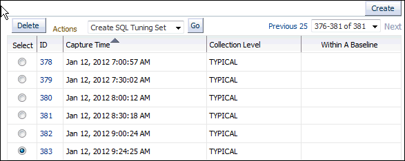
    [Description of the illustration snapshots.gif](img_text/snapshots.md)

##### 3.2.3.2 Modifying Snapshot Settings

By default, AWR generates snapshots of performance data once every hour. You can modify the default values of both the interval between snapshots and their retention period.

##### To modify the snapshot settings:

1.  Access the Database Home page.

    See "[Accessing the Database Home Page](introduction.md)" for more information.

2.  From the Performance menu, select AWR, then select AWR Administration.

    If the Database Login page appears, then log in as a user with administrator privileges. The Automatic Workload Repository page appears.

    In the following screenshot of the General section of the page, the snapshot retention is set to 8 days and the snapshot interval is set to 60 minutes.

    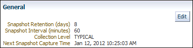
    [Description of the illustration snapshot_settings.gif](img_text/snapshot_settings.md)

3.  Click Edit.

    The Edit Settings page appears.

    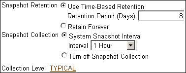
    [Description of the illustration snap_edit_set.gif](img_text/snap_edit_set.md)

4.  For Snapshot Retention, do one of the following:

    - Select Use Time-Based Retention Period (Days), and in the associated field enter the number of days to retain the snapshots.

    - Select Retain Forever to retain snapshots indefinitely.

    It is recommended that you increase the snapshot retention period to the maximum allowed by the available disk space.

    In the following screenshot of the Snapshot Retention group, the snapshot retention period is changed to 30 days.

    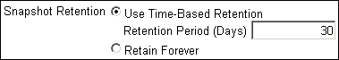
    [Description of the illustration snapshot_retent.gif](img_text/snapshot_retent.md)

5.  For Snapshot Collection, do one of the following:

    - Select System Snapshot Interval, and in the Interval list, select the desired interval to change the interval between snapshots.

    - Select Turn off Snapshot Collection to disable snapshot collection.

    In the following screenshot of the Snapshot Collection group, the snapshot collection interval is changed to 30 minutes.

    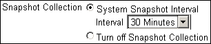
    [Description of the illustration snapshot_collect.gif](img_text/snapshot_collect.md)

6.  Click the link next to Collection Level.

    The Initialization Parameters page appears.

    To change the statistics level, select `TYPICAL` or `ALL` in the Value list for the `statistics_level` parameter. Click Save to File to set the value in the server parameter file.

    In the following screenshot of the Initialization Parameters table, the default value of Typical is used.

    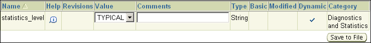
    [Description of the illustration snapshot_stat_lvl.gif](img_text/snapshot_stat_lvl.md)

7.  Click OK to apply the changes.

    The Automatic Workload Repository page appears and displays the new settings.

    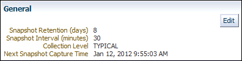
    [Description of the illustration snapshot_sett_mod.gif](img_text/snapshot_sett_mod.md)

### 3.3 Reviewing the Automatic Database Diagnostic Monitor Analysis

By default, ADDM runs every hour to analyze snapshots taken by AWR during that period. If the database finds performance problems, then it displays the results of the analysis under Diagnostics in the Summary section on the Database Home page.

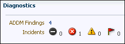
[Description of the illustration diagnostic_sum.gif](img_text/diagnostic_sum.md)

The ADDM Findings link shows how many ADDM findings were found in the most recent ADDM analysis.

#### To view ADDM findings:

1.  Access the Database Home page.

    See "[Accessing the Database Home Page](introduction.md)" for more information.

2.  From the Performance menu, select Advisors Home.

    If the Database Login page appears, then log in as a user with administrator privileges. The Advisor Central page appears.

3.  In the Results section of Advisor Tasks, select the most recent ADDM result, and then click View Result.

    The Automatic Database Diagnostic Monitor (ADDM) page appears. The results of the ADDM run are displayed.

    Figure 3-1 The Automatic Database Diagnostic Monitor Page

    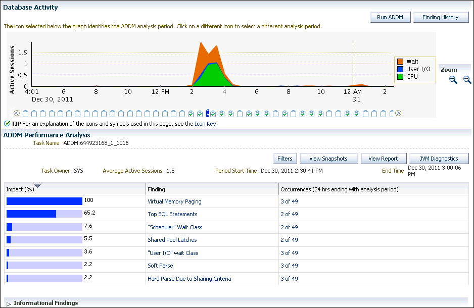
    [Description of "Figure 3-1 The Automatic Database Diagnostic Monitor Page"](img_text/addm_page.md)
    On the Automatic Database Diagnostic Monitor (ADDM) page, the Database Activity chart shows the database activity during the ADDM analysis period. Database activity types are defined in the legend based on their corresponding colors in the chart. Each icon below the chart represents a different ADDM task, which in turn corresponds to a pair of snapshots saved in AWR.

    In Figure 3-1, stacked area chart in the Database Activity section shows that the most database activity was between 2:00 p.m. to 4:30 p.m. on December 30. During that time, the activity was dominated by CPU and wait classes, with very little I/O happening.

    In the ADDM Performance Analysis section, ADDM findings are listed in descending order, from highest to least impact. The Informational Findings section lists areas that have no performance impact and are for information only.

    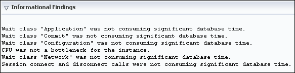
    [Description of the illustration information_findings.gif](img_text/information_findings.md)

4.  Optionally, click the Zoom icons to shorten or lengthen the analysis period displayed on the chart.

5.  To view the ADDM findings in a report, click View Report.

    The View Report page appears.

    You can click Save to File to save the report for later access.

### 3.4 Interpretation of Automatic Database Diagnostic Monitor Findings

The ADDM analysis results are represented as a set of findings. Each ADDM finding belongs to one of three types:

- Problem

  Findings that describe the root cause of a database performance issue

- Symptom

  Findings that contain information that often leads to one or more problem findings

- Information

  Findings that are used to report areas of the system that do not have a performance impact

Each problem finding is quantified with an estimate of the portion of DB time that resulted from the performance problem.

When a specific problem has multiple causes, ADDM may report multiple findings. In this case, the impacts of these multiple findings can contain the same portion of DB time. Because performance problems can overlap, summing the impacts of the reported findings can yield a number higher than 100% of DB time. For example, if a system performs many read I/O operations, ADDM may report a SQL statement responsible for 50% of DB time due to I/O activity as one finding, and an undersized buffer cache responsible for 75% of DB time as another finding.

A problem finding can be associated with a list of recommendations for reducing the impact of a performance problem. Each recommendation has a benefit that is an estimate of the portion of DB time that can be saved if the recommendation is implemented. When multiple recommendations are associated with an ADDM finding, the recommendations may contain alternatives for solving the same problem. In this case, the sum of the benefits may be higher than the impact of the finding. You do not need to apply all the recommendations to solve the same problem.

Recommendations are composed of actions and rationales. You must apply all the actions of a recommendation to gain its estimated benefit. The rationales explain why the set of actions are recommended, and provide additional information for implementing them. An ADDM action may present multiple solutions. If this is the case, then choose the easiest solution to implement.

### 3.5 Implementing Automatic Database Diagnostic Monitor Recommendations

This section describes how to implement ADDM recommendations. ADDM findings are displayed in the Automatic Database Diagnostic Monitor (ADDM) page under ADDM Performance Analysis.

#### To implement ADDM recommendations:

1.  Access the Database Home page.

    See "[Accessing the Database Home Page](introduction.md)" for more information.

2.  From the Performance menu, select Advisors Home.

    If the Database Login page appears, then log in as a user with administrator privileges. The Advisor Central page appears.

3.  In the Results section of Advisor Tasks, select the most recent ADDM result, then click View Result.

    The Automatic Database Diagnostic Monitor (ADDM) page appears.

4.  In the Database Activity section, click the chart icon for the ADDM run to investigate.

    The data in the ADDM Performance Analysis section changes based on the ADDM run that you selected.

5.  In the ADDM Performance Analysis table, click the ADDM finding that has the greatest impact.

    In the following screenshot of the ADDM Performance Analysis table, the finding with the greatest impact is Top SQL Statements.

    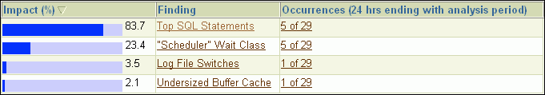
    [Description of the illustration perf_analysis.gif](img_text/perf_analysis.md)
    The Performance Finding Details page appears.

    In the following screen shot of the Performance Finding Details page, five recommendations are shown. The first is estimated to have a maximum benefit of up to 26.7% of DB time in the analysis period. The second recommendation is estimated to have a maximum benefit of up to 10.9% of DB time, the third also has a maximum of 10.9%, the fourth has a maximum of 9.9%, and the fifth has a maximum of 5%.

    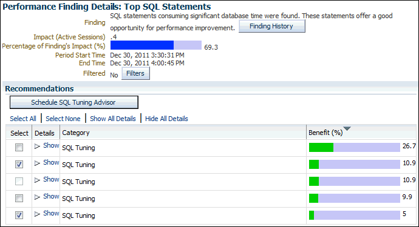
    [Description of the illustration perf_finding_details.gif](img_text/perf_finding_details.md)

6.  Under Recommendations, click Show to review the recommendations and required actions for each recommendation.

    The Category column displays the category of the recommendation. The Benefit (%) column displays the estimated benefit of implementing the recommendation.

    Figure 3-2 shows the recommendations for the first item in the Recommendations table.

    Figure 3-2 Recommendations on the Performance Finding Details Page

    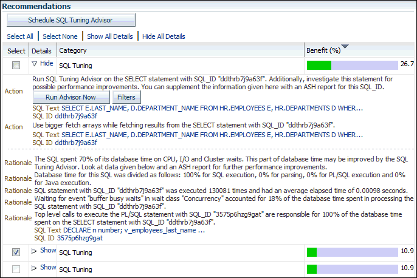
    [Description of "Figure 3-2 Recommendations on the Performance Finding Details Page"](img_text/addm_rec.md)

7.  If additional information is available about why the set of actions was recommended, then click Additional Information, or review the content displayed under Additional Information.

    For example, the following screenshot shows an Undersized Buffer Cache finding that contains additional information that indicates the recommended value of the `DB_CACHE_SIZE` initialization parameter.

    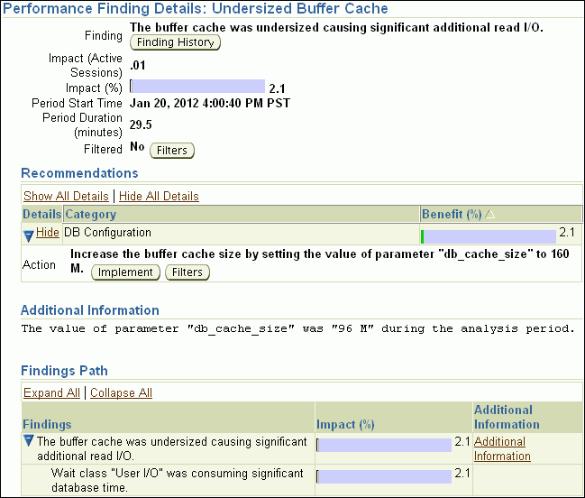
    [Description of the illustration addm_addit_info.gif](img_text/addm_addit_info.md)

8.  To view the history of a finding, click Finding History.

    The Finding History page appears. The following screenshot shows the Finding History page for the top SQL statements.

    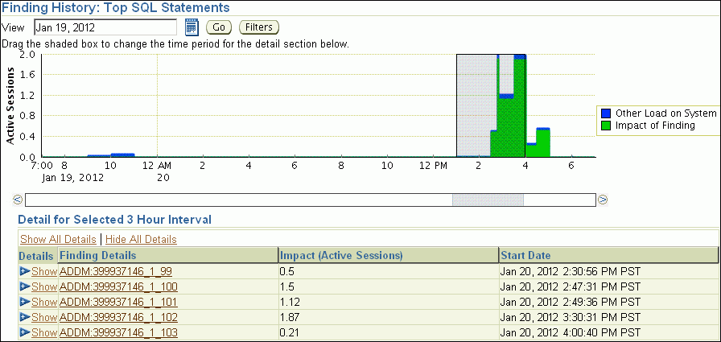
    [Description of the illustration finding_history.gif](img_text/finding_history.md)
    The Finding History page shows how often a particular finding has occurred in a selected 3-hour interval. You can use this information to determine whether the finding was a transient or a persistent problem in the system. Based on this information, you can determine whether the actions associated with the finding should be implemented.

    The Active Sessions stacked area chart shows the impact of the finding and of the other loads on the system. You can change the display as follows:

    1.  To move the 3-hour interval, click and drag the shaded box in the Active Sessions chart.

    2.  To change dates, enter the desired date in the View field, and then click Go.

    3.  To view details about a finding, under Detail for Selected 3 Hour Interval, click the link in the Finding Details column to display the Performance Finding Details page for the corresponding ADDM finding.

9.  Optionally, create a filter to suppress known findings that have been tuned or cannot be tuned further. To create filters for a selected ADDM finding:

    1.  Click Filters.

        The Filters for Finding page appears.

    2.  Click Create.

        The Create Filter for Finding page appears.

    3.  In the Name field, enter a name for the ADDM filter.

    4.  In the Active Sessions field, specify the filter criteria in terms of the number of active sessions.

        The database filters the ADDM finding for future ADDM runs if the number of active sessions for the finding is less than the specified filter criteria.

    5.  In the % Active Sessions field, specify the filter criteria in terms of percentage of active sessions.

        The database filters the ADDM finding for future ADDM runs if the number of active sessions for the finding is less than the specified filter criteria.

    6.  Click OK.

10. Perform the required action of a chosen recommendation.

    Depending on the type of action you choose to perform, various options may be available, such as Implement or Run Advisor Now. These options enable you to implement the recommendation immediately with a single mouse click.

    In the example shown in Figure 3-2, the simplest solution is to click Run Advisor Now to immediately run a SQL Tuning Advisor task on the SQL statement.

    **See Also:**

    - "[Tuning SQL Statements](tuning-sql-statements.md) "

### 3.6 Viewing Snapshot Statistics

You can view the data contained in snapshots taken by AWR using Cloud Control. Typically, it is not necessary to review snapshot data because it primarily contains raw statistics. Instead, rely on ADDM, which analyzes statistics to identify performance problems. Snapshot statistics are intended primarily for advanced users, such as DBAs accustomed to using Statspack for performance analysis.

#### To view snapshot statistics:

1.  Access the Database Home page.

    See "[Accessing the Database Home Page](introduction.md)" for more information.

2.  From the Performance menu, select AWR and then select AWR Administration.

    If the Database Login page appears, then log in as a user with administrator privileges. The Performance page appears.

3.  Under Manage Snapshots and Baselines, click the number next to Snapshots.

    The Snapshots page appears with a list of the most recent snapshots.

4.  To view the statistics gathered in a snapshot, click the ID link of the snapshot you want to view.

    The Snapshot Details appears, showing the Details subpage.

    The following screenshot of a Details subpage shows statistics gathered from the previous snapshot (snapshot 386) to the selected snapshot (snapshot 387).

    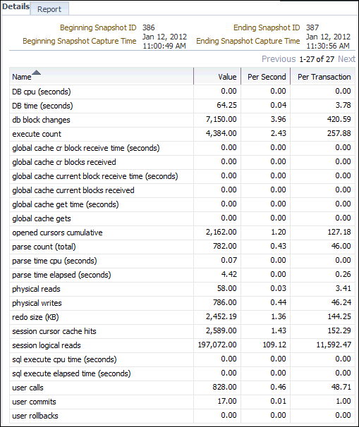
    [Description of the illustration snapshot_det.gif](img_text/snapshot_det.md)

5.  To view a Workload Repository report of the statistics, click Report.

    The Workload Repository report appears.

6.  Optionally, click Save to File to save the report for later access.

**See Also:**

- " [Resolving Performance Degradation Over Time](resolving-performance-degradation-over-time.md) "
