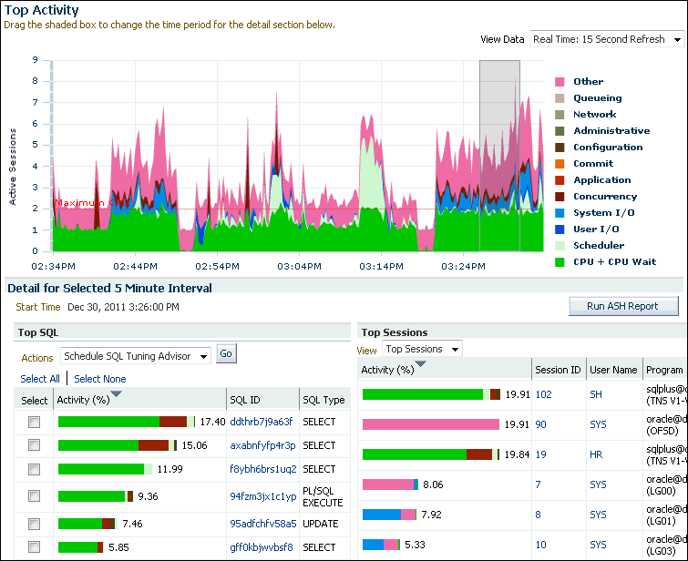
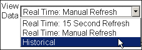
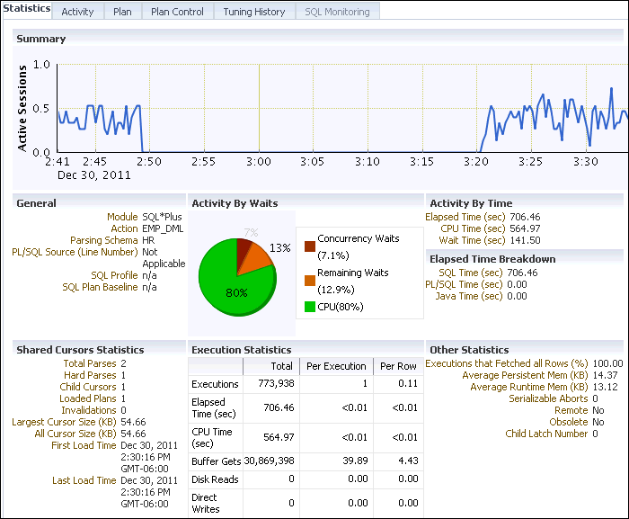
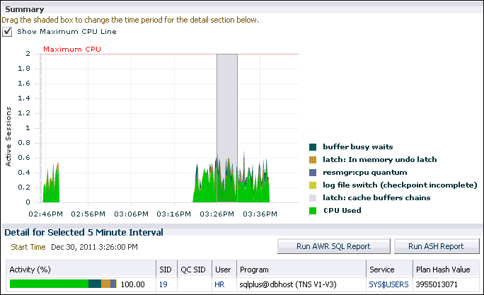
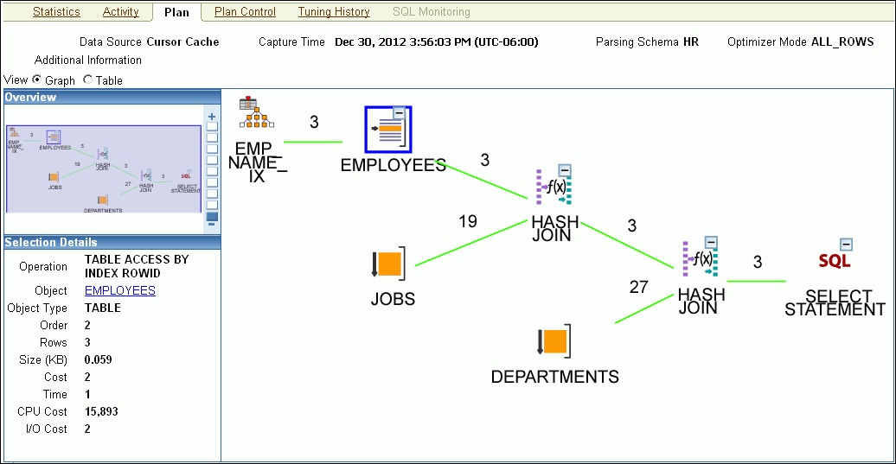
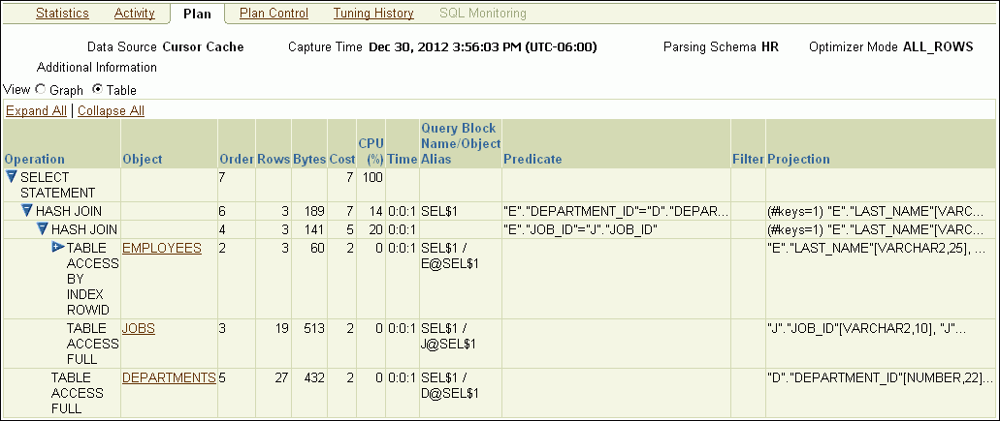
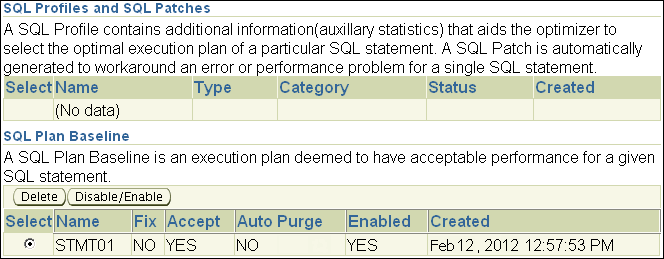
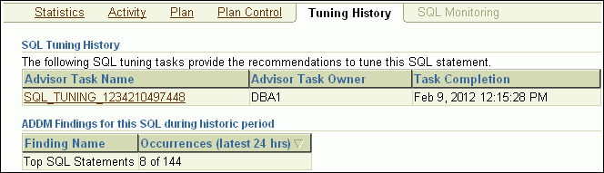

High-load SQL statements may consume a disproportionate amount of system resources. These SQL statements often greatly affect database performance and must be tuned to optimize their performance and resource consumption. Even when a database is properly tuned, inefficient SQL can significantly degrade performance.

Identifying high-load SQL statements is an important SQL tuning activity that must be performed regularly. Automatic Database Diagnostic Monitor (ADDM) automates this task by proactively identifying potential high-load SQL statements. Additionally, you can use Oracle Enterprise Manager Cloud Control (Cloud Control) to identify high-load SQL statements that require further investigation. After you have identified the high-load SQL statements, you can tune them with SQL Tuning Advisor and SQL Access Advisor.

This chapter describes how to identify high-load SQL statements and contains the following sections:

- Identification of High-Load SQL Statements Using ADDM Findings

- Identifying High-Load SQL Statements Using Top SQL

### 11.1 Identification of High-Load SQL Statements Using ADDM Findings

By default, ADDM runs proactively once every hour. It analyzes key statistics gathered by the Automatic Workload Repository (AWR) over the last hour to identify any performance problems, including high-load SQL statements. When the system finds performance problems, it displays them as ADDM findings in the Automatic Database Diagnostic Monitor (ADDM) page.

ADDM provides recommendations with each ADDM finding. When a high-load SQL statement is identified, ADDM gives recommendations, such as running SQL Tuning Advisor on the SQL statement. You can begin tuning SQL statements as described in [Tuning SQL Statements](tuning-sql-statements.md) .

**See Also:**

- "[Overview of Automatic Database Diagnostic Monitor](automatic-database-performance-monitoring.md)"

- "[Interpretation of Automatic Database Diagnostic Monitor Findings](automatic-database-performance-monitoring.md)"

- "[Implementing Automatic Database Diagnostic Monitor Recommendations](automatic-database-performance-monitoring.md)"

### 11.2 Identifying High-Load SQL Statements Using Top SQL

ADDM automatically identifies high-load SQL statements that may be causing systemwide performance degradation. Under normal circumstances, manual identification of high-load SQL statements is not necessary. In some cases, however, you may want to monitor SQL statements at a more granular level. The Top SQL section of the Top Activity page in Cloud Control enables you to identify high-load SQL statements for any 5-minute interval.

Figure 11-1 shows an example of the Top Activity page. The page shows a 1-hour time line of the top activity running on the database. SQL statements that are using the highest percentage of database activity are listed under the Top SQL section, and are displayed in 5-minute intervals.

Figure 11-1 Top Activity Page

[Description of "Figure 11-1 Top Activity Page"](img_text/top_activity.md)

#### To access the Top Activity page:

1.  Access the Database Home page.

    See "[Accessing the Database Home Page](introduction.md)" for more information.

2.  From the Performance menu, select Top Activity.

    If the Database Login page appears, then log in as a user with administrator privileges. The Top Activity page appears.

3.  To move the 5-minute interval, drag the shaded box to the desired time.

    The information contained in the Top SQL section is automatically updated to reflect the selected time period.

4.  To monitor SQL statements for a longer duration than one hour, select Historical from the View Data list.

    In Historical view, you can view the top SQL statements for the duration defined by the AWR retention period.

This section contains the following topics:

- Viewing SQL Statements by Wait Class

- Viewing Details of SQL Statements

#### 11.2.1 Viewing SQL Statements by Wait Class

The SQL statements that appear in the Top SQL section of the Top Activity page are categorized into various wait classes, based on their corresponding class as described in the legend on the Top Activity chart.

##### To view the SQL statements for a particular wait class:

1.  Access the Database Home page.

    See "[Accessing the Database Home Page](introduction.md)" for more information.

2.  From the Performance menu, select Top Activity.

    If the Database Login page appears, then log in as a user with administrator privileges. The Top Activity page appears.

3.  In the Top Activity chart, click the block of color on the chart for the wait class, or its corresponding wait class in the legend.

    The Active Sessions Working page for the selected wait class appears. The Top SQL section automatically updates to show only the SQL statements for the specified wait class.

**See Also:**

- "[Monitoring User Activity](monitoring-real-time-database-performance.md)" for information about using the Active Sessions Working page

#### 11.2.2 Viewing Details of SQL Statements

The Top SQL section of the Top Activity page displays the SQL statements executed within the selected 5-minute interval in descending order based on their resource consumption. The SQL statement at the top of this table represents the most resource-intensive SQL statement during that time period, followed by the second most resource-intensive SQL statement, and so on.

##### To view details of SQL statements:

1.  Access the Database Home page.

    See "[Accessing the Database Home Page](introduction.md)" for more information.

2.  From the Performance menu, select Top Activity.

    If the Database Login page appears, then log in as a user with administrator privileges. The Top Activity page appears.

3.  In the Top SQL section, click the SQL ID link of the SQL statement.

    The SQL Details page for the selected SQL statement appears.

4.  To view SQL details for a longer period, select Historical from the View Data list.

    
    [Description of the illustration sql_details_historical.gif](img_text/sql_details_historical.md)
    You can now view SQL details in the past, up to the duration defined by the AWR retention period.

5.  In the Text section, review the SQL text for the SQL statement.

    The Text section contains the SQL text for the selected SQL statement. Note that if only part of the SQL statement is displayed, then a plus sign (`+`) icon appears next to the Text heading. To view the SQL text for the entire SQL statement, click the plus sign (+) icon.

    In Figure 11-1, the text of the SQL statement `ddthrb7j9a63f` is as follows:

        SELECT E.LAST_NAME, J.JOB_TITLE, D.DEPARTMENT_NAME
        FROM   HR.EMPLOYEES E, HR.DEPARTMENTS D, HR.JOBS J
        WHERE  E.DEPARTMENT_ID = D.DEPARTMENT_ID
        AND    E.JOB_ID = J.JOB_ID
        AND    E.LAST_NAME LIKE 'A%'

6.  In the Plan Hash Value list in the Details section, do one of the following:

    - If the SQL statement has multiple plans, then select All to show SQL details for all plans.

    - Select a particular plan to display SQL details for this plan only.

7.  View the subpages available on the SQL Details page to display additional information about the SQL statement, as described in the following sections:

    - Viewing SQL Statistics

    - Viewing Session Activity

    - Viewing the SQL Execution Plan

    - Viewing the Plan Control

    - Viewing the Tuning History

8.  If the SQL statement is a high-load SQL statement, then tune it as described in [Tuning SQL Statements](tuning-sql-statements.md) .

##### 11.2.2.1 Viewing SQL Statistics

The Statistics subpage of the SQL Details page displays statistical information about the SQL statement.

##### To view statistics for the SQL statement:

1.  Access the SQL Details page, as explained in "Viewing Details of SQL Statements".

2.  Under Details, click Statistics.

    The Statistics subpage appears.

    
    [Description of the illustration sql_details_statistics.gif](img_text/sql_details_statistics.md)

3.  View the statistics for the SQL statement, as described in the following sections:

    - SQL Statistics Summary

    - General SQL Statistics

    - Activity by Waits Statistics and Activity by Time Statistics

    - Elapsed Time Breakdown Statistics

    - Shared Cursors Statistics and Execution Statistics

    - Other SQL Statistics

###### 11.2.2.1.1 SQL Statistics Summary

The Summary section displays SQL statistics and activity on a chart.

In the Real Time view, the Active Sessions chart shows the average number of active sessions executing the SQL statement in the last hour. If the SQL statement has multiple plans and All is selected in the Plan Hash Value list, then the chart displays each plan in different colors, enabling you to easily spot if the plan changed and whether this may be the cause of the performance degradation. Alternatively, you can select a particular plan to display that plan only.

In the Historical view, the chart shows execution statistics in different dimensions. To view execution statistics, select the desired dimension from the View list:

- Elapsed time per execution

- Executions per hour

- Disk reads per execution

- Buffer gets per execution

This technique enables you to track the response time of the SQL statement using different dimensions. You can determine whether the performance of the SQL statement has degraded based on the dimension selected.

To view statistics of the SQL statement for a particular time interval, click the snapshot icon below the chart. You can also use the arrows to scroll the chart to locate a desired snapshot.

###### 11.2.2.1.2 General SQL Statistics

The General section enables you to identify the origin of the SQL statement by listing the following information:

- Module, if specified using the `DBMS_APPLICATION_INFO` package

- Action, if specified using the `DBMS_APPLICATION_INFO` package

- Parsing schema, or the database account used to execute the SQL statement

- PL/SQL source, or the code line if the SQL statement is part of a PL/SQL program

###### 11.2.2.1.3 Activity by Waits Statistics and Activity by Time Statistics

The Activity by Waits and Activity by Time sections enable you to identify how the SQL statement spent most of its time. The Activity by Waits section contains a graphical representation of how much elapsed time is consumed by CPU and by remaining waits. The Activity by Time section breaks out the total elapsed time into CPU time and wait time by seconds.

###### 11.2.2.1.4 Elapsed Time Breakdown Statistics

The Elapsed Time Breakdown section enables you to identify if the SQL statement itself is consuming a lot of time, or if the total elapsed time is inflated due to the amount of time the originating program or application spent with the PL/SQL or Java engine. If the PL/SQL time or Java time makes up a significant portion of the elapsed time, then there may be minimal benefit gained by tuning the SQL statement. Instead, you should examine the application to determine how the PL/SQL time or Java time can be reduced.

###### 11.2.2.1.5 Shared Cursors Statistics and Execution Statistics

The Shared Cursors Statistics and Execution Statistics sections provide information about the efficiency of various stages of the SQL execution process.

###### 11.2.2.1.6 Other SQL Statistics

The Other Statistics section provides additional information about the SQL statement, such as average persistent and run-time memory.

##### 11.2.2.2 Viewing Session Activity

The Activity subpage contains a graphical representation of the session activity.

##### To view session activity for the SQL statement:

1.  Access the SQL Details page, as explained in "Viewing Details of SQL Statements".

2.  Under Details, click Activity.

    The SQL Details page appears, showing the Activity subpage.

    
    [Description of the illustration sql_details_activity.gif](img_text/sql_details_activity.md)
    The Activity subpage displays details of various sessions executing the SQL statement. The Active Sessions chart profiles the average number of active sessions over time.

3.  Optionally, drag the shaded box to select a 5-minute interval.

    The Detail for Selected 5 Minute Interval section lists the sessions that executed the SQL statement during the selected 5-minute interval. The multicolored bar in the Activity % column depicts how the database time is divided for each session while executing the SQL statement.

4.  Optionally, click the link in the SID column of the session you want to view to display the Session Details page.

**See Also:**

- "[Monitoring Top Sessions](monitoring-real-time-database-performance.md)" for information about monitoring session activity and details

##### 11.2.2.3 Viewing the SQL Execution Plan

The execution plan for a SQL statement is the sequence of operations Oracle Database performs to run the statement. The Plan subpage displays the execution plan for the SQL statement in a graph view and a table view.

##### To view the execution plan for the SQL statement:

1.  Access the SQL Details page, as explained in "Viewing Details of SQL Statements".

2.  Under Details, click Plan.

    The SQL Details page appears, showing the Plan subpage.

3.  Click Graphical to view the SQL execution in a graph view.

    
    [Description of the illustration sql_details_plan_graph.gif](img_text/sql_details_plan_graph.md)

4.  Optionally, select an operation in the graph to display details about the operations shown in the execution plan.

    The Selection Details section refreshes to show details about the selected operations.

5.  If the selected operation is on a particular database object (such as a table), then click the Object link to view further details about the database object.

6.  To view the SQL execution in a table view, click Tabular.

    The Plan subpage refreshes to show the explain plan in a table.

    
    [Description of the illustration sql_details_plan_table.gif](img_text/sql_details_plan_table.md)
    Query rewrite is an optimization technique that transforms a user request written in terms of master tables into a semantically equivalent request that includes materialized views. The database compares the cost for the query, with and without query rewrite, and selects the least costly option. If a rewrite is necessary, then query rewrite and its cost benefit are shown in the Explain Rewrite section.

**See Also:**

- "[Tuning SQL Statements](tuning-sql-statements.md) " for information about execution plan and the query optimizer

##### 11.2.2.4 Viewing the Plan Control

The Plan Control subpage contains information about the following items:

- SQL profiles

  A SQL profile contains additional statistics for the SQL statement. The optimizer uses these statistics to generate a better execution plan for the statement.

- SQL patches

  A SQL patch is automatically generated to work around an error or performance problem for a single SQL statement.

- SQL plan baselines

  A SQL plan baseline is an execution plan proven to have acceptable performance for a given SQL statement.

##### To view plan control information:

1.  Access the SQL Details page, as explained in "Viewing Details of SQL Statements".

2.  Under Details, click Plan Control.

    The SQL Details page appears, showing the Plan Control subpage.

3.  Review the plan-related information.

    In the following example, the optimizer used a SQL plan baseline named `STMT01` for the SQL statement.

    
    [Description of the illustration sql_details_plan_control.gif](img_text/sql_details_plan_control.md)

**See Also:**

- "[Tuning SQL Statements](tuning-sql-statements.md) " for information about SQL Tuning Advisor and SQL profiles

- "[Managing SQL Profiles](tuning-sql-statements.md)"

- " [Optimizing Data Access Paths](optimizing-data-access-paths.md) " for information about SQL Access Advisor

##### 11.2.2.5 Viewing the Tuning History

The SQL Tuning History section displays a history of SQL Tuning Advisor and SQL Access Advisor tasks.

##### To view the SQL tuning history:

1.  Access the SQL Details page, as explained in "Viewing Details of SQL Statements".

2.  Under Details, click Tuning History.

    The SQL Details page appears, showing the Tuning History subpage.

3.  Review the information about the tuning history.

    The SQL Tuning History section displays a history of SQL Tuning Advisor or SQL Access Advisor tasks.

    The ADDM Findings for this SQL During Historic Period section displays the number of occurrences of ADDM findings that are associated with the SQL statement.

    The following example shows that SQL tuning task was performed by user `DBA1` on February 9, 2012.

    
    [Description of the illustration sql_details_tuning.gif](img_text/sql_details_tuning.md)

**See Also:**

- "[Tuning SQL Statements](tuning-sql-statements.md) " for information about SQL Tuning Advisor and SQL profiles

- "[Managing SQL Profiles](tuning-sql-statements.md)"

- " [Optimizing Data Access Paths](optimizing-data-access-paths.md) " for information about SQL Access Advisor
