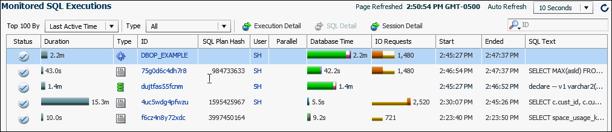
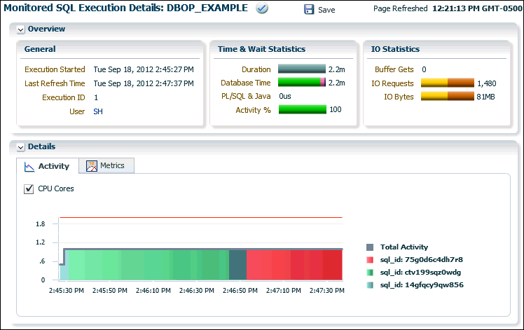
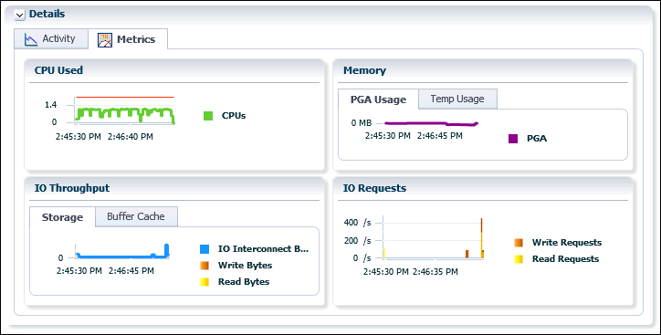
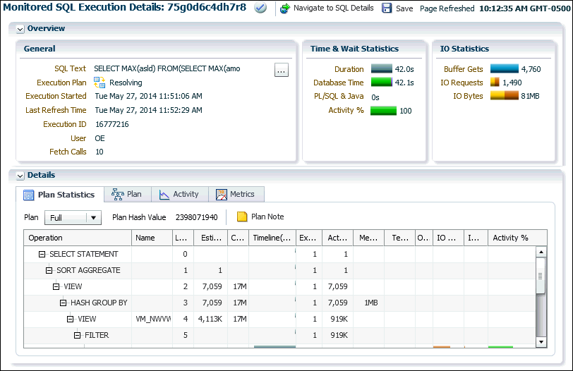
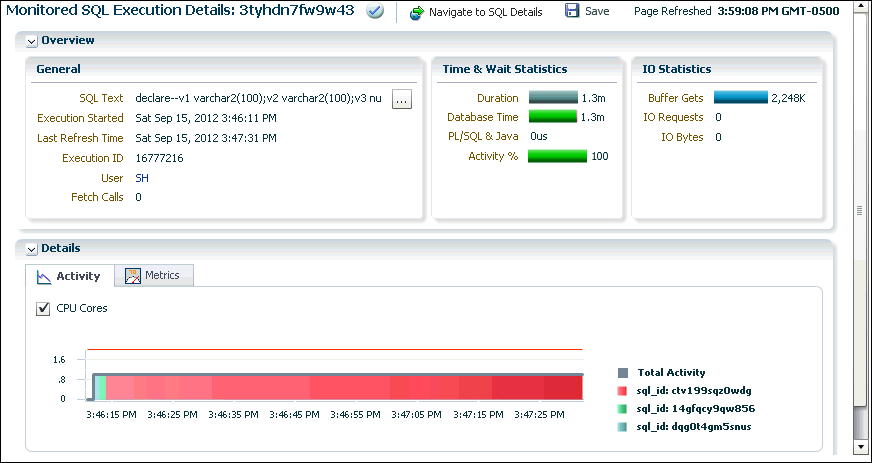

This chapter describes how to monitor current and recent database operations in Oracle Enterprise Manager Cloud Control (Cloud Control). This chapter contains the following topics:

- About Monitoring Database Operations

- Creating a Database Operation

- Monitoring Database Operations in Cloud Control

**See Also:**

- [Oracle Database SQL Tuning Guide](../tgsql/monitoring-database-operations.md) for information on monitoring database operations using an API

### 5.1 About Monitoring Database Operations

The SQL Monitoring pages in Cloud Control display information that you can use to monitor the performance of database operations while they are executing, view details about the time and resources used for recently completed operations, and track and report on database operations. A database operation is a set of database tasks defined by end users or application code such as a SQL statement or PL/SQL function, a batch job, or extract, transform, and load (ETL) processing. You can define, monitor, and report on database operations.

This section contains the following topics:

- Types of Database Operations

- Purposes of Monitoring Database Operations

- Enabling Monitoring of Database Operations

- Attributes of Database Operations

**See Also:**

- [Oracle Database SQL Tuning Guide](../tgsql/monitoring-database-operations.md) for more information about monitoring database operations

#### 5.1.1 Types of Database Operations

Database operations are either simple or composite. A simple database operation is a single SQL statement or PL/SQL procedure or function. Monitoring of a simple operation starts automatically when a SQL statement runs in parallel, or when it has consumed at least 5 seconds of CPU or I/O time in a single execution.

A composite database operation is activity between two defined points in time in a database session. You begin and end a composite operation by using PL/SQL procedures, as shown in "Creating a Database Operation". Only one composite database operation at a time can run in a database session.

#### 5.1.2 Purposes of Monitoring Database Operations

In general, database operation monitoring is useful for the following users:

- DBAs whose responsibilities include identifying expensive (high response time) SQL statements and PL/SQL functions

- DBAs who manage batch jobs in a data warehouse or OLTP system

- Application or database developers who need to monitor the activities related to particular operations, for example, Data Pump operations

Monitoring database operations is useful for performing the following tasks:

- Tracking and reporting

  Tracking requires first defining a composite database operation. When the operation begins, the database infrastructure determines what to track on behalf of the operation. For example, your tuning task may involve determining which SQL statements run on behalf of a specific batch job, what their execution statistics were, what was occurring in the database when the operation was executing, and so on. In Cloud Control, you can view the reports for the composite database operation and for the simple database operations that comprise the composite database operation. You can save the reports to disk.

- Monitoring execution progress

  This task involves monitoring a currently executing database operation. The information is particularly useful when you are investigating why an operation is taking a long time to complete.

- Monitoring resource usage

  You may want to detect when a SQL execution uses excessive CPU, issues an excessive amount of I/O, or takes a long time to complete. With the Oracle Database Resource Manager (Resource Manager), you can configure thresholds for each consumer group that specify the maximum resource usage for all SQL executions in the group. When a SQL operation reaches a specified threshold, Resource Manager can switch the operation into a lower-priority consumer group, terminate the session, or cancel and quarantine the SQL operation. In Cloud Control, you can examine these SQL operations.

  **See Also:**

  [Oracle Database Administrator's Guide](../admin/managing-resources-with-oracle-database-resource-manager.md) for more information about consumer group switching by setting resource limits using the Resource Manager

- Tuning for response time

  When tuning a database operation, you typically want to improve the response time. Often the database operation performance issues are mainly SQL performance issues.

#### 5.1.3 Enabling Monitoring of Database Operations

Real-time database operations monitoring is enabled by default when the `STATISTICS_LEVEL` initialization parameter is either set to `TYPICAL` (the default value) or `ALL`. Because database operations monitoring is a feature of the Oracle Tuning Pack, the `CONTROL_MANAGEMENT_PACK_ACCESS` parameter must be set to `DIAGNOSTIC+TUNING` (the default value).

**See Also:**

[Oracle Database SQL Tuning Guide](../tgsql/monitoring-database-operations.md) for more information about how to disable real-time database operations monitoring

#### 5.1.4 Attributes of Database Operations

A database operation has attributes that uniquely identify it. These attributes are the following:

- Database operation name

  This is a user-created name such as `daily_sales_report`. For an example of naming a database operation, see "Creating a Database Operation".

- Database operation execution ID

  Two or more occurrences of the same database operation can run at the same time, each in a different database session, with the same name but with different execution IDs. This numeric ID uniquely identifies different executions of the same database operation.

  The database automatically creates an execution ID when you begin a database operation. You can also specify your own execution ID.

### 5.2 Creating a Database Operation

You can create a composite database operation using the `DBMS_SQL_MONITOR` package subprograms.

The following example creates a database operation named `DBOP_EXAMPLE`. The example begins the database operation. It has a PL/SQL procedure that selects the maximum sales amount by customer by city. It then has a SQL statement that selects the maximum sales amount of all customers from cities that have at least two customers. Finally, it ends the database operation.

Example 5-1 Creating a Database Operation

    VAR eid NUMBER
    EXEC :eid := DBMS_SQL_MONITOR.BEGIN_OPERATION('DBOP_EXAMPLE');
    declare
    --
    v1 number;
    --
    CURSOR c1 IS
    SELECT cust_city
      FROM (SELECT COUNT(*) cnt, cust_city
            FROM sh.customers GROUP BY cust_city
            ORDER BY 1 desc);
    --
    BEGIN
    FOR i IN c1
    LOOP
    --
    v1 := 0;
    --
    SELECT MAX(amount_sold)
    INTO v1
    FROM sh.sales
    WHERE cust_id IN (select cust_id FROM sh.customers WHERE cust_city=i.cust_city);
    --
    DBMS_OUTPUT.PUT_LINE('Amount: '||v1);
    --
    END LOOP;
    --
    END;
    /
    SELECT MAX(asld) FROM
    (SELECT MAX(amount_sold) asld, cust_id FROM sh.sales WHERE cust_id IN
      (SELECT cust_id FROM sh.customers WHERE cust_city IN
        (SELECT cust_city FROM
         (SELECT count(*) cnt, cust_city FROM sh.customers
          GROUP BY cust_city HAVING COUNT(*) > 1)
        ))
    GROUP BY cust_id)
    /

    EXEC DBMS_SQL_MONITOR.END_OPERATION('DBOP_EXAMPLE',:eid);

**Note:**

Starting with Oracle Database 19c, database users without the administrative privileges can also create composite database operations using the `DBMS_SQL_MONITOR` package subprograms and view the SQL execution details of those operations, including the execution plans and performance metrics, by navigating to the Monitored SQL Executions page of Cloud Control.

**See Also:**

- [Oracle Database SQL Tuning Guide](../tgsql/monitoring-database-operations.md) for information on monitoring database operations using an API

- [Oracle Database PL/SQL Packages and Types Reference](../arpls/DBMS_SQL_MONITOR.md) for information on the `DBMS_SQL_MONITOR` package

### 5.3 Monitoring Database Operations in Cloud Control

The Monitored SQL Executions page of Cloud Control displays a table of database operations that are currently running or have completed.

With a selection from the Top 100 By list, you can order the rows of the table by aspects of the operations such as Last Active Time, Duration, or CPU Time. With a selection from the Type list, you can show all of the operations or filter the rows to show only the SQL, PL/SQL, or database operations.

The table contains data about the operations, such as the status and type of the operation, the operation ID, the database time consumed, the SQL text, if appropriate, and so on. The values in some columns are links to other pages or display information when the cursor points to them. For example, the value in the ID column is a link to the Monitored SQL Execution Details page. Another example is that when the cursor points to the bar in the Database Time column, a context message appears that displays information such as the wait class, the amount of time, and the percentage of database time. For example, pointing to the bar in the Database Time column displays a message such as `CPU: 2.8m (92%)`. The Execution Detail, SQL Detail, and Session Detail controls above the table become active when you select a row from the table.

**Note:**

Starting with Oracle Database 19c, database users without the administrative privileges can also view the execution plans and performance metrics of their SQL statements by navigating to the Monitored SQL Executions page of Cloud Control.

This section contains the following topics:

- Viewing SQL Execution Details for a Composite Database Operation

- Viewing SQL Execution Details for a SQL Statement

- Viewing SQL Execution Details for a PL/SQL Statement

**See Also:**

- Cloud Control Online Help for descriptions of the elements on the Monitored SQL Executions Details page

#### 5.3.1 Viewing SQL Execution Details for a Composite Database Operation

This topic describes how to view the execution details for a composite database operation.

##### To view execution details for a composite database operation:

1.  Access the Database Home page.

    See "[Accessing the Database Home Page](introduction.md)" for more information.

2.  From the Performance menu, select Performance Hub and then SQL Monitoring.

    If the Database Login page appears, then log in as a user with administrator privileges. The Monitored SQL Execution page appears.

    Figure 5-1 Monitored SQL Executions Page

    
    [Description of "Figure 5-1 Monitored SQL Executions Page"](img_text/mon_sql_exec.md)

3.  Click the ID of a composite database operation in the table.

    For example, in Figure 5-1 click `DBOP_EXAMPLE`.

    The Monitored SQL Execution Details page for the operation appears. In the Details section, the Activity subpage is selected by default. Selecting an area in the Activity chart or selecting the corresponding SQL ID value in the legend displays the SQL Details page for that statement.

    
    [Description of the illustration mon_sql_details_dbop.gif](img_text/mon_sql_details_dbop.md)

4.  To view metrics of the operation, click the Metrics tab.

    The Metrics subpage appears.

    
    [Description of the illustration mon_sql_dtls_dbop_mtrc.gif](img_text/mon_sql_dtls_dbop_mtrc.md)

#### 5.3.2 Viewing SQL Execution Details for a SQL Statement

This topic describes how to view the execution details for a SQL statement.

##### To view execution details for a SQL statement:

1.  Access the Database Home page.

    See "[Accessing the Database Home Page](introduction.md)" for more information.

2.  From the Performance menu, select Performance Hub and then SQL Monitoring.

    If the Database Login page appears, then log in as a user with administrator privileges. The Monitored SQL Execution page appears.

3.  Click the ID of a SQL statement in the table.

    For example, in Figure 5-1 click `75g0d6c4dh7r8`.

    The Monitored SQL Execution Details page for the operation appears. In the Details section, the Plan Statistics subpage is selected by default.

    
    [Description of the illustration mon_sql_details_sql.gif](img_text/mon_sql_details_sql.md)

#### 5.3.3 Viewing SQL Execution Details for a PL/SQL Statement

This topic describes viewing the execution details for a PL/SQL statement.

##### To view execution details for a PL/SQL statement:

1.  Access the Database Home page.

    See "[Accessing the Database Home Page](introduction.md)" for more information.

2.  From the Performance menu, select Performance Hub and then SQL Monitoring.

    If the Database Login page appears, then log in as a user with administrator privileges. The Monitored SQL Execution page appears.

3.  Click the ID of a PL/SQL statement in the table.

    The Monitored SQL Execution Details page for the operation appears. In the Details section, the Activity subpage is selected by default.

    
    [Description of the illustration mon_sql_details_plsql.gif](img_text/mon_sql_details_plsql.md)
