The Automatic Database Diagnostic Monitor (ADDM) automatically identifies performance problems with the database, as described in [Automatic Database Performance Monitoring](automatic-database-performance-monitoring.md). Information on performance appears on the Performance page in Oracle Enterprise Manager Cloud Control (Cloud Control).

By drilling down to other pages from the Performance page, you can identify database performance problems in real time. If you find a problem, then you can run ADDM manually to analyze it immediately without having to wait until the next ADDM analysis. To learn how to run ADDM manually, see "[Manually Running ADDM to Analyze Current Database Performance](manual-database-performance-monitoring.md)".

This chapter describes how to monitor some aspects of database activity. It contains the following sections:

- Monitoring User Activity

- Monitoring Instance Activity

- Monitoring Host Activity

- Determining the Cause of Spikes in Database Activity

- Customizing the Database Performance page

### 4.1 Monitoring User Activity

As described in [Oracle Database Performance Method](oracle-database-performance-method.md) , database time (DB time) is an indicator of the total database instance workload. The average active sessions for a time period equals the total database time of all user sessions during the period divided by the elapsed time (wall-clock time) for the period.

The Average Active Sessions chart on the Performance page shows the average active sessions for CPU usage and wait classes in the time period. By following the performance method explained in [Oracle Database Performance Method](oracle-database-performance-method.md) , you can drill down from the chart to identify the causes of instance-related performance issues and resolve them.

#### To monitor user activity:

1.  Access the Database Home page.

    See "[Accessing the Database Home Page](introduction.md)" for more information.

2.  From the Performance menu, select Performance Home.

    If the Database Login page appears, then log in as a user with administrator privileges. The Performance page appears.

3.  Locate any spikes or other areas of interest in the Average Active Sessions stacked area chart.

    Figure 4-1 shows an example of the Average Active Sessions chart on the Performance page.

    Figure 4-1 Average Active Sessions Chart

    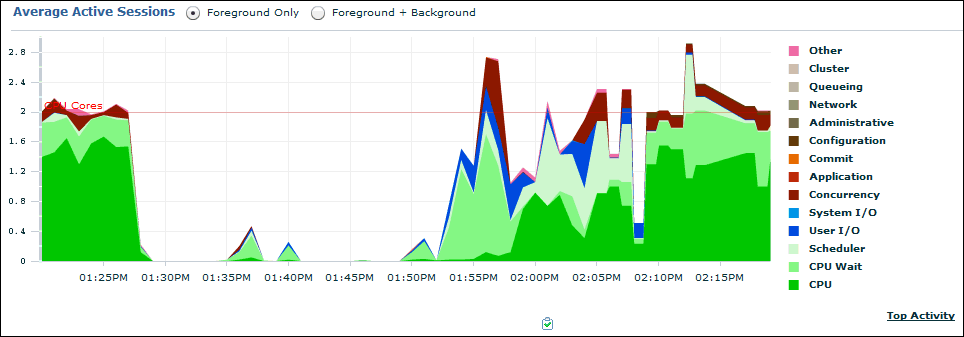
    [Description of "Figure 4-1 Average Active Sessions Chart"](img_text/average_active_sess.md)
    Each color-filled area on the stacked area chart shows the average active sessions for the specified event at the specified time. In the chart, the average active sessions amount for each event is stacked upon the one below it. The events appear on the chart in the order shown in the legend, with CPU starting at zero on the y-axis and the other events stacked in ascending order, from CPU Wait to Other. The wait classes show how much database activity is consumed by waiting for a resource such as disk I/O.

    For example, in Figure 4-1 at approximately 1:26 p.m., five events consume database time in the sampled time interval: CPU, CPU Wait, Scheduler, Concurrency, and Other. The combined average active sessions total is 2.1. The average active sessions value for CPU is about 1.52, for CPU Wait it is about .38, for Scheduler it is about .03, for Concurrency it is about .16, and for Other it is about .01.

    The CPU Cores line at 2 on the y-axis indicates the number of CPUs on the host system. When the CPU value reaches the CPU Cores line, the database instance is consuming 100 percent of CPU time on the system.

    In Figure 4-1, the chart shows that most of the activity occurred from 1:20 to 1:28 and from about 1:53 to 2:20. Most of the activity between 1:20 and 1:28 was CPU usage, as was most of the activity after about 1:59. Wait class activity spiked a few times between 1:56 and 2:12, and consumed a significant amount of database time from about 1:52 to about 2:08.

4.  To identify each wait class, move your cursor over the area in the Average Active Sessions chart that corresponds to the class.

    The corresponding wait class is highlighted in the chart legend.

5.  Click the largest area of color on the chart or the corresponding wait class in the legend to drill down to the wait class with the most average active sessions.

    If you click CPU or CPU Wait, then the Active Sessions Working: CPU + CPU Wait page appears. If you click a different wait class, such as User I/O, then an Active Sessions Waiting page for that wait class appears. Figure 4-2 shows the Active Sessions Working: CPU + CPU Wait page.

    Figure 4-2 Active Sessions Working Page

    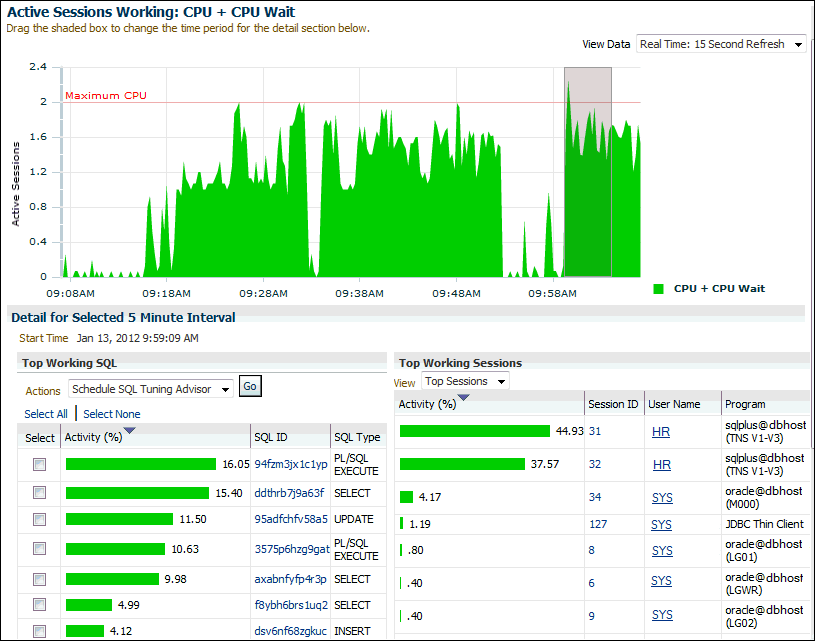
    [Description of "Figure 4-2 Active Sessions Working Page"](img_text/act_sess_wrk.md)
    The Active Sessions Working page shows a 1-hour timeline. Details for each wait class are shown in 5-minute intervals under Detail for Selected 5 Minute Interval.

    You can view the details of wait classes in different dimensions by proceeding to one of the following sections:

    - "Monitoring Top SQL"

    - "Monitoring Top Sessions"

    - "Monitoring Top Services"

    - "Monitoring Top Modules"

    - "Monitoring Top Actions"

    - "Monitoring Top Clients"

    - "Monitoring Top PL/SQL"

    - "Monitoring Top Files"

    - "Monitoring Top Objects"

6.  To change the selected time interval, drag the shaded area on the chart to a different interval.

    The information contained in the Detail for Selected 5 Minute Interval section is automatically updated to display the selected time period.

    In the example shown in Figure 4-2, the 5 -minute interval from 9:59 to 10:04 is selected for the CPU and CPU wait class.

7.  If you discover a performance problem, then you can attempt to resolve it in real time. On the Performance page, do one of the following:

    - Below the Average Active Sessions chart, click the snapshot corresponding to the time when the performance problem occurred to run ADDM for this time period.

      For information about ADDM analysis, see "[Reviewing the Automatic Database Diagnostic Monitor Analysis](automatic-database-performance-monitoring.md)".

    - Click Run ADDM Now to create a snapshot manually.

      For information about creating snapshots manually, see "[Creating Snapshots](automatic-database-performance-monitoring.md)". For information about running ADDM manually, see "[Manually Running ADDM to Analyze Current Database Performance](manual-database-performance-monitoring.md)".

    - Click Run ASH Report to create an Active Session History (ASH) report to analyze transient, short-lived performance problems.

      For information about ASH reports, see "[Active Session History Reports](resolving-transient-performance-problems.md)".

#### 4.1.1 Monitoring Top SQL

On the Active Sessions Working page, the Top Working SQL table shows the database activity for actively running SQL statements that are consuming CPU resources. The Activity (%) column shows the percentage of this activity consumed by each SQL statement. If one or several SQL statements are consuming most of the activity, then you should investigate them.

##### To monitor the top working SQL statements:

1.  Access the Performance page, as explained in "Monitoring User Activity".

2.  In the Average Active Sessions chart, click the CPU or CPU Wait area on the chart or the corresponding wait class in the legend.

    The Active Sessions Working page appears.

3.  In the Top Working SQL table, click the SQL ID link of the most active SQL statement. For example, in Figure 4-2, the SQL ID of the most active SQL statement is `ddthrb7j9a63f`.

    The SQL Details page appears.

    For SQL statements that are consuming the majority of the wait time, use SQL Tuning Advisor or create a SQL tuning set to tune the problematic SQL statements.

**See Also:**

- "[Viewing Details of SQL Statements](identifying-high-load-sql-statements.md)"

- "[Tuning SQL Statements Using SQL Tuning Advisor](tuning-sql-statements.md)"

#### 4.1.2 Monitoring Top Sessions

A session is a logical entity in the database instance memory that represents the state of a current user login to the database. A session lasts from the time a user logs in to the database until the user disconnects. For example, when a user starts SQL\*Plus, the user must provide a valid database user name and password to establish a session. If a single session is consuming the majority of database activity, then you should investigate it.

##### To monitor the top working sessions:

1.  Access the Performance page, as explained in "Monitoring User Activity".

2.  In the Average Active Sessions chart, click the CPU or CPU Wait area on the chart or the corresponding wait class in the legend.

    The Active Sessions Working: CPU + CPU Wait page appears, as shown in Figure 4-2.

3.  Under Detail for Selected 5 Minute Interval, in the Top Working Sessions section, from the View list select Top Sessions.

    The Top Working Sessions table appears. The table displays the top sessions waiting for the corresponding wait class during the selected time period.

4.  In the Top Working Sessions table, click the Session ID link of the session consuming the most database activity.

    The Session Details page appears.

    This page contains information such as session activity, session statistics, open cursors, blocking sessions, wait event history, and parallel SQL for the selected session.

    If a session is consuming too much database activity, then consider clicking Kill Session, and then tuning the SQL statement.

**See Also:**

- "[Tuning SQL Statements](tuning-sql-statements.md) "

#### 4.1.3 Monitoring Top Services

A service is a group of applications with common attributes, service-level thresholds, and priorities. For example, the `SYS$USERS` service is the default service name used when a user session is established without explicitly identifying a service name. The `SYS$BACKGROUND` service consists of all database background processes. If a service is using the majority of the wait time, then you should investigate it.

##### To monitor a service:

1.  Access the Performance page, as explained in "Monitoring User Activity".

2.  In the Average Active Sessions chart, click a colored area on the chart or the corresponding wait class in the legend.

    The Active Sessions Working page appears.

3.  Under Detail for Selected 5 Minute Interval, select Top Services from the View list.

    The Top Services table appears.

    Figure 4-3 Monitoring Top Services

    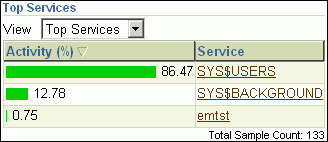
    [Description of "Figure 4-3 Monitoring Top Services"](img_text/top_serv.md)
    The Top Services table displays the top services waiting for the corresponding wait event during the selected time period. For example, in Figure 4-3, the `SYS$USERS` service is consuming 86.47% of database activity.

4.  Click the Service link of the most active service.

    The Service page appears.

    This page contains information about the modules, activity, and statistics for the selected service.

#### 4.1.4 Monitoring Top Modules

Modules represent the applications that set the service name as part of the workload definition. For example, the `DBMS_SCHEDULER` module may assign jobs that run within the `SYS$BACKGROUND` service. If a single module is using the majority of the wait time, then it should be investigated.

##### To monitor a module:

1.  Access the Performance page, as explained in "Monitoring User Activity".

2.  In the Average Active Sessions chart, click a colored area on the chart or the corresponding wait class in the legend.

    The Active Sessions Working page appears.

3.  Under Detail for Selected 5 Minute Interval, select Top Modules from the View list.

    The Top Modules table appears.

    Figure 4-4 Monitoring Top Modules

    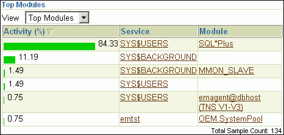
    [Description of "Figure 4-4 Monitoring Top Modules"](img_text/top_mod.md)
    The Top Modules table displays the top modules waiting for the corresponding wait event during the selected time period. For example, in Figure 4-4, the SQL\*Plus module is consuming over 84% of database activity and should be investigated. As shown in Figure 4-2, the SQL\*Plus sessions for user `HR` are consuming a huge percentage of database activity.

4.  Click the Module link of the module that is showing the highest percentage of activity.

    The Module page appears.

    This page contains information about the actions, activity, and statistics for the selected module.

#### 4.1.5 Monitoring Top Actions

Actions represent the jobs that are performed by a module. For example, the `DBMS_SCHEDULER` module can run the `GATHER_STATS_JOB` action to gather statistics on all database objects. If a single action is using the majority of the wait time, then you should investigate it.

##### To monitor an action:

1.  Access the Performance page, as explained in "Monitoring User Activity".

2.  In the Average Active Sessions chart, click a colored area on the chart or the corresponding wait class in the legend.

    The Active Sessions Working page appears.

3.  Under Detail for Selected 5 Minute Interval, select Top Actions from the View list.

    The Top Actions table appears.

    Figure 4-5 Monitoring Top Actions

    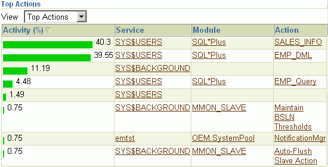
    [Description of "Figure 4-5 Monitoring Top Actions"](img_text/top_act.md)
    The Top Actions table displays the top actions waiting for the corresponding wait event during the selected time period. For example, in Figure 4-5, the `SALES_INFO` action associated with the SQL\*Plus module is consuming 40.3% of the database activity, while `EMP_DML` is consuming 39.55% and `EMP_Query` is consuming 4.48%. This information is consistent with Figure 4-2, which shows that the database sessions for user `HR` are consuming over 82% of database activity.

4.  Click the Action link of the most active action.

    The Action page appears.

    This page contains statistics for the selected action.

#### 4.1.6 Monitoring Top Clients

A client can be a web browser or any client process that initiates a request for the database to perform an operation. If a single client is using the majority of the wait time, then you should investigate it.

##### To monitor a client:

1.  Access the Performance page, as explained in "Monitoring User Activity".

2.  In the Average Active Sessions chart, click a colored area on the chart or the corresponding wait class in the legend.

    The Active Sessions Working page appears.

3.  Under Detail for Selected 5 Minute Interval, select Top Clients from the View list.

    The Top Clients table appears.

    Figure 4-6 Monitoring Top Clients

    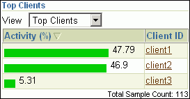
    [Description of "Figure 4-6 Monitoring Top Clients"](img_text/top_client.md)
    The Top Clients table displays the top clients waiting for the corresponding wait event during the selected time period. For example, in Figure 4-6, client1 and client2 are consuming the majority of the database activity.

4.  Click the Client ID link of the most active client.

    The Clients page appears.

    This page contains statistics for the selected client process.

#### 4.1.7 Monitoring Top PL/SQL

If a single PL/SQL subprogram is using the majority of the wait time, then you should investigate it.

##### To monitor a PL/SQL subprogram:

1.  Access the Performance page, as explained in "Monitoring User Activity".

2.  In the Average Active Sessions chart, click a colored area on the chart or the corresponding wait class in the legend.

    The Active Sessions Working page appears.

3.  Under Detail for Selected 5 Minute Interval, select Top PL/SQL from the View list.

    The Top PL/SQL table appears.

    Figure 4-7 Monitoring Top PL/SQL

    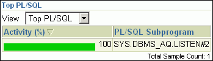
    [Description of "Figure 4-7 Monitoring Top PL/SQL"](img_text/top_plsql.md)
    The Top PL/SQL table displays the top PL/SQL subprograms waiting for the corresponding wait event during the selected time period. For example, in Figure 4-7, the `SYS.DBMS_AQ.LISTEN#2` subprogram is consuming 100% of database activity.

4.  Click the PL/SQL Subprogram link of the most active subprogram.

    The PL/SQL Subprogram page appears.

    This page contains statistics for the selected subprogram.

#### 4.1.8 Monitoring Top Files

Data on the average wait time for specific files is available from the Active Sessions Waiting: User I/O page.

##### To monitor a file:

1.  Access the Performance page, as explained in "Monitoring User Activity".

2.  In the Average Active Sessions chart, click the User I/O area on the chart or the corresponding wait class in the legend.

    The Active Sessions Waiting: User I/O page appears.

3.  Under Detail for Selected 5 Minute Interval, select Top Files from the View list.

    The Top Files table appears.

    Figure 4-8 Monitoring Top Files

    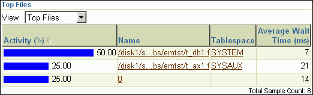
    [Description of "Figure 4-8 Monitoring Top Files"](img_text/top_files.md)
    The Top Files table displays the average wait time for specific files during the selected time period. For example, in Figure 4-8 75% of the wait times are associated with I/O to the files in the `SYSTEM` and `SYSAUX` tablespaces.

4.  Click the Tablespace link of the file with the highest average wait time.

    The View Tablespace page appears.

#### 4.1.9 Monitoring Top Objects

Data on the top database objects waiting for resources is available from the Active Sessions Waiting: User I/O page.

##### To monitor an object:

1.  Access the Performance page, as explained in "Monitoring User Activity".

2.  In the Average Active Sessions chart, click the User I/O area on the chart or the corresponding wait class in the legend.

    The Active Sessions Waiting: User I/O page appears.

3.  Under Detail for Selected 5 Minute Interval, select Top Objects from the View list.

    The Top Objects table appears.

    Figure 4-9 Monitoring Top Objects

    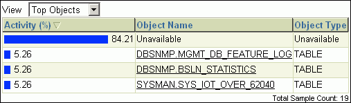
    [Description of "Figure 4-9 Monitoring Top Objects"](img_text/top_obj.md)
    The Top Objects table displays the top database objects waiting for the corresponding wait event during the selected time period.

    For example, Figure 4-9 shows that over 84% of the waits are for an object whose name is unavailable. Based on the information in Figure 4-2, you can conclude that the performance problem is caused by the query and modification DML statements.

4.  Click the Object Name link of the object with the highest average wait time.

    The View page for the object appears.

### 4.2 Monitoring Instance Activity

Below the Average Active Sessions chart on the Performance page are other charts that you can use to monitor database instance activity. As explained in "Customizing the Database Performance page", you can also customize the Performance page so that the most useful instance activity charts are displayed by default.

You can use the instance activity charts to perform the following tasks:

- Monitoring Throughput

- Monitoring I/O

- Monitoring Parallel Execution

- Monitoring Services

#### 4.2.1 Monitoring Throughput

Database throughput measures the amount of work the database performs in a unit of time. The Throughput charts show any contention that appears in the Average Active Sessions chart.

Compare the peaks on the Throughput charts with the peaks on the Average Active Sessions chart. If the Average Active Sessions chart displays a large number of sessions waiting, indicating internal contention, but throughput is high, then the situation may be acceptable. The database is probably also performing efficiently if internal contention is low but throughput is high. However, if internal contention is high but throughput is low, then consider tuning the database.

##### To monitor throughput:

1.  Access the Database Home page.

    See "[Accessing the Database Home Page](introduction.md)" for more information.

2.  From the Performance menu, select Performance Home.

    If the Database Login page appears, then log in as a user with administrator privileges. The Performance page appears.

3.  Click the Throughput tab.

4.  Select one of the following Instance Throughput Rate options.

    - Per Second

      Two charts appear. One shows the number of logons and transactions per second and the other shows the physical reads and redo size per second.

      Figure 4-10 shows the Throughput charts with the Instance Throughput Rate of Per Second selected. The bar in the middle of the figure indicates a portion of the charts (from approximately 1:37 to 1:52) that has been removed for space considerations. In Figure 4-10, the most transactions occurred from 1:15 to 1:27 p.m. and from 2:08 to 2:12 p.m.

    - Per Transaction

      One chart appears that shows the number of physical reads and redo size per transaction.

Figure 4-10 Monitoring Throughput

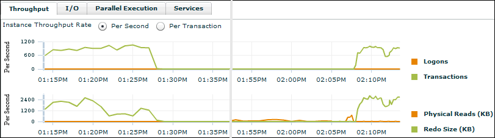
[Description of "Figure 4-10 Monitoring Throughput"](img_text/through_per_sec.md)

#### 4.2.2 Monitoring I/O

The I/O charts show I/O statistics collected from all database clients. The I/O wait time for a database process represents the amount of time that the process could have been doing useful work if a pending I/O had completed. Oracle Database captures the I/O wait times for all important I/O components in a uniform fashion so that every I/O wait by any Oracle process can be derived from the I/O statistics.

Figure 4-11 Monitoring I/O

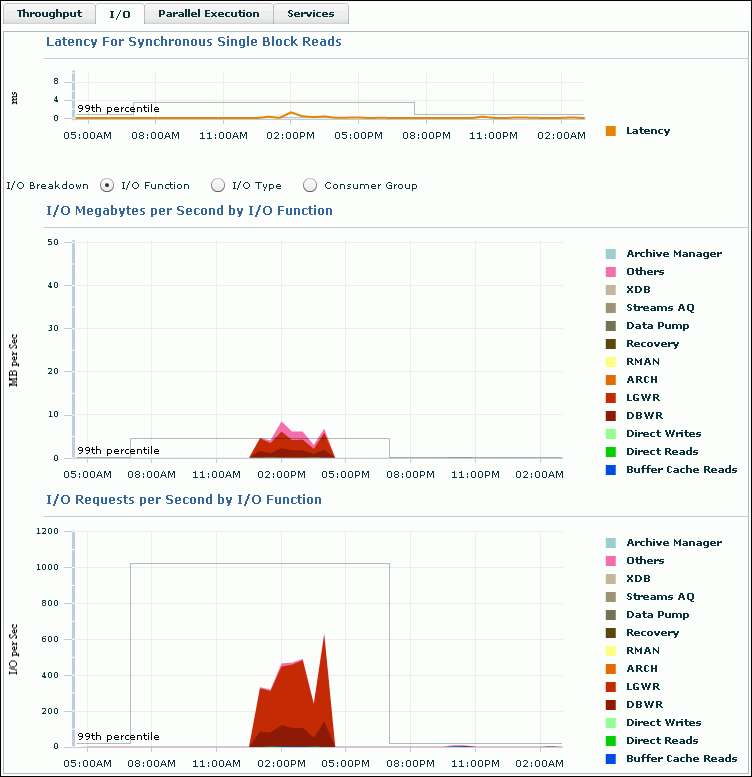
[Description of "Figure 4-11 Monitoring I/O"](img_text/io_function.md)

The Latency for Synchronous Single Block Reads chart shows the total perceived I/O latency for a block read, which is the time difference between when an I/O request is submitted and when the first byte of the transfer arrives. Most systems are performing satisfactorily if latency is fewer than 10 milliseconds. This type of I/O request is the best indicator of I/O performance for the following reasons:

- Write operations may exhibit good performance because of write caches in storage.

- Because multiblock I/O requests have varying sizes, they can take different amounts of time.

- The latency of asynchronous I/O requests does not represent the full I/O wait time.

The other charts shown depend on your selection for I/O Breakdown, as described in the following sections:

- Monitoring I/O by Function

- Monitoring I/O by Type

- Monitoring I/O by Consumer Group

##### 4.2.2.1 Monitoring I/O by Function

The I/O Function charts determine I/O usage level by application or job. The component-level statistics give a detailed view of the I/O bandwidth usage, which you can then use in scheduling jobs and I/O provisioning. The component-level statistics fall in the following categories:

- Background type

  This category includes ARCH, LGWR, and DBWR.

- Activity

  This category includes XDB, Advanced Queuing (AQ), Data Pump, Recovery, and RMAN.

- I/O type

  The category includes the following:

  - Direct Writes

    This write is made by a foreground process and is not from the buffer cache.

  - Direct Reads

    This read is physical I/O from a data file that bypasses the buffer cache and reads the data block directly into process-private memory.

  - Buffer Cache Reads

- Others

  This category includes I/Os such as control file I/Os.

##### To monitor I/O by function:

1.  Access the Performance page, as explained in "Monitoring User Activity".

2.  In the instance activity chart, click I/O.

    The Latency for Synchronous Single Block Reads, I/O Megabytes per Second, and I/O Requests per Second charts appear.

3.  For I/O Breakdown, select I/O Function.

    The I/O Megabytes per Second by I/O Function and I/O Requests per Second by I/O Function charts appear.

    The example in Figure 4-11 shows that a significant amount of I/O is being performed by the log writer. The log writer activity peaked at approximately 600 I/O requests per second.

4.  Click the largest colored area on the chart or the corresponding function in the legend to drill down to the function with the highest I/O rate.

    An I/O Throughput by I/O Function page appears with details about the selected category.

    You can view real-time or historical data for details on I/O megabytes or I/O requests.

**See Also:**

- [Oracle Database Concepts](../cncpt/process-architecture.md) to learn about database background processes such as ARCH, LGWR, and DBWR

##### 4.2.2.2 Monitoring I/O by Type

The I/O Type charts enable you to monitor I/O by the types of read and write operations. Small I/Os are requests smaller than 128 KB and are typically single database block I/O operations. Large I/Os are requests greater than or equal to 128 KB. Large I/Os are generated by database operations such as table/index scans, direct data loads, backups, restores, and archiving.

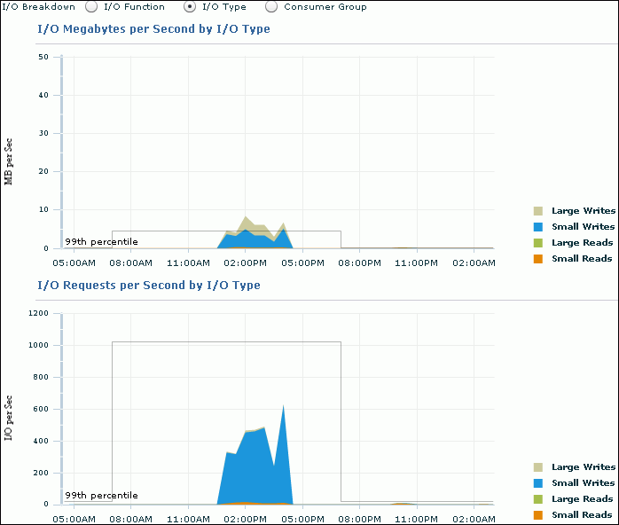
[Description of the illustration perf_io_type.gif](img_text/perf_io_type.md)

When optimizing for short transaction times, such as in an OLTP environment, monitor latency for small I/Os. High latencies typically indicate that the storage system is a bottleneck.

When optimizing for large queries, such as in a data warehouse, performance depends on the maximum throughput the storage system can achieve rather than the latency of the I/O requests. In this case, monitor the I/O megabytes per second rather than the synchronous single-block I/O latencies.

##### To monitor I/O by type:

1.  Access the Performance page, as explained in "Monitoring User Activity".

2.  In the instance activity chart, click I/O.

    The I/O Megabytes per Second and I/O Requests per Second charts appear.

3.  For I/O Breakdown, select I/O Type.

    The I/O Megabytes per Second by I/O Type and I/O Requests per Second by I/O Type charts appear.

    In the above sample chart, the number of small writes per second increased to more than 600. These writes correspond to the log writer I/O requests shown in Figure 4-11.

4.  Click the largest colored area on the chart or the corresponding function in the legend to drill down to the function with the highest I/O rate.

    The I/O Details page appears.

    You can view real-time or historical data for details on I/O megabytes or I/O requests.

##### 4.2.2.3 Monitoring I/O by Consumer Group

When Oracle Database Resource Manager is enabled, the database collects I/O statistics for all consumer groups that are part of the currently enabled resource plan. The Consumer Group charts enable you to monitor I/O by consumer group.

A resource plan specifies how the resources are to be distributed among various users (resource consumer groups). Resource consumer groups enable you to organize user sessions by resource requirements. Note that the `_ORACLE_BACKGROUND_GROUP_` consumer group contains I/O requests issued by background processes.

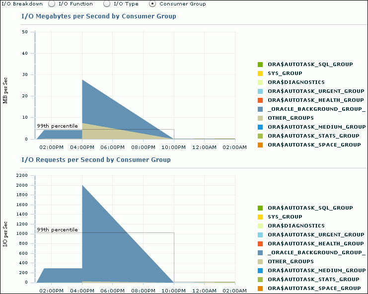
[Description of the illustration perf_io_consum.gif](img_text/perf_io_consum.md)

##### To monitor I/O requests by consumer group:

1.  Access the Performance page, as explained in "Monitoring User Activity".

2.  In the instance activity chart, click I/O.

    The I/O Megabytes per Second and I/O Requests per Second charts appear.

3.  For I/O Breakdown, select Consumer Group.

    The I/O Megabytes per Second by Consumer Group and I/O Requests per Second by Consumer Group charts appear.

#### 4.2.3 Monitoring Parallel Execution

The Parallel Execution charts show system metrics related to parallel queries. Metrics are statistical counts per unit. The unit could be a time measure, such as seconds, or per transaction, or session.

A parallel query divides the work of executing a SQL statement across multiple processes. The charts show parallel queries that were waiting for a particular wait event that accounted for the highest percentages of sampled session activity.

Figure 4-12 Monitoring Parallel Execution

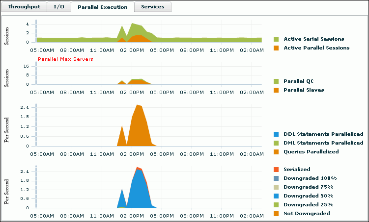
[Description of "Figure 4-12 Monitoring Parallel Execution"](img_text/pe.md)

##### To monitor parallel execution:

1.  Access the Performance page, as explained in "Monitoring User Activity".

2.  In the instance activity chart, click Parallel Execution.

    The Parallel Execution charts appear.

    Two pairs of charts are shown. The first pair shows the number of sessions on the y-axis, whereas the second pair shows the per second rate on the y-axis.

    In the example shown in Figure 4-12, query parallelization was active from 12:30 p.m. to 4 p.m.

#### 4.2.4 Monitoring Services

Services represent groups of applications with common attributes, service-level thresholds, and priorities. For example, the `SYS$USERS` service is the default service name used when a user session is established without explicitly identifying a service name.

Figure 4-13 Monitoring Services

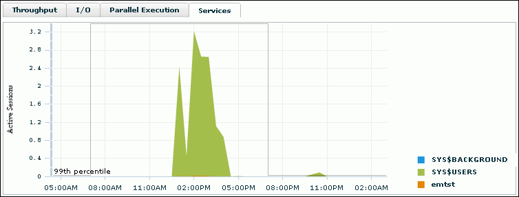
[Description of "Figure 4-13 Monitoring Services"](img_text/services.md)

##### To monitor services:

1.  Access the Performance page, as explained in "Monitoring User Activity".

2.  In the instance activity chart, click Services.

    The Services chart appears. The Services chart shows services waiting for the corresponding wait event during the time period shown. Only active services are shown.

    In Figure 4-13, the `SYS$USERS` service has the greatest number of active sessions.

3.  Click the largest colored area on the chart or the corresponding service in the legend to drill down to the service with the highest number of active sessions.

    The Service page appears, showing the Activity subpage.

    You can view real-time data showing the session load for all wait classes associated with the service.

### 4.3 Monitoring Host Activity

The Host chart on the Performance page displays utilization information about the system hosting the database.

Figure 4-14 Monitoring Host Activity

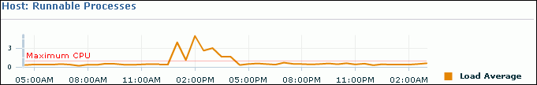
[Description of "Figure 4-14 Monitoring Host Activity"](img_text/host.md)

To determine if the host system has enough resources available to run the database, establish appropriate expectations for the amount of CPU, memory, and disk resources that your system should be using. You can then verify that the database is not consuming too many of these resources.

#### To view details about CPU, memory, and disk utilization:

1.  From the Targets menu, select Hosts.

    The Hosts page appears.

2.  In the list of hosts, click the name of the host on which your database resides.

    The hostname page appears, where hostname is the name of the host.

3.  Determine whether sufficient resources are available and whether your system is using too many resources.

    For example, determine the amount of CPU, memory, and disk resources the database uses in the following scenarios:

    - When your system is idle, or when little database and nondatabase activity exists

    - At average workloads

    - At peak workloads

    Workload is an important factor when evaluating the level of resource utilization for your system. During peak workload hours, 90 percent utilization of a resource, such as a CPU with 10 percent idle and waiting time, can be acceptable. However, if your system shows high utilization at normal workload, then there is no room for additional workload.

    Perform the following tasks to monitor the host activity for your database:

    - Monitoring CPU Utilization

    - Monitoring Memory Utilization

    - Monitoring Disk I/O Utilization

4.  Set the appropriate threshold values for the performance metrics so the system can automatically generate alerts when these thresholds are exceeded.

    For information about setting metric thresholds, see "[Setting Metric Thresholds for Performance Alerts](monitoring-performance-alerts.md)".

#### 4.3.1 Monitoring CPU Utilization

To address CPU problems, first establish appropriate expectations for the amount of CPU resources your system should be using. You can then determine whether sufficient CPU resources are available and recognize when your system is consuming too many resources. This section describes how to monitor CPU utilization.

##### To monitor CPU utilization:

1.  Access the hostname page as explained in "Monitoring Host Activity".

2.  From the Host menu, select Monitoring, and then CPU Details.

    The CPU Details page appears.

    This page contains statistics about CPU utilization, I/O wait times, and load gathered over the last hour. The top 10 processes are listed based on CPU utilization.

3.  Verify the current CPU utilization using the CPU Utilization chart.

    The CPU Utilization chart shows CPU utilization over the last hour and a half. The current value is displayed below the chart. During standard workload hours, the value should not exceed the critical threshold.

4.  Click CPU Utilization.

    The CPU Utilization page appears.

    This page contains CPU utilization statistics and related alerts generated over the last 24 hours.

    In the following example, the CPU utilization has suddenly spiked from approximately 8% to 89.49% at 12:28 p.m., which is above the warning threshold of 80%.

    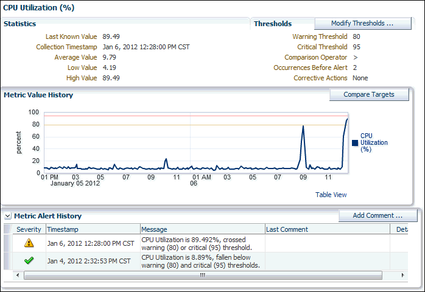
    [Description of the illustration cpu_util.gif](img_text/cpu_util.md)
    If you notice an unexpected spike in this value that is sustained through normal workload hours, then the CPU performance problem should be investigated.

5.  Return to the CPU Details page. From the Host menu, select Monitoring, and then CPU Details.

6.  Verify the current CPU I/O wait time using the CPU I/O Wait chart.

    The CPU I/O Wait chart shows CPU I/O wait time over the last hour and a half. The current value is displayed below the chart. During normal workload hours, the value of CPU I/O wait should not exceed the warning threshold.

    CPU I/O wait represents the average number of jobs waiting for I/O during an interval.

7.  Click CPU I/O Wait.

    The CPU in I/O Wait page appears.

    This page contains CPU I/O wait statistics and related alerts generated over the last 24 hours.

    If you notice an unexpected increase in this value that is sustained through standard workload hours, then a CPU performance problem may exist.

8.  Return to the CPU Details page. From the Host menu, select Monitoring, and then CPU Details.

9.  Verify the current CPU load using the CPU Load chart.

    The CPU Load chart shows the CPU load over the last hour and a half. The current value is displayed below the chart. During standard workload hours, the value of CPU load should not exceed the warning threshold.

    CPU load represents the average number of processes waiting to be scheduled for CPU resources in the previous minute, or the level of CPU contention time over time.

10. Click CPU Load.

    The Run Queue Length (5 minute average) page appears.

    This page contains CPU load statistics and related alerts generated over the last 24 hours.

    If you notice an unexpected spike in this value that is sustained through normal workload hours, then a CPU performance problem might exist.

11. Return to the CPU Details page. From the Host menu, select Monitoring, and then CPU Details.

12. Review the Top 10 Processes (ordered by CPU) table.

    If a process is consuming too much of the CPU utilization percentage, then investigate that process.

    In the following example, two database processes are consuming 87.6% of CPU utilization. Therefore, the database is the likely source of a potential CPU performance problem and should be investigated.

    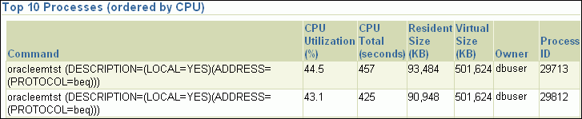
    [Description of the illustration top_10_proc.gif](img_text/top_10_proc.md)

13. If a CPU performance problem is identified, then you can try to resolve the issue by doing the following:

    - Use Oracle Database Resource Manager to reduce the impact of peak-load-use patterns by prioritizing CPU resource allocation

    - Avoid running too many processes that use a large amount of CPU

    - Increase hardware capacity, including changing the system architecture

**See Also:**

- [Oracle Database Performance Tuning Guide](../tgdba/managing-operating-system-resources.md) for information about resolving CPU issues

- [Oracle Database Administrator's Guide](../admin/managing-resources-with-oracle-database-resource-manager.md)for information about Oracle Database Resource Manager

#### 4.3.2 Monitoring Memory Utilization

Operating system performance issues commonly involve process management, memory management, and scheduling. This section describes how to monitor memory utilization and identify problems such as paging and swapping.

##### To monitor memory utilization:

1.  Access the hostname page as explained in "Monitoring Host Activity".

2.  From the Host menu, select Monitoring, and then Memory Details.

    The Memory Details page appears.

    This page contains statistics about memory utilization, page scan rates, and swap utilization gathered over the last hour. The top 10 processes are also listed ordered by memory utilization. Figure 4-15 shows a portion of the Memory Details page. The Top 10 Processes (ordered by Memory) section is not shown.

    Figure 4-15 Memory Details Page

    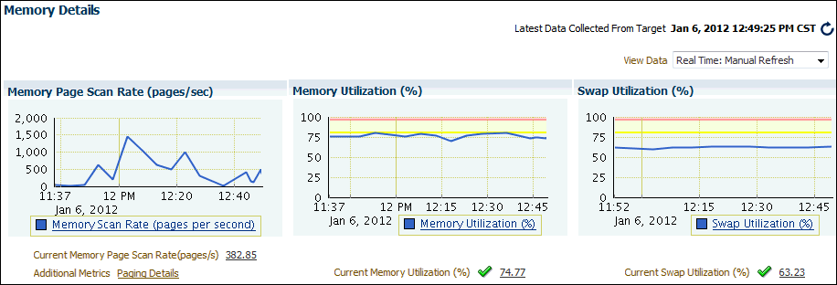
    [Description of "Figure 4-15 Memory Details Page"](img_text/mem_details.md)

3.  Verify the current memory page scan rate using the Memory Page Scan Rate chart.

    The current value of the memory page scan rate is displayed below the chart. On UNIX and Linux, this value represents the number of pages scanned per second. On Microsoft Windows, this value represents the rate at which pages are read from or written to disk to resolve hard page faults. This value is a primary indicator of the types of faults that may be causing systemwide delays.

4.  Click Memory Scan Rate (pages per second).

    The Memory Page Scan Rate page appears.

    This page contains memory page scan rate statistics and related alerts over the last 24 hours.

    If you notice an unexpected increase in this value that is sustained through standard workload hours, then a memory performance problem might exist.

5.  Return to the Memory Details page. From the Host menu, select Monitoring, and then Memory Details.

6.  Using the Memory Utilization chart, verify the current memory utilization.

    The Memory Utilization chart shows how much memory is being used. The current value of memory utilization is displayed below the chart. During standard workload hours, the value should not exceed the warning threshold (shown in yellow).

7.  Click Memory Utilization (%).

    The Memory Utilization page appears.

    This page contains memory utilization statistics and related alerts generated over the last 24 hours.

    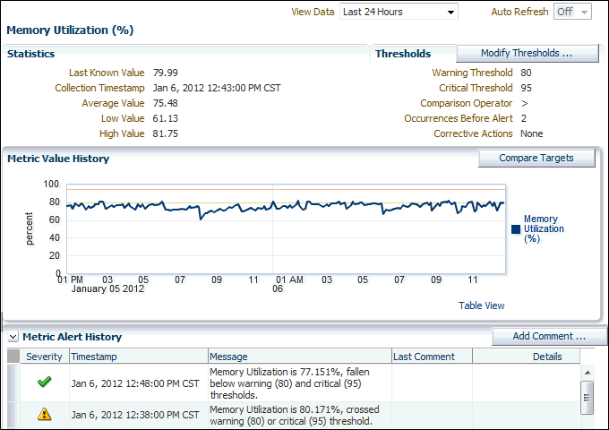
    [Description of the illustration mem_util.gif](img_text/mem_util.md)
    In this example, memory utilization has exceeded 80%, so warnings appear in the Metric Alert History table.

    If you notice an unexpected spike in this value that is sustained through normal workload hours, then a memory performance problem might exist.

8.  Return to the Memory Details page. From the Host menu, select Monitoring, then Memory Details.

9.  Using the Swap Utilization chart, verify current swap utilization.

    The Swap Utilization chart shows how much swap space is being used. The current value of swap utilization is displayed below the chart. During normal workload hours, the value should not exceed the warning threshold.

10. Click Swap Utilization (%).

    The Swap Utilization page appears.

    This page contains swap utilization statistics and related alerts generated over the last 24 hours.

    If you notice an unexpected spike in this value that is sustained through normal workload hours, then a memory performance problem might exist.

11. Return to the Memory Details page. From the Host menu, select Monitoring, then Memory Details.

12. Review the top processes in the Top 10 Processes (ordered by Memory) table.

    If a process is taking up too much memory, then this process should be investigated.

13. If a memory performance problem is identified, then you can attempt to resolve the issue by doing the following:

    - Use Automatic Memory Management to automatically manage and distribute memory between the System Global Area (SGA) and the aggregate program global area (PGA aggregate).

    - Use the Memory Advisor to set SGA and PGA memory target values.

    - Use Automatic PGA Management to manage SQL memory execution.

    - Avoid running too many processes that consume large amounts of memory.

    - Reduce paging or swapping.

    - Reduce the number of open cursors and hard parsing with cursor sharing.

**See Also:**

- [Oracle Database Administrator's Guide](../admin/managing-memory.md) for information about using Automatic Memory Management

- [Oracle Database Performance Tuning Guide](../tgdba/database-memory-allocation.md) for information about resolving memory issues

#### 4.3.3 Monitoring Disk I/O Utilization

Because the database resides on a set of disks, the performance of the I/O subsystem is very important to database performance. Important disk statistics include the disk I/Os per second and the length of the service times. These statistics show if the disk is performing optimally or if the storage system is being overworked. This section describes how to monitor disk I/O utilization.

##### To monitor disk I/O utilization:

1.  From the Targets menu, select Hosts.

    The Hosts page appears.

2.  In the list of hosts, click the name of the host on which your database resides.

    The hostname page appears, where hostname is the name of the host.

3.  From the Host menu, select Monitoring, then Disk Details.

    The Disk Details page appears.

    This page contains disk I/O utilization and service time statistics, and the top disk devices ordered by the percentage of time that they were in use.

    Figure 4-16 Disk Details

    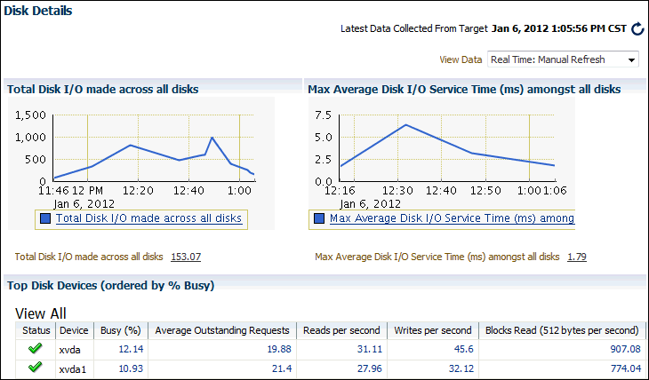
    [Description of "Figure 4-16 Disk Details"](img_text/disk_details.md)

4.  Verify the current disk I/O utilization using the Total Disk I/O Made Across All Disks chart.

    The Total Disk I/O Made Across All Disks chart shows how many disk I/Os are being performed per second. The current value for total disk I/O per second is displayed below the chart. In Figure 4-16 the value is 153.07.

5.  Click Total Disk I/O made across all disks (per second).

    The Total Disk I/O Made Across All Disks (Per Second) page appears.

    This page contains disk utilization statistics and related alerts generated over the last 24 hours.

    If you notice an unexpected spike in this value that is sustained through standard workload hours, then a disk I/O performance problem might exist and should be investigated.

6.  Verify the current I/O service time using the Max Average Disk I/O Service Time (ms) Among All Disks chart.

    The Max Average Disk I/O Service Time (ms) Among All Disks chart shows the longest service time for disk I/Os in milliseconds. The current value for longest I/O service time is displayed below the chart. In Figure 4-16 the value is 1.79.

7.  From the Host menu, select Monitoring, then Disk Details.

    The Disk Details page appears.

8.  Click Max Average Disk I/O (ms) Service Time Among All Disks.

    The Max Average Disk I/O Service Time (ms) Among All Disks page appears.

    This page contains I/O service time statistics and related alerts generated over the last 24 hours.

    If you notice an unexpected spike in this value that is sustained through normal workload hours, then a disk I/O performance problem might exist and should be investigated.

9.  From the Host menu, select Monitoring, then Disk Details.

    The Disk Details page appears.

10. On the Disk Details page, verify the disk devices in the Top Disk Devices (ordered by % Busy) table.

    If a particular disk is busy a high percentage of the time, then this disk should be investigated.

    In Figure 4-16, the drives that host Oracle Database (xvda and xvda1) are only busy 12.14 and 10.93 percent of the time, so no disk performance problem appears to exist.

11. If a disk I/O performance problem is identified, you can attempt to resolve the problem by doing the following:

    - Use Oracle Automatic Storage Management (Oracle ASM) to manage database storage.

    - Stripe everything across every disk to distribute I/O.

    - Move files such as archived redo logs and online redo logs to separate disks.

    - Store required data in memory to reduce the number of physical I/Os.

**See Also:**

- [Oracle Database Performance Tuning Guide](../tgdba/IO-configuration-and-design.md) for information about resolving disk I/O issues

### 4.4 Determining the Cause of Spikes in Database Activity

If you see a spike in database activity in the Performance page, then you can access the ASH Analytics page to find out which sessions are consuming the most database time. This page provides stacked area charts to help you visualize the active session activity from various dimensions, such as Wait Class, Module, Actions, SQL ID, Instance, User Session, Consumer Group, and others. You can drill down into specific members of a dimension (vertical zooming), and zoom in and out of any time period (horizontal zooming).

#### To view active session activity on the ASH Analytics page:

1.  Access the Database Home page.

    See "[Accessing the Database Home Page](introduction.md)" for more information.

2.  From the Performance menu, select Performance Hub and then ASH Analytics.

    If the Database Login page appears, then log in as a user with administrator privileges. The ASH Analytics page appears.

    Figure 4-17 shows an example of the ASH Analytics page.

    Figure 4-17 ASH Analytics Page

    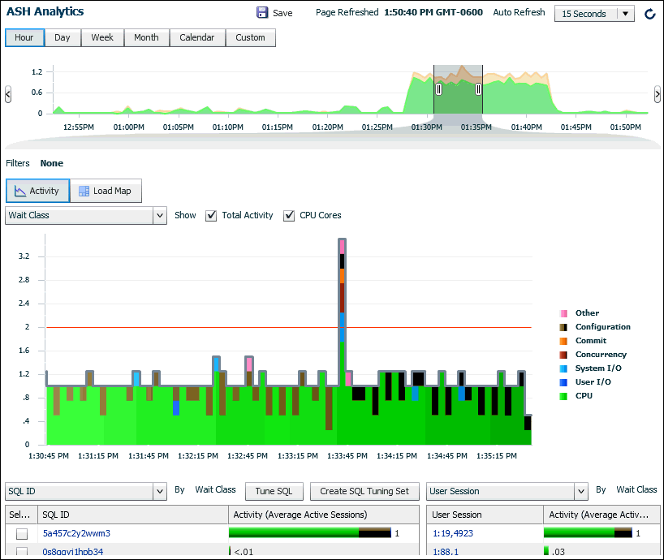
    [Description of "Figure 4-17 ASH Analytics Page"](img_text/ash_analytics_page.md)

3.  To view a high-level perspective of top activity during a selected time period, drag the entire shaded slider area in the top chart to the desired time period.

    **Tip:**

    You can change the amount of time selected in the shaded slider area by selecting the control at either edge of the slider and dragging it to the left or right.

    You can select a time period within the default setting of one hour or you can use the selector buttons above the chart to display time periods of one day, one week, or one month. You can also use the Calendar and Custom buttons to display a time period other than one of the preset choices.

4.  To view a more detailed perspective of your selected time period, use the Activity chart on the page. By default, the chart shows a breakdown of workload activity by wait classes.

5.  Investigate the impact by viewing detailed statistics for the top activity sessions that are adversely affecting the system.

    To view detailed statistics for a session:

    1.  Select the largest spike in the chart or the corresponding wait class in the legend beside the chart. The viewer now filters out everything in the chart except for the wait class of interest.

        For example, if the chart shows that the Concurrency wait class has the biggest spike, select the chart area of the legend for Concurrency. The viewer refreshes the chart and now only shows the Concurrency value and displays a Wait Class: Concurrency icon in the Filters bar.

        **Tip:**

        You can create an unlimited number of filters.

    2.  In the Activity section, select Top Dimensions from the dimensions list. The chart refreshes in response to your selection, displaying values for the particular category you selected.

        For instance, if you create a filter for Concurrency as described above, then select Top Dimensions from the list, and then select User Session, the chart shows user sessions only for Concurrency.

        Figure 4-18 shows the list of activities with Top Dimensions selected.

        Figure 4-18 List of Activities

        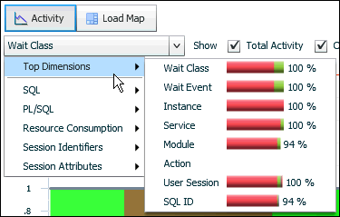
        [Description of "Figure 4-18 List of Activities"](img_text/ash_analytics_list.md)

6.  Optionally, use the Load Map for a graphical view of system activity.

    The Load Map is useful for viewing activity in a single- or multi-dimensional layout when you are not interested in seeing how activity has changed over time during the selected period.

    Figure 4-19 shows the load map for activity by wait class and wait events.

    Figure 4-19 Load Map on the ASH Analytics Page

    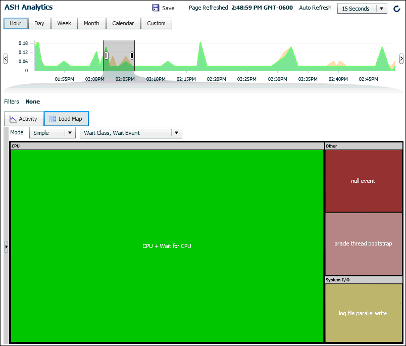
    [Description of "Figure 4-19 Load Map on the ASH Analytics Page"](img_text/ash_analytics_loadmap.md)

7.  Optionally, click Save to save the current page view as an HTML file for offline reference. When you click Save, a Save As dialog box appears and you can specify where you want to save the report. This action creates an Enterprise Manager Active Report covering all data currently gathered as part of the analysis. You can use this later to conduct a more thorough post-mortem analysis, for instance. You can view the report without Cloud Control or database connectivity.

    You can also click Mail and specify an email address to send the page as an attachment.

### 4.5 Customizing the Database Performance page

You can customize the Performance page so that it specifically addresses your requirements. As explained in "Monitoring Instance Activity", you can specify which charts you want to appear by default in the Performance page, and how you want them to appear. You can also decide whether to include baseline values in the Throughput and Services charts.

Cloud Control stores persistent customization information for each user in the repository. Cloud Control retrieves the customization data when you access the Performance page and caches it for the remainder of the browser session until you change the settings.

#### To customize the Performance page:

1.  Access the Database Home page.

    See "[Accessing the Database Home Page](introduction.md)" for more information.

2.  From the Performance menu, select Performance Home.

    If the Database Login page appears, then log in as a user with administrator privileges. The Performance page appears.

3.  Click Settings.

    The Performance Page Settings page appears.

    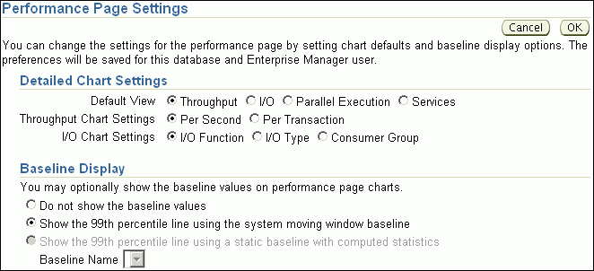
    [Description of the illustration perf_page_sett.gif](img_text/perf_page_sett.md)

4.  In the Detailed Chart Settings section, choose the defaults for display of the instance activity charts. Complete the following steps:

    1.  In Default View, select the instance activity chart to appear by default in the Average Active Session section.

        See "Monitoring Instance Activity" for a description of the Throughput, I/O, Parallel Execution, and Services charts.

    2.  In Throughput Chart Settings, select Per Second or Per Transaction as the default instance throughput rate to be displayed in the Throughput chart.

        See "Monitoring Throughput" to learn how to use the Throughput charts.

    3.  In I/O Chart Settings, select the default I/O option to be displayed in the I/O chart.

        See "Monitoring I/O" to learn how to use the I/O charts.

5.  In the Baseline Display section, choose how AWR baselines are displayed in the performance charts. Do one of the following:

    - Select Do not show the baseline values to prevent baselines from appearing.

    - Select Show the 99th percentile line using the system moving window baseline to specify a percentile to display for the Throughput and Services charts.

    - Select Show the 99th percentile line using a static baseline with computed statistics and then select a baseline name from the Baseline Name list.

      You can select only baselines that have undergone schedule statistics computation, as described in "[Computing Threshold Statistics for Baselines](resolving-performance-degradation-over-time.md)".

6.  Click OK.

    The Performance page appears.

    The charts are now displayed according to your customized settings.
