To achieve optimal performance for data-intensive queries, materialized views and indexes are essential for SQL statements. However, implementing these objects does not come without cost. Creation and maintenance of these objects can be time-consuming. Space requirements can be significant. SQL Access Advisor enables you to optimize query access paths by recommending materialized views and view logs, indexes, SQL profiles, and partitions for a specific workload.

A materialized view provides access to table data by storing query results in a separate schema object. Unlike an ordinary view, which does not take up storage space or contain data, a materialized view contains the rows from a query of one or more base tables or views. A materialized view log is a schema object that records changes to a master table's data, so that a materialized view defined on the master table can be refreshed incrementally. SQL Access Advisor recommends how to optimize materialized views so that they can be rapidly refreshed and make use of the query rewrite feature.

SQL Access Advisor also recommends bitmap, function-based, and B-tree indexes. A bitmap index reduces response time for many types of ad hoc queries and can also reduce storage space compared to other indexes. A function-based index computes the value of a function or expression involving one or more columns and stores it in the index. B-tree indexes are commonly used to index unique or near-unique keys.

Using SQL Access Advisor involves the following tasks:

- Running SQL Access Advisor

- Reviewing the SQL Access Advisor Recommendations

- Implementing the SQL Access Advisor Recommendations

**See Also:**

- "[Identifying High-Load SQL Statements](identifying-high-load-sql-statements.md) "

- "[Tuning SQL Statements](tuning-sql-statements.md) " for information about SQL Tuning Advisor

- [Oracle Database Concepts](../cncpt/partitions-views-and-other-schema-objects.md) to learn about materialized views

- [Oracle Database Concepts](../cncpt/indexes-and-index-organized-tables.md) to learn about indexes

### 13.1 Running SQL Access Advisor

This section describes how to run SQL Access Advisor to make recommendations for a SQL workload.

#### To run SQL Access Advisor:

1.  Select the initial options, as described in "Selecting the Initial Options".

2.  Select the workload source you want to use for the analysis, as described in "Selecting the Workload Source".

3.  Define the filters options, as described in "Applying Filter Options".

4.  Choose the types of recommendations, as described in "Specifying Recommendation Options".

5.  Schedule the SQL Access Advisor task, as described in "Specifying Task and Scheduling Options".

#### 13.1.1 Selecting the Initial Options

The first step in running SQL Access Advisor is to select the initial options on the SQL Access Advisor: Initial Options page.

##### To select initial options:

1.  Access the Database Home page.

    See "[Accessing the Database Home Page](introduction.md)" for more information.

2.  From the Performance menu, select Advisors Home.

    If the Database Login page appears, then log in as a user with administrator privileges. The Advisor Central page appears.

3.  Click SQL Advisors.

    The SQL Advisors page appears.

4.  Click SQL Access Advisor.

    The SQL Access Advisor: Initial Options page appears.

5.  Do one of the following:

    - Select Verify use of access structures (indexes, materialized views, partitioning, and so on) only to verify existing structures.

    - Select Recommend new access structures to use the recommended options defined in the Oracle Enterprise Manager Cloud Control (Cloud Control) default template.

      If you select this option, then you can optionally complete the following steps:

      - Select Inherit Options from a previously saved Task or Template to use the options defined in an existing SQL Access Advisor task or another template.

      - In Tasks and Templates, select the task or template that you want to use.

    In this example, Recommend new access structures is selected.

    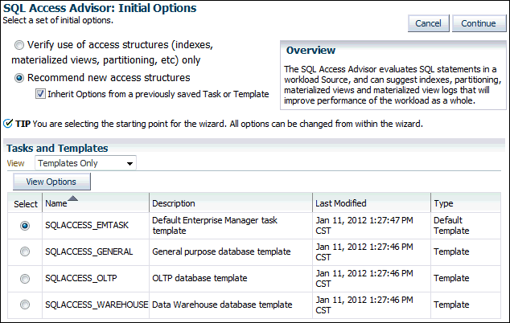
    [Description of the illustration sql_access_initial_options.gif](img_text/sql_access_initial_options.md)

6.  Click Continue.

    The SQL Access Advisor: Workload Source page appears.

7.  Proceed to the next step, as described in "Selecting the Workload Source".

#### 13.1.2 Selecting the Workload Source

After initial options are specified for SQL Access Advisor, select the workload source that you want to use for the analysis, as described in the following sections:

- Using SQL Statements from the Cache

- Using an Existing SQL Tuning Set

- Using a Hypothetical Workload

##### 13.1.2.1 Using SQL Statements from the Cache

You can use SQL statements from the cache as the workload source. However, only current and recent SQL statements are stored in the SQL cache, so this workload source may not be representative of the entire workload on your database.

##### To use SQL statements from the cache as the workload source:

1.  Select the initial options, as described in "Selecting the Initial Options".

2.  On the SQL Access Advisor: Workload Source page, select Current and Recent SQL Activity.

    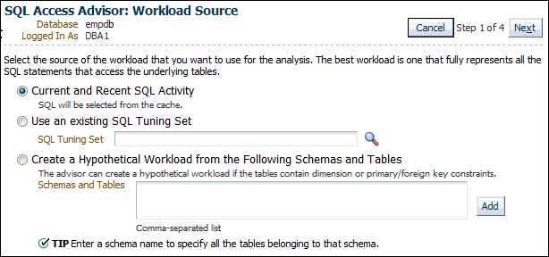
    [Description of the illustration sql_access_source_cache.gif](img_text/sql_access_source_cache.md)

3.  Proceed to the next step, as described in "Applying Filter Options".

##### 13.1.2.2 Using an Existing SQL Tuning Set

You can use an existing SQL tuning set as the workload source. This option is useful because SQL tuning sets can be used repeatedly as the workload source for SQL Access Advisor and SQL Tuning Advisor.

##### To use a SQL tuning set as the workload source:

1.  Select the initial options, as described in "Selecting the Initial Options".

2.  On the SQL Access Advisor: Workload Source page, select Use an existing SQL Tuning Set.

3.  Click the SQL Tuning Set search icon to use an existing SQL tuning set.

    The Search and Select: SQL Tuning Set dialog box appears.

4.  In the Schema field, enter the name of the schema containing the SQL tuning set you want to use and then click Go.

    A list of SQL tuning sets contained in the selected schema appears.

5.  Select the SQL tuning set to be used for the workload source and click Select.

    The Search and Select: SQL Tuning Set dialog box closes and the selected SQL Tuning Set now appears in the SQL Tuning Set field.

6.  Proceed to the next step, as described in "Applying Filter Options".

**See Also:**

- "[Managing SQL Tuning Sets](tuning-sql-statements.md)"

##### 13.1.2.3 Using a Hypothetical Workload

A dimension table stores all or part of the values for a logical dimension in a star or snowflake schema. You can create a hypothetical workload from dimension tables containing primary or foreign key constraints. This option is useful if the workload to be analyzed does not exist. In this case, SQL Access Advisor examines the current logical schema design, and provides recommendations based on the defined relationships between tables.

##### To use a hypothetical workload as the workload source:

1.  Select the initial options, as described in "Selecting the Initial Options".

2.  On the SQL Access Advisor: Workload Source page, select Create a Hypothetical Workload from the Following Schemas and Tables.

3.  Leave Schemas and Tables empty and then click Add to search for tables.

    The Workload Source: Search and Select Schemas and Tables page appears.

4.  In the Tables section, enter a schema name in the Schema field and then click Search.

    A list of tables in the selected schema is displayed.

5.  Select the tables to be used in creating the hypothetical workload and then click Add Tables.

    The selected tables now appear in the Schemas and Tables field.

6.  Click OK.

    The SQL Access Advisor: Workload Source page appears with the selected tables now added.

7.  Proceed to the next step, as described in "Applying Filter Options".

**See Also:**

- [Oracle Database Concepts](../cncpt/partitions-views-and-other-schema-objects.md) for an overview of materialized views

#### 13.1.3 Applying Filter Options

After the workload source is selected, you can optionally apply filters to reduce the scope of the SQL statements found in the workload. Filters are beneficial for the following reasons:

- Using filters directs SQL Access Advisor to make recommendations based on a specific subset of SQL statements from the workload, which may lead to better recommendations.

- Using filters removes extraneous SQL statements from the workload, which may greatly reduce processing time.

##### To apply filters to the workload source:

1.  Select initial options, as described in "Selecting the Initial Options".

2.  Select the workload source, as described in "Selecting the Workload Source".

3.  On the SQL Access Advisor: Workload Source page, click Filter Options.

    The Filter Options section expands.

4.  Select Filter Workload Based on these Options.

    The Filter Options section is enabled.

5.  Define the filters you want to apply, as described in the following sections:

    - Defining Filters for Resource Consumption

    - Defining Filters for Users

    - Defining Filters for Tables

    - Defining Filters for SQL Text

    - Defining Filters for Modules

    - Defining Filters for Actions

6.  Click Next.

    The Recommendation Options page appears.

7.  Proceed to the next step, as described in "Specifying Recommendation Options".

##### 13.1.3.1 Defining Filters for Resource Consumption

The resource consumption filter restricts the workload to include only the number of high-load SQL statements that you specify.

##### To define a filter for resource consumption:

1.  On the SQL Access Advisor: Workload Source page, under User Resource Consumption, enter the number of high-load SQL statements in the Number of Statements field.

2.  From the Order by list, select one of the methods by which the SQL statements are to be ordered.

##### 13.1.3.2 Defining Filters for Users

The users filter restricts the workload to include or exclude SQL statements executed by users that you specify.

##### To define a filter for users:

1.  On the SQL Access Advisor: Workload Source page, under Users, select Include only SQL statements executed by these users or Exclude all SQL statements executed by these users.

2.  To search for available users, click the Users search icon.

    The Search and Select: Users dialog box appears.

3.  Select the users whose SQL statements you want to include or exclude and then click Select.

    The Search and Select: Users dialog box closes and the selected tables now appear in the Users field.

    In this example, a filter is defined to include only SQL statements executed by the user `SH`.

    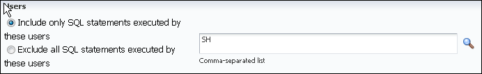
    [Description of the illustration sql_access_filter_users.gif](img_text/sql_access_filter_users.md)

##### 13.1.3.3 Defining Filters for Tables

The tables filter restricts the workload to include or exclude SQL statements that access a list of tables that you specify. Table filters are not permitted if you selected the Create a Hypothetical Workload from the Following Schemas and Tables option, as described in "Using a Hypothetical Workload".

##### To define a filter for tables:

1.  To include only SQL statements that access a specific list of tables, enter the table names in the Include only SQL statements that access any of these tables field.

2.  To exclude all SQL statements that access a specific list of tables, enter the table names in the Exclude all SQL statements that access any of these tables field.

3.  To search for available tables, click the Tables search icon.

    The Search and Select: Schema and Table dialog box appears.

4.  Select the tables for which you want to include or exclude SQL statements and click Select.

    The Search and Select: Schema and Table dialog box closes and the selected tables now appear in the corresponding Tables field.

##### 13.1.3.4 Defining Filters for SQL Text

The SQL text filter restricts the workload to include or exclude SQL statements that contains SQL text substrings that you specify.

##### To define a filter for SQL text:

1.  To include only SQL statements that contains specific SQL text, enter the SQL text to be included in the Include only SQL statements containing these SQL text substrings field.

2.  To exclude all SQL statements that contain specific SQL text, enter the SQL text to be excluded in the Exclude all SQL statements containing these SQL text substrings field.

##### 13.1.3.5 Defining Filters for Modules

The module filter restricts the workload to include or exclude SQL statements that are associated with modules that you specify.

##### To define a filter for module ID:

1.  Do one of the following:

    - To include only SQL statements associated with a specific module ID in the workload, select Include only SQL statements associated with these modules.

    - To exclude all SQL statements associated to a specific module ID from the workload, select Exclude all SQL statements associated with these modules.

2.  In the Modules field, enter the names of the modules for which associated SQL statements are included or excluded.

##### 13.1.3.6 Defining Filters for Actions

The actions filter restricts the workload to include or exclude SQL statements that are associated with actions that you specify.

##### To define a filter for actions:

1.  Do one of the following:

    - To include only SQL statements associated with a specific action in the workload, select Include only SQL statements associated with these actions.

    - To exclude all SQL statements associated with a specific action from the workload, select Exclude all SQL statements associated with these actions.

2.  In the Actions field, enter the actions for which associated SQL statements are included or excluded.

#### 13.1.4 Specifying Recommendation Options

To improve the underlying data access methods chosen by the optimizer for the workload, SQL Access Advisor provides recommendations for indexes, materialized views, and partitioning. Using these access structures can significantly improve the performance of the workload by reducing the time required to read data from the database. However, you must balance the benefits of using these access structures against the cost to maintain them.

##### To specify recommendation options:

1.  Select initial options, as described in "Selecting the Initial Options".

2.  Select the workload source, as described in "Selecting the Workload Source".

3.  Define the filter options, as described in "Applying Filter Options".

4.  On the SQL Access Advisor: Recommendation Options page, under Access Structures to Recommend, select the type of access structures to be recommended by SQL Access Advisor:

    - Indexes

    - Materialized Views

    - Partitioning

    In this example, all of the preceding access types are selected.

    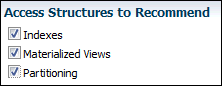
    [Description of the illustration sql_access_recommend_types.gif](img_text/sql_access_recommend_types.md)

5.  Under Scope, select the mode in which SQL Access Advisor runs. Do one of the following:

    - Select Limited.

      In limited mode, SQL Access Advisor focuses on SQL statements with the highest cost in the workload. The analysis is quicker, but the recommendations may be limited.

    - Select Comprehensive.

      In comprehensive mode, SQL Access Advisor analyzes all SQL statements in the workload. The analysis can take much longer, but the recommendations are exhaustive.

    In this example, Limited Mode is selected.

    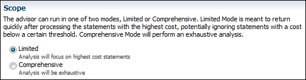
    [Description of the illustration sql_access_advisor_mode.gif](img_text/sql_access_advisor_mode.md)

6.  Optionally, click Advanced Options.

    The Advanced Options section expands. This section contains the following subsections:

    - Workload Categorization

      In this section, you can specify the type of workload for which you want a recommendation. The following categories are available:

      - Workload Volatility

        Select Consider only queries if the workload primarily contains read-only operations, as in data warehouses. Volatility data is useful for online transaction processing (OLTP) systems, where the performance of `INSERT`, `UPDATE`, and `DELETE` operations is critical.

      - Workload Scope

        Select Recommend dropping unused access structures if the workload represents all access structure use cases.

    - Space Restrictions

      Indexes and materialized views increase performance at the cost of space. Do one of the following:

      - Select No, show me all recommendations (unlimited space) to specify no space limits. When SQL Access Advisor is invoked with no space limits, it makes the best possible performance recommendations.

      - Select Yes, limit additional space to and then enter the space limit in megabytes, gigabytes, or terabytes. When SQL Access Advisor is invoked with a space limit, it produces only recommendations with space requirements that do not exceed the specified limit.

    - Tuning Prioritization

      This section enables you to specify how SQL statements are tuned. Complete the following steps:

      - From the Prioritize tuning of SQL statements by list, select a method by which SQL statements are to be tuned and then click Add.

      - Optionally, select Consider access structures creation costs recommendations to weigh the cost of creating access structures against the frequency and potential improvement of SQL statement execution time. Otherwise, creation cost is ignored. You should select this option if you want specific recommendations generated for SQL statements that are executed frequently.

    - Default Storage Locations

      Use this section to override the defaults defined for schema and tablespace locations. By default, indexes are in the schema and tablespace of the table they reference. Materialized views are in the schema and tablespace of the first table referenced in the query. Materialized view logs are in the default tablespace of the schema of the table that they reference.

7.  Click Next.

    The SQL Access Advisor: Schedule page appears.

8.  Proceed to the next step, as described in "Specifying Task and Scheduling Options".

#### 13.1.5 Specifying Task and Scheduling Options

Use the SQL Access Advisor Schedule page to set or modify the schedule parameters for the SQL Access Advisor task.

Figure 13-1 Scheduling a SQL Access Advisor Task

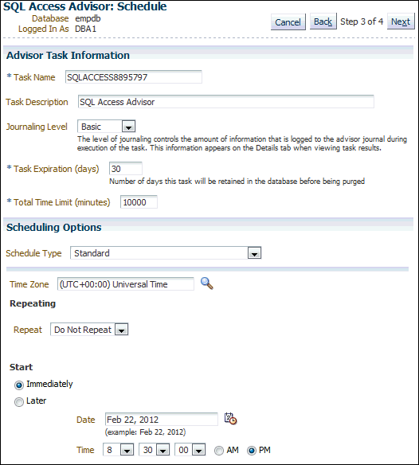
[Description of "Figure 13-1 Scheduling a SQL Access Advisor Task"](img_text/sql_access_schedule.md)

##### To schedule a SQL Access Advisor task:

1.  Select initial options, as described in "Selecting the Initial Options".

2.  Select the workload source, as described in "Selecting the Workload Source".

3.  Define the filter options, as described in "Applying Filter Options".

4.  Specify the recommendation options, as described in "Specifying Recommendation Options".

5.  On the SQL Access Advisor: Schedule page, under Advisor Task Information, enter a name in the Task Name field if you do not want to use the system-generated task name.

    In the example in Figure 13-1, `SQLACCESS8895797` is entered.

6.  In the Task Description field, enter a description of the task.

    In the example in Figure 13-1, `SQL Access Advisor` is entered.

7.  From the Journaling Level list, select the level of journaling for the task.

    Journaling level controls the amount of information that is logged to the SQL Access Advisor journal during task execution. This information appears on the Details subpage when viewing task results.

    In the example in Figure 13-1, `Basic` is selected.

8.  In the Task Expiration (days) field, enter the number of days to retain the task in the database before it is purged.

    In the example in Figure 13-1, `30` is entered.

9.  In the Total Time Limit (minutes) field, enter the maximum number of minutes that the job is permitted to run.

    You must enter a time in this field rather than use the default.

10. Under Scheduling Options, in the Schedule Type list, select a schedule type for the task and a maintenance window in which the task should run. Do one of the following:

    - Click Standard.

      This schedule type enables you to select a repeating interval and start time for the task. Complete the following steps:

      - Enter your time zone code in the Time Zone field or click the search icon to locate the code for your area.

      - In the Repeat list, select Do Not Repeat to perform the task only once, or select a unit of time and enter the number of units in the Interval field.

      - Under Start, select Immediately to start the task now, or Later to schedule the task to start at a time specified using the Date and Time fields.

    - Click Use Predefined Schedule.

      This schedule type enables you to select an existing schedule. Do one of the following:

      - In the Schedule field, enter the name of the schedule to be used for the task.

      - To search for a schedule, click the search icon.

        The Search and Select: Schedule dialog box appears.

        Select the desired schedule and click Select. The selected schedule now appears in the Schedule field.

    - Click Standard Using PL/SQL for Repeated Interval.

      This schedule type enables you to select a repeating interval and an execution time period (window) for the task. Complete the following steps:

      - Enter your time zone code in the Time Zone field or click the search icon to locate the code for your area.

      - Under Available to Start, select Immediately to start the task now, or Later to schedule the task to start at a time specified using the Date and Time fields.

      - In the Repeated Interval field, enter a PL/SQL schedule expression, such as `SYSDATE+1`.

      - Under Not Available After, select No End Date to indicate that there is no end date for the execution window, or Specified End Date to specify an end date using the Date and Time fields.

    - Click Use Predefined Window.

      This schedule type enables you to select an existing window. Select Stop on Window Close to stop the job when the window closes. Do one of the following:

      - In the Window field, enter the name of the window to be used for the task.

      - To search for a window, click the search icon.

        The Search and Select: Window and Window Groups dialog box appears.

        Select the desired window and click Select. The selected window now appears in the Schedule field.

    - Click Event.

      Complete the following steps:

      - Enter your time zone code in the Time Zone field or click the search icon to locate the code for your area.

      - Under Event Parameters, enter values in the Queue Name and Condition fields.

      - Under Start, select Immediately to start the task now, or Later to schedule the task to start at a time specified using the Date and Time fields.

      - Under Not Available After, select No End Date to indicate that there is no end date for the execution window, or Specified End Date to specify an end date using the Date and Time fields.

    - Click Calendar.

      Complete the following steps:

      - Enter your time zone code in the Time Zone field or click the search icon to locate the code for your area.

      - Under Calendar Expression, enter a calendar expression.

      - Under Start, select Immediately to start the task now, or Later to schedule the task to start at a time specified using the Date and Time fields.

      - Under Not Available After, select No End Date to indicate that there is no end date for the execution window, or Specified End Date to specify an end date using the Date and Time fields.

    In the example in Figure 13-1, Standard is selected for schedule type. The task does not repeat and is scheduled to start immediately.

11. Click Next.

    The SQL Access Advisor: Review page appears.

    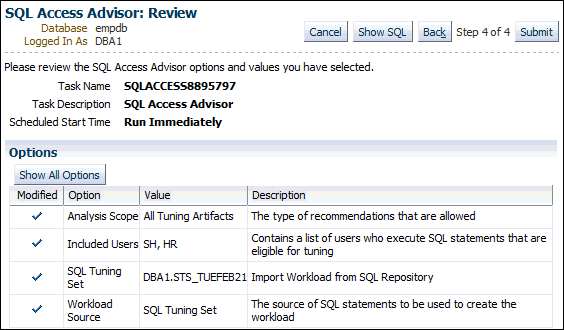
    [Description of the illustration sql_access_review.gif](img_text/sql_access_review.md)
    Under Options is a list of modified options for the SQL Access Advisor task. To display both modified and unmodified options, click Show All Options. To view the SQL text for the task, click Show SQL.

12. Click Submit.

    The Advisor Central page appears. A message informs you that the task was created successfully.

### 13.2 Reviewing the SQL Access Advisor Recommendations

SQL Access Advisor graphically displays the recommendations and provides links so that you can quickly see which SQL statements benefit from a recommendation. Each recommendation produced by the SQL Access Advisor is linked to the SQL statement it benefits.

#### To review the SQL Access Advisor recommendations:

1.  Run SQL Access Advisor to make the recommendations, as described in "Running SQL Access Advisor".

2.  Access the Database Home page.

    See "[Accessing the Database Home Page](introduction.md)" for more information.

3.  From the Performance menu, select Advisors Home.

    If the Database Login page appears, then log in as a user with administrator privileges. The Advisor Central page appears.

4.  Select the SQL Access Advisor task for review and click View Result.

    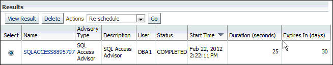
    [Description of the illustration sql_access_adv_results.gif](img_text/sql_access_adv_results.md)
    If the task is not displayed, then you may need to refresh the screen. The Results for Task page appears.

5.  Review the Summary subpage, which provides an overview of the SQL Access Advisor analysis, as described in "Reviewing the SQL Access Advisor Recommendations: Summary".

6.  Review the Recommendations subpage, which enables you to view the recommendations ranked by cost improvement, as described in "Reviewing the SQL Access Advisor Recommendations: Recommendations".

7.  Review the SQL statements analyzed in the workload, as described in "Reviewing the SQL Access Advisor Recommendations: SQL Statements".

8.  Review the details of the workload, task options, and the SQL Access Advisor task, as described in "Reviewing the SQL Access Advisor Recommendations: Details".

#### 13.2.1 Reviewing the SQL Access Advisor Recommendations: Summary

The Summary subpage displays an overview of the SQL Access Advisor analysis.

##### To review the recommendations summary:

1.  Access the Results for Task page, as described in "Reviewing the SQL Access Advisor Recommendations".

2.  Click Summary.

    The Summary subpage of the Results for Tasks page appears.

    In this example, Limited Mode is selected so that SQL Access Advisor analyzes the highest cost statements rather than all statements.

    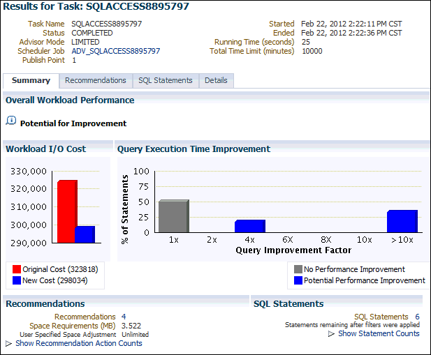
    [Description of the illustration sql_access_results_summary.gif](img_text/sql_access_results_summary.md)

3.  Under Overall Workload Performance, assess the potential for improvement in implementing the recommendations.

4.  Use the Workload I/O Cost chart to compare the original workload I/O cost with the new cost.

    In this example, the workload I/O cost decreases from 107.1 million to 43.1 million by implementing the recommendations.

5.  Use the Query Execution Time Improvement chart to compare the improvement in query execution time.

    This chart shows the percentage of SQL statements in the workload whose execution time improves by accepting the recommendations. The SQL statements are grouped by the projected improvement factor along the horizontal axis on the chart (1x to \>10x). The percentage of SQL statements that improve by the projected improvement factor are along the vertical axis (0% to 100%).

    In this example, approximately 62 percent of SQL statements in the workload do not improve execution time, but about 25 percent have the potential for improvement of over 4x or more.

6.  Under Recommendations, click Show Recommendation Action Counts.

    In the following example, creating 2 indexes, 4 materialized views, and 4 materialized view logs is recommended.

    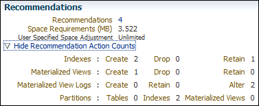
    [Description of the illustration sql_access_results_reccount.gif](img_text/sql_access_results_reccount.md)

7.  Under SQL Statements, click Show Statement Counts to display the type of SQL statement.

    In the following example, 25 `SELECT` statements are analyzed.

    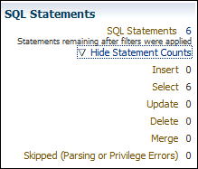
    [Description of the illustration sql_access_results_sqlcount.gif](img_text/sql_access_results_sqlcount.md)

#### 13.2.2 Reviewing the SQL Access Advisor Recommendations: Recommendations

The Recommendations subpage ranks the SQL Access Advisor recommendations by cost improvement. You can also view details about each recommendation.

##### To review recommendation details:

1.  Access the Results for Task page, as described in "Reviewing the SQL Access Advisor Recommendations".

2.  Click Recommendations.

    The Recommendations subpage appears.

    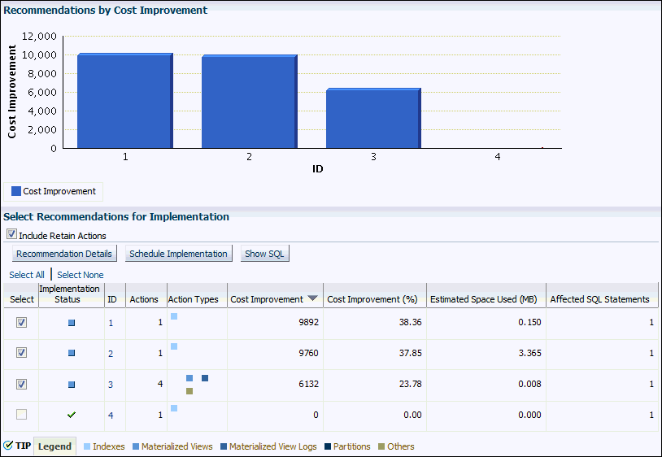
    [Description of the illustration sql_access_results_rec.gif](img_text/sql_access_results_rec.md)

3.  Use the Recommendations by Cost Improvement chart to view recommendations ordered by the cost improvement.

    Under Select Recommendations for Implementation, each recommendation is listed with its implementation status, recommendation ID, cost improvement, space consumption, and the number of affected SQL statements for each recommendation. Implementing the top recommendation has the biggest benefit to the total performance of the workload.

4.  To view details for a particular recommendation, select the recommendation and click Recommendation Details.

    The Recommendation Details page appears. For space reasons, the following screenshot does not show the rightmost columns of the Actions table. The columns not shown are Tablespace and Estimated Space Used (MB).

    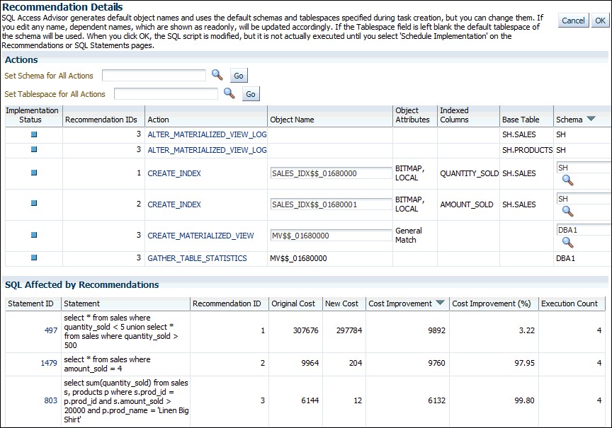
    [Description of the illustration sql_access_rec_details.gif](img_text/sql_access_rec_details.md)
    The Recommendation Details page displays all actions for the specified recommendation.

    Under Actions, you can choose to specify the schema or the tablespace for all actions. For some actions you can modify the object name, tablespace, and schema. To view the SQL text of an action, click the link in the Action column for the specified action.

    Under SQL Affected by Recommendation, the SQL text of the SQL statement and cost improvement information are displayed.

5.  Click OK.

    The Recommendations subpage appears.

6.  To view the SQL text of a recommendation, select the recommendation and click Show SQL.

    The Show SQL page for the selected recommendation appears.

    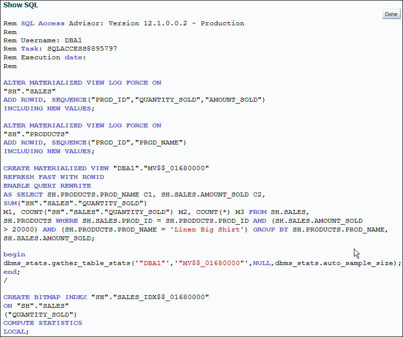
    [Description of the illustration sql_access_show_sql.gif](img_text/sql_access_show_sql.md)

#### 13.2.3 Reviewing the SQL Access Advisor Recommendations: SQL Statements

The SQL Statements subpage ranks SQL statements in the workload by cost improvement. You can use this page to view details about the SQL statements analyzed in the workload.

##### To review SQL statements:

1.  Access the Results for Task page, as described in "Reviewing the SQL Access Advisor Recommendations".

2.  Click SQL Statements.

    The SQL Statements subpage appears.

    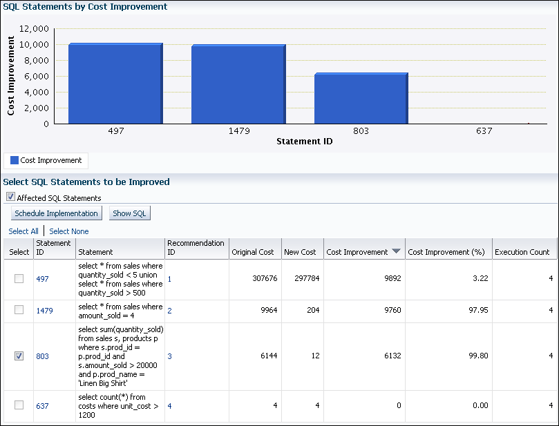
    [Description of the illustration sql_access_results_sql.gif](img_text/sql_access_results_sql.md)

3.  Use the SQL Statements by Cost Improvement chart to view SQL statements in the workload ordered by the cost improvement.

    Under Select SQL Statements to be Improved, each SQL statement is listed with its statement ID, SQL text, associated recommendation, cost improvement, and execution count.

    Implementing the recommendation associated with the top SQL statement has the biggest benefit to the total performance of the workload. In this example, implementing the recommendation with ID 3 produces the biggest benefit, a cost improvement of 99.80%, for the SQL statement with ID 803.

4.  To view the SQL text of a recommendation, select the recommendation and click Show SQL.

    The Show SQL page for the selected recommendation appears.

#### 13.2.4 Reviewing the SQL Access Advisor Recommendations: Details

The Details subpage displays a list of all the workload and task options used in the analysis. You can also use this page to view a list of journal entries for the task, based on the journaling level used when the task was created.

##### To review workload and task details:

1.  Access the Results for Task page, as described in "Reviewing the SQL Access Advisor Recommendations".

2.  Click Details.

    The Details subpage appears.

    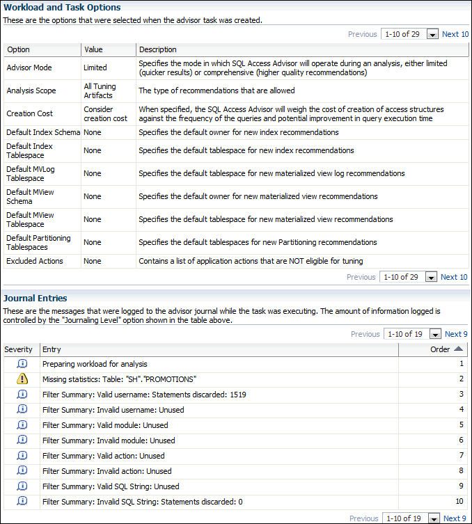
    [Description of the illustration sql_access_results_details.gif](img_text/sql_access_results_details.md)
    Under Workload and Task Options, a list of options that were selected when the advisor task was created is displayed.

    Under Journal Entries, a list of messages that were logged to the SQL Access Advisor journal while the task was executing is displayed.

### 13.3 Implementing the SQL Access Advisor Recommendations

A SQL Access Advisor recommendation can range from a simple suggestion to a complex solution that requires partitioning a set of existing base tables and implementing a set of database objects such as indexes, materialized views, and materialized view logs. You can select the recommendations for implementation and schedule when the job should be executed.

#### To implement the SQL Access Advisor recommendations:

1.  Review the SQL Access Advisor recommendations for cost benefits to determine which ones, if any, should be implemented.

    See "Reviewing the SQL Access Advisor Recommendations" for more information.

2.  Access the Results for Task page, as described in "Reviewing the SQL Access Advisor Recommendations".

3.  Click Recommendations.

    The Recommendations subpage appears.

4.  Under Select Recommendations for Implementation, select the recommendation you want to implement and then click Schedule Implementation.

    In the following example, the recommendation with ID value `1` is selected.

    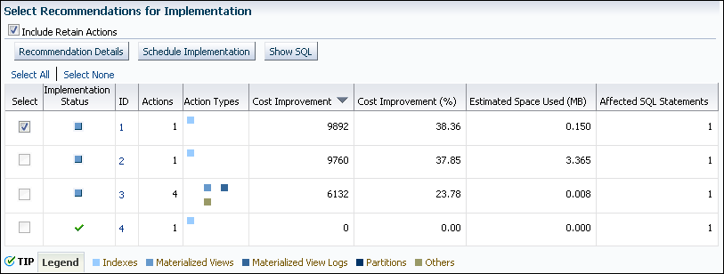
    [Description of the illustration sql_access_schedule_imp.gif](img_text/sql_access_schedule_imp.md)
    The Schedule Implementation page appears.

5.  In the Job Name field, enter a name for the job if you do not want to use the system-generated job name.

6.  Determine whether the implementation job should stop if an error is encountered. Do one of the following:

    - To stop processing if an error occurs, select Stop on Error.

    - To continue processing even if an error occurs, deselect Stop on Error.

7.  Under Scheduling Options, in the Schedule Type list, select a schedule type for the task and a maintenance window in which the task should run. Do one of the following:

    - Click Standard.

      This schedule type enables you to select a repeating interval and start time for the task. Complete the following steps:

      - Enter your time zone code in the Time Zone field or click the search icon to locate the code for your area.

      - In the Repeat list, select Do Not Repeat to perform the task only once, or select a unit of time and enter the number of units in the Interval field.

      - Under Start, select Immediately to start the task now, or Later to schedule the task to start at a time specified using the Date and Time fields.

    - Click Use predefined schedule.

      This schedule type enables you to select an existing schedule. Do one of the following:

      - In the Schedule field, enter the name of the schedule to be used for the task.

      - To search for a schedule, click the search icon.

        The Search and Select: Schedule dialog box appears.

        Select the desired schedule and click Select. The selected schedule now appears in the Schedule field.

    - Click Standard using PL/SQL for repeated interval.

      This schedule type enables you to select a repeating interval and an execution window for the task. Complete the following steps:

      - Enter your time zone code in the Time Zone field or click the search icon to locate the code for your area.

      - Under Available to Start, select Immediately to start the task now, or Later to schedule the task to start at a time specified using the Date and Time fields.

      - In the Repeated Interval field, enter a PL/SQL schedule expression, such as `SYSDATE+1`.

      - Under Not Available After, select No End Date to indicate that there is no end date for the execution window, or Specified End Date to specify an end date using the Date and Time fields.

    - Click Use predefined window.

      This schedule type enables you to select an existing window. Select Stop on Window Close to stop the job when the window closes. Do one of the following:

      - In the Window field, enter the name of the window to be used for the task.

      - To search for a window, click the search icon.

        The Search and Select: Window and Window Groups dialog box appears.

        Select the desired window and click Select. The selected window now appears in the Schedule field.

    - Click Event.

      Complete the following steps:

      - Enter your time zone code in the Time Zone field or click the search icon to locate the code for your area.

      - Under Event Parameters, enter values in the Queue Name and Condition fields.

      - Under Start, select Immediately to start the task now, or Later to schedule the task to start at a time specified using the Date and Time fields.

      - Under Not Available After, select No End Date to indicate that there is no end date for the execution window, or Specified End Date to specify an end date using the Date and Time fields.

    - Click Calendar.

      Complete the following steps:

      - Enter your time zone code in the Time Zone field or click the search icon to locate the code for your area.

      - Under Calendar Expression, enter a calendar expression.

      - Under Start, select Immediately to start the task now, or Later to schedule the task to start at a time specified using the Date and Time fields.

      - Under Not Available After, select No End Date to indicate that there is no end date for the execution window, or Specified End Date to specify an end date using the Date and Time fields.

    In this example, Standard is selected for schedule type. The job does not repeat and is scheduled to start immediately.

    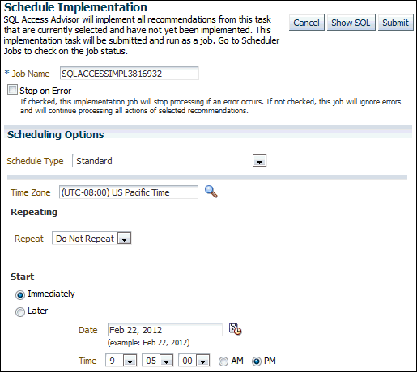
    [Description of the illustration sql_access_schedule_options.gif](img_text/sql_access_schedule_options.md)

8.  Optionally, click Show SQL to view the SQL text for the job.

9.  Click Submit to submit the job.

10. Do one of the following, depending on whether the job is scheduled to start immediately or later:

    - If you submitted the job immediately, and if the Results for Task page appears, then click the link in the Scheduler Job field to display the View Job page. Go to Step 12.

    - If the job is scheduled to start at a later time, then proceed to Step 11.

11. Complete the following steps:

    1.  From the Administration menu, select Oracle Scheduler, then Jobs.

        The Scheduler Jobs page appears.

    2.  Select the implementation job and click View Job Definition.

        The View Job page for the selected job appears.

12. On the View Job page, under Operation Detail, check the status of the operation.

    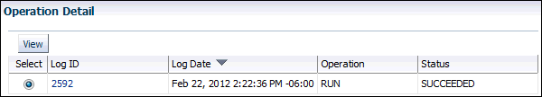
    [Description of the illustration sql_access_operation_det.gif](img_text/sql_access_operation_det.md)

13. Optionally, select the operation and click View.

    The Operation Detail page appears.

    This page contains information (such as start date and time, run duration, CPU time used, and session ID) that you can use when troubleshooting.

14. Optionally, from the Database Home page, select Schema, then the page of the object that was created.

    Depending on the type of access structure that is created, you can display the access structure using the Indexes page, Materialized Views page, or the Materialized View Logs page.
