Performance degradation of the database occurs when your database was performing optimally in the past, such as 6 months ago, but has gradually degraded to a point where it becomes noticeable to the users. The Automatic Workload Repository (AWR) Compare Periods report enables you to compare database performance between two periods of time.

While an AWR report shows AWR data between two snapshots (or two points in time), the AWR Compare Periods report shows the difference between two periods (or two AWR reports with a total of four snapshots). Using the AWR Compare Periods report helps you to identify detailed performance attributes and configuration settings that differ between two time periods. The two time periods selected for the AWR Compare Periods report can be of different durations. The report normalizes the statistics by the amount of time spent on the database for each time period and presents statistical data ordered by the largest difference between the periods.

For example, a batch workload that historically completed in the maintenance window between 10:00 p.m. and midnight is currently showing poor performance and completing at 2 a.m. You can generate an AWR Compare Periods report from 10:00 p.m. to midnight on a day when performance was good and from 10:00 a.m. to 2 a.m. on a day when performance was poor. The comparison of these reports should identify configuration settings, workload profile, and statistics that were different in these two time periods. Based on the differences identified, you can diagnose the cause of the performance degradation.

This chapter contains the following sections:

- Managing Baselines

- Running the AWR Compare Periods Reports

- Using the AWR Compare Periods Reports

**See Also:**

- "[Gathering Database Statistics Using the Automatic Workload Repository](oracle-database-performance-method.md)"

### 9.1 Managing Baselines

Baselines are an effective way to diagnose performance problems. AWR supports the capture of baseline data by enabling you to specify and preserve a pair or a range of snapshots as a baseline. The snapshots contained in a baseline are excluded from the automatic AWR purging process and are retained indefinitely.

A moving window baseline corresponds to all AWR data that exists within the AWR retention period. Oracle Database automatically maintains a system-defined moving window baseline. The default size of the window is the current AWR retention period, which by default is 8 days.

This section contains the following topics:

- Creating a Baseline

- Deleting a Baseline

- Computing Threshold Statistics for Baselines

- Setting Metric Thresholds for Baselines

#### 9.1.1 Creating a Baseline

Before creating a baseline, carefully consider the time period you choose as a baseline because it should represent the database operating at an optimal level. In the future, you can compare these baselines with other baselines or snapshots captured during periods of poor performance to analyze performance degradation over time.

You can create the following types of baseline:

- Creating a Single Baseline

- Creating a Repeating Baseline

##### 9.1.1.1 Creating a Single Baseline

A single baseline is captured at a single, fixed time interval. For example, a single baseline may be captured on February 5, 2012 from 5:00 p.m. to 8:00 p.m.

You can choose future start and end times to create a baseline that captures future database activity. If both the start time and the end time are in the future, then a baseline template with the same name as the baseline is also created. A baseline template is a specification that enables Oracle Database to automatically generate a baseline for a future time period.

##### To create a single baseline:

1.  Access the Database Home page.

    See "[Accessing the Database Home Page](introduction.md)" for more information.

2.  From the Performance menu, select AWR and then AWR Administration.

    If the Database Login page appears, then log in as a user with administrator privileges. The Performance page appears.

3.  Under Manage Snapshots and Baselines, click the number next to Baselines.

    The AWR Baselines page appears with a list of existing baselines displayed.

    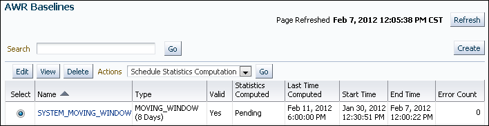
    [Description of the illustration awr_baselines.gif](img_text/awr_baselines.md)

4.  Click Create.

    The Create Baseline: Baseline Interval Type page appears.

5.  Select Single.

    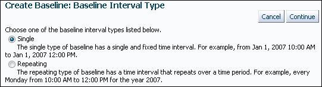
    [Description of the illustration baseline_interval_single.gif](img_text/baseline_interval_single.md)

6.  Click Continue.

    The Create Baseline: Single Baseline page appears.

    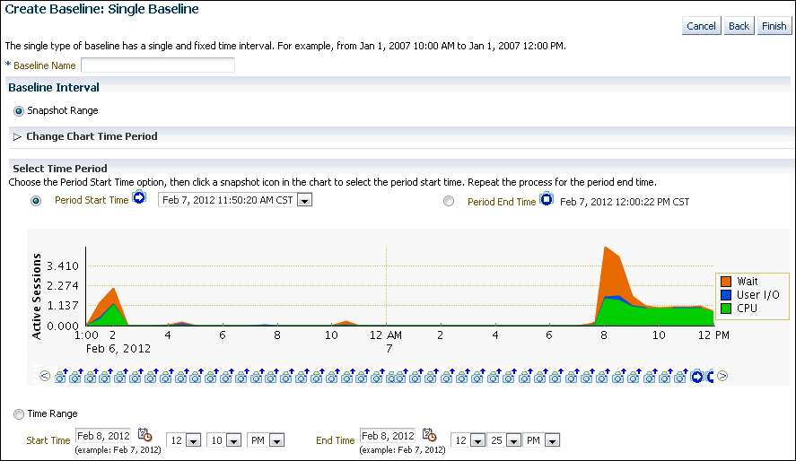
    [Description of the illustration create_baseline_single.gif](img_text/create_baseline_single.md)

7.  In the Baseline Name field, enter a name for the baseline.

8.  Under Baseline Interval, select whether to use a snapshot range or a time range for the baseline. Do one of the following:

    - To use a range, select Snapshot Range. Complete the following steps:

      - Under Select Time Period, select a start time for the baseline by selecting Period Start Time and the snapshot icon below the Active Sessions chart that corresponds to the desired start time.

      - Select an end time for the baseline by selecting Period End Time and the snapshot icon below the Active Sessions chart that corresponds to the desired end time.

      - Optionally, to view older snapshots that are not displayed below the Active Sessions chart, expand Change Chart Time Period. Enter the desired start date in the Chart Start Date field and the desired end date in the Chart End Date field, and click Go.

      In this example, a snapshot range of February 7, 2012 from 10:50 a.m. to 11:20 a.m. is selected.

      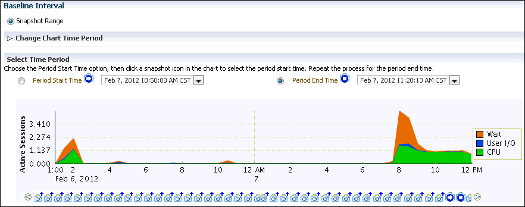
      [Description of the illustration baseline_snapshot_range.gif](img_text/baseline_snapshot_range.md)

    - To use a time range, select Time Range. Complete the following steps:

      - In the Start Time fields, select a start time for the baseline.

      - In the End Time fields, select an end time for the baseline.

      In the following example, a time range from 12:20 p.m. to 12:35 p.m. on February 7, 2012 is selected.

      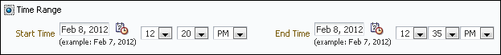
      [Description of the illustration create_baseline_time_range.gif](img_text/create_baseline_time_range.md)

9.  Click Finish.

    The AWR Baselines page reappears with the newly created baseline displayed.

##### 9.1.1.2 Creating a Repeating Baseline

A repeating baseline is a baseline that repeats during a time interval over a specific period. For example, a repeating baseline may repeat every Monday from 1:00 p.m. to 3:00 p.m. from February 7, 2012 to February 7, 2013.

##### To create a repeating baseline:

1.  Access the AWR Baselines page, as explained in "Creating a Single Baseline".

2.  Click Create.

    The Create Baseline: Baseline Interval Type page appears.

3.  Select Repeating and then click Continue.

    The Create Baseline: Repeating Baseline Template page appears.

4.  In the Baseline Name Prefix field, enter a name prefix for the baseline.

5.  Under Baseline Time Period, specify the time of the day that you want the baseline to begin collecting AWR data and the duration of the baseline collection.

6.  Under Frequency, do one of the following:

    - Select Daily if you want the baseline to repeat on a daily basis.

    - Select Weekly if you want the baseline to repeat on a weekly basis, and then select the day of the week on which the baseline repeats.

7.  Under Interval of Baseline Creation, complete the following steps:

    1.  In the Start Time fields, select a date and time in the future when the data collection should begin.

    2.  In the End Time fields, select a date and time in the future when the data collection should end.

8.  Under Purge Policy, enter the number of days to retain captured baselines.

9.  Click Finish.

    A baseline template with the same name as the baseline name prefix is created. A baseline template is a specification that enables Oracle Database to automatically generate a baseline for a future time period.

    This example creates a baseline that repeats weekly on Mondays from 8:00 a.m. to 10:00 a.m. from February 6, 2009 to February 6, 2010. Every captured baseline expires after 30 days.

    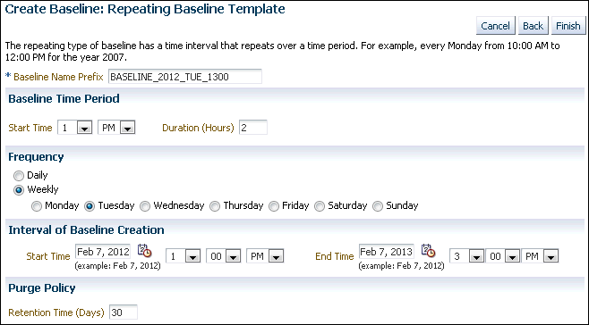
    [Description of the illustration create_baseline_repeating.gif](img_text/create_baseline_repeating.md)

#### 9.1.2 Deleting a Baseline

To conserve storage space, you may want to periodically delete unused baselines stored in the database.

##### To delete a baseline:

1.  Access the AWR Baselines page, as explained in "Creating a Single Baseline".

2.  Select a baseline and click Delete.

    The Confirmation page appears.

3.  Select whether to purge the underlying data associated with the baseline.

    The underlying data includes the individual snapshots preserved in the baseline and any statistics that are computed for the baseline. Do one of the following:

    - To delete the underlying data, select Purge the underlying data associated with the baseline.

    - To preserve the underlying data, select Do not purge the underlying data associated with the baseline.

4.  Click Yes.

    The AWR Baselines page reappears. A message informs you that the baseline was deleted successfully.

#### 9.1.3 Computing Threshold Statistics for Baselines

Computing threshold statistics for baselines enables you to graphically display the computed statistics in the charts on the Performance page.

##### To compute threshold statistics for baselines:

1.  Access the AWR Baselines page, as explained in "Creating a Single Baseline".

2.  Select the baseline for which you want to compute statistics.

    Select a baseline that does not already have computed statistics. These baselines are identified by No in the Statistics Computed column.

3.  From the Actions list, select Schedule Statistics Computation, and then click Go.

    The Compute Threshold Statistics page appears.

    This example computes statistics for the baseline `BASELINE_TUE_1120`.

    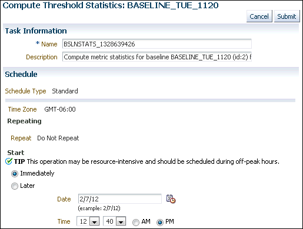
    [Description of the illustration compute_threshold_stats.gif](img_text/compute_threshold_stats.md)

4.  In the Name field, enter a name for the task.

    Alternatively, you can choose to use the system-generated name.

5.  In the Description field, enter a description for the task.

    Alternatively, you can choose to use the system-generated description.

6.  Under Start, do one of the following:

    - Select Immediately to run the task immediately after it has been submitted.

    - Select Later to run the task at a later time as specified using the Date and Time fields.

    This computation is resource-intensive, so you may want to schedule it to run during off-peak hours.

7.  Click Submit.

    The AWR Baselines page appears. A message informs you that statistics computation has been scheduled for the selected baseline.

**See Also:**

- "[Customizing the Database Performance page](monitoring-real-time-database-performance.md)" for information about displaying computed statistics on the Performance page

#### 9.1.4 Setting Metric Thresholds for Baselines

As explained in "[Setting Metric Thresholds for Performance Alerts](monitoring-performance-alerts.md)", a metric is the rate of change in a cumulative statistic. Alerts notify you when particular metric thresholds are crossed. When the metric thresholds are crossed, the system is in an undesirable state. You can edit the threshold settings for baseline metrics.

You can create the following types of baseline:

- Setting Metric Thresholds for the Default Moving Baseline

- Setting Metric Thresholds for Selected Baselines

##### 9.1.4.1 Setting Metric Thresholds for the Default Moving Baseline

This section describes the easiest technique for setting the metric thresholds for the default moving baseline. You can choose a group of basic metric threshold settings based on common database workload profiles such as OLTP, data warehousing, and OLTP with nighttime batch jobs. After choosing a workload profile, you can expand or change the threshold values as needed.

##### To set metric thresholds for the default moving baseline:

1.  Access the Database Home page.

    See "[Accessing the Database Home Page](introduction.md)" for more information.

2.  From the Performance menu, select Adaptive Thresholds.

    If the Database Login page appears, then log in as a user with administrator privileges.

    The Threshold Configuration tab of the Baseline Metric Thresholds page appears.

3.  Click Quick Configuration.

    The Quick Configuration: Baseline Metric Thresholds page appears.

4.  In Workload Profile, select one of the following options, depending on how you are using the database:

    - Primarily OLTP (pure transaction processing 24 hours a day)

    - Primarily Data Warehousing (query and load intensive)

    - Alternating (OLTP during the daytime and batch during the nighttime)

    In this example, Primarily OLTP was selected.

5.  Click Continue.

    The Quick Configuration: Review OLTP Threshold Settings page appears.

    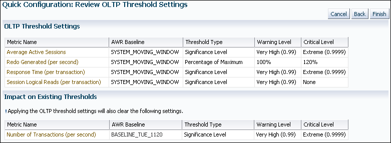
    [Description of the illustration threshold_quick.gif](img_text/threshold_quick.md)

6.  Review the metric threshold settings and then click Finish.

    You are returned to the Baseline Metric Thresholds page, with the Threshold Configuration tab selected. The metric threshold settings are displayed.

##### 9.1.4.2 Setting Metric Thresholds for Selected Baselines

This section explains how to select a baseline and edit its thresholds. You can configure the type of threshold, for example, whether it is based on significance levels, percentage of maximum values, or fixed values. You can also configure the threshold levels that determine when the database generates critical alerts and warnings.

You can edit thresholds for the default moving baseline or a baseline that you created in the AWR Baselines page. You can select a baseline in the Edit Thresholds page after you have scheduled statistics computation from the AWR Baselines page and the statistics have finished computing on the static baseline.

##### To set a metric threshold for a selected moving baseline:

1.  Access the Baseline Metric Thresholds page, as explained in "Setting Metric Thresholds for the Default Moving Baseline".

2.  In the View list, select Basic Metrics.

    The Baseline Metric Thresholds page appears.

3.  In the Category/Name column, click the link for the metric whose threshold you want to set or change.

    For example, click Number of Transactions (per second).

    The Edit Thresholds: Number of Transactions (per second) appears.

    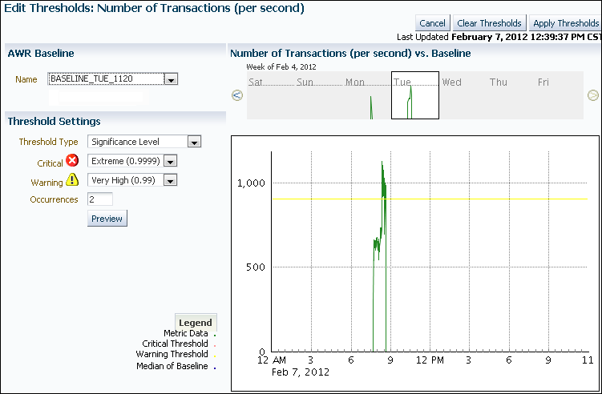
    [Description of the illustration edit_thresholds.gif](img_text/edit_thresholds.md)
    The charts on this page provide simple and detailed views of metric activity for a 24-hour period. In the top simple chart, click a day to view the value of the metric plotted against a 24-hour period.

4.  Under AWR Baseline, in the Name list, select either the default SYSTEM_MOVING_WINDOW or the name of a baseline created in the AWR Baselines page.

    A baseline appears in the AWR Baseline list after you have scheduled statistics computation from the AWR Baselines page and the statistics have finished computing on the static baseline.

    In this example, `BASELINE_TUE_1120` is selected.

    The page refreshes to show the charts for the baseline that you selected.

5.  In the Threshold Settings section, complete the following steps to change the settings:

    1.  In the Threshold Type list, select a type.

    2.  In the Critical list, select a level.

    3.  In the Warning list, select a value.

    4.  In the Occurrences list, select a value.

6.  Click Apply Thresholds.

    The Baseline Metric Thresholds page reappears. The page shows the altered metric threshold settings.

### 9.2 Running the AWR Compare Periods Reports

This section describes how to run the AWR Compare Periods reports using Enterprise Manager Cloud Control (Cloud Control).

You can use AWR Compare Periods reports to compare the database performance between two time periods by:

- Comparing a Baseline to Another Baseline or Pair of Snapshots

- Comparing Current System Performance to a Baseline Period

- Comparing Two Pairs of Snapshots

#### 9.2.1 Comparing a Baseline to Another Baseline or Pair of Snapshots

When performance degradation occurs over time, you can run the AWR Compare Periods report to compare the degraded performance, captured as a new baseline or a pair of snapshots, to an existing baseline. You must have a baseline that represents the system operating at an optimal level. If an existing baseline is unavailable, then compare database performance between two periods of time using two arbitrary pairs of snapshots, as described in "Comparing Two Pairs of Snapshots".

##### To compare a baseline to another baseline:

1.  Access the Database Home page.

    See "[Accessing the Database Home Page](introduction.md)" for more information.

2.  From the Performance menu, select AWR, then AWR Administration.

    If the Database Login page appears, then log in as a user with administrator privileges. The Automatic Workload Repository page appears.

    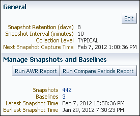
    [Description of the illustration awr1.gif](img_text/awr1.md)

3.  Under Manage Snapshots and Baselines, click the link next to Baselines.

    The AWR Baselines page appears.

4.  Complete the following steps:

    1.  Select the baseline to use for the report.

        At least one existing baseline must be available.

    2.  From the Actions list, select Compare Periods and then click Go.

    The Compare Periods: Second Period Start page appears. Under First Period, the selected baseline is displayed.

    In this example, the baseline named `BASELINE_TUE_1120` is selected.

    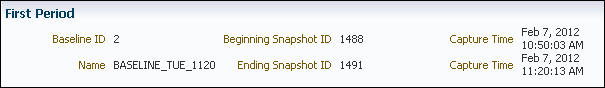
    [Description of the illustration baseline_first_period.gif](img_text/baseline_first_period.md)

5.  Compare the baseline selected in the first period to another baseline or a pair of snapshots. Do one of the following:

    - To compare to another baseline, select Select a Baseline and the baseline you want to use in the second period, and then click Next.

      The Compare Periods: Review page appears. Go to Step 7.

    - To compare to a pair of snapshots, select Select Beginning Snapshot and the beginning snapshot to use in the second period, and then click Next.

      This example selects snapshot 18, taken on February 7, 2012 at 1:00 p.m.

      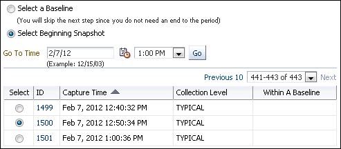
      [Description of the illustration awr_snapshot2_begin2.gif](img_text/awr_snapshot2_begin2.md)
      The Compare Periods: Second Period End appears. Proceed to the next step.

6.  Select the ending snapshot for the snapshot period to include in the report and then click Next.

    In this example, snapshot 1500, taken on February 7, 2009 at 12:50 p.m., is selected.

    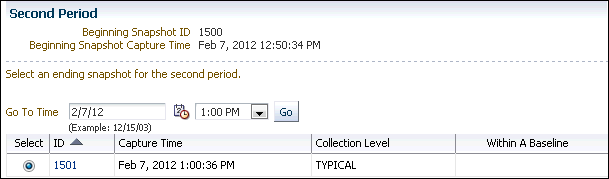
    [Description of the illustration awr_snapshot2_end2.gif](img_text/awr_snapshot2_end2.md)
    The Compare Periods: Review page appears.

    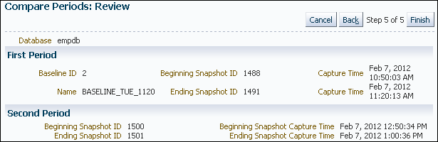
    [Description of the illustration awr2_review.gif](img_text/awr2_review.md)

7.  Review the periods to be included in the report and then click Finish.

    The Compare Periods: Results page appears.

    Data from the selected periods appears under the General subpage. You can view data per second or per transaction by selecting an option from the View Data list.

    **Note:**

    If the time periods have different lengths, then the data is normalized over database time before calculating the difference so that periods of different lengths can be compared.

    In this example, almost every metric shows that more resources were consumed in the first period. The bar graphs indicate the proportions of the values in the two periods. The absence of bars indicates equivalent values. The report for this example shows significantly more database block changes per second and parse time in the first period than in the second.

    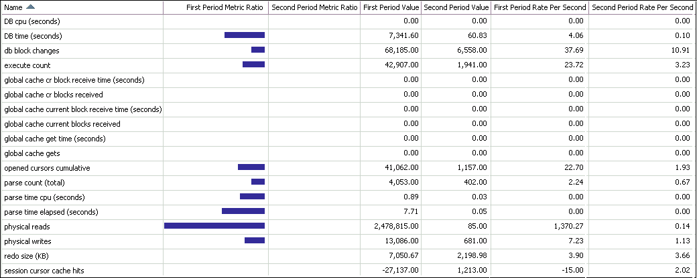
    [Description of the illustration awr2_results_general.gif](img_text/awr2_results_general.md)

8.  Click Report to view the report.

    The Processing: View Report page appears while the report is being generated. After it completes, the report appears.

9.  Optionally, do the following:

    - To change periods, click Change Periods.

    - To save the report as an HTML file, click Save to File.

**See Also:**

- "Creating a Baseline"

- "Using the AWR Compare Periods Reports"

#### 9.2.2 Comparing Current System Performance to a Baseline Period

You may have noticed a performance change on a production system and would like to know why, or you may have implemented a change to a production system and want to know the effect of the change, such as increased concurrency waits.

The Compare Period ADDM compares the performance of the database server in two time periods, and returns a report describing the performance changes and the root origin of the changes. The Advisor can analyze any Oracle RDBMS version 10.2.0.4 or later monitored by Cloud Control. The following procedure explains how to initiate a report from the Compare Period ADDM.

1.  From the Performance menu, select AWR, then Compare Period ADDM.
2.  From the Run Compare Period ADDM page, specify the desired comparison and base periods:
    - Comparison Period — Generally represents an improperly functioning time period. However, you could also use the advisor to understand why performance has improved now when compared with an earlier time period.

    - Base Period — Represents a known (baseline or reference) period in which the database is functioning properly. You should select a base period in which the performance was acceptable, and the workload was as similar or identical as possible.
3.  Click Run to display the Database Compare Period Report.
4.  Examine the sections of the report to understand the performance change between the two periods and the cause of the change:
    - Overview

      This portion of the report shows SQL commonality, which is the comparability between the base and comparison periods based on the average resource consumption of the SQL statements common to both periods.

      A commonality value of 100% means that the workload "signature" in both time periods is identical. A value of 0% means that the two time periods have no items in common for the specific workload dimension.

      Commonality is based on the type of input (that is, which SQL is executing) as well as the load of the executing SQL statements. Consequently, SQL statements running in only one time period, but not consuming significant time, do not affect commonality. Therefore, two workloads could have a commonality of 100% even if some SQL statements are running only in one of the two periods, provided that these SQL statements do not consume significant resources.

    - Configuration

      The information displayed shows base period and comparison period values for various parameters categorized by instance, host, and database.

    - Findings

      The findings can show performance improvements and identify the major performance differences caused by system changes. For negative outcomes, if you understand and remove the cause, the negative outcome can be eliminated.

      The values shown for the Base Period and Comparison Period represent performance with regard to database time.

      The Change Impact value represents a measurement of the scale of a change in performance from one time period to another. It is applicable to issues or items measured by the total database time they consumed in each time period. The absolute values are sorted in descending order.

      If the value is positive, an improvement has occurred, and if the value is negative, a regression has occurred. For instance, a change impact of -200% means that period 2 is three times as slow as period 1.

      You can run performance tuning tools, such as ADDM and the SQL Tuning Advisor, to fix issues in the comparison period to improve general system performance.

    - Resources

      The information shown here provides a summary of the division of database time for both time periods, and shows the resource usage for CPU, memory, I/O, and interconnect (Oracle RAC only).
5.  Based on your observations, decide how to proceed to resolve performance regressions, then implement your action plan.

#### 9.2.3 Comparing Two Pairs of Snapshots

If an existing baseline is unavailable, then you can compare database performance by using two arbitrary pairs of snapshots. Use one pair taken when the database is performing optimally, and another pair when the database is performing poorly. At least four snapshots must be available.

##### To compare performance using two pairs of snapshots:

1.  Access the Database Home page.

    See "[Accessing the Database Home Page](introduction.md)" for more information.

2.  From the Performance menu, select AWR, then Compare Periods Reports.

    If the Database Login page appears, then log in as a user with administrator privileges. The Run Compare Periods Report page appears.

3.  In First Period, select By Snapshot.

4.  In Begin Snapshot, click the magnifying glass icon.

    The Search and Select: Snapshots page appears.

5.  Select the starting point for the first snapshot period to be included in the report, and then click Select.

    You are returned to the Run Compare Periods Report page.

6.  In End Snapshot, click the magnifying glass icon.

    The Search and Select: Snapshots page appears.

7.  Select the ending point for the first snapshot period to be included in the report, and then click Select.

    You are returned to the Run Compare Periods Report page.

8.  Under Second Period, repeat Step 3 through Step 7.

9.  Click Generate Report.

    The Report Results section appears on the Run Compare Periods Report page. The section contains the Workload Repository Compare Period Report.

10. Optionally, do the following:

    - To change periods, repeat Step 3 through Step 9.

    - To save the report as an HTML file, click Save to File.

### 9.3 Using the AWR Compare Periods Reports

After an AWR Compare Periods report is generated for the time periods you want to compare, you can use it to analyze performance degradation. To learn how to create the report, see "Running the AWR Compare Periods Reports".

Figure 9-1 shows a portion of an AWR Compare Periods report.

Figure 9-1 AWR Compare Periods Report

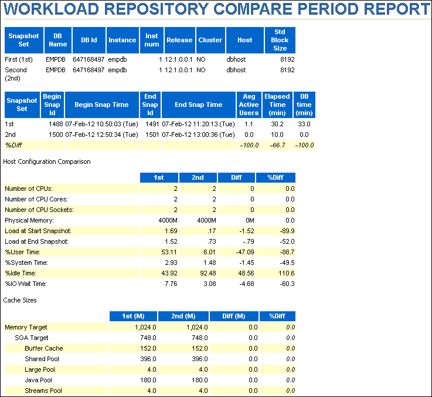
[Description of "Figure 9-1 AWR Compare Periods Report"](img_text/awr_report.md)

The AWR Compare Periods report is divided into the following sections:

- Summary of the AWR Compare Periods Report

- Details of the AWR Compare Periods Report

- Supplemental Information in the AWR Compare Periods Report

#### 9.3.1 Summary of the AWR Compare Periods Report

The report summary is at the beginning of the AWR Compare Periods report, and summarizes information about the snapshot sets and loads used in the report. The report summary contains the following sections:

- Snapshot Sets

- Host Configuration Comparison

- Cache Sizes

- Load Profile

- Top Timed Events

##### 9.3.1.1 Snapshot Sets

The Snapshot Sets section displays information about the snapshot sets used for this report, such as instance, host, and snapshot information.

In the example shown in Figure 9-1, the first snapshot period corresponds to the time when performance was stable on February 7 from 10:50 to 11:20. The second snapshot period corresponds to the time when performance degradation occurred on the same day from 12:50 to 13:00.

##### 9.3.1.2 Host Configuration Comparison

The Host Configuration Comparison section compares the host configurations used in the two snapshot sets. For example, the report compares physical memory and number of CPUs. Differences in the configurations are quantified as percentages in the %Diff column.

##### 9.3.1.3 Cache Sizes

The Cache Sizes section compares the database configurations used in the two snapshot sets. For example, the report compares the SGA and log buffer size. Differences in the configurations are quantified as percentages in the %Diff column.

##### 9.3.1.4 Load Profile

The Load Profile section compares the loads used in the two snapshot sets. Differences in the loads are quantified as percentages in the %Diff column.

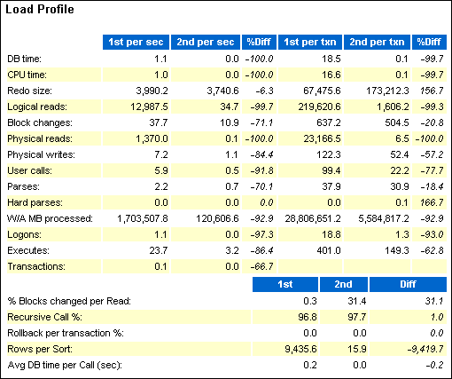
[Description of the illustration awr_load_profile.gif](img_text/awr_load_profile.md)

In this example, the DB time per second was 100% higher in the first period. CPU time per second was 100% higher.

##### 9.3.1.5 Top Timed Events

The Top Timed Events section is one of the most useful sections in the report. This section displays the five timed events or operations that consumed the highest percentage of total DB time in each of the snapshot sets.

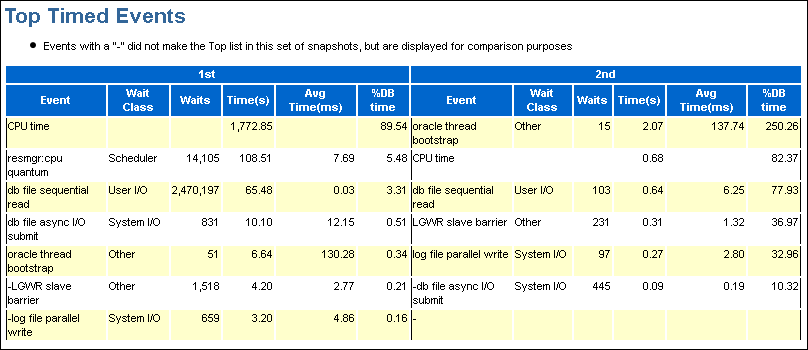
[Description of the illustration awr_top5_timed_events.gif](img_text/awr_top5_timed_events.md)

In this example, CPU time and the number of waits for database file sequential reads are significantly higher in the first period than in the second.

#### 9.3.2 Details of the AWR Compare Periods Report

The Report Details section follows the summary of the AWR Compare Periods report, and provides statistics about the snapshot sets and loads used in the report. For example, the section includes statistics for time model statistics, wait events, SQL execution time, and instance activity.

#### 9.3.3 Supplemental Information in the AWR Compare Periods Report

The supplemental information is at the end of the AWR Compare Periods report, and provides additional information about initialization parameters and SQL statements. The init.ora Parameters section lists all the initialization parameter values for the first snapshot set. The Complete List of SQL Text section lists each statement by SQL ID and shows the text of the SQL statement.
