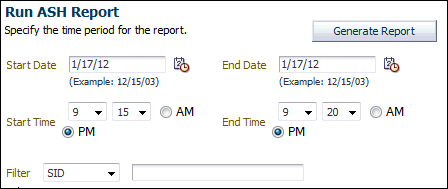
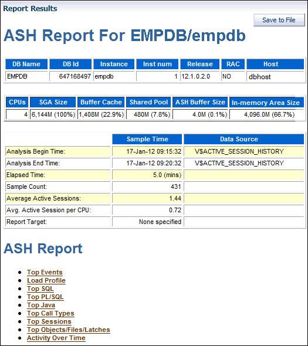
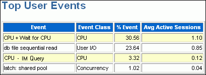
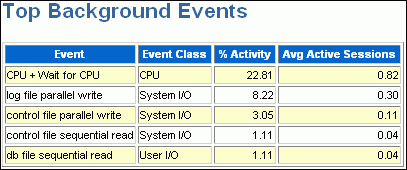
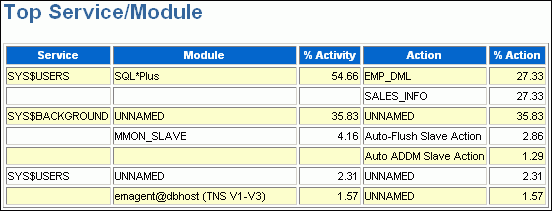
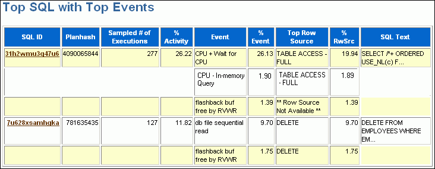
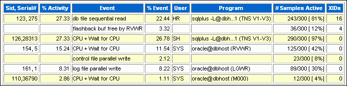
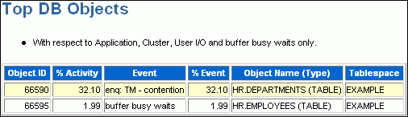
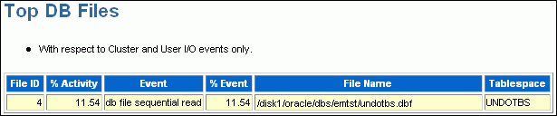
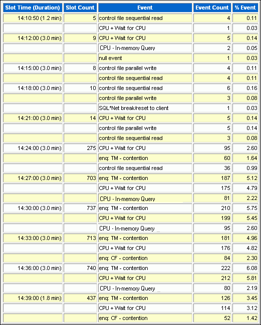

Transient performance problems are short-lived and typically do not appear in the Automatic Database Diagnostic Monitor (ADDM) analysis. ADDM tries to report the most significant performance problems during an analysis period in terms of their effect on database time (DB time). If a problem lasts for a brief time, then its severity might be averaged out or minimized by other performance problems in the entire analysis period. Therefore, the problem may not appear in the ADDM findings. Whether or not a performance problem is captured by ADDM depends on its duration compared to the interval between the Automatic Workload Repository (AWR) snapshots.

If a performance problem lasts for a significant portion of the time between snapshots, then it is captured by ADDM. For example, if the snapshot interval is one hour, then a performance problem that lasts 30 minutes should not be considered a transient performance problem because its duration represents a significant portion of the snapshot interval and is likely to be captured by ADDM.

On the other hand, a performance problem that lasts 2 minutes could be transient because its duration is a small portion of the snapshot interval and probably does not appear in the ADDM findings. For example, if the system was slow between 10:00 p.m. and 10:10 p.m., and if the ADDM analysis for the time period between 10:00 p.m. and 11:00 p.m. does not show a problem, then a transient problem may have occurred for only a few minutes of the 10-minute interval.

This chapter contains the following sections:

- Overview of Active Session History

- Running Active Session History Reports

- Active Session History Reports

- Diagnosing Serious Performance Problems in Real Time

### 8.1 Overview of Active Session History

To capture a detailed history of database activity, Oracle Database samples active sessions each second with the Active Session History (ASH) sampler. AWR snapshot processing collects the sampled data into memory and writes it to persistent storage. ASH is an integral part of the Oracle Database self-management framework and is extremely useful for diagnosing performance problems.

ASH gathers sampled data at the session level rather than at the instance level. By capturing statistics for only active sessions, ASH collects a manageable set of data. The size of this data is directly related to the work being performed, rather than to the size of the entire database instance.

Sampled data captured by ASH can be aggregated based on the dimensions in the data, including the following:

- SQL identifier of a SQL statement

- Object number, file number, and block number

- Wait event identifier and parameters

- Session identifier and session serial number

- Module and action name

- Client identifier of the session

- Service hash identifier

You can run ASH reports to analyze transient performance problems with the database that only occur during specific times. This technique is especially useful when you are trying to do either of the following:

- Resolve transient performance problems that may last for only a short period of time, such as why a particular job or session is not responding when the rest of the instance is performing as usual

- Perform scoped or targeted performance analysis by various dimensions or their combinations, such as time, session, module, action, or SQL identifier

**See Also:**

- "[Active Session History Statistics](oracle-database-performance-method.md)"

- [Oracle Database Performance Tuning Guide](../tgdba/analyzing-sampled-data.md) for more detailed information about ASH reports

### 8.2 Running Active Session History Reports

This section describes how to generate ASH reports using Oracle Enterprise Manager Cloud Control (Cloud Control).

#### To run ASH reports:

1.  Access the Database Home page.

    See "[Accessing the Database Home Page](introduction.md)" for more information.

2.  From the Performance menu, select Performance Home.

    If the Database Login page appears, then log in as a user with administrator privileges. The Performance page appears.

3.  Under Average Active Sessions, click Run ASH Report.

    The Run ASH Report page appears.

4.  Enter the date and time for the start and end of the time period when the transient performance problem occurred.

    In this example, database activity increased between 9:15 p.m. and 9:20 p.m., so an ASH report should be created for that time period.

    
    [Description of the illustration run_ash.gif](img_text/run_ash.md)

5.  Click Generate Report.

    The Processing: View Report page appears while the report is being generated.

    After the report is generated, the ASH report appears under Report Results on the Run ASH Report page.

    
    [Description of the illustration ash_report.gif](img_text/ash_report.md)
    **See Also:**

    "Active Session History Reports" for descriptions of some of the reports.

6.  Optionally, click Save to File to save the report in HTML format for future analysis.

### 8.3 Active Session History Reports

You can use an ASH report to identify the source of transient performance problems. The report is divided into titled sections. The following sections of the ASH report are useful places to begin the investigation:

- Top Events

- Load Profile

- Top SQL

- Top Sessions

- Top DB Objects/Files/Latches

- Activity Over Time

**See Also:**

- [Oracle Database Performance Tuning Guide](../tgdba/analyzing-sampled-data.md) for more detailed information about ASH reports

#### 8.3.1 Top Events

The Top Events section of the report describes the top wait events of the sampled session activity categorized by user, background, and priority. Use this information to identify the wait events that may be the cause of the transient performance problem.

The Top Events section of the report contains the following subsections:

- Top User Events

- Top Background Events

##### 8.3.1.1 Top User Events

The Top User Events subsection of the report lists the top wait events from client processes that accounted for the highest percentages of sampled session activity.

Figure 8-1 shows that most database activity is consumed by the `CPU + Wait for CPU` event. The Wait for CPU is the time the process spent in the operating system run queue. The `%Event` column shows the percentage of DB time consumed by this event. In this example, over 30 percent of DB time was spent either on the CPU or waiting to get on it. The Load Profile section should be examined next to determine the type of activity that is causing this CPU consumption.

Figure 8-1 Top User Events

[Description of "Figure 8-1 Top User Events"](img_text/ash_top_user_events.md)

##### 8.3.1.2 Top Background Events

The Top Background Events subsection lists the top wait events from the background events that accounted for the highest percentages of sampled session activity.

The example in Figure 8-2 shows that 22.81 percent of sampled session activity is consumed by the `CPU + Wait for CPU` event.

Figure 8-2 Top Background Events

[Description of "Figure 8-2 Top Background Events"](img_text/top_back_events.md)

#### 8.3.2 Load Profile

The Load Profile section of the report describes the load analyzed in the sampled session activity. Use the information in this section to identify the service, client, or SQL command type that may be the cause of the transient performance problem.

The Top Service/Module subsection lists the services and modules that accounted for the highest percentages of sampled session activity. A service is a group of related database tasks that share common functionality, quality expectations, and priority. Services are a convenient way to monitor multiple applications. The `SYS$USERS` and `SYS$BACKGROUND` services are always defined.

Figure 8-3 shows that over half of the database activity is consumed by the `SYS$USERS` service running the SQL\*Plus module. In this example, it appears that the user is running high-load SQL that is causing the performance problem indicated in Figure 8-1. The Top SQL section of the report should be analyzed next to determine whether a particular type of SQL statement makes up the load.

Figure 8-3 Top Service/Module

[Description of "Figure 8-3 Top Service/Module"](img_text/ash_top_service_module.md)

**See Also:**

- "[Monitoring Top Services](monitoring-real-time-database-performance.md)"

- "[Monitoring Top Modules](monitoring-real-time-database-performance.md)"

#### 8.3.3 Top SQL

The Top SQL section of the report describes the top SQL statements of the sampled session activity. Use this information to identify high-load SQL statements that may be the cause of the transient performance problem. The Top SQL with Top Events subsection lists the SQL statements that accounted for the highest percentages of sampled session activity. The Sampled \# of Executions column shows how many distinct executions of a particular SQL statement were sampled. To view the text of the SQL statements, click the SQL ID link.

Figure 8-4 shows that over half of DB time is consumed by three DML statements. These statements were run in the SQL\*Plus module shown in Figure 8-3. The Top Sessions section should be analyzed to identify the sessions running these statements.

Figure 8-4 Top SQL with Top Events

[Description of "Figure 8-4 Top SQL with Top Events"](img_text/ash_top_sql.md)

**See Also:**

- "[Monitoring Top SQL](monitoring-real-time-database-performance.md)"

#### 8.3.4 Top Sessions

The Top Sessions section lists the sessions that were waiting for the wait event that accounted for the highest percentages of sampled session activity. Use this information to identify the sessions that may be the cause of the performance problem.

The `# Samples Active` column shows the number of ASH samples in which the session was found waiting for that particular event. The percentage is calculated based on wall-clock time.

In Figure 8-5, the `# Samples Active` column shows that of the 300 times that ASH sampled database activity, the `HR` session (SID 123) performed a sequential read 243 times and a flashback operation 36 times. So, `HR` was active at least 93% of the time. The session consumed 27% of the total activity (much less than 93%) because other sessions, including the `SH` session, were also active.

It appears that the `HR` and `SH` sessions were running the high-load SQL statement in Figure 8-4. You should investigate this session to determine whether it is performing a legitimate operation and tune the SQL statement if possible. If tuning the SQL is not possible, and if a session is causing an unacceptable performance impact on the system, then consider terminating the session.

Figure 8-5 Top Sessions

[Description of "Figure 8-5 Top Sessions"](img_text/ash_top_sessions.md)

**See Also:**

- "[Monitoring Top Sessions](monitoring-real-time-database-performance.md)"

- "[Tuning SQL Statements](tuning-sql-statements.md) "

#### 8.3.5 Top DB Objects/Files/Latches

The Top Objects/Files/Latches section provides additional information about the most commonly-used database resources and contains the following subsections:

- Top DB Objects

- Top DB Files

- Top Latches

##### 8.3.5.1 Top DB Objects

The Top DB Objects subsection lists the database objects (such as tables and indexes) that accounted for the highest percentages of sampled session activity.

The example in Figure 8-6 shows that the `hr.departments` and `hr.employees` tables account for a high percentage of activity. Enqueue waits are waits for locks. In this example, the wait is for the TM (table) lock. Sometimes these waits indicate unindexed foreign key constraints. The `buffer busy waits` event records waits for a buffer to become available. These waits indicate that multiple processes are attempting to concurrently access the same buffers in the buffer cache.

Figure 8-6 Top DB Objects

[Description of "Figure 8-6 Top DB Objects"](img_text/top_db_objects.md)

##### 8.3.5.2 Top DB Files

The Top DB Files subsection lists the database files that accounted for the highest percentages of sampled session activity. Only cluster and I/O events are considered. The `% Event` column breaks down the activity by event, so if multiple rows exist in this table, then the sampled activity is divided among multiple events.

Figure 8-7 shows that about 11 percent of DB time involves waits for the `UNDOTBS` tablespace. This information is consistent with Figure 8-4, which shows significant DML activity from multiple sessions.

Figure 8-7 Top DB Files

[Description of "Figure 8-7 Top DB Files"](img_text/ash_top_files.md)

##### 8.3.5.3 Top Latches

The Top Latches subsection lists the latches that accounted for the highest percentages of sampled session activity. Latches are simple, low-level serialization mechanisms to protect shared data structures in the System Global Area (SGA).

#### 8.3.6 Activity Over Time

The Activity Over Time section of the ASH report is particularly useful for longer time periods because it provides in-depth details about activities and workload profiles during the analysis period. The Activity Over Time section is divided into time slots. The ASH report time span is divided into 10 time slots unless the time period is short or the data is sparse.

Figure 8-8 shows an activity report for the period between 2:10 p.m. and 2:40 p.m. The report indicates that the number of sampled sessions rose sharply in the sixth inner slot (2:24 p.m.) and stayed up. During this period CPU activity and lock enqueue waits increased dramatically.

Figure 8-8 Activity Over Time

[Description of "Figure 8-8 Activity Over Time"](img_text/ash_activity_over_time.md)

Each time slot contains session and wait event activity, as described in Table 8-1.

Table 8-1 Activity Over Time

| Column               | Description                                                                     |
|:---------------------|:--------------------------------------------------------------------------------|
| Slot Time (Duration) | Duration of the slot                                                            |
| Slot Count           | Number of sampled sessions in the slot                                          |
| Event                | Top three wait events in the slot                                               |
| Event Count          | Number of ASH samples waiting for the wait event                                |
| % Event              | Percentage of ASH samples waiting for wait events in the entire analysis period |

All inner slots are the same number of minutes each for easy comparison. The first and last slots, called outer slots, are odd-sized because they do not have a fixed slot time.

When comparing the inner slots, perform a skew analysis by identifying spikes. A spike in the Slot Count column indicates an increase in active sessions and a relative increase in database workload. A spike in the Event Count column indicates an increase in the number of sampled sessions waiting for an event. Typically, when the number of active session samples and the number of sessions associated with a wait event increase, the slot may be the cause of the transient performance problem.

### 8.4 Diagnosing Serious Performance Problems in Real Time

The following procedure is useful for diagnosing serious performance problems at the moment they are occurring. This may assist you in finding a remedy to resolve the problem other than rebooting the system.

1.  Access the Database Home page.

    See "[Accessing the Database Home Page](introduction.md)" for more information.

2.  From the Performance menu, select Emergency Monitoring.

    The Emergency Performance page appears and displays collected ASH data. The page also shows top blocking sessions in the Hang Analysis table.

    If the information displayed on this page does not help you resolve the problem, continue to the next step.

3.  From the Performance menu, select Real-Time ADDM.

    The Real-Time ADDM page appears.

4.  In the Real-Time ADDM Results section, click Start.

    The system responds by collecting performance data from the target database, analyzing data for problem diagnosis and resolutions, and showing you results of the analysis.

5.  Click the Findings tab for a clear and interactive summary of all of the findings the analysis has detected, and to view actionable recommendations.

6.  Optionally, click Save to save the current page view as an HTML file for offline reference. When you click Save, a Save As dialog box appears and you can specify where you want to save the report. This action creates an Enterprise Manager Active Report covering all data currently gathered as part of the analysis. You can use this later to conduct a more thorough post-mortem analysis. You can view the report without Cloud Control or database connectivity.

    You can also click Mail and specify an email address to send the report as an attachment.

**Note:**

Certain database performance problems trigger a Real-Time ADDM analysis. You can view the results of the analysis by going to the Performance Home page and selecting the clipboard icon for the ADDM run under the Average Active Sessions chart.

**See Also:**

[Oracle Database Performance Tuning Guide](../tgdba/automatic-performance-diagnostics.md) for information on Real-Time ADDM analysis

#### Example of Diagnosing a Problem

1.  A database is currently having severe performance problems, so the DBA goes to the Database Home page in Cloud Control. From the Performance menu, the DBA selects Emergency Performance.

2.  Neither ASH nor Hang Analysis indicate the root cause or offer quick solutions, so from the Performance menu the DBA selects Real-Time ADDM.

3.  The DBA views the active report generated by Real-Time ADDM, which shows that the system is paging due to excessive PGA consumption by session S1, possibly due to a memory leak. The report recommends terminating the session immediately.

4.  The DBA terminates session S1, then returns to the Emergency Performance page to see if normal system behavior is restored.

5.  The DBA notes that the system is making progress according to the activity charts on the page.

6.  From the Performance menu, the DBA selects Performance Home and observes that database performance has improved.
