A SQL statement specifies the data you want Oracle Database to retrieve. For example, a SQL statement can retrieve the names of employees in a department. When Oracle Database executes the SQL statement, the query optimizer (also called the optimizer) first determines the best and most efficient way to retrieve the results.

The optimizer determines whether it is more efficient to read all data in the table, called a full table scan, or use an index. It compares the cost of all possible approaches and chooses the approach with the least cost. The access method for physically executing a SQL statement is called an execution plan, which the optimizer is responsible for generating. The determination of an execution plan is an important step in the processing of any SQL statement, and can greatly affect execution time.

The query optimizer can also help you tune SQL statements. By using SQL Tuning Advisor and SQL Access Advisor, you can run the query optimizer in advisory mode to examine a SQL statement or set of statements and determine how to improve their efficiency. SQL Tuning Advisor and SQL Access Advisor can make various recommendations, such as the following:

- Creating SQL profiles

- Restructuring SQL statements

- Creating additional indexes or materialized views

- Refreshing optimizer statistics

Additionally, Oracle Enterprise Manager Cloud Control (Cloud Control) enables you to accept and implement many of these recommendations easily.

SQL Access Advisor is primarily responsible for making schema modification recommendations, such as adding or dropping indexes and materialized views. SQL Tuning Advisor makes other types of recommendations, such as creating SQL profiles and restructuring SQL statements. If significant performance improvements can be gained by creating a new index, then SQL Tuning Advisor may recommend it. However, such recommendations should be verified by running SQL Access Advisor using a SQL workload that contains a set of representative SQL statements.

This chapter describes how to tune SQL statements using SQL Tuning Advisor and contains the following sections:

- Tuning SQL Statements Using SQL Tuning Advisor

- Managing SQL Tuning Sets

- Managing SQL Profiles

- Managing SQL Plan Baselines

**See Also:**

- "[Identifying High-Load SQL Statements](identifying-high-load-sql-statements.md) "

- " [Optimizing Data Access Paths](optimizing-data-access-paths.md) " for information about SQL Access Advisor

### 12.1 Tuning SQL Statements Using SQL Tuning Advisor

You can use SQL Tuning Advisor to tune one or more SQL statements. When tuning multiple statements, SQL Tuning Advisor does not recognize interdependencies between the SQL statements. Instead, SQL Tuning Advisor provides a convenient way to obtain tuning advice for a large number of SQL statements.

Oracle Database can generate SQL tuning reports automatically. Automatic SQL Tuning runs during system maintenance windows as an automated maintenance task, searching for ways to improve the execution plans of high-load SQL statements. A maintenance window is a contiguous time interval during which automated maintenance tasks are run.

#### 12.1.1 Tuning SQL Manually Using SQL Tuning Advisor

As described in [Identifying High-Load SQL Statements](identifying-high-load-sql-statements.md) , Automatic Database Diagnostic Monitor (ADDM) automatically identifies high-load SQL statements. If ADDM identifies such statements, then click Schedule/Run SQL Tuning Advisor on the Recommendation Detail page to run SQL Tuning Advisor.

##### To tune SQL statements manually using SQL Tuning Advisor:

1.  Access the Database Home page.

    See "[Accessing the Database Home Page](introduction.md)" for more information.

2.  From the Performance menu, select Advisors Home

    If the Database Login page appears, then log in as a user with administrator privileges. The Advisor Central page appears.

3.  In the Advisors section, click SQL Advisors. The SQL Advisors page appears.

4.  In the SQL Tuning Advisor section, click SQL Tuning Advisor.

    The Schedule SQL Tuning Advisor page appears.

    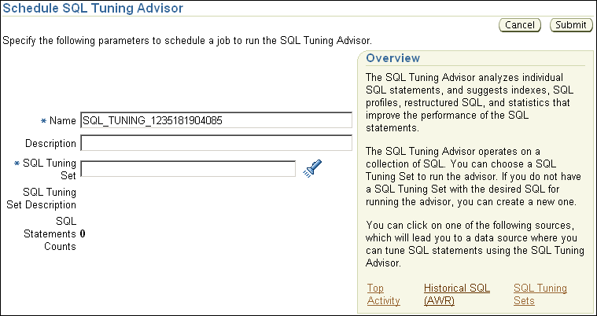
    [Description of the illustration sql_tuning_advisor_empty.gif](img_text/sql_tuning_advisor_empty.md)

5.  In the Name field, enter a name for the SQL tuning task.

    If unspecified, then SQL Tuning Advisor uses a system-generated name.

6.  Do one of the following:

    - To run a SQL tuning task for one or more high-load SQL statements, under Overview click Top Activity.

      The Top Activity page appears.

      Under Top SQL, select the SQL statement that you want to tune.

      In the Actions list, select Schedule SQL Tuning Advisor and click Go.

      **See Also:**

      "[Identifying High-Load SQL Statements Using Top SQL](identifying-high-load-sql-statements.md)" to learn how to identify high-load SQL statements using the Top Activity page

    - To run a SQL tuning task for historical SQL statements from the Automatic Workload Repository (AWR), under Overview click Historical SQL (AWR).

      The Historical SQL (AWR) page appears.

      Under Historical SQL (AWR), click the band below the chart, and select the 24-hour interval for which you want to view SQL statements that ran on the database. Under Detail for Selected 24 Hour Interval, select the SQL statement you want to tune, and click Schedule SQL Tuning Advisor.

    - To run a SQL tuning task for a SQL tuning set, under Overview click SQL Tuning Sets.

      The SQL Tuning Sets page appears.

      Select the SQL tuning set that contains the SQL statements you want to tune and then click Schedule SQL Tuning Advisor.

      **See Also:**

      "Creating a SQL Tuning Set" to learn how to create SQL tuning sets

    The Schedule SQL Tuning Advisor page reappears.

7.  To display the SQL text of the selected statement, expand SQL Statements.

    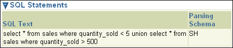
    [Description of the illustration sql_tuning_sql_statements.gif](img_text/sql_tuning_sql_statements.md)

8.  Under Scope, select the scope of tuning to perform. Do one of the following:

    - Select Limited.

      A limited scope takes approximately 1 second to tune each SQL statement but does not recommend a SQL profile.

    - Select Comprehensive, and then set a time limit (in minutes) for each SQL statement in the Time Limit per Statement field, and a total time limit (in minutes) in the Total Time Limit field. Note that setting the time limit too small may affect the quality of the recommendations.

      Comprehensive mode may take several minutes to tune a single SQL statement. This mode is both time and resource intensive because each query must be hard-parsed. You should only use comprehensive scope for high-load SQL statements that have a significant impact on the entire system.

    **See Also:**

    "Managing SQL Profiles" to learn more about SQL profiles

9.  Under Schedule, do one of the following:

    - Select Immediately and then click Submit to run the SQL tuning task immediately.

      The Processing: SQL Tuning Advisor Task page appears.

    - Select Later to schedule a specific time in the future, and then click OK.

10. From the Performance menu, select Advisors Home.

    The Advisor Central page appears.

    Under Advisor Tasks, the Results sections lists the result of advisors.

    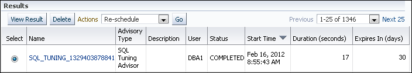
    [Description of the illustration sta_advisor_results.gif](img_text/sta_advisor_results.md)

11. Select a SQL Tuning Advisor type result from the table and then click View Result.

    The Recommendations for SQL ID page appears.

    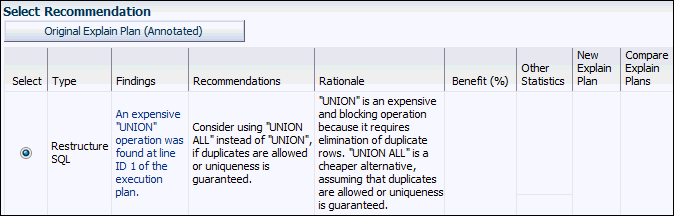
    [Description of the illustration rec_for_sql_id.gif](img_text/rec_for_sql_id.md)
    If you used a SQL tuning set, then multiple recommendations may be shown. To help you decide whether to implement a recommendation, an estimated benefit of implementing the recommendation is displayed in the Benefit (%) column. The Rationale column displays an explanation of why the recommendation is made.

12. To implement the recommendation, do one of the following:

    - If an automated solution is recommended, then click Implement.

      A confirmation page appears. Click Yes to confirm the change.

    - If a manual solution is recommended, then consider implementing the recommendation.

#### 12.1.2 Viewing Automatic SQL Tuning Results

By analyzing data in the Automatic Workload Repository (AWR), the database can identify routine maintenance tasks. The automated maintenance tasks infrastructure (known as AutoTask) schedules these tasks to run in maintenance windows.

Maintenance windows are Oracle Scheduler time intervals that belong to the window group named `MAINTENANCE_WINDOW_GROUP`. By default, one window is scheduled for each day of the week. You can customize attributes of these maintenance windows, including start and end times, frequency, and days of the week.

By default, AutoTask runs the following automated maintenance tasks in all maintenance windows:

- Optimizer Statistics Collection

- Segment Advisor

- SQL Tuning Advisor

You can view the results of automated execution of SQL Tuning Advisor on observed high-load SQL statements.

##### To view automatic SQL tuning results:

1.  Access the Database Home page.

    See "[Accessing the Database Home Page](introduction.md)" for more information.

2.  From the Performance page, select Advisors Home.

    If the Database Login page appears, then log in as a user with administrator privileges. The Advisor Central page appears.

3.  Under Advisors, click SQL Advisors.

    The SQL Advisors page appears.

4.  Under SQL Tuning Advisor, click Automatic SQL Tuning Results.

    The Automatic SQL Tuning Result Summary page appears.

    The top half of the page includes sections for the status and activity summary of the SQL Tuning task.

    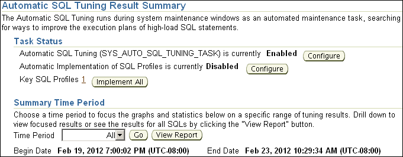
    [Description of the illustration sql_tuning_auto_result.gif](img_text/sql_tuning_auto_result.md)

5.  In the Time Period list, select All and then click Go.

    The Overall Task Statistics and Profile Effect Statistics sections are refreshed.

    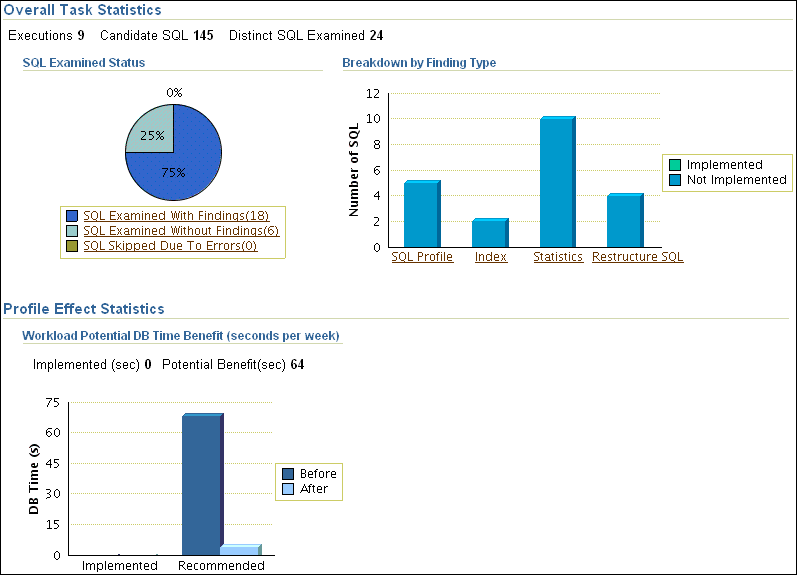
    [Description of the illustration sql_tuning_auto_stats.gif](img_text/sql_tuning_auto_stats.md)

6.  Optionally, in the Task Status section, click Configure to change the attributes of the Automatic SQL Tuning task.

    The Automated Maintenance Tasks Configuration page appears.

    In this page, you can enable or disable the Automatic SQL Tuning task and specify which days it should run. Click Apply or Revert to return to the previous page.

7.  In the Task Activity Summary section, leave All selected for the Time Period and then click View Report.

    The Automatic SQL Tuning Result Details page appears.

    The page lists SQL statements that have been automatically selected by the database as candidates for SQL tuning.

    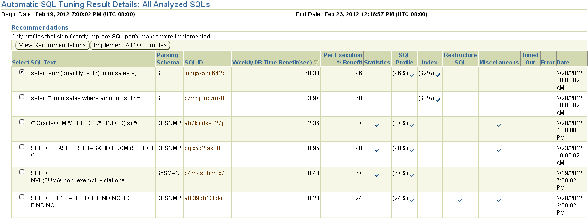
    [Description of the illustration sql_tuning_result_details.gif](img_text/sql_tuning_result_details.md)

8.  Under Recommendations, select a SQL statement and then click View Recommendations.

    The Recommendations for SQL ID page appears.

    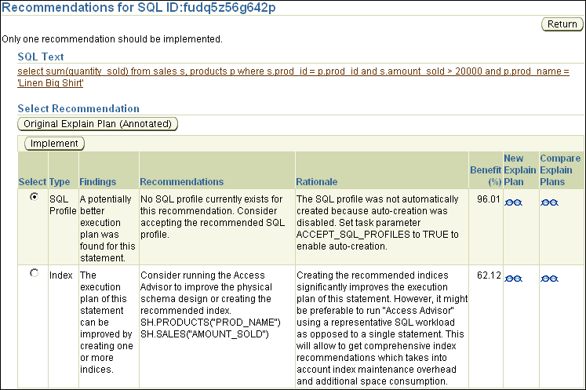
    [Description of the illustration sql_tuning_recommend.gif](img_text/sql_tuning_recommend.md)
    This page can include recommendations for SQL profiles and indexes.

    **See Also:**

    "Tuning SQL Manually Using SQL Tuning Advisor" to learn how to implement recommendations made by SQL Tuning Advisor

### 12.2 Managing SQL Tuning Sets

A SQL tuning set is a database object that includes one or more SQL statements and their execution statistics and context. You can use the set as an input for advisors such as SQL Tuning Advisor, SQL Access Advisor, and SQL Performance Analyzer. You can load SQL statements into a SQL tuning set from different SQL sources, such as AWR, the cursor cache, or high-load SQL statements that you identify.

A SQL tuning set includes the following:

- A set of SQL statements

- Associated execution context such as:

  - User schema

  - Application module name and action

  - List of bind values

  - Cursor compilation environment

- Associated basic execution statistics such as:

  - Elapsed time and CPU time

  - Buffer gets

  - Disk reads

  - Rows processed

  - Cursor fetches

  - Number of executions and number of complete executions

  - Optimizer cost

  - Command type

- Associated execution plans and row source statistics for each SQL statement (optional)

SQL statements can be filtered using the application module name and action, or any of the execution statistics. In addition, SQL statements can be ranked based on any combination of execution statistics.

SQL tuning sets are transportable, enabling SQL workloads to be transferred between databases for remote performance diagnostics and tuning. When high-load SQL statements are identified on a production system, it may not be desirable to perform investigation and tuning activities directly on this system. This feature enables you to transport the high-load SQL statements to a test system, where they can be safely analyzed and tuned.

**See Also:**

[Oracle Database SQL Tuning Guide](../tgsql/managing-sql-tuning-sets.md) for more information about transporting SQL tuning sets between databases

Using Cloud Control, you can manage SQL tuning sets by doing the following:

- Creating a SQL Tuning Set

- Dropping a SQL Tuning Set

- Transporting SQL Tuning Sets

#### 12.2.1 Creating a SQL Tuning Set

This section describes how to create a SQL tuning set with Cloud Control.

##### To create a SQL tuning set:

1.  Specify the initial options for the SQL tuning set, as described in "Creating a SQL Tuning Set: Options".

2.  Select the load method to use for collecting and loading SQL statements into the SQL tuning set, as described in "Creating a SQL Tuning Set: Load Methods".

3.  Specify the filter options for the SQL tuning set, as described in "Creating a SQL Tuning Set: Filter Options".

4.  Schedule and submit a job to collect the SQL statements and load them into the SQL tuning set, as described in "Creating a SQL Tuning Set: Schedule".

##### 12.2.1.1 Creating a SQL Tuning Set: Options

The first step in creating a SQL tuning set is to specify options for the set such as name, owner, and description.

##### To specify options for creating a SQL tuning set:

1.  Access the Database Home page.

    See "[Accessing the Database Home Page](introduction.md)" for more information.

2.  From the Performance menu, select SQL, and then SQL Tuning Sets.

    If the Database Login page appears, then log in as a user with administrator privileges. The SQL Tuning Sets page appears.

3.  Click Create.

    The Create SQL Tuning Set: Options page appears.

4.  Enter the following details:

    - In SQL Tuning Set Name, enter a name for the SQL tuning set.

    - In Owner, enter the owner of the SQL tuning set.

    - In Description, enter a description of the SQL tuning set.

5.  Optionally, to create an empty SQL tuning set and add SQL statements to it at a later time, complete the following steps:

    1.  Select Create an empty SQL tuning set.

    2.  Click Next.

        The Create SQL Tuning Set: Review page appears.

    3.  Review your SQL tuning set options and click Submit.

        The empty SQL tuning set is created. You can add SQL statements to it later.

6.  Click Next.

    The Create SQL Tuning Set: Load Methods page appears.

    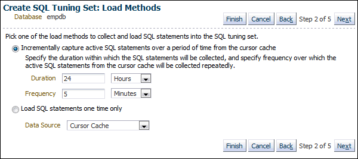
    [Description of the illustration sts_load_methods.gif](img_text/sts_load_methods.md)

7.  Proceed to the next step, as described in "Creating a SQL Tuning Set: Load Methods".

##### 12.2.1.2 Creating a SQL Tuning Set: Load Methods

After options are specified for the SQL tuning set, select the load method to use for collecting and loading SQL statements into the SQL tuning set, as described in the following sections:

- Loading Active SQL Statements Incrementally from the Cursor Cache

- Loading SQL Statements from the Cursor Cache

- Loading SQL Statements from AWR Snapshots

- Loading SQL Statements from AWR Baselines

- Loading SQL Statements from a User-Defined Workload

###### 12.2.1.2.1 Loading Active SQL Statements Incrementally from the Cursor Cache

You can load active SQL statements from the cursor cache into the SQL tuning set incrementally over a specified period of time. This technique enables you to not only collect current and recent SQL statements stored in the SQL cache, but also SQL statements that run during a specified time period in the future.

##### To load active SQL statements incrementally from the cursor cache:

1.  Access the Create SQL Tuning Set: Load Methods page, as explained in "Creating a SQL Tuning Set: Options".

2.  Select Incrementally capture active SQL statements over a period of time from the cursor cache.

3.  In the Duration field, specify how long to capture active SQL statements.

4.  In the Frequency field, specify how often to capture active SQL statements during the specified duration.

5.  Click Next.

    The Create SQL Tuning Set: Filter Options page appears.

6.  Proceed to the next step, as described in "Creating a SQL Tuning Set: Filter Options".

###### 12.2.1.2.2 Loading SQL Statements from the Cursor Cache

You can load SQL statements from the cursor cache into the SQL tuning set. However, because only current and recent SQL statements are in the SQL cache, collecting these statements only once may result in a SQL tuning set this is not representative of the entire database workload.

##### To load SQL statements from the cursor cache:

1.  Access the Create SQL Tuning Set: Load Methods page, as explained in "Creating a SQL Tuning Set: Options".

2.  Select Load SQL statements one time only.

3.  From the Data Source list, select Cursor Cache.

4.  Click Next.

    The Create SQL Tuning Set: Filter Options page is shown.

5.  Proceed to the next step, as described in "Creating a SQL Tuning Set: Filter Options".

###### 12.2.1.2.3 Loading SQL Statements from AWR Snapshots

You can load SQL statements captured in AWR snapshots. This is useful when you want to collect SQL statements for specific snapshot periods of interest that can be used for later comparison or tuning purposes.

##### To load SQL statements from AWR snapshots:

1.  Access the Create SQL Tuning Set: Load Methods page, as explained in "Creating a SQL Tuning Set: Options".

2.  Select Load statements one time only.

3.  In the Data Source list, select AWR Snapshots.

4.  In the AWR Snapshots field, select the snapshots to include. Do one of the following:

    - Select either ALL or a time period such as Last 24 hours and then go to Step 6.

      Only snapshots that are captured and stored in AWR in the specified time are included.

    - Select Customize and then go to Step 5.

      Only snapshots that are captured and stored in AWR during a customized time period that you specify are included.

5.  To select a customized time period of snapshots, complete the following steps:

    1.  Select Customize and then click Go.

        The Select Time Period window opens.

    2.  For the starting snapshot, select Period Start Time and then click the snapshot icon below the Active Session graph that corresponds to the desired start time.

    3.  For the ending snapshot, select Period End Time and then click the snapshot icon below the Active Session graph that corresponds to the desired end time.

    4.  Click Select.

    In this example, the snapshot taken on December 27, 2011 at 9:00 a.m. is selected as the start time, and the snapshot taken on December 27, 2011 at 11:00 a.m. is selected as the end time.

    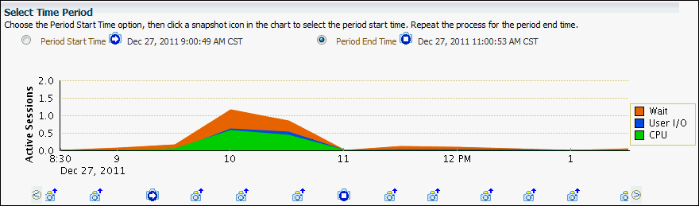
    [Description of the illustration sts_load_time_period.gif](img_text/sts_load_time_period.md)

6.  Click Next.

    The Create SQL Tuning Set: Filter Options page is shown.

7.  Proceed to the next step, as described in "Creating a SQL Tuning Set: Filter Options".

###### 12.2.1.2.4 Loading SQL Statements from AWR Baselines

You can load SQL statements captured in AWR baselines. This technique is useful when you want to collect SQL statements that are representative of a time period during known performance levels that can be used for later comparison or tuning purposes.

##### To load SQL statements from AWR baselines:

1.  Access the Create SQL Tuning Set: Load Methods page, as explained in "Creating a SQL Tuning Set: Options".

2.  Select Load SQL statements one time only.

3.  In the Data Source field, select AWR Baseline.

4.  In the AWR Baseline field, select the baseline to include.

    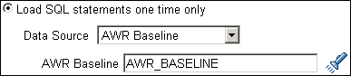
    [Description of the illustration sts_load_baseline.gif](img_text/sts_load_baseline.md)

5.  Click Next.

    The Create SQL Tuning Set: Filter Options page is shown.

6.  Proceed to the next step, as described in "Creating a SQL Tuning Set: Filter Options".

###### 12.2.1.2.5 Loading SQL Statements from a User-Defined Workload

You can load SQL statements by importing from a table or view. This technique is useful if the workload you want to analyze is not currently running on the database or captured in an existing AWR snapshot or AWR baseline.

There are no restrictions on which schema the workload resides in, the name of the table, or the number of tables that you can define. The only requirement is that the format of the table must match format of the `USER_WORKLOAD` table.

##### To load SQL statements from a user-defined workload:

1.  Access the Create SQL Tuning Set: Load Methods page, as explained in "Creating a SQL Tuning Set: Options".

2.  Select Load statements one time only.

3.  In the Data Source field, select User-Defined Workload.

4.  In the User-Defined Workload field, select the table or view to include.

    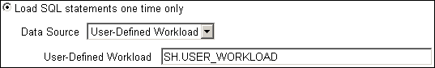
    [Description of the illustration sts_load_workload.gif](img_text/sts_load_workload.md)

5.  Click Next.

    The Create SQL Tuning Set: Filter Options page appears.

6.  Proceed to the next step, as described in "Creating a SQL Tuning Set: Filter Options".

##### 12.2.1.3 Creating a SQL Tuning Set: Filter Options

After the load method is selected, you can apply filters to reduce the scope of the SQL statements found in the SQL tuning set. While using filters is optional, it can be very beneficial due to the following:

- Using filters directs the various advisors that use the SQL tuning set as a workload source, such as SQL Tuning Advisor, SQL Access Advisor, and SQL Performance Analyzer, to make recommendations based on a specific subset of SQL statements, which may lead to better recommendations.

- Using filters removes extraneous SQL statements from the SQL tuning set, which may greatly reduce processing time when it is used as a workload source for the various advisors.

##### To specify filter options for a SQL tuning set:

1.  Create a SQL tuning set and specify the initial options, as described in "Creating a SQL Tuning Set: Options".

2.  Select the load method, as described in "Creating a SQL Tuning Set: Load Methods".

3.  On the Create SQL Tuning Set: Filter Options page, specify the values of filter conditions that you want use in the search in the Value column, and an operator or a condition in the Operator column.

    Only the SQL statements that meet all of the specified filter conditions are added to the SQL tuning set. Unspecified filter values are not included as filter conditions in the search.

    By default, the following filter conditions are displayed:

    - Parsing Schema Name

    - SQL Text

    - SQL ID

    - Elapsed Time (sec)

4.  To add filter conditions, under Filter Conditions, select the filter condition you want to add and click Add a Filter or Column.

    After the desired filter conditions have been added, specify their values in the Value column, and an operator or a condition in the Operator column.

5.  To remove any unused filter conditions, click the icon in the Remove column for the corresponding filter condition you want to remove.

6.  Click Next.

    The Create SQL Tuning Set: Schedule page appears.

7.  Proceed to the next step, as described in "Creating a SQL Tuning Set: Schedule".

##### 12.2.1.4 Creating a SQL Tuning Set: Schedule

After the filter options are specified for the SQL tuning set, you can schedule and submit a job to collect the SQL statements and load them into the SQL tuning set.

##### To schedule and submit a job to create a SQL tuning set:

1.  Create a SQL Tuning Set and specify the initial options, as described in "Creating a SQL Tuning Set: Options".

2.  Select the load method, as described in "Creating a SQL Tuning Set: Load Methods".

3.  Specify the filter options, as described in "Creating a SQL Tuning Set: Filter Options".

4.  On the Create SQL Tuning Set: Schedule page, under Job Parameters, enter a name in the Job Name field if you do not want to use the system-generated job name.

5.  In the Description field, enter a description of the job.

6.  Under Schedule, do one of the following:

    - Immediately to run the job immediately after it has been submitted

    - Later to run the job at a later time as specified using the Time Zone, Date, and Time fields

    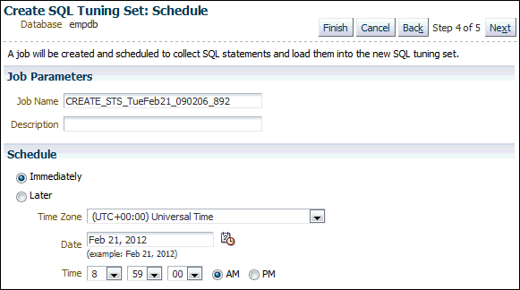
    [Description of the illustration sts_schedule.gif](img_text/sts_schedule.md)

7.  Click Next.

    The Create SQL Tuning Set: Review page appears.

    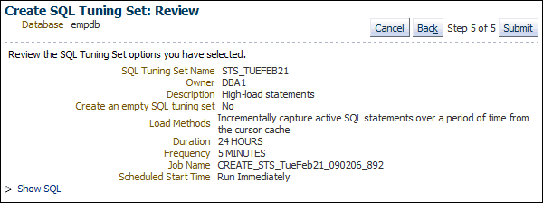
    [Description of the illustration sts_review.gif](img_text/sts_review.md)

8.  Review the SQL Tuning Set options that you have selected.

    To view the SQL statements used by the job, expand Show SQL.

9.  Click Submit.

    The SQL Tuning Sets page appears.

    If the job was scheduled to run immediately, then a message is displayed to inform you that the job and the SQL tuning set were created successfully. If the job was scheduled to run at a later time, a message is displayed to inform you that the job was created successfully.

10. To view details about the job, such as operation status, click View Job Details.

    The View Job page appears to display details about the job.

#### 12.2.2 Dropping a SQL Tuning Set

This section describes how to drop a SQL tuning set. To conserve storage space, you may want to periodically drop unused SQL tuning sets stored in the database.

##### To drop a SQL tuning set:

1.  Access the Database Home page.

    See "[Accessing the Database Home Page](introduction.md)" for more information.

2.  From the Performance menu, select SQL, and then SQL Tuning Sets.

    If the Database Login page appears, then log in as a user with administrator privileges. The SQL Tuning Sets page appears.

3.  Select the SQL tuning set you want to drop and then click Drop.

    The Confirmation page appears to verify that you want to drop the selected SQL tuning set.

4.  Click Yes.

    The SQL Tuning Sets page appears.

    A confirmation message is displayed to indicate that the SQL tuning set was successfully dropped.

#### 12.2.3 Transporting SQL Tuning Sets

You can transport SQL tuning sets from one system to another by first exporting a SQL tuning set from one database, and then importing it into another database.

This section contains the following topics:

- Exporting a SQL Tuning Set

- Importing a SQL Tuning Set

##### 12.2.3.1 Exporting a SQL Tuning Set

This section describes how to export a SQL tuning set, enabling it to be transported to another system.

##### To export a SQL tuning set:

1.  Access the Database Home page.

    See "[Accessing the Database Home Page](introduction.md)" for more information.

2.  From the Performance menu, select SQL, then SQL Tuning Sets.

    If the Database Login page appears, then log in as a user with administrator privileges. The SQL Tuning Sets page appears.

3.  Select the SQL tuning set that you want to export and then click Export To A File.

    The Export SQL Tuning Set page appears.

    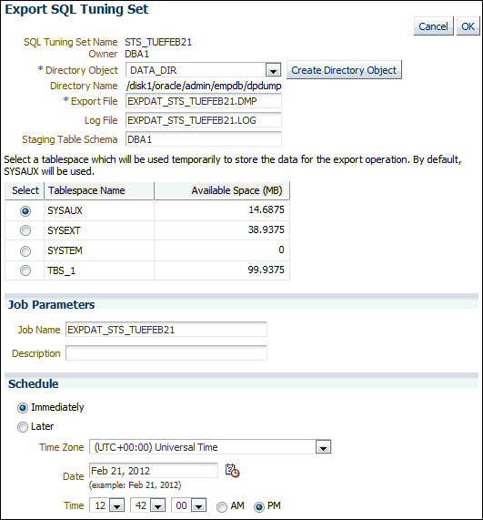
    [Description of the illustration sts_export.gif](img_text/sts_export.md)

4.  In the Directory Object field, select a directory in which to create the export file.

    For example, to use the Oracle Data Pump directory, select DATA_PUMP_DIR. The Directory Name field refreshes automatically to indicate the selected directory.

5.  In the Export File field, enter a name for the file.

    Alternatively, you can accept the name generated by the database.

6.  In the Log File field, enter a name for the log file for the export operation.

    Alternatively, you can accept the name generated by the database.

7.  Select a tablespace to temporarily store the data for the export operation.

    By default, `SYSAUX` is used.

8.  Under Job Parameters, in the Job Name field, enter a name for the job.

    Alternatively, you can accept the name generated by the database.

    Optionally, in the Description field, enter a description of the tuning set.

9.  Under Schedule, do one of the following:

    - Select Immediately to run the job immediately after it has been submitted.

    - Select Later to run the job at a later time as specified by selecting or entering values in the Time Zone, Date, and Time fields.

10. Click OK.

    The SQL Tuning Sets page appears.

    A confirmation message indicates that the job was created successfully.

11. Transport the export file to another system using the mechanism of choice, such as Oracle Data Pump or a database link.

##### 12.2.3.2 Importing a SQL Tuning Set

Before a SQL tuning set can be imported, you must first export a SQL tuning set from another system and transport it to your current system.

**See Also:**

"Exporting a SQL Tuning Set" for more information

##### To import a SQL tuning set:

1.  Access the Database Home page.

    See "[Accessing the Database Home Page](introduction.md)" for more information.

2.  From the Performance menu, select SQL, then SQL Tuning Sets.

    If the Database Login page appears, then log in as a user with administrator privileges. The SQL Tuning Sets page appears.

3.  Click Import From A File.

    The Import SQL Tuning Set page appears.

4.  In Directory Object, select the directory containing the file to be imported.

    The directory should contain the export file that was transported to your current system. For example, if the file resides in the Data Pump directory, then select `DATA_PUMP_DIR`. The Directory Name field refreshes automatically to indicate the selected directory.

5.  In the Import File field, enter the name of the dump file to import.

6.  In the Log File field, enter a name for the log file for the import operation.

7.  To replace an existing SQL tuning set with the one that you are importing, select Replace the existing SQL tuning set if one exists.

8.  Select a tablespace to temporarily store the data for the import operation.

    By default, `SYSAUX` is used.

9.  Under Job Parameters, in the Job Name field, enter a name for the job.

    Alternatively, you can accept the name generated by the system.

    Optionally, in the Description field, enter a description of the tuning set.

10. Under Schedule, do one of the following:

    - Select Immediately to run the job immediately after it has been submitted.

    - Select Later to run the job at a later time as specified by selecting or entering values in the Time Zone, Date, and Time fields.

11. Click OK.

    The SQL Tuning Sets page appears.

    A confirmation message appears that indicates that the job was successfully created. If the job is scheduled to run immediately, then the imported SQL tuning set is shown on this page. You may need to refresh to see the SQL tuning set.

### 12.3 Managing SQL Profiles

A SQL profile is a set of auxiliary information that is built during automatic tuning of a SQL statement. A SQL profile is to a SQL statement what statistics are to a table.

When running a SQL Tuning Advisor task with a limited scope, the optimizer makes estimates about cardinality, selectivity, and cost that are sometimes significantly off, resulting in poor execution plans. To address this problem, consider running a SQL Tuning Advisor task with a comprehensive scope to collect additional information using sampling and partial execution techniques into a SQL profile. The database can use the profile to verify and, if necessary, adjust optimizer estimates.

During SQL profiling, the optimizer uses the execution history of the SQL statement to create appropriate settings for optimizer parameters. After SQL profiling completes, the optimizer uses the information in the SQL profile and regular database statistics to generate execution plans. The additional information enables the database to produce well-tuned plans for corresponding SQL statements.

After running a SQL Tuning Advisor task with a comprehensive scope, a SQL profile may be recommended. If you accept the recommendation, then the database creates the SQL profile and enables it for the SQL statement.

In some cases, you may want to disable a SQL profile. For example, you may want to test the performance of a SQL statement without using a SQL profile to determine if the SQL profile is actually beneficial. If the SQL statement is performing poorly after the SQL profile is disabled, then you should enable it again to avoid performance degradation. If the SQL statement is performing optimally after you have disabled the SQL profile, then you may want to remove the SQL profile from your database.

#### To enable, disable, or delete a SQL profile:

1.  Access the Database Home page.

    See "[Accessing the Database Home Page](introduction.md)" for more information.

2.  From the Performance menu, select Top Activity.

    If the Database Login page appears, then log in as a user with administrator privileges. The Top Activity page appears.

3.  Under Top SQL, click the SQL ID link of the SQL statement that is using a SQL profile.

    The SQL Details page appears.

4.  Click the Plan Control tab.

    A list of SQL profiles is displayed under SQL Profiles and Outlines.

5.  Select the SQL profile you want to manage. Do one of the following:

    - To enable a SQL profile that is disabled, click Disable/Enable.

    - To disable a SQL profile that is enabled, click Disable/Enable.

    - To remove a SQL profile, click Delete.

    A confirmation page appears.

6.  Click Yes to continue, or No to cancel the action.

**See Also:**

[Oracle Database SQL Tuning Guide](../tgsql/managing-sql-profiles.md) to learn how to manage SQL profiles using an API

### 12.4 Managing SQL Plan Baselines

SQL plan management is a preventative mechanism that enables the optimizer to automatically manage execution plans, ensuring that the database uses only known or verified plans. In this context, a plan includes all plan-related information that the optimizer needs to reproduce an execution plan.

SQL plan management uses SQL plan baselines. A SQL plan baseline is a set of accepted plans that the optimizer is allowed to use for a SQL statement. In the typical use case, a plan is accepted into the SQL plan baseline only after the database verifies that the plan performs well.

SQL plan management avoids SQL performance regression caused by plan changes. Events such as new optimizer statistics, changes to initialization parameters, database upgrades, and so on can cause changes to execution plans. These changes can cause SQL performance regressions that are difficult and time-consuming to fix manually. SQL plan baselines preserve performance of SQL statements, regardless of changes in the database. SQL plan management adapts to such changes by verifying and accepting only plan changes that improve performance.

Capturing a SQL plan automatically or loading a plan manually makes SQL plan management aware of the plan. Evolving a plan is the process by which the optimizer verifies new plans and adds them to an existing SQL plan baseline. This section contains the following topics:

- Capturing SQL Plan Baselines Automatically

- Loading SQL Plan Baselines Manually

- Evolving SQL Plans

**See Also:**

- [Oracle Database SQL Tuning Guide](../tgsql/managing-sql-plan-baselines.md) for more information on SQL plan management and on controlling it with APIs

#### 12.4.1 Capturing SQL Plan Baselines Automatically

You can specify that Oracle Database captures SQL plan baselines automatically.

##### To capture SQL plan baselines automatically:

1.  Access the Database Home page.

    See "[Accessing the Database Home Page](introduction.md)" for more information.

2.  Select Performance, then SQL, and then SQL Plan Control.

    If the Database Login page appears, then log in as a user with administrator privileges. The SQL Profile subpage of the SQL Plan Control page appears.

3.  Click SQL Plan Baseline.

    The SQL Plan Baseline subpage appears.

    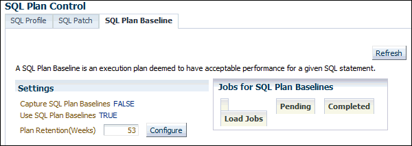
    [Description of the illustration sql_plan_control.gif](img_text/sql_plan_control.md)

4.  Under Settings, click the link next to Capture SQL Plan Baselines.

    The Initialization Parameters page appears.

5.  In the Value column of the table, select TRUE and then click OK.

    You are returned to the SQL Plan Baseline subpage, which now shows Capture SQL Baselines set to `TRUE`.

    Because you configured baselines to be automatically captured, the database will create a SQL plan baseline for all SQL statements executed more than once and adds the current execution plan for the statement to the SQL plan baseline as the first accepted plan.

#### 12.4.2 Loading SQL Plan Baselines Manually

You can manually load existing plans into a SQL plan baseline. You can load plans from a SQL tuning set (STS) or you can load selected plans from the cursor cache.

To load SQL execution plans manually, the Capture SQL Baselines setting must be FALSE.

##### To manually load SQL execution plans:

1.  Access the Database Home page.

2.  Select Performance, then SQL, and then SQL Plan Control.

    The SQL Profile subpage of the SQL Plan Control page appears.

3.  Click SQL Plan Baseline.

    The SQL Plan Baseline subpage appears.

4.  Click Load.

    The SQL Plan Control page appears.

    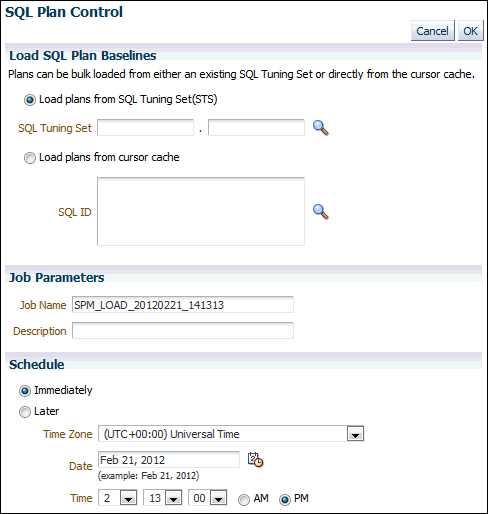
    [Description of the illustration sql_plan_load.gif](img_text/sql_plan_load.md)

5.  Select the SQL plan baselines to be loaded by completing the following steps:

    1.  Under Load SQL Plan Baselines, select Load plans from SQL Tuning Set (STS).

        In this example, load plans from the SQL tuning set that you created in "Creating a SQL Tuning Set".

    2.  In Job Name, enter a name for the job. For example, enter `SPM_LOAD_TEST`.

    3.  Under Schedule, select Immediately.

    4.  Click OK.

    The SQL Plan Control page reappears.

    The table displays a list of SQL plans that are stored as SQL plan baselines.

    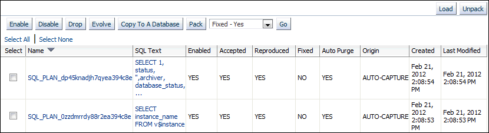
    [Description of the illustration sql_baselines.gif](img_text/sql_baselines.md)

6.  Optionally, fix the execution plan of a baseline to prevent the database from using an alternative SQL plan baseline. Complete the following steps:

    1.  Select a SQL plan baseline that is not fixed.

    2.  Select Fixed - Yes from the list preceding the baseline table.

    3.  Click Go.

    The table is refreshed to show the SQL execution plan with the value `YES` in the Fixed column of the table.

**See Also:**

- Cloud Control context-sensitive online help to learn about the other options on the SQL Plan Baseline subpage

#### 12.4.3 Evolving SQL Plans

A SQL plan baseline for a SQL statement usually starts with a single accepted plan. However, some SQL statements perform well when executed with different plans under different conditions. For example, a SQL statement with bind variables whose values result in different selectivities may have several good plans. Creating a materialized view or an index or repartitioning a table may make current plans more expensive than other plans.

If new plans were never added to SQL plan baselines, then the performance of some SQL statements might degrade. Thus, it is sometimes necessary to evolve newly found plans to see if they should be added to SQL plan baselines. Plan evolution prevents performance regressions by verifying the performance of a new plan before including it in a SQL plan baseline.

Plan evolution consists of the following distinct steps:

1.  Verifying that unaccepted plans perform at least as well as accepted plans in a SQL plan baseline.

2.  Adding unaccepted plans in the plan history to the plan baseline as accepted plans when they have been proven to perform as well as previously accepted plans.

You can evolve a plan manually or you can use the SQL Plan Management (SPM) Evolve Advisor.

By default, the SPM Evolve Advisor runs daily in the scheduled maintenance window. It ranks all unaccepted plans, and then performs test executions of as many plans as possible during the window. The evolve advisor selects the lowest-cost accepted plan in the SQL plan baseline to compare against each unaccepted plan. If a plan performs sufficiently better than the existing accepted plan, then the database automatically accepts it.

**See Also:**

- [Oracle Database SQL Tuning Guide](../tgsql/managing-sql-plan-baselines.md) for more information on configuring SPM Evolve Advisor and on running it manually by using APIs

##### To evolve plans manually:

1.  Access the Database Home page.

    See "[Accessing the Database Home Page](introduction.md)" for more information.

2.  Select Performance, then SQL, and then SQL Plan Control.

    If the Database Login page appears, then log in as a user with administrator privileges. The SQL Profile subpage of the SQL Plan Control page appears.

3.  Click SQL Plan Baseline.

    The SQL Plan Baseline subpage appears.

4.  In the table, select one or more SQL plans that have No in the Accepted column and then click Evolve.

    The Evolve SQL Plan Baselines page appears.

5.  Specify the options to perform.

    - For Verify Performance, select one of the following:

      - Select Yes to have the database verify that the plan performs as good as or better than the current baseline plan.

      - Select No to automatically evolve the plan regardless of how it performs.

    - For Time Limit, select one of the following:

      - Auto to have the database determine how long to spend verifying the performance of the unaccepted plan.

      - Unlimited to run the verification to completion regardless of how long it takes.

      - Specify to specify a time limit for the verification process. Enter a value in minutes in the associated field.

    - For Action, select one of the following:

      - Report and Accept to have the database accept the plan and create a report.

      - Report Only to have the database create a report but not accept the plan.

    Click OK to implement the options.

    A report appears. After viewing the report, click Return to return to the SQL Plan Baseline subpage.
