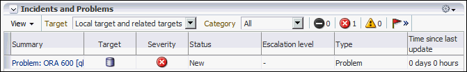
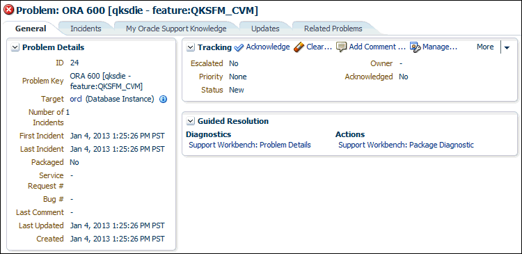
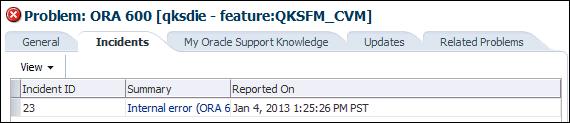
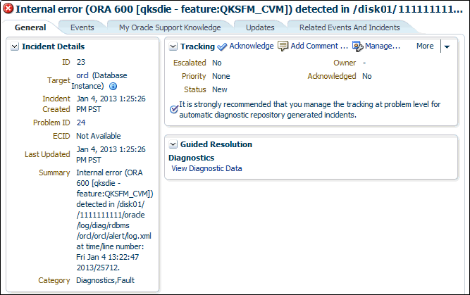
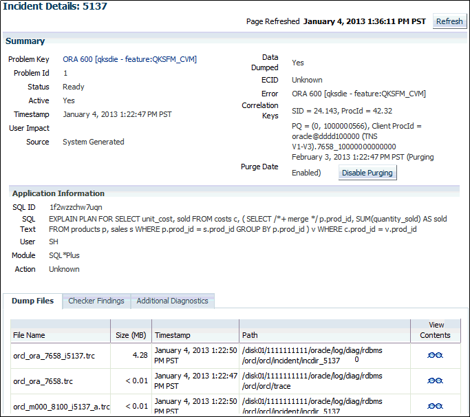
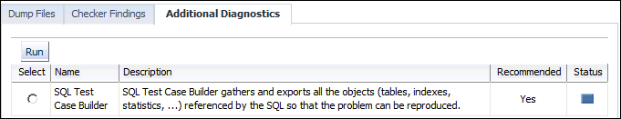
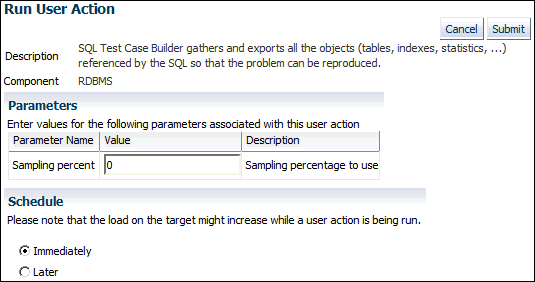
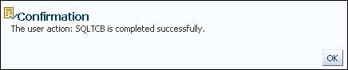

## 22 Gathering Diagnostic Data with SQL Test Case Builder

**SQL Test Case Builder** is a tool that automatically gathers information needed to reproduce the problem in a different database instance.

A **SQL test case** is a set of information that enables a developer to reproduce the execution plan for a specific SQL statement that has encountered a performance problem.

This chapter contains the following topics:

### Purpose of SQL Test Case Builder

SQL Test Case Builder automates the process of gathering and reproducing information about a problem and the environment in which it occurred.

For most SQL components, obtaining a reproducible test case is the most important factor in bug resolution speed. It is also the longest and most painful step for users. The goal of SQL Test Case Builder is to gather as much as information related to an SQL incident as possible, and then package it in a way that enables Oracle staff to reproduce the problem on a different system.

The output of SQL Test Case Builder is a set of scripts in a predefined directory. These scripts contain the commands required to re-create all the necessary objects and the environment on another database instance. After the test case is ready, you can create a zip file of the directory and move it to another database, or upload the file to Oracle Support.

### Concepts for SQL Test Case Builder

Key concepts for SQL Test Case Builder include SQL incidents, types of information recorded, and the form of the output.

This section contains the following topics:

#### SQL Incidents

In the fault diagnosability infrastructure of Oracle Database, an **incident** is a single occurrence of a problem.

A SQL incident is a SQL-related problem. When a problem (critical error) occurs multiple times, the database creates an incident for each occurrence. Incidents are timestamped and tracked in the Automatic Diagnostic Repository (ADR). Each incident has a numeric incident ID, which is unique within the ADR.

SQL Test Case Builder is accessible any time on the command line. In Oracle Enterprise Manager Cloud Control (Cloud Control), the SQL Test Case pages are only available after a SQL incident is found.

#### What SQL Test Case Builder Captures

SQL Test Case Builder captures permanent information about a SQL query and its environment.

The information includes the query being executed, table and index definitions (but not the actual data), PL/SQL packages and program units, optimizer statistics, SQL plan baselines, and initialization parameter settings. Starting with Oracle Database 12c, SQL Test Case Builder also captures and replays transient information, including information only available as part of statement execution.

SQL Test Case Builder supports the following:

- Adaptive plans

  SQL Test Case Builder captures inputs to the decisions made regarding adaptive plans, and replays them at each decision point. For adaptive plans, the final statistics value at each buffering statistics collector is sufficient to decide on the final plan.

- Automatic memory management

  The database automatically handles the memory requested for each SQL operation. Actions such as sorting can affect performance significantly. SQL Test Case Builder keeps track of the memory activities, for example, where the database allocated memory and how much it allocated.

- Dynamic statistics

  Dynamic statistics is an optimization technique in which the database executes a recursive SQL statement to scan a small random sample of a table's blocks to estimate predicate selectivities. Regathering dynamic statistics on a different database does not always generate the same results, for example, when data is missing. To reproduce the problem, SQL Test Case Builder exports the dynamic statistics result from the source database. In the testing database, SQL Test Case Builder reuses the same values captured from the source database instead of regathering dynamic statistics.

- Multiple execution support

  SQL Test Case Builder can capture dynamic information accumulated during multiple executions of the query. This capability is important for automatic reoptimization.

- Compilation environment and bind values replay

  The compilation environment setting is an important part of the query optimization context. SQL Test Case Builder captures nondefault settings altered by the user when running the problem query in the source database. If any nondefault parameter values are used, SQL Test Case Builder re-establishes the same values before running the query.

- Object statistics history

  The statistics history for objects is helpful to determine whether a plan change was caused by a change in statistics values. `DBMS_STATS` stores the history in the data dictionary. SQL Test Case Builder stores this statistics data into a staging table during export. During import, SQL Test Case Builder automatically reloads the statistics history data into the target database from the staging table.

- Statement history

  The statement history is important for diagnosing problems related to adaptive cursor sharing, statistics feedback, and cursor sharing bugs. The history includes execution plans and compilation and execution statistics.

**See Also:**

- [Oracle Database SQL Tuning Guide](introduction-to-sql-tuning.md) for more information about adaptive query plans, supplemental dynamic statistics, automatic reoptimization, and SQL plan baselines

- [Oracle Database PL/SQL Packages and Types Reference](../arpls/DBMS_STATS.md) to learn about the `DBMS_STATS` package

#### Output of SQL Test Case Builder

The output of SQL Test Case Builder is a set of files that contains commands required to re-create the environment and all necessary objects.

By default, SQL Test Case Builder stores the files in the following directory, where incnum refers to the incident number and runnum refers to the run number:

    $ADR_HOME/incident/incdir_incnum/SQLTCB_runnum

For example, a valid output file name could be as follows:

    $ORACLE_HOME/log/diag/rdbms/dbsa/dbsa/incident/incdir_2657/SQLTCB_1

You can also specify a particular directory for storing the SQL Test Case Builder files by creating a directory object with the name `SQL_TCB_DIR` and running the procedure `DBMS_SQLDIAG.EXPORT_SQL_TESTCASE` as shown in the following example:

    CREATE OR REPLACE DIRECTORY SQL_TCB_DIR '/tmp';

    DECLARE
    tc CLOB;
    BEGIN
      DBMS_SQLDIAG.EXPORT_SQL_TESTCASE (
        directory => 'SQL_TCB_DIR',
        sql_text  => 'select * from hr_table',
        testcase  => tc);
    END;

**Note:**

The database administrator must have read and write access permissions to the operating system directory specified in the directory object `SQL_TCB_DIR`.

You can also specify a name for a test case using the `testcase_name` parameter of the `DBMS_SQLDIAG.EXPORT_SQL_TESTCASE` procedure. A test case name is used as a prefix for all the files generated by SQL Test Case Builder.

If you do not specify a test case name, then a default test case name having the following format is used by SQL Test Case Builder:

    oratcb_connectionId_sqlId_sequenceNumber_sessionId

Here, connectionId is the database connection ID, sqlId is the SQL statement ID, sequenceNumber is the internal sequence number, and sessionId is the database session ID.

You can also specify any additional information to include in the output of SQL Test Case Builder using the `ctrlOptions` parameter of the `DBMS_SQLDIAG.EXPORT_SQL_TESTCASE` procedure. The following are some of the options that you can specify in the `ctrlOptions` parameter:

- `compress`: This option is used to compress the SQL Test Case Builder output files into a zip file.

- `diag_event`: This option is used to specify the level of trace information to include in the SQL Test Case Builder output.

- `problem_type`: This option is used to assign an issue type for a SQL Test Case Builder test case. For example, if a test case is related to performance regression issue, then you can assign the value of `PERFORMANCE` to the `problem_type` option.

You can view the information about all the test cases generated by SQL Test Case Builder by querying the `V$SQL_TESTCASES` view as shown in the following example:

    select testcase_name, sql_text from v$sql_testcases;

    TESTCASE_NAME                           SQL_TEXT
    -------------------------------------   ----------------------
    oratcb_0_am8q8kudm02v9_1_00244CC50001   select * from hr_table

**Note:**

The `V$SQL_TESTCASES` view requires the existence of a SQL Test Case Builder root directory object named `SQL_TCB_DIR`. In Oracle Autonomous Database environments, this directory object is created automatically on each POD during provisioning. For on-premises databases, you must explicitly create the SQL Test Case Builder root directory object `SQL_TCB_DIR`, otherwise the `V$SQL_TESTCASES` view will not display any information. The database administrator must have read and write access permissions to the operating system directory specified in the directory object `SQL_TCB_DIR`.

**See Also:**

- [Oracle Database PL/SQL Packages and Types Reference](../arpls/DBMS_SQLDIAG.md) for more information about the `DBMS_SQLDIAG.EXPORT_SQL_TESTCASE` procedure

- [Oracle Database Reference](../refrn/V-SQL_TESTCASES.md) for more information about the `V$SQL_TESTCASES` view

### User Interfaces for SQL Test Case Builder

You can access SQL Test Case Builder either through Cloud Control or using PL/SQL on the command line.

This section contains the following topics:

#### Graphical Interface for SQL Test Case Builder

Within Cloud Control, you can access SQL Test Case Builder from the Incident Manager page or the Support Workbench page.

This section contains the following topics:

##### Accessing the Incident Manager

From the Incidents and Problems section on the Database Home page, you can navigate to the Incident Manager.

##### To access the Incident Manager:

1.  Log in to Cloud Control with the appropriate credentials.

2.  Under the Targets menu, select Databases.

3.  In the list of database targets, select the target for the Oracle Database instance that you want to administer.

4.  If prompted for database credentials, then enter the minimum credentials necessary for the tasks you intend to perform.

5.  In the Incidents and Problems section, locate the SQL incident to be investigated.

    In the following example, the `ORA 600` error is a SQL incident.

    
    [Description of the illustration incidents_and_problems.gif](img_text/incidents_and_problems.md)

6.  Click the summary of the incident.

    The Problem Details page of the Incident Manager appears.

    
    [Description of the illustration problem_details.gif](img_text/problem_details.md)
    The Support Workbench page appears, with the incidents listed in a table.

##### Accessing the Support Workbench

From the Oracle Database menu, you can navigate to the Support Workbench.

##### To access the Support Workbench:

1.  Log in to Cloud Control with the appropriate credentials.

2.  Under the Targets menu, select Databases.

3.  In the list of database targets, select the target for the Oracle Database instance that you want to administer.

4.  If prompted for database credentials, then enter the minimum credentials necessary for the tasks you intend to perform.

5.  From the Oracle Database menu, select Diagnostics, then Support Workbench.

    The Support Workbench page appears, with the incidents listed in a table.

#### Command-Line Interface for SQL Test Case Builder

The `DBMS_SQLDIAG` package performs tasks relating to SQL Test Case Builder.

This package consists of various subprograms for the SQL Test Case Builder, some of which are listed in the following table.

Table 22-1 SQL Test Case Functions in the DBMS_SQLDIAG Package

| Procedure                        | Description                                                                    |
|:---------------------------------|:-------------------------------------------------------------------------------|
| `EXPORT_SQL_TESTCASE`            | Exports a SQL test case to a user-specified directory                          |
| `EXPORT_SQL_TESTCASE_DIR_BY_INC` | Exports a SQL test case corresponding to the incident ID passed as an argument |
| `EXPORT_SQL_TESTCASE_DIR_BY_TXT` | Exports a SQL test case corresponding to the SQL text passed as an argument    |
| `IMPORT_SQL_TESTCASE`            | Imports a SQL test case into a schema                                          |
| `REPLAY_SQL_TESTCASE`            | Automates reproduction of a SQL test case                                      |
| `EXPLAIN_SQL_TESTCASE`           | Explains a SQL test case                                                       |

**See Also:**

[Oracle Database PL/SQL Packages and Types Reference](../arpls/DBMS_SQLDIAG.md) to learn more about the `DBMS_SQLDIAG` package

### Running SQL Test Case Builder

You can run SQL Test Case Builder using Cloud Control.

#### Assumptions

This tutorial assumes the following:

- You ran the following `EXPLAIN PLAN` statement as user `sh`, which causes an internal error:

      EXPLAIN PLAN FOR
        SELECT unit_cost, sold
        FROM   costs c,
               ( SELECT /*+ merge */ p.prod_id, SUM(quantity_sold) AS sold
                 FROM   products p, sales s
                 WHERE  p.prod_id = s.prod_id
                 GROUP BY p.prod_id ) v
        WHERE  c.prod_id = v.prod_id;

- In the Incidents and Problems section on the Database Home page, a SQL incident generated by the internal error appears.

- You access the Incident Details page, as explained in "Accessing the Incident Manager".

#### To run SQL Test Case Builder:

1.  Click the Incidents tab.

    The Problem Details page appears.

    
    [Description of the illustration problem_details_summary.gif](img_text/problem_details_summary.md)

2.  Click the summary for the incident.

    The Incident Details page appears.

    
    [Description of the illustration incident_details.gif](img_text/incident_details.md)

3.  In Guided Resolution, click View Diagnostic Data.

    The Incident Details: incident_number page appears.

    
    [Description of the illustration incident_details_num.gif](img_text/incident_details_num.md)

4.  In the Application Information section, click Additional Diagnostics.

    The Additional Diagnostics subpage appears.

    
    [Description of the illustration additional_diagnostics.gif](img_text/additional_diagnostics.md)

5.  Select SQL Test Case Builder, and then click Run.

    The Run User Action page appears.

    
    [Description of the illustration run_user_action.gif](img_text/run_user_action.md)

6.  Select a sampling percentage (optional), and then click Submit.

    After processing completes, the Confirmation page appears.

    
    [Description of the illustration sqltcb_confirmation.gif](img_text/sqltcb_confirmation.md)

7.  Access the SQL Test Case files in the location described in "Output of SQL Test Case Builder".
