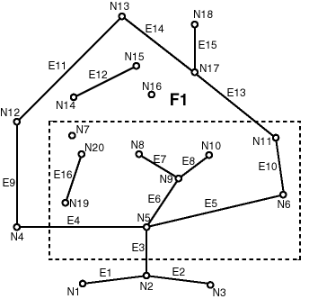

## 4  SDO_TOPO_MAP Package Subprograms

The MDSYS.SDO_TOPO_MAP package contains subprograms (functions and procedures) that constitute part of the PL/SQL application programming interface (API) for the Spatial and Graph Topology Data Model feature.

This package contains subprograms related to editing topologies. These subprograms use a TopoMap object, either one that you previously created or that Spatial and Graph creates implicitly.

To use the subprograms in this chapter, you must understand the conceptual information about topology in [Topology Data Model Overview](topology-data-model-overview.md), as well as the information about editing topologies in [Editing Topologies](editing-topologies.md) .

**Note:**

SDO_TOPO_MAP subprograms are supported only if Oracle JVM is enabled on your Oracle Autonomous Database Serverless deployments. To enable Oracle JVM, see [Use Oracle Java](http://www.oracle.com/pls/topic/lookup?ctx=en/cloud/paas/autonomous-database&id=GUID-2516EE33-B38D-4270-BE52-30A4F9014E8B) in Using Oracle Autonomous Database Serverless for more information.

The rest of this chapter provides reference information about the SDO_TOPO_MAP subprograms, listed in alphabetical order.

- SDO_TOPO_MAP.ADD_EDGE
- SDO_TOPO_MAP.ADD_ISOLATED_NODE
- SDO_TOPO_MAP.ADD_LINEAR_GEOMETRY
- SDO_TOPO_MAP.ADD_LOOP
- SDO_TOPO_MAP.ADD_NODE
- SDO_TOPO_MAP.ADD_POINT_GEOMETRY
- SDO_TOPO_MAP.ADD_POLYGON_GEOMETRY
- SDO_TOPO_MAP.CHANGE_EDGE_COORDS
- SDO_TOPO_MAP.CLEAR_TOPO_MAP
- SDO_TOPO_MAP.COMMIT_TOPO_MAP
- SDO_TOPO_MAP.CREATE_EDGE_INDEX
- SDO_TOPO_MAP.CREATE_FACE_INDEX
- SDO_TOPO_MAP.CREATE_FEATURE
- SDO_TOPO_MAP.CREATE_TOPO_MAP
- SDO_TOPO_MAP.DROP_TOPO_MAP
- SDO_TOPO_MAP.GET_CONTAINING_FACE
- SDO_TOPO_MAP.GET_EDGE_ADDITIONS
- SDO_TOPO_MAP.GET_EDGE_CHANGES
- SDO_TOPO_MAP.GET_EDGE_COORDS
- SDO_TOPO_MAP.GET_EDGE_DELETIONS
- SDO_TOPO_MAP.GET_EDGE_NODES
- SDO_TOPO_MAP.GET_FACE_ADDITIONS
- SDO_TOPO_MAP.GET_FACE_CHANGES
- SDO_TOPO_MAP.GET_FACE_BOUNDARY
- SDO_TOPO_MAP.GET_FACE_DELETIONS
- SDO_TOPO_MAP.GET_NEAREST_EDGE
- SDO_TOPO_MAP.GET_NEAREST_EDGE_IN_CACHE
- SDO_TOPO_MAP.GET_NEAREST_NODE
- SDO_TOPO_MAP.GET_NEAREST_NODE_IN_CACHE
- SDO_TOPO_MAP.GET_NODE_ADDITIONS
- SDO_TOPO_MAP.GET_NODE_CHANGES
- SDO_TOPO_MAP.GET_NODE_COORD
- SDO_TOPO_MAP.GET_NODE_DELETIONS
- SDO_TOPO_MAP.GET_NODE_FACE_STAR
- SDO_TOPO_MAP.GET_NODE_STAR
- SDO_TOPO_MAP.GET_TOPO_NAME
- SDO_TOPO_MAP.GET_TOPO_TRANSACTION_ID
- SDO_TOPO_MAP.LIST_TOPO_MAPS
- SDO_TOPO_MAP.LOAD_TOPO_MAP
- SDO_TOPO_MAP.MOVE_EDGE
- SDO_TOPO_MAP.MOVE_ISOLATED_NODE
- SDO_TOPO_MAP.MOVE_NODE
- SDO_TOPO_MAP.REMOVE_EDGE
- SDO_TOPO_MAP.REMOVE_NODE
- SDO_TOPO_MAP.REMOVE_OBSOLETE_NODES
- SDO_TOPO_MAP.ROLLBACK_TOPO_MAP
- SDO_TOPO_MAP.SEARCH_EDGE_RTREE_TOPO_MAP
- SDO_TOPO_MAP.SEARCH_FACE_RTREE_TOPO_MAP
- SDO_TOPO_MAP.SET_MAX_MEMORY_SIZE
- SDO_TOPO_MAP.UPDATE_TOPO_MAP
- SDO_TOPO_MAP.VALIDATE_TOPO_MAP
- SDO_TOPO_MAP.VALIDATE_TOPOLOGY

**Parent topic:** [Topology Data Model](topology-data-model.md)

### 4.1 SDO_TOPO_MAP.ADD_EDGE

#### Format

    SDO_TOPO_MAP.ADD_EDGE(     
      topology IN VARCHAR2,      
      node_id1 IN NUMBER,      
      node_id2 IN NUMBER,      
      geom     IN SDO_GEOMETRY      
    ) RETURN NUMBER;

#### Description

Adds an edge to a topology, and returns the edge ID of the added edge.

#### Parameters

topology
Name of the topology to which to add the edge, or null if you are using an updatable TopoMap object (see [Specifying the Editing Approach with the Topology Parameter](editing-topologies.md)). Must not exceed 20 characters.

node_id1
Node ID of the start node for the edge to be added.

node_id2
Node ID of the end node for the edge to be added.

geom
SDO_GEOMETRY object (line or contiguous line string geometry) representing the edge to be added.

#### Usage Notes

Spatial and Graph automatically assigns an edge ID to the added edge. If `topology` is not null, the appropriate entry is inserted in the \<topology-name\>\_EDGE\$ table; and if the addition of the edge affects the face information table, the appropriate entries in the \<topology-name\>\_FACE\$ table are updated. (If `topology` is null, you can update these tables at any time by calling the SDO_TOPO_MAP.UPDATE_TOPO_MAP procedure.)

If `node_id1` and `node_id2` are the same value, a loop edge is created.

For information about adding and deleting nodes and edges, see [Editing Topologies](editing-topologies.md) .

This function is equivalent to using the `addEdge` method of the `TopoMap` class of the client-side Java API (described in [Topology Data Model Java Interface](topology-data-model-overview.md)).

#### Examples

The following example adds an edge connecting node N3 to node N4 in the current updatable TopoMap object. (The example refers to definitions and data from [Topology Built from Topology Data](topology-data-model-overview.md).)

    CALL SDO_TOPO_MAP.ADD_EDGE(null, 3, 4,
      SDO_GEOMETRY(2002, NULL, NULL, SDO_ELEM_INFO_ARRAY(1, 2, 1),
        SDO_ORDINATE_ARRAY(25,35, 20,37)))
      INTO :res_number;

    Call completed.

    SQL> PRINT res_number;

    RES_NUMBER
    ----------
            29

**Parent topic:** SDO_TOPO_MAP Package Subprograms

### 4.2 SDO_TOPO_MAP.ADD_ISOLATED_NODE

#### Format

    SDO_TOPO_MAP.ADD_ISOLATED_NODE(     
      topology IN VARCHAR2,      
      face_id  IN NUMBER,      
      point    IN SDO_GEOMETRY      
    ) RETURN NUMBER;

or

    SDO_TOPO_MAP.ADD_ISOLATED_NODE(     
      topology IN VARCHAR2,      
      point    IN SDO_GEOMETRY      
    ) RETURN NUMBER;

or

    SDO_TOPO_MAP.ADD_ISOLATED_NODE(     
    topology IN VARCHAR2,      
    face_id  IN NUMBER,      
    x        IN NUMBER,      
    y        IN NUMBER      
    ) RETURN NUMBER;

or

    SDO_TOPO_MAP.ADD_ISOLATED_NODE(     
    topology IN VARCHAR2,      
    x        IN NUMBER,      
    y        IN NUMBER      
    ) RETURN NUMBER;

#### Description

Adds an isolated node (that is, an island node) to a topology, and returns the node ID of the added isolated node.

#### Parameters

topology
Name of the topology to which to add the isolated node, or null if you are using an updatable TopoMap object (see [Specifying the Editing Approach with the Topology Parameter](editing-topologies.md)). Must not exceed 20 characters.

face_id
Face ID of the face on which the isolated node is to be added. (An exception is raised if the specified point is not on the specified face.)

point
SDO_GEOMETRY object (point geometry) representing the isolated node to be added.

x
X-axis value of the point representing the isolated node to be added.

y
Y-axis value of the point representing the isolated node to be added.

#### Usage Notes

Spatial and Graph automatically assigns a node ID to the added node. If `topology` is not null, the appropriate entry is inserted in the \<topology-name\>\_NODE\$ table, and the \<topology-name\>\_FACE\$ table is updated to include an entry for the added isolated node. (If `topology` is null, you can update these tables at any time by calling the SDO_TOPO_MAP.UPDATE_TOPO_MAP procedure.)

If you know the ID of the face on which the isolated node is to be added, you can specify the `face_id` parameter. If you specify this parameter, there are two benefits:

- Validation: The function checks to see if the point is on the specified face, and raises an exception if it is not. Otherwise, the function checks to see if the point is on any face in the topology, and raises an exception if it is not.

- Performance: The function checks only if the point is on the specified face. Otherwise, it checks potentially all faces in the topology to see if the point is on any face.

To add a non-isolated node, use the SDO_TOPO_MAP.ADD_NODE function.

For information about adding and deleting nodes and edges, see [Editing Topologies](editing-topologies.md) .

This function is equivalent to using the `addIsolatedNode` method of the `TopoMap` class of the client-side Java API (described in [Topology Data Model Java Interface](topology-data-model-overview.md)).

#### Examples

The following example adds an isolated node to the right of isolated node N4 on face F2, and it returns the node ID of the added node. It uses the current updatable TopoMap object. (The example refers to definitions and data from [Topology Built from Topology Data](topology-data-model-overview.md).)

    DECLARE
      result_num NUMBER;
    BEGIN
    result_num := SDO_TOPO_MAP.ADD_ISOLATED_NODE(null, 2,
      SDO_GEOMETRY(2001, NULL, SDO_POINT_TYPE(22,37,NULL), NULL, NULL));
    DBMS_OUTPUT.PUT_LINE('Result = ' || result_num);
    END;
    /
    Result = 24

    PL/SQL procedure successfully completed.

**Parent topic:** SDO_TOPO_MAP Package Subprograms

### 4.3 SDO_TOPO_MAP.ADD_LINEAR_GEOMETRY

#### Format

    SDO_TOPO_MAP.ADD_LINEAR_GEOMETRY(     
      topology IN VARCHAR2,      
      curve    IN SDO_GEOMETRY      
    ) RETURN SDO_NUMBER_ARRAY;

or

    SDO_TOPO_MAP.ADD_LINEAR_GEOMETRY(     
      topology IN VARCHAR2,      
      coords   IN SDO_NUMBER_ARRAY      
    ) RETURN SDO_NUMBER_ARRAY;

#### Description

Adds a linear (line string or multiline string) geometry to the topology, inserting edges and nodes as necessary based on the full intersection of the geometry with the edges and nodes in the topology graph, and an array of the edge IDs of the inserted and shared edges in sequence from the start to the end of the geometry.

#### Parameters

topology
Name of the topology to which to add the edge or edges, or null if you are using an updatable TopoMap object (see [Specifying the Editing Approach with the Topology Parameter](editing-topologies.md)). Must not exceed 20 characters.

curve
SDO_GEOMETRY object (curve or line string geometry) representing the edge or edges to be added.

coords
SDO_NUMBER_ARRAY object specifying the coordinates of the edge or edges to be added.

#### Usage Notes

This function creates at least one new edge, and more edges if necessary. For example, if the line string geometry intersects an existing edge, two edges are created for the added line string, and the existing edge (the one being intersected) is divided into two edges. If `topology` is not null, Spatial and Graph automatically updates the \<topology-name\>\_EDGE\$ table as needed. (If `topology` is null, you can update this table at any time by calling the SDO_TOPO_MAP.UPDATE_TOPO_MAP procedure.)

This function returns an array of the edge IDs of the inserted and shared edges in sequence from the start to the end of the geometry. If a segment in the added geometry overlaps an existing edge in the topology, the sign of the returned edge depends on the directions of the added segment and the existing edge: if the direction of the existing edge is the same as the linear geometry, the returned edge element is positive; if the direction of the existing edge is the opposite of the linear geometry, the returned edge element is negative.

An exception is raised if the object in the `curve` or `coords` parameter contains any line segments that run together (overlap) in any manner; however, the line segments can cross at one or more points.

For information about adding and deleting nodes and edges, see [Editing Topologies](editing-topologies.md) .

This function is equivalent to using the `addLinearGeometry` method of the `TopoMap` class of the client-side Java API (described in [Topology Data Model Java Interface](topology-data-model-overview.md)).

#### Examples

The following example adds an edge representing a specified line string geometry, and it returns the edge ID of the added edge. It uses the current updatable TopoMap object. (The example refers to definitions and data from [Topology Built from Topology Data](topology-data-model-overview.md).)

    SELECT SDO_TOPO_MAP.ADD_LINEAR_GEOMETRY(null,
      SDO_GEOMETRY(2002, NULL, NULL, SDO_ELEM_INFO_ARRAY(1,2,1),
        SDO_ORDINATE_ARRAY(50,10, 55,10, 57,11)))
    FROM DUAL;

    SDO_TOPO_MAP.ADD_LINEAR_GEOMETRY(NULL,SDO_GEOMETRY(2002,NULL,NULL,SDO_ELEM_INFO_
    --------------------------------------------------------------------------------
    SDO_NUMBER_ARRAY(31)

**Parent topic:** SDO_TOPO_MAP Package Subprograms

### 4.4 SDO_TOPO_MAP.ADD_LOOP

#### Format

    SDO_TOPO_MAP.ADD_LOOP(     
      topology  IN VARCHAR2,      
      node_id   IN NUMBER,      
      geom      IN SDO_GEOMETRY      
    ) RETURN NUMBER;

#### Description

Adds an edge that loops and connects to the same node, and returns the edge ID of the added edge.

#### Parameters

topology
Name of the topology to which to add the edge, or null if you are using an updatable TopoMap object (see [Specifying the Editing Approach with the Topology Parameter](editing-topologies.md)). Must not exceed 20 characters.

node_id
Node ID of the node to which to add the edge that will start and end at this node.

geom
SDO_GEOMETRY object (line string geometry) representing the edge to be added. The start and end points of the line string must be the same point representing `node_id`.

#### Usage Notes

This function creates a new edge, as well as a new face consisting of the interior of the loop. If the edge is added at an isolated node, the edge is an isolated edge. If `topology` is not null, Spatial and Graph automatically updates the \<topology-name\>\_EDGE\$ and \<topology-name\>\_FACE\$ tables as needed. (If `topology` is null, you can update these tables at any time by calling the SDO_TOPO_MAP.UPDATE_TOPO_MAP procedure.)

For information about adding and deleting nodes and edges, see [Editing Topologies](editing-topologies.md) .

This function is equivalent to using the `addLoop` method of the `TopoMap` class of the client-side Java API (described in [Topology Data Model Java Interface](topology-data-model-overview.md)).

#### Examples

The following example adds an edge loop starting and ending at node N4, and it returns the edge ID of the added edge. It uses the current updatable TopoMap object. (The example refers to definitions and data from [Topology Built from Topology Data](topology-data-model-overview.md).)

    CALL SDO_TOPO_MAP.ADD_LOOP(null, 4,
      SDO_GEOMETRY(2002, NULL, NULL, SDO_ELEM_INFO_ARRAY(1, 2, 1),
        SDO_ORDINATE_ARRAY(20,37, 20,39, 25,39, 20,37)))
      INTO :res_number;

    Call completed.

    SQL> PRINT res_number;

    RES_NUMBER
    ----------
            30

**Parent topic:** SDO_TOPO_MAP Package Subprograms

### 4.5 SDO_TOPO_MAP.ADD_NODE

#### Format

    SDO_TOPO_MAP.ADD_NODE(     
      topology           IN VARCHAR2,      
      edge_id            IN NUMBER,      
      point              IN SDO_GEOMETRY,      
      coord_index        IN NUMBER,      
      is_new_shape_point IN VARCHAR2      
    ) RETURN NUMBER;

or

    SDO_TOPO_MAP.ADD_NODE(     
      topology           IN VARCHAR2,      
      edge_id            IN NUMBER,      
      x                  IN NUMBER,      
      y                  IN NUMBER,      
      coord_index        IN NUMBER,      
      is_new_shape_point IN VARCHAR2      
    ) RETURN NUMBER;

#### Description

Adds a non-isolated node to a topology to split an existing edge, and returns the node ID of the added node.

#### Parameters

topology
Name of the topology to which to add the node, or null if you are using an updatable TopoMap object (see [Specifying the Editing Approach with the Topology Parameter](editing-topologies.md)). Must not exceed 20 characters.

edge_id
Edge ID of the edge on which the node is to be added.

point
SDO_GEOMETRY object (point geometry) representing the node to be added. The point must be an existing shape point or a new point that breaks a line segment connecting two consecutive shape points.

x
X-axis value of the point representing the node to be added. The point must be an existing shape point or a new point that breaks a line segment connecting two consecutive shape points.

y
Y-axis value of the point representing the node to be added. The point must be an existing shape point or a new point that breaks a line segment connecting two consecutive shape points.

coord_index
The index (position) of the array position in the edge coordinate array on or after which the node is to be added. Each vertex (node or shape point) has a position in the edge coordinate array. The start point (node) is index (position) 0, the first point after the start point is 1, and so on. (However, the `coord_index` value cannot be the index of the last vertex.) For example, if the edge coordinates are (2,2, 5,2, 8,3) the index of the second vertex (5,2) is 1.

is_new_shape_point
`TRUE` if the added node is to be a new shape point following the indexed vertex (`coord_index` value) of the edge; `FALSE` if the added node is exactly on the indexed vertex.

A value of `TRUE` lets you add a node at a new point, breaking an edge segment at the coordinates specified in the `point` parameter or the `x` and `y` parameter pair. A value of `FALSE` causes the coordinates in the `point` parameter or the `x` and `y` parameter pair to be ignored, and causes the node to be added at the existing shape point associated with the `coord_index` value.

#### Usage Notes

Spatial and Graph automatically assigns a node ID to the added node and creates a new edge. The split piece at the beginning of the old edge is given the edge ID of the old edge. If `topology` is not null, appropriate entries are inserted in the \<topology-name\>\_NODE\$ and \<topology-name\>\_EDGE\$ tables. (If `topology` is null, you can update these tables at any time by calling the SDO_TOPO_MAP.UPDATE_TOPO_MAP procedure.)

To add an isolated node (that is, an island node), use the SDO_TOPO_MAP.ADD_ISOLATED_NODE function.

For information about adding and deleting nodes and edges, see [Editing Topologies](editing-topologies.md) .

This function is equivalent to using the `addNode` method of the `TopoMap` class of the client-side Java API (described in [Topology Data Model Java Interface](topology-data-model-overview.md)).

#### Examples

The following example adds a non-isolated node to the right of node N2 on edge E2, and it returns the node ID of the added node. It uses the current updatable TopoMap object. (The example refers to definitions and data from [Topology Built from Topology Data](topology-data-model-overview.md).)

    DECLARE
      result_num NUMBER;
    BEGIN
    result_num := SDO_TOPO_MAP.ADD_NODE(null, 2,
      SDO_GEOMETRY(2001, NULL, SDO_POINT_TYPE(27,30,NULL), NULL, NULL),
      0, 'TRUE');
    DBMS_OUTPUT.PUT_LINE('Result = ' || result_num);
    END;
    /
    Result = 26

    PL/SQL procedure successfully completed.

**Parent topic:** SDO_TOPO_MAP Package Subprograms

### 4.6 SDO_TOPO_MAP.ADD_POINT_GEOMETRY

#### Format

    SDO_TOPO_MAP.ADD_POINT_GEOMETRY(
      topology IN VARCHAR2,      
      point    IN SDO_GEOMETRY      
    ) RETURN NUMBER;

or

    SDO_TOPO_MAP.ADD_POINT_GEOMETRY(
      topology IN VARCHAR2,      
      coord    IN SDO_NUMBER_ARRAY      
    ) RETURN NUMBER;

#### Description

Adds a node representing a specified point geometry or coordinate pair, and returns the node ID of the added node.

#### Parameters

topology
Name of the topology to which to add the node, or null if you are using an updatable TopoMap object (see [Specifying the Editing Approach with the Topology Parameter](editing-topologies.md)). Must not exceed 20 characters.

point
SDO_GEOMETRY object (point geometry) representing the node to be added.

coord
SDO_NUMBER_ARRAY object specifying the coordinates of the node to be added.

#### Usage Notes

If the point coincides with an existing node, no changes are made to the topology. Otherwise, an isolated node or a node splitting an edge is added.

For information about adding and deleting nodes and edges, see [Editing Topologies](editing-topologies.md) .

This function is equivalent to using the `addPointGeometry` method of the `TopoMap` class of the client-side Java API (described in [Topology Data Model Java Interface](topology-data-model-overview.md)).

#### Examples

The following example adds a node representing a specified point geometry, and it returns the node ID of the added node. It uses the current updatable TopoMap object.

    SELECT SDO_TOPO_MAP.ADD_POINT_GEOMETRY(null,
      SDO_GEOMETRY(2001, NULL, SDO_POINT_TYPE(57,12,NULL), NULL, NULL))
    FROM DUAL;

    SDO_TOPO_MAP.ADD_POINT_GEOMETRY(NULL,SDO_GEOMETRY(2001,NULL,SDO_POINT_TYPE(57,12
    --------------------------------------------------------------------------------
                                                                                  29

The following example adds a node at the specified coordinates (58, 12), and it returns the node ID of the added node. It uses the current updatable TopoMap object.

    SELECT SDO_TOPO_MAP.ADD_POINT_GEOMETRY(null, SDO_NUMBER_ARRAY(58,12))
    FROM DUAL;

    SDO_TOPO_MAP.ADD_POINT_GEOMETRY(NULL,SDO_NUMBER_ARRAY(58,12))
    -------------------------------------------------------------
                                                               30

**Parent topic:** SDO_TOPO_MAP Package Subprograms

### 4.7 SDO_TOPO_MAP.ADD_POLYGON_GEOMETRY

#### Format

    SDO_TOPO_MAP.ADD_POLYGON_GEOMETRY(     
      topology  IN VARCHAR2,      
      polygon   IN SDO_GEOMETRY      
    ) RETURN SDO_NUMBER_ARRAY;

or

    SDO_TOPO_MAP.ADD_POLYGON_GEOMETRY(     
      topology  IN VARCHAR2,      
      coords    IN SDO_NUMBER_ARRAY      
    ) RETURN SDO_NUMBER_ARRAY;

#### Description

Adds one or more faces representing a specified polygon geometry, and returns the face ID of each added face.

#### Parameters

topology
Name of the topology to which to add the face or faces, or null if you are using an updatable TopoMap object (see [Specifying the Editing Approach with the Topology Parameter](editing-topologies.md)). Must not exceed 20 characters.

polygon
SDO_GEOMETRY object (polygon or multipolygon geometry) representing the face or faces to be added. Each polygon in the object must have a single exterior ring that can contain any number of interior rings.

coords
SDO_NUMBER_ARRAY object specifying the coordinates of a single polygon geometry representing the face or faces to be added. The vertices of the polygon must be in counterclockwise order, with the last vertex the same as the first vertex.

#### Usage Notes

This function creates at least one new face, and more faces if necessary. For example, if the polygon geometry intersects an existing face, faces are created for the added polygon, and the existing face (the one being intersected) definition is adjusted. If `topology` is not null, Spatial and Graph automatically updates the \<topology-name\>\_FACE\$ table as needed. (If `topology` is null, you can update this table at any time by calling the SDO_TOPO_MAP.UPDATE_TOPO_MAP procedure.)

If the polygon coincides with an existing face, no changes are made to the topology.

For a multipolygon geometry, no exterior ring may overlap any other exterior ring. For example, you cannot add a face representing the following single multipolygon geometry: a park (exterior ring) containing a lake (interior ring) with an island in the lake (exterior ring inside the preceding interior ring).

This function is equivalent to using the `addPolygonGeometry` method of the `TopoMap` class of the client-side Java API (described in [Topology Data Model Java Interface](topology-data-model-overview.md)).

#### Examples

The following example adds a face representing a specified polygon geometry, and it returns and prints the face ID of the added edge. It uses the current updatable TopoMap object.

    DECLARE
      res_number_array SDO_NUMBER_ARRAY;
      face_count NUMBER;
      face_ctr NUMBER;
      this_face NUMBER;
    BEGIN
    res_number_array := SDO_TOPO_MAP.ADD_POLYGON_GEOMETRY(null,
      SDO_GEOMETRY(2003, NULL, NULL, SDO_ELEM_INFO_ARRAY(1,1003,1),
        SDO_ORDINATE_ARRAY(61,10, 70,10, 70,15, 65,15, 61,10)));
    -- DBMS_OUTPUT.PUT_LINE('Result = ' || res_number_array);
    -- Print each face associated with the geometry.
    face_count := res_number_array.count;
    for face_ctr in 1..face_count loop
      this_face := res_number_array(face_ctr);
      dbms_output.put_line ('this face = '|| this_face);
      end loop;  -- printed each face
    END;
    /
    this face = 12

**Parent topic:** SDO_TOPO_MAP Package Subprograms

### 4.8 SDO_TOPO_MAP.CHANGE_EDGE_COORDS

#### Format

    SDO_TOPO_MAP.CHANGE_EDGE_COORDS(     
      topology  IN VARCHAR2,      
      edge_id   IN NUMBER,      
      geom      IN SDO_GEOMETRY);

or

    SDO_TOPO_MAP.CHANGE_EDGE_COORDS(     
      topology         IN VARCHAR2,      
      edge_id          IN NUMBER,      
      geom             IN SDO_GEOMETRY,      
      moved_iso_nodes  OUT SDO_NUMBER_ARRAY,      
      moved_iso_edges  OUT SDO_NUMBER_ARRAY,      
      allow_iso_moves  IN VARCHAR2);

#### Description

Changes the coordinates and related information about an edge.

#### Parameters

topology
Name of the topology containing the edge, or null if you are using an updatable TopoMap object (see [Specifying the Editing Approach with the Topology Parameter](editing-topologies.md)). Must not exceed 20 characters.

edge_id
Edge ID of the edge whose coordinates are to be changed.

geom
SDO_GEOMETRY object (line or contiguous line string geometry) representing the modified edge. The start and end points of the modified edge must be the same as for the original edge.

moved_iso_nodes
Output parameter in which, if the `allow_iso_moves` parameter value is `TRUE`, Spatial and Graph stores the node ID values of any isolated nodes that have moved to a different face as a result of this procedure. If the `allow_iso_moves` parameter value is `FALSE`, Spatial and Graph stores the node ID values of any isolated nodes that did not move but that would have moved to a different face if the `allow_iso_moves` parameter value had been `TRUE`.

moved_iso_edges
Output parameter in which, if the `allow_iso_moves` parameter value is `TRUE`, Spatial and Graph stores the edge ID values of any isolated edges that have moved to a different face as a result of this procedure. If the `allow_iso_moves` parameter value is `FALSE`, Spatial and Graph stores the edge ID values of any isolated edges that did not move but that would have moved to a different face if the `allow_iso_moves` parameter value had been `TRUE`.

allow_iso_moves
`TRUE` causes Spatial and Graph to allow an edge coordinates change operation that would cause any isolated nodes or edges to be in a different face, and to adjust the containing face information for such isolated nodes and edges; `FALSE` causes Spatial and Graph not to allow an edge coordinates change operation that would cause any isolated nodes or edges to be in a different face.

If you use the format that does not include the `allow_iso_moves` parameter, Spatial and Graph allows edge move operations that would cause any isolated nodes or edges to be in a different face, and it adjusts the containing face information for such isolated nodes and edges.

#### Usage Notes

If this procedure modifies a boundary between faces, Spatial and Graph automatically performs the following operations and updates the Topology Data Model tables as needed: reassigning island nodes and faces, and adjusting the MBRs of the faces on both sides.

If `topology` is not null, this procedure modifies the information about the specified edge in the \<topology-name\>\_EDGE\$ table (described in [Edge Information Table](topology-data-model-overview.md)). (If `topology` is null, you can update this table at any time by calling the SDO_TOPO_MAP.UPDATE_TOPO_MAP procedure.)

You cannot use this procedure to change the start point or the end point, or both, of the specified edge. To do any of these operations, you must delete the edge, delete the node or nodes for the start or end point (or both) to be changed, add the necessary new node or nodes, and add the edge.

For information about editing topological elements, see [Editing Topologies](editing-topologies.md) .

This procedure is equivalent to using the `changeEdgeCoords` method of the `TopoMap` class of the client-side Java API (described in [Topology Data Model Java Interface](topology-data-model-overview.md)).

#### Examples

The following example changes the coordinates of edge E1. (It changes only the third point, from 16,38 to 16,39.) It uses the current updatable TopoMap object. (The example refers to definitions and data from [Topology Built from Topology Data](topology-data-model-overview.md).)

    CALL SDO_TOPO_MAP.CHANGE_EDGE_COORDS(null, 1,
      SDO_GEOMETRY(2002, NULL, NULL, SDO_ELEM_INFO_ARRAY(1, 2, 1),
        SDO_ORDINATE_ARRAY(8,30, 16,30, 16,39, 3,38, 3,30, 8,30)));

**Parent topic:** SDO_TOPO_MAP Package Subprograms

### 4.9 SDO_TOPO_MAP.CLEAR_TOPO_MAP

#### Format

    SDO_TOPO_MAP.CLEAR_TOPO_MAP(     
      topo_map  IN VARCHAR2);

#### Description

Clears all objects and changes in the cache associated with a TopoMap object.

#### Parameters

topo_map
Name of the TopoMap object. (TopoMap objects are explained in [TopoMap Objects](editing-topologies.md).)

#### Usage Notes

If the TopoMap object is updatable, this procedure changes it to be read-only.

For information about using an in-memory cache to edit topological elements, see [Approaches for Editing Topology Data](editing-topologies.md).

Contrast this procedure with the SDO_TOPO_MAP.UPDATE_TOPO_MAP procedure, which applies the changes in the cache associated with the TopoMap object to the topology. You cannot call the SDO_TOPO_MAP.CLEAR_TOPO_MAP procedure if you previously used the SDO_TOPO_MAP.UPDATE_TOPO_MAP procedure on the specified TopoMap object.

This procedure is equivalent to using the `clearCache` method of the `TopoMap` class of the client-side Java API (described in [Topology Data Model Java Interface](topology-data-model-overview.md)).

#### Examples

The following example clears the cache associated with the TopoMap object named `CITY_DATA_TOPOMAP`, which is associated with the topology named `CITY_DATA`. (The example refers to definitions and data from [Topology Built from Topology Data](topology-data-model-overview.md).)

    CALL SDO_TOPO_MAP.CLEAR_TOPO_MAP('CITY_DATA_TOPOMAP');

**Parent topic:** SDO_TOPO_MAP Package Subprograms

### 4.10 SDO_TOPO_MAP.COMMIT_TOPO_MAP

#### Format

    SDO_TOPO_MAP.COMMIT_TOPO_MAP;

#### Description

Updates the topology to reflect changes made to the current updatable TopoMap object, commits all changes to the database, and makes the TopoMap object read-only.

#### Parameters

None.

#### Usage Notes

Use this procedure when you are finished with a batch of edits to a topology and you want to commit all changes to the database. After the commit operation completes, you cannot edit the TopoMap object. To make further edits to the topology, you must either clear the cache (using the SDO_TOPO_MAP.CLEAR_TOPO_MAP procedure) or create a new TopoMap object (using the SDO_TOPO_MAP.CREATE_TOPO_MAP procedure), and then load the topology into the TopoMap object for update (using the SDO_TOPO_MAP.LOAD_TOPO_MAP function or procedure).

Contrast this procedure with the SDO_TOPO_MAP.UPDATE_TOPO_MAP procedure, which leaves the TopoMap object available for editing operations and which does not perform a commit operation (and thus does not end the database transaction).

To roll back all TopoMap object changes, use the SDO_TOPO_MAP.ROLLBACK_TOPO_MAP procedure.

For information about using an in-memory cache to edit topological elements, see [Approaches for Editing Topology Data](editing-topologies.md).

This procedure is equivalent to using the `commitDB` method of the `TopoMap` class of the client-side Java API (described in [Topology Data Model Java Interface](topology-data-model-overview.md)).

#### Examples

The following example commits to the database all changes to the current updatable TopoMap object, and prevents further editing of the TopoMap object.

    EXECUTE SDO_TOPO_MAP.COMMIT_TOPO_MAP;

**Parent topic:** SDO_TOPO_MAP Package Subprograms

### 4.11 SDO_TOPO_MAP.CREATE_EDGE_INDEX

#### Format

    SDO_TOPO_MAP.CREATE_EDGE_INDEX(     
      topo_map  IN VARCHAR2);

#### Description

Creates an internal R-tree index (or rebuilds the index if one already exists) on the edges in the cache associated with a TopoMap object.

#### Parameters

topo_map
Name of the TopoMap object. (TopoMap objects are explained in [TopoMap Objects](editing-topologies.md).)

#### Usage Notes

You can cause Spatial and Graph to create in-memory R-tree indexes to be built on the edges and faces in the specified TopoMap object. These indexes use some memory resources and take some time to create; however, they significantly improve performance if you edit a large number of topological elements in the session. They can also improve performance for queries that use a read-only TopoMap object. If the TopoMap object is updatable and if you are performing many editing operations, you should probably rebuild the indexes periodically; however, if the TopoMap object will not be updated, create the indexes when or after loading the read-only TopoMap object or after calling the SDO_TOPO_MAP.COMMIT_TOPO_MAP procedure.

Compare this procedure with the SDO_TOPO_MAP.CREATE_FACE_INDEX procedure, which creates an internal R-tree index (or rebuilds the index if one already exists) on the faces in the cache associated with a TopoMap object.

This procedure is equivalent to using the `createEdgeIndex` method of the `TopoMap` class of the client-side Java API (described in [Topology Data Model Java Interface](topology-data-model-overview.md)).

#### Examples

The following example creates an internal R-tree index (or rebuilds the index if one already exists) on the edges in the cache associated with the TopoMap object named `CITY_DATA_TOPOMAP`, which is associated with the topology named `CITY_DATA`. (The example refers to definitions and data from [Topology Built from Topology Data](topology-data-model-overview.md).)

    CALL SDO_TOPO_MAP.CREATE_EDGE_INDEX('CITY_DATA_TOPOMAP');

**Parent topic:** SDO_TOPO_MAP Package Subprograms

### 4.12 SDO_TOPO_MAP.CREATE_FACE_INDEX

#### Format

    SDO_TOPO_MAP.CREATE_FACE_INDEX(     
      topo_map  IN VARCHAR2);

#### Description

Creates an internal R-tree index (or rebuilds the index if one already exists) on the faces in the cache associated with a TopoMap object.

#### Parameters

topo_map
Name of the TopoMap object. (TopoMap objects are explained in [TopoMap Objects](editing-topologies.md).)

#### Usage Notes

You can cause Spatial and Graph to create in-memory R-tree indexes to be built on the edges and faces in the specified TopoMap object. These indexes use some memory resources and take some time to create; however, they significantly improve performance if you edit a large number of topological elements in the session. They can also improve performance for queries that use a read-only TopoMap object. If the TopoMap object is updatable and if you are performing many editing operations, you should probably rebuild the indexes periodically; however, if the TopoMap object will not be updated, create the indexes when or after loading the read-only TopoMap object or after calling the SDO_TOPO_MAP.COMMIT_TOPO_MAP procedure.

Compare this procedure with the SDO_TOPO_MAP.CREATE_EDGE_INDEX procedure, which creates an internal R-tree index (or rebuilds the index if one already exists) on the edges in the cache associated with a TopoMap object.

This procedure is equivalent to using the `createFaceIndex` method of the `TopoMap` class of the client-side Java API (described in [Topology Data Model Java Interface](topology-data-model-overview.md)).

#### Examples

The following example creates an internal R-tree index (or rebuilds the index if one already exists) on the faces in the cache associated with the TopoMap object named `CITY_DATA_TOPOMAP`, which is associated with the topology named `CITY_DATA`. (The example refers to definitions and data from [Topology Built from Topology Data](topology-data-model-overview.md).)

    CALL SDO_TOPO_MAP.CREATE_FACE_INDEX('CITY_DATA_TOPOMAP');

**Parent topic:** SDO_TOPO_MAP Package Subprograms

### 4.13 SDO_TOPO_MAP.CREATE_FEATURE

#### Format (no topology geometry layer hierarchy or lowest level in a hierarchy)

    SDO_TOPO_MAP.CREATE_FEATURE(     
      topology    IN VARCHAR2,      
      table_name  IN VARCHAR2,      
      column_name IN VARCHAR2,      
      geom        IN SDO_GEOMETRY      
    ) RETURN SDO_TOPO_GEOMETRY;
    or
    SDO_TOPO_MAP.CREATE_FEATURE(     
      topology    IN VARCHAR2,      
      table_name  IN VARCHAR2,      
      column_name IN VARCHAR2,      
      geom        IN SDO_GEOMETRY,
      snapfeature IN NUMBER     
    ) RETURN SDO_TOPO_GEOMETRY;

#### Format (parent level in a hierarchy)

    SDO_TOPO_MAP.CREATE_FEATURE(     
      topology      IN VARCHAR2,      
      table_name    IN VARCHAR2,      
      column_name   IN VARCHAR2,      
      dml_condition IN VARCHAR2      
    ) RETURN SDO_TOPO_GEOMETRY;

#### Description

Creates a feature from Oracle Spatial and Graph geometries. (This function is intended to be used for inserting rows into a feature table.)

- The first two formats (with the `geom` parameter and without the `dml_condition` parameter) are for creating a feature in a topology without a topology geometry layer hierarchy or in the lowest level of a topology with a topology geometry layer hierarchy.

- The third format (with the `dml_condition` parameter and without the `geom` parameter) is for creating a feature in a parent level of a topology with a topology geometry layer hierarchy.

#### Parameters

topology
Topology having the associated specified feature table and feature column.

table_name
Name of the feature table containing the feature column specified in `column_name`.

column_name
Name of the feature column (of type SDO_TOPO_GEOMETRY) containing the topology geometries.

geom
Geometry objects.

snapfeature
If set to 1, the specified new feature is snapped to existing edges and nodes in the topology.

dml_condition
For topologies with a topology geometry layer hierarchy (described in [Topology Geometry Layer Hierarchy](topology-data-model-overview.md)): DML condition for selecting rows from a child layer to be inserted into a parent layer. Specify the condition in a quoted string, but without the word WHERE. For example, to select only rows where the STATE_ABBR column value is `MA`, specify the following: `'state_abbr=''MA'''`

#### Usage Notes

This function is used to create features from existing geometries stored in a spatial table. Creating features from existing geometries is one approach to creating topology features; the other approach is to load the topology data into the node, edge, and face information tables. Both approaches are described in [Main Steps in Using Topology Data](topology-data-model-overview.md), which contains the following subsections:

- [Using a Topology Built from Topology Data](topology-data-model-overview.md)

- [Using a Topology Built from Spatial Geometries](topology-data-model-overview.md) (that is, the approach using the CREATE_FEATURE function)

When you use the first or second format of this function, you must first create and load an updatable TopoMap object. To create a topology feature or an associated topological element, the function internally calls the `addPointGeometry`, `addLinearGeometry`, or `addPolygonGeometry` method of the updatable TopoMap object, depending on the SDO_GTYPE value of the geometry object, and it calls the `updateTopology` method of the updatable TopoMap object to write topological elements to the database. If this function is called in an INSERT or UPDATE statement, a feature is created or updated in the feature table. When the function completes, it has the effect of overlaying the geometry onto the topology. (That is, Spatial and Graph uses an implicitly created TopoMap object to create a new TopoMap object for each call to this function.)

When you use the third format of this function, you do not need to create an updatable TopoMap object. The function internally collects TG_ID values of features in the child level based on the `dml_condition` parameter value, and it assembles an SDO_TGL_OBJECT_ARRAY object to create the SDO_GEOMETRY object.

To ensure that this function works correctly with all geometries, use a loop to call the function for each geometry. Do not use this function in a subquery in an INSERT or UPDATE statement, because doing so may cause inconsistencies in the topology, and you may not receive any error or warning messages about the inconsistencies.

An exception is raised if one or more of the following conditions exist:

- `topology`, `table_name`, or `column_name` does not exist.

- `geom` specifies geometry objects of a type inconsistent with the topology geometry layer type. For example, you cannot use line string geometries to create land parcel features.

- `dml_condition` is used with a topology that does not have a topology geometry layer hierarchy.

- The input geometries include any optimized shapes, such as optimized rectangles or circles.

- A line string or multiline string geometry contains any overlapping line segments.

- In a multipolygon geometry, an exterior ring overlaps any other exterior ring.

#### Examples

The following example populates the FEATURE column in the CITY_STREETS, TRAFFIC_SIGNS, and LAND_PARCELS feature tables with all geometries in the GEOMETRY column in the CITY_STREETS_GEOM, TRAFFIC_SIGNS_GEOM, and LAND_PARCELS_GEOM spatial tables, respectively. This example assumes that an updatable TopoMap object has been created and loaded for the `CITY_DATA` topology. (The example refers to definitions and data from [Topology Built from Spatial Geometries](topology-data-model-overview.md).)

    BEGIN
      FOR street_rec IN (SELECT name, geometry FROM city_streets_geom) LOOP
       INSERT INTO city_streets VALUES(street_rec.name,
         SDO_TOPO_MAP.CREATE_FEATURE('CITY_DATA', 'CITY_STREETS', 'FEATURE',
             street_rec.geometry));
      END LOOP;

      FOR sign_rec IN (SELECT name, geometry FROM traffic_signs_geom) LOOP
       INSERT INTO traffic_signs VALUES(sign_rec.name,
         SDO_TOPO_MAP.CREATE_FEATURE('CITY_DATA', 'TRAFFIC_SIGNS', 'FEATURE',
             sign_rec.geometry));
      END LOOP;

      FOR parcel_rec IN (SELECT name, geometry FROM land_parcels_geom) LOOP
       INSERT INTO land_parcels VALUES(parcel_rec.name,
         SDO_TOPO_MAP.CREATE_FEATURE('CITY_DATA', 'LAND_PARCELS', 'FEATURE',
             parcel_rec.geometry));
      END LOOP;
    END;
    /

The following example creates a topology that has a topology geometry layer hierarchy with two layers: counties and states. The calls to the CREATE_FEATURE function that create parent layer (state) features include the `dml_condition` parameter (for example, `'p_name=''NH'''`).

    declare
     name varchar2(64);
     cursor c1 is select state_abrv, county from
       counties order by 1, 2;
     stateabrv varchar2(2);
    begin

     -- Initialize.
     sdo_topo_map.create_topo_map('cnty', 'm2', 10000, 10000, 10000);
     sdo_topo_map.load_topo_map('m2', -180, -90, 180, 90, 'true');

     -- Insert one county at a time.
     for cnty_rec in c1 loop
       stateabrv := cnty_rec.state_abrv;
       name := cnty_rec.county;
       insert into cnty_areas select state_abrv || '-' ||county,
         sdo_topo_map.create_feature('CNTY', 'CNTY_AREAS', 'FEATURE', geom) from
         counties where state_abrv=stateabrv and county=name;
     end loop;

     -- Roll back topology.
     sdo_topo_map.rollback_topo_map();
     sdo_topo_map.drop_topo_map('m2');

     -- Roll back inserts.
     rollback;

    exception
     when others then
       dbms_output.put_line(SQLERRM);
       sdo_topo_map.rollback_topo_map();
       sdo_topo_map.drop_topo_map('m2');
       rollback;
    end;
    /

    -- Add parent feature layer.
    --
    --   The following commented out statement can be used to populate the
    --     child_layer_id parameter in sdo_topo.add_topo_geometry_layer.
    --
    --   select tg_layer_id
    --     from user_sdo_topo_info
    --     where TOPOLOGY = 'SC'
    --       and table_name = 'SC_AREAS';
    --
    execute sdo_topo.add_topo_geometry_layer('SC','SC_P_AREAS', 'FEATURE', -
                                          'POLYGON', NULL, child_layer_id => 1);

    -- Create and insert state features (logically) from county features.
    insert into sc_p_areas (f_name, p_name, feature) values ('NH', 'US',
      sdo_topo_map.create_feature('SC','SC_P_AREAS','FEATURE','p_name=''NH'''));
    insert into sc_p_areas (f_name, p_name, feature) values ('CT', 'US',
      sdo_topo_map.create_feature('SC','SC_P_AREAS','FEATURE','p_name=''CT'''));
    insert into sc_p_areas (f_name, p_name, feature) values ('ME', 'US',
      sdo_topo_map.create_feature('SC','SC_P_AREAS','FEATURE','p_name=''ME'''));
    insert into sc_p_areas (f_name, p_name, feature) values ('MA', 'US',
      sdo_topo_map.create_feature('SC','SC_P_AREAS','FEATURE','p_name=''MA'''));
    commit;

**Parent topic:** SDO_TOPO_MAP Package Subprograms

### 4.14 SDO_TOPO_MAP.CREATE_TOPO_MAP

#### Format

    SDO_TOPO_MAP.CREATE_TOPO_MAP(     
      topology         IN VARCHAR2,      
      topo_map         IN VARCHAR2,      
      number_of_edges  IN NUMBER DEFAULT 100,      
      number_of_nodes  IN NUMBER DEFAULT 80,      
      number_of_faces  IN NUMBER DEFAULT 30);

#### Description

Creates a TopoMap object cache associated with an existing topology.

#### Parameters

topology
Name of the topology. Must not exceed 20 characters.

topo_map
Name of the TopoMap object. (TopoMap objects are explained in [TopoMap Objects](editing-topologies.md).)

number_of_edges
An estimate of the maximum number of edges that will be in the TopoMap object at any given time. If you do not specify this parameter, a default value of 100 is used.

number_of_nodes
An estimate of the maximum number of nodes that will be in the TopoMap object at any given time. If you do not specify this parameter, a default value of 80 is used.

number_of_faces
An estimate of the maximum number of faces that will be in the TopoMap object at any given time. If you do not specify this parameter, a default value of 30 is used.

#### Usage Notes

The `number_of_edges`, `number_of_nodes`, and `number_of_faces` parameters let you improve the performance and memory usage of the procedure when you have a good idea of the approximate number of edges, nodes, or faces (or any combination) that will be placed in the cache associated with the specified TopoMap object. Spatial and Graph initially allocates memory cache for the specified or default number of objects of each type, and incrementally increases the allocation later if more objects need to be accommodated.

You can create more than one TopoMap object in a user session; however, there can be no more than one updatable TopoMap object at any given time in a user session.

For information about using an in-memory cache to edit topological elements, see [Approaches for Editing Topology Data](editing-topologies.md).

Using this procedure is equivalent to calling the constructor of the `TopoMap` class of the client-side Java API (described in [Topology Data Model Java Interface](topology-data-model-overview.md)).

#### Examples

The following example creates a TopoMap object named `CITY_DATA_TOPOMAP` and its associated cache, and it associates the TopoMap object with the topology named `CITY_DATA`. (The example refers to definitions and data from [Topology Built from Topology Data](topology-data-model-overview.md).)

    CALL SDO_TOPO_MAP.CREATE_TOPO_MAP('CITY_DATA', 'CITY_DATA_TOPOMAP');

**Parent topic:** SDO_TOPO_MAP Package Subprograms

### 4.15 SDO_TOPO_MAP.DROP_TOPO_MAP

#### Format

    SDO_TOPO_MAP.DROP_TOPO_MAP(     
      topo_map IN VARCHAR2);

#### Description

Deletes a TopoMap object from the current user session.

#### Parameters

topo_map
Name of the TopoMap object. (TopoMap objects are explained in [TopoMap Objects](editing-topologies.md).)

#### Usage Notes

This procedure rolls back any uncommitted changes if the TopoMap object is updatable (that is, performs the equivalent of an SDO_TOPO_MAP.ROLLBACK_TOPO_MAP operation). It clears the cache associated with the TopoMap object, and removes the TopoMap object from the session.

For information about using an in-memory cache to edit topological elements, see [Approaches for Editing Topology Data](editing-topologies.md).

Using this procedure is equivalent to setting the variable of the TopoMap object to a null value in a client-side Java application. (The client-side Java API is described in [Topology Data Model Java Interface](topology-data-model-overview.md).)

#### Examples

The following example drops the TopoMap object named `CITY_DATA_TOPOMAP`. (The example refers to definitions and data from [Topology Built from Topology Data](topology-data-model-overview.md).)

    CALL SDO_TOPO_MAP.DROP_TOPO_MAP('CITY_DATA_TOPOMAP');

**Parent topic:** SDO_TOPO_MAP Package Subprograms

### 4.16 SDO_TOPO_MAP.GET_CONTAINING_FACE

#### Format

    SDO_TOPO_MAP.GET_CONTAINING_FACE(     
      topology IN VARCHAR2,      
      topo_map IN VARCHAR2,      
      point    IN SDO_GEOMETRY      
    ) RETURN NUMBER;

or

    SDO_TOPO_MAP.GET_CONTAINING_FACE(     
      topology IN VARCHAR2,      
      topo_map IN VARCHAR2,      
      x        IN NUMBER,      
      y        IN NUMBER      
    ) RETURN NUMBER;

#### Description

Returns the face ID number of the face that contains the specified point.

#### Parameters

topology
Name of the topology that contains the face and the point, or a null value, as explained in [Using GET_xxx Topology Functions](editing-topologies.md). Must not exceed 20 characters.

topo_map
Name of the TopoMap object, or a null value, as explained in [Using GET_xxx Topology Functions](editing-topologies.md). (TopoMap objects are explained in [TopoMap Objects](editing-topologies.md).)

point
Geometry object specifying the point.

x
X-axis value of the point.

y
Y-axis value of the point.

#### Usage Notes

The `topology` or `topo_map` parameter should specify a valid name, as explained in [Using GET_xxx Topology Functions](editing-topologies.md).

This function determines, from the faces in the specified TopoMap object (including any island faces), which one face (if any) contains the specified point in its open set, excluding islands. (The open set, excluding islands, of a face consists of all points inside, but not on the boundary of, the face.) If the point is exactly on the boundary of a face, the function returns a value of 0 (zero).

If the entire topology has been loaded into the TopoMap object and if the point is not in any finite face in the cache, this function returns a value of -1 (for the universe face). If a window from the topology has been loaded into the TopoMap object and if the point is not in any finite face in the cache, this function returns a value of -1 (for the universe face) if the point is inside the window and a value of 0 (zero) if the point is outside the window. If neither the entire topology nor a window has been loaded, this function returns 0 (zero).

This function is equivalent to using the `getContainingFace` method of the `TopoMap` class of the client-side Java API (described in [Topology Data Model Java Interface](topology-data-model-overview.md)).

#### Examples

The following example returns the face ID number of the face that contains the point at (22, 37) in the `CITY_DATA_TOPOMAP` TopoMap object. (The example refers to definitions and data from [Topology Built from Topology Data](topology-data-model-overview.md).)

    SELECT SDO_TOPO_MAP.GET_CONTAINING_FACE(null, 'CITY_DATA_TOPOMAP',
      SDO_GEOMETRY(2001, NULL, SDO_POINT_TYPE(22,37,NULL), NULL, NULL))
      FROM DUAL;

    SDO_TOPO_MAP.GET_CONTAINING_FACE(NULL,'CITY_DATA_TOPOMAP',SDO_GEOMETRY(2001,NULL
    --------------------------------------------------------------------------------
                                                                                   2

**Parent topic:** SDO_TOPO_MAP Package Subprograms

### 4.17 SDO_TOPO_MAP.GET_EDGE_ADDITIONS

#### Format

    SDO_TOPO_MAP.GET_EDGE_ADDITIONS() RETURN SDO_NUMBER_ARRAY;

#### Description

Returns an array of edge ID numbers of edges that have been added to the current updatable TopoMap object.

#### Parameters

None.

#### Usage Notes

This function returns the edge ID numbers of edges in the current updatable TopoMap object that have been added since the object was most recently loaded (using SDO_TOPO_MAP.LOAD_TOPO_MAP), updated (using SDO_TOPO_MAP.UPDATE_TOPO_MAP), cleared (using SDO_TOPO_MAP.CLEAR_TOPO_MAP), committed (using SDO_TOPO_MAP.COMMIT_TOPO_MAP), or rolled back (using SDO_TOPO_MAP.ROLLBACK_TOPO_MAP). If there have been no additions during that time, the function returns an empty SDO_NUMBER_ARRAY object.

This function is equivalent to using the `getEdgeAdditions` method of the `TopoMap` class of the client-side Java API (described in [Topology Data Model Java Interface](topology-data-model-overview.md)).

#### Examples

The following example returns the edge ID numbers of edges that have been added to the current updatable TopoMap object.

    SELECT SDO_TOPO_MAP.GET_EDGE_ADDITIONS FROM DUAL;

    GET_EDGE_ADDITIONS
    --------------------------------------------------------------------------------
    SDO_NUMBER_ARRAY(28, 29, 30, 32)

**Parent topic:** SDO_TOPO_MAP Package Subprograms

### 4.18 SDO_TOPO_MAP.GET_EDGE_CHANGES

#### Format

    SDO_TOPO_MAP.GET_EDGE_CHANGES() RETURN SDO_NUMBER_ARRAY;

#### Description

Returns an array of edge ID numbers of edges that have been changed (modified) in the current updatable TopoMap object.

#### Parameters

None.

#### Usage Notes

This function returns the edge ID numbers of edges in the current updatable TopoMap object that have been changed since the object was most recently loaded (using SDO_TOPO_MAP.LOAD_TOPO_MAP), updated (using SDO_TOPO_MAP.UPDATE_TOPO_MAP), cleared (using SDO_TOPO_MAP.CLEAR_TOPO_MAP), committed (using SDO_TOPO_MAP.COMMIT_TOPO_MAP), or rolled back (using SDO_TOPO_MAP.ROLLBACK_TOPO_MAP). If there have been no changes during that time, the function returns an empty SDO_NUMBER_ARRAY object.

This function is equivalent to using the `getEdgeChanges` method of the `TopoMap` class of the client-side Java API (described in [Topology Data Model Java Interface](topology-data-model-overview.md)).

#### Examples

The following example returns the edge ID numbers of edges that have been changed in the current updatable TopoMap object.

    SELECT SDO_TOPO_MAP.GET_EDGE_CHANGES FROM DUAL;

    GET_EDGE_CHANGES
    --------------------------------------------------------------------------------
    SDO_NUMBER_ARRAY(3, 2, 1)

**Parent topic:** SDO_TOPO_MAP Package Subprograms

### 4.19 SDO_TOPO_MAP.GET_EDGE_COORDS

#### Format

    SDO_TOPO_MAP.GET_EDGE_COORDS(     
      topology IN VARCHAR2,      
      topo_map IN VARCHAR2,      
      edge_id  IN NUMBER      
    ) RETURN SDO_NUMBER_ARRAY;

#### Description

Returns an array with the coordinates of the start node, shape points, and end node for the specified edge.

#### Parameters

topology
Name of the topology that contains the edge, or a null value, as explained in [Using GET_xxx Topology Functions](editing-topologies.md). Must not exceed 20 characters.

topo_map
Name of the TopoMap object, or a null value, as explained in [Using GET_xxx Topology Functions](editing-topologies.md). (TopoMap objects are explained in [TopoMap Objects](editing-topologies.md).)

edge_id
Edge ID value of the edge.

#### Usage Notes

The `topology` or `topo_map` parameter should specify a valid name, as explained in [Using GET_xxx Topology Functions](editing-topologies.md).

This function is equivalent to using the `getEdgeCoords` method of the `TopoMap` class of the client-side Java API (described in [Topology Data Model Java Interface](topology-data-model-overview.md)).

#### Examples

The following example returns the coordinates of the start node, shape points, and end node for the edge whose edge ID value is 1. The returned array contains coordinates for six points. (The example refers to definitions and data from [Topology Built from Topology Data](topology-data-model-overview.md).)

    SELECT SDO_TOPO_MAP.GET_EDGE_COORDS(null, 'CITY_DATA_TOPOMAP', 1) FROM DUAL;

    SDO_TOPO_MAP.GET_EDGE_COORDS(NULL,'CITY_DATA_TOPOMAP',1)
    --------------------------------------------------------------------------------
    SDO_NUMBER_ARRAY(8, 30, 16, 30, 16, 38, 3, 38, 3, 30, 8, 30)

**Parent topic:** SDO_TOPO_MAP Package Subprograms

### 4.20 SDO_TOPO_MAP.GET_EDGE_DELETIONS

#### Format

    SDO_TOPO_MAP.GET_EDGE_DELETIONS() RETURN SDO_NUMBER_ARRAY;

#### Description

Returns an array of edge ID numbers of edges that have been deleted from the current updatable TopoMap object.

#### Parameters

None.

#### Usage Notes

This function returns the edge ID numbers of edges in the current updatable TopoMap object that have been deleted since the object was most recently loaded (using SDO_TOPO_MAP.LOAD_TOPO_MAP), updated (using SDO_TOPO_MAP.UPDATE_TOPO_MAP), cleared (using SDO_TOPO_MAP.CLEAR_TOPO_MAP), committed (using SDO_TOPO_MAP.COMMIT_TOPO_MAP), or rolled back (using SDO_TOPO_MAP.ROLLBACK_TOPO_MAP). If there have been no deletions during that time, the function returns an empty SDO_NUMBER_ARRAY object.

This function is equivalent to using the `getEdgeDeletions` method of the `TopoMap` class of the client-side Java API (described in [Topology Data Model Java Interface](topology-data-model-overview.md)).

#### Examples

The following example returns the edge ID numbers of edges that have been deleted from the current updatable TopoMap object. In this case, the return of an empty SDO_NUMBER_ARRAY object indicates that no edges have been deleted.

    SELECT SDO_TOPO_MAP.GET_EDGE_DELETIONS FROM DUAL;

    GET_EDGE_DELETIONS
    --------------------------------------------------------------------------------
    SDO_NUMBER_ARRAY()

**Parent topic:** SDO_TOPO_MAP Package Subprograms

### 4.21 SDO_TOPO_MAP.GET_EDGE_NODES

#### Format

    SDO_TOPO_MAP.GET_EDGE_NODES(     
      topology IN VARCHAR2,      
      topo_map IN VARCHAR2,      
      edge_id  IN NUMBER      
    ) RETURN SDO_NUMBER_ARRAY;

#### Description

Returns an array with the ID numbers of the start and end nodes on the specified edge.

#### Parameters

topology
Name of the topology that contains the edge, or a null value, as explained in [Using GET_xxx Topology Functions](editing-topologies.md). Must not exceed 20 characters.

topo_map
Name of the TopoMap object, or a null value, as explained in [Using GET_xxx Topology Functions](editing-topologies.md). (TopoMap objects are explained in [TopoMap Objects](editing-topologies.md).)

edge_id
Edge ID value of the edge.

#### Usage Notes

The `topology` or `topo_map` parameter should specify a valid name, as explained in [Using GET_xxx Topology Functions](editing-topologies.md).

If the edge starts and ends at a node, the ID number of the node is the first and last number in the array.

This function has no exact equivalent method in the `TopoMap` class of the client-side Java API (described in [Topology Data Model Java Interface](topology-data-model-overview.md)). The `getEdge` method returns a Java edge object of the `oracle.spatial.topo.Edge` class.

#### Examples

The following example returns the ID numbers of the nodes on the edge whose edge ID value is 1. The returned array contains two nodes ID numbers, both of them 1 (for the same node), because the specified edge starts and ends at the node with node ID 1 and has a loop edge. (The example refers to definitions and data from [Topology Built from Topology Data](topology-data-model-overview.md).)

    SELECT SDO_TOPO_MAP.GET_EDGE_NODES(null, 'CITY_DATA_TOPOMAP', 1) FROM DUAL;

    SDO_TOPO_MAP.GET_EDGE_NODES(NULL,'CITY_DATA_TOPOMAP',1)
    --------------------------------------------------------------------------------
    SDO_NUMBER_ARRAY(1, 1)

**Parent topic:** SDO_TOPO_MAP Package Subprograms

### 4.22 SDO_TOPO_MAP.GET_FACE_ADDITIONS

#### Format

    SDO_TOPO_MAP.GET_FACE_ADDITIONS() RETURN SDO_NUMBER_ARRAY;

#### Description

Returns an array of face ID numbers of faces that have been added to the current updatable TopoMap object.

#### Parameters

None.

#### Usage Notes

This function returns the face ID numbers of faces in the current updatable TopoMap object that have been added since the object was most recently loaded (using SDO_TOPO_MAP.LOAD_TOPO_MAP), updated (using SDO_TOPO_MAP.UPDATE_TOPO_MAP), cleared (using SDO_TOPO_MAP.CLEAR_TOPO_MAP), committed (using SDO_TOPO_MAP.COMMIT_TOPO_MAP), or rolled back (using SDO_TOPO_MAP.ROLLBACK_TOPO_MAP). If there have been no additions during that time, the function returns an empty SDO_NUMBER_ARRAY object.

This function is equivalent to using the `getFaceAdditions` method of the `TopoMap` class of the client-side Java API (described in [Topology Data Model Java Interface](topology-data-model-overview.md)).

#### Examples

The following example returns the face ID numbers of faces that have been added to the current updatable TopoMap object.

    SELECT SDO_TOPO_MAP.GET_FACE_ADDITIONS FROM DUAL;

    GET_FACE_ADDITIONS
    --------------------------------------------------------------------------------
    SDO_NUMBER_ARRAY(11)

**Parent topic:** SDO_TOPO_MAP Package Subprograms

### 4.23 SDO_TOPO_MAP.GET_FACE_CHANGES

#### Format

    SDO_TOPO_MAP.GET_FACE_CHANGES() RETURN SDO_NUMBER_ARRAY;

#### Description

Returns an array of face ID numbers of faces that have been changed (modified) in the current updatable TopoMap object.

#### Parameters

None.

#### Usage Notes

This function returns the face ID numbers of faces in the current updatable TopoMap object that have been changed since the object was most recently loaded (using SDO_TOPO_MAP.LOAD_TOPO_MAP), updated (using SDO_TOPO_MAP.UPDATE_TOPO_MAP), cleared (using SDO_TOPO_MAP.CLEAR_TOPO_MAP), committed (using SDO_TOPO_MAP.COMMIT_TOPO_MAP), or rolled back (using SDO_TOPO_MAP.ROLLBACK_TOPO_MAP). If there have been no changes during that time, the function returns an empty SDO_NUMBER_ARRAY object.

This function is equivalent to using the `getFaceChanges` method of the `TopoMap` class of the client-side Java API (described in [Topology Data Model Java Interface](topology-data-model-overview.md)).

#### Examples

The following example returns the face ID numbers of faces that have been changed in the current updatable TopoMap object.

    SELECT SDO_TOPO_MAP.GET_FACE_CHANGES FROM DUAL;

    GET_FACE_CHANGES
    --------------------------------------------------------------------------------
    SDO_NUMBER_ARRAY(2, 1, -1)

**Parent topic:** SDO_TOPO_MAP Package Subprograms

### 4.24 SDO_TOPO_MAP.GET_FACE_BOUNDARY

#### Format

    SDO_TOPO_MAP.GET_FACE_BOUNDARY(     
      topology IN VARCHAR2,      
      topo_map IN VARCHAR2,      
      face_id  IN NUMBER      
      option   IN NUMBER      
    ) RETURN SDO_NUMBER_ARRAY;

#### Description

Returns an array with the edge ID numbers of the edges that make up the boundary for the specified face.

#### Parameters

topology
Name of the topology that contains the face, or a null value, as explained in [Using GET_xxx Topology Functions](editing-topologies.md). Must not exceed 20 characters.

topo_map
Name of the TopoMap object, or a null value, as explained in [Using GET_xxx Topology Functions](editing-topologies.md). (TopoMap objects are explained in [TopoMap Objects](editing-topologies.md).)

face_id
Face ID value of the face.

option
One of the following numbers to indicate an option for computing the boundary: 0 for an external boundary ring without spurs (that is, without doubly traced edges), 1 for external and internal rings without spurs, or 2 for external and internal rings with spurs. A value of 2 returns the full, though possibly degenerate, boundary.

#### Usage Notes

The `topology` or `topo_map` parameter should specify a valid name, as explained in [Using GET_xxx Topology Functions](editing-topologies.md).

This function is equivalent to using the `getFaceBoundary` method of the `TopoMap` class of the client-side Java API (described in [Topology Data Model Java Interface](topology-data-model-overview.md)).

#### Examples

The following example returns the edges in the external boundary ring without spurs for the face whose face ID value is 3. The returned array contains four edge ID values. (The example refers to definitions and data from [Topology Built from Topology Data](topology-data-model-overview.md).)

    SELECT SDO_TOPO_MAP.GET_FACE_BOUNDARY(null, 'CITY_DATA_TOPOMAP', 3, 0) FROM DUAL;

    SDO_TOPO_MAP.GET_FACE_BOUNDARY(NULL,'CITY_DATA_TOPOMAP',3,0)
    --------------------------------------------------------------------------------
    SDO_NUMBER_ARRAY(19, 6, 21, 9)

**Parent topic:** SDO_TOPO_MAP Package Subprograms

### 4.25 SDO_TOPO_MAP.GET_FACE_DELETIONS

#### Format

    SDO_TOPO_MAP.GET_FACE_DELETIONS() RETURN SDO_NUMBER_ARRAY;

#### Description

Returns an array of face ID numbers of faces that have been deleted from the current updatable TopoMap object.

#### Parameters

None.

#### Usage Notes

This function returns the face ID numbers of faces in the current updatable TopoMap object that have been deleted since the object was most recently loaded (using SDO_TOPO_MAP.LOAD_TOPO_MAP), updated (using SDO_TOPO_MAP.UPDATE_TOPO_MAP), cleared (using SDO_TOPO_MAP.CLEAR_TOPO_MAP), committed (using SDO_TOPO_MAP.COMMIT_TOPO_MAP), or rolled back (using SDO_TOPO_MAP.ROLLBACK_TOPO_MAP). If there have been no deletions during that time, the function returns an empty SDO_NUMBER_ARRAY object.

This function is equivalent to using the `getFaceDeletions` method of the `TopoMap` class of the client-side Java API (described in [Topology Data Model Java Interface](topology-data-model-overview.md)).

#### Examples

The following example returns the face ID numbers of faces that have been deleted from the current updatable TopoMap object. In this case, the return of an empty SDO_NUMBER_ARRAY object indicates that no faces have been deleted.

    SELECT SDO_TOPO_MAP.GET_FACE_DELETIONS FROM DUAL;

    GET_FACE_DELETIONS
    --------------------------------------------------------------------------------
    SDO_NUMBER_ARRAY()

**Parent topic:** SDO_TOPO_MAP Package Subprograms

### 4.26 SDO_TOPO_MAP.GET_NEAREST_EDGE

#### Format

    SDO_TOPO_MAP.GET_NEAREST_EDGE(     
      topology IN VARCHAR2,      
      topo_map IN VARCHAR2,      
      point    IN SDO_GEOMETRY      
    ) RETURN NUMBER;

or

    SDO_TOPO_MAP.GET_NEAREST_EDGE(     
      topology IN VARCHAR2,      
      topo_map IN VARCHAR2,      
      x        IN NUMBER,      
      y        IN NUMBER      
    ) RETURN NUMBER;

#### Description

Returns the edge ID number of the edge that is nearest (closest to) the specified point.

#### Parameters

topology
Name of the topology that contains the edge and the point, or a null value, as explained in [Using GET_xxx Topology Functions](editing-topologies.md). Must not exceed 20 characters.

topo_map
Name of the TopoMap object, or a null value, as explained in [Using GET_xxx Topology Functions](editing-topologies.md). (TopoMap objects are explained in [TopoMap Objects](editing-topologies.md).)

point
Geometry object specifying the point.

x
X-axis value of the point.

y
Y-axis value of the point.

#### Usage Notes

The `topology` or `topo_map` parameter should specify a valid name, as explained in [Using GET_xxx Topology Functions](editing-topologies.md).

The nearest edge is determined from the representation of the topology in the database, using the spatial index. If there are changed, added, or deleted edges in the instance and the database has not been updated to reflect those changes, the result may not reflect the true situation in the TopoMap object cache.

If multiple edges are equally close to the point, any one of the edge ID values is returned. If no edges exist in the topology, this function returns 0 (zero).

This function is equivalent to using the `getNearestEdge` method of the `TopoMap` class of the client-side Java API (described in [Topology Data Model Java Interface](topology-data-model-overview.md)).

#### Examples

The following example returns the edge ID number of the edge that is closest to the point at (8, 8) in the `CITY_DATA_TOPOMAP` TopoMap object. (The example refers to definitions and data from [Topology Built from Topology Data](topology-data-model-overview.md).)

    SELECT SDO_TOPO_MAP.GET_NEAREST_EDGE(null, 'CITY_DATA_TOPOMAP',
      SDO_GEOMETRY(2001, NULL, SDO_POINT_TYPE(8,8,NULL), NULL, NULL))
      FROM DUAL;

    SDO_TOPO_MAP.GET_NEAREST_EDGE(NULL,'CITY_DATA_TOPOMAP',SDO_GEOMETRY(2001,NULL,SD
    --------------------------------------------------------------------------------
                                                                                  22

**Parent topic:** SDO_TOPO_MAP Package Subprograms

### 4.27 SDO_TOPO_MAP.GET_NEAREST_EDGE_IN_CACHE

#### Format

    SDO_TOPO_MAP.GET_NEAREST_EDGE_IN_CACHE(     
      topo_map IN VARCHAR2,      
      point    IN SDO_GEOMETRY      
    ) RETURN NUMBER;

or

    SDO_TOPO_MAP.GET_NEAREST_EDGE_IN_CACHE(     
      topo_map IN VARCHAR2,      
      x        IN NUMBER,      
      y        IN NUMBER      
    ) RETURN NUMBER;

#### Description

Returns the edge ID number of the edge that, of the edges loaded in the specified TopoMap object, is nearest (closest to) the specified point.

#### Parameters

topo_map
Name of the TopoMap object. (TopoMap objects are explained in [TopoMap Objects](editing-topologies.md).)

point
Geometry object specifying the point.

x
X-axis value of the point.

y
Y-axis value of the point.

#### Usage Notes

If multiple edges are equally close to the point, any one of the edge ID values is returned. If no topology data is loaded or if no edges exist in the cache, this function returns 0 (zero).

This function is equivalent to using the `getNearestEdgeInCache` method of the `TopoMap` class of the client-side Java API (described in [Topology Data Model Java Interface](topology-data-model-overview.md)).

#### Examples

The following example returns the edge ID number of the edge that is closest to the point at (8, 8) in the `CITY_DATA_TOPOMAP` TopoMap object. (The example refers to definitions and data from [Topology Built from Topology Data](topology-data-model-overview.md).)

    SELECT SDO_TOPO_MAP.GET_NEAREST_EDGE_IN_CACHE('CITY_DATA_TOPOMAP',
      SDO_GEOMETRY(2001, NULL, SDO_POINT_TYPE(8,8,NULL), NULL, NULL))
      FROM DUAL;

    SDO_TOPO_MAP.GET_NEAREST_EDGE_IN_CACHE('CITY_DATA_TOPOMAP',SDO_GEOMETRY(2001,NUL
    --------------------------------------------------------------------------------
                                                                                  22

**Parent topic:** SDO_TOPO_MAP Package Subprograms

### 4.28 SDO_TOPO_MAP.GET_NEAREST_NODE

#### Format

    SDO_TOPO_MAP.GET_NEAREST_NODE(     
      topology IN VARCHAR2,      
      topo_map IN VARCHAR2,      
      point    IN SDO_GEOMETRY      
    ) RETURN NUMBER;

or

    SDO_TOPO_MAP.GET_NEAREST_NODE(     
      topology IN VARCHAR2,      
      topo_map IN VARCHAR2,      
      x        IN NUMBER,      
      y        IN NUMBER      
    ) RETURN NUMBER;

#### Description

Returns the node ID number of the node that is nearest (closest to) the specified point.

#### Parameters

topology
Name of the topology that contains the node and the point, or a null value, as explained in [Using GET_xxx Topology Functions](editing-topologies.md). Must not exceed 20 characters.

topo_map
Name of the TopoMap object, or a null value, as explained in [Using GET_xxx Topology Functions](editing-topologies.md). (TopoMap objects are explained in [TopoMap Objects](editing-topologies.md).)

point
Geometry object specifying the point.

x
X-axis value of the point.

y
Y-axis value of the point.

#### Usage Notes

The `topology` or `topo_map` parameter should specify a valid name, as explained in [Using GET_xxx Topology Functions](editing-topologies.md).

The nearest node is determined from the representation of the topology in the database, using the spatial index. If there are changed, added, or deleted nodes in the instance and the database has not been updated to reflect those changes, the result may not reflect the true situation in the TopoMap object cache.

If multiple nodes are equally close to the point, any one of the node ID values is returned.

This function is equivalent to using the `getNearestNode` method of the `TopoMap` class of the client-side Java API (described in [Topology Data Model Java Interface](topology-data-model-overview.md)).

#### Examples

The following example returns the node ID number of the node that is closest to the point at (8, 8) in the `CITY_DATA_TOPOMAP` TopoMap object. (The example refers to definitions and data from [Topology Built from Topology Data](topology-data-model-overview.md).)

    SELECT SDO_TOPO_MAP.GET_NEAREST_NODE(null, 'CITY_DATA_TOPOMAP',
      SDO_GEOMETRY(2001, NULL, SDO_POINT_TYPE(8,8,NULL), NULL, NULL))
      FROM DUAL;

    SDO_TOPO_MAP.GET_NEAREST_NODE(NULL,'CITY_DATA_TOPOMAP',SDO_GEOMETRY(2001,NULL,SD
    --------------------------------------------------------------------------------
                                                                                   8

**Parent topic:** SDO_TOPO_MAP Package Subprograms

### 4.29 SDO_TOPO_MAP.GET_NEAREST_NODE_IN_CACHE

#### Format

    SDO_TOPO_MAP.GET_NEAREST_NODE_IN_CACHE(     
      topo_map IN VARCHAR2,      
      point    IN SDO_GEOMETRY      
    ) RETURN NUMBER;

or

    SDO_TOPO_MAP.GET_NEAREST_NODE_IN_CACHE(     
      topo_map IN VARCHAR2,      
      x        IN NUMBER,      
      y        IN NUMBER      
    ) RETURN NUMBER;

#### Description

Returns the node ID number of the node that, of the nodes loaded in the specified TopoMap object, is nearest (closest to) the specified point.

#### Parameters

topo_map
Name of the TopoMap object. (TopoMap objects are explained in [TopoMap Objects](editing-topologies.md).)

point
Geometry object specifying the point.

x
X-axis value of the point.

y
Y-axis value of the point.

#### Usage Notes

If multiple nodes are equally close to the point, any one of the node ID values is returned. If no topology data is loaded or if no nodes exist in the cache, this function returns 0 (zero).

This function is equivalent to using the `getNearestNodeInCache` method of the `TopoMap` class of the client-side Java API (described in [Topology Data Model Java Interface](topology-data-model-overview.md)).

#### Examples

The following example returns the node ID number of the node that is closest to the point at (8, 8) in the `CITY_DATA_TOPOMAP` TopoMap object. (The example refers to definitions and data from [Topology Built from Topology Data](topology-data-model-overview.md).)

    SELECT SDO_TOPO_MAP.GET_NEAREST_NODE_IN_CACHE('CITY_DATA_TOPOMAP',
      SDO_GEOMETRY(2001, NULL, SDO_POINT_TYPE(8,8,NULL), NULL, NULL))
      FROM DUAL;

    SDO_TOPO_MAP.GET_NEAREST_NODE_IN_CACHE('CITY_DATA_TOPOMAP',SDO_GEOMETRY(2001,NUL
    --------------------------------------------------------------------------------
                                                                                   8

**Parent topic:** SDO_TOPO_MAP Package Subprograms

### 4.30 SDO_TOPO_MAP.GET_NODE_ADDITIONS

#### Format

    SDO_TOPO_MAP.GET_NODE_ADDITIONS() RETURN SDO_NUMBER_ARRAY;

#### Description

Returns an array of node ID numbers of nodes that have been added to the current updatable TopoMap object.

#### Parameters

None.

#### Usage Notes

This function returns the node ID numbers of nodes in the current updatable TopoMap object that have been added since the object was most recently loaded (using SDO_TOPO_MAP.LOAD_TOPO_MAP), updated (using SDO_TOPO_MAP.UPDATE_TOPO_MAP), cleared (using SDO_TOPO_MAP.CLEAR_TOPO_MAP), committed (using SDO_TOPO_MAP.COMMIT_TOPO_MAP), or rolled back (using SDO_TOPO_MAP.ROLLBACK_TOPO_MAP). If there have been no additions during that time, the function returns an empty SDO_NUMBER_ARRAY object.

This function is equivalent to using the `getNodeAdditions` method of the `TopoMap` class of the client-side Java API (described in [Topology Data Model Java Interface](topology-data-model-overview.md)).

#### Examples

The following example returns the node ID numbers of nodes that have been added to the current updatable TopoMap object.

    SELECT SDO_TOPO_MAP.GET_NODE_ADDITIONS FROM DUAL;

    GET_NODE_ADDITIONS
    --------------------------------------------------------------------------------
    SDO_NUMBER_ARRAY(24, 25, 26, 27, 28)

**Parent topic:** SDO_TOPO_MAP Package Subprograms

### 4.31 SDO_TOPO_MAP.GET_NODE_CHANGES

#### Format

    SDO_TOPO_MAP.GET_NODE_CHANGES() RETURN SDO_NUMBER_ARRAY;

#### Description

Returns an array of node ID numbers of nodes that have been changed (modified) in the current updatable TopoMap object.

#### Parameters

None.

#### Usage Notes

This function returns the node ID numbers of nodes in the current updatable TopoMap object that have been changed since the object was most recently loaded (using SDO_TOPO_MAP.LOAD_TOPO_MAP), updated (using SDO_TOPO_MAP.UPDATE_TOPO_MAP), cleared (using SDO_TOPO_MAP.CLEAR_TOPO_MAP), committed (using SDO_TOPO_MAP.COMMIT_TOPO_MAP), or rolled back (using SDO_TOPO_MAP.ROLLBACK_TOPO_MAP). If there have been no changes during that time, the function returns an empty SDO_NUMBER_ARRAY object.

This function is equivalent to using the `getNodeChanges` method of the `TopoMap` class of the client-side Java API (described in [Topology Data Model Java Interface](topology-data-model-overview.md)).

#### Examples

The following example returns the node ID numbers of nodes that have been changed in the current updatable TopoMap object.

    SELECT SDO_TOPO_MAP.GET_NODE_CHANGES FROM DUAL;

    GET_NODE_CHANGES
    --------------------------------------------------------------------------------
    SDO_NUMBER_ARRAY(2, 4)

**Parent topic:** SDO_TOPO_MAP Package Subprograms

### 4.32 SDO_TOPO_MAP.GET_NODE_COORD

#### Format

    SDO_TOPO_MAP.GET_NODE_COORD(     
      topology  IN VARCHAR2,      
      topo_map  IN VARCHAR2,      
      node_id   IN NUMBER      
    ) RETURN SDO_GEOMETRY;

#### Description

Returns an SDO_GEOMETRY object with the coordinates of the specified node.

#### Parameters

topology
Name of the topology that contains the node, or a null value, as explained in [Using GET_xxx Topology Functions](editing-topologies.md). Must not exceed 20 characters.

topo_map
Name of the TopoMap object, or a null value, as explained in [Using GET_xxx Topology Functions](editing-topologies.md). (TopoMap objects are explained in [TopoMap Objects](editing-topologies.md).)

node_id
Node ID value of the node.

#### Usage Notes

The `topology` or `topo_map` parameter should specify a valid name, as explained in [Using GET_xxx Topology Functions](editing-topologies.md).

This function is equivalent to using the `getNodeCoord` method of the `TopoMap` class of the client-side Java API (described in [Topology Data Model Java Interface](topology-data-model-overview.md)).

#### Examples

The following example returns a geometry object with the coordinates of the node whose node ID value is 14. (The example refers to definitions and data from [Topology Built from Topology Data](topology-data-model-overview.md).)

    SELECT SDO_TOPO_MAP.GET_NODE_COORD(null, 'CITY_DATA_TOPOMAP', 14) FROM DUAL;

    SDO_TOPO_MAP.GET_NODE_COORD(NULL,'CITY_DATA_TOPOMAP',14)(SDO_GTYPE, SDO_SRID, SD
    --------------------------------------------------------------------------------
    SDO_GEOMETRY(2001, 0, SDO_POINT_TYPE(21, 14, NULL), NULL, NULL)

**Parent topic:** SDO_TOPO_MAP Package Subprograms

### 4.33 SDO_TOPO_MAP.GET_NODE_DELETIONS

#### Format

    SDO_TOPO_MAP.GET_NODE_DELETIONS() RETURN SDO_NUMBER_ARRAY;

#### Description

Returns an array of node ID numbers of nodes that have been deleted from the current updatable TopoMap object.

#### Parameters

None.

#### Usage Notes

This function returns the node ID numbers of nodes in the current updatable TopoMap object that have been deleted since the object was most recently loaded (using SDO_TOPO_MAP.LOAD_TOPO_MAP), updated (using SDO_TOPO_MAP.UPDATE_TOPO_MAP), cleared (using SDO_TOPO_MAP.CLEAR_TOPO_MAP), committed (using SDO_TOPO_MAP.COMMIT_TOPO_MAP), or rolled back (using SDO_TOPO_MAP.ROLLBACK_TOPO_MAP). If there have been no deletions during that time, the function returns an empty SDO_NUMBER_ARRAY object.

This function is equivalent to using the `getNodeDeletions` method of the `TopoMap` class of the client-side Java API (described in [Topology Data Model Java Interface](topology-data-model-overview.md)).

#### Examples

The following example returns the node ID numbers of nodes that have been deleted from the current updatable TopoMap object. In this case, the return of an empty SDO_NUMBER_ARRAY object indicates that no nodes have been deleted.

    SELECT SDO_TOPO_MAP.GET_NODE_DELETIONS FROM DUAL;

    GET_NODE_DELETIONS
    --------------------------------------------------------------------------------
    SDO_NUMBER_ARRAY()

**Parent topic:** SDO_TOPO_MAP Package Subprograms

### 4.34 SDO_TOPO_MAP.GET_NODE_FACE_STAR

#### Format

    SDO_TOPO_MAP.GET_NODE_FACE_STAR(     
      topology  IN VARCHAR2,      
      topo_map  IN VARCHAR2,      
      node_id   IN NUMBER      
    ) RETURN SDO_NUMBER_ARRAY;

#### Description

Returns an SDO_NUMBER_ARRAY object with the face ID numbers, in clockwise order, of the faces that are connected to the specified node.

#### Parameters

topology
Name of the topology that contains the node, or a null value, as explained in [Using GET_xxx Topology Functions](editing-topologies.md). Must not exceed 20 characters.

topo_map
Name of the TopoMap object, or a null value, as explained in [Using GET_xxx Topology Functions](editing-topologies.md). (TopoMap objects are explained in [TopoMap Objects](editing-topologies.md).)

node_id
Node ID value of the node.

#### Usage Notes

The node face star of a node is the faces that are connected to the node. One face is returned for each edge connected to the node. For an isolated node, the containing face is returned. A face may appear more than once in the list.

The `topology` or `topo_map` parameter should specify a valid name, as explained in [Using GET_xxx Topology Functions](editing-topologies.md).

This function is equivalent to using the `getNodeFaceStar` method of the `TopoMap` class of the client-side Java API (described in [Topology Data Model Java Interface](topology-data-model-overview.md)).

To return the node star of a node, use the SDO_TOPO_MAP.GET_NODE_STAR function.

#### Examples

The following example returns the node face star of the node whose node ID value is 14. (The example refers to definitions and data from [Topology Built from Topology Data](topology-data-model-overview.md).)

    SELECT SDO_TOPO_MAP.GET_NODE_FACE_STAR(null, 'CITY_DATA_TOPOMAP', 14) FROM DUAL;

    SDO_TOPO_MAP.GET_NODE_FACE_STAR(NULL,'CITY_DATA_TOPOMAP',14)
    --------------------------------------------------------------------------------
    SDO_NUMBER_ARRAY(4, 7, 6, 3)

**Parent topic:** SDO_TOPO_MAP Package Subprograms

### 4.35 SDO_TOPO_MAP.GET_NODE_STAR

#### Format

    SDO_TOPO_MAP.GET_NODE_STAR(     
      topology  IN VARCHAR2,      
      topo_map  IN VARCHAR2,      
      node_id   IN NUMBER      
    ) RETURN SDO_NUMBER_ARRAY;

#### Description

Returns an SDO_NUMBER_ARRAY object with the edge ID numbers, in clockwise order, of the edges that are connected to the specified node.

#### Parameters

topology
Name of the topology that contains the node, or a null value, as explained in [Using GET_xxx Topology Functions](editing-topologies.md). Must not exceed 20 characters.

topo_map
Name of the TopoMap object, or a null value, as explained in [Using GET_xxx Topology Functions](editing-topologies.md). (TopoMap objects are explained in [TopoMap Objects](editing-topologies.md).)

node_id
Node ID value of the node.

#### Usage Notes

The node star of a node is the edges that are connected to the node. A positive edge ID represents an edge for which the node is its start node. A negative edge ID represents an edge for which the node is its end node. If any loops are connected to the node, edges may appear in the list twice with opposite signs.

The `topology` or `topo_map` parameter should specify a valid name, as explained in [Using GET_xxx Topology Functions](editing-topologies.md).

This function is equivalent to using the `getNodeStar` method of the `TopoMap` class of the client-side Java API (described in [Topology Data Model Java Interface](topology-data-model-overview.md)).

To return the node face star of a node, use the SDO_TOPO_MAP.GET_NODE_FACE_STAR function.

#### Examples

The following example returns the node star of the node whose node ID value is 14. (The example refers to definitions and data from [Topology Built from Topology Data](topology-data-model-overview.md).)

    SELECT SDO_TOPO_MAP.GET_NODE_STAR(null, 'CITY_DATA_TOPOMAP', 14) FROM DUAL;

    SDO_TOPO_MAP.GET_NODE_STAR(NULL,'CITY_DATA_TOPOMAP',14)
    --------------------------------------------------------------------------------
    SDO_NUMBER_ARRAY(19, -10, -20, -9)

**Parent topic:** SDO_TOPO_MAP Package Subprograms

### 4.36 SDO_TOPO_MAP.GET_TOPO_NAME

#### Format

    SDO_TOPO_MAP.GET_TOPO_NAME(     
      topo_map  IN VARCHAR2      
    ) RETURN VARCHAR2;

#### Description

Returns the name of the topology associated with the specified TopoMap object.

#### Parameters

topo_map
Name of the TopoMap object. (TopoMap objects are explained in [TopoMap Objects](editing-topologies.md).)

#### Usage Notes

This function is equivalent to using the `getTopoName` method of the `TopoMap` class of the client-side Java API (described in [Topology Data Model Java Interface](topology-data-model-overview.md)).

#### Examples

The following example returns the name of the topology associated with the TopoMap object named `CITY_DATA_TOPOMAP`. (The example refers to definitions and data from [Topology Built from Topology Data](topology-data-model-overview.md).)

    SELECT SDO_TOPO_MAP.GET_TOPO_NAME('CITY_DATA_TOPOMAP') FROM DUAL;

    SDO_TOPO_MAP.GET_TOPO_NAME('CITY_DATA_TOPOMAP')
    --------------------------------------------------------------------------------
    CITY_DATA

**Parent topic:** SDO_TOPO_MAP Package Subprograms

### 4.37 SDO_TOPO_MAP.GET_TOPO_TRANSACTION_ID

#### Format

    SDO_TOPO_MAP.GET_TOPO_TRANSACTION_ID() RETURN NUMBER;

#### Description

Returns the topology transaction ID number, if data has been loaded into the current updatable TopoMap object.

#### Parameters

None.

#### Usage Notes

For each row in the history information table for a topology, the TOPO_TX_ID column contains the topology transaction ID number. The history information table is described in [History Information Table](topology-data-model-overview.md).

This function is equivalent to using the `getTopoTransactionId` method of the `TopoMap` class of the client-side Java API (described in [Topology Data Model Java Interface](topology-data-model-overview.md)).

#### Examples

The following example returns the topology transaction ID number for the current updatable TopoMap object.

    SELECT SDO_TOPO_MAP.GET_TOPO_TRANSACTION_ID FROM DUAL;

    GET_TOPO_TRANSACTION_ID
    -----------------------
                          1

**Parent topic:** SDO_TOPO_MAP Package Subprograms

### 4.38 SDO_TOPO_MAP.LIST_TOPO_MAPS

#### Format

    SDO_TOPO_MAP.LIST_TOPO_MAPS() RETURN VARCHAR2;

#### Description

Returns a comma-delimited list of entries for each TopoMap object currently active in the session, or an empty string if there are no currently active TopoMap objects.

#### Parameters

None.

#### Usage Notes

Each entry in the comma-delimited list contains the following information: the name of the TopoMap object, the name of the topology associated with the TopoMap object, and either `updatable` if the TopoMap object can be updated (that is, edited) or `read-only` if the TopoMap object cannot be updated.

For more information about TopoMap objects, including updatable and read-only status, see [TopoMap Objects](editing-topologies.md).

To remove a TopoMap object from the session, use the SDO_TOPO_MAP.DROP_TOPO_MAP procedure.

#### Examples

The following example lists the Topomap object name, topology name, and whether the object is updatable or read-only for each TopoMap object currently active in the session. (The example refers to definitions and data from [Topology Built from Topology Data](topology-data-model-overview.md).)

    SELECT SDO_TOPO_MAP.LIST_TOPO_MAPS FROM DUAL;

    LIST_TOPO_MAPS
    --------------------------------------------------------------------------------
    (CITY_DATA_TOPOMAP, CITY_DATA, updatable)

**Parent topic:** SDO_TOPO_MAP Package Subprograms

### 4.39 SDO_TOPO_MAP.LOAD_TOPO_MAP

#### Format (Function)

    SDO_TOPO_MAP.LOAD_TOPO_MAP(     
      topo_map      IN VARCHAR2,      
      allow_updates IN VARCHAR2,      
      build_indexes IN VARCHAR2 DEFAULT 'TRUE'      
    ) RETURN VARCHAR2;

or

    SDO_TOPO_MAP.LOAD_TOPO_MAP(     
      topo_map      IN VARCHAR2,      
      xmin          IN NUMBER,      
      ymin          IN NUMBER,      
      xmax          IN NUMBER,      
      ymax          IN NUMBER,      
      allow_updates IN VARCHAR2,      
      build_indexes IN VARCHAR2 DEFAULT 'TRUE'      
    ) RETURN VARCHAR2;

or

    SDO_TOPO_MAP.LOAD_TOPO_MAP(     
      topo_map      IN VARCHAR2,      
      xmin          IN NUMBER,      
      ymin          IN NUMBER,      
      xmax          IN NUMBER,      
      ymax          IN NUMBER,      
      allow_updates IN VARCHAR2,      
      build_indexes IN VARCHAR2,      
      next_load     IN VARCHAR2 DEFAULT 'FALSE'      
    ) RETURN VARCHAR2;

#### Format (Procedure)

    SDO_TOPO_MAP.LOAD_TOPO_MAP(     
      topo_map      IN VARCHAR2,      
      allow_updates IN VARCHAR2,      
      build_indexes IN VARCHAR2 DEFAULT 'TRUE');'

or

    SDO_TOPO_MAP.LOAD_TOPO_MAP(     
      topo_map      IN VARCHAR2,      
      xmin          IN NUMBER,      
      ymin          IN NUMBER,      
      xmax          IN NUMBER,      
      ymax          IN NUMBER,      
      allow_updates IN VARCHAR2,      
      build_indexes IN VARCHAR2 DEFAULT 'TRUE');'

#### Description

Loads the topological elements (primitives) for an entire topology or a window (rectangular portion) of a topology into a TopoMap object. If you use a function format, returns the string `TRUE` if topological elements were loaded into the cache, and `FALSE` if no topological elements were loaded into the cache.

#### Parameters

topo_map
Name of the TopoMap object. (TopoMap objects are explained in [TopoMap Objects](editing-topologies.md).)

xmin
Lower-left X coordinate value for the window (rectangular portion of the topology) to be loaded.

See the Usage Notes and Figure 4-1 for information about which topological elements are loaded when you specify a window.

ymin
Lower-left Y coordinate value for the window (rectangular portion of the topology) to be loaded.

xmax
Upper-right X coordinate value for the window (rectangular portion of the topology) to be loaded.

ymax
Upper-right Y coordinate value for the window (rectangular portion of the topology) to be loaded.

allow_updates
`TRUE` makes the TopoMap object updatable; that is, it allows topology editing operations to be performed on the TopoMap object and changes to be written back to the database. `FALSE` makes the TopoMap object read-only with respect to the database; that is, it allows topology editing operations to be performed on the TopoMap object but does not allow changes to be written back to the database.

Making a TopoMap object updatable causes the topological elements in the TopoMap object to be locked, which means that they cannot be included in an updatable TopoMap object in the session of another database user. (Within any given user session, there can be no more than one updatable TopoMap object active.)

build_indexes
`TRUE` (the default) builds in-memory R-tree indexes for edge and face data; `FALSE` does not build in-memory R-tree indexes for edge and face data. The indexes improve the performance of editing operations, especially with large topologies.

next_load
`TRUE` allows you to expand the load window area (rectangular portion of the topology) in order to add more data if you discover that the existing window does not cover the area that you want to edit; `FALSE` (the default) does not allow you to add more data to the load window.

The first call to the function on a TopoMap object (`topo_map`) should always have `next_load` as `FALSE` (either by default or explicitly specified). If you need to expand the window area, call the function again but with `next_load` as `TRUE`, then perform any desired additional editing operations.

#### Usage Notes

Using a procedure format for loading the TopoMap object is more efficient than using the function format, if you do not need to know if any topological elements were loaded (for example, if the specified topology or rectangular area is empty). Using a function format lets you know if any topological elements were loaded.

You must create the TopoMap object (using the SDO_TOPO_MAP.CREATE_TOPO_MAP procedure) before you load data into it.

You cannot use this function or procedure if the TopoMap object already contains data, unless you use the function format with `next_load` as `TRUE`. Otherwise, if the TopoMap object contains any data, you must do one of the following before calling this function or procedure: commit the changes (using the SDO_TOPO_MAP.COMMIT_TOPO_MAP procedure) and clear the cache (using the SDO_TOPO_MAP.CLEAR_TOPO_MAP procedure), or roll back the changes (using the SDO_TOPO_MAP.ROLLBACK_TOPO_MAP procedure).

For information about using an in-memory cache to edit topological elements, see [Approaches for Editing Topology Data](editing-topologies.md).

This function or procedure is equivalent to using the `loadTopology` or `loadWindow` method of the `TopoMap` class of the client-side Java API (described in [Topology Data Model Java Interface](topology-data-model-overview.md)).

Every TopoMap object, whether for an entire topology or for a window specified using the `xmin`, `ymin`, `xmax`, and `ymax` parameters, has a region associated with it. For an updatable TopoMap object, updates are allowed only within this region. (The region might also contain topological elements that you cannot update directly, but that might be modified by Oracle Spatial and Graph as needed as a result of your editing operations.)

When a TopoMap object is loaded, all nodes, faces, and edges that intersect the region for the TopoMap object are loaded. When a face is loaded, all edges and nodes that are on the boundary of the face are loaded. When an edge is loaded, the start node and end node of the edge are loaded. Consider the topology and the window (shown by a dashed line) in Figure 4-1.

Figure 4-1 Loading Topological Elements into a Window

[Description of "Figure 4-1 Loading Topological Elements into a Window"](img_text/load_window.md)

With the window shown in Figure 4-1:

- Face F1 is loaded because it partially overlaps the window.

- The following edges are loaded: E3, E4, E5, E6, E7, E8, E9, E10, E11, E12, E13, E14, E16.

  Edge E3 is loaded because it partially overlaps the window.

  Edge E9 is loaded because it bounds a face (F1) that partially overlaps a window.

  Edge E12 is loaded because it is an island edge in a face (F1) that partially overlaps the window.

  Edge E1 is not loaded because it is not associated with any face that interacts with the window.

- The following nodes are loaded: N2, N5, N6, N7, N8, N9, N10, N11, N12, N16, N19, N20.

  Non-isolated node N2 is loaded because edge E3 is loaded.

  Non-isolated node N12 is loaded because edges E9 and E11 are loaded.

  Isolated node N16 is loaded because it is an isolated (island) node inside a locked face.

#### Examples

The following example loads all `CITY_DATA` topology elements into its associated TopoMap object for editing and builds the in-memory R-tree indexes by default. It returns a result indicating that the operation was successful and that some topological elements were loaded into the cache. (The example refers to definitions and data from [Topology Built from Topology Data](topology-data-model-overview.md).)

    CALL SDO_TOPO_MAP.LOAD_TOPO_MAP('CITY_DATA_TOPOMAP', 'TRUE') INTO :res_varchar;

    Call completed.

    PRINT res_varchar;

    RES_VARCHAR
    --------------------------------------------------------------------------------
    TRUE

**Parent topic:** SDO_TOPO_MAP Package Subprograms

### 4.40 SDO_TOPO_MAP.MOVE_EDGE

#### Format

    SDO_TOPO_MAP.MOVE_EDGE(     
      topology    IN VARCHAR2,      
      edge_id     IN NUMBER,      
      s_node_id   IN NUMBER,      
      t_node_id   IN NUMBER,      
      edge_coords IN SDO_NUMBER_ARRAY);

or

    SDO_TOPO_MAP.MOVE_EDGE(     
      topology        IN VARCHAR2,      
      edge_id         IN NUMBER,      
      s_node_id       IN NUMBER,      
      t_node_id       IN NUMBER,      
      edge_coords     IN SDO_NUMBER_ARRAY,      
      moved_iso_nodes OUT SDO_NUMBER_ARRAY,      
      moved_iso_edges OUT SDO_NUMBER_ARRAY,      
      allow_iso_moves IN VARCHAR2);

#### Description

Moves a non-isolated edge.

#### Parameters

topology
Name of the topology in which to move the edge, or null if you are using an updatable TopoMap object (see [Specifying the Editing Approach with the Topology Parameter](editing-topologies.md)). Must not exceed 20 characters.

edge_id
Edge ID of the edge to be moved.

edge_coords
An array of coordinates of the resulting moved edge, from start point to end point.

s_node_id
Node ID of the source node, which identifies the point (start node or end node of the edge) affected by the move, before the move occurs. For example, if the end point of edge E19 is to be moved from node N17 to node N16, the `s_node_id` value is the node ID number for node N17.

t_node_id
Node ID of the target node, which identifies the point affected by the move, after the move occurs. For example, if the end point of edge E19 is to be moved from node N17 to node N16, the `t_node_id` value is the node ID number for node N16.

moved_iso_nodes
Output parameter in which, if the `allow_iso_moves` parameter value is `TRUE`, Spatial and Graph stores the node ID values of any isolated nodes that have moved to a different face as a result of this procedure. If the `allow_iso_moves` parameter value is `FALSE`, Spatial and Graph stores the node ID values of any isolated nodes that did not move but that would have moved to a different face if the `allow_iso_moves` parameter value had been `TRUE`.

moved_iso_edges
Output parameter in which, if the `allow_iso_moves` parameter value is `TRUE`, Spatial and Graph stores the edge ID values of any isolated edges that have moved to a different face as a result of this procedure. If the `allow_iso_moves` parameter value is `FALSE`, Spatial and Graph stores the edge ID values of any isolated edges that did not move but that would have moved to a different face if the `allow_iso_moves` parameter value had been `TRUE`.

allow_iso_moves
`TRUE` causes Spatial and Graph to allow an edge move operation that would cause any isolated nodes or edges to be in a different face, and to adjust the containing face information for such isolated nodes and edges; `FALSE` causes Spatial and Graph not to allow an edge move operation that would cause any isolated nodes or edges to be in a different face.

If you use the format that does not include the `allow_iso_moves` parameter, Spatial and Graph allows an edge move operation that would cause any isolated nodes or edges to be in a different face, and it adjusts the containing face information for such isolated nodes and edges.

#### Usage Notes

For information about moving edges, see [Moving an Edge](editing-topologies.md).

This procedure is equivalent to using the `moveEdge` method of the `TopoMap` class of the client-side Java API (described in [Topology Data Model Java Interface](topology-data-model-overview.md)).

#### Examples

The following example moves the edge with edge ID value 19, and it displays the edge coordinates before and after the move. The edge move operation moves the end point of the edge from the node with node ID value 17 to the node with node ID value 16. (The edge being moved is E19 in [Figure 1-2](topology-data-model-overview.md) in [Topology Data Model Concepts](topology-data-model-overview.md); and the edge is being changed from going vertically up to node N17, to going diagonally up and left to node N16. The example refers to definitions and data from [Topology Built from Topology Data](topology-data-model-overview.md).)

    -- Get coordinates of edge E19.
    SELECT SDO_TOPO_MAP.GET_EDGE_COORDS(null, 'CITY_DATA_TOPOMAP', 19) FROM DUAL;

    SDO_TOPO_MAP.GET_EDGE_COORDS(NULL,'CITY_DATA_TOPOMAP',19)
    --------------------------------------------------------------------------------
    SDO_NUMBER_ARRAY(21, 14, 21, 22)

    -- Move edge E19: from N14 -> N17 to N14 -> N16. The 3rd and 4th parameters
    -- identify N17 and N16.
    CALL SDO_TOPO_MAP.MOVE_EDGE(null, 19, 17, 16,
      SDO_NUMBER_ARRAY(21,14, 9,22));

    Call completed.

    -- Get coordinates of edge E19 after the move.
    SELECT SDO_TOPO_MAP.GET_EDGE_COORDS(null, 'CITY_DATA_TOPOMAP', 19) FROM DUAL;

    SDO_TOPO_MAP.GET_EDGE_COORDS(NULL,'CITY_DATA_TOPOMAP',19)
    --------------------------------------------------------------------------------
    SDO_NUMBER_ARRAY(21, 14, 9, 22)

**Parent topic:** SDO_TOPO_MAP Package Subprograms

### 4.41 SDO_TOPO_MAP.MOVE_ISOLATED_NODE

#### Format

    SDO_TOPO_MAP.MOVE_ISOLATED_NODE(     
      topology  IN VARCHAR2,      
      node_id   IN NUMBER,      
      point     IN SDO_GEOMETRY);

or

    SDO_TOPO_MAP.MOVE_ISOLATED_NODE(     
      topology  IN VARCHAR2,      
      node_id   IN NUMBER,      
      x         IN NUMBER,      
      y         IN NUMBER);

#### Description

Moves an isolated (island) node.

#### Parameters

topology
Name of the topology in which to move the node, or null if you are using an updatable TopoMap object (see [Specifying the Editing Approach with the Topology Parameter](editing-topologies.md)). Must not exceed 20 characters.

node_id
Node ID of the node to be moved.

point
SDO_GEOMETRY object (point geometry) representing the location to which the isolated node is to be moved.

x
X-axis value of the point representing the location to which the isolated node is to be moved.

y
Y-axis value of the point representing the location to which the isolated node is to be moved.

#### Usage Notes

For information about moving nodes, see [Moving a Node](editing-topologies.md).

The node must be moved to a location inside the face in which it is currently located. Otherwise, you must delete the node and re-create it.

This procedure is equivalent to using the `moveIsolatedNode` method of the `TopoMap` class of the client-side Java API (described in [Topology Data Model Java Interface](topology-data-model-overview.md)).

#### Examples

The following example adds an isolated node and then moves it. (The example refers to definitions and data from [Topology Built from Topology Data](topology-data-model-overview.md).)

    CALL SDO_TOPO_MAP.ADD_ISOLATED_NODE(null, 2,
      SDO_GEOMETRY(2001, NULL, SDO_POINT_TYPE(22,38,NULL), NULL, NULL))
      INTO :res_number;

    -- Move the just-added isolated node (from 20,38 to 22,39).
    CALL SDO_TOPO_MAP.MOVE_ISOLATED_NODE( null, :res_number,
      SDO_GEOMETRY(2001, NULL, SDO_POINT_TYPE(22,39,NULL), NULL, NULL));

**Parent topic:** SDO_TOPO_MAP Package Subprograms

### 4.42 SDO_TOPO_MAP.MOVE_NODE

#### Format

    SDO_TOPO_MAP.MOVE_NODE(     
      topology     IN VARCHAR2,      
      node_id      IN NUMBER,      
      edges_coords IN SDO_EDGE_ARRAY);

or

    SDO_TOPO_MAP.MOVE_NODE(     
      topology        IN VARCHAR2,      
      node_id         IN NUMBER,      
      edges_coords    IN SDO_EDGE_ARRAY,      
      moved_iso_nodes OUT SDO_NUMBER_ARRAY,      
      moved_iso_edges OUT SDO_NUMBER_ARRAY,      
      allow_iso_moves IN VARCHAR2);

#### Description

Moves a non-isolated node and its attached edges.

#### Parameters

topology
Name of the topology in which to move the node, or null if you are using an updatable TopoMap object (see [Specifying the Editing Approach with the Topology Parameter](editing-topologies.md)). Must not exceed 20 characters.

node_id
Node ID of the node to be moved.

edges_coords
An array of arrays, of type SDO_EDGE_ARRAY (described in [SDO_EDGE_ARRAY and SDO_NUMBER_ARRAY Types](topology-data-model-overview.md)). Each inner array consists of coordinates of each resulting attached edge, from start point to end point. The outer array consists of the attached edge arrays, starting with the start edge of the node to be moved and proceeding in clockwise order (with the sequence of the edges as would be obtained in a call to the SDO_TOPO_MAP.GET_NODE_STAR function).

The array for each edge must include the start and end points. Any loops that connect twice at the moved node must be specified twice in the array.

moved_iso_nodes
Output parameter in which, if the `allow_iso_moves` parameter value is `TRUE`, Spatial and Graph stores the node ID values of any isolated nodes that have moved to a different face as a result of this procedure. If the `allow_iso_moves` parameter value is `FALSE`, Spatial and Graph stores the node ID values of any isolated nodes that did not move but that would have moved to a different face if the `allow_iso_moves` parameter value had been `TRUE`.

moved_iso_edges
Output parameter in which, if the `allow_iso_moves` parameter value is `TRUE`, Spatial and Graph stores the edge ID values of any isolated edges that have moved to a different face as a result of this procedure. If the `allow_iso_moves` parameter value is `FALSE`, Spatial and Graph stores the edge ID values of any isolated edges that did not move but that would have moved to a different face if the `allow_iso_moves` parameter value had been `TRUE`.

allow_iso_moves
`TRUE` causes Spatial and Graph to allow a node move operation that would cause any isolated nodes or edges to be in a different face, and to adjust the containing face information for such isolated nodes and edges; `FALSE` causes Spatial and Graph not to allow a node move operation that would cause any isolated nodes or edges to be in a different face.

If you use the format that does not include the `allow_iso_moves` parameter, Spatial and Graph allows a node move operation that would cause any isolated nodes or edges to be in a different face, and it adjusts the containing face information for such isolated nodes and edges.

#### Usage Notes

For information about moving nodes, see [Moving a Node](editing-topologies.md).

This procedure is equivalent to using the `moveNode` method of the `TopoMap` class of the client-side Java API (described in [Topology Data Model Java Interface](topology-data-model-overview.md)).

#### Examples

The following example moves node N3 and adjusts the coordinates of the only attached edge. (The example refers to definitions and data from [Topology Built from Topology Data](topology-data-model-overview.md).)

    -- Move node N3 to right: from 25,35 to 26,35.
    -- E3 is changed from 25,30 -> 25,35 to 25,30 -> 26,35.
    CALL SDO_TOPO_MAP.MOVE_NODE(null, 3,
      SDO_EDGE_ARRAY(SDO_NUMBER_ARRAY(25,30, 26,35)));

**Parent topic:** SDO_TOPO_MAP Package Subprograms

### 4.43 SDO_TOPO_MAP.REMOVE_EDGE

#### Format

    SDO_TOPO_MAP.REMOVE_EDGE(     
      topology IN VARCHAR2,      
      edge_id  IN NUMBER);

#### Description

Removes an edge from a topology.

#### Parameters

topology
Name of the topology from which to remove the edge, or null if you are using an updatable TopoMap object (see [Specifying the Editing Approach with the Topology Parameter](editing-topologies.md)). Must not exceed 20 characters.

edge_id
Edge ID of the edge to be removed.

#### Usage Notes

If `topology` is not null, Spatial and Graph automatically updates the appropriate entries in the \<topology-name\>\_EDGE\$ and \<topology-name\>\_FACE\$ tables. (If `topology` is null, you can update these tables at any time by calling the SDO_TOPO_MAP.UPDATE_TOPO_MAP procedure.)

For information about removing an edge from a topology, see [Removing an Edge](editing-topologies.md).

#### Examples

The following example removes the edge with edge ID value 99 from the current updatable TopoMap object.

    CALL SDO_TOPO_MAP.REMOVE_EDGE(null, 99);

**Parent topic:** SDO_TOPO_MAP Package Subprograms

### 4.44 SDO_TOPO_MAP.REMOVE_NODE

#### Format

    SDO_TOPO_MAP.REMOVE_NODE(     
      topology IN VARCHAR2,      
      node_id  IN NUMBER);

#### Description

Removes a node from a topology.

#### Parameters

topology
Name of the topology from which to remove the node, or null if you are using an updatable TopoMap object (see [Specifying the Editing Approach with the Topology Parameter](editing-topologies.md)). Must not exceed 20 characters.

node_id
Node ID of the node to be removed.

#### Usage Notes

If `topology` is not null, Spatial and Graph automatically updates the appropriate entries in the \<topology-name\>\_NODE\$ and \<topology-name\>\_EDGE\$ tables, and in the \<topology-name\>\_FACE\$ table if necessary. (If `topology` is null, you can update these tables at any time by calling the SDO_TOPO_MAP.UPDATE_TOPO_MAP procedure.)

For information about removing a node from a topology, see [Removing a Node](editing-topologies.md).

#### Examples

The following example removes the node with node ID value 500 from the current updatable TopoMap object.

    CALL SDO_TOPO_MAP.REMOVE_NODE(null, 500);

**Parent topic:** SDO_TOPO_MAP Package Subprograms

### 4.45 SDO_TOPO_MAP.REMOVE_OBSOLETE_NODES

#### Format

    SDO_TOPO_MAP.REMOVE_OBSOLETE_NODES(     
      topology  IN VARCHAR2);

#### Description

Removes obsolete nodes from a topology. (Obsolete nodes are explained in [Removing Obsolete Nodes](editing-topologies.md).)

#### Parameters

topology
Name of the topology from which to remove obsolete nodes, or null if you are using an updatable TopoMap object (see [Specifying the Editing Approach with the Topology Parameter](editing-topologies.md)). Must not exceed 20 characters.

#### Usage Notes

For information about removing obsolete nodes from a topology, see [Removing Obsolete Nodes](editing-topologies.md).

#### Examples

The following example removes all obsolete nodes from the current updatable TopoMap object.

    CALL SDO_TOPO_MAP.REMOVE_OBSOLETE_NODES(null);

**Parent topic:** SDO_TOPO_MAP Package Subprograms

### 4.46 SDO_TOPO_MAP.ROLLBACK_TOPO_MAP

#### Format

    SDO_TOPO_MAP.ROLLBACK_TOPO_MAP;

#### Description

Rolls back all changes to the database that were made using the current updatable TopoMap object, discards any changes in the object, clears the object's cache structure, and makes the object read-only.

#### Parameters

None.

#### Usage Notes

Use this procedure when you are finished with a batch of edits to a topology and you want to discard (that is, not commit) all changes to the database and in the cache. After the rollback operation completes, you cannot edit the TopoMap object. To make further edits to the topology, you can load the topology into the same TopoMap object for update (using the SDO_TOPO_MAP.LOAD_TOPO_MAP function or procedure), or you can create a new TopoMap object (using the SDO_TOPO_MAP.CREATE_TOPO_MAP procedure) and load the topology into that TopoMap object for update.

To commit all TopoMap object changes, use the SDO_TOPO_MAP.COMMIT_TOPO_MAP procedure.

For information about using an in-memory cache to edit topological elements, see [Approaches for Editing Topology Data](editing-topologies.md).

This procedure is equivalent to using the `rollbackDB` method of the `TopoMap` class of the client-side Java API (described in [Topology Data Model Java Interface](topology-data-model-overview.md)).

#### Examples

The following example rolls back from the database all changes associated with the current updatable TopoMap object.

    EXECUTE SDO_TOPO_MAP.ROLLBACK_TOPO_MAP;

**Parent topic:** SDO_TOPO_MAP Package Subprograms

### 4.47 SDO_TOPO_MAP.SEARCH_EDGE_RTREE_TOPO_MAP

#### Format

    SDO_TOPO_MAP.SEARCH_EDGE_RTREE_TOPO_MAP(     
      topo_map IN VARCHAR2,      
      xmin     IN NUMBER,      
      ymin     IN NUMBER,      
      xmax     IN NUMBER,      
      ymax     IN NUMBER,      
      capacity IN NUMBER      
    ) RETURN SDO_NUMBER_ARRAY;

#### Description

Returns an array with the edge ID numbers of the edges that interact with a specified query window. The query uses the edge R-tree built on the specified TopoMap object.

#### Parameters

topo_map
Name of the TopoMap object. (TopoMap objects are explained in [TopoMap Objects](editing-topologies.md).)

xmin
Lower-left X coordinate value for the query window.

ymin
Lower-left Y coordinate value for the query window.

xmax
Upper-right X coordinate value for the query window.

ymax
Upper-right Y coordinate value for the query window.

capacity
Maximum number of edge ID values to be returned. If you specify 0 or a negative number, 100 is used.

#### Usage Notes

This procedure is equivalent to using the `searchEdgeRTree` method of the `TopoMap` class of the client-side Java API (described in [Topology Data Model Java Interface](topology-data-model-overview.md)).

#### Examples

The following example returns the edge ID numbers (up to 200) of edge that interact with a query window whose lower-left corner is at (5,5) and upper-right corner is at (30,40). (The example refers to definitions and data from [Topology Built from Topology Data](topology-data-model-overview.md).)

    SELECT SDO_TOPO_MAP.SEARCH_EDGE_RTREE_TOPO_MAP('CITY_DATA_TOPOMAP', -
      5,5, 30,40, 200) FROM DUAL;

    SDO_TOPO_MAP.SEARCH_EDGE_RTREE_TOPO_MAP('CITY_DATA_TOPOMAP',5,5,30,40,200)
    --------------------------------------------------------------------------------
    SDO_NUMBER_ARRAY(12, 13, 22, 20, 9, 21, 19, 6, 10, 7, 26, 3, 1, 25, 2)

**Parent topic:** SDO_TOPO_MAP Package Subprograms

### 4.48 SDO_TOPO_MAP.SEARCH_FACE_RTREE_TOPO_MAP

#### Format

    SDO_TOPO_MAP.SEARCH_FACE_RTREE_TOPO_MAP(     
      topo_map IN VARCHAR2,      
      xmin     IN NUMBER,      
      ymin     IN NUMBER,      
      xmax     IN NUMBER,      
      ymax     IN NUMBER,      
      capacity IN NUMBER      
    ) RETURN SDO_NUMBER_ARRAY;

#### Description

Returns an array with the face ID numbers of the faces that interact with a specified query window. The query uses the face R-tree built on the specified TopoMap object.

#### Parameters

topo_map
Name of the TopoMap object. (TopoMap objects are explained in [TopoMap Objects](editing-topologies.md).)

xmin
Lower-left X coordinate value for the query window.

ymin
Lower-left Y coordinate value for the query window.

xmax
Upper-right X coordinate value for the query window.

ymax
Upper-right Y coordinate value for the query window.

capacity
Maximum number of face ID values to be returned. If you specify 0 or a negative number, 100 is used.

#### Usage Notes

This procedure is equivalent to using the `searchFaceRTree` method of the `TopoMap` class of the client-side Java API (described in [Topology Data Model Java Interface](topology-data-model-overview.md)).

#### Examples

The following example returns the face ID numbers (up to 200) of faces that interact with a query window whose lower-left corner is at (5,5) and upper-right corner is at (30,40). (The example refers to definitions and data from [Topology Built from Topology Data](topology-data-model-overview.md).)

    SELECT SDO_TOPO_MAP.SEARCH_FACE_RTREE_TOPO_MAP('CITY_DATA_TOPOMAP', -
      5,5, 30,40, 200) FROM DUAL;

    SDO_TOPO_MAP.SEARCH_FACE_RTREE_TOPO_MAP('CITY_DATA_TOPOMAP',5,5,30,40,200)
    --------------------------------------------------------------------------------
    SDO_NUMBER_ARRAY(6, 7, 3, 4, 9, 1, 2)

**Parent topic:** SDO_TOPO_MAP Package Subprograms

### 4.49 SDO_TOPO_MAP.SET_MAX_MEMORY_SIZE

#### Format

    SDO_TOPO_MAP.SET_MAX_MEMORY_SIZE(     
      maxsize IN NUMBER DEFAULT 268435456);

#### Description

Sets the Java maximum heap size for an application to run in an Oracle Java virtual machine.

#### Parameters

maxsize
Number of bytes for the Java maximum heap size. The default value is 268435456 (256 MB).

#### Usage Notes

If you encounter the `java.lang.OutOfMemoryError` exception, you can use this procedure to increase the maximum heap size.

If you specify a value greater than the system limit, the system limit is used.

#### Examples

The following example sets the Java maximum heap size to 536870912 (512 MB).

    EXECUTE SDO_TOPO_MAP.SET_MAX_MEMORY_SIZE(536870912);

**Parent topic:** SDO_TOPO_MAP Package Subprograms

### 4.50 SDO_TOPO_MAP.UPDATE_TOPO_MAP

#### Format

    SDO_TOPO_MAP.UPDATE_TOPO_MAP;

#### Description

Updates the topology to reflect edits made to the current updatable TopoMap object.

#### Parameters

None.

#### Usage Notes

Use this procedure to update the topology periodically during an editing session, as explained in [Process for Editing Using Cache Explicitly (PL/SQL API)](editing-topologies.md). Updates are made, as needed, to the edge, face, and node information tables (described in [Topology Data Model Tables](topology-data-model-overview.md)). The TopoMap object remains open for further editing operations. The updates are not actually committed to the database until you call the SDO_TOPO_MAP.COMMIT_TOPO_MAP procedure.

This procedure performs a level-0 validation of the TopoMap object before it updates the topology. (See the explanation of the `level` parameter for the SDO_TOPO_MAP.VALIDATE_TOPO_MAP function.)

If you caused in-memory R-tree indexes to be created when you loaded the TopoMap object (by specifying or accepting the default value of `TRUE` for the `build_indexes` parameter with the SDO_TOPO_MAP.LOAD_TOPO_MAP function or procedure), you can rebuild these indexes by using the SDO_TOPO_MAP.CREATE_EDGE_INDEX and SDO_TOPO_MAP.CREATE_FACE_INDEX procedures. For best index performance, these indexes should be rebuilt periodically when you are editing a large number of topological elements.

Contrast this procedure with the SDO_TOPO_MAP.CLEAR_TOPO_MAP procedure, which clears the cache associated with a specified TopoMap object and makes the object read-only.

To commit all TopoMap object changes, use the SDO_TOPO_MAP.COMMIT_TOPO_MAP procedure.

For information about using an in-memory cache to edit topological elements, see [Approaches for Editing Topology Data](editing-topologies.md).

This procedure is equivalent to using the `updateTopology` method of the `TopoMap` class of the client-side Java API (described in [Topology Data Model Java Interface](topology-data-model-overview.md)).

#### Examples

The following example updates the topology associated with the current updatable TopoMap object to reflect changes made to that object.

    EXECUTE SDO_TOPO_MAP.UPDATE_TOPO_MAP;

**Parent topic:** SDO_TOPO_MAP Package Subprograms

### 4.51 SDO_TOPO_MAP.VALIDATE_TOPO_MAP

#### Format

    SDO_TOPO_MAP.VALIDATE_TOPO_MAP(     
      topo_map IN VARCHAR2,      
      level    IN NUMBER DEFAULT 1      
    ) RETURN VARCHAR2;

#### Description

Performs a first-order validation of a TopoMap object, and optionally (by default) checks the computational geometry also; returns the string `TRUE` if the structure of the topological elements in TopoMap object is consistent, and raises an exception if the structure of the topological elements in TopoMap object is not consistent.

#### Parameters

topo_map
Name of the TopoMap object. (TopoMap objects are explained in [TopoMap Objects](editing-topologies.md).)

level
A value of 0 checks for the following conditions as part of a first-order validation:

- All faces are closed, and none have infinite loops.

- All previous and next edge pointers are consistent.

- All edges meet at nodes.

- Each island node is associated with a face.

- All edges on a face boundary are associated with the face.

A value of 1 (the default) checks for all conditions associated with a value of 0, plus the following conditions related to computational geometry:

- Each island is inside the boundary of its associated face.

- No edge intersects itself or another edge.

- Start and end coordinates of edges match coordinates of nodes.

- Node stars are properly ordered geometrically.

#### Usage Notes

This function checks the consistency of all pointer relationships among edges, nodes, and faces. You can use this function to validate an updatable TopoMap object before you update the topology (using the SDO_TOPO_MAP.UPDATE_TOPO_MAP procedure) or to validate a read-only TopoMap object before issuing queries.

This function uses a tolerance value of 10E-15 for its internal computations, as explained in [Tolerance in the Topology Data Model](topology-data-model-overview.md).

This function is equivalent to using the `validateCache` method of the `TopoMap` class of the client-side Java API (described in [Topology Data Model Java Interface](topology-data-model-overview.md)).

#### Examples

The following example validates the topology in the TopoMap object named `CITY_DATA_TOPOMAP`, and it returns a result indicating that the topology is valid. (The example refers to definitions and data from [Topology Built from Topology Data](topology-data-model-overview.md).)

    CALL SDO_TOPO_MAP.VALIDATE_TOPO_MAP('CITY_DATA_TOPOMAP') INTO :res_varchar;

    Call completed.

    PRINT res_varchar;

    RES_VARCHAR
    --------------------------------------------------------------------------------
    TRUE

**Parent topic:** SDO_TOPO_MAP Package Subprograms

### 4.52 SDO_TOPO_MAP.VALIDATE_TOPOLOGY

#### Format

    SDO_TOPO_MAP.VALIDATE_TOPOLOGY(     
      topology  IN VARCHAR2,      
    ) RETURN VARCHAR2;

or

    SDO_TOPO_MAP.VALIDATE_TOPOLOGY(
      topology         IN VARCHAR2,
      prevent_updates  IN VARCHAR2,
      level            IN NUMBER DEFAULT 1
    ) RETURN VARCHAR2;

or

    SDO_TOPO_MAP.VALIDATE_TOPOLOGY(
      topology  IN VARCHAR2,
      xmin      IN NUMBER,
      ymin      IN NUMBER,
      xmax      IN NUMBER,
      ymax      IN NUMBER
    ) RETURN VARCHAR2;

or

    SDO_TOPO_MAP.VALIDATE_TOPOLOGY(
      topology  IN VARCHAR2,
      xmin      IN NUMBER,
      ymin      IN NUMBER,
      xmax      IN NUMBER,
      ymax      IN NUMBER
    ) RETURN VARCHAR2;

#### Description

Loads an entire topology or a window (rectangular portion) of a topology into a TopoMap object; returns the string `TRUE` if the structure of the topology is consistent, and raises an exception if the structure of the topology is not consistent.

#### Parameters

topology
Name of the topology to be validated. Must not exceed 20 characters.

xmin
Lower-left X coordinate value for the window (rectangular portion of the topology) to be validated.

ymin
Lower-left Y coordinate value for the window (rectangular portion of the topology) to be validated.

xmax
Upper-right X coordinate value for the window (rectangular portion of the topology) to be validated.

ymax
Upper-right Y coordinate value for the window (rectangular portion of the topology) to be validated.

prevent_updates
`TRUE` prevents other users from updating the topology while the validation is being performed; `FALSE` allows other users to update the topology while the validation is being performed. If you specify `FALSE`, any topology changes made by other users while the validation is being performed will not be considered by this function and will not affect the result.

level
A value of 0 checks for the following conditions:

- All faces are closed, and none have infinite loops.

- All previous and next edge pointers are consistent.

- All edges meet at nodes.

- Each island node is associated with a face.

- All edges on a face boundary are associated with the face.

A value of 1 (the default) checks for all conditions associated with a value of 0, plus the following conditions related to computational geometry:

- Each island is inside the boundary of its associated face.

- No edge intersects itself or another edge.

- Start and end coordinates of edges match coordinates of nodes.

- Node stars are properly ordered geometrically.

#### Usage Notes

This function implicitly creates a TopoMap object, and removes the object after the validation is complete. (TopoMap objects are described in [TopoMap Objects](editing-topologies.md).)

This function uses a tolerance value of 10E-15 for its internal computations, as explained in [Tolerance in the Topology Data Model](topology-data-model-overview.md).

#### Examples

The following example validates the topology named `CITY_DATA`, and it returns a result indicating that the topology is valid. (The example refers to definitions and data from [Topology Built from Topology Data](topology-data-model-overview.md).)

    CALL SDO_TOPO_MAP.VALIDATE_TOPOLOGY('CITY_DATA') INTO :res_varchar;

    Call completed.

    PRINT res_varchar;

    RES_VARCHAR
    --------------------------------------------------------------------------------
    TRUE

**Parent topic:** SDO_TOPO_MAP Package Subprograms
