## 2  Editing Topologies

Node and edge data in a topology can be edited. The operations include adding, moving, and removing nodes and edges, and updating the coordinates of an edge.

This chapter explains two approaches to editing topology data, and it explains why one approach (creating and using a special cache) is better in most cases. It also describes the behavior and implications of some major types of editing operations.

The explanations in this chapter refer mainly to the PL/SQL application programming interface (API) provided in the MDSYS.SDO_TOPO_MAP package, which is documented in [SDO_TOPO_MAP Package Subprograms](SDO_TOPO_MAP-reference.md). However, you can also perform topology editing operations using the client-side Java API, which is introduced in [Topology Data Model Java Interface](topology-data-model-overview.md) and is explained in the Javadoc-generated documentation.

To edit topology data, always use the PL/SQL or Java API. Do not try to perform editing operations by directly modifying the node, edge, or face information tables.

- Approaches for Editing Topology Data
  Whenever you need to edit a topology, you can use PL/SQL or Java API. In both cases, Oracle Spatial and Graph uses an in-memory topology cache, specifically, a TopoMap object.
- Performing Operations on Nodes
  This topic contains sections that describe the effects of adding, moving, and removing nodes, and that explain how to perform these operations using the PL/SQL API.
- Performing Operations on Edges
  This topic describes the effects of adding, moving, removing, and updating edges, and explains how to perform these operations using the PL/SQL API.

**See Also:**

- [Cross-Schema Topology Editing](topology-data-model-overview.md)

**Parent topic:** [Topology Data Model](topology-data-model.md)

### 2.1 Approaches for Editing Topology Data

Whenever you need to edit a topology, you can use PL/SQL or Java API. In both cases, Oracle Spatial and Graph uses an in-memory topology cache, specifically, a TopoMap object. (This object is described in TopoMap Objects.)

- If you use the PL/SQL API, you can either explicitly create and use the cache or allow Spatial and Graph to create and use the cache automatically.

- If you use the Java API, you must explicitly create and use the cache.

Allowing Spatial and Graph to create and manage the cache automatically is simpler, because it involves fewer steps than creating and using a cache. However, because allowing Spatial and Graph to create and manage the cache involves more database activity and disk accesses, it is less efficient when you need to edit more than a few topological elements.

- TopoMap Objects
- Specifying the Editing Approach with the Topology Parameter
- Using GET_xxx Topology Functions
- Process for Editing Using Cache Explicitly (PL/SQL API)
- Process for Editing Using the Java API
- Error Handling for Topology Editing

**Parent topic:** Editing Topologies

#### 2.1.1 TopoMap Objects

A TopoMap object is associated with an in-memory cache that is associated with a topology. If you explicitly create and use a cache for editing a topology, you must create a TopoMap object to be associated with a topology, load all or some of the topology into the cache, edit objects, periodically update the topology to write changes to the database, commit the changes made in the cache, and clear the cache.

Although this approach involves more steps than allowing Spatial and Graph to create and use the cache automatically, it is much faster and more efficient for most topology editing sessions, which typically affect hundreds or thousands of topological elements. It is the approach shown in most explanations and illustrations.

A TopoMap object can be updatable or read-only, depending on the value of the `allow_updates` parameter when you call the [SDO_TOPO_MAP.LOAD_TOPO_MAP](SDO_TOPO_MAP-reference.md) function or procedure:

- With a read-only TopoMap object, topological elements (primitives) are loaded but not locked.

- With an updatable TopoMap object, topological elements (primitives) are loaded and locked. If you specified a rectangular window for an updatable TopoMap object, you can edit only those topological elements inside the specified window. (The TopoMap object may also contain locked topological elements that you cannot edit directly, but that Oracle Spatial and Graph can modify indirectly as needed.)

  For more information about what occurs when you use an updatable TopoMap object, see the Usage Notes for the [SDO_TOPO_MAP.LOAD_TOPO_MAP](SDO_TOPO_MAP-reference.md) function or procedure.

The following procedures set an updatable TopoMap object to be read-only:

- [SDO_TOPO_MAP.COMMIT_TOPO_MAP](SDO_TOPO_MAP-reference.md)

- [SDO_TOPO_MAP.ROLLBACK_TOPO_MAP](SDO_TOPO_MAP-reference.md)

- [SDO_TOPO_MAP.CLEAR_TOPO_MAP](SDO_TOPO_MAP-reference.md)

Within a user session at any given time, there can be no more than one updatable TopoMap object. However, multiple different user sessions can work with updatable TopoMap objects based on the same topology, as long as their editing windows do not contain any topological elements that are in any other updatable TopoMap objects. There can be multiple read-only TopoMap objects within and across user sessions.

Two or more users can edit a topology at the same time as long as their editing windows (specified in the call to the [SDO_TOPO_MAP.LOAD_TOPO_MAP](SDO_TOPO_MAP-reference.md) function or procedure) do not overlap.

**Parent topic:** Approaches for Editing Topology Data

#### 2.1.2 Specifying the Editing Approach with the Topology Parameter

For many SDO_TOPO_MAP package functions and procedures that edit topologies, such as [SDO_TOPO_MAP.ADD_NODE](SDO_TOPO_MAP-reference.md) or [SDO_TOPO_MAP.MOVE_EDGE](SDO_TOPO_MAP-reference.md), you indicate the approach you are using for editing by specifying either a topology name or a null value for the first parameter, which is named `topology`:

- If you specify a topology name, Spatial and Graph checks to see if an updatable TopoMap object already exists in the user session; and if one does not exist, Spatial and Graph creates an internal TopoMap object, uses that cache to perform the editing operation, commits the change (or rolls back changes to the savepoint at the beginning of the process if an exception occurred), and deletes the TopoMap object. (If an updatable TopoMap object already exists, an exception is raised.) For example, the following statement removes the node with node ID value 99 from the `MY_TOPO` topology:

      CALL SDO_TOPO_MAP.REMOVE_NODE('MY_TOPO', 99);

- If you specify a null value, Spatial and Graph checks to see if an updatable TopoMap object already exists in the user session; and if one does exist, Spatial and Graph performs the operation in the TopoMap object's cache. (If no updatable TopoMap object exists, an exception is raised.) For example, the following statement removes the node with node ID value 99 from the current updatable TopoMap object:

      CALL SDO_TOPO_MAP.REMOVE_NODE(null, 99);

**Parent topic:** Approaches for Editing Topology Data

#### 2.1.3 Using GET_xxx Topology Functions

Some SDO_TOPO_MAP package functions that get information about topologies have `topology` and `topo_map` as their first two parameters. Examples of such functions are [SDO_TOPO_MAP.GET_EDGE_COORDS](SDO_TOPO_MAP-reference.md) and [SDO_TOPO_MAP.GET_NODE_STAR](SDO_TOPO_MAP-reference.md). To use these functions, specify a valid value for one parameter and a null value for the other parameter, as follows:

- If you specify a valid `topology` parameter value, Spatial and Graph retrieves the information for the specified topology. It creates an internal TopoMap object, uses that cache to perform the operation, and deletes the TopoMap object. For example, the following statement returns the edge coordinates of the edge with an ID value of 1 from the `CITY_DATA` topology:

      SELECT SDO_TOPO_MAP.GET_EDGE_COORDS('CITY_DATA', null, 1) FROM DUAL;

- If you specify a null `topology` parameter value and a valid `topo_map` parameter value, Spatial and Graph uses the specified TopoMap object (which can be updatable or read-only) to retrieve the information for the specified topology. For example, the following statement returns the edge coordinates of the edge with an ID value of 1 from the `CITY_DATA_TOPOMAP` TopoMap object:

      SELECT SDO_TOPO_MAP.GET_EDGE_COORDS(null, 'CITY_DATA_TOPOMAP', 1) FROM DUAL;

- If you specify a null or invalid value for both the `topology` and `topo_map` parameters, an exception is raised.

Some SDO_TOPO_MAP package functions that get information about topology editing operations have no parameters. Examples of such functions are [SDO_TOPO_MAP.GET_FACE_ADDITIONS](SDO_TOPO_MAP-reference.md) and [SDO_TOPO_MAP.GET_NODE_CHANGES](SDO_TOPO_MAP-reference.md). These functions use the current updatable TopoMap object. If no updatable TopoMap object exists, an exception is raised. For example, the following statement returns an SDO_NUMBER_ARRAY object (described in [SDO_EDGE_ARRAY and SDO_NUMBER_ARRAY Types](topology-data-model-overview.md)) with the node ID values of nodes that have been added to the current updatable TopoMap object:

    SELECT SDO_TOPO_MAP.GET_NODE_ADDITIONS FROM DUAL;

**Parent topic:** Approaches for Editing Topology Data

#### 2.1.4 Process for Editing Using Cache Explicitly (PL/SQL API)

Figure 2-1 shows the recommended process for editing topological elements using the PL/SQL API and explicitly using a TopoMap object and its associated cache.

Figure 2-1 Editing Topologies Using the TopoMap Object Cache (PL/SQL API)

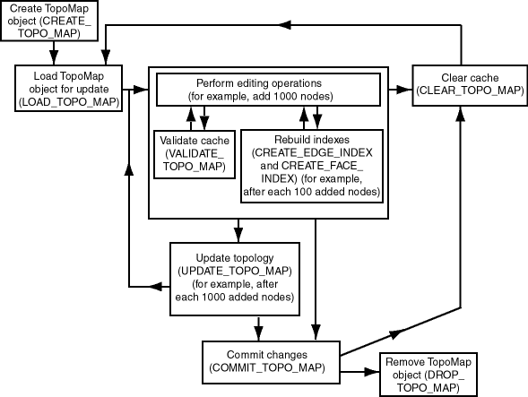
[Description of "Figure 2-1 Editing Topologies Using the TopoMap Object Cache (PL/SQL API)"](img_text/topo_editing_plsql.md)

As Figure 2-1 shows, the basic sequence is as follows:

1.  Create the TopoMap object, using the [SDO_TOPO_MAP.CREATE_TOPO_MAP](SDO_TOPO_MAP-reference.md) procedure.

    This creates an in-memory cache for editing objects associated with the specified topology.

2.  Load the entire topology or a rectangular window from the topology into the TopoMap object cache for update, using the [SDO_TOPO_MAP.LOAD_TOPO_MAP](SDO_TOPO_MAP-reference.md) function or procedure.

    You can specify that in-memory R-tree indexes be built on the edges and faces that are being loaded. These indexes use some memory resources and take some time to create and periodically rebuild; however, they significantly improve performance if you edit a large number of topological elements in the session. (They can also improve performance for queries that use a read-only TopoMap object.)

3.  Perform a number of topology editing operations (for example, add 1000 nodes).

    Periodically, validate the cache by calling the [SDO_TOPO_MAP.VALIDATE_TOPO_MAP](SDO_TOPO_MAP-reference.md) function.

    You can rebuild existing in-memory R-tree indexes on edges and faces in the TopoMap object, or create new indexes if none exist, by using the [SDO_TOPO_MAP.CREATE_EDGE_INDEX](SDO_TOPO_MAP-reference.md) and [SDO_TOPO_MAP.CREATE_FACE_INDEX](SDO_TOPO_MAP-reference.md) procedures. For best index performance, these indexes should be rebuilt periodically when you are editing a large number of topological elements.

    If you want to discard edits made in the cache, call the [SDO_TOPO_MAP.CLEAR_TOPO_MAP](SDO_TOPO_MAP-reference.md) procedure. This procedure fails if there are any uncommitted updates; otherwise, it clears the data in the cache and sets the cache to be read-only.

4.  Update the topology by calling the [SDO_TOPO_MAP.UPDATE_TOPO_MAP](SDO_TOPO_MAP-reference.md) procedure.

5.  Repeat Steps 3 and 4 (editing objects, validating the cache, rebuilding the R-tree indexes, and updating the topology) as often as needed, until you have finished the topology editing operations.

6.  Commit the topology changes by calling the [SDO_TOPO_MAP.COMMIT_TOPO_MAP](SDO_TOPO_MAP-reference.md) procedure. (The [SDO_TOPO_MAP.COMMIT_TOPO_MAP](SDO_TOPO_MAP-reference.md) procedure automatically performs the actions of the [SDO_TOPO_MAP.UPDATE_TOPO_MAP](SDO_TOPO_MAP-reference.md) procedure before it commits the changes.) After the commit operation, the cache is made read-only (that is, it is no longer updatable). However, if you want to perform further editing operations using the same TopoMap object, you can load it again and use it (that is, repeat Steps 2 through 5, clearing the cache first if necessary).

    To perform further editing operations, clear the TopoMap object cache by calling the [SDO_TOPO_MAP.CLEAR_TOPO_MAP](SDO_TOPO_MAP-reference.md) procedure, and then go to Step 2.

    If you want to discard all uncommitted topology changes, you can call the [SDO_TOPO_MAP.ROLLBACK_TOPO_MAP](SDO_TOPO_MAP-reference.md) procedure at any time. After the rollback operation, the cache is cleared.

7.  Remove the TopoMap object by calling the [SDO_TOPO_MAP.DROP_TOPO_MAP](SDO_TOPO_MAP-reference.md) procedure.

    This procedure removes the TopoMap object and frees any resources that it had used. (If you forget to drop the TopoMap object, it will automatically be dropped when the user session ends.) This procedure also rolls back any topology changes in the cache that have not been committed.

    If the application terminates abnormally, all uncommitted changes to the database will be discarded.

If you plan to perform a very large number of topology editing operations, you can divide the operations among several editing sessions, each of which performs Steps 1 through 7 in the preceding list.

**Parent topic:** Approaches for Editing Topology Data

#### 2.1.5 Process for Editing Using the Java API

Figure 2-2 shows the recommended process for editing topological elements using the client-side Java API, which is introduced in [Topology Data Model Java Interface](topology-data-model-overview.md) and is explained in the Javadoc-generated documentation. The Java API requires that you create and manage a TopoMap object and its associated cache.

Figure 2-2 Editing Topologies Using the TopoMap Object Cache (Java API)

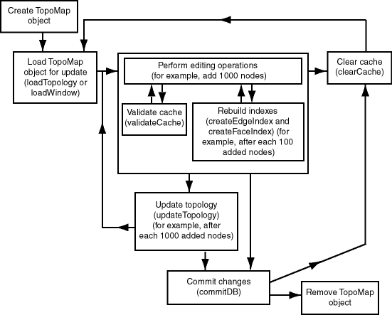
[Description of "Figure 2-2 Editing Topologies Using the TopoMap Object Cache (Java API)"](img_text/topo_editing_java.md)

As Figure 2-2 shows, the basic sequence is as follows:

1.  Create the TopoMap object, using a constructor of the `TopoMap` class, specifying a topology and a database connection.

    This creates an in-memory cache for editing objects associated with the specified topology.

2.  Load the entire topology or a rectangular window from the topology into the TopoMap object cache for update, using the `loadTopology` or `loadWindow` method of the `TopoMap` class.

    You can specify that in-memory R-tree indexes be built on the edge and edge face that are being affected. These indexes use some memory resources and take some time to create and periodically rebuild; however, they significantly improve performance if you edit a large number of topological elements during the database connection.

3.  Perform a number of topology editing operations (for example, add 1000 nodes), and update the topology by calling the `updateTopology` method of the `TopoMap` class.

    Periodically, validate the cache by calling the `validateCache` method of the `TopoMap` class.

    If you caused in-memory R-tree indexes to be created when you loaded the TopoMap object (in Step 2), you can periodically (for example, after each addition of 100 nodes) rebuild the indexes by calling the `createEdgeIndex` and `createFaceIndex` methods of the `TopoMap` class. For best index performance, these indexes should be rebuilt periodically when you are editing a large number of topological elements.

    If you do not want to update the topology but instead want to discard edits made in the cache since the last update, call the `clearCache` method of the `TopoMap` class. The `clearCache` method fails if there are any uncommitted updates; otherwise, it clears the data in the cache and sets the cache to be read-only.

4.  Update the topology by calling the `updateTopology` method of the `TopoMap` class.

5.  Repeat Steps 3 and 4 (editing objects, validating the cache, rebuilding the R-tree indexes, and updating the topology) as often as needed, until you have finished the topology editing operations.

6.  Commit the topology changes by calling the `commitDB` method of the `TopoMap` class. (The `commitDB` method automatically calls the `updateTopology` method before it commits the changes.) After the commit operation, the cache is made read-only (that is, it is no longer updatable). However, if you want to perform further editing operations using the same TopoMap object, you can load it again and use it (that is, repeat Steps 2 through 5, clearing the cache first if necessary).

    To perform further editing operations, clear the TopoMap object cache by calling the `clearCache` method of the `TopoMap` class, and then go to Step 2.

    If you want to discard all uncommitted topology changes, you can call the `rollbackDB` method of the `TopoMap` class at any time. After the rollback operation, the cache is cleared.

7.  Remove the TopoMap object by setting the TopoMap object to null, which makes the object available for garbage collection and frees any resources that it had used. (If you forget to remove the TopoMap object, it will automatically be garbage collected when the application ends.)

    If the application terminates abnormally, all uncommitted changes to the database will be discarded.

If you plan to perform a very large number of topology editing operations, you can divide the operations among several editing sessions, each of which performs Steps 1 through 7 in the preceding list.

**Parent topic:** Approaches for Editing Topology Data

#### 2.1.6 Error Handling for Topology Editing

This section discusses the following conditions.

- Input Parameter Errors
- All Exceptions

**Parent topic:** Approaches for Editing Topology Data

##### 2.1.6.1 Input Parameter Errors

When an SDO_TOPO_MAP PL/SQL subprogram or a public method in the `TopoMap` Java class is called, it validates the values of the input parameters, and it uses or creates a TopoMap object to perform the editing or read-only operation. Whenever there is an input error, an `oracle.spatial.topo.TopoDataException` exception is thrown. Other errors may occur when the underlying TopoMap object performs an operation.

If the method is called from SQL or PL/SQL, the caller gets the following error message:

    ORA-29532: Java call terminated by uncaught Java exception:
    <specific error message text>

The following PL/SQL example shows how you can handle a `TopoDataException` exception:

    DECLARE
      topo_data_error EXCEPTION;
      PRAGMA EXCEPTION_INIT(topo_data_error, -29532);
    BEGIN
      sdo_topo_map.create_topo_map(null, null, 100, 100, 100);
    EXCEPTION
      WHEN topo_data_error THEN
        DBMS_OUTPUT.PUT_LINE(SQLERRM);
    END;/

The preceding example generates the following output:

    ORA-29532: Java call terminated by uncaught Java exception:oracle.spatial.topo.TopoDataException: invalid TopoMap name

**Parent topic:** Error Handling for Topology Editing

##### 2.1.6.2 All Exceptions

The following actions are performed automatically when any exception occurs in a call to any of the following SDO_TOPO_MAP PL/SQL subprograms or their associated methods in the `TopoMap` Java class: [SDO_TOPO_MAP.ADD_EDGE](SDO_TOPO_MAP-reference.md) (`addEdge`), [SDO_TOPO_MAP.ADD_ISOLATED_NODE](SDO_TOPO_MAP-reference.md) (`addIsolatedNode`), [SDO_TOPO_MAP.ADD_LOOP](SDO_TOPO_MAP-reference.md) (`addLoop`), [SDO_TOPO_MAP.ADD_NODE](SDO_TOPO_MAP-reference.md) (`addNode`), [SDO_TOPO_MAP.ADD_POINT_GEOMETRY](SDO_TOPO_MAP-reference.md) (`addPointGeometry`), [SDO_TOPO_MAP.ADD_POLYGON_GEOMETRY](SDO_TOPO_MAP-reference.md) (`addPolygonGeometry`), [SDO_TOPO_MAP.CHANGE_EDGE_COORDS](SDO_TOPO_MAP-reference.md) (`changeEdgeCoords`), [SDO_TOPO_MAP.MOVE_ISOLATED_NODE](SDO_TOPO_MAP-reference.md) (`moveIsolatedNode`), [SDO_TOPO_MAP.MOVE_NODE](SDO_TOPO_MAP-reference.md) (`moveNode`), [SDO_TOPO_MAP.MOVE_EDGE](SDO_TOPO_MAP-reference.md) (`moveEdge`), [SDO_TOPO_MAP.REMOVE_EDGE](SDO_TOPO_MAP-reference.md) (`removeEdge`), [SDO_TOPO_MAP.REMOVE_NODE](SDO_TOPO_MAP-reference.md) (`removeNode`), and [SDO_TOPO_MAP.UPDATE_TOPO_MAP](SDO_TOPO_MAP-reference.md) (`updateTopology`).

- The transaction is rolled back.

- The TopoMap object cache is cleared.

- The TopoMap object is made read-only.

**Parent topic:** Error Handling for Topology Editing

### 2.2 Performing Operations on Nodes

This topic contains sections that describe the effects of adding, moving, and removing nodes, and that explain how to perform these operations using the PL/SQL API.

- Adding a Node
- Moving a Node
- Removing a Node
- Removing Obsolete Nodes

**Parent topic:** Editing Topologies

#### 2.2.1 Adding a Node

Adding a non-isolated node adds the node to an edge at a point that is currently on the edge. This operation also splits the edge, causing the original edge to be divided into two edges. Spatial and Graph automatically adjusts the definition of the original edge and creates a new edge (assigning it an ID value that is unique among edges in the topology).

To add a non-isolated node, use the [SDO_TOPO_MAP.ADD_NODE](SDO_TOPO_MAP-reference.md) function. To add an isolated node, use the [SDO_TOPO_MAP.ADD_ISOLATED_NODE](SDO_TOPO_MAP-reference.md) function.

Figure 2-3 shows the addition of a node (N3) on edge E1.

Figure 2-3 Adding a Non-Isolated Node

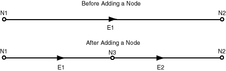
[Description of "Figure 2-3 Adding a Non-Isolated Node"](img_text/add_node.md)

As a result of the operation shown in Figure 2-3:

- Edge E1 is redefined to be between the original edge's start point and the point at the added node (N3).

- Edge E2 is created. Its start point is the point at node N3, and its end point is the end point of the original edge.

- If any linear features were defined on the original edge, they are automatically redefined to be on both resulting edges, the edge is split, and a record is added to the history information table (explained in [History Information Table](topology-data-model-overview.md)) for the topology. For example, if a street named Main Street had been defined on the original edge E1 in Figure 2-3, then after the addition of node N3, Main Street would be defined on both edges E1 and E2.

Figure 2-4 shows a more complicated example of adding a node, where the result depends on whether or not the added node is a new shape point of the original edge (that is, on the value of the `is_new_shape_point` parameter to the [SDO_TOPO_MAP.ADD_NODE](SDO_TOPO_MAP-reference.md) function).

Figure 2-4 Effect of is_new_shape_point Value on Adding a Node

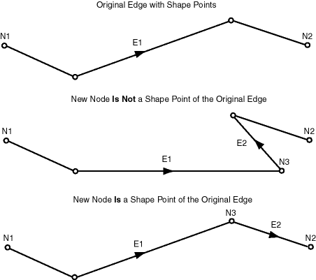
[Description of "Figure 2-4 Effect of is_new_shape_point Value on Adding a Node"](img_text/add_node_2.md)

In Figure 2-4:

- In the top part of the figure, the original edge (E1) starts at node N1, ends at node N2, and has two intermediate shape points.

- In the middle part of the figure, a new node (N3) is added that is not a shape point of the original edge, but instead is a new shape point (that is, `is_new_shape_point=>'TRUE'`). The new node is added at the location specified with the `point` parameter, and is added after the vertex specified in the `coord_index` parameter (in this case, `coord_index=>1` to indicate after the first vertex). The new node becomes the end node for edge E1 and the start node for the new edge E2, which ends at node N2.

- In the bottom part of the figure, a new node (N3) is added that is a shape point of the original edge, and is thus not a new shape point (that is, `is_new_shape_point=>'FALSE'`). Because it is not a new shape point, the node is added at the vertex specified with the `coord_index` parameter (in this case, `coord_index=>2`). As in the middle part of the figure, the new node becomes the end node for edge E1 and the start node for the new edge E2, which ends at node N2.

**Parent topic:** Performing Operations on Nodes

#### 2.2.2 Moving a Node

Moving a non-isolated node to a new position causes the ends of all edges that are attached to the node to move with the node. You must specify the vertices for all edges affected by the moving of the node; each point (start or end) that is attached to the node must have the same coordinates as the new location of the node, and the other end points (not the moved node) of each affected edge must remain the same.

To move a non-isolated node, use the [SDO_TOPO_MAP.MOVE_NODE](SDO_TOPO_MAP-reference.md) procedure. To move an isolated node, use the [SDO_TOPO_MAP.MOVE_ISOLATED_NODE](SDO_TOPO_MAP-reference.md) procedure.

Figure 2-5 shows the original topology before node N1 is moved.

Figure 2-5 Topology Before Moving a Non-Isolated Node

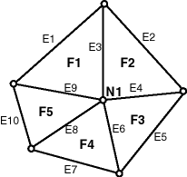
[Description of "Figure 2-5 Topology Before Moving a Non-Isolated Node"](img_text/move_node_1.md)

Figure 2-6 shows two cases of the original topology after node N1 is moved. In one case, no reshaping occurs; that is, all edges affected by the movement are specified as straight lines. In the other case, reshaping occurs; that is, one or more affected edges are specified as line segments with multiple vertices.

Figure 2-6 Topology After Moving a Non-Isolated Node

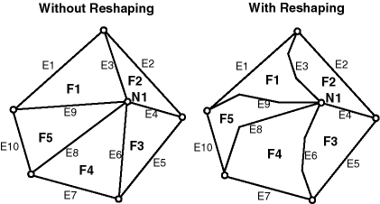
[Description of "Figure 2-6 Topology After Moving a Non-Isolated Node"](img_text/move_node_2b.md)

In both cases shown in Figure 2-6:

- The topology does not change. That is, the number of nodes, edges, and faces does not change, and the relationships (such as adjacency and connectivity) among the nodes, edges, and faces do not change.

- All features defined on the nodes, edges, and faces retain their definitions.

Any isolated nodes and edges might remain in the same face or be moved to a different face as a result of a move operation on a non-isolated node. The [SDO_TOPO_MAP.MOVE_NODE](SDO_TOPO_MAP-reference.md) procedure has two output parameters, `moved_iso_nodes` and `moved_iso_edges`, that store the ID numbers of any isolated nodes and edges that were moved to a different face as a result of the operation.

A node cannot be moved if, as a result of the move, any of the following would happen:

- Any edges attached to the node would intersect any other edge. For example, assume that the original topology shown in Figure 2-6 had included another edge E20 that passed just above and to the right of node N1. If the movement of node N1 would cause edge E3, E4, E6, E8, or E9 to intersect edge E20, the move operation is not performed.

- The node would be moved to a face that does not currently bound the node. For example, if the movement of node N1 would place it outside the original topology shown in Figure 2-6, the move operation is not performed.

- The node would be moved to the opposite side of an isolated face. This is not allowed because the move would change the topology by changing one or more of the following: the relationship or ordering of edges around the face, and the left and right face for each edge. Figure 2-7 shows a node movement (flipping node N1 from one side of isolated face F1 to the other side) that would not be allowed.

  Figure 2-7 Node Move Is Not Allowed

  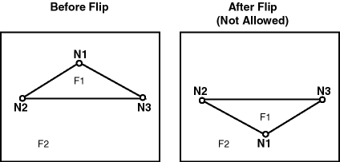
  [Description of "Figure 2-7 Node Move Is Not Allowed"](img_text/flip_node.md)

<!-- -->

- Additional Examples of Allowed and Disallowed Node Moves

**Parent topic:** Performing Operations on Nodes

##### 2.2.2.1 Additional Examples of Allowed and Disallowed Node Moves

This section provides additional examples of node movement operations that are either allowed or not allowed. All refer to the topology shown in Figure 2-8.

Figure 2-8 Topology for Node Movement Examples

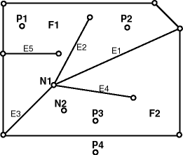
[Description of "Figure 2-8 Topology for Node Movement Examples"](img_text/node_moves_several.md)

In the topology shown in Figure 2-8:

- Attempts will be made to move node N1 to points P1, P2, P3, and P4. (These points are locations but are not existing nodes.)

- The edges have no shape points, either before or after the move operation.

- New vertices are specified for the edges E1, E2, E3, and E4, but the ID values of the start and end points for the edges remain the same.

When the following node move operations are attempted using the topology shown in Figure 2-8, the following results occur:

- Moving node N1 to point P1: Not allowed, because one or more of the four attached edges would intersect edge E5. (Edge E3 would definitely intersect edge E5 if the move were allowed.)

- Moving node N1 to point P2: Allowed.

- Moving node N1 to point P3: Allowed. However, this operation causes the isolated node N2 to change from face F2 to face F1, and this might cause the application to want to roll back or disallow the movement of node N1. Similarly, if the movement of a node would cause any isolated edges or faces to change from one face to another, the application might want to roll back or disallow the node move operation.

- Moving node N1 to point P4: Not allowed, because the node must be moved to a point in a face that bounds the original (current) position of the node.

**Parent topic:** Moving a Node

#### 2.2.3 Removing a Node

You can remove individual nodes (isolated or non-isolated), as explained in this section, and you can remove all obsolete nodes in a topology, as explained in Removing Obsolete Nodes.

Removing a non-isolated node deletes the node and merges the edges that were attached to the node into a single edge. (Spatial and Graph applies complex rules, which are not documented, to determine the ID value and direction of the resulting edge.)

To remove a non-isolated or isolated node, use the [SDO_TOPO_MAP.REMOVE_NODE](SDO_TOPO_MAP-reference.md) procedure.

Figure 2-9 shows the removal of a node (N1) that is attached to edges E1 and E2.

Figure 2-9 Removing a Non-Isolated Node

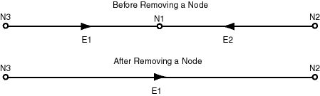
[Description of "Figure 2-9 Removing a Non-Isolated Node"](img_text/delete_node.md)

As a result of the operation shown in Figure 2-9:

- Edge E1 is redefined to consist of the line segments that had represented the original edges E1 and E2.

- Edge E2 is deleted.

- If any linear features were defined on both original edges, they are automatically redefined to be on the resulting edge, and a record is added to the history information table (explained in [History Information Table](topology-data-model-overview.md)) for the topology. For example, if a street named Main Street had been defined on the original edges E1 and E2 in Figure 2-9, then after the removal of node N1, Main Street would be defined on edge E1.

A node cannot be removed if one or more of the following are true:

- A point feature is defined on the node. For example, if a point feature named Metropolitan Art Museum had been defined on node N1 in Figure 2-9, node N1 cannot be removed. Before you can remove the node in this case, you must remove the definition of any point features on the node.

- A linear feature defined on either original edge is not also defined on both edges. For example, if a linear feature named Main Street had been defined on edge E1 but not edge E2 in Figure 2-9, node N1 cannot be removed.

**Parent topic:** Performing Operations on Nodes

#### 2.2.4 Removing Obsolete Nodes

An obsolete node is a node that is connected to only two distinct edges, is not assigned to any point feature, and does not serve as the demarcation between different linear features. Obsolete nodes can result when the [SDO_TOPO_MAP.ADD_POLYGON_GEOMETRY](SDO_TOPO_MAP-reference.md) function is used repeatedly to build a topology, or when edges have been removed during editing operations, leaving some unnecessary nodes. Therefore, it is recommended that you use the [SDO_TOPO_MAP.REMOVE_OBSOLETE_NODES](SDO_TOPO_MAP-reference.md) procedure to remove obsolete nodes in such cases.

Spatial and Graph automatically updates the appropriate entries in the \<topology-name\>\_NODE\$ and \<topology-name\>\_EDGE\$ tables, and in the \<topology-name\>\_FACE\$ table if necessary.

Figure 2-10 shows the removal of obsolete nodes in a simple topology. In this topology, node N1 has a point feature named Art Museum defined on it, and node N3 has a point feature named Town Hall defined on it. Edges E1, E2, and E3 have a linear feature named Main Street defined on them, and edge E4 has a linear feature named First Avenue defined on it.

Figure 2-10 Removing Obsolete Nodes

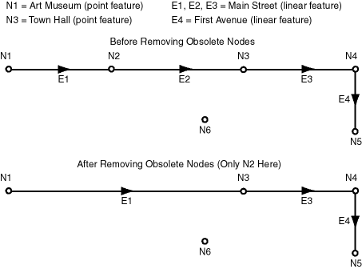
[Description of "Figure 2-10 Removing Obsolete Nodes"](img_text/delete_obsolete_nodes.md)

In Figure 2-10, the only node removed is N2, because only that node satisfies all the criteria for an obsolete node. As for the other nodes:

- N1 is connected to only one edge (E1), and it has a point feature defined on it (Art Museum).

- N3 has a point feature defined on it (Town Hall).

- N4 is the demarcation between two different linear features (Main Street and First Avenue).

- N5 is connected to only one edge (E4).

- Node N6 is an isolated node (not connected to any edges).

Also as a result of the operation shown in Figure 2-10, edge E2 was removed as a result of the removal of node N2.

**Parent topic:** Performing Operations on Nodes

### 2.3 Performing Operations on Edges

This topic describes the effects of adding, moving, removing, and updating edges, and explains how to perform these operations using the PL/SQL API.

- Adding an Edge
- Moving an Edge
- Removing an Edge
- Updating an Edge

**Parent topic:** Editing Topologies

#### 2.3.1 Adding an Edge

Adding a non-isolated edge adds the edge to a face. It also splits the face, causing the original face to be divided into two faces. Spatial and Graph automatically adjusts the definition of the original face and creates a new face (assigning it an ID value that is unique among faces in the topology).

To add an edge, use the [SDO_TOPO_MAP.ADD_EDGE](SDO_TOPO_MAP-reference.md) procedure. You must specify existing nodes as the start and end nodes of the added edge.

Figure 2-11 shows the addition of an edge (E7) between nodes N3 and N5 on face F3.

Figure 2-11 Adding a Non-Isolated Edge

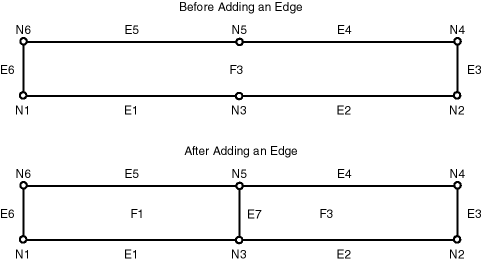
[Description of "Figure 2-11 Adding a Non-Isolated Edge"](img_text/add_edge.md)

As a result of the operation shown in Figure 2-11, face F3 is redefined to be two faces, F1 and F3. (Spatial and Graph applies complex rules, which are not documented, to determine the ID values of the resulting faces.)

Any polygon features that were defined on the original face are automatically redefined to be on both resulting faces. For example, if a park named Walden State Park had been defined on the original face F3 in Figure 2-11, then after the addition of edge E7, Walden State Park would be defined on both faces F1 and F3.

**Parent topic:** Performing Operations on Edges

#### 2.3.2 Moving an Edge

Moving a non-isolated edge keeps the start or end point of the edge in the same position and moves the other of those two points to another existing node position. You must specify the source node (location before the move of the node to be moved), the target node (location after the move of the node being moved), and the vertices for the moved edge.

To move an edge, use the [SDO_TOPO_MAP.MOVE_EDGE](SDO_TOPO_MAP-reference.md) procedure.

Figure 2-12 shows the movement of edge E7, which was originally between nodes N3 and N5, to be between nodes N2 and N5.

Figure 2-12 Moving a Non-Isolated Edge

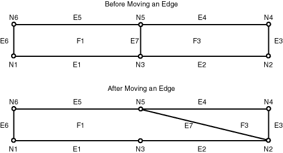
[Description of "Figure 2-12 Moving a Non-Isolated Edge"](img_text/move_edge.md)

As a result of the operation shown in Figure 2-12, faces F1 and F3 are automatically redefined to reflect the coordinates of their edges, including the new coordinates for edge E7.

Any isolated nodes and edges might remain in the same face or be moved to a different face as a result of a move operation on a non-isolated edge. The [SDO_TOPO_MAP.MOVE_EDGE](SDO_TOPO_MAP-reference.md) procedure has two output parameters, `moved_iso_nodes` and `moved_iso_edges`, that store the ID numbers of any isolated nodes and edges that were moved to a different face as a result of the operation.

An edge cannot be moved if, as a result of the move, any of the following would happen:

- The moved edge would intersect any other edge. For example, assume that the topology before the move, as shown in Figure 2-12, had included another edge (E10) that was between nodes N3 and N4. In this case, the movement of edge E7 would cause it to intersect edge E10, and therefore the move operation is not performed.

- The node would be moved to a face that does not currently bound the edge. For example, if the movement of edge E7 would place its terminating point at a node outside the faces shown in Figure 2-12 (F1 and F3), the move operation is not performed.

**Parent topic:** Performing Operations on Edges

#### 2.3.3 Removing an Edge

Removing a non-isolated edge deletes the edge and merges the faces that bounded the edge. (Spatial and Graph applies complex rules, which are not documented, to determine the ID value of the resulting face.)

To remove an edge, use the [SDO_TOPO_MAP.REMOVE_EDGE](SDO_TOPO_MAP-reference.md) procedure.

Figure 2-13 shows the removal of an edge (E7) that is bounded by faces F1 and F3.

Figure 2-13 Removing a Non-Isolated Edge

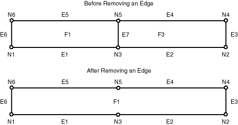
[Description of "Figure 2-13 Removing a Non-Isolated Edge"](img_text/delete_edge.md)

As a result of the operation shown in Figure 2-13:

- Face F1 is redefined to consist of the area of the original faces F1 and F3.

- Face F3 is deleted.

- The start and end nodes of the deleted edge (nodes N3 and N5) are not removed.

Any polygon features that were defined on both original faces are automatically redefined to be on the resulting face. For example, if a park named Adams Park had been defined on the original faces F1 and F3 in Figure 2-13, then after the removal of edge E7, Adams Park would be defined on face F1.

A non-isolated edge cannot be removed if one or more of the following are true:

- A linear feature is defined on the edge. For example, if a linear feature named Main Street had been defined on edge E7 in Figure 2-13, edge E7 cannot be removed. Before you can remove the edge in this case, you must remove the definition of any linear features on the edge.

- A polygon feature defined on either original face is not also defined on both faces. For example, if a linear feature named Adams Park had been defined on face F1 but not face F3 in Figure 2-13, edge E7 cannot be removed.

**Parent topic:** Performing Operations on Edges

#### 2.3.4 Updating an Edge

Updating an isolated edge means changing one or more coordinates of the edge, but without changing the start point and end point.

To update an edge, use the [SDO_TOPO_MAP.CHANGE_EDGE_COORDS](SDO_TOPO_MAP-reference.md) procedure.

Any isolated nodes and edges might remain in the same face or be moved to a different face as a result of an update operation on a non-isolated edge. The [SDO_TOPO_MAP.CHANGE_EDGE_COORDS](SDO_TOPO_MAP-reference.md) procedure has two output parameters, `moved_iso_nodes` and `moved_iso_edges`, that store the ID numbers of any isolated nodes and edges that were moved to a different face as a result of the operation.

An edge cannot be updated if, as a result of the operation, it would intersect any other edge. See the Usage Notes for the [SDO_TOPO_MAP.CHANGE_EDGE_COORDS](SDO_TOPO_MAP-reference.md) procedure for more information about updating an edge.

**Parent topic:** Performing Operations on Edges
