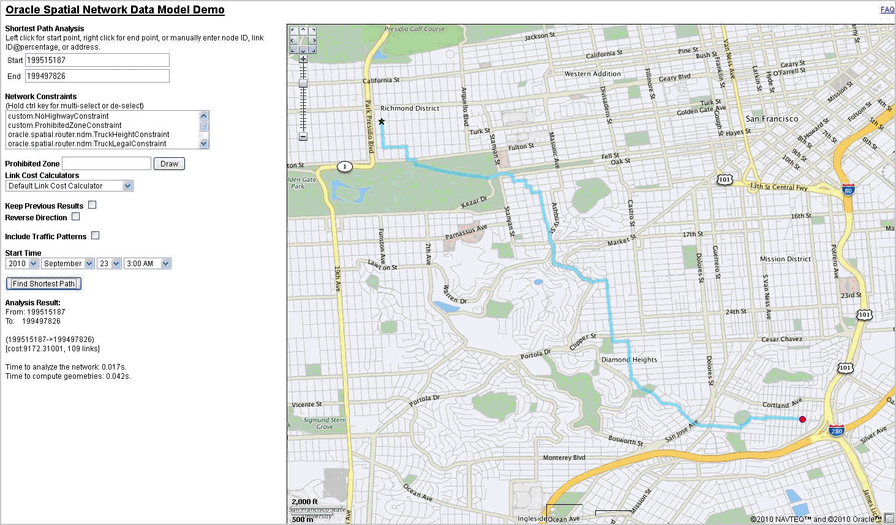
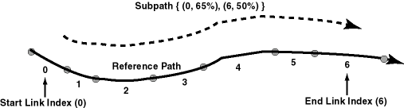
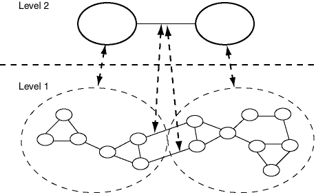
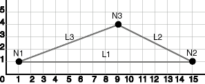
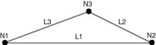
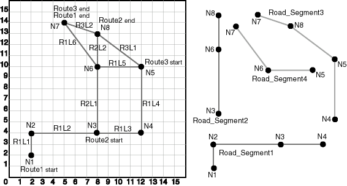
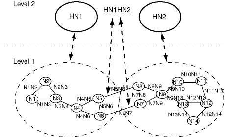

## 5  Network Data Model Graph Overview

This chapter explains the concepts and operations related to the network data model for representing capabilities or objects that are modeled as nodes and links (vertices and edges) in a graph.

**Note:**

Network Data Model is supported only if Oracle JVM is enabled on your Oracle Autonomous Database Serverless deployments. To enable Oracle JVM, see [Use Oracle Java](http://www.oracle.com/pls/topic/lookup?ctx=en/cloud/paas/autonomous-database&id=GUID-2516EE33-B38D-4270-BE52-30A4F9014E8B) in Using Oracle Autonomous Database Serverless for more information.

This model is called the Oracle Spatial and Graph Network Data Model Graph feature, or simply Network Data Model Graph. This chapter assumes that you are familiar with the main Oracle Spatial and Graph concepts, data types, and operations, as documented in [Oracle Spatial and Graph Developer's Guide](../spatl/spatial-concepts-usage.md).

Although this chapter discusses some network-related terms as they relate to Oracle Spatial and Graph, it assumes that you are familiar with basic network data modeling concepts.

- Introduction to Network Modeling
  In many applications, capabilities or objects are modeled as nodes and links in a network. The network model contains logical information such as connectivity relationships among nodes and links, directions of links, and costs of nodes and links.
- Main Steps in Using the Network Data Model Graph
  This topic summarizes the main steps for working with the Network Data Model Graph feature in Oracle Spatial and Graph. It refers to important concepts, structures, and operations that are described in detail in other topics.
- Network Data Model Graph Concepts
  A network is a type of mathematical graph that captures relationships between objects using connectivity.
- Network Applications
  Networks are used in applications to find how different objects are connected to each other.
- Network Hierarchy
  Some network applications require representations at different levels of abstraction. For example, two major processes might be represented as nodes with a link between them at the highest level of abstraction, and each major process might have several subordinate processes that are represented as nodes and links at the next level down.
- Network User Data
  For user data defined through the xxx\_SDO_NETWORK_USER_DATA views, the default user data I/O implementation (`LODUserDataIOSDO`) is used to access the user data during network analysis. However, some user data is not included in the node or link table, and thus cannot be registered through xxx_SDO_NETWORK_USER_DATA views.
- Feature Modeling
  You can model objects of interest on the network as features.
- Feature Modeling Using Network Feature Editing (NFE)
  Network feature editing (NFE) lets you create and manage an NFE model. An NFE model extends the feature modeling capabilities by enabling you to visualize and manipulate features using Java Swing components and a PL/SQL API.
- Network Constraints
  Network constraints are restrictions defined on network analysis computations.
- Network Analysis Using Load on Demand
  Load on demand means that during network analysis, a network partition is not loaded into memory until the analysis has reached this partition while exploring the network.
- Network Data Model Graph Tables
  The connectivity information for a spatial network is stored in two tables: a node table and a link table. In addition, path information can be stored in a path table and a path-link table.
- Network Data Model Graph and Network Feature Editing (NFE) Model Metadata Views
  Two sets of network metadata views can be created for each schema (user): xxx_SDO_NETWORK_xxxxxx and xxx_SDO_NFE_MODEL_xxxxxx, where the initial xxx can be USER or ALL. These views are created, as needed, by Spatial and Graph
- Network Data Model Graph Application Programming Interface
  The Oracle Spatial and Graph Network Data Model Graph feature includes two client application programming interfaces (APIs): a PL/SQL interface provided by the SDO_NET package and a Java interface.
- Cross-Schema Network Access
  If database users other than the network owner need to read a network into memory, you need to do one of the following options.
- Network Examples
  This topic presents several Network Data Model Graph examples.
- Network Data Model Graph Tutorial and Other Resources
  Network Data Model Graph learning resources are available.
- README File for Spatial and Graph and Related Features
  A `README.txt` file supplements the information in the following manuals:

**Parent topic:** [Network Data Model](network-data-model.md)

### 5.1 Introduction to Network Modeling

In many applications, capabilities or objects are modeled as nodes and links in a network. The network model contains logical information such as connectivity relationships among nodes and links, directions of links, and costs of nodes and links.

With logical network information, you can analyze a network and answer questions, many of them related to path computing and tracing. For example, for a biochemical pathway, you can find all possible reaction paths between two chemical compounds; or for a road network, you can find the following information:

- What is the shortest (distance) or fastest (travel time) path between two cities?

- What is the closest hotel to a specific airport, and how can I get there?

In addition to logical network information, spatial information such as node locations and link geometries can be associated with the network. This information can help you to model the logical information (such as the cost of a route, because its physical length can be directly computed from its spatial representation).

The Spatial and Graph Network Data Model Graph feature can be used for large, complex networks. For example, Figure 5-1 shows San Francisco and links, which have been defined using the Network Data Model Graph feature, displayed in a demo web-based application for network analysis. (You can install this demo using the NDM tutorial described in Network Data Model Graph Tutorial and Other Resources.)

Figure 5-1 San Francisco Nodes and Links

[Description of "Figure 5-1 San Francisco Nodes and Links"](img_text/ndmdemo_sf.md)

The generic data model and network analysis capability can model and analyze many kinds of network applications in addition to traditional geographical information systems (GIS). For example, in biochemistry, applications may need to model reaction pathway networks for living organisms; and in the pharmaceutical industry, applications that model the drug discovery process may need to model protein-protein interaction.

The network modeling capabilities of Spatial and Graph include schema objects and an application programming interface (API). The schema objects include metadata and network tables. The API includes a server-side PL/SQL API (the SDO_NET package) for creating and managing networks in the database, and a middle-tier (or client-side) Java API for network editing and analysis.

**Parent topic:** Network Data Model Graph Overview

### 5.2 Main Steps in Using the Network Data Model Graph

This topic summarizes the main steps for working with the Network Data Model Graph feature in Oracle Spatial and Graph. It refers to important concepts, structures, and operations that are described in detail in other topics.

There are two basic approaches to creating a network:

- Let Spatial and Graph perform most operations, using procedures with names in the form CREATE\_\<network-type\>\_NETWORK.

- Perform the operations yourself: create the necessary network tables and update the network metadata.

With each approach, you must insert the network data into the network tables. You can then use the Network Data Model Graph PL/SQL and Java application programming interfaces (APIs) to update the network and perform other operations. (The PL/SQL and Java APIs are described in Network Data Model Graph Application Programming Interface.)

- Letting Spatial Perform Most Operations
- Performing the Operations Yourself

**Parent topic:** Network Data Model Graph Overview

#### 5.2.1 Letting Spatial Perform Most Operations

To create a network by letting Spatial and Graph perform most of the necessary operations, follow these steps:

1.  Create the network using a procedure with a name in the form CREATE\_\<network-type\>\_NETWORK, where \<network-type\> reflects the type of network that you want to create:
    - [SDO_NET.CREATE_SDO_NETWORK](SDO_NET-reference.md) for a spatial network with non-LRS SDO_GEOMETRY objects

    - [SDO_NET.CREATE_LRS_NETWORK](SDO_NET-reference.md) for a spatial network with LRS SDO_GEOMETRY objects

    - [SDO_NET.CREATE_TOPO_NETWORK](SDO_NET-reference.md) for a spatial network with topology geometry (SDO_TOPO_GEOMETRY) objects

    - [SDO_NET.CREATE_LOGICAL_NETWORK](SDO_NET-reference.md) for a logical network that does not contain spatial information

    Each of these procedures creates the necessary Network Data Model Graph tables (described in Network Data Model Graph Tables) and inserts a row with the appropriate network metadata information into the xxx_SDO_NETWORK_METADATA views (described in xxx_SDO_NETWORK_METADATA Views).

    Each procedure has two formats: one format creates all Network Data Model Graph tables using default names for the tables and certain columns, and other format lets you specify names for the tables and certain columns. The default names for the Network Data Model Graph tables are \<network-name\>\_NODE\$, \<network-name\>\_LINK\$, \<network-name\>\_PATH\$, and \<network-name\>\_PLINK\$. The default name for cost columns in the Network Data Model Graph tables is COST, and the default name for geometry columns is GEOMETRY.
2.  Insert data into the node and link tables, and if necessary into the path and path-link tables. (The node, link, path, and path-link tables are described in Network Data Model Graph Tables.)
3.  Validate the network, using the [SDO_NET.VALIDATE_NETWORK](SDO_NET-reference.md) function.
4.  For a spatial (SDO or LRS) network, insert the appropriate information into the USER_SDO_GEOM_METADATA view, and create spatial indexes on the geometry columns.
    If you plan to use a view as a node, link, or path table, you must specify the view name for the TABLE_NAME column value when you insert information about the node, link, or path table in the USER_SDO_GEOM_METADATA view.

**Parent topic:** Main Steps in Using the Network Data Model Graph

#### 5.2.2 Performing the Operations Yourself

To create a network by performing the necessary operations yourself, follow these steps:

1.  Create the node table, using the [SDO_NET.CREATE_NODE_TABLE](SDO_NET-reference.md) procedure.
2.  Insert data into the node table.
3.  Create the link table, using the [SDO_NET.CREATE_LINK_TABLE](SDO_NET-reference.md) procedure.
4.  Insert data into the link table.
5.  Optionally, create the path table, using the [SDO_NET.CREATE_PATH_TABLE](SDO_NET-reference.md) procedure.
6.  If you created the path table, create the path-link table, using the [SDO_NET.CREATE_PATH_LINK_TABLE](SDO_NET-reference.md) procedure.
7.  If you created the path table and if you want to create paths, insert data into the table.
8.  If you inserted data into the path table, insert the appropriate rows into the path-link table.
9.  Insert a row into the USER_SDO_NETWORK_METADATA view with information about the network. (The USER_SDO_NETWORK_METADATA view is described in xxx_SDO_NETWORK_METADATA Views.)
    If you plan to use a view as a node, link, path, or path-link table, you must specify the view name for the relevant columns when you insert information about the network in the USER_SDO_NETWORK_METADATA view.
10. For a spatial (SDO or LRS) network, insert the appropriate information into the USER_SDO_GEOM_METADATA view, and create spatial indexes on the geometry columns.
    If you plan to use a view as a node, link, or path table, you must specify the view name for the TABLE_NAME column value when you insert information about the node, link, or path table in the USER_SDO_GEOM_METADATA view.
11. Validate the network, using the [SDO_NET.VALIDATE_NETWORK](SDO_NET-reference.md) function.

You can change the sequence of some of these steps. For example, you can create both the node and link tables first, and then insert data into each one; and you can insert the row into the USER_SDO_NETWORK_METADATA view before you create the node and link tables.

**Parent topic:** Main Steps in Using the Network Data Model Graph

### 5.3 Network Data Model Graph Concepts

A network is a type of mathematical graph that captures relationships between objects using connectivity.

The connectivity may or may not be based on spatial proximity. For example, if two towns are on opposite sides of a lake, the shortest path based on spatial proximity (a straight line across the middle of the lake) is not relevant if you want to drive from one town to the other. Instead, to find the shortest driving distance, you need connectivity information about roads and intersections and about the "cost" of individual links.

A network consists of a set of nodes and links. Each link (sometimes also called an edge or a segment) specifies two nodes.

A network can be directed (that is, by default, the start and end nodes determine link direction) or undirected (that is, links can be traversed in either direction).

The following are some key terms related to the Network Data Model Graph: feature

- A node, also called a vertex, is a point where links can join each other. An isolated node is a node that is not included in any links. (A non-isolated node will become isolated if all links that include that node are deleted.)

- A link represents a relationship between two nodes. Within a directed network, any link can be undirected (that is, able to be traversed either from the start node to the end node or from the end node to the start node) or directed (that is, able to be traversed only from the start node to the end node). Within an undirected network, all links are undirected.

- A network element is a node or a link.

- A path is an alternating sequence of nodes and links, beginning and ending with nodes, and usually with no nodes and links appearing more than once. (Repeating nodes and links within a path are permitted, but are rare in most network applications.)

- A subpath is a partial path along a path, created either as a result of a network analysis operation or explicitly by a user. Subpaths are explained and illustrated in Subpaths.

- A logical network contains connectivity information but no geometric information. This is the model used for network analysis. A logical network can be treated as a directed graph or undirected graph, depending on the application.

- A spatial network contains both connectivity information and geometric information. In a spatial network, the nodes and links are SDO_GEOMETRY geometry objects without LRS information (an SDO network) or with LRS information (an LRS network), or SDO_TOPO_GEOMETRY objects (a topology geometry network).

  In an LRS network, each node includes a geometry ID value and a measure value, and each link includes a geometry ID value and start and end measure values; and the geometry ID value in each case refers to an SDO_GEOMETRY object with LRS information. A spatial network can be directed or undirected, depending on the application.

- A feature is an object of interest in a network application that is associated with a node or link. Features and feature layer types are explained in Features and Feature Layers

- Cost is a non-negative numeric attribute that can be associated with links or nodes for computing the minimum cost path, which is the path that has the minimum total cost from a start node to an end node. You can specify a single cost factor, such as driving time or driving distance for links, in the network metadata, and network analytical functions that examine cost will use this specified cost factor.

- Duration is a non-negative numeric attribute that can be associated with links or nodes to specify a duration value for the link or node. The duration value can indicate a number of minutes or any other user-determined significance. You can specify a single duration factor, such as driving time for links, in the network metadata; however, if you use duration instead of cost to indicate elapsed time, network analytical functions that examine cost will not consider the specified duration factor.

- State is a string attribute, either `ACTIVE` or `INACTIVE`, that is associated with links or nodes to specify whether or not a link or node will be considered by network analysis functions. For example, if the state of a node is `INACTIVE`, any links from or to that node are ignored in the computation of the shortest path between two nodes. The state is `ACTIVE` by default when a link or node is created, but you can set the state `INACTIVE`.

- Type is a string attribute that can be associated with links or nodes to specify a user-defined value for the type of a link or a node.

- Temporary links, nodes, and paths exist only in a network memory object, and are not written to the database when the network memory object is written. For example, during a network analysis and editing session you might create temporary nodes to represent street addresses for shortest-path computations, but not save these temporary nodes when you save the results of editing operations.

- Reachable nodes are all nodes that can be reached from a given node. Reaching nodes are all nodes that can reach a given node.

- The degree of a node is the number of links to (that is, incident upon) the node. The in-degree is the number of inbound links, and the out-degree is the number of outbound links.

- A connected component is a group of network nodes that are directly or indirectly connected. If node A can reach node B, they must belong to the same connected component. If two nodes are not connected, it is concluded that there is no possible path between them. This information can be used as a filter to avoid unnecessary path computations.

- A spanning tree of a connected graph is a tree (that is, a graph with no cycles) that connects all nodes of the graph. (The directions of links are ignored in a spanning tree.) The minimum cost spanning tree is the spanning tree that connects all nodes and has the minimum total cost.

- A partitioned network is a network that contains multiple partitions. Partitioning a large network enables only the necessary partitions to be loaded on demand into memory, thus providing better overall performance.

  Network partitions are sub-networks, each covering a subset of nodes and links of the entire network. Network partitions are the basic processing units for load on demand analysis. They are created by assigning every node in the network to only one partition ID. Network partition information is stored in a partition table.

- Load on demand (load on demand analysis) is an approach that divides large networks into manageable partitions and only loads needed partitions during analysis, thus removing memory limitation as a consideration and providing better overall performance.

- Partition BLOBs are binary representations for network partitions. They provide faster partition loading time. They are stored in a partition BLOB table.

- The load on demand partition cache is an in-memory placeholder for network partitions loaded into memory during network analysis. You can configure the partition cache.

- User-defined data is the information (not related to connectivity) that users want to associate with a network representation. User-defined data can be defined at the node, link, path, and subpath level, and is stored in columns in the node, link, path, and subpath tables.

<!-- -->

- Subpaths
- Features and Feature Layers

**Parent topic:** Network Data Model Graph Overview

#### 5.3.1 Subpaths

A subpath is a partial path along a path, created either as a result of a network analysis operation or explicitly by a user. The start and end points of a subpath are defined as link indexes and the percentage of the distance from the previous node in the path, as shown in Figure 5-2.

Figure 5-2 Path and Subpaths

[Description of "Figure 5-2 Path and Subpaths"](img_text/subpaths.md)

A subpath refers to an existing path (the reference path) using the following parameters:

- Reference path ID: the path ID of the reference path.

- Start link index: the start link index on the reference path. (Link index 0 refers to the link between the first and second nodes on the path.) In Figure 5-2, link index 0 is the start link index.

- Start percentage: the percentage of the distance along the start link for the start node of the subpath. In Figure 5-2, the subpath starts at 65 percent of the distance between the start and end of link index 0.

- End link index: the end link index on the reference path. In Figure 5-2, link index 6 is the end link index.

- End percentage: the percentage of the distance along the end link for the end node of the subpath. In Figure 5-2, the subpath ends at 50 percent of the distance between the start and end of link index 6.

**Parent topic:** Network Data Model Graph Concepts

#### 5.3.2 Features and Feature Layers

A feature is an object of interest in a network application that is associated with a node or link. For example, in a transportation network, features include exits and intersections (mapped to nodes), and highways and streets (mapped to links).

A feature consists of one or more feature elements. A feature element is a point or line along the network. If it is a point, it can lie on a node or along a line; if it is a line, it can be a full link or a partial link.

Depending on the types of feature elements in the feature, a feature can have any of the feature types shown in Table 5-1.

Table 5-1 Feature Types

| Type Number | Type Name                | Feature Elements Consist of:                                                            |
|:------------|:-------------------------|:----------------------------------------------------------------------------------------|
| 1           | SDO_NET.FEAT_TYPE_PON    | A single point on a node                                                                |
| 2           | SDO_NET.FEAT_TYPE_POL    | A single point on a link                                                                |
| 3           | SDO_NET.FEAT_TYPE_POINT  | A single point, but whether it is on a node or a link is unknown                        |
| 4           | SDO_NET.FEAT_TYPE_LINE   | A single line                                                                           |
| 5           | SDO_NET.FEAT_TYPE_MPON   | One or more points on one or more nodes                                                 |
| 6           | SDO_NET.FEAT_TYPE_MPOL   | One or more points on one or more links                                                 |
| 7           | SDO_NET.FEAT_TYPE_MPOINT | One or more points, but the points can be on nodes or links (or a combination)          |
| 8           | SDO_NET.FEAT_TYPE_MLINE  | One or more lines                                                                       |
| 9           | SDO_NET.FEAT_TYPE_COLL   | A collection of both points and lines, or the types of the feature elements are unknown |

A feature layer corresponds to a table containing features that have the same set of attributes. For example, in a roads network, there may be separate feature layers for restaurants and hotels (and perhaps other feature layers for other kinds of things of interest to travelers).

Depending on the types of features in the feature layer, a feature layer can have any of the feature layer types shown in Table 5-2, which maps each feature layer type to the associated feature type or types from Table 5-1.

Table 5-2 Feature Layer Types

| Layer Type Number | Features in the Layer Are of (type from ):                     |
|:------------------|:---------------------------------------------------------------|
| 1                 | Type 1 (SDO_NET.FEAT_TYPE_PON)                                 |
| 2                 | Type 2 (SDO_NET.FEAT_TYPE_POL)                                 |
| 3                 | Type 3 (SDO_NET.FEAT_TYPE_POINT)                               |
| 4                 | Type 4 (SDO_NET.FEAT_TYPE_LINE)                                |
| 5                 | Type 5 (SDO_NET.FEAT_TYPE_MPON) or 1 (SDO_NET.FEAT_TYPE_PON)   |
| 6                 | Type 6 (SDO_NET.FEAT_TYPE_MPOL) or 2 (SDO_NET.FEAT_TYPE_POL)   |
| 7                 | Type 1, 2, 3, 5, 6, or 7                                       |
| 8                 | Type 8 (SDO_NET.FEAT_TYPE_MLINE) or 4 (SDO_NET.FEAT_TYPE_LINE) |
| 9                 | Potentially a mixture of any number of feature types           |

A parent feature consists of features from one or more feature layers. For example, in an electrical network, substation is a parent feature for the feature layers for all its associated parts, such as joints, switches, and cables.

Features and feature layers can be edited and displayed using the NFE API. This API makes it easier to model certain types of networks, such as electrical, gas, and water utilities.

**See Also:**

- Feature Modeling Using Network Feature Editing (NFE)

**Parent topic:** Network Data Model Graph Concepts

### 5.4 Network Applications

Networks are used in applications to find how different objects are connected to each other.

The connectivity is often expressed in terms of adjacency and path relationships. Two nodes are adjacent if they are connected by a link. There are often several paths between any two given nodes, and you may want to find the path with the minimum cost.

This topic describes some typical examples of different kinds of network applications.

- Road Network Example
- Subway (Train) Network Example
- Multimodal Network and Temporal Examples
- Utility Network Example
- Biochemical Network Example

**Parent topic:** Network Data Model Graph Overview

#### 5.4.1 Road Network Example

In a typical road network, the intersections of roads are nodes and the road segments between two intersections are links. The spatial representation of a road is not inherently related to the nodes and links in the network. For example, a shape point in the spatial representation of a road (reflecting a sharp turn in the road) is not a node in the network if that shape point is not associated with an intersection; and a single spatial object may make up several links in a network (such as a straight segment intersected by three crossing roads). An important operation with a road network is to find the path from a start point to an end point, minimizing either the travel time or distance. There may be additional constraints on the path computation, such as having the path go through a particular landmark or avoid a particular intersection.

**Parent topic:** Network Applications

#### 5.4.2 Subway (Train) Network Example

The subway network of any major city is probably best modeled as a logical network, assuming that precise spatial representation of the stops and track lines is unimportant. In such a network, all stops on the system constitute the nodes of the network, and a link is the connection between two stops if a train travels directly between these two stops. Important operations with a train network include finding all stations that can be reached from a specified station, finding the number of stops between two specified stations, and finding the travel time between two stations.

**Parent topic:** Network Applications

#### 5.4.3 Multimodal Network and Temporal Examples

Multimodal networks are networks that consist of multiple modes, such as a network consisting of driving and walking routes. They are usually modeled as individual networks (of the specific mode) and are treated as an aggregate network so that routes of single mode as well as multiple modes can be represented and computed. In general, multimodal networks are "connected" by schedules of different modes, and in such cases they are also temporal networks. An example is to compute an itinerary with walking to nearest bus stop, taking the fastest bus route, getting off at the stop that is closest to the destination, then walking to your destination. You could also add modes like driving or flight to be taken into consideration.

Temporal modeling and analysis adds a temporal (time) dimension to network modeling and analysis. The time factor provides cost and/or constraints on top of static (non-temporal) networks. An example is to consider traffic patterns (time-dependent travel time costs) instead of static travel-time costs.

Many metropolitan transportation networks consist of multiple modes such as buses, subways, and commuter rail lines, where transfers across modes are possible (for example, from a bus to the subway). Each transportation mode has a component network within the larger transportation network. The component networks can be modeled using nodes and links, and the transfers across modes can be modeled as links that connect the stops where transfers are possible.

An important feature of such multimodal transportation networks is their schedule-based operation. When performing common network operations such as computing the fastest route from a start point to an end point, the schedule information and possible transfers across modes must be considered. The schedule information at stops can be represented as user-defined data at the nodes representing these stops. Examples of operations that use schedule information in a multimodal network are (A) finding the fastest route (minimum travel time) from a start point to an end point for a specified start time, and (B) finding the latest departure time at a start point to reach an end point by a specified arrival time.

**Parent topic:** Network Applications

#### 5.4.4 Utility Network Example

Utility networks, such as power line or cable networks, must often be configured to minimize the cost. An important operation with a utility network is to determine the connections among nodes, using minimum cost spanning tree algorithms, to provide the required quality of service at the minimum cost. Another important operation is reachability analysis, so that, for example, if a station in a water network is shut down, you know which areas will be affected.

**Parent topic:** Network Applications

#### 5.4.5 Biochemical Network Example

Biochemical processes can be modeled as biochemical networks to represent reactions and regulations in living organisms. For example, metabolic pathways are networks involved in enzymatic reactions, while regulatory pathways represent protein-protein interactions. In this example, a pathway is a network; genes, proteins, and chemical compounds are nodes; and reactions among nodes are links. Important operations for a biochemical network include computing paths and the degrees of nodes.

**Parent topic:** Network Applications

### 5.5 Network Hierarchy

Some network applications require representations at different levels of abstraction. For example, two major processes might be represented as nodes with a link between them at the highest level of abstraction, and each major process might have several subordinate processes that are represented as nodes and links at the next level down.

A network hierarchy enables you to represent a network with multiple levels of abstraction by assigning a hierarchy level to each node. (Links are not assigned a hierarchy level, and links can be between nodes in the same hierarchy level or in different levels.) The lowest (most detailed) level in the hierarchy is level 1, and successive higher levels are numbered 2, 3, and so on.

Nodes at adjacent levels of a network hierarchy have parent-child relationships. Each node at the higher level can be the parent node for one or more nodes at the lower level. Each node at the lower level can be a child node of one node at the higher level. Sibling nodes are nodes that have the same parent node.

Links can also have parent-child relationships. However, because links are not assigned to a hierarchy level, there is not necessarily a relationship between link parent-child relationships and network hierarchy levels. Sibling links are links that have the same parent link.

Figure 5-3 shows a simple hierarchical network, in which there are two levels.

Figure 5-3 Network Hierarchy

[Description of "Figure 5-3 Network Hierarchy"](img_text/net_hier.md)

As shown in Figure 5-3:

- The top level (level 2) contains two nodes. Each node is the parent node of several nodes in the bottom level. The link between the nodes in the top level is the parent link of two links between nodes in the bottom level.

- The bottom level (level 1) shows the nodes that make up each node in the top level. It also shows the links between nodes that are child nodes of each parent node in the top level, and two links between nodes that have different parent nodes.

- The links between nodes in the bottom level that have different parent nodes are shown with dark connecting lines. These links are child links of the single link between the nodes in the top level in the hierarchy. (However, these two links in the bottom level could also be defined as not being child links of any parent link between nodes in a higher level.)

- The parent-child relationships between each parent node and link and its child nodes and links are shown with dashed lines with arrowheads at both ends.

Although it is not shown in Figure 5-3, links can cross hierarchy levels. For example, a link could be defined between a node in the top level and any node in the bottom level. In this case, there would not be a parent-child relationship between the links.

Given certain grouping of nodes in a network, a parent network can be defined. The group IDs in the child network are used as node IDs in the parent network. The aggregated links between groups in the child network represent the links in the parent network, with arbitrary link IDs assigned.

A network can have multiple ways of grouping its nodes based on different criteria; therefore, it can have multiple parent networks. In addition, nodes in a parent network can be further grouped to form a higher-level parent network. For example, in a social network, members can be grouped by city, profession, income, or other criteria. Members grouped by city, for example, can be further grouped into higher-level county, state, or country networks.

The parent-child network relationship is defined through the CHILD_NETWORK and HIERARCHY_TABLE_NAME columns in the network metadata.

**Note:**

Do not confuse a hierarchical network with a multilevel network, which is a network with multiple link levels. A multilevel network does not necessarily have parent-child relationships between nodes; that is, a multilevel network may also be a hierarchical network or may also not be a hierarchical network. In a multilevel network, a higher-level network (such as level 2) is just a subnetwork of a lower-level network (such as level 1), with link levels greater than or equal to the higher-level link.

**Parent topic:** Network Data Model Graph Overview

### 5.6 Network User Data

For user data defined through the xxx\_SDO_NETWORK_USER_DATA views, the default user data I/O implementation (`LODUserDataIOSDO`) is used to access the user data during network analysis. However, some user data is not included in the node or link table, and thus cannot be registered through xxx_SDO_NETWORK_USER_DATA views.

For such user data, users must provide their own custom implementation of the user data I/O interface. A typical way of implementing a custom data I/O interface is to generate BLOBs corresponding to node and link user data, one BLOB for each partition, and then retrieve user data information from the BLOBs during network analysis.

Network Data Model Graph also allows you to associate multiple categories of user-defined data (categorized user data) with a single network. For example, in a multimodal network, if you need to associate driving-related attributes (such as speed limit) with a link in addition to the link's multimodal attributes, user-defined data can be organized in two categories, one for driving-related attributes and the other for multimodal attributes.

See these examples of user-defined data:

- User-Defined Data Example (PL/SQL and Java)
- User-Defined Data Example (Custom User Data I/O Implementation)

**Parent topic:** Network Data Model Graph Overview

#### 5.6.1 User-Defined Data Example (PL/SQL and Java)

This section presents an example of using network user-defined data, which is the information (not related to connectivity) that users want to associate with a network representation. The USER_SDO_NETWORK_USER_DATA and ALL_SDO\_ NETWORK_USER_DATA metadata views (described in xxx_SDO_NETWORK_USER_DATA Views) contain information about user-defined data.

To use user-defined data, you must set the USER_DEFINED_DATA column value to `Y` in the appropriate xxx\_SDO_NETWORK_METADATA views (described in Section xxx_SDO_NETWORK_METADATA Views).

Example 5-1 inserts link-related user-defined data into the network metadata.

Example 5-1 Inserting User-Defined Data into Network Metadata

    -- Insert link user data named 'interaction' of
    -- type varchar2 (50) in network 'bi_test'.
    --'interaction' is a column of type varchar2(50) in the link table of network 'bi_
    test'.
    insert into user_sdo_network_user_data (network, table_type, data_name, data_type, data_length, category_id)
                      values ('bi_test', 'LINK', 'interaction', 'VARCHAR2', 50, 0) ;
    -- insert link user data named 'PROB' of type Number.
    --'PROB' is a column of type NUMBER in the link table of network 'bi_test'.
    insert into user_sdo_network_user_data (network, table_type, data_name, data_type, category_id)
                      values ('bi_test','LINK','PROB','NUMBER', 0) ;

    After a network or network partition is loaded, user-defined data is available in Java representations. You can access user-defined data through the getCategorizedUserData and setCategorizedUserData methods for the Node, Link, Path, and SubPath interfaces. For example:

    //The user data index is the sequence number of a user data within a category sorted by data name.

    int interactionUserDataIndex = 0;
    int probUserDataIndex = 1;

    String interaction = (String)link.getCategorizedUserData().getUserData(0).
                                    get(interactionUseDataIndex);

    double prob = ((Double)link.getCategorizedUserData().getUserData(0).
                           get(probUserdataIndex)).doubleValue();

**Parent topic:** Network User Data

#### 5.6.2 User-Defined Data Example (Custom User Data I/O Implementation)

This section presents an example of a custom user data I/O implementation (nondefault implementation) of the `LODUserDataIO` interface. In Example 5-2, user data associated with links is written to BLOBs (one BLOB per partition) and read from BLOBs during analysis. It is assumed that the user-defined data BLOB for multimodal data for each partition has the partition ID and number of links associated with the partition, followed by \<Link ID, link route ID\> for each link.

Example 5-2 Implementation of writeUserData method of LODUserDataIO

    //Method getLinksInPartition(partitionId) computes a vector that
    // consists of  the ID and the route ID of each link associated with a partition
    // with ID = partitionId
    LinkVector = getLinksInPartition(partitionId);

    ObjectOutputStream dout = null;

    //Insert an empty blob for the partition with ID = partition_id
    String insertStr = "INSERT INTO " + MULTIMODAL_USER_DATA +
                                 " (partition_id, blob) " + " VALUES " + " (?, EMPTY_LOB())" ;

    PreparedStatement stmt = conn.prepareStatement(insertStr);
    stmt.setInt(1,partitionId);
    int n = stmt.executeUpdate();
    stmt.close();

    //lock the row for blob update
     String lockRowStr = "SELECT blob FROM " + MULTIMODAL_USER_DATA +
                                      " WHERE partition_id = ? " + " FOR UPDATE";
     stmt = conn.prepareStatement(lockRowStr);
     stmt.setInt(1,partitionId);
     ResultSet rs = stmt.executeQuery();

     rs.next();
    oracle.sql.BLOB userDataBlob = (oracle.sql.BLOB) rs.getBlob(1);
    stmt.close();

     OutputStream blobOut = ((oracle.sql.BLOB) userDataBlob).setBinaryStream(1);
     dout = new ObjectOutputStream(blobOut);

     //write partition ID
     dout.writeInt(partitionId);
     int numLinks = linkVector.size()

      for (int i=0; i<linkVector.size(); i++) {
            //MultimodalLink is a class with variables link ID and route ID
            MultimodalLink link = (MultimodalLink) linkVector.elementAt(i);
             //write link ID
            dout.writeLong(link.getLinkId());

            // write route ID into file
            dout.writeInt(link.getRouteId());
       }
       dout.close();
        blobOut.close();
        rs.close();

The subsections that follow describe the implementations of the `writeUserData` and `readUserData` methods of the `LODUserDataIO` interface.

- Implementation of writeUserData method of LODUserDataIO
- Implementation of readUserData method of LODUserDataIO

**Parent topic:** Network User Data

##### 5.6.2.1 Implementation of writeUserData method of LODUserDataIO

In the implementation of the writeUserData method of LODUserDataIO, the user-defined data BLOB table name is assumed to be MULTIMODAL_USER_DATA.

    //Method getLinksInPartition(partitionId) computes a vector that
    // consists of  the ID and the route ID of each link associated with a partition
    // with ID = partitionId
    LinkVector = getLinksInPartition(partitionId);

    ObjectOutputStream dout = null;

    //Insert an empty blob for the partition with ID = partition_id
    String insertStr = "INSERT INTO " + MULTIMODAL_USER_DATA +
                          " (partition_id, blob) " + " VALUES " + " (?, EMPTY_BLOB())" ;

    PreparedStatement stmt = conn.prepareStatement(insertStr);
    stmt.setInt(1,partitionId);
    int n = stmt.executeUpdate();
    stmt.close();

    //lock the row for blob update
     String lockRowStr = "SELECT blob FROM " + MULTIMODAL_USER_DATA +
                                      " WHERE partition_id = ? " + " FOR UPDATE";
     stmt = conn.prepareStatement(lockRowStr);
     stmt.setInt(1,partitionId);
     ResultSet rs = stmt.executeQuery();

     rs.next();
    oracle.sql.BLOB userDataBlob = (oracle.sql.BLOB) rs.getBlob(1);
    stmt.close();

     OutputStream blobOut = ((oracle.sql.BLOB) userDataBlob).setBinaryStream(1);
     dout = new ObjectOutputStream(blobOut);

     //write partition ID
     dout.writeInt(partitionId);
     int numLinks = linkVector.size()

      for (int i=0; i<linkVector.size(); i++) {
            //MultimodalLink is a class with variables link ID and route ID
            MultimodalLink link = (MultimodalLink) linkVector.elementAt(i);
             //write link ID
            dout.writeLong(link.getLinkId());

            // write route ID into file
            dout.writeInt(link.getRouteId());
       }
       dout.close();
        blobOut.close();
        rs.close();

**Parent topic:** User-Defined Data Example (Custom User Data I/O Implementation)

##### 5.6.2.2 Implementation of readUserData method of LODUserDataIO

The user-defined data is accessed through the `getCategorizedUserData` and `setCategorizedUserData` methods for the `Node`, `Link`, `Path`, and `SubPath` interfaces and `getUserData` and `setUserData` methods of the `CategorizedUserData` interface.

    //Read the blob for the required partition from the user data blob table
    // In this example,
    // MULTIMODAL_USER_DATA  is the name of user –defined data blob table
    BLOB multimodalBlob = null;
    String queryStr = "SELECT blob FROM " + MULTIMODAL_USER_DATA
                                 " WHERE partition_id = ?";
    PreparedStatement stmt = conn.prepareStatement(queryStr);
    stmt.setInt(1,partitionId);
    ResultSet rs = stmt.executeQuery();
    if (rs.next())   {
         multimodalBlob = (oracle.sql.BLOB)rs.getBlob(1);
    }

    // Materialize the blob value as an input stream
    InputStream is = multimodalBlob.getBinaryStream();

    //Create an ObjectInputStream that reads from the InputStream is
    ObjectInputStream ois = new ObjectInputStream(is);

    //Read the values of partition ID and number of links from the blob
    int partitionId = ois.readInt();
    int numLinks = ois.readInt();

    for (int i=0; i<numLinks; i++)  {

        //Read link ID and route ID for each link
         long linkId = ois.readLong();
         int routeId = ois.readInt();

         //MultimodalLinkUserData is an implementation of NDM LOD UserData interface
         //Implementation is provided at the end of the example
         linkUserData = new MultimodalLinkUserData(routeId);

         //Get the link object corresponding to the link ID
         LogicalNetLink link = partition.getLink(linkId);

         //Get the (categorized) user data associated with the link.
         CategorizedUserData cud = link.getCategorizedUserData();

         // If the link does not have categorized user data associated with it,
         // initialize it to linkUserData
         // Else, set the user data for category USER_DATA_MULTIMODAL
         // to linkUserData
         if (cud == null) {
                UserData [] userDataArray = {linkUserData};
                cud = new CategorizedUserDataImpl(userDataArray);
                 link.setCategorizedUserData(cud);
         }
         else {
                cud.setUserData(USER_DATA_MULTIMODAL,linkUserData);
         }
    }

The following segment shows how to read the user-defined data, specifically the route ID associated with a link during analysis.

    //info is an instance of LODAnalysisInfo
    LogicalLink currentLink = info.getCurrentLink();

    //Read the user-defined data (in this case, route ID)
    int linkRouteId   = (Integer)currentLink.getCategorizedUserData().
                               getUserData(USER_DATA_MULTIMODAL).
                               get(INDEX_LINK_ROUTEID);

    Implementation of MultimodalLinkUserData :

    class MultimodalLinkUserData implements UserData
    {
        private int routeId;

        protected MultimodalLinkUserData(int routeId)
       {
            this.routeId = routeId;
       }

      public Object get(int index)
      {
        switch(index)
        {
             case INDEX_LINK_ROUTEID:
                  return routeId;
        }
        return null;
      }

      public void set(int index, Object userData)
      {
        switch(index)
        {
             case INDEX_LINK_ROUTEID:
                this.routeId = (Integer) userData;
        }
      }

      public int getNumberOfUserData()
      {
           return 1;
      }

      public Object clone()
    {
        return new MultimodalLinkUserData(routeId);
      }
    }

**Parent topic:** User-Defined Data Example (Custom User Data I/O Implementation)

### 5.7 Feature Modeling

You can model objects of interest on the network as features.

A feature consists of one or many feature elements. A feature element can be a point, a link, or a partial link along the network. You can define feature layers on top of a network. For example, restaurants and hotels can each be defined as a feature layer on a road network, and switches can be defined as a feature layer on an electrical network.

The following are the typical steps for using feature modeling.

1.  Create a feature layer.

    For example, the points of interest (POIs) on a road network can be modeled as features. Each type of POI (hotels, restaurants, hospitals, schools, and so on) corresponds to one feature layer. The following example adds a feature layer for hotels:

        sdo_net.add_feature_layer(
           'US_ROAD_NETWORK', --network name
           'HOTEL',           --feature layer name
           2,                 --feature layer type: point on link
           'HOTEL_TAB',       --feature table or view name
           'HOTEL_NET_REL',   --relation table or view name
           null);             --hierarchy table or view name

2.  Register feature user data, if any application-specific feature attributes are potentially useful in feature analysis.

    Feature user data is registered by adding an entry in the XXX_SDO_NETWORK_USER_DATA view, just like registering the user data for network nodes or links, except that the TABLE_TYPE column is set to the name of the feature table. The following example adds hotel name as user data for hotel features:

        INSERT INTO USER_SDO_NETWORK_USER_DATA(
           network, table_type, data_name, data_type, category_id)
        VALUES(
           'US_ROAD_NETWORK',  --network name
           'HOTEL_TAB',            --feature table or view name
           'NAME',             --user data name, i.e., name of the user data column
           'VARCHAR2',         --user data type
           3);                 --user data category

3.  Add, update, or delete features on the feature layer.

    If the content of feature tables, feature element relationship table, and feature hierarchy table (all described in Feature Layer Tables) -- or any combination of these tables -- is managed by the data provider, then you can skip this step. Otherwise, you can call procedures in the SDO_NET package, such as ADD_FEATURE, UPDATE_FEATURE, DELETE_FEATURES, to add, update or delete features in a feature layer. (The SDO_NET subprograms are described in [SDO_NET Package Subprograms](SDO_NET-reference.md).)

4.  Perform feature analysis using `NetworkAnalyst`. The feature analysis functions include:

    - Shortest paths between features

    - Nearest (reaching) features

    - Within (reaching) cost features

- Data Types Used for Feature Modeling

**Parent topic:** Network Data Model Graph Overview

#### 5.7.1 Data Types Used for Feature Modeling

This section describes the following PL/SQL data types that are used for parameters and return values of some SDO_NET package subprograms related to feature modeling:

- SDO_NET_FEAT_ELEM_ARRAY

- SDO_NET_FEAT_ELEM

- SDO_NET_LAYER_FEAT_ARRAY

- SDO_NET_LAYER_FEAT

- SDO_NETWORK_NVP_TAB

- SDO_NETWORK_NVP

SDO_NET_FEAT_ELEM_ARRAY is defined as `VARRAY(1024) OF MDSYS.SDO_NET_FEAT_ELEM`.

SDO_NET_FEAT_ELEM is defined as:

    FEAT_ELEM_TYPE    NUMBER
    NET_ELEM_ID       NUMBER
    START_PERCENTAGE  NUMBER
    END_PERCENTAGE    NUMBER

SDO_NET_LAYER_FEAT_ARRAY is defined as `VARRAY(1024) OF MDSYS.SDO_NET_LAYER_FEAT`.

SDO_NET_LAYER_FEAT is defined as:

    FEATURE_LAYER_ID  NUMBER
    FEATURE_ID        NUMBER

SDO_NETWORK_NVP_TAB is defined as `TABLE OF MDSYS.SDO_NETWORK_NVP`.

SDO_NETWORK_NVP is defined as:

    NAME   VARCHAR2(128)
    VALUE  VARCHAR2(1024)

**Parent topic:** Feature Modeling

### 5.8 Feature Modeling Using Network Feature Editing (NFE)

Network feature editing (NFE) lets you create and manage an NFE model. An NFE model extends the feature modeling capabilities by enabling you to visualize and manipulate features using Java Swing components and a PL/SQL API.

NFE lets you define features on the top of an existing network. For example, restaurants and hotels can be defined as features on the top of a road network. You can also define models that consist just of features (network elements are hidden from you), and where the connectivity can be restricted by rules. Such connectivity restrictions are typically used in utility networks, such as electrical, water, or gas networks, to model the network devices and restrict the connectivity. One example of using connectivity restrictions is to avoid connections between high tension and low tension devices in an electrical network

NFE includes concepts such as feature classes and rules, which can be built into a model. Metadata tables and views are automatically created and maintained when you create and work with an NFE model.

The minimum privileges required for using NFE features are `CREATE TABLE`,`CREATE VIEW`, `CREATE SEQUENCE`, and `CREATE SESSION`. These are in addition to any other privileges that the user might need to perform operations not specifically related to NFE.

- Creation Modes for NFE Models
- NFE Feature Classes
- NFE Rules
- Data Types Used for NFE Connectivity Rules

**Parent topic:** Network Data Model Graph Overview

#### 5.8.1 Creation Modes for NFE Models

You can create a network feature editing (NFE) model in one of two possible modes: from scratch and over an existing network model.

- From scratch: In this mode, a network is generated automatically when you create the NFE the model, and the network is assign to the model. You will work only with features, and the underlying network elements will be hidden from you. This mode supports rules whose statements specify what kind of features (feature classes) can be connected with each other kinds of features. One typical use of this mode is to model utility networks, such as electricity or water networks, where you want to restrict the connections among certain components in the network.

- Over an existing network model: In this mode, an existing network is used when you create the NFE model. The network is visible to you, and you can add features over the network elements. Rules are not supported in this mode.

The feature class relationship table contains information about the relationship between features and feature classes, that is, which feature belongs to which feature class.

**Parent topic:** Feature Modeling Using Network Feature Editing (NFE)

#### 5.8.2 NFE Feature Classes

A feature class describes a group of features based on attributes values, shape, and style. Each feature class belongs only to one feature layer, so the group of features in the feature class also belongs to the same feature layer.

For example, an electrical network might include two feature layers: Transformers and Conductors. Each of these feature layers might include two feature classes:

- The Transformers feature layer might include the HT Transformers (high tension transformers) and LT Transformers (low tension transformers), where transformers within each feature type have specified input and output voltages, and tension types. Both feature types are associated with points (their shape). Each feature type has a different associated icon for use in diagrams.

- The Conductors feature layer might include the HT Conductors (high tension conductors) and LT Conductors (low tension conductors), where conductors within each feature type have specified attribute values. Both feature types are associated with lines (their shape). Each feature type has a different associated icon for use in diagrams.

The following table lists the shapes that can be associated with a feature class, and requirements and restrictions depending on the creation mode used for the NFE model..

Table 5-3 Shapes for NFE Feature Classes

| Shape Type (Number) | Shape Name   | Model Created from Scratch                                                                                                                                                                                     | Model Created over Existing Network                                                                          |
|:--------------------|:-------------|:---------------------------------------------------------------------------------------------------------------------------------------------------------------------------------------------------------------|:-------------------------------------------------------------------------------------------------------------|
| 1                   | Point        | Features can have only one PointOnNode feature element.                                                                                                                                                        | Features can have one or more feature elements of types PointOnNode and PointOnLine.                         |
| 2                   | Line         | Features can have only one line feature element. A line supports connections only on its start and end points.                                                                                                 | Features can contain one or more line feature elements. It does not matter if the lines are adjacent or not. |
| 3                   | Complex line | Features can have multiple adjacent (connected) line feature elements. A complex line supports connection on its middle points; when this happens, the complex line is divided into two line feature elements. | (Complex lines not supported for this creation mode.)                                                        |
| 4                   | Path         | Feature representing a path. This type of feature class is typically used when analysis is performed.                                                                                                          | Feature representing a path. This type of feature class is typically used when analysis is performed.        |

**Parent topic:** Feature Modeling Using Network Feature Editing (NFE)

#### 5.8.3 NFE Rules

Rules in NFE models are constraints related to feature connections. Rules are available only for models created from scratch, that is, not for models created over an existing network. Rules can be customized, and can support any kind of connection constraint.

Rules can generally be classified into cardinality rules and connectivity rules:

- Cardinality rules are used over point features that have specific characteristics (that is, belong to the same feature class), to specify the maximum and minimum number of incoming and outgoing connections that the point feature can accept.

- Connectivity rules are used to indicate whether two features can be connected if they have some specific characteristics (feature layer, feature class, and attributes) and a specific interaction. A connectivity rule will allow the connection with a point feature as long as the point feature has available space to support the corresponding incoming and outgoing connections needed, as dictated by its related cardinality rule.

  Connectivity rules are the only way to connect features in NFE, and they are always positive; that is, they allow connections, but cannot deny them. The absence of connectivity rules between elements indicates that elements cannot be connected.

##### Line-Point Connectivity Rules

A line-point connectivity rule states that whenever a line feature and a point feature interact in certain ways, they can be connected.

A line-point connectivity rule, along with its cardinality rule, can be expressed as follows: “Any Line Feature from Feature Layer L1 with Feature Class C1 matching the condition P1 can be connected to a Point Feature from Feature Layer L2 with Feature Class C2 matching the condition P2. The cardinality of Point Feature indicates that maximum of X incoming connections and a maximum of Y outgoing connections are allowed.”

The following table shows examples of line-point connectivity rules.

Table 5-4 Examples of Line-Point Connectivity Rules

| Line Condition                           | Point Condition                              | Cardinality           | Description                                                                                                                                                                                                                                                                                         |
|:-----------------------------------------|:---------------------------------------------|:----------------------|:----------------------------------------------------------------------------------------------------------------------------------------------------------------------------------------------------------------------------------------------------------------------------------------------------|
| HT Conductor class from Conductors layer | HT Transformer class from Transformers layer | Unbounded             | Any number of high tension conductors can connect to a high tension transformer.                                                                                                                                                                                                                    |
| HT Conductor class from Conductors layer | LT Transformer class from Transformers layer | In: unbounded; Out: 0 | Any number of incoming high tension conductors can connect to a low tension transformer, but no outgoing high tension conductors can be connected out from a low tension transformer. A low tension transformer steps down the voltage from a high tension conductor to a low tension conductor. |
| LT Conductor class from Conductors layer | LT Transformer class from Transformers layer | Unbounded             | Any number of low tension conductors can connect to a low tension transformer.                                                                                                                                                                                                                      |

##### Line-Line Connectivity Rules

A line-line connectivity rule states that when two line features interact in some specific way, they can be connected through one specific point feature. The rule can also specify to automatically create the connecting point, if it does not already exist, when the interaction between the feature lines occurs. Another way of looking at a line-line rule is as two line-point rules having in common the same point feature restrictions, so in that sense a line-line rule refers to two line-point rules with the same point feature condition.

An example line-line connectivity rule might be expressed as follows: “If interaction I is true between (Line Feature1 from Feature Layer L1 with Feature Class C1 matching the condition P1) AND (Line Feature2 from Feature Layer L2 with Feature Class C2 matching the condition P2) the lines can be connected using (Point Feature P1) (Optionally: create automatically Point Feature P1 if it does not exist).”

##### Left Hand Side and Right Hand Size of a Line-Line Connectivity Rule

A line-line connectivity rule specifies interaction between two line features: line feature 1 and line feature 2. These two line features are known as the left hand side (LHS) of the rule and the right hand side (RHS) of the rule, respectively. Any feature that is on line feature 1 is considered to be on the LHS of the rule, and any feature that is on line feature 2 is considered to be on the RHS of the rule.

The following table shows examples of line-line rules suitable for an electrical network model, identifying the LHS and RHS line feature groups of the rule. Each row in the table describes one line-line rule.

Table 5-5 LHS and RHS for Sample Line-Line Rules

| LHS Line Features Group                  | Interaction Type | RHS Line Features Group                  | Common Point                                 | Description                                                                                                                                            |
|:-----------------------------------------|:-----------------|:-----------------------------------------|:---------------------------------------------|:-------------------------------------------------------------------------------------------------------------------------------------------------------|
| HT Conductor class from Conductors layer | Touch end point  | HT Conductor class from Conductors layer | HT Transformer class from Transformers layer | High tension conductors are automatically connected to each other by a high tension transformer when they are touching on their end points.            |
| LT Conductor class from Conductors layer | Touch end point  | LT Conductor class from Conductors layer | LT Transformer class from Transformers layer | Low tension conductors are automatically connected to each other by a low tension transformer when they are touching on their end points.              |
| HT Conductor class from Conductors layer | Touch end point  | LT Conductor class from Conductors layer | LT Transformer class from Transformers layer | High tension conductors are automatically connected to low tension conductors by a low tension transformer when they are touching on their end points. |

##### Rule Decision Handlers

Rules can be customized by using rule decision handlers, which can be applied to both line-point and line-line rules. Decision handlers are a mechanism that allows a user to determine which elements in an interaction must be connected and how.

A rule implementation always uses a decision handler to manage the connections among the features. NFE provides a default implementation to connect features for line-point and line-line rules. When executing a rule, the default decision handler implementation will try to connect as many elements matching the rule as possible, but there could be scenarios where you want more control over the connections than the rule provides by default, in which case you must modify the default decision handler implementation..

Using a water network example, assume that two valves can interact with pipes at a spatial point. Each valve has four outlets. Either (A) all four pipe ends can be connected to the four outlets of a single valve, or (B) two pipe ends can connect to two opposite outlets of one valve, and the two other pipe ends can connect to two opposite outlets of the other valve. The default decision handler implementation will try the first approach (all four pipe ends connecting to a single valve); but if you wanted to distribute the four pipes among the two available valves, you could implement a custom decision handler tio use the second approach (two pipe ends connecting to the first valve, the two other pipe ends connecting to the second valve).

##### Rule Instances

When features are connected because of the application of certain rule, the group of connected features is called a rule instance, that is, an instance of the rule that allowed the connection. Rule instances are maintained in the Rule Instance Table.

A rule definition can be removed or modified only if no dependent rule instances exist (that is, no connections that depend on any existing rule instances)

If a feature element involved in a rule instance is deleted, the rule instance may or may not be automatically deleted. If the feature element deletion causes the number of elements to drop below the minimum number for the rule instance (which depends on the type of rule), then the rule instance is deleted. However, if the feature element deletion does not cause the number of elements to drop below the minimum number for the rule instance, then the feature element is deleted from the rule instance, but the .the rule instance itself is not deleted (but it is modified).

**Parent topic:** Feature Modeling Using Network Feature Editing (NFE)

#### 5.8.4 Data Types Used for NFE Connectivity Rules

This section describes the following PL/SQL data types that are used for parameters and return values of some SDO_NFE package subprograms related to network feature editing (NFE):

- SDO_INTERACT_POINT_FEAT_ARRAY

- SDO_INTERACT_POINT_FEAT

- SDO_INTERACT_LINE_FEAT_ARRAY

- SDO_INTERACT_LINE_FEAT

- SDO_INTERACTION_ARRAY

- SDO_INTERACTION

SDO_INTERACT_POINT_FEAT_ARRAY is defined as `VARRAY(1024) OF MDSYS.SDO_INTERACT_POINT_FEAT`.

SDO_INTERACT_POINT_FEAT is defined as:

    FEATURE_LAYER_ID    NUMBER
    FEATURE_ID          NUMBER
    FEATURE_CLASS_ID    NUMBER
    NODE_ID             NUMBER
    NODE_GEOM           SDO_GEOMETRY
    AVAILABLE_IN_CONN   SDO_NUMBER_ARRAYSET
    AVAILABLE_OUT_CONN  SDO_NUMBER_ARRAYSET
    RUNTIME_CREATED         CHAR(1)

SDO_INTERACT_LINE_FEAT_ARRAY is defined as `VARRAY(1024) OF MDSYS.SDO_INTERACT_LINE_FEAT`.

SDO_NET_LAYER_FEAT is defined as:

    FEATURE_LAYER_ID    NUMBER
    FEATURE_ID          NUMBER
    FEATURE_CLASS_ID    NUMBER
    LINK_ID             NUMBER
    LINK_GEOM           SDO_GEOMETRY
    START_NODE          SDO_INTERACT_POINT_FEAT
    END_NODE            SDO_INTERACT_POINT_FEAT
    BIDIRECTED          CHAR(1)
    INTERSECTION_LOCATION   NUMBER
    RULE_SIDE           CHAR(1)

SDO_INTERACTION_ARRAY is defined as `VARRAY (1048576) OF MDSYS.SDO_INTERACTION`.

SDO_INTERACTION is defined as:

    LINES             SDO_INTERACT_LINE_FEAT_ARRAY
    POINTS            SDO_INTERACT_POINT_FEAT_ARRAY
    INTERSECT_PT_GEOM SDO_GEOMETRY

**Parent topic:** Feature Modeling Using Network Feature Editing (NFE)

### 5.9 Network Constraints

Network constraints are restrictions defined on network analysis computations.

For example, a network constraint might list a series of prohibited turns in a roads network due to one-way streets and "No Left Turn" signs, with each prohibited turn represented as a pair of links (a start link and an end link onto which a turn cannot be made from the start link). As another example, a network constraint might require that driving routes must not include toll roads or must not include expressways.

To create a network constraint, you must create a Java class that implements the constraint, and you must register the constraint by using the [SDO_NET.REGISTER_CONSTRAINT](SDO_NET-reference.md) procedure. To apply a network constraint to a network analysis operation, you must specify that constraint.

Examples of Java classes to implement network constraints are provided in the Network Data Model Graph demo files, which are described in Network Data Model Graph Tutorial and Other Resources. For example, the `ProhibitedTurns.java` file creates a network constraint that defines a series of prohibited turns, and it then returns the shortest path between two nodes, first without applying the constraint and then applying the constraint.

**Parent topic:** Network Data Model Graph Overview

### 5.10 Network Analysis Using Load on Demand

Load on demand means that during network analysis, a network partition is not loaded into memory until the analysis has reached this partition while exploring the network.

With load on demand, Oracle Spatial and Graph performs most partitioning and loading operations automatically, and this usually results in more efficient memory utilization with very large networks.

Load on demand analysis involves the following major steps: network creation, network partition, partition cache configuration, and network analysis.

1.  Create the network, using one of the approaches described in Main Steps in Using the Network Data Model Graph.

2.  Partition the network using the [SDO_NET.SPATIAL_PARTITION](SDO_NET-reference.md) procedure, as explained in Partitioning a Network.

3.  Optionally, generate partition BLOBs, as explained in Generating Partition BLOBs.

4.  Configure the load on demand environment, including the partition cache, as explained in Configuring the Partition Cache.

5.  Analyze the network, as explained in Analyzing the Network.

**Note:**

Load on demand analysis also works with nonpartitioned networks by treating the entire network as one partition. For a small network, there may be no performance benefit in partitioning it, in which case you can skip the partitioning but still use load on demand APIs.

For examples of performing load on demand network analysis and configuring the partition cache, see Partitioning and Load on Demand Analysis Examples (PL/SQL\_ XML\_ and Java).

Additional examples of partitioning and load on demand analysis are included on the Oracle Database Examples media (see [Oracle Database Examples Installation Guide](../exmpl/index.md)). For more information about Network Data Model Graph example and demo files, see Network Data Model Graph Tutorial and Other Resources.

- Partitioning a Network
- Generating Partition BLOBs
- Configuring the Partition Cache
- Analyzing the Network
- Using Link Levels for Priority Modeling
- Precomputed Analysis Results

**Parent topic:** Network Data Model Graph Overview

#### 5.10.1 Partitioning a Network

You can partition a network using the [SDO_NET.SPATIAL_PARTITION](SDO_NET-reference.md) procedure, specifying the maximum number of nodes in each partition. The partition result is stored in a partition table, which is automatically generated, and partition metadata information is inserted into the network metadata. (As an alternative to using the procedure, you can partition a network by creating and populating a partition table.) You can use other SDO_NET subprograms to query the partitioning metadata.

A good partition strategy is to minimize the number of links between partitions, which reduces the number of partitions that need to be loaded and the probable number of times that the same partitions need to be reloaded. Moreover, partitions that are too small require excessive loading and unloading of partitions during analysis.

The recommended maximum number of nodes per partition, assuming 1 GB of memory, is between 5,000 and 10,000. You can tune the number and see what is best for your applications, considering the available memory, type of analysis, and network size. You should also consider configuring the partition caching size.

**Parent topic:** Network Analysis Using Load on Demand

#### 5.10.2 Generating Partition BLOBs

To enhance the performance of network loading, you can optionally store partitions as BLOBs in a network partition BLOB table. This information needs to be stored in the network metadata view in order to take advantage of faster partition loading time. Note that if a network or partition information is updated, the partition BLOBs need to be regenerated as well.

A partition BLOB is a binary stream of data containing the network partition information, such as number of nodes, number of links, properties of each node, properties of each link, and so on. If a partition BLOB exists, Spatial and Graph uses it to read information during the load operation, rather than performing time-consuming database queries.

To generate partition BLOBs, use the [SDO_NET.GENERATE_PARTITION_BLOBS](SDO_NET-reference.md) procedure. The partition BLOBs and their metadata are stored in the Partition BLOB Table.

**Parent topic:** Network Analysis Using Load on Demand

#### 5.10.3 Configuring the Partition Cache

Before you perform network analysis, you can configure the network partition cache to optimize performance, by modifying an XML configuration file to override the default configuration. You can specify the following:

- Cache size: the maximum number of nodes in partition cache

- Partitions source: from network tables or partition BLOBs

- Resident partitions: IDs of partitions that will not be flushed out of the cache, but will stay in memory once they are loaded

- Cache flushing policy: class name of the `CachingHandler` implementation

  The default caching policy is `LeastRecentlyUsed`, which flushes out the oldest partition out of memory when the cache is full. You can specify other caching policies by implementing the `CachingHandler` interface.

A copy of the default load on demand configuration file is included in the supplementary documentation, described in Network Data Model Graph Tutorial and Other Resources.

**Parent topic:** Network Analysis Using Load on Demand

#### 5.10.4 Analyzing the Network

After you have created and partitioned the network, and optionally configured the partition cache, you can issue analysis queries. Analysis results are returned in Java representation or XML responses, depending on whether you used the Java or XML API. For details, see the load on demand (LOD) Javadoc and XML schemas (the latter described in Network Data Model Graph Tutorial and Other Resources).

You can write the analysis results to the database using the load on demand Java API.

**Parent topic:** Network Analysis Using Load on Demand

#### 5.10.5 Using Link Levels for Priority Modeling

Although the load on demand approach reduces the effect of memory limitations in analyzing large networks, analysis operations still can sometimes be very slow. For example, shortest path analysis of two nodes diagonally across the entire network is likely to require traversing almost every link in the network, and this will take a significant amount of time for a network with more than, for example, two million nodes.

To further reduce network analysis time, you can perform analysis on different link levels. Link level is a positive integer assigned to a link indicating the level of preference of this link. The higher the link level, the higher the preference. For example, a road network may consist of two link levels, level 1 for local roads and level 2 for highways. During network analysis, highways are preferred to local roads, and the minimum link level is 1. (If no link level is assigned to a link, the default link level of 1 is used for the link.)

Link levels have an implicit inheritance property, which means that a network at higher link levels must be a subnetwork of a network at a lower link level. That is, link level 2 is a subnetwork of link level 1, link level 3 is a subnetwork of link level 2, and so on.

You can specify a link level when you load a network or a partition, which causes links at that level and higher levels to be loaded. Using the road network example, with link level 1 for local roads and link level 2 for highways, specifying link level 1 on a load operation loads links at link levels 1 and 2 (that is, local roads and highways), but specifying link level 2 on a load operation loads only the highways links. If you wanted to perform analysis using only highways links, you could optimize the performance by specifying link level 2 for the load operation.

**Parent topic:** Network Analysis Using Load on Demand

#### 5.10.6 Precomputed Analysis Results

Some analysis operations, such as connected component analysis, can be time consuming. To improve runtime performance, you can call the [SDO_NET.FIND_CONNECTED_COMPONENTS](SDO_NET-reference.md) procedure, which computes the connected components in the network and stores the results in the Connected Component Table.

At runtime, before calling shortest path analysis or reachability analysis, you can check whether the nodes of interest belong to the same connected component by querying the connected component table. If precomputed component information does not exist, it may take a long time for shortest path and reachability analysis to discover that two nodes are, in fact, not connected.

**Parent topic:** Network Analysis Using Load on Demand

### 5.11 Network Data Model Graph Tables

The connectivity information for a spatial network is stored in two tables: a node table and a link table. In addition, path information can be stored in a path table and a path-link table.

You can have Spatial and Graph create these tables automatically when you create the network using a CREATE\_\<network-type\>\_NETWORK procedure; or you can create these tables using the [SDO_NET.CREATE_NODE_TABLE](SDO_NET-reference.md), [SDO_NET.CREATE_LINK_TABLE](SDO_NET-reference.md), [SDO_NET.CREATE_PATH_TABLE](SDO_NET-reference.md), and [SDO_NET.CREATE_PATH_LINK_TABLE](SDO_NET-reference.md) procedures.

These tables contain columns with predefined names, and you must not change any of the predefined column names; however, you can add columns to the tables by using the ALTER TABLE statement with the ADD COLUMN clause. For example, although each link and path table is created with a single COST column, you can create additional columns and associate them with other comparable attributes. Thus, to assign a driving time, scenic appeal rating, and a danger rating to each link, you could use the COST column for driving time, add columns for SCENIC_APPEAL and DANGER to the link table, and populate all three columns with values to be interpreted by applications.

The following considerations apply to schema, table, and column names that are stored in any Oracle Spatial and Graph metadata views. For example, these considerations apply to the names of node, link, path, and path-link tables, and to the names of any columns in these tables that are stored in the network metadata views described in Network Data Model Graph Metadata Views.

- The name must contain only letters, numbers, and underscores. For example, the name cannot contain a space (` `), an apostrophe (`'`), a quotation mark (`"`), or a comma (`,`).

- All letters in the names are converted to uppercase before the names are stored in metadata views or before the tables are accessed. This conversion also applies to any schema name specified with the table name.

<!-- -->

- Network Layer Tables
- Feature Layer Tables
- Network Feature Editing (NFE) Model Tables

**Parent topic:** Network Data Model Graph Overview

#### 5.11.1 Network Layer Tables

The metadata tables in this section are not related to feature modeling.

- Node Table
- Link Table
- Path Table
- Path-Link Table
- Subpath Table
- Partition Table
- Partition BLOB Table
- Connected Component Table
- Node Hierarchy Table (Optional)
- Node Level Table (Optional)

**Parent topic:** Network Data Model Graph Tables

##### 5.11.1.1 Node Table

Each network has a node table that can contain the columns described in Table 5-6. (The specific columns depend on the network type and whether the network is hierarchical or not.)

Table 5-6 Node Table Columns

| Column Name                                      | Data Type                                     | Description                                                                                                                                                                                                                                                                                                                                                                                                                                                                                                                                                                                                     |
|:-------------------------------------------------|:----------------------------------------------|:----------------------------------------------------------------------------------------------------------------------------------------------------------------------------------------------------------------------------------------------------------------------------------------------------------------------------------------------------------------------------------------------------------------------------------------------------------------------------------------------------------------------------------------------------------------------------------------------------------------|
| NODE_ID                                          | NUMBER                                        | ID number that uniquely identifies this node within the network                                                                                                                                                                                                                                                                                                                                                                                                                                                                                                                                                 |
| NODE_NAME                                        | VARCHAR2(32)                                  | Name of the node                                                                                                                                                                                                                                                                                                                                                                                                                                                                                                                                                                                                |
| NODE_TYPE                                        | VARCHAR2(24)                                  | User-defined string to identify the node type                                                                                                                                                                                                                                                                                                                                                                                                                                                                                                                                                                   |
| ACTIVE                                           | VARCHAR2(1)                                   | Contains `Y` if the node is active (visible in the network), or `N` if the node is not active.                                                                                                                                                                                                                                                                                                                                                                                                                                                                                                                  |
| PARTITION_ID                                     | NUMBER                                        | (Not used. Instead, node and partition relationships are stored in the partition table, which is described in Partition Table.)                                                                                                                                                                                                                                                                                                                                                                                                                                                                                 |
| \<node_geometry_column\>, or GEOM_ID and MEASURE | SDO_GEOMETRY, or SDO_TOPO_GEOMETRY, or NUMBER | For a spatial (SDO, non-LRS) network, the SDO_GEOMETRY object associated with the node For a spatial topology network, the SDO_TOPO_GEOMETRY object associated with the node For a spatial LRS network, GEOM_ID and MEASURE column values (both of type NUMBER) for the geometry objects associated with the node For a logical network, this column is not used. For a spatial SDO or topology network, the actual column name is either a default name or what you specified as the `geom_column` parameter value in the call to the [SDO_NET.CREATE_NODE_TABLE](SDO_NET-reference.md) procedure. |
| \<node_cost_column\>                             | NUMBER                                        | Cost value to be associated with the node, for use by applications that use the network. The actual column name is either a default name or what you specified as the `cost_column` parameter value in the call to the [SDO_NET.CREATE_NODE_TABLE](SDO_NET-reference.md) procedure. The cost value can represent anything you want, for example, the toll to be paid at a toll booth.                                                                                                                                                                                                                           |
| HIERARCHY_LEVEL                                  | NUMBER                                        | For hierarchical networks only: number indicating the level in the network hierarchy for this node. (Network Hierarchy explains network hierarchy.)                                                                                                                                                                                                                                                                                                                                                                                                                                                             |
| PARENT_NODE_ID                                   | NUMBER                                        | For hierarchical networks only: node ID of the parent node of this node. (Network Hierarchy explains network hierarchy.)                                                                                                                                                                                                                                                                                                                                                                                                                                                                                        |

**Parent topic:** Network Layer Tables

##### 5.11.1.2 Link Table

Each network has a link table that contains the columns described in Table 5-7.

Table 5-7 Link Table Columns

| Column Name                                                          | Data Type                                     | Description                                                                                                                                                                                                                                                                                                                                                                                                                                                                                                                                                                                                                        |
|:---------------------------------------------------------------------|:----------------------------------------------|:-----------------------------------------------------------------------------------------------------------------------------------------------------------------------------------------------------------------------------------------------------------------------------------------------------------------------------------------------------------------------------------------------------------------------------------------------------------------------------------------------------------------------------------------------------------------------------------------------------------------------------------|
| LINK_ID                                                              | NUMBER                                        | ID number that uniquely identifies this link within the network                                                                                                                                                                                                                                                                                                                                                                                                                                                                                                                                                                    |
| LINK_NAME                                                            | VARCHAR2(32)                                  | Name of the link                                                                                                                                                                                                                                                                                                                                                                                                                                                                                                                                                                                                                   |
| START_NODE_ID                                                        | NUMBER                                        | Node ID of the node that starts the link                                                                                                                                                                                                                                                                                                                                                                                                                                                                                                                                                                                           |
| END_NODE_ID                                                          | NUMBER                                        | Node ID of the node that ends the link                                                                                                                                                                                                                                                                                                                                                                                                                                                                                                                                                                                             |
| LINK_TYPE                                                            | VARCHAR2(24)                                  | User-defined string to identify the link type                                                                                                                                                                                                                                                                                                                                                                                                                                                                                                                                                                                      |
| ACTIVE                                                               | VARCHAR2(1)                                   | Contains `Y` if the link is active (visible in the network), or `N` if the link is not active.                                                                                                                                                                                                                                                                                                                                                                                                                                                                                                                                     |
| LINK_LEVEL                                                           | NUMBER                                        | Priority level for the link; used for network analysis, so that links with higher priority levels can be considered first in computing a path                                                                                                                                                                                                                                                                                                                                                                                                                                                                                      |
| \<link_geometry_column\>; or GEOM_ID, START_MEASURE, and END_MEASURE | SDO_GEOMETRY, or SDO_TOPO_GEOMETRY, or NUMBER | For a spatial (SDO, non-LRS) network, the SDO_GEOMETRY object associated with the link For a spatial topology network, the SDO_TOPO_GEOMETRY object associated with the link For a spatial LRS network, GEOM_ID, START_MEASURE, and END_MEASURE column values (all of type NUMBER) for the geometry objects associated with the link For a logical network, this column is not used. For a spatial SDO or topology network, the actual column name is either a default name or what you specified as the `geom_column` parameter value in the call to the [SDO_NET.CREATE_LINK_TABLE](SDO_NET-reference.md) procedure. |
| \<link_cost_column\>                                                 | NUMBER                                        | Cost value to be associated with the link, for use by applications that use the network. The actual column name is either a default name or what you specified as the `cost_column` parameter value in the call to the [SDO_NET.CREATE_LINK_TABLE](SDO_NET-reference.md) procedure. The cost value can represent anything you want, for example, the estimated driving time for the link.                                                                                                                                                                                                                                          |
| PARENT_LINK_ID                                                       | NUMBER                                        | For hierarchical networks only: link ID of the parent link of this link. (Network Hierarchy explains parent-child relationships in a network hierarchy.)                                                                                                                                                                                                                                                                                                                                                                                                                                                                           |
| BIDIRECTED                                                           | VARCHAR2(1)                                   | For directed networks only: contains `Y` if the link is undirected (that is, can be traversed either from the start node to the end node or from the end node to the start node), or `N` if the link is directed (in one direction only, from the start node to the end node).                                                                                                                                                                                                                                                                                                                                                     |

**Parent topic:** Network Layer Tables

##### 5.11.1.3 Path Table

Each network can have a path table. A path is an ordered sequence of links, and is usually created as a result of network analysis. A path table provides a way to store the result of this analysis. For each path table, you must create an associated path-link table (described in Path-Link Table). Each path table contains the columns described in Table 5-8.

Table 5-8 Path Table Columns

| Column Name              | Data Type    | Description                                                                                                                                                                                                                                                                                                                       |
|:-------------------------|:-------------|:----------------------------------------------------------------------------------------------------------------------------------------------------------------------------------------------------------------------------------------------------------------------------------------------------------------------------------|
| PATH_ID                  | NUMBER       | ID number that uniquely identifies this path within the network                                                                                                                                                                                                                                                                   |
| PATH_NAME                | VARCHAR2(32) | Name of the path                                                                                                                                                                                                                                                                                                                  |
| PATH_TYPE                | VARCHAR2(24) | User-defined string to identify the path type                                                                                                                                                                                                                                                                                     |
| START_NODE_ID            | NUMBER       | Node ID of the node that starts the first link in the path                                                                                                                                                                                                                                                                        |
| END_NODE_ID              | NUMBER       | Node ID of the node that ends the last link in the path                                                                                                                                                                                                                                                                           |
| COST                     | NUMBER       | Cost value to be associated with the path, for use by applications that use the network. The cost value can represent anything you want, for example, the estimated driving time for the path.                                                                                                                                    |
| SIMPLE                   | VARCHAR2(1)  | Contains `Y` if the path is a simple path, or `N` if the path is a complex path. In a simple path, the links form an ordered list that can be traversed from the start node to the end node with each link visited once. In a complex path, there are multiple options for going from the start node to the end node.             |
| \<path_geometry_column\> | SDO_GEOMETRY | For all network types except logical, the geometry object associated with the path. The actual column name is either a default name or what you specified as the `geom_column` parameter value in the call to the [SDO_NET.CREATE_PATH_TABLE](SDO_NET-reference.md) procedure. For a logical network, this column is not used. |

**Parent topic:** Network Layer Tables

##### 5.11.1.4 Path-Link Table

For each path table (described in Path Table), you must create a path-link table. Each row in the path-link table uniquely identifies a link within a path in a network; that is, each combination of PATH_ID, LINK_ID, and SEQ_NO values must be unique within the network. The order of rows in the path-link table is not significant. Each path-link table contains the columns described in Table 5-9.

Table 5-9 Path-Link Table Columns

| Column Name | Data Type | Description                                                                                                                                           |
|:------------|:----------|:------------------------------------------------------------------------------------------------------------------------------------------------------|
| PATH_ID     | NUMBER    | ID number of the path in the network                                                                                                                  |
| LINK_ID     | NUMBER    | ID number of the link in the network                                                                                                                  |
| SEQ_NO      | NUMBER    | Unique sequence number of the link in the path. (The sequence numbers start at 1.) Sequence numbers allow paths to contain repeating nodes and links. |

**Parent topic:** Network Layer Tables

##### 5.11.1.5 Subpath Table

Each path can have one or more associated subpaths, and information about all subpaths in a network is stored in the subpath table. A subpath is a partial path along a path, as explained in Network Data Model Graph Concepts. The subpath table contains the columns described in Table 5-10.

Table 5-10 Subpath Table Columns

| Column Name       | Data Type    | Description                                                                                                                                                                                                                                                                                                                                                                                       |
|:------------------|:-------------|:--------------------------------------------------------------------------------------------------------------------------------------------------------------------------------------------------------------------------------------------------------------------------------------------------------------------------------------------------------------------------------------------------|
| SUBPATH_ID        | NUMBER       | ID number that uniquely identifies this subpath within the reference path                                                                                                                                                                                                                                                                                                                         |
| SUBPATH_NAME      | VARCHAR2(32) | Name of the subpath                                                                                                                                                                                                                                                                                                                                                                               |
| SUBPATH_TYPE      | VARCHAR2(24) | User-defined string to identify the subpath type                                                                                                                                                                                                                                                                                                                                                  |
| REFERENCE_PATH_ID | NUMBER       | Path ID number of the path that contains this subpath                                                                                                                                                                                                                                                                                                                                             |
| START_LINK_INDEX  | NUMBER       | Link ID of the link used to define the start of the subpath. For example, in Figure 5-2 in Network Data Model Graph Concepts, the START_LINK_INDEX is 0, and the START_PERCENTAGE is 0.65.                                                                                                                                                                                                        |
| END_LINK_INDEX    | NUMBER       | Link ID of the link used to define the end of the subpath. For example, in Figure 5-2 in Network Data Model Graph Concepts, the END_LINK_INDEX is 6, and the END_PERCENTAGE is 0.5.                                                                                                                                                                                                               |
| START_PERCENTAGE  | NUMBER       | Percentage of the distance between START_LINK_INDEX and the next link in the path, representing the start point of the subpath. Can be a positive or negative number. For example, in Figure 5-2 in Network Data Model Graph Concepts, the START_LINK_INDEX is 0, and the START_PERCENTAGE is 0.65. ("Percentage" values in this case are expressed as between 0 and 1.0, so 0.65 is 65 percent.) |
| END_PERCENTAGE    | NUMBER       | Percentage of the distance between END_LINK_INDEX and the next link in the path, representing the end point of the subpath. Can be a positive or negative number. For example, in Figure 5-2 in Network Data Model Graph Concepts, the END_LINK_INDEX is 6, and the END_PERCENTAGE is 0.5. ("Percentage" values in this case are expressed as between 0 and 1.0, so 0.5 is 50 percent.)           |
| COST              | NUMBER       | Cost value to be associated with the subpath, for use by applications that use the network. The cost value can represent anything you want, for example, the estimated driving time for the path.                                                                                                                                                                                                 |
| GEOM              | SDO_GEOMETRY | For all network types except logical, the geometry object associated with the subpath. The actual column name is either a default name or what you specified as the `geom_column` parameter value in the call to the [SDO_NET.CREATE_SUBPATH_TABLE](SDO_NET-reference.md) procedure. For a logical network, this column is not used.                                                           |

**Parent topic:** Network Layer Tables

##### 5.11.1.6 Partition Table

Each partitioned network has a partition table. For information about partitioned networks, see Network Analysis Using Load on Demand. Each partition table contains the columns described in Table 5-11.

Table 5-11 Partition Table Columns

| Column Name  | Data Type | Description                                                                                                                                                                                |
|:-------------|:----------|:-------------------------------------------------------------------------------------------------------------------------------------------------------------------------------------------|
| NODE_ID      | NUMBER    | ID number of the node                                                                                                                                                                      |
| PARTITION_ID | NUMBER    | ID number of the partition. Must be unique within the network.                                                                                                                             |
| LINK_LEVEL   | NUMBER    | Link level (Link level reflects the priority level for the link, and is used for network analysis, so that links with higher priority levels can be considered first in computing a path.) |

**Parent topic:** Network Layer Tables

##### 5.11.1.7 Partition BLOB Table

Each partitioned network can have a partition BLOB table, which stores binary large object (BLOB) representations for each combination of link level and partition ID in the network. Having BLOB representations of partitions enables better performance for network load on demand analysis operations. To create the partition BLOB table, use the [SDO_NET.GENERATE_PARTITION_BLOBS](SDO_NET-reference.md) procedure, where you specify the partition BLOB table name as one of the parameters. For information about partitioned networks, see Network Analysis Using Load on Demand.

**Note:**

You should never directly modify the partition BLOB table. This table is automatically updated as a result of calls to the [SDO_NET.GENERATE_PARTITION_BLOBS](SDO_NET-reference.md) and [SDO_NET.GENERATE_PARTITION_BLOB](SDO_NET-reference.md) procedures.

Each partition table contains the columns described in Table 5-12.

Table 5-12 Partition BLOB Table Columns

| Column Name        | Data Type    | Description                                                                                                                                                                                |
|:-------------------|:-------------|:-------------------------------------------------------------------------------------------------------------------------------------------------------------------------------------------|
| LINK_LEVEL         | VARCHAR2(32) | Link level (Link level reflects the priority level for the link, and is used for network analysis, so that links with higher priority levels can be considered first in computing a path.) |
| PARTITION_ID       | NUMBER       | ID number of the partition                                                                                                                                                                 |
| BLOB               | BLOB         | Binary large object (BLOB) representing the specified link level within the specified partition                                                                                            |
| NUM_INODES         | NUMBER       | Number of internal nodes in the BLOB (that is, total number of nodes in the BLOB)                                                                                                          |
| NUM_ENODES         | NUMBER       | Number of external nodes. An external node is a node that is outside the BLOB, but is one end of a link in which the other node is inside the BLOB.                                        |
| NUM_ILINKS         | NUMBER       | Number of internal links in the BLOB (that is, links completely inside the BLOB)                                                                                                           |
| NUM_ELINKS         | NUMBER       | Number of external links. An external link is a link in which one node is internal (inside the BLOB) and one node is external (outside the BLOB).                                          |
| NUM_INLINKS        | NUMBER       | Number of incoming links. An incoming link is an external link in which the start node is outside the BLOB and the end node is inside the BLOB.                                            |
| NUM_OUTLINKS       | NUMBER       | Number of outgoing links. An outgoing link is an external link in which the start node is inside the BLOB and the end node is outside the BLOB.                                            |
| USER_DATA_INCLUDED | VARCHAR2(1)  | Contains `Y` if the BLOB can include user data, or `N` if the BLOB cannot include user data.                                                                                               |

**Parent topic:** Network Layer Tables

##### 5.11.1.8 Connected Component Table

Each network can have a connected component table, which stores the component ID for each node. Nodes of the same connected component have the same component ID. Having this information in the table enables better performance for many network analysis operations. To create the connected component table, and to update the contents of the table at any time afterwards, use the [SDO_NET.FIND_CONNECTED_COMPONENTS](SDO_NET-reference.md) procedure, where you specify the connected component table name as one of the parameters. For more information about using the precomputed information about connected components, see Precomputed Analysis Results.

Each connected component table contains the columns described in Table 5-13.

Table 5-13 Connected Component Table Columns

| Column Name  | Data Type | Description                                                                                                                                                                                                             |
|:-------------|:----------|:------------------------------------------------------------------------------------------------------------------------------------------------------------------------------------------------------------------------|
| LINK_LEVEL   | NUMBER    | Link level of the component assignment. (Link level reflects the priority level for the link, and is used for network analysis, so that links with higher priority levels can be considered first in computing a path.) |
| NODE_ID      | NUMBER    | ID number of the node from which to compute all other components that are reachable.                                                                                                                                    |
| COMPONENT_ID | NUMBER    | ID number of a component that is reachable from the specified node.                                                                                                                                                     |

**Parent topic:** Network Layer Tables

##### 5.11.1.9 Node Hierarchy Table (Optional)

Each network can have a node hierarchy table, which stores parent-child relationships if the network has a hierarchy (explained in Network Hierarchy).

If the node hierarchy table exists, it contains the columns described in Table 5-14.

Table 5-14 Node Hierarchy Table Columns

| Column Name | Data Type | Description                                                                                                                                                                                                                                |
|:------------|:----------|:-------------------------------------------------------------------------------------------------------------------------------------------------------------------------------------------------------------------------------------------|
| PARENT_ID   | NUMBER    | Parent node ID, that is, the node ID in the parent network, or the group, cluster, or partition ID in the child network.                                                                                                                   |
| CHILD_ID    | NUMBER    | Child ID, that is, the node ID in the child network.                                                                                                                                                                                       |
| LINK_LEVEL  | NUMBER    | Link level on which the parent-child relationship is defined. A network on a higher link level is a subnetwork of that on a lower link level. A network on link level n consists of only links with link level greater than or equal to n. |

**Parent topic:** Network Layer Tables

##### 5.11.1.10 Node Level Table (Optional)

Each network can have a node level table, which stores information on the maximum link level for each higher level node (that is, a node whose maximum link level is greater than 1). The node level table is only useful for multilevel networks; it makes loading partitions from node and link tables faster.

If the node level table exists, it contains the columns described in Table 5-15.

Table 5-15 Node Level Table Columns

| Column Name | Data Type | Description                                             |
|:------------|:----------|:--------------------------------------------------------|
| NODE_ID     | NUMBER    | ID of a node whose maximum link level is greater than 1 |
| LINK_LEVEL  | NUMBER    | Maximum link level to which the node is connected.      |

**Parent topic:** Network Layer Tables

#### 5.11.2 Feature Layer Tables

The tables in this section are related to feature modeling (see Feature Modeling). These tables are used to describe each registered feature layer.

In most applications, the tables containing feature entity information, feature to network relationships, or feature hierarchy relationships already exist, although the table schema may be different from that of the NDM tables. In such cases, you can create views to map the existing table schema to the NDM table schema.

- Feature Table
- Feature Element Relationships Table
- Feature Hierarchy Table

**Parent topic:** Network Data Model Graph Tables

##### 5.11.2.1 Feature Table

A feature table contains feature entity information. Each feature table must contain a FEATURE_ID column. Other feature attributes that are potentially useful during feature analysis can be registered as user data.

Each feature table contains the columns described in Table 5-16.

Table 5-16 Feature Table Columns

| Column Name                    | Data Type        | Description                                                                    |
|:-------------------------------|:-----------------|:-------------------------------------------------------------------------------|
| FEATURE_ID                     | NUMBER           | ID of the feature.                                                             |
| (Additional columns as needed) | (As appropriate) | (Other feature attributes that are potentially useful during feature analysis) |

**Parent topic:** Feature Layer Tables

##### 5.11.2.2 Feature Element Relationships Table

The feature element relationships table contains information about the relationships between feature elements and network elements (nodes and links).

The feature element relationships table contains the columns described in Table 5-17.

Table 5-17 Feature Element Relationships Table Columns

| Column Name      | Data Type | Description                                                                                                                                                                                   |
|:-----------------|:----------|:----------------------------------------------------------------------------------------------------------------------------------------------------------------------------------------------|
| FEATURE_ID       | NUMBER    | ID of the feature.                                                                                                                                                                            |
| FEAT_ELEM_TYPE   | NUMBER    | Feature element type. One of the following: 1 for SDO_NET. FEAT_ELEM_TYPE_PON (point on node) ; 2 for SDO_NET. FEAT_ELEM_TYPE_POL (point on link); 3 for SDO_NET. FEAT_ELEM_TYPE_LINE (line). |
| NET_ELEM_ID      | NUMBER    | ID of the network element (node or link) associated with this feature element.                                                                                                                |
| START_PERCENTAGE | NUMBER    | Start percentage along NET_ELEM_ID for this feature element (ignored for point on node feature elements).                                                                                     |
| END_PERCENTAGE   | NUMBER    | End percentage along NET_ELEM_ID for this feature element (ignored for point on node and point on line feature elements).                                                                     |
| SEQUENCE         | NUMBER    | Sequence number of the feature element.                                                                                                                                                       |

**Parent topic:** Feature Layer Tables

##### 5.11.2.3 Feature Hierarchy Table

The feature hierarchy table contains feature hierarchy information. Child features can belong to different feature layers.

The feature hierarchy table contains the columns described in Table 5-18.

Table 5-18 Feature Hierarchy Table Columns

| Column Name    | Data Type | Description                            |
|:---------------|:----------|:---------------------------------------|
| PARENT_ID      | NUMBER    | ID of the parent feature.              |
| CHILD_LAYER_ID | NUMBER    | Feature layer ID of the child feature. |
| CHILD_ID       | NUMBER    | ID of the child feature.               |
| SEQUENCE       | NUMBER    | Sequence number of the child feature.  |

**Parent topic:** Feature Layer Tables

#### 5.11.3 Network Feature Editing (NFE) Model Tables

The tables in this section are related to feature manipulation using Network Feature Editing (NFE) (see Feature Modeling Using Network Feature Editing (NFE)). These tables are used to describe each NFE model.

In most cases, these tables are created or updated automatically when a new NFE Model is created using the PL/SQL function [SDO_NFE.CREATE_MODEL_STRUCTURE](SDO_NFE-reference.md) or the Java API; but you can also manually create the tables or views and register them to the desired model.

- Automatically Created Points Default Attributes Table
  The automatically created points default attributes table contains information about the default values for the attributes of automatically created points as the result of the execution of a connectivity line-line rule.
- Connectivity Line-Line Rules Table
  The connectivity line-line rules table contains the information about the definition of connectivity line-line rules applicable to features involved in an NFE model.
- Connectivity Line-Point Rules Table
  The connectivity line-point rules table contains the information about the definition of connectivity line-point rules applicable to features involved in an NFE model.
- Feature Class Table
  A feature class is related to a feature. A feature class table contains the records of all feature classes from a feature layer, and must contain the columns described in the following table.
- Feature Class Attributes Constraints Table
  The feature class attributes constraints table contains information about user restrictions over feature class attributes, which are the same attributes defined for the feature layer that the feature class belongs to.
- Feature Class Default Predefined Connected Points Table
  The feature class default predefined connected points table contains the information about such default connected point features along a line feature described by a feature class.
- Feature Class Relationship Table
  The feature class relationship table contains information about the relationship between features and feature classes, that is, which feature belongs to which feature class.
- Feature Rule Relationship Table
  The feature rule relationship table contains information that relates each feature element involved in a rule, with the rule that caused its generation or connection.
- Feature User Data Table
  The feature user data table contains he information of feature class attributes of a catalog type.
- Feature User Data Catalog Table
  You can assign a value to a feature class attribute from a catalog; this is, that the attribute type from a feature class can be a catalog type. The feature user data catalog table keeps a register of the catalogs that can be used for that purpose.
- Feature User Data Catalog Values Table
  The feature user data catalog values table contains the list of values held by catalogs defined in feature user data catalog table.
- Point Cardinality Rules Table
  The point cardinality rules table contains the configuration of the maximum and minimum inbound and outbound connections that a specific point feature must support in an NFE model.
- Rule Decision Handlers Table
  The rule decision handlers table contains information about the names of the Java class and/or PL/SQL procedures to be executed as decision handlers when a connectivity rule (line-line or line-point) is executed.
- Rule Instance Table
  The rule instance table contains information about rule instances generated by the application of either line-line or line-point connectivity rules in an NFE model.

**Parent topic:** Network Data Model Graph Tables

##### 5.11.3.1 Automatically Created Points Default Attributes Table

The automatically created points default attributes table contains information about the default values for the attributes of automatically created points as the result of the execution of a connectivity line-line rule.

. The following table describes the columns of the automatically created points default attributes table. When an NFE model is created, the name by default given to this kind of table is POINT_ATTR_DEF\_\[model_id\]\$.

Table 5-19 Automatically Created Points Default Attributes Table Columns

| Column Name       | Data Type    | Description                                                                                                 |
|:------------------|:-------------|:------------------------------------------------------------------------------------------------------------|
| ID                | NUMBER       | Primary key. Default value identifier.                                                                      |
| LINE_LINE_RULE_ID | NUMBER       | Foreign key. An existing line-line rule identifier. Refers to the ID column in the line-line rules table.   |
| ATTRIBUTE_NAME    | VARCHAR(50)  | A point feature class attribute name. Refers to the DATA_NAME column in the xxx_SDO_NETWORK_USER_DATA view. |
| DEFAULT_VALUE     | VARCHAR(100) | Default value for the point's attribute.                                                                    |

**Parent topic:** Network Feature Editing (NFE) Model Tables

##### 5.11.3.2 Connectivity Line-Line Rules Table

The connectivity line-line rules table contains the information about the definition of connectivity line-line rules applicable to features involved in an NFE model.

This definition depicts how two line features (described in a line-point rule) must interact in order to be connected each other.

The following table describes the columns of a connectivity line-line rules table When an NFE model is created, the name by default given to this kind of table is LINE_LINE_RULE\_\[model_id\]\$.

Table 5-20 Connectivity Line-Line Rules Table Columns

| Column Name         | Data Type   | Description                                                                                                                                                     |
|:--------------------|:------------|:----------------------------------------------------------------------------------------------------------------------------------------------------------------|
| ID                  | NUMBER      | Primary key. Line-line rule identifier.                                                                                                                         |
| LINE_POINT_1_ID     | NUMBER      | Foreign key. An existing line-point rule identifier. Refers to the ID column from a line point rules table.                                                     |
| LINE_POINT_2_ID     | NUMBER      | Foreign key. An existing line-point rule identifier. Refers to the ID column from a line point rules table.                                                     |
| INTERACTION         | NUMBER      | Interaction type between the two lines. Posible values: 1 = Crosses, 2 = Touches end points, 3 = Touches middle points, 4 = Touches any point, 5 = Any interact |
| DECISION_HANDLER_ID | NUMBER      | Foreign key. The ID of the decision handler (if any) associated with the rule. Refrs to the ID column in the rules decision handler table.                      |
| CREATE_POINT        | VARCHAR2(1) | Specifies whether the connection point should be created automatically or not when the interaction among feature lines occurs. Possible values: ‘Y’, ‘N’.       |

**Parent topic:** Network Feature Editing (NFE) Model Tables

##### 5.11.3.3 Connectivity Line-Point Rules Table

The connectivity line-point rules table contains the information about the definition of connectivity line-point rules applicable to features involved in an NFE model.

This definition includes specifications of feature layer, feature class, and feature attributes conditions for both line and point interacting features that can be connected.

The following table describes the columns of a connectivity line-point rules table When an NFE model is created, the name by default given to this kind of table is LINE_POINT_RULE\_\[model_id\]\$.

Table 5-21 Connectivity Line-Point Rules Table Columns

| Column Name              | Data Type     | Description                                                                                                                                         |
|:-------------------------|:--------------|:----------------------------------------------------------------------------------------------------------------------------------------------------|
| ID                       | NUMBER        | Primary key. Line-point rule identifier.                                                                                                            |
| LINE_FEATURE_LAYER_ID    | NUMBER        | Feature layer identifier to which the line belongs. Refers to the xxx_SDO_NETWORK_FEATURE table. A value of -1 means all feature layers.            |
| LINE_FEATURE_CLASS_ID    | NUMBER        | Feature class identifier for the line to which the rule will be applied. A value of -1 means all feature classes.                                   |
| LINE_ATTRIBUTE_CONDITION | VARCHAR2(200) | Condition to be evaluated in the rule over the feature line attributes. Example: `MATERIAL = 'IRON'`                                                |
| POINT_FEATURE_LAYER_ID   | NUMBER        | Feature layer identifier to which allowed connection point belongs. Refers to the xxx_SDO_NETWORK_FEATURE table.                                    |
| POINT_FEATURE_CLASS_ID   | NUMBER        | Feature class identifier for the allowed connection point. A value of -1 means all feature classes.                                                 |
| DECISION_HANDLER_ID      | NUMBER        | Foreign key. The ID of the decision handler (if any) associated with the rule. Refers to the ID column from the rule decision handler table.        |
| MAX_IN_CONN              | NUMBER        | Maximum number of incoming lines that can be connected to the point.                                                                                |
| MAX_OUT_CONN             | NUMBER        | Maximum number of outgoing lines that can be connected to the point.                                                                                |
| MIN_IN_CONN              | NUMBER        | Minimum number of incoming lines that must be connected to the point                                                                                |
| MIN_OUT_CONN             | NUMBER        | Minimum number of outgoing lines that must be connected to the point                                                                                |
| SOURCE                   | NUMBER        | Indicates whether the rule was created by the user or by a line-line rule. Possible values are: 1 = User, 2=Line-Line Rule. The default value is 1. |
| ID                       | NUMBER        | Primary key. Line-line rule identifier.                                                                                                             |

**Parent topic:** Network Feature Editing (NFE) Model Tables

##### 5.11.3.4 Feature Class Table

A feature class is related to a feature. A feature class table contains the records of all feature classes from a feature layer, and must contain the columns described in the following table.

When an NFE model is created, the name by default given to this kind of table is FT_CLASS\_\[model_id\]\$.

Table 5-22 Feature Class Table Columns

| Column Name      | Data Type    | Description                                                                                                                                                            |
|:-----------------|:-------------|:-----------------------------------------------------------------------------------------------------------------------------------------------------------------------|
| ID               | NUMBER       | Primary key. Feature class identifier                                                                                                                                  |
| NAME             | VARCHAR2(50) | Feature class name                                                                                                                                                     |
| FEATURE_LAYER_ID | NUMBER       | Feature layer identifier. Reference to xxx_SDO_NETWORK_FEATURE table.                                                                                                  |
| SHAPE            | NUMBER       | Feature class shape type. Possible values: SDO_NFE.FT_CLASS_POINT (1), SDO_NFE.FT_CLASS_SIMPLE_LINE (2), SDO_NFE.FT_CLASS_COMPLEX_LINE (3), SDO_NFE.FT_CLASS_PATH (4). |
| STYLE            | VARCHAR2(50) | Feature class style. Reference to xxx_SDO_STYLES table.                                                                                                                |

**Parent topic:** Network Feature Editing (NFE) Model Tables

##### 5.11.3.5 Feature Class Attributes Constraints Table

The feature class attributes constraints table contains information about user restrictions over feature class attributes, which are the same attributes defined for the feature layer that the feature class belongs to.

This table must contain the columns described in the following table. When an NFE model is created, the name by default given to this kind of table is FT_CLASS_ATTR_CSTR\_\[model_id\]\$.

Table 5-23 Feature Class Attributes Constraints Table Columns

| Column Name      | Data Type     | Description                                                                                                    |
|:-----------------|:--------------|:---------------------------------------------------------------------------------------------------------------|
| ID               | NUMBER        | Primary key. Constraint identifier.                                                                            |
| FEATURE_CLASS_ID | NUMBER        | Foreign key. Feature class identifier. Reference to feature class table.                                       |
| ATTRIBUTE_NAME   | VARCHAR2(50)  | Name of the attribute to be restricted. Reference to DATA_NAME column from the xxx_SDO_NETWORK_USER_DATA view. |
| DEFAULT_VALUE    | VARCHAR2(100) | Default value for the specified attribute (attribute_name).                                                    |
| VISIBLE          | VARCHAR2(1)   | Specifies whether the attribute must be visible or not.                                                        |
| EDITABLE         | VARCHAR2(1)   | Specifies whether the attribute must be editable or not.                                                       |

**Parent topic:** Network Feature Editing (NFE) Model Tables

##### 5.11.3.6 Feature Class Default Predefined Connected Points Table

The feature class default predefined connected points table contains the information about such default connected point features along a line feature described by a feature class.

A Line Feature Class can be defined with points connected by default. The following table describes the columns of a feature class default predefined connected points table. When an NFE model is created, the name by default given to this kind of table is FT_CLASS_DEF_CON_PT\_\[model_id\]\$.

Table 5-24 Feature Class Default Predefined Connected Points Table Columns

| Column Name            | Data Type | Description                                                                                      |
|:-----------------------|:----------|:-------------------------------------------------------------------------------------------------|
| ID                     | NUMBER    | Primary key. Default connected point identifier.                                                 |
| LINE_FEATURE_CLASS_ID  | NUMBER    | Foreign key. Line feature class identifier. Refers to the ID column in the feature class table.  |
| POINT_FEATURE_CLASS_ID | NUMBER    | Foreign key. Point feature class identifier. Refers to the ID column in the feature class table. |
| POSITION_PERCENTAGE    | DECIMAL   | Percentage of point's location along the line.                                                   |

**Parent topic:** Network Feature Editing (NFE) Model Tables

##### 5.11.3.7 Feature Class Relationship Table

The feature class relationship table contains information about the relationship between features and feature classes, that is, which feature belongs to which feature class.

The feature class relationship table contains the columns described in the following table. When an NFE model is created, the name by default given to this kind of table is FT_CLASS_REL\_\[model_id\]\$.

Table 5-25 Feature Class Relationship Table Columns

| Column Name      | Data Type | Description                                                              |
|:-----------------|:----------|:-------------------------------------------------------------------------|
| FEATURE_ID       | NUMBER    | Primary key. Feature identifier. Reference to feature table.             |
| FEATURE_CLASS_ID | NUMBER    | Foreign key. Feature class identifier. Reference to feature class table. |

**Parent topic:** Network Feature Editing (NFE) Model Tables

##### 5.11.3.8 Feature Rule Relationship Table

The feature rule relationship table contains information that relates each feature element involved in a rule, with the rule that caused its generation or connection.

The feature rule relationship table contains the columns described in the following table. When an NFE model is created, the name by default given to this kind of table is FT_RULE_REL\_\[model_id\]\$.

Table 5-26 Feature Rule Relationship Table Columns

| Column Name      | Data Type | Description                                                                                                             |
|:-----------------|:----------|:------------------------------------------------------------------------------------------------------------------------|
| RULE_INSTANCE_ID | NUMBER    | Primary key. Rule instance identifier.                                                                                  |
| FEATURE_LAYER_ID | NUMBER    | Primary key. Feature layer identifier. Refers to the xxx_SDO_NETWORK_FEATURE table.                                     |
| FEATURE_ID       | NUMBER    | Primary key. Feature identifier. Refers to the FEATURE_ID column from the feature table.                                |
| NET_ELEM_ID      | NUMBER    | Primary key. Network element identifier. Refers to the NET_ELEM_ID column from the feature element relationships table. |
| FEAT_ELEM_TYPE   | NUMBER    | Primary key. Feature element type. Refers to the FEAT_ELEM_TYPE column from the feature element relationships table.    |

**Parent topic:** Network Feature Editing (NFE) Model Tables

##### 5.11.3.9 Feature User Data Table

The feature user data table contains he information of feature class attributes of a catalog type.

The feature user data table is an extension of xxx_SDO_NETWORK_USER_DATA view. The following table describes the columns of a feature user data table. When an NFE model is created, the name by default given to this kind of table is FT_USR_DATA\_\[model_id\]\$.

Table 5-27 Feature User Data Table Columns

| Column Name      | Data Type    | Description                                                                                        |
|:-----------------|:-------------|:---------------------------------------------------------------------------------------------------|
| ID               | NUMBER       | Primary key. Feature class attribute identifier.                                                   |
| FEATURE_LAYER_ID | NUMBER       | Feature layer identifier to which the feature class attribute belongs.                             |
| ATTRIBUTE_NAME   | VARCHAR2(50) | Attribute name. Refers to the DATA_NAME column of the xxx_SDO_NETWORK_USER_DATA view.              |
| CATALOG_ID       | NUMBER       | Foreign key. Catalog identifier. Refers to the ID column from the feature user data catalog table. |

**Parent topic:** Network Feature Editing (NFE) Model Tables

##### 5.11.3.10 Feature User Data Catalog Table

You can assign a value to a feature class attribute from a catalog; this is, that the attribute type from a feature class can be a catalog type. The feature user data catalog table keeps a register of the catalogs that can be used for that purpose.

The following table describes the columns that a feature user data catalog table must contain. When an NFE model is created, the name by default given to this kind of table is FT_USR_DATA_CATLG\_\[model_id\]\$.

Table 5-28 Feature User Data Catalog Table Columns

| Column Name | Data Type     | Description                                          |
|:------------|:--------------|:-----------------------------------------------------|
| ID          | NUMBER        | Primary key. Catalog identifier.                     |
| NAME        | VARCHAR2(200) | Catalog name.                                        |
| DATA_TYPE   | VARCHAR2(12)  | Catalog data type (for example, Number or Varchar2). |

**Parent topic:** Network Feature Editing (NFE) Model Tables

##### 5.11.3.11 Feature User Data Catalog Values Table

The feature user data catalog values table contains the list of values held by catalogs defined in feature user data catalog table.

The following table describes the columns that a feature user data catalog values table must contain. When an NFE model is created, the name by default given to this kind of table is FT_USR_DATA_CVAL\_\[model_id\]\$.

Table 5-29 Feature User Data Catalog Values Table Columns

| Column Name | Data Type    | Description                                                                        |
|:------------|:-------------|:-----------------------------------------------------------------------------------|
| ID          | NUMBER       | Primary key. Catalog entry identifier.                                             |
| CATALOG_ID  | NUMBER       | Foreign key. Catalog identifier. Reference to the feature user data catalog table. |
| VALUE       | VARCHAR2(12) | Catalog entry.                                                                     |

**Parent topic:** Network Feature Editing (NFE) Model Tables

##### 5.11.3.12 Point Cardinality Rules Table

The point cardinality rules table contains the configuration of the maximum and minimum inbound and outbound connections that a specific point feature must support in an NFE model.

The point cardinality rules table contains the columns described in the following table. When an NFE model is created, the name by default given to this kind of table is POINT_CARD_RULE\_\[model_id\]\$.

Table 5-30 Point Cardinality Rules Table Columns

| Column Name      | Data Type | Description                                                              |
|:-----------------|:----------|:-------------------------------------------------------------------------|
| ID               | NUMBER    | Primary key. Cardinality rule identifier                                 |
| FEATURE_LAYER_ID | NUMBER    | Feature layer of the point                                               |
| FEATURE_CLASS_ID | NUMBER    | Feature class of the point. The shape of the class must be of type POINT |
| MAX_IN_CONN      | NUMBER    | Maximum number of incoming lines that can be connected to the point      |
| MAX_OUT_CONN     | NUMBER    | Maximum number of outgoing lines that can be connected to the point      |

**Parent topic:** Network Feature Editing (NFE) Model Tables

##### 5.11.3.13 Rule Decision Handlers Table

The rule decision handlers table contains information about the names of the Java class and/or PL/SQL procedures to be executed as decision handlers when a connectivity rule (line-line or line-point) is executed.

The rule decision handlers table contains the columns described in the following table. When an NFE model is created, the name by default given to this kind of table is RULE_DEC_HANDLER\_\[model_id\]\$.

Table 5-31 Rule Decision Handlers Table Columns

| Column Name              | Data Type    | Description                                                                                                                                                                                                                                                                                                                                                                                                                                                                                                                                                                                                                                                                                                                                                                                                                                                                                                                                                                                                                                                                                                                                                                                                                                                                                                                                                                                                                                                                                                                                                                                                                                                                                                                                                                                                                                                                                                                                                                                                                                                                                                                                                                                                                                                           |
|:-------------------------|:-------------|:----------------------------------------------------------------------------------------------------------------------------------------------------------------------------------------------------------------------------------------------------------------------------------------------------------------------------------------------------------------------------------------------------------------------------------------------------------------------------------------------------------------------------------------------------------------------------------------------------------------------------------------------------------------------------------------------------------------------------------------------------------------------------------------------------------------------------------------------------------------------------------------------------------------------------------------------------------------------------------------------------------------------------------------------------------------------------------------------------------------------------------------------------------------------------------------------------------------------------------------------------------------------------------------------------------------------------------------------------------------------------------------------------------------------------------------------------------------------------------------------------------------------------------------------------------------------------------------------------------------------------------------------------------------------------------------------------------------------------------------------------------------------------------------------------------------------------------------------------------------------------------------------------------------------------------------------------------------------------------------------------------------------------------------------------------------------------------------------------------------------------------------------------------------------------------------------------------------------------------------------------------------------|
| ID                       | NUMBER       | Primary key. Decision handler identifier.                                                                                                                                                                                                                                                                                                                                                                                                                                                                                                                                                                                                                                                                                                                                                                                                                                                                                                                                                                                                                                                                                                                                                                                                                                                                                                                                                                                                                                                                                                                                                                                                                                                                                                                                                                                                                                                                                                                                                                                                                                                                                                                                                                                                                             |
| TYPE                     | VARCHAR2(1)  | `SDO_NFE.RULE_TYPE_LINE_LINE` for line-line rule handler, or `SDO_NFE.RULE_TYPE_LINE_POINT` for line-point rule handler.                                                                                                                                                                                                                                                                                                                                                                                                                                                                                                                                                                                                                                                                                                                                                                                                                                                                                                                                                                                                                                                                                                                                                                                                                                                                                                                                                                                                                                                                                                                                                                                                                                                                                                                                                                                                                                                                                                                                                                                                                                                                                                                                              |
| CLASS_FQNAME             | VARCHAR(100) | Handler class fully qualified name. This class must be an implementation of oracle.spatial.network.nfe.model.rule.DecisionHandler. The implementation class must be accessible from the classpath of the application that is running the rule engine in the Java API.                                                                                                                                                                                                                                                                                                                                                                                                                                                                                                                                                                                                                                                                                                                                                                                                                                                                                                                                                                                                                                                                                                                                                                                                                                                                                                                                                                                                                                                                                                                                                                                                                                                                                                                                                                                                                                                                                                                                                                                                 |
| PLSQL_SP_GET_CONN_GROUPS | VARCHAR2(50) | Name of the PL/SQL stored procedure used to obtain the different groups of elements participating in an intersection that can be connected through a rule. The name must include the package name. For a handler of type 'L', the default value is SDO_NFE.get_ll_conn_intersections, and the parameters must be: model_id IN NUMBER - Model identifier ll_rule_id IN NUMBER - Line-Line rule identifier interaction_grp IN OUT SDO_INTERACTION - Group of lines and points that are interacting rule_lhs_lines_indexes IN dbms_sql.NUMBER_TABLE - Among the line features in the interacting group, indexes of the lines that specifically match the LEFT hand side of the line-line rule. rule_rhs_lines_indexes IN dbms_sql.NUMBER_TABLE - Among the line features in the interacting group, indexes of the lines that specifically match the RIGHT hand side of the line-line rule. rule_points_indexes IN dbms_sql.NUMBER_TABLE - Among the point features in the interacting group, indexes of the points that specifically match the point feature specification in the line-line rule. These points are the ones to be considered in the conformation of connectable groups. Refer to SDO_NFE.GET_LL_CONN_INTERSECTIONSfunction documentation in Section 7 for more details. For a handler of type 'P', the default value is SDO_NFE.get_lp_conn_intersections, and the parameters must be: model_id IN NUMBER - Model identifier lp_rule_id IN NUMBER - Line-point rule identifier interaction_grp IN OUT SDO_INTERACTION - Group of lines and points that are interacting. rule_lines_indexes IN dbms_sql.NUMBER_TABLE - Among the line features in the interacting group, indexes of the LINES that specifically match the line-point rule. These lines will be considered in the conformation of connectable groups. rule_points_indexes IN dbms_sql.NUMBER_TABLE - Among the point features in the interacting group, indexes of the POINTS that specifically match the point feature specification in the line-point rule. These points are the ones to be considered in the conformation of connectable groups. Refer to SDO_NFE.GET_LP_CONN_INTERSECTIONSfunction documentation in Section 7 for more details. |
| PLSQL_SP_GET_CONN_POINT  | VARCHAR2(50) | Name of the PL/SQL stored procedure used to determine the geometry of the connection point between the participating elements in an intersection. The name must include the package name. Default value is SDO_NFE.get_connection_point_geom. It must accept only one parameter as an object of type SDO_INTERACTION which is the group of interacting features. Refer to SDO_NFE.GET_CONNECTION_POINT_GEOM function documentation for more details.                                                                                                                                                                                                                                                                                                                                                                                                                                                                                                                                                                                                                                                                                                                                                                                                                                                                                                                                                                                                                                                                                                                                                                                                                                                                                                                                                                                                                                                                                                                                                                                                                                                                                                                                                                                                                  |

For using customized rule decision handlers in the Java API, the decision handler Java class to be used must be specified in CLASS_FQNAME. For using customized rule decision handlers in PL/SQL, the subprogram for calculating the connectable groups of features must be specified in PLSQL_SP_GET_CONN_GROUPS, and the subprogram for calculating the geometry of the connection point among the features to be connected must be specified in PLSQL_SP_GET_CONN_POINT.

**Parent topic:** Network Feature Editing (NFE) Model Tables

##### 5.11.3.14 Rule Instance Table

The rule instance table contains information about rule instances generated by the application of either line-line or line-point connectivity rules in an NFE model.

This definition includes the identifier for the rule instance, the identifier of the rule that generated the instance, and the type of the rule.

The following table describes the columns of a rule instance table When an NFE model is created, the name by default given to this kind of table is RULE_INSTANCE\_\[model_id\]\$.

Table 5-32 Rule Instance Table Columns

| Column Name | Data Type  | Description                                                                                         |
|:------------|:-----------|:----------------------------------------------------------------------------------------------------|
| ID          | NUMBER     | Primary key. Rule instance identifier                                                               |
| RULE_ID     | NUMBER     | Rule identifier. Refers to ID column in either the line-line rules table or line-point rules table. |
| RULE_TYPE   | VARCHAR(1) | Must be `SDO_NFE.RULE_TYPE_LINE_LINE` or `SDO_NFE.RULE_TYPE_LINE_POINT`.                            |

**Parent topic:** Network Feature Editing (NFE) Model Tables

### 5.12 Network Data Model Graph and Network Feature Editing (NFE) Model Metadata Views

Two sets of network metadata views can be created for each schema (user): xxx_SDO_NETWORK_xxxxxx and xxx_SDO_NFE_MODEL_xxxxxx, where the initial xxx can be USER or ALL. These views are created, as needed, by Spatial and Graph

The xxx_SDO_NFE_MODEL_xxxxxx metadata views relate to Feature Modeling Using Network Feature Editing (NFE).

- xxx_SDO_NETWORK_METADATA Views
- xxx_SDO_NETWORK_CONSTRAINTS Views
- xxx_SDO_NETWORK_USER_DATA Views
- xxx_SDO_NETWORK_FEATURE Views
- xxx_SDO_NFE_MODEL_FTLAYER_REL Views
- xxx_SDO_NFE_MODEL_METADATA Views
- xxx_SDO_NFE_MODEL_WORKSPACE Views

**Parent topic:** Network Data Model Graph Overview

#### 5.12.1 xxx_SDO_NETWORK_METADATA Views

The following views contain information about networks:

- USER_SDO_NETWORK_METADATA contains information about all networks owned by the user.

- ALL_SDO_NETWORK_METADATA contains information about all networks on which the user has SELECT permission.

If you create a network using one of the CREATE\_\<network-type\>\_NETWORK procedures, the information in these views is automatically updated to reflect the new network; otherwise, you must insert information about the network into the USER_SDO_NETWORK_METADATA view.

The USER_SDO_NETWORK_METADATA and ALL_SDO_NETWORK_METADATA views contain the same columns, as shown Table 5-33, except that the USER_SDO_NETWORK_METADATA view does not contain the OWNER column. (The columns are listed in their order in the view definition.)

Table 5-33 Columns in the xxx_SDO_NETWORK_METADATA Views

| Column Name               | Data Type      | Purpose                                                                                                                                                                                                                                                                                                                            |
|:--------------------------|:---------------|:-----------------------------------------------------------------------------------------------------------------------------------------------------------------------------------------------------------------------------------------------------------------------------------------------------------------------------------|
| OWNER                     | VARCHAR2(32)   | Owner of the network (ALL_SDO_NETWORK_METADATA view only)                                                                                                                                                                                                                                                                          |
| NETWORK                   | VARCHAR2(24)   | Name of the network                                                                                                                                                                                                                                                                                                                |
| NETWORK_ID                | NUMBER         | ID number of the network; assigned by Spatial and Graph                                                                                                                                                                                                                                                                            |
| NETWORK_CATEGORY          | VARCHAR2(12)   | Contains `SPATIAL` if the network nodes and links are associated with spatial geometries; contains `LOGICAL` if the network nodes and links are not associated with spatial geometries. A value of `LOGICAL` causes the Network Data Model Graph PL/SQL and Java APIs to ignore any spatial attributes of nodes, links, and paths. |
| GEOMETRY_TYPE             | VARCHAR2(24)   | If `NETWORK_CATEGORY` is `SPATI``AL`, contains a value indicating the geometry type of nodes and links: `SDO_GEOMETRY` for non-LRS SDO_GEOMETRY objects, `LRS_GEOMETRY` for LRS SDO_GEOMETRY objects, `TOPO_GEOMETRY` for SDO_TOPO_GEOMETRY objects.                                                                               |
| NETWORK_TYPE              | VARCHAR2(24)   | User-defined string to identify the network type.                                                                                                                                                                                                                                                                                  |
| NO_OF_HIERARCHY_LEVELS    | NUMBER         | Number of levels in the network hierarchy. Contains 1 if there is no hierarchy. (See Network Hierarchy for information about network hierarchy.)                                                                                                                                                                                   |
| NO_OF_PARTITIONS          | NUMBER         | (Not currently used)                                                                                                                                                                                                                                                                                                               |
| LRS_TABLE_NAME            | VARCHAR2(32)   | If `GEOMETRY_TYPE` is `SDO_GEOMETRY`, contains the name of the table containing geometries associated with nodes.                                                                                                                                                                                                                  |
| LRS_GEOM_COLUMN           | VARCHAR2(32)   | If `LRS_TABLE_NAME` contains a table name, identifies the geometry column in that table.                                                                                                                                                                                                                                           |
| NODE_TABLE_NAME           | VARCHAR2(32)   | If `GEOMETRY_TYPE` is `SDO_GEOMETRY`, contains the name of the table containing geometries associated with nodes. (The node table is described in Node Table.)                                                                                                                                                                     |
| NODE_GEOM_COLUMN          | VARCHAR2(32)   | If `NODE_TABLE_NAME` contains a table name, identifies the geometry column in that table.                                                                                                                                                                                                                                          |
| NODE_COST_COLUMN          | VARCHAR2(1024) | If `NODE_TABLE_NAME` contains a table name, identifies the cost column in that table, or a PL/SQL function to compute the cost value.                                                                                                                                                                                              |
| NODE_PARTITION_COLUMN     | VARCHAR2(32)   | (Not currently used).                                                                                                                                                                                                                                                                                                              |
| NODE_DURATION_COLUMN      | VARCHAR2(32)   | If `NODE_TABLE_NAME` contains a table name, identifies the optional duration column in that table. This column can contain a numeric value that has any user-defined significance, such as a number of minutes associated with the node.                                                                                           |
| LINK_TABLE_NAME           | VARCHAR2(32)   | If `GEOMETRY_TYPE` is `SDO_GEOMETRY`, contains the name of the table containing geometries associated with links. (The link table is described in Link Table.)                                                                                                                                                                     |
| LINK_GEOM_COLUMN          | VARCHAR2(32)   | If `LINK_TABLE_NAME` contains a table name, identifies the geometry column in that table.                                                                                                                                                                                                                                          |
| LINK_DIRECTION            | VARCHAR2(12)   | Contains a value indicating the type for all links in the network: `UNDIRECTED` or `DIRECTED`.                                                                                                                                                                                                                                     |
| LINK_COST_COLUMN          | VARCHAR2(1024) | If `LINK_TABLE_NAME` contains a table name, identifies the optional numeric column containing a cost value for each link, or a PL/SQL function to compute the cost value.                                                                                                                                                          |
| LINK_PARTITION_COLUMN     | VARCHAR2(32)   | (Not currently used)                                                                                                                                                                                                                                                                                                               |
| LINK_DURATION_COLUMN      | VARCHAR2(32)   | If `LINK_TABLE_NAME` contains a table name, identifies the optional duration column in that table. This column can contain a numeric value that has any user-defined significance, such as a number of minutes associated with the link.                                                                                           |
| PATH_TABLE_NAME           | VARCHAR2(32)   | Contains the name of an optional table containing information about paths. (The path table is described in Path Table.)                                                                                                                                                                                                            |
| PATH_GEOM_COLUMN          | VARCHAR2(32)   | If `PATH_TABLE_NAME` is associated with a spatial network, identifies the geometry column in that table.                                                                                                                                                                                                                           |
| PATH_LINK_TABLE_NAME      | VARCHAR2(32)   | Contains the name of an optional table containing information about links for each path. (The path-link table is described in Path-Link Table.)                                                                                                                                                                                    |
| SUBPATH_TABLE_NAME        | VARCHAR2(32)   | Contains the name of an optional table containing information about subpaths. (The subpath table is described in Subpath Table.)                                                                                                                                                                                                   |
| SUBPATH_GEOM_COLUMN       | VARCHAR2(32)   | If `SUBPATH_TABLE_NAME` is associated with a spatial network, identifies the geometry column in that table.                                                                                                                                                                                                                        |
| PARTITION_TABLE_NAME      | VARCHAR2(32)   | For a partitioned network: the name of the partition table. (The partition table is described in Partition Table.                                                                                                                                                                                                                  |
| PARTITION_BLOB_TABLE_NAME | VARCHAR2(32)   | For a partitioned network for which any partition BLOBs have been generated: the name of the partition BLOB table. (The partition BLOB table is described in Partition BLOB Table.                                                                                                                                                 |
| COMPONENT_TABLE_NAME      | VARCHAR2(32)   | The name of the table containing information about precomputed connected components, as explained in Precomputed Analysis Results. (The connected component table is described in Connected Component Table.)                                                                                                                      |
| NODE_LEVEL_TABLE_NAME     | VARCHAR2(32)   | The name of the table containing information about node levels in a multilevel network. Specify this table as the `node_level_table_name` parameter with the [SDO_NET.GENERATE_NODE_LEVELS](SDO_NET-reference.md) procedure.                                                                                                       |
| TOPOLOGY                  | VARCHAR2(32)   | For a spatial network containing SDO_TOPO_GEOMETRY objects (creating using the [SDO_NET.CREATE_TOPO_NETWORK](SDO_NET-reference.md) procedure), contains the name of the topology.                                                                                                                                                  |
| USER_DEFINED_DATA         | VARCHAR2(1)    | Contains Y if the network contains user-defined data; contains N if the network does not contain user-defined data.                                                                                                                                                                                                                |
| EXTERNAL_REFERENCES       | VARCHAR2(1)    | (Not currently used)                                                                                                                                                                                                                                                                                                               |
| CHILD_NETWORK             | VARCHAR2(32)   | Name of the child network, if a network hierarchy is involved.                                                                                                                                                                                                                                                                     |
| HIERARCHY_TABLE_NAME      | VARCHAR2(32)   | Name of the hierarchy table, if a network hierarchy is involved.                                                                                                                                                                                                                                                                   |

**Parent topic:** Network Data Model Graph and Network Feature Editing (NFE) Model Metadata Views

#### 5.12.2 xxx_SDO_NETWORK_CONSTRAINTS Views

The following views contain information about network constraints (described in Network Constraints):

- USER_SDO_NETWORK_CONSTRAINTS contains information about all network constraints owned by the user.

- ALL_SDO_NETWORK_CONSTRAINTS contains information about all network constraints on which the user has SELECT permission.

These views are automatically maintained by the [SDO_NET.REGISTER_CONSTRAINT](SDO_NET-reference.md) and [SDO_NET.DEREGISTER_CONSTRAINT](SDO_NET-reference.md) procedures. You should not directly modify the contents of these views.

The USER_SDO_NETWORK_CONSTRAINTS and ALL_SDO_NETWORK_CONSTRAINTS views contain the same columns, as shown Table 5-34, except that the USER_SDO_NETWORK_CONSTRAINTS view does not contain the OWNER column. (The columns are listed in their order in the view definition.)

Table 5-34 Columns in the xxx_SDO_NETWORK_CONSTRAINTS Views

| Column Name | Data Type       | Purpose                                                                                       |
|:------------|:----------------|:----------------------------------------------------------------------------------------------|
| OWNER       | VARCHAR2(32)    | Owner of the network constraint (ALL_SDO_NETWORK_CONSTRAINTS view only)                       |
| CONSTRAINT  | VARCHAR2(32)    | Name of the network constraint                                                                |
| DESCRIPTION | VARCHAR2(200)   | Descriptive information about the network constraint, such as its purpose and any usage notes |
| CLASS_NAME  | VARCHAR2(4000)  | Name of the Java class that implements the network constraint                                 |
| CLASS       | BINARY FILE LOB | The Java class that implements the network constraint                                         |

**Parent topic:** Network Data Model Graph and Network Feature Editing (NFE) Model Metadata Views

#### 5.12.3 xxx_SDO_NETWORK_USER_DATA Views

The following views contain information about network user-defined data, which is the information (not related to connectivity) that users want to associate with a network representation:

- USER_SDO_NETWORK_USER_DATA contains information about all network user-defined data owned by the user.

- ALL_SDO_NETWORK_USER_DATA contains information about all network user-defined data on which the user has SELECT permission.

The USER_SDO_NETWORK_USER_DATA and ALL_SDO_NETWORK_USER_DATA views contain the same columns, as shown Table 5-34, except that the USER_SDO_NETWORK_USER_DATA view does not contain the OWNER column. (The columns are listed in their order in the view definition.)

Table 5-35 Columns in the xxx_SDO_NETWORK_USER_DATA Views

| Column Name | Data Type    | Purpose                                                                                                                                                                                                                                                                                                                                                                                                                                                                                                                                                                                                                                                                                                                 |
|:------------|:-------------|:------------------------------------------------------------------------------------------------------------------------------------------------------------------------------------------------------------------------------------------------------------------------------------------------------------------------------------------------------------------------------------------------------------------------------------------------------------------------------------------------------------------------------------------------------------------------------------------------------------------------------------------------------------------------------------------------------------------------|
| OWNER       | VARCHAR2(32) | Owner of the network constraint (ALL_SDO_NETWORK_USER_DATA view only)                                                                                                                                                                                                                                                                                                                                                                                                                                                                                                                                                                                                                                                   |
| NETWORK     | VARCHAR2(32) | Name of the network                                                                                                                                                                                                                                                                                                                                                                                                                                                                                                                                                                                                                                                                                                     |
| TABLE_TYPE  | VARCHAR2(12) | Type of the table containing the user-defined data: `NODE`, `LINK`, `PATH`, or `SUBPATH` If feature user data is registered through the xxx_SDO_USER_NETWORK_USER_DATA views. TABLE_TYPE is set to the name of the feature table.                                                                                                                                                                                                                                                                                                                                                                                                                                                                                    |
| DATA_NAME   | VARCHAR2(32) | Name of column containing the user-defined data                                                                                                                                                                                                                                                                                                                                                                                                                                                                                                                                                                                                                                                                         |
| DATA_TYPE   | VARCHAR2(12) | Data type of the user-defined data: `VARCHAR2`, `INTEGER`, `NUMBER`, `DATE`, `TIMESTAMP`, or `SDO_GEOMETRY`                                                                                                                                                                                                                                                                                                                                                                                                                                                                                                                                                                                                             |
| DATA_LENGTH | NUMBER(38)   | If DATA_TYPE is `VARCHAR2`, the length of the user-defined data                                                                                                                                                                                                                                                                                                                                                                                                                                                                                                                                                                                                                                                         |
| CATEGORY_ID | NUMBER       | User data category ID (non-negative number, default 0). The category ID allows for grouping of user data for different applications. Category 0 is reserved for general-purpose user data that is useful for all applications. User data for different purposes can be grouped into different categories, so that during network analysis, only the relevant user data categories are loaded into memory, reducing memory consumption at runtime. For example, for a road network, category 0 user data can include the speed limit and function class of links, and the x, y coordinates of nodes; trucking-related user data might belong to category 1; and traffic-related user data might belong to category 2. |

To use user-defined data, you must set the USER_DEFINED_DATA column value to `Y` in the appropriate xxx_SDO_NETWORK_METADATA views (described in xxx_SDO_NETWORK_METADATA Views).

For an example of using user-defined data, see User-Defined Data Examples (PL/SQL and Java).

For user data defined through the xxx_SDO_NETWORK_USER_DATA views, the default user data I/O implementation (`LODUserDataIOSDO`) is used to access the user data during network analysis. However, some user data is not included in the node or link table, and thus cannot be registered through xxx_SDO_NETWORK_USER_DATA views. For such user data, you must provide your own implementation of the user data I/O interface. A typical way of implementing a custom user data I/O interface is to generate BLOBs corresponding to node and link user data , one BLOB for each partition, and then retrieve user data information from the BLOBs during network analysis.

You can also associate multiple categories of user-defined data (categorized user data) with a single network. For example, in a multimodal network (described in Multimodal Network and Temporal Examples), if you must associate driving-related attributes (such as speed limit) with a link in addition to the link's multimodal attributes, you can organize user-defined data in two categories: one for driving-related attributes and the other for multimodal attributes.

**Parent topic:** Network Data Model Graph and Network Feature Editing (NFE) Model Metadata Views

#### 5.12.4 xxx_SDO_NETWORK_FEATURE Views

The following views contain information about network feature layers (described in Features and Feature Layers):

- USER_SDO_NETWORK_FEATURE contains information about all network feature layers owned by the user.

- ALL_SDO_NETWORK_FEATURE contains information about all network feature layers on which the user has SELECT permission.

The USER_SDO_NETWORK_FEATURE and ALL_SDO_NETWORK_FEATURE views contain the same columns, as shown Table 5-34, except that the USER_SDO_NETWORK_FEATURE view does not contain the OWNER column. (The columns are listed in their order in the view definition.)

Table 5-36 Columns in the xxx_SDO_NETWORK_FEATURE Views

| Column Name         | Data Type    | Purpose                                                                                                                                                        |
|:--------------------|:-------------|:---------------------------------------------------------------------------------------------------------------------------------------------------------------|
| OWNER               | VARCHAR2(32) | Owner of the network feature layer (ALL_SDO_NETWORK_FEATURE view only)                                                                                         |
| NETWORK             | VARCHAR2(32) | Name of the network on which the feature layer is defined                                                                                                      |
| FEATURE_LAYER_NAME  | VARCHAR2(32) | Name of the feature layer                                                                                                                                      |
| FEATURE_LAYER_ID    | NUMBER       | ID of the feature layer (assigned by Oracle Spatial and Graph)                                                                                                 |
| FEATURE_LAYER_TYPE  | NUMBER       | Type of the feature layer (see Table 5-2 in Features and Feature Layers)                                                                                       |
| FEATURE_TABLE_NAME  | VARCHAR2(32) | Name of the feature table (see Feature Table)                                                                                                                  |
| RELATION_TABLE_NAME | VARCHAR2(32) | Name of the feature element relationships table, which maps feature elements with network elements (nodes and links) (see Feature Element Relationships Table) |
| HIERRCHY_TABLE_NAME | VARCHAR2(32) | Name of the feature hierarchy table, which defines parent-child relationships between features (see Feature Hierarchy Table)                                   |

To use user-defined data, you must set the USER_DEFINED_DATA column value to `Y` in the appropriate xxx_SDO_NETWORK_METADATA views (described in xxx_SDO_NETWORK_METADATA Views).

For an example of using user-defined data, see User-Defined Data Examples (PL/SQL and Java).

For user data defined through the xxx_SDO_NETWORK_USER_DATA views, the default user data I/O implementation (`LODUserDataIOSDO`) is used to access the user data during network analysis. However, some user data is not included in the node or link table, and thus cannot be registered through xxx_SDO_NETWORK_USER_DATA views. For such user data, you must provide your own implementation of the user data I/O interface. A typical way of implementing a custom user data I/O interface is to generate BLOBs corresponding to node and link user data , one BLOB for each partition, and then retrieve user data information from the BLOBs during network analysis.

You can also associate multiple categories of user-defined data (categorized user data) with a single network. For example, in a multimodal network (described in Multimodal Network and Temporal Examples), if you must associate driving-related attributes (such as speed limit) with a link in addition to the link's multimodal attributes, you can organize user-defined data in two categories: one for driving-related attributes and the other for multimodal attributes.

**Parent topic:** Network Data Model Graph and Network Feature Editing (NFE) Model Metadata Views

#### 5.12.5 xxx_SDO_NFE_MODEL_FTLAYER_REL Views

The following views contain information about network feature layers related to NFE models. (This topic assumes you are familiar with the concepts explained in Feature Modeling Using Network Feature Editing (NFE).)

- USER_SDO_NFE_MODEL_FTLAYER_REL contains information about feature layers that are related to all NFE models that are owned by the user.

- ALL_SDO_NFE_MODEL_FTLAYER_REL contains information about feature layers that are related to NFE models on which the user has SELECT permission.

The USER_SDO_NFE_MODEL_FTLAYER_REL and ALL_SDO_NFE_MODEL_FTLAYER_REL views contain the same columns, as shown in Table 5-37, except that the USER_SDO_NFE_MODEL_FTLAYER_REL view does not contain the OWNER column. (The columns are listed in their order in the view definition.)

Table 5-37 Columns in the xxx_SDO_NFE_MODEL_FTLAYER_REL Views

| Column Name      | Data Type    | Purpose                                                                                                                                                                                                                   |
|:-----------------|:-------------|:--------------------------------------------------------------------------------------------------------------------------------------------------------------------------------------------------------------------------|
| OWNER            | VARCHAR2(32) | Owner of the NFE model (ALL_SDO_NFE_MODEL_FTLAYER_REL view only)                                                                                                                                                          |
| MODEL_ID         | NUMBER       | Identifier of the model related to a feature layer.                                                                                                                                                                       |
| FEATURE_LAYER_ID | NUMBER       | Identifier of the related feature layer.                                                                                                                                                                                  |
| HIERARCHY_LEVEL  | NUMBER       | Hierarchical level for the feature layer in the model. The default is 0 (zero). Higher levels are on top of lower levels.                                                                                                 |
| Z_ORDER          | NUMBER       | Depth of the feature layer among other feature layers in the same hierarchy level. Normally used to determine the order of drawing the feature layer elements on a canvas: the lowest order is the first to be presented. |
| PATH_LAYER       | VARCHAR2(1)  | Indicates whether the feature layer is a path generated from an analysis operation. `Y` indicates a path feature layer (generated from an analysis operation); `N` or null indicates a common feature layer.              |

**Parent topic:** Network Data Model Graph and Network Feature Editing (NFE) Model Metadata Views

#### 5.12.6 xxx_SDO_NFE_MODEL_METADATA Views

The following views contain information about NFE models. (This topic assumes you are familiar with the concepts explained in Feature Modeling Using Network Feature Editing (NFE).)

- USER_SDO_NFE_MODEL_METADATA contains information about NFE models that are owned by the user.

- ALL_SDO_NFE_MODEL_METADATA contains information about NFE models on which the user has SELECT permission.

The USER_SDO_NFE_MODEL_METADATA and ALL_SDO_NFE_MODEL_METADATA views contain the same columns, as shown in Table 5-38, except that the USER_SDO_NFE_MODEL_METADATA view does not contain the OWNER column. (The columns are listed in their order in the view definition.)

Table 5-38 Columns in the xxx_SDO_NFE_MODEL_METADATA Views

| Column Name      | Data Type     | Purpose                                                                                                                                                                                                                                                                    |
|:-----------------|:--------------|:---------------------------------------------------------------------------------------------------------------------------------------------------------------------------------------------------------------------------------------------------------------------------|
| OWNER            | VARCHAR2(32)  | Owner of the NFE model (ALL_SDO_NFE_MODEL_METADATA view only).                                                                                                                                                                                                             |
| ID               | NUMBER        | Model identifier (assigned by Oracle Spatial and Graph).                                                                                                                                                                                                                   |
| NAME             | VARCHAR2(100) | Name of the model.                                                                                                                                                                                                                                                         |
| EDITION_MODE     | NUMBER        | Can be `1` (SDO_NFE.FROM_SCRATCH) for models using a new network, creating features along with underlying network elements, or `2` (SDO_NFE.OVER_EXISTING_NETWORK) for models built on top of a currently existing network (in which network elements cannot be modified). |
| VERSIONABLE_IND  | VARCHAR2(1)   | Indicates whether the model will allow different versions or branches. `Y` indicates a they are allowed; `N` indicates they are not allowed.                                                                                                                               |
| TABLE_REG_TAB    | VARCHAR2(50)  | Name of the table in which the names of the Network Feature Editing (NFE) Model Tables are registered. This table is automatically created and maintained, and it has the columns described in Table 5-39.                                                                 |
| SEQUENCE_REG_TAB | VARCHAR2(50)  | Name of the table in which the sequences associated with the model’s tables are registered. This table is automatically created and maintained, and it has the columns described in xxx_SDO_NFE_MODEL_METADATA Views.                                                      |
| NETWORK_NAME     | VARCHAR2(50)  | Name of the network associated with the model.                                                                                                                                                                                                                             |

Table 5-39 Columns in the TABLE_REG_TAB Table

| Column Name | Data Type    | Purpose                                                                                                                                                                                                                                                                                                                                                                                                         |
|:------------|:-------------|:----------------------------------------------------------------------------------------------------------------------------------------------------------------------------------------------------------------------------------------------------------------------------------------------------------------------------------------------------------------------------------------------------------------|
| TABLE_TYPE  | VARCHAR2(50) | Primary Key. Type of the table to be registered. Possible values: SDO_NFE.FT_CLASS, SDO_NFE.FT_CLASS_REL, SDO_NFE.FT_CLASS_ATTR_CON, DO_NFE.FT_USR_DATA, SDO_NFE.FT_USR_DATA_CAT, SDO_NFE.FT_USR_DATA_CVAL, SDO_NFE.FT_CLASS_DEF_PTS, SDO_NFE.LINE_LINE_RULES, SDO_NFE.LINE_POINT_RULES, SDO_NFE.RULE_INSTANCE, SDO_NFE.FT_RULE_REL, SDO_NFE.RULE_DEC_HANDLER, SDO_NFE.POINT_CARD_RULES, SDO_NFE.POINT_ATTR_DEF |
| TABLE_NAME  | VARCHAR2(50) | Name assigned to the table. When you use [SDO_NET.ADD_CHILD_FEATURE](SDO_NET-reference.md), by default this name is created in the form `[TABLE_TYPE]_[model_id]$`.                                                                                                                                                                                                                                             |

Table 5-40 Columns in the SEQUENCE_REG_TAB Table

| Column Name   | Data Type    | Purpose                                                       |
|:--------------|:-------------|:--------------------------------------------------------------|
| TABLE_NAME    | VARCHAR2(50) | Primary key. Name of the table associated with the sequence.. |
| SEQUENCE_NAME | VARCHAR2(50) | Name of the sequence..                                        |

**Parent topic:** Network Data Model Graph and Network Feature Editing (NFE) Model Metadata Views

#### 5.12.7 xxx_SDO_NFE_MODEL_WORKSPACE Views

The following views contain information about workspaces related to NFE models. (This topic assumes you are familiar with the concepts explained in Feature Modeling Using Network Feature Editing (NFE).)

- USER_SDO_NFE_MODEL_WORKSPACE contains information about workspaces that are related to all NFE models that are owned by the user.

- ALL_SDO_NFE_MODEL_WORKSPACE contains information about workspaces that are related to NFE models on which the user has SELECT permission.

These views are automatically maintained by Spatial and Graph using the NFE Java and PL/SQL interfaces for creating and deleting Workspace Manager workspaces. You should never directly modify the content of these views.

The USER_SDO_NFE_MODEL_WORKSPACE and ALL_SDO_NFE_MODEL_WORKSPACE views contain the same columns, as shown in Table 5-37, except that the USER_SDO_NFE_MODEL_WORKSPACE view does not contain the OWNER column. (The columns are listed in their order in the view definition.)

Table 5-41 Columns in the xxx_SDO_NFE_MODEL_WORKSPACE Views

| Column Name    | Data Type    | Purpose                                                                                                                                                                                                  |
|:---------------|:-------------|:---------------------------------------------------------------------------------------------------------------------------------------------------------------------------------------------------------|
| OWNER          | VARCHAR2(32) | Owner of the NFE model (ALL_SDO_NFE_MODEL_WORKSPACE view only)                                                                                                                                           |
| ID             | NUMBER       | Identifier of the workspace. Assigned by Oracle Spatial and Graph.                                                                                                                                       |
| MODEL_ID       | NUMBER       | Identifier of the model to which the workspace belongs.                                                                                                                                                  |
| WORKSPACE_NAME | VARCHAR2(50) | Name of the workspace.                                                                                                                                                                                   |
| MBR_IND        | VARCHAR2(1)  | Indicates whether the workspace represents an MBR (minimum bounding rectangle) region in the model. `Y` indicates the workspace represents an MBR; `N` indicates the workspace does not represent an MBR |
| LOWER_X        | NUMBER       | If MBR_IND is `Y`, the X value for the lower coordinate of the MBR.                                                                                                                                      |
| UPPER_X        | NUMBER       | If MBR_IND is `Y`, the X value for the upper coordinate of the MBR.                                                                                                                                      |
| LOWER_Y        | NUMBER       | If MBR_IND is `Y`, the Y value for the lower coordinate of the MBR.                                                                                                                                      |
| UPPER_Y        | NUMBER       | If MBR_IND is `Y`, the Y value for the upper coordinate of the MBR.                                                                                                                                      |
| LOCK_IND       | VARCHAR2(1)  | Indicates whether the workspace is locked for editing by others (that is,, unable to be edited by others). `Y` indicates the workspace is locked; `N` indicates the workspace is not locked.             |

**Parent topic:** Network Data Model Graph and Network Feature Editing (NFE) Model Metadata Views

### 5.13 Network Data Model Graph Application Programming Interface

The Oracle Spatial and Graph Network Data Model Graph feature includes two client application programming interfaces (APIs): a PL/SQL interface provided by the SDO_NET package and a Java interface.

Both interfaces let you create and update network data, and the Java interface lets you perform network analysis. It is recommended that you use only PL/SQL or SQL to populate network tables and to create indexes, and that you mainly use Java for application development.

The following performance considerations apply to the PL/SQL and Java APIs:

- If you plan to analyze or edit only nonspatial aspects of a spatial network, you can get better performance by setting the NETWORK_CATEGORY column value to `LOGICAL` in the USER_SDO_NETWORK_METADATA view (described in xxx_SDO_NETWORK_METADATA Views) before performing the analysis or editing, and then changing the value back to `SPATIAL` afterward.

  For example, you could use this technique when finding the shortest path between two nodes, because the shortest-path computation considers cost values. However, you could not use this technique when setting the spatial geometry object or the end measure value for a link.

- If you do not plan to modify any network objects (that is, if you plan to perform only network analysis operations or to retrieve network information), you can get better performance by creating the network memory object as read-only (that is, by specifying that updates are not allowed).

<!-- -->

- Network Data Model Graph PL/SQL Interface
- Network Data Model Graph Java Interface
- Network Data Model Graph XML Interface

**Parent topic:** Network Data Model Graph Overview

#### 5.13.1 Network Data Model Graph PL/SQL Interface

The SDO_NET package provides subprograms for creating, accessing, and managing networks on a database server. Example 5-5 in Network Examples shows the use of SDO_NET functions and procedures.

The SDO_NET subprograms can be grouped into the following logical categories:

- Creating networks:

  [SDO_NET.CREATE_SDO_NETWORK](SDO_NET-reference.md)

  [SDO_NET.CREATE_LRS_NETWORK](SDO_NET-reference.md)

  [SDO_NET.CREATE_TOPO_NETWORK](SDO_NET-reference.md)

  [SDO_NET.CREATE_LOGICAL_NETWORK](SDO_NET-reference.md)

- Copying and deleting networks:

  [SDO_NET.COPY_NETWORK](SDO_NET-reference.md)

  [SDO_NET.DROP_NETWORK](SDO_NET-reference.md)

- Creating network tables:

  [SDO_NET.CREATE_NODE_TABLE](SDO_NET-reference.md)

  [SDO_NET.CREATE_LINK_TABLE](SDO_NET-reference.md)

  [SDO_NET.CREATE_PATH_TABLE](SDO_NET-reference.md)

  [SDO_NET.CREATE_PATH_LINK_TABLE](SDO_NET-reference.md)

  [SDO_NET.CREATE_LRS_TABLE](SDO_NET-reference.md)

- Validating network objects:

  [SDO_NET.VALIDATE_NETWORK](SDO_NET-reference.md)

  [SDO_NET.VALIDATE_NODE_SCHEMA](SDO_NET-reference.md)

  [SDO_NET.VALIDATE_LINK_SCHEMA](SDO_NET-reference.md)

  [SDO_NET.VALIDATE_PATH_SCHEMA](SDO_NET-reference.md)

  [SDO_NET.VALIDATE_LRS_SCHEMA](SDO_NET-reference.md)

- Retrieving information (getting information about the network, checking for a characteristic):

  [SDO_NET.GET_CHILD_LINKS](SDO_NET-reference.md)

  [SDO_NET.GET_CHILD_NODES](SDO_NET-reference.md)

  [SDO_NET.GET_GEOMETRY_TYPE](SDO_NET-reference.md)

  [SDO_NET.GET_IN_LINKS](SDO_NET-reference.md)

  [SDO_NET.GET_LINK_COST_COLUMN](SDO_NET-reference.md)

  [SDO_NET.GET_LINK_DIRECTION](SDO_NET-reference.md)

  [SDO_NET.GET_LINK_GEOM_COLUMN](SDO_NET-reference.md)

  [SDO_NET.GET_LINK_GEOMETRY](SDO_NET-reference.md)

  [SDO_NET.GET_LINK_TABLE_NAME](SDO_NET-reference.md)

  [SDO_NET.GET_LRS_GEOM_COLUMN](SDO_NET-reference.md)

  [SDO_NET.GET_LRS_LINK_GEOMETRY](SDO_NET-reference.md)

  [SDO_NET.GET_LRS_NODE_GEOMETRY](SDO_NET-reference.md)

  [SDO_NET.GET_LRS_TABLE_NAME](SDO_NET-reference.md)

  [SDO_NET.GET_NETWORK_TYPE](SDO_NET-reference.md)

  [SDO_NET.GET_NO_OF_HIERARCHY_LEVELS](SDO_NET-reference.md)

  [SDO_NET.GET_NO_OF_LINKS](SDO_NET-reference.md)

  [SDO_NET.GET_NO_OF_NODES](SDO_NET-reference.md)

  [SDO_NET.GET_NODE_DEGREE](SDO_NET-reference.md)

  [SDO_NET.GET_NODE_GEOM_COLUMN](SDO_NET-reference.md)

  [SDO_NET.GET_NODE_GEOMETRY](SDO_NET-reference.md)

  [SDO_NET.GET_NODE_IN_DEGREE](SDO_NET-reference.md)

  [SDO_NET.GET_NODE_OUT_DEGREE](SDO_NET-reference.md)

  [SDO_NET.GET_NODE_TABLE_NAME](SDO_NET-reference.md)

  [SDO_NET.GET_OUT_LINKS](SDO_NET-reference.md)

  [SDO_NET.GET_PATH_GEOM_COLUMN](SDO_NET-reference.md)

  [SDO_NET.GET_PATH_TABLE_NAME](SDO_NET-reference.md)

  [SDO_NET.IS_HIERARCHICAL](SDO_NET-reference.md)

  [SDO_NET.IS_LOGICAL](SDO_NET-reference.md)

  [SDO_NET.IS_SPATIAL](SDO_NET-reference.md)

  [SDO_NET.LRS_GEOMETRY_NETWORK](SDO_NET-reference.md)

  [SDO_NET.NETWORK_EXISTS](SDO_NET-reference.md)

  [SDO_NET.SDO_GEOMETRY_NETWORK](SDO_NET-reference.md)

  [SDO_NET.TOPO_GEOMETRY_NETWORK](SDO_NET-reference.md)

For reference information about each SDO_NET function and procedure, see [SDO_NET Package Subprograms](SDO_NET-reference.md).

**Parent topic:** Network Data Model Graph Application Programming Interface

#### 5.13.2 Network Data Model Graph Java Interface

The Network Data Model Graph feature includes the load on demand Java interface. Complete reference information about this interface is provided in [Oracle Spatial and Graph Java API Reference](../spajv/index.md). The classes of the load on demand Java interface are in the `oracle.spatial.network.lod` package and its subpackages.

The Spatial and Graph Java class libraries are in .jar files under the `<ORACLE_HOME>/md/jlib/` directory.

- Network Metadata and Data Management
- Network Analysis Using the Load on Demand Approach

**Parent topic:** Network Data Model Graph Application Programming Interface

##### 5.13.2.1 Network Metadata and Data Management

You can use the Java API to perform network metadata and data management operations such as the following:

- Insert, delete, and modify node and link data

- Load a network from a database

- Store a network in a database

- Store network metadata in a database

- Modify network metadata attributes

**Parent topic:** Network Data Model Graph Java Interface

##### 5.13.2.2 Network Analysis Using the Load on Demand Approach

You can use the `oracle.spatial.network.lod.NetworkAnalyst` class to perform network analysis operations, such as the following, using the load on demand approach:

- Shortest path: typical transitive closure problems in graph theory. Given a start and an end node, find the shortest path.

- Reachability: Given a node, find all nodes that can reach that node, or find all nodes that can be reached by that node.

- Within-cost analysis: Given a target node and a cost, find all nodes that can be reached by the target node within the given cost.

- Nearest-neighbors analysis: Given a target node and number of neighbors, find the neighbor nodes and their costs to go to the given target node.

- Dynamic data input: Create and use a `NetworkUpdate` object with network update information.

- User-defined link and node cost calculators: Define the method for computing the cost of a link or a node.

**Parent topic:** Network Data Model Graph Java Interface

#### 5.13.3 Network Data Model Graph XML Interface

You can use the Network Data Model Graph XML API to perform network analysis. Web service requests are supported through Oracle Spatial and Graph web services, which are described in [Oracle Spatial and Graph Developer's Guide](../spatl/web-feature-service-wfs-concepts.md).

HTTP requests can be sent to the web service from Java, PLSQL, or .NET programs or simply from a HTML form. The [SDO_NET.POST_XML](SDO_NET-reference.md) function (described in [SDO_NET Package Subprograms](SDO_NET-reference.md)) enables PL/SQL users to call the web service.

The XML schema of the Network Data Model Graph XML API is described in the following: `$ORACLE_HOME/md/doc/sdondmxml.zip`

- User-Specified Implementations

**Parent topic:** Network Data Model Graph Application Programming Interface

##### 5.13.3.1 User-Specified Implementations

The XML API can take user-specified constraints, cost calculators, or even network analysis algorithm settings, by letting you specify the Java class that implements the LOD interfaces. For any implementation that requires input parameters, such as truck weight or height in a trucking constraint implementation, the Java class must implement the `oracle.spatial.network.lod.XMLConfigurable` interface, that is, it must implement the following two methods:

- `void init(Element parameter);`

- `String getXMLSchema();`

The `init` method lets you pass in the input parameter as an XML element, which must follow the schema returned from the `getXMLSchema` method.

The following XML code segment is an example of how to configure the shortest path algorithm for a shortest path analysis request:

    <startPoint>
      <nodeID>123</nodeID>
    </startPoint>
    <endPoint>
      <nodeID>456</nodeID>
    </endPoint>
    <shortestPathAlgorithm>
      <className>oracle.spatial.network.lod.AStar</className>
      <parameters>
        <heuristicCostFunction>
          <className>oracle.spatial.network.lod.GeodeticCostFunction</className>
          <parameters>
            <userDataCategory>0</userDataCategory>
            <xCoordUserDataIndex>0</xCoordUserDataIndex>
            <yCoordUserDataIndex>1</yCoordUserDataIndex>
          </parameters>
        </heuristicCostFunction>
        <linkLevelSelector>
          <className>oracle.spatial.network.lod.DynamicLinkLevelSelector</className>
          <parameters>
            <maxLinkLevel>2</maxLinkLevel>
            <costThreshold linkLevel="1">40000</costThreshold>
            <numHighLevelNeighbors>8</numHighLevelNeighbors>
            <costMultiplier>1.5</costMultiplier>
            <costFunction>
              <className>oracle.spatial.network.lod.GeodeticCostFunction</className>
              <parameters>
                <userDataCategory>0</userDataCategory>
                <xCoordUserDataIndex>0</xCoordUserDataIndex>
                <yCoordUserDataIndex>1</yCoordUserDataIndex>
              </parameters>
            </costFunction>
          </parameters>
        </linkLevelSelector>
      </parameters>
    </shortestPathAlgorithm>

More examples of the XML API are provided with the NDM tutorial (see Network Data Model Graph Tutorial and Other Resources).

**Parent topic:** Network Data Model Graph XML Interface

### 5.14 Cross-Schema Network Access

If database users other than the network owner need to read a network into memory, you need to do one of the following options.

- For each non-owner user, qualify the network tables with the schema of the network owner in the USER_SDO_NETWORK_METADATA view, as explained in Cross-Schema Access by Specifying Owner in Network Metadata.

- For each non-owner user, create views on the Network Data Model Graph tables and update the USER_SDO_NETWORK_METADATA view, as explained in Cross-Schema Access by Using Views.

The second approach requires the extra step of creating views, but the views provide you with flexibility in controlling the parts of the network that are accessible. Each view can provide access to all of the network, or it can use a WHERE clause to provide access to just one or more parts (for example, `WHERE STATE_CODE='NY'` to restrict the view users to rows for New York) .

Consider the following example scenario:

- User1 creates (and thus owns) Network1.

- User2 attempts to call the SDO_NET_MEM.NETWORK_MANAGER.READ_NETWORK procedure to read Network1, but receives an error. The error occurs even though User2 has the appropriate privileges on the Network Data Model Graph tables for Network1.

To work around this problem, you must use the approach in either Cross-Schema Access by Specifying Owner in Network Metadata or Cross-Schema Access by Using Views.

- Cross-Schema Access by Specifying Owner in Network Metadata
- Cross-Schema Access by Using Views

**Parent topic:** Network Data Model Graph Overview

#### 5.14.1 Cross-Schema Access by Specifying Owner in Network Metadata

To enable a non-owner user (with suitable privileges) to access a network, you can specify the network owner in the network metadata. For each non-owner user that will be permitted to access the network, follow these steps:

1.  Ensure that the user has SELECT or READ privilege access to the necessary Network Data Model Graph tables. If the user does not have this access, connect as the network owner and grant it. For example, connect as User1 and execute the following statements:

        GRANT select ON network1_node$ TO user2;
        GRANT select ON network1_link$ TO user2;
        GRANT select ON network1_path$ TO user2;
        GRANT select ON network1_plink$ TO user2;

2.  Connect as the non-owner user. For example, connect as User2.

3.  Use the schema name of the network owner to qualify the Network Data Model Graph tables for the network in the USER_SDO_NETWORK_METADATA view (explained in xxx_SDO_NETWORK_METADATA Views). For example, if the network is not already defined in this view, enter the following while connected as User2:

        INSERT INTO user_sdo_network_metadata
          (network, network_category, geometry_type,
           node_table_name,node_geom_column,
           link_table_name, link_geom_column, link_direction,
           path_table_name, path_geom_column,
           path_link_table_name)
        VALUES
          ('NETWORK1','SPATIAL', 'SDO_GEOMETRY',
           'USER1.NETWORK1_NODE$', 'GEOMETRY',
           'USER1.NETWORK1_LINK$', 'GEOMETRY', 'DIRECTED',
           'USER1.NETWORK1_PATH$', 'GEOMETRY',
           'USER1.NETWORK1_PLINK$');

    If the network is already defined in this view, update the definition to qualify each table name with the schema name. For example:

        UPDATE USER_SDO_NETWORK_METADATA
          SET node_table_name = 'USER1.NETWORK1_NODE$',
              link_table_name = 'USER1.NETWORK1_LINK$',
              path_table_name = 'USER1.NETWORK1_PATH$',
              path_link_table_name = 'USER1.NETWORK1_PLINK$'
          WHERE network = 'NETWORK1';

In this scenario, User2 can now read NETWORK1 into memory.

**Parent topic:** Cross-Schema Network Access

#### 5.14.2 Cross-Schema Access by Using Views

To enable a non-owner user (with suitable privileges) to access a network, or specific parts of a network, you can create views. For each non-owner user that will be permitted to access the network, follow these steps:

1.  Ensure that the user has SELECT or READ privilege access to the necessary Network Data Model Graph tables. If the user does not have this access, connect as the network owner and grant it. For example, connect as User1 and execute the following statements:

        GRANT select ON network1_node$ TO user2;
        GRANT select ON network1_link$ TO user2;
        GRANT select ON network1_path$ TO user2;
        GRANT select ON network1_plink$ TO user2;

2.  Connect as the non-owner user. For example, connect as User2.

3.  Create a view on each of the necessary Network Data Model Graph nodes, with each view selecting all columns in the associated table. Qualify the table name with the schema name of the network owner. For example, while connected as User2:

        CREATE VIEW network1_node$ AS select * from user1.network1_node$;
        CREATE VIEW network1_link$ AS select * from user1.network1_link$;
        CREATE VIEW network1_path$ AS select * from user1.network1_path$;
        CREATE VIEW network1_plink$ AS select * from user1.network1_plink$;

    **Note:**

    Although this example shows views that include all data in the underlying tables, you can restrict the parts of the network that are available by using a WHERE clause in each view definition (for example, `WHERE STATE_CODE='NY'`).

4.  Add a row specifying the newly created views to the USER_SDO_NETWORK_METADATA view (explained in xxx_SDO_NETWORK_METADATA Views). For example, while connected as User2:

        INSERT INTO user_sdo_network_metadata
          (network, network_category, geometry_type,
           node_table_name,node_geom_column,
           link_table_name, link_geom_column, link_direction,
           path_table_name, path_geom_column,
           path_link_table_name)
        VALUES
          ('NETWORK1','SPATIAL', 'SDO_GEOMETRY',
           'NETWORK1_NODE$', 'GEOMETRY',
           'NETWORK1_LINK$', 'GEOMETRY', 'DIRECTED',
           'NETWORK1_PATH$', 'GEOMETRY',
           'NETWORK1_PLINK$');

In this scenario, User2 can now read into memory those parts of NETWORK1 that are available through the views that were created.

**Parent topic:** Cross-Schema Network Access

### 5.15 Network Examples

This topic presents several Network Data Model Graph examples.

Most are simplified examples. All examples use the PL/SQL API, and some also use other APIs.

The examples refer to concepts that are explained in this chapter, and they use PL/SQL functions and procedures documented in [SDO_NET Package Subprograms](SDO_NET-reference.md).

- Simple Spatial (SDO) Network Example (PL/SQL)
- Simple Logical Network Example (PL/SQL)
- Spatial (LRS) Network Example (PL/SQL)
- Logical Hierarchical Network Example (PL/SQL)
- Partitioning and Load on Demand Analysis Examples (PL/SQL, XML, and Java)
- User-Defined Data Examples (PL/SQL and Java)

**Parent topic:** Network Data Model Graph Overview

#### 5.15.1 Simple Spatial (SDO) Network Example (PL/SQL)

This section presents an example of a very simple spatial (SDO, not LRS) network that contains three nodes and a link between each node. The network is illustrated in Figure 5-4.

Figure 5-4 Simple Spatial (SDO) Network

[Description of "Figure 5-4 Simple Spatial (SDO) Network"](img_text/net_sdo.md)

As shown in Figure 5-4, node `N1` is at point 1,1, node `N2` is at point 15,1, and node `N3` is at point 9,4. Link `L1` is a straight line connecting nodes `N1` and `N2`, link `L2` is a straight line connecting nodes `N2` and `N3`, and link `L3` is a straight line connecting nodes `N3` and `N1`. There are no other nodes or shape points on any of the links.

Example 5-3 does the following:

- In a call to the [SDO_NET.CREATE_SDO_NETWORK](SDO_NET-reference.md) procedure, creates the `SDO_NET1` directed network; creates the SDO_NET1_NODE\$, SDO_NET1_LINK\$, SDO_NET1_PATH\$, and SDO_NET1_PLINK\$ tables; and updates the xxx_SDO_NETWORK_METADATA views. All geometry columns are named GEOMETRY. Both the node and link tables contain a cost column named COST.

- Populates the node, link, path, and path-link tables. It inserts three rows into the node table, three rows into the link table, two rows into the path table, and four rows into the path-link table.

- Updates the Oracle Spatial and Graph metadata, and creates spatial indexes on the GEOMETRY columns of the node and link tables. (These actions are not specifically related to network management, but that are necessary if applications are to benefit from spatial indexing on these geometry columns.)

Example 5-3 does not show the use of many SDO_NET functions and procedures; these are included in Example 5-5 in Spatial (LRS) Network Example (PL/SQL).

Example 5-3 Simple Spatial (SDO) Network Example (PL/SQL)

    -- Create the SDO_NET1 directed network. Also creates the SDO_NET1_NODE$,
    -- SDO_NET1_LINK$, SDO_NET1_PATH$, SDO_NET1_PLINK$ tables, and updates
    -- USER_SDO_NETWORK_METADATA. All geometry columns are named GEOMETRY.
    -- Both the node and link tables contain a cost column named COST.
    EXECUTE SDO_NET.CREATE_SDO_NETWORK('SDO_NET1', 1, TRUE, TRUE);

    -- Populate the SDO_NET1_NODE$ table.
    -- N1
    INSERT INTO sdo_net1_node$ (node_id, node_name, active, geometry, cost)
      VALUES(1, 'N1', 'Y',
        SDO_GEOMETRY(2001, NULL, SDO_POINT_TYPE(1,1,NULL), NULL, NULL),
        5);
    -- N2
    INSERT INTO sdo_net1_node$ (node_id, node_name, active, geometry, cost)
      VALUES(2, 'N2', 'Y',
        SDO_GEOMETRY(2001, NULL, SDO_POINT_TYPE(15,1,NULL), NULL, NULL),
        8);
    -- N3
    INSERT INTO sdo_net1_node$ (node_id, node_name, active, geometry, cost)
      VALUES(3, 'N3', 'Y',
        SDO_GEOMETRY(2001, NULL, SDO_POINT_TYPE(9,4,NULL), NULL, NULL),
        4);

    -- Populate the SDO_NET1_LINK$ table.
    -- L1
    INSERT INTO sdo_net1_link$ (link_id, link_name, start_node_id, end_node_id,
         active, geometry, cost, bidirected)
      VALUES(1, 'L1', 1, 2, 'Y',
        SDO_GEOMETRY(2002, NULL, NULL,
          SDO_ELEM_INFO_ARRAY(1,2,1),
            SDO_ORDINATE_ARRAY(1,1, 15,1)),
        14, 'Y');
    -- L2
    INSERT INTO sdo_net1_link$ (link_id, link_name, start_node_id, end_node_id,
         active, geometry, cost, bidirected)
       VALUES(2, 'L2', 2, 3, 'Y',
        SDO_GEOMETRY(2002, NULL, NULL,
          SDO_ELEM_INFO_ARRAY(1,2,1),
            SDO_ORDINATE_ARRAY(15,1, 9,4)),
        10, 'Y');
    -- L3
    INSERT INTO sdo_net1_link$ (link_id, link_name, start_node_id, end_node_id,
         active, geometry, cost, bidirected)
      VALUES(3, 'L3', 3, 1, 'Y',
        SDO_GEOMETRY(2002, NULL, NULL,
          SDO_ELEM_INFO_ARRAY(1,2,1),
            SDO_ORDINATE_ARRAY(9,4, 1,1)),
        10, 'Y');

    -- Do not populate the SDO_NET1_PATH$ and SDO_NET1_PLINK$ tables now.
    -- Do this only when you need to create any paths.

    ---------------------------------------------------------------------------
    -- REMAINING STEPS NEEDED TO USE SPATIAL INDEXES --
    ---------------------------------------------------------------------------
    -- Update the USER_SDO_GEOM_METADATA view. This is required before the
    -- spatial index can be created. Do this only once for each layer
    -- (that is, table-column combination).

    INSERT INTO user_sdo_geom_metadata
        (TABLE_NAME,
         COLUMN_NAME,
         DIMINFO,
         SRID)
      VALUES (
        'SDO_NET1_NODE$',
        'GEOMETRY',
        SDO_DIM_ARRAY(   -- 20X20 grid
          SDO_DIM_ELEMENT('X', 0, 20, 0.005),
          SDO_DIM_ELEMENT('Y', 0, 20, 0.005)
           ),
        NULL   -- SRID (spatial reference system, also called coordinate system)
      );
    INSERT INTO user_sdo_geom_metadata
        (TABLE_NAME,
         COLUMN_NAME,
         DIMINFO,
         SRID)
      VALUES (
        'SDO_NET1_LINK$',
        'GEOMETRY',
        SDO_DIM_ARRAY(   -- 20X20 grid
          SDO_DIM_ELEMENT('X', 0, 20, 0.005),
          SDO_DIM_ELEMENT('Y', 0, 20, 0.005)
           ),
        NULL   -- SRID (spatial reference system, also called coordinate system)
      );

    -- Create the spatial indexes
    CREATE INDEX sdo_net1_nodes_idx ON sdo_net1_node$(geometry)
      INDEXTYPE IS MDSYS.SPATIAL_INDEX;
    CREATE INDEX sdo_net1_links_idx ON sdo_net1_link$(geometry)
      INDEXTYPE IS MDSYS.SPATIAL_INDEX;

**Parent topic:** Network Examples

#### 5.15.2 Simple Logical Network Example (PL/SQL)

This section presents an example of a very simple logical network that contains three nodes and a link between the nodes. The network is illustrated in Figure 5-5.

Figure 5-5 Simple Logical Network

[Description of "Figure 5-5 Simple Logical Network"](img_text/net_log_simple.md)

As shown in Figure 5-5, link `L1` is a straight line connecting nodes `N1` and `N2`, link `L2` is a straight line connecting nodes `N2` and `N3`, and link `L3` is a straight line connecting nodes `N3` and `N1`. There are no other nodes on any of the links.

Example 5-4 calls the [SDO_NET.CREATE_LOGICAL_NETWORK](SDO_NET-reference.md) procedure, which does the following: creates the `LOG_NET1` directed network; creates the LOG_NET1_NODE\$, LOG_NET1_LINK\$, LOG_NET1_PATH\$, and LOG_NET1_PLINK\$ tables; and updates the xxx_SDO_NETWORK_METADATA views. Both the node and link tables contain a cost column named COST. (Because this is a logical network, there are no geometry columns.) The example also populates the node and link tables.

Example 5-4 does not show the use of many SDO_NET functions and procedures; these are included in the logical hierarchical network example (Example 5-6) in Logical Hierarchical Network Example (PL/SQL).

Example 5-4 Simple Logical Network Example (PL/SQL)

    -- Creates the LOG_NET1 directed logical network. Also creates the
    -- LOG_NET1_NODE$, LOG_NET1_LINK$, LOG_NET1_PATH$,
    -- and LOG_NET1_PLINK$ tables, and updates USER_SDO_NETWORK_METADATA.
    -- Both the node and link tables contain a cost column named COST.
    EXECUTE SDO_NET.CREATE_LOGICAL_NETWORK('LOG_NET1', 1, TRUE, TRUE);

    -- Populate the LOG_NET1_NODE$ table.
    -- N1
    INSERT INTO log_net1_node$ (node_id, node_name, active, cost)
      VALUES (1, 'N1', 'Y', 2);
    -- N2
    INSERT INTO log_net1_node$ (node_id, node_name, active, cost)
      VALUES (2, 'N2', 'Y', 3);
    -- N3
    INSERT INTO log_net1_node$ (node_id, node_name, active, cost)
      VALUES (3, 'N3', 'Y', 2);

    -- Populate the LOG_NET1_LINK$ table.
    -- L1
    INSERT INTO log_net1_link$ (link_id, link_name, start_node_id, end_node_id,
         active, link_level, cost)
      VALUES (1, 'L1', 1, 2, 'Y', 1, 10);
    -- L2
    INSERT INTO log_net1_link$ (link_id, link_name, start_node_id, end_node_id,
         active, link_level, cost)
      VALUES (2, 'L2', 2, 3, 'Y', 1, 7);
    -- L3
    INSERT INTO log_net1_link$ (link_id, link_name, start_node_id, end_node_id,
         active, link_level, cost)
      VALUES (3, 'L3', 3, 1, 'Y', 1, 8);

    -- Do not populate the LOG_NET1_PATH$ and LOG_NET1_PLINK$ tables now.
    -- Do this only when you need to create any paths.

**Parent topic:** Network Examples

#### 5.15.3 Spatial (LRS) Network Example (PL/SQL)

This section presents an example of a spatial (LRS) network that uses the roads (routes) illustrated in Figure 5-6. Each road is built from individual line segments (associated with links) taken from one or more road segment geometries, which are also shown in the figure.

Figure 5-6 Roads and Road Segments for Spatial (LRS) Network Example

[Description of "Figure 5-6 Roads and Road Segments for Spatial (LRS) Network Example"](img_text/net_roads.md)

As shown in Figure 5-6:

- `Route1` starts at point 2,2 and ends at point 5,14. It has the following nodes: `N1`, `N2`, `N3`, `N4`, `N5`, `N6`, and `N7`. It has the following links: `R1L1`, `R1L2`, `R1L3`, `R1L4`, `R1L5`, and `R1L6`.

- `Route2` starts at point 8,4 and ends at point 8,13. It has the following nodes: `N3`, `N6`, and `N8`. It has the following links: `R2L1` and `R2L2`.

- `Route3` starts at point 12,10 and ends at point 5,14. It has the following nodes: `N5`, `N8`, and `N7`. It has the following links: `R3L1` and `R3L2`.

- The four road segment geometries are shown individually on the right side of the figure. (The points on each segment are labeled with their associated node names, to clarify how each segment geometry fits into the illustration on the left side.)

Example 5-5 does the following:

- Creates a table to hold the road segment geometries.

- Inserts four road segment geometries into the table.

- Inserts the spatial metadata into the USER_SDO_GEOM_METADATA view.

- Creates a spatial index on the geometry column in the ROAD_SEGMENTS table.

- Creates and populates the node table.

- Creates and populates the link table.

- Creates and populates the path table and path-link table, for possible future use. (Before an application can use paths, you must populate these two tables.)

- Inserts network metadata into the USER_SDO_NETWORK_METADATA view.

Example 5-5 Spatial (LRS) Network Example (PL/SQL)

    ---------------------------------------------------------------------------
    -- CREATE AND POPULATE TABLE --
    ---------------------------------------------------------------------------
    -- Create a table for road segments. Use LRS.
    CREATE TABLE road_segments (
      segment_id  NUMBER PRIMARY KEY,
      segment_name  VARCHAR2(32),
      segment_geom  SDO_GEOMETRY,
      geom_id NUMBER);

    -- Populate the table with road segments.
    INSERT INTO road_segments VALUES(
      1,
      'Segment1',
      SDO_GEOMETRY(
        3302,  -- line string, 3 dimensions (X,Y,M), 3rd is measure dimension
        NULL,
        NULL,
        SDO_ELEM_INFO_ARRAY(1,2,1), -- one line string, straight segments
        SDO_ORDINATE_ARRAY(
          2,2,0,   -- Starting point - Node1; 0 is measure from start.
          2,4,2,   -- Node2; 2 is measure from start.
          8,4,8,   -- Node3; 8 is measure from start.
          12,4,12) -- Node4; 12 is measure from start.
      ), 1001
    );

    INSERT INTO road_segments VALUES(
      2,
      'Segment2',
      SDO_GEOMETRY(
        3302,  -- line string, 3 dimensions (X,Y,M), 3rd is measure dimension
        NULL,
        NULL,
        SDO_ELEM_INFO_ARRAY(1,2,1), -- one line string, straight segments
        SDO_ORDINATE_ARRAY(
          8,4,0,   -- Node3; 0 is measure from start.
          8,10,6,  -- Node6; 6 is measure from start.
          8,13,9)  -- Ending point - Node8; 9 is measure from start.
      ), 1002
    );

    INSERT INTO road_segments VALUES(
      3,
      'Segment3',
      SDO_GEOMETRY(
        3302,  -- line string, 3 dimensions (X,Y,M), 3rd is measure dimension
        NULL,
        NULL,
        SDO_ELEM_INFO_ARRAY(1,2,1), -- one line string, straight segments
        SDO_ORDINATE_ARRAY(
          12,4,0,     -- Node4; 0 is measure from start.
          12,10,6,    -- Node5; 6 is measure from start.
          8,13,11,    -- Node8; 11 is measure from start.
          5,14,14.16) -- Ending point - Node7; 14.16 is measure from start.
      ), 1003
    );

    INSERT INTO road_segments VALUES(
      4,
      'Segment4',
      SDO_GEOMETRY(
        3302,  -- line string, 3 dimensions (X,Y,M), 3rd is measure dimension
        NULL,
        NULL,
        SDO_ELEM_INFO_ARRAY(1,2,1), -- one line string, straight segments
        SDO_ORDINATE_ARRAY(
          12,10,0, -- Node5; 0 is measure from start.
          8,10,4,  -- Node6; 4 is measure from start.
          5,14,9)  -- Ending point - Node7; 9 is measure from start.
      ), 1004
    );

    ---------------------------------------------------------------------------
    -- UPDATE THE SPATIAL METADATA --
    ---------------------------------------------------------------------------
    -- Update the USER_SDO_GEOM_METADATA view. This is required before the
    -- spatial index can be created. Do this only once for each layer
    -- (that is, table-column combination; here: road_segment and segment_geom).
    INSERT INTO user_sdo_geom_metadata
        (TABLE_NAME,
         COLUMN_NAME,
         DIMINFO,
         SRID)
      VALUES (
      'ROAD_SEGMENTS',
      'SEGMENT_GEOM',
      SDO_DIM_ARRAY(   -- 20X20 grid
        SDO_DIM_ELEMENT('X', 0, 20, 0.005),
        SDO_DIM_ELEMENT('Y', 0, 20, 0.005),
        SDO_DIM_ELEMENT('M', 0, 20, 0.005) -- Measure dimension
         ),
      NULL   -- SRID (spatial reference system, also called coordinate system)
    );

    -------------------------------------------------------------------
    -- CREATE THE SPATIAL INDEX --
    -------------------------------------------------------------------
    CREATE INDEX road_segments_idx ON road_segments(segment_geom)
      INDEXTYPE IS MDSYS.SPATIAL_INDEX;

    --------------------------------
    -- USE SDO_NET SUBPROGRAMS
    --------------------------------

    -- This procedure does not use the CREATE_LRS_NETWORK procedure. Instead,
    -- the user creates the network tables and populates the network metadata view.
    -- Basic steps:
    -- 1. Create and populate the node table.
    -- 2. Create and populate the link table.
    -- 3. Create the path table and paths and links table (for possible
    --    future use, before which they will need to be populated).
    -- 4. Populate the network metadata (USER_SDO_NETWORK_METADATA).
    --    Note: Can be done before or after Steps 1-3.
    -- 5. Use various SDO_NET functions and procedures.

    -- 1. Create and populate the node table.
    EXECUTE SDO_NET.CREATE_NODE_TABLE('ROADS_NODES', 'LRS_GEOMETRY', 'NODE_GEOMETRY', 'COST', 1);

    -- Populate the node table.

    -- N1
    INSERT INTO roads_nodes (node_id, node_name, active, geom_id, measure)
      VALUES (1, 'N1', 'Y', 1001, 0);

    -- N2
    INSERT INTO roads_nodes (node_id, node_name, active, geom_id, measure)
      VALUES (2, 'N2', 'Y', 1001, 2);

    -- N3
    INSERT INTO roads_nodes (node_id, node_name, active, geom_id, measure)
      VALUES (3, 'N3', 'Y', 1001, 8);

    -- N4
    INSERT INTO roads_nodes (node_id, node_name, active, geom_id, measure)
      VALUES (4, 'N4', 'Y', 1001, 12);

    -- N5
    INSERT INTO roads_nodes (node_id, node_name, active, geom_id, measure)
      VALUES (5, 'N5', 'Y', 1004, 0);

    -- N6
    INSERT INTO roads_nodes (node_id, node_name, active, geom_id, measure)
      VALUES (6, 'N6', 'Y', 1002, 6);

    -- N7
    INSERT INTO roads_nodes (node_id, node_name, active, geom_id, measure)
      VALUES (7, 'N7', 'Y', 1004, 9);

    -- N8
    INSERT INTO roads_nodes (node_id, node_name, active, geom_id, measure)
      VALUES (8, 'N8', 'Y', 1002, 9);

    -- 2. Create and populate the link table.
    EXECUTE SDO_NET.CREATE_LINK_TABLE('ROADS_LINKS', 'LRS_GEOMETRY', 'LINK_GEOMETRY', 'COST', 1);

    -- Populate the link table.

    -- Route1, Link1
    INSERT INTO roads_links (link_id, link_name, start_node_id, end_node_id, active,
       cost, geom_id, start_measure, end_measure)
    VALUES (101, 'R1L1', 1, 2, 'Y', 3, 1001, 0, 2);

    -- Route1, Link2
    INSERT INTO roads_links (link_id, link_name, start_node_id, end_node_id, active,
       cost, geom_id, start_measure, end_measure)
    VALUES (102, 'R1L2', 2, 3, 'Y', 15, 1001, 2, 8);

     -- Route1, Link3
    INSERT INTO roads_links (link_id, link_name, start_node_id, end_node_id, active,
       cost, geom_id, start_measure, end_measure)
    VALUES (103, 'R1L3', 3, 4, 'Y', 10, 1001, 8, 12);

    -- Route1, Link4
    INSERT INTO roads_links (link_id, link_name, start_node_id, end_node_id, active,
       cost, geom_id, start_measure, end_measure)
    VALUES (104, 'R1L4', 4, 5, 'Y', 15, 1003, 0, 6);

    -- Route1, Link5
    INSERT INTO roads_links (link_id, link_name, start_node_id, end_node_id, active,
       cost, geom_id, start_measure, end_measure)
    VALUES (105, 'R1L5', 5, 6, 'Y', 10, 1004, 0, 4);

    -- Route1, Link6
    INSERT INTO roads_links (link_id, link_name, start_node_id, end_node_id, active,
       cost, geom_id, start_measure, end_measure)
    VALUES (106, 'R1L6', 6, 7, 'Y', 7, 1004, 4, 9);

    -- Route2, Link1 (cost = 30, a slow drive)
    INSERT INTO roads_links (link_id, link_name, start_node_id, end_node_id, active,
       cost, geom_id, start_measure, end_measure)
    VALUES (201, 'R2L1', 3, 6, 'Y', 30, 1002, 0, 6);

    -- Route2, Link2
    INSERT INTO roads_links (link_id, link_name, start_node_id, end_node_id, active,
       cost, geom_id, start_measure, end_measure)
    VALUES (202, 'R2L2', 6, 8, 'Y', 5, 1002, 6, 9);

    -- Route3, Link1
    INSERT INTO roads_links (link_id, link_name, start_node_id, end_node_id, active,
       cost, geom_id, start_measure, end_measure)
    VALUES (301, 'R3L1', 5, 8, 'Y', 5, 1003, 6, 11);

    -- Route3, Link2
    INSERT INTO roads_links (link_id, link_name, start_node_id, end_node_id, active,
       cost, geom_id, start_measure, end_measure)
    VALUES (302, 'R3L2', 8, 7, 'Y', 5, 1003, 11, 14.16);

    -- 3. Create the path table (to store created paths) and the path-link
    --    table (to store links for each path) for possible future use,
    --    before which they will need to be populated.
    EXECUTE SDO_NET.CREATE_PATH_TABLE('ROADS_PATHS', 'PATH_GEOMETRY');
    EXECUTE SDO_NET.CREATE_PATH_LINK_TABLE('ROADS_PATHS_LINKS');

    -- 4. Populate the network metadata (USER_SDO_NETWORK_METADATA).

    INSERT INTO user_sdo_network_metadata
        (NETWORK,
         NETWORK_CATEGORY,
         GEOMETRY_TYPE,
         NETWORK_TYPE,
         NO_OF_HIERARCHY_LEVELS,
         NO_OF_PARTITIONS,
         LRS_TABLE_NAME,
         LRS_GEOM_COLUMN,
         NODE_TABLE_NAME,
         NODE_GEOM_COLUMN,
         NODE_COST_COLUMN,
         LINK_TABLE_NAME,
         LINK_GEOM_COLUMN,
         LINK_DIRECTION,
         LINK_COST_COLUMN,
         PATH_TABLE_NAME,
         PATH_GEOM_COLUMN,
         PATH_LINK_TABLE_NAME)
      VALUES (
        'ROADS_NETWORK',  -- Network name
        'SPATIAL',  -- Network category
        'LRS_GEOMETRY',  -- Geometry type
        'Roadways',  -- Network type (user-defined)
        1,  -- No. of levels in hierarchy
        1,  -- No. of partitions
        'ROAD_SEGMENTS',   -- LRS table name
        'SEGMENT_GEOM' ,  -- LRS geometry column
        'ROADS_NODES',  -- Node table name
        'NODE_GEOMETRY',  -- Node geometry column
        'COST',  -- Node cost column
        'ROADS_LINKS',  -- Link table name
        'LINK_GEOMETRY',  -- Link geometry column
        'DIRECTED',  -- Link direction
        'COST',  -- Link cost column
        'ROADS_PATHS',  -- Path table name
        'PATH_GEOMETRY',  -- Path geometry column
        'ROADS_PATHS_LINKS'  -- Paths and links table
        );

    -- 5. Use various SDO_NET functions and procedures.

    -- Validate the network.
    SELECT SDO_NET.VALIDATE_NETWORK('ROADS_NETWORK') FROM DUAL;

    -- Validate parts or aspects of the network.
    SELECT SDO_NET.VALIDATE_LINK_SCHEMA('ROADS_NETWORK') FROM DUAL;
    SELECT SDO_NET.VALIDATE_LRS_SCHEMA('ROADS_NETWORK') FROM DUAL;
    SELECT SDO_NET.VALIDATE_NODE_SCHEMA('ROADS_NETWORK') FROM DUAL;
    SELECT SDO_NET.VALIDATE_PATH_SCHEMA('ROADS_NETWORK') FROM DUAL;

    -- Retrieve various information (GET_xxx and some other functions).
    SELECT SDO_NET.GET_CHILD_LINKS('ROADS_NETWORK', 101) FROM DUAL;
    SELECT SDO_NET.GET_CHILD_NODES('ROADS_NETWORK', 1) FROM DUAL;
    SELECT SDO_NET.GET_GEOMETRY_TYPE('ROADS_NETWORK') FROM DUAL;
    SELECT SDO_NET.GET_IN_LINKS('ROADS_NETWORK', 3) FROM DUAL;
    SELECT SDO_NET.GET_INVALID_LINKS('ROADS_NETWORK') FROM DUAL;
    SELECT SDO_NET.GET_INVALID_NODES('ROADS_NETWORK') FROM DUAL;
    SELECT SDO_NET.GET_INVALID_PATHS('ROADS_NETWORK') FROM DUAL;
    SELECT SDO_NET.GET_ISOLATED_NODES('ROADS_NETWORK') FROM DUAL;
    SELECT SDO_NET.GET_LINK_COST_COLUMN('ROADS_NETWORK') FROM DUAL;
    SELECT SDO_NET.GET_LINK_DIRECTION('ROADS_NETWORK') FROM DUAL;
    SELECT SDO_NET.GET_LINK_GEOM_COLUMN('ROADS_NETWORK') FROM DUAL;
    SELECT SDO_NET.GET_LINK_GEOMETRY('ROADS_NETWORK', 103) FROM DUAL;
    SELECT SDO_NET.GET_LINK_TABLE_NAME('ROADS_NETWORK') FROM DUAL;
    SELECT SDO_NET.GET_LRS_GEOM_COLUMN('ROADS_NETWORK') FROM DUAL;
    SELECT SDO_NET.GET_LRS_LINK_GEOMETRY('ROADS_NETWORK', 103) FROM DUAL;
    SELECT SDO_NET.GET_LRS_NODE_GEOMETRY('ROADS_NETWORK', 3) FROM DUAL;
    SELECT SDO_NET.GET_LRS_TABLE_NAME('ROADS_NETWORK') FROM DUAL;
    SELECT SDO_NET.GET_NETWORK_CATEGORY('ROADS_NETWORK') FROM DUAL;
    SELECT SDO_NET.GET_NETWORK_ID('ROADS_NETWORK') FROM DUAL;
    SELECT SDO_NET.GET_NETWORK_NAME(3) FROM DUAL;
    SELECT SDO_NET.GET_NETWORK_TYPE('ROADS_NETWORK') FROM DUAL;
    SELECT SDO_NET.GET_NO_OF_HIERARCHY_LEVELS('ROADS_NETWORK') FROM DUAL;
    SELECT SDO_NET.GET_NO_OF_LINKS('ROADS_NETWORK') FROM DUAL;
    SELECT SDO_NET.GET_NO_OF_NODES('ROADS_NETWORK') FROM DUAL;
    SELECT SDO_NET.GET_NODE_DEGREE('ROADS_NETWORK', 3) FROM DUAL;
    SELECT SDO_NET.GET_NODE_GEOM_COLUMN('ROADS_NETWORK') FROM DUAL;
    SELECT SDO_NET.GET_NODE_GEOMETRY('ROADS_NETWORK', 3) FROM DUAL;
    SELECT SDO_NET.GET_NODE_IN_DEGREE('ROADS_NETWORK', 3) FROM DUAL;
    SELECT SDO_NET.GET_NODE_OUT_DEGREE('ROADS_NETWORK', 3) FROM DUAL;
    SELECT SDO_NET.GET_NODE_TABLE_NAME('ROADS_NETWORK') FROM DUAL;
    SELECT SDO_NET.GET_NODE_COST_COLUMN('ROADS_NETWORK') FROM DUAL;
    SELECT SDO_NET.GET_NODE_HIERARCHY_LEVEL('ROADS_NETWORK', 3) FROM DUAL;
    SELECT SDO_NET.GET_OUT_LINKS('ROADS_NETWORK', 3) FROM DUAL;
    SELECT SDO_NET.GET_PATH_GEOM_COLUMN('ROADS_NETWORK') FROM DUAL;
    SELECT SDO_NET.GET_PATH_TABLE_NAME('ROADS_NETWORK') FROM DUAL;
    SELECT SDO_NET.IS_COMPLEX('ROADS_NETWORK') FROM DUAL;
    SELECT SDO_NET.IS_HIERARCHICAL('ROADS_NETWORK') FROM DUAL;
    SELECT SDO_NET.IS_LOGICAL('ROADS_NETWORK') FROM DUAL;
    SELECT SDO_NET.IS_SIMPLE('ROADS_NETWORK') FROM DUAL;
    SELECT SDO_NET.IS_SPATIAL('ROADS_NETWORK') FROM DUAL;
    SELECT SDO_NET.LRS_GEOMETRY_NETWORK('ROADS_NETWORK') FROM DUAL;
    SELECT SDO_NET.NETWORK_EXISTS('ROADS_NETWORK') FROM DUAL;
    SELECT SDO_NET.SDO_GEOMETRY_NETWORK('ROADS_NETWORK') FROM DUAL;
    SELECT SDO_NET.TOPO_GEOMETRY_NETWORK('ROADS_NETWORK') FROM DUAL;

    -- Copy a network.
    EXECUTE SDO_NET.COPY_NETWORK('ROADS_NETWORK', 'ROADS_NETWORK2');

    -- Create a trigger.
    EXECUTE SDO_NET.CREATE_DELETE_TRIGGER('ROADS_NETWORK');

**Parent topic:** Network Examples

#### 5.15.4 Logical Hierarchical Network Example (PL/SQL)

This section presents an example of a logical network that contains the nodes and links illustrated in Figure 5-7. Because it is a logical network, there are no spatial geometries associated with it. (Figure 5-7 is essentially the same as Figure 5-3 in Network Hierarchy, but with the nodes and links labeled.)

Figure 5-7 Nodes and Links for Logical Network Example

[Description of "Figure 5-7 Nodes and Links for Logical Network Example"](img_text/net_hier2.md)

As shown in Figure 5-7:

- The network is hierarchical, with two levels. The top level (level 2) consists of two nodes (`HN1` and `HN2`), and the remaining nodes and links are in the bottom level (level 1) of the hierarchy.

- Each node in level 1 is a child node of one of the nodes in level 2. Node `HN1` has the following child nodes: `N1`, `N2`, `N3`, `N4`, `N5`, and `N6`. Node `HN2` has the following child nodes: `N7`, `N8`, `N9`, `N10`, `N11`, `N12`, `N13`, and `N14`.

- One link (`HN1HN2`) links nodes `HN1` and `HN2`, and two links (`N5N8` and `N6N7`) are child links of parent link `HN1HN2`. Note, however, that links are not associated with a specific network hierarchy level.

Example 5-6 does the following:

- Creates and populates the node table.

- Creates and populates the link table.

- Creates and populates the path table and path-link table, for possible future use. (Before an application can use paths, you must populate these two tables.)

- Inserts network metadata into the USER_SDO_NETWORK_METADATA view.

- Uses various SDO_NET functions and procedures.

Example 5-6 Logical Network Example (PL/SQL)

    -- Basic steps:
    -- 1. Create and populate the node table.
    -- 2. Create and populate the link table.
    -- 3. Create the path table and paths and links table (for possible
    --    future use, before which they will need to be populated).
    -- 4. Populate the network metadata (USER_SDO_NETWORK_METADATA).
    --    Note: Can be done before or after Steps 1-3.
    -- 5. Use various SDO_NET functions and procedures.

    -- 1. Create and populate the node table.
    EXECUTE SDO_NET.CREATE_NODE_TABLE('XYZ_NODES', NULL, NULL, NULL, 2);

    -- Populate the node table, starting with the highest level in the hierarchy.

    -- HN1 (Hierarchy level=2, highest in this network)
    INSERT INTO xyz_nodes (node_id, node_name, active, hierarchy_level)
      VALUES (1, 'HN1', 'Y', 2);

    -- HN2 (Hierarchy level=2, highest in this network)
    INSERT INTO xyz_nodes (node_id, node_name, active, hierarchy_level)
      VALUES (2, 'HN2', 'Y', 2);

    -- N1 (Hierarchy level 1, parent node ID = 1 for N1 through N6)
    INSERT INTO xyz_nodes (node_id, node_name, active, hierarchy_level,
         parent_node_id)
      VALUES (101, 'N1', 'Y', 1, 1);

    -- N2
    INSERT INTO xyz_nodes (node_id, node_name, active, hierarchy_level,
         parent_node_id)
      VALUES (102, 'N2', 'Y', 1, 1);

    -- N3
    INSERT INTO xyz_nodes (node_id, node_name, active, hierarchy_level,
         parent_node_id)
      VALUES (103, 'N3', 'Y', 1, 1);

    -- N4
    INSERT INTO xyz_nodes (node_id, node_name, active, hierarchy_level,
         parent_node_id)
      VALUES (104, 'N4', 'Y', 1, 1);

    -- N5
    INSERT INTO xyz_nodes (node_id, node_name, active, hierarchy_level,
         parent_node_id)
      VALUES (105, 'N5', 'Y', 1, 1);

    -- N6
    INSERT INTO xyz_nodes (node_id, node_name, active, hierarchy_level,
         parent_node_id)
      VALUES (106, 'N6', 'Y', 1, 1);

    -- N7 (Hierarchy level 1, parent node ID = 2 for N7 through N14)
    INSERT INTO xyz_nodes (node_id, node_name, active, hierarchy_level,
         parent_node_id)
      VALUES (107, 'N7', 'Y', 1, 2);

    -- N8
    INSERT INTO xyz_nodes (node_id, node_name, active, hierarchy_level,
         parent_node_id)
      VALUES (108, 'N8', 'Y', 1, 2);

    -- N9
    INSERT INTO xyz_nodes (node_id, node_name, active, hierarchy_level,
         parent_node_id)
      VALUES (109, 'N9', 'Y', 1, 2);

    -- N10
    INSERT INTO xyz_nodes (node_id, node_name, active, hierarchy_level,
         parent_node_id)
      VALUES (110, 'N10', 'Y', 1, 2);

    -- N11
    INSERT INTO xyz_nodes (node_id, node_name, active, hierarchy_level,
         parent_node_id)
      VALUES (111, 'N11', 'Y', 1, 2);

    -- N12
    INSERT INTO xyz_nodes (node_id, node_name, active, hierarchy_level,
         parent_node_id)
      VALUES (112, 'N12', 'Y', 1, 2);

    -- N13
    INSERT INTO xyz_nodes (node_id, node_name, active, hierarchy_level,
         parent_node_id)
      VALUES (113, 'N13', 'Y', 1, 2);

    -- N14
    INSERT INTO xyz_nodes (node_id, node_name, active, hierarchy_level,
         parent_node_id)
      VALUES (114, 'N14', 'Y', 1, 2);

    -- 2. Create and populate the link table.
    EXECUTE SDO_NET.CREATE_LINK_TABLE('XYZ_LINKS', NULL, NULL, 'COST', 2);

    -- Populate the link table.

    -- HN1HN2 (single link in highest hierarchy level: link level = 2)
    INSERT INTO xyz_links (link_id, link_name, start_node_id, end_node_id, active,
         link_level)
      VALUES (1001, 'HN1HN2', 1, 2, 'Y', 2);

    -- For remaining links, link level = 1 and cost (10, 20, or 30) varies among links.
    -- N1N2
    INSERT INTO xyz_links (link_id, link_name, start_node_id, end_node_id, active,
         link_level, cost)
      VALUES (1101, 'N1N2', 101, 102, 'Y', 1, 10);

    -- N1N3
    INSERT INTO xyz_links (link_id, link_name, start_node_id, end_node_id, active,
         link_level, cost)
      VALUES (1102, 'N1N3', 101, 103, 'Y', 1, 20);

    -- N2N3
    INSERT INTO xyz_links (link_id, link_name, start_node_id, end_node_id, active,
         link_level, cost)
      VALUES (1103, 'N2N3', 102, 103, 'Y', 1, 30);

    -- N3N4
    INSERT INTO xyz_links (link_id, link_name, start_node_id, end_node_id, active,
         link_level, cost)
      VALUES (1104, 'N3N4', 103, 104, 'Y', 1, 10);

    -- N4N5
    INSERT INTO xyz_links (link_id, link_name, start_node_id, end_node_id, active,
         link_level, cost)
      VALUES (1105, 'N4N5', 104, 105, 'Y', 1, 20);

    -- N4N6
    INSERT INTO xyz_links (link_id, link_name, start_node_id, end_node_id, active,
         link_level, cost)
      VALUES (1106, 'N4N6', 104, 106, 'Y', 1, 30);

    -- N5N6
    INSERT INTO xyz_links (link_id, link_name, start_node_id, end_node_id, active,
         link_level, cost)
      VALUES (1107, 'N5N6', 105, 106, 'Y', 1, 10);

    -- N5N8 (child of the higher-level link: parent ID = 1001)
    INSERT INTO xyz_links (link_id, link_name, start_node_id, end_node_id, active,
         link_level, cost, parent_link_id)
      VALUES (1108, 'N5N8', 105, 108, 'Y', 1, 20, 1001);

    -- N6N7 (child of the higher-level link: parent ID = 1001)
    INSERT INTO xyz_links (link_id, link_name, start_node_id, end_node_id, active,
         link_level, cost, parent_link_id)
      VALUES (1109, 'N6N7', 106, 107, 'Y', 1, 30, 1001);

    -- N7N8
    INSERT INTO xyz_links (link_id, link_name, start_node_id, end_node_id, active,
         link_level, cost)
      VALUES (1110, 'N7N8', 107, 108, 'Y', 1, 10);

    -- N7N9
    INSERT INTO xyz_links (link_id, link_name, start_node_id, end_node_id, active,
         link_level, cost)
      VALUES (1111, 'N7N9', 107, 109, 'Y', 1, 20);

    -- N8N9
    INSERT INTO xyz_links (link_id, link_name, start_node_id, end_node_id, active,
         link_level, cost)
      VALUES (1112, 'N8N9', 108, 109, 'Y', 1, 30);

    -- N9N10
    INSERT INTO xyz_links (link_id, link_name, start_node_id, end_node_id, active,
         link_level, cost)
      VALUES (1113, 'N9N10', 109, 110, 'Y', 1, 30);

    -- N9N13
    INSERT INTO xyz_links (link_id, link_name, start_node_id, end_node_id, active,
         link_level, cost)
      VALUES (1114, 'N9N13', 109, 113, 'Y', 1, 10);

    -- N10N11
    INSERT INTO xyz_links (link_id, link_name, start_node_id, end_node_id, active,
         link_level, cost)
      VALUES (1115, 'N10N11', 110, 111, 'Y', 1, 20);

    -- N11N12
    INSERT INTO xyz_links (link_id, link_name, start_node_id, end_node_id, active,
         link_level, cost)
      VALUES (1116, 'N11N12', 111, 112, 'Y', 1, 30);

    -- N12N13
    INSERT INTO xyz_links (link_id, link_name, start_node_id, end_node_id, active,
         link_level, cost)
      VALUES (1117, 'N12N13', 112, 113, 'Y', 1, 10);

    -- N12N14
    INSERT INTO xyz_links (link_id, link_name, start_node_id, end_node_id, active,
         link_level, cost)
      VALUES (1118, 'N12N14', 112, 114, 'Y', 1, 20);

    -- N13N14
    INSERT INTO xyz_links (link_id, link_name, start_node_id, end_node_id, active,
         link_level, cost)
      VALUES (1119, 'N13N14', 113, 114, 'Y', 1, 30);

    -- 3. Create the path table (to store created paths) and the path-link
    --    table (to store links for each path) for possible future use,
    --    before which they will need to be populated.
    EXECUTE SDO_NET.CREATE_PATH_TABLE('XYZ_PATHS', NULL);
    EXECUTE SDO_NET.CREATE_PATH_LINK_TABLE('XYZ_PATHS_LINKS');

    -- 4. Populate the network metadata (USER_SDO_NETWORK_METADATA).

    INSERT INTO user_sdo_network_metadata
        (NETWORK,
         NETWORK_CATEGORY,
         NO_OF_HIERARCHY_LEVELS,
         NO_OF_PARTITIONS,
         NODE_TABLE_NAME,
         LINK_TABLE_NAME,
         LINK_DIRECTION,
         LINK_COST_COLUMN,
         PATH_TABLE_NAME,
         PATH_LINK_TABLE_NAME)
      VALUES (
        'XYZ_NETWORK',  -- Network name
        'LOGICAL',   -- Network category
        2,  -- No. of levels in hierarchy
        1,  -- No. of partitions
        'XYZ_NODES',  -- Node table name
        'XYZ_LINKS',  -- Link table name
        'BIDIRECTED',  -- Link direction
        'COST',  -- Link cost column
        'XYZ_PATHS',  -- Path table name
        'XYZ_PATHS_LINKS'  -- Path-link table name
      );

    -- 5. Use various SDO_NET functions and procedures.

    -- Validate the network.
    SELECT SDO_NET.VALIDATE_NETWORK('XYZ_NETWORK') FROM DUAL;

    -- Validate parts or aspects of the network.
    SELECT SDO_NET.VALIDATE_LINK_SCHEMA('XYZ_NETWORK') FROM DUAL;
    SELECT SDO_NET.VALIDATE_LRS_SCHEMA('XYZ_NETWORK') FROM DUAL;
    SELECT SDO_NET.VALIDATE_NODE_SCHEMA('XYZ_NETWORK') FROM DUAL;
    SELECT SDO_NET.VALIDATE_PATH_SCHEMA('XYZ_NETWORK') FROM DUAL;

    -- Retrieve various information (GET_xxx and some other functions).
    SELECT SDO_NET.GET_CHILD_LINKS('XYZ_NETWORK', 1001) FROM DUAL;
    SELECT SDO_NET.GET_CHILD_NODES('XYZ_NETWORK', 1) FROM DUAL;
    SELECT SDO_NET.GET_CHILD_NODES('XYZ_NETWORK', 2) FROM DUAL;
    SELECT SDO_NET.GET_IN_LINKS('XYZ_NETWORK', 104) FROM DUAL;
    SELECT SDO_NET.GET_LINK_COST_COLUMN('XYZ_NETWORK') FROM DUAL;
    SELECT SDO_NET.GET_LINK_DIRECTION('XYZ_NETWORK') FROM DUAL;
    SELECT SDO_NET.GET_LINK_TABLE_NAME('XYZ_NETWORK') FROM DUAL;
    SELECT SDO_NET.GET_NETWORK_TYPE('XYZ_NETWORK') FROM DUAL;
    SELECT SDO_NET.GET_NO_OF_HIERARCHY_LEVELS('XYZ_NETWORK') FROM DUAL;
    SELECT SDO_NET.GET_NO_OF_LINKS('XYZ_NETWORK') FROM DUAL;
    SELECT SDO_NET.GET_NO_OF_NODES('XYZ_NETWORK') FROM DUAL;
    SELECT SDO_NET.GET_NODE_DEGREE('XYZ_NETWORK', 104) FROM DUAL;
    SELECT SDO_NET.GET_NODE_IN_DEGREE('XYZ_NETWORK', 104) FROM DUAL;
    SELECT SDO_NET.GET_NODE_OUT_DEGREE('XYZ_NETWORK', 104) FROM DUAL;
    SELECT SDO_NET.GET_OUT_LINKS('XYZ_NETWORK', 104) FROM DUAL;
    SELECT SDO_NET.GET_PATH_TABLE_NAME('XYZ_NETWORK') FROM DUAL;
    SELECT SDO_NET.IS_HIERARCHICAL('XYZ_NETWORK') FROM DUAL;
    SELECT SDO_NET.IS_LOGICAL('XYZ_NETWORK') FROM DUAL;
    SELECT SDO_NET.IS_SPATIAL('XYZ_NETWORK') FROM DUAL;
    SELECT SDO_NET.NETWORK_EXISTS('XYZ_NETWORK') FROM DUAL;

    -- Copy a network.
    EXECUTE SDO_NET.COPY_NETWORK('XYZ_NETWORK', 'XYZ_NETWORK2');

    -- Create a trigger.
    EXECUTE SDO_NET.CREATE_DELETE_TRIGGER('XYZ_NETWORK');

**Parent topic:** Network Examples

#### 5.15.5 Partitioning and Load on Demand Analysis Examples (PL/SQL, XML, and Java)

This section presents examples of partitioning a network, including related operations, and performing load on demand network analysis. The examples illustrate concepts and techniques explained in Network Analysis Using Load on Demand.

Additional examples of using load on demand analysis with partitioned networks are included in the demo files, described in Network Data Model Graph Tutorial and Other Resources.

Example 5-7 Partitioning a Spatial Network

Example 5-7 partitions a spatial network named `NYC_NET`. (Assume that this network already exists and its metadata, node, and link tables are populated.)

Example 5-7 and Example 5-8 generate the necessary partition tables for the `NYC_NET` network. After executing these examples, you can check the .log file for the current status or any errors encountered during partitioning or BLOB generation.

    exec sdo_net.spatial_partition(
      network->'NYC_NET', -- network name
      partition_table_name->'NYC_PART$', -- partition table name
      max_num_nodes->5000, -- max. number of nodes per partition
      log_loc->'MDDIR', -- partition log directory
      log_file->'nyc_part.log', --partition log file name
      open_mode->'w', -- partition log file open mode
      link_level->1); -- link level

Example 5-8 Generating Partition BLOBs

Example 5-8 generates partition BLOBs for the network.

    exec sdo_net.generate_partition_blobs(
      network->'NYC_NET', ,-- network name
      link_level ->1, -- link level
      partition_blob_table_name->'NYC_PBLOB$', -- partition blob table name
      includeUserdata->FALSE, -- include user data in partition blobs?
      log_loc->'MYDIR',  -- partition log directory
      log_file->'nyc_part.log', --partition log file name
      open_mode->'a'); -- partition log file open mode

Example 5-9 Configuring the Load on Demand Environment, Including Partition Cache

Example 5-9 shows the XML for configuring the load on demand environment, including the partition cache.

    <?xml version="1.0" encoding="UTF-8" ?>
    <LODConfigs xmlns:xsi="http://www.w3.org/2001/XMLSchema-instance"
                xmlns ="http://xmlns.oracle.com/spatial/network"
                version = "12.1">
    <!--The new xml configuration schema takes the version number. If the version attribute is missing, then we assume it is 11.2 or lower. -->
    <!-- default configuration for networks not configured -->
      <LODConfig globalNetworkName="$DEFAULT$" networkName="$DEFAULT$">
        <networkIO>
          <geometryTolerance>0.000001</geometryTolerance>
          <readPartitionFromBlob>false</readPartitionFromBlob>
          <partitionBlobTranslator>
            <className>oracle.spatial.network.lod.PartitionBlobTranslator11gR2</className>
            <parameters></parameters>
          </partitionBlobTranslator>
          <userDataIO categoryId="0">
            <className>oracle.spatial.network.lod.LODUserDataIOSDO</className>
            <parameters></parameters>
          </userDataIO>
          <cachingPolicy linkLevel="1">
            <maxNodes>500000</maxNodes>
            <residentPartitions></residentPartitions>
            <flushRule>
              <className>oracle.spatial.network.lod.LRUCachingHandler</className>
              <parameters></parameters>
            </flushRule>
          </cachingPolicy>
        </networkIO>
        <networkAnalysis>
          <linkLevelSelector>
            <className>oracle.spatial.network.lod.DummyLinkLevelSelector</className>
            <parameters></parameters>
          </linkLevelSelector>
          <withinCostPolygonTolerance>0.05</withinCostPolygonTolerance>
        </networkAnalysis>
      </LODConfig>
      <LODConfig globalNetworkName="SAMPLE_NETWORK" networkName="SAMPLE_NETWORK">
        <networkIO>
          <geometryTolerance>0.000001</geometryTolerance>
          <readPartitionFromBlob>true</readPartitionFromBlob>
          <partitionBlobTranslator>
            <className>oracle.spatial.router.ndm.RouterPartitionBlobTranslator11gR2</className>
            <parameters></parameters>
          </partitionBlobTranslator>
          <userDataIO categoryId="0">
            <className>oracle.spatial.network.lod.LODUserDataIOSDO</className>
            <parameters></parameters>
          </userDataIO>
          <userDataIO categoryId="1">
            <className>oracle.spatial.router.ndm.RouterUserDataIO</className>
            <parameters></parameters>
          </userDataIO>
          <cachingPolicy linkLevel="1">
            <maxNodes>200000</maxNodes>
            <residentPartitions></residentPartitions>
            <flushRule>
              <className>oracle.spatial.network.lod.LRUCachingHandler</className>
              <parameters></parameters>
            </flushRule>
          </cachingPolicy>
          <cachingPolicy linkLevel="2">
            <maxNodes>800000</maxNodes>
            <residentPartitions>0</residentPartitions>
            <flushRule>
              <className>oracle.spatial.network.lod.LRUCachingHandler</className>
              <parameters></parameters>
            </flushRule>
          </cachingPolicy>
        </networkIO>
        <networkAnalysis>
        </networkAnalysis>
      </LODConfig>
    </LODConfigs>

Example 5-10 Reloading the Load on Demand Configuration (Java API)

Example 5-10 and Example 5-11 show the Java and PL/SQL APIs, respectively, for reloading the load on demand configuration.

    InputStream config = ClassLoader.getSystemResourceAsStream(
                         "netlodcfg.xml");
    LODNetworkManager.getConfigManager().loadConfig(config);

Example 5-11 Reloading the Load on Demand Configuration (PL/SQL API)

    EXECUTE SDO_NET.LOAD_CONFIG('WORK_DIR', 'netlodcfg.xml');

Example 5-12 Getting Estimated Partition Size

Example 5-12 returns the estimated size in bytes for a specified network partition.

    SELECT SDO_NET.GET_PARTITION_SIZE (
      NETWORK->'NYC_NET',
      PARTITION_ID->1,
      LINK_LEVEL ->1,
      INCLUDE_USER_DATA->'FALSE',
      INCLUDE_SPATIAL_DATA->'TRUE') FROM DUAL;

Example 5-13 Network Analysis: Shortest Path (LOD Java API)

Example 5-13 uses the load on demand Java API (oracle.spatial.network.lod) to issue a shortest-path query on a network.

    Connection conn = LODNetworkManager.getConnection(dbUrl, dbUser, dbPassword);
    // get LOD network IO Adapter
    String networkName = "NYC_NET";
    NetworkIO reader = LODNetworkManager.getCachedNetworkIO(conn, networkName, networkName, null);
    // get analysis module
    NetworkAnalyst analyst = LODNetworkManager.getNetworkAnalyst(reader);
    // compute the shortest path
    LogicalSubPath path = analyst.shortestPathDijkstra(new PointOnNet(startNodeId),
          new PointOnNet(endNodeId), null);
    // print path result
    PrintUtility.print(System.out, path, false, 0, 0);
    . . .

Example 5-14 Network Analysis: Shortest Path (XML API)

Example 5-14 uses the XML API (oracle.spatial.network.xml) to issue a shortest-path query on a network. It includes the request and the response.

    <?xml version="1.0" encoding="UTF-8"?>
    <ndm:networkAnalysisRequest
        xmlns:ndm="http://xmlns.oracle.com/spatial/network"
        xmlns:xsi="http://www.w3.org/2001/XMLSchema-instance"
        xmlns:gml="http://www.opengis.net/gml">
      <ndm:networkName>NYC_NET</ndm:networkName>
      <ndm:shortestPath>
        <ndm:startPoint>
          <ndm:nodeID>65</ndm:nodeID>
        </ndm:startPoint>
        <ndm:endPoint>
          <ndm:nodeID>115</ndm:nodeID>
        </ndm:endPoint>
        <ndm:subPathRequestParameter>
          <ndm:isFullPath> true </ndm:isFullPath>
          <ndm:startLinkIndex> true </ndm:startLinkIndex>
          <ndm:startPercentage> true </ndm:startPercentage>
          <ndm:endLinkIndex> true </ndm:endLinkIndex>
          <ndm:endPercentage> true </ndm:endPercentage>
          <ndm:geometry>false</ndm:geometry>
        <ndm:pathRequestParameter>
          <ndm:cost> true </ndm:cost>
          <ndm:isSimple> true </ndm:isSimple>
          <ndm:startNodeID>true</ndm:startNodeID>
          <ndm:endNodeID>true</ndm:endNodeID>
          <ndm:noOfLinks>true</ndm:noOfLinks>
          <ndm:linksRequestParameter>
            <ndm:onlyLinkID>true</ndm:onlyLinkID>
          </ndm:linksRequestParameter>
          <ndm:nodesRequestParameter>
            <ndm:onlyNodeID>true</ndm:onlyNodeID>
          </ndm:nodesRequestParameter>
          <ndm:geometry>true</ndm:geometry>
        </ndm:pathRequestParameter>
        </ndm:subPathRequestParameter>
      </ndm:shortestPath>
    </ndm:networkAnalysisRequest>

    <?xml version = '1.0' encoding = 'UTF-8'?>
    <ndm:networkAnalysisResponse xmlns:xsi="http://www.w3.org/2001/XMLSchema-instance" xmlns:ndm="http://xmlns.oracle.com/spatial/network" xmlns:gml="http://www.opengis.net/gml">
      <ndm:networkName>NYC_NET</ndm:networkName>
      <ndm:shortestPath>
        <ndm:subPathResponse>
          <ndm:isFullPath>true</ndm:isFullPath>
          <ndm:startLinkIndex>0</ndm:startLinkIndex>
          <ndm:startPercentage>0.0</ndm:startPercentage>
          <ndm:endLinkIndex>17</ndm:endLinkIndex>
          <ndm:endPercentage>1.0</ndm:endPercentage>
          <ndm:pathResponse>
            <ndm:cost>6173.212694405703</ndm:cost>
            <ndm:isSimple>true</ndm:isSimple>
            <ndm:startNodeID>65</ndm:startNodeID>
            <ndm:endNodeID>115</ndm:endNodeID>
            <ndm:noOfLinks>18</ndm:noOfLinks>
            <ndm:linkIDs>145477046 145477044 145477042 145477039 145476926 145476930 145480892 145480891 145476873 145476871 145477023 145489019 145489020 145476851 145488986 145488987 145476913 145476905
            </ndm:linkIDs>
            <ndm:nodeIDs>65 64 60 57 58 61 71 70 73 87 97 95 91 101 102 104 117 120 115
            </ndm:nodeIDs>
            <ndm:geometry>
              <gml:LineString>
                <gml:coordinates>-71.707462,43.555262 -71.707521,43.555601…
                </gml:coordinates>
              </gml:LineString>
            </ndm:geometry>
          </ndm:pathResponse>
        </ndm:subPathResponse>
      </ndm:shortestPath>
    </ndm:networkAnalysisResponse>

**Parent topic:** Network Examples

#### 5.15.6 User-Defined Data Examples (PL/SQL and Java)

This section presents examples of using network user-defined data, which is the information (not related to connectivity) that users want to associate with a network representation. The USER_SDO_NETWORK_USER_DATA and ALL_SDO_NETWORK_USER_DATA metadata views (described in xxx_SDO_NETWORK_USER_DATA Views) contain information about user-defined data.

To use user-defined data, you must set the USER_DEFINED_DATA column value to `Y` in the appropriate xxx_SDO_NETWORK_METADATA views (described in xxx_SDO_NETWORK_METADATA Views).

Example 5-15 Inserting User-Defined Data into Network Metadata

Example 5-15 uses the PL/SQL API to insert link-related user-defined data into the network metadata.

    -- Insert link user data named 'interaction' of
    -- type varchar2 (50) in network 'bi_test'.
    --'interaction' is a column of type varchar2(50) in the link table of network 'bi_
    test'.
    insert into user_sdo_network_user_data
             (network,table_type, data_name, data_type, data_length, category_id)
              values ('bi_test', 'LINK', 'interaction', 'VARCHAR2', 50, 0) ;
    -- insert link user data named 'PROB' of type Number.
    --'PROB' is a column of type NUMBER in the link table of network 'bi_test'.
    insert into user_sdo_network_user_data
             (network,table_type,data_name,data_type, category_id)
              values ('bi_test','LINK','PROB','NUMBER', 0) ;

After a network or network partition is loaded, user-defined data is available in Java representations. You can access user-defined data through the `getCategorizedUserData` and `setCategorizedUserData` methods for the `Node`, `Link`, `Path`, and `SubPath` interfaces. For example:

    // The user data index is the sequence number of a user data within a category
    // sorted by data name.

    int interactionUserDataIndex = 0;
    int probUserDataIndex = 1;

    String interaction = (String)link.getCategorizedUserData().getUserData(0).
                         get(interactionUseDataIndex);

    double prob = ((Double)link.getCategorizedUserData().getUserData(0).
                  get(probUserdataIndex)).doubleValue();

Example 5-16 Implementation of writeUserData method of LODUserDataIO Interface

Example 5-16 uses the Java API for a custom user data I/O implementation (non-default implementation) of the `LODUserDataIO` interface. User data associated to links is written to BLOBs (one BLOB per partition) and read from BLOBs during analysis. In this example it is assumed that:

- The user-defined data BLOB for multimodal data for each partition has the partition ID and number of links associated with the partition followed by \<Link ID, link route ID\> for each link

- The user-defined data BLOB table name is MULTIMODAL_USER_DATA

<!-- -->

     //Method getLinksInPartition(partitionId) computes a vector that
     // consists of  the ID and the route ID of each link associated with a partition
     // with ID = partitionId
     LinkVector = getLinksInPartition(partitionId);

     ObjectOutputStream dout = null;

     //Insert an empty blob for the partition with ID = partition_id
     String insertStr = "INSERT INTO " + MULTIMODAL_USER_DATA +
                                  " (partition_id, blob) " + " VALUES " + " (?, EMPTY_BLOB())" ;

     PreparedStatement stmt = conn.prepareStatement(insertStr);
     stmt.setInt(1,partitionId);
     int n = stmt.executeUpdate();
     stmt.close();

     //lock the row for blob update
      String lockRowStr = "SELECT blob FROM " + MULTIMODAL_USER_DATA +
                                       " WHERE partition_id = ? " + " FOR UPDATE";
      stmt = conn.prepareStatement(lockRowStr);
      stmt.setInt(1,partitionId);
      ResultSet rs = stmt.executeQuery();

      rs.next();
     oracle.sql.BLOB userDataBlob = (oracle.sql.BLOB) rs.getBlob(1);
     stmt.close();

      OutputStream blobOut = ((oracle.sql.BLOB) userDataBlob).setBinaryStream(1);
      dout = new ObjectOutputStream(blobOut);

      //write partition ID
      dout.writeInt(partitionId);
      int numLinks = linkVector.size()

       for (int i=0; i<linkVector.size(); i++) {
             //MultimodalLink is a class with variables link ID and route ID
             MultimodalLink link = (MultimodalLink) linkVector.elementAt(i);
              //write link ID
             dout.writeLong(link.getLinkId());

             // write route ID into file
             dout.writeInt(link.getRouteId());
        }
        dout.close();
         blobOut.close();
         rs.close();

Example 5-17 Implementation of readUserData method of LODUserDataIO Interface

In Example 5-17, the user-defined data is accessed through the `getCategorizedUserData` and `setCategorizedUserData` methods for the `Node`, `Link`, `Path`, and `SubPath` interfaces and the `getUserData` and `setUserData` methods of the `CategorizedUserData` interface.

    //Read the blob for the required partition from the user data blob table
    // In this example,
    // MULTIMODAL_USER_DATA  is the name of user –defined data blob table
    BLOB multimodalBlob = null;
    String queryStr = "SELECT blob FROM " + MULTIMODAL_USER_DATA
                                 " WHERE partition_id = ?";
    PreparedStatement stmt = conn.prepareStatement(queryStr);
    stmt.setInt(1,partitionId);
    ResultSet rs = stmt.executeQuery();
    if (rs.next())   {
         multimodalBlob = (oracle.sql.BLOB)rs.getBlob(1);
    }

    // Materialize the blob value as an input stream
    InputStream is = multimodalBlob.getBinaryStream();

    //Create an ObjectInputStream that reads from the InputStream is
    ObjectInputStream ois = new ObjectInputStream(is);

    //Read the values of partition ID and number of links from the blob
    int partitionId = ois.readInt();
    int numLinks = ois.readInt();

    for (int i=0; i<numLinks; i++)  {

        //Read link ID and route ID for each link
         long linkId = ois.readLong();
         int routeId = ois.readInt();

         //MultimodalLinkUserData is an implementation of NDM LOD UserData interface
         //Implementation is provided at the end of the example
         linkUserData = new MultimodalLinkUserData(routeId);

         //Get the link object corresponding to the link ID
         LogicalNetLink link = partition.getLink(linkId);

         //Get the (categorized) user data associated with the link.
         CategorizedUserData cud = link.getCategorizedUserData();

         // If the link does not have categorized user data associated with it,
         // initialize it to linkUserData
         // Else, set the user data for category USER_DATA_MULTIMODAL
         // to linkUserData
         if (cud == null) {
                UserData [] userDataArray = {linkUserData};
                cud = new CategorizedUserDataImpl(userDataArray);
                 link.setCategorizedUserData(cud);
         }
         else {
                cud.setUserData(USER_DATA_MULTIMODAL,linkUserData);
         }
    }

The following example shows how to read the user-defined data, namely the route ID associated with a link during analysis:

    //info is an instance of LODAnalysisInfo
    LogicalLink currentLink = info.getCurrentLink();

    //Read the user-defined data (in this case, route ID)
    int linkRouteId   = (Integer)currentLink.getCategorizedUserData().
                               getUserData(USER_DATA_MULTIMODAL).
                               get(INDEX_LINK_ROUTEID);

The implementation of the `MultimodalLinkUserData` interface is as follows:

    class MultimodalLinkUserData implements UserData
    {
        private int routeId;

        protected MultimodalLinkUserData(int routeId)
       {
            this.routeId = routeId;
       }

      public Object get(int index)
      {
        switch(index)
        {
             case INDEX_LINK_ROUTEID:
                  return routeId;
        }
        return null;
      }

      public void set(int index, Object userData)
      {
        switch(index)
        {
             case INDEX_LINK_ROUTEID:
                this.routeId = (Integer) userData;
        }
      }

      public int getNumberOfUserData()
      {
           return 1;
      }

      public Object clone()
    {
        return new MultimodalLinkUserData(routeId);
      }
    }

**Parent topic:** Network Examples

### 5.16 Network Data Model Graph Tutorial and Other Resources

Network Data Model Graph learning resources are available.

[`http://www.oracle.com/technetwork/database-options/spatialandgraph`](http://www.oracle.com/technetwork/database-options/spatialandgraph) on the Oracle Technology Network provides links to valuable resources to help you get started with Oracle Spatial and Graph technologies, including the Network Data Model (NDM) Graph. The Network Data Model Graph resources include the following:

- A Network Data Model Graph tutorial (`ndm_tutorial.zip` on [`http://www.oracle.com/technetwork/indexes/samplecode/spatial-1433316.html`](http://www.oracle.com/technetwork/indexes/samplecode/spatial-1433316.html)) outlines the steps to set up and configure a network, and to conduct the analysis. It also includes sample code and a web application that demonstrates how to use Oracle Maps to display analysis results.

- An NDM white paper ("A Load-On-Demand Approach to Handling Large Networks in the Oracle Spatial and Graph Network Data Model Graph") provides detailed explanations and examples.

- The NDM editor, provided as a demo intended for small and medium-size networks, is a graphical tool to view, browse, and navigate through data that is stored in the network data model. You can also use this tool to perform analysis on networks (shortest path, nearest neighbor, minimum cost spanning tree, and so on), and to add and delete nodes, links, and paths.

- NFE (Network Feature Editing) Java API documentation provides examples of NFE capabilities. It also provides electricity and water network examples, and a NFE data dictionary with NFE table descriptions.

  You are encouraged to examine the Java examples before starting development with NFE.

- The NFE editor is a sample application to create NFE models and manage them. The models can be created in the From Scratch mode or the Over Existing Network Model mode. You can create and manage feature layers, feature classes and features. Additionally, a video presentation shows how to create and manage NFE models with the NFE editor.

**Parent topic:** Network Data Model Graph Overview

### 5.17 README File for Spatial and Graph and Related Features

A `README.txt` file supplements the information in the following manuals: [Oracle Spatial and Graph Developer's Guide](../spatl/index.md), [Oracle Spatial and Graph GeoRaster Developer's Guide](../geors/index.md), and Oracle Spatial and Graph Topology Data Model and Network Data Model Graph Developer's Guide (this manual).

This file is located at:

    $ORACLE_HOME/md/doc/README.txt

**Parent topic:** Network Data Model Graph Overview
