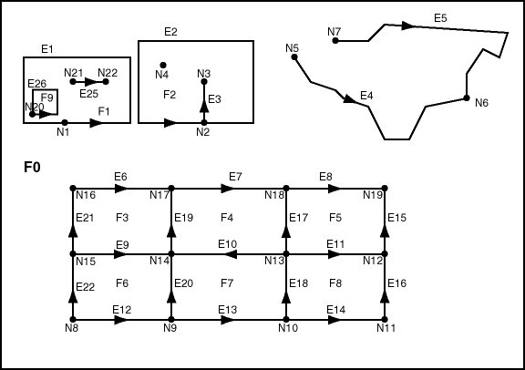
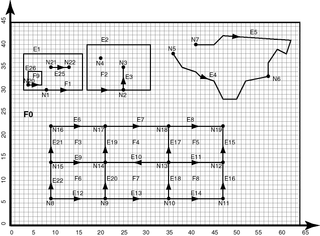
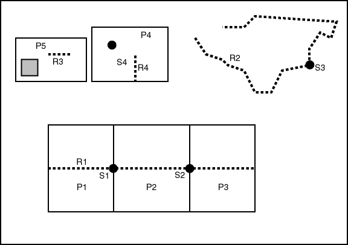
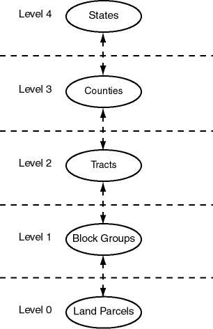
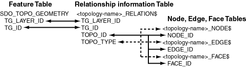
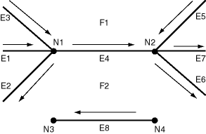

## 1  Topology Data Model Overview

The Topology Data Model feature of Oracle Spatial and Graph lets you work with data about nodes, edges, and faces in a topology.

**Note:**

Topology Data Model is supported only if Oracle JVM is enabled on your Oracle Autonomous Database Serverless deployments. To enable Oracle JVM, see [Use Oracle Java](http://www.oracle.com/pls/topic/lookup?ctx=en/cloud/paas/autonomous-database&id=GUID-2516EE33-B38D-4270-BE52-30A4F9014E8B) in Using Oracle Autonomous Database Serverless for more information.

For example, United States Census geographic data is provided in terms of nodes, chains, and polygons, and this data can be represented using the Spatial and Graph Topology Data Model feature. You can store information about topological elements and geometry layers in Oracle Spatial and Graph tables and metadata views. You can then perform certain spatial operations referencing the topological elements, for example, finding which chains (such as streets) have any spatial interaction with a specific polygon entity (such as a park).

This chapter describes the spatial data structures and data types that support the Topology Data Model feature, and what you need to do to populate and manipulate the structures. You can use this information to write a program to convert your topological data into formats usable with Spatial and Graph.

**Note:**

Although this chapter discusses some topology terms as they relate to Oracle Spatial and Graph, it assumes that you are familiar with basic topology concepts.

It also assumes that you are familiar with the main concepts, data types, and operations as documented in [Oracle Spatial and Graph Developer's Guide](../spatl/spatial-concepts-usage.md).

- Main Steps in Using Topology Data
  This topic summarizes the main steps for working with topology data.
- Topology Data Model Concepts
  Topology is a branch of mathematics concerned with objects in space. Topological relationships include such relationships as contains, inside, covers, covered by, touch, and overlap with boundaries intersecting.
- Topology Geometries and Layers
  A topology geometry (also referred to as a feature) is a spatial representation of a real world object. For example, Main Street and Walden State Park might be the names of topology geometries.
- Topology Geometry Layer Hierarchy
  In some topologies, the topology geometry layers (feature layers) have one or more parent-child relationships in a topology hierarchy. That is, the layer at the topmost level consists of features in its child layer at the next level down in the hierarchy; the child layer might consist of features in its child layer at the next layer farther down; and so on.
- Topology Data Model Tables
  To use the Spatial and Graph topology capabilities, you must first insert data into special edge, node, and face tables, which are created by Spatial and Graph when you create a topology.
- Topology Data Types
  The main data type associated with the Topology Data Model is SDO_TOPO_GEOMETRY, which describes a topology geometry.
- Topology Metadata Views
  There are two sets of topology metadata views for each schema (user): xxx_SDO_TOPO_INFO and xxx_SDO_TOPO_METADATA, where xxx can be USER or ALL. These views are read-only to users; they are created and maintained by Spatial and Graph.
- Topology Application Programming Interface
  The Topology Data Model application programming interface (API) consists of the following.
- Exporting and Importing Topology Data
  You can export a topology from one database and import it into a new topology with the same name, structures, and data in another database, as long as the target database does not already contain a topology with the same name as the exported topology.
- Cross-Schema Topology Usage and Editing
  This topic contains requirements and guidelines for using and editing topologies when multiple database users (schemas) are involved.
- Function-Based Indexes Not Supported
  You cannot create a function-based index on a column of type SDO_TOPO_GEOMETRY.
- Topology Examples (PL/SQL)
  This topic presents simplified PL/SQL examples that perform Topology Data Model operations.
- README File for Spatial and Graph and Related Features
  A `README.txt` file supplements the information in the following manuals:

**Parent topic:** [Topology Data Model](topology-data-model.md)

### 1.1 Main Steps in Using Topology Data

This topic summarizes the main steps for working with topology data.

It refers to important concepts, structures, and operations that are described in detail in other topics.

The specific main steps depend on which of two basic approaches you follow, which depend on the kind of data you will use to build the topology:

- If you have data about the edges, nodes, and faces (but not spatial geometry data), follow the steps in Using a Topology Built from Topology Data.

- If you will build the topology from spatial geometries that will become topology features, follow the steps in Using a Topology Built from Spatial Geometries.

You can use the Topology Data Model PL/SQL and Java APIs to update the topology (for example, to change the data about an edge, node, or face). The PL/SQL API for most editing operations is the SDO_TOPO_MAP package, which is documented in [SDO_TOPO_MAP Package Subprograms](SDO_TOPO_MAP-reference.md). The Java API is described in Topology Data Model Java Interface.

- Using a Topology Built from Topology Data
- Using a Topology Built from Spatial Geometries

**Parent topic:** Topology Data Model Overview

#### 1.1.1 Using a Topology Built from Topology Data

The main steps for working with a topology built from topology data are as follows:

1.  Create the topology, using the [SDO_TOPO.CREATE_TOPOLOGY](SDO_TOPO-reference.md) procedure. This causes the \<topology-name\>\_EDGE\$, \<topology-name\>\_NODE\$, \<topology-name\>\_FACE\$, and \<topology-name\>\_HISTORY\$ tables to be created. (These tables are described in Edge Information Table, Node Information Table, Face Information Table, and History Information Table, respectively.)
2.  Load topology data into the node, edge, and face tables created in Step 1. This is typically done using a bulk-load utility, but it can be done using SQL INSERT statements.
3.  Create a feature table for each type of topology geometry layer in the topology. For example, a city data topology might have separate feature tables for land parcels, streets, and traffic signs.
4.  Associate the feature tables with the topology, using the [SDO_TOPO.ADD_TOPO_GEOMETRY_LAYER](SDO_TOPO-reference.md) procedure for each feature table. This causes the \<topology-name\>\_RELATION\$ table to be created. (This table is described in Relationship Information Table.)
5.  Initialize topology metadata, using the [SDO_TOPO.INITIALIZE_METADATA](SDO_TOPO-reference.md) procedure. (This procedure also creates spatial indexes on the \<topology-name\>\_EDGE\$, \<topology-name\>\_NODE\$, and \<topology-name\>\_FACE\$ tables, and additional B-tree indexes on the \<topology-name\>\_EDGE\$ and \<topology-name\>\_NODE\$ tables.)
6.  Load the feature tables using the SDO_TOPO_GEOMETRY constructor. (This constructor is described in SDO_TOPO_GEOMETRY Constructors.)
7.  Query the topology data (for example, using one of topology operators described in Topology Operators).
8.  Optionally, edit topology data using the PL/SQL or Java application programming interfaces (APIs).

Topology Built from Topology Data contains a PL/SQL example that performs these main steps.

**Parent topic:** Main Steps in Using Topology Data

#### 1.1.2 Using a Topology Built from Spatial Geometries

To build a topology from spatial geometries, you must first perform the standard operations for preparing data for use with Oracle Spatial and Graph, as described in [Oracle Spatial and Graph Developer's Guide](../spatl/spatial-concepts-usage.md):

1.  Create the spatial tables.

2.  Update the spatial metadata (USER_SDO_GEOM_METADATA view).

3.  Load data into the spatial tables.

4.  Validate the spatial data.

5.  Create the spatial indexes.

The main steps for working with a topology built from Oracle Spatial and Graph geometries are as follows:

1.  Create the topology, using the [SDO_TOPO.CREATE_TOPOLOGY](SDO_TOPO-reference.md) procedure. This causes the \<topology-name\>\_EDGE\$, \<topology-name\>\_NODE\$, \<topology-name\>\_FACE\$, and \<topology-name\>\_HISTORY\$ tables to be created. (These tables are described in Edge Information Table, Node Information Table, Face Information Table, and History Information Table, respectively.)
2.  Create the universe face (F0, defined in Topology Data Model Concepts).
3.  Create a feature table for each type of topology geometry layer in the topology. For example, a city data topology might have separate feature tables for land parcels, streets, and traffic signs.
4.  Associate the feature tables with the topology, using the [SDO_TOPO.ADD_TOPO_GEOMETRY_LAYER](SDO_TOPO-reference.md) procedure for each feature table. This causes the \<topology-name\>\_RELATION\$ table to be created. (This table is described in Relationship Information Table.)
5.  Initialize topology metadata, using the [SDO_TOPO.INITIALIZE_METADATA](SDO_TOPO-reference.md) procedure. (This procedure also creates spatial indexes on the \<topology-name\>\_EDGE\$, \<topology-name\>\_NODE\$, and \<topology-name\>\_FACE\$ tables, and additional B-tree indexes on the \<topology-name\>\_EDGE\$ and \<topology-name\>\_NODE\$ tables.)
6.  Create a TopoMap object and load the whole topology into cache.
7.  Load the feature tables, inserting data from the spatial tables and using the [SDO_TOPO_MAP.CREATE_FEATURE](SDO_TOPO_MAP-reference.md) function.
8.  Query the topology data (using one of topology operators described in Topology Operators).
9.  Optionally, edit topology data using the PL/SQL or Java application programming interfaces (APIs).

Topology Built from Spatial Geometries contains a PL/SQL example that performs these main steps.

**Parent topic:** Main Steps in Using Topology Data

### 1.2 Topology Data Model Concepts

Topology is a branch of mathematics concerned with objects in space. Topological relationships include such relationships as contains, inside, covers, covered by, touch, and overlap with boundaries intersecting.

Topological relationships remain constant when the coordinate space is deformed, such as by twisting or stretching. (Examples of relationships that are not topological include length of, distance between, and area of.)

The basic elements in a topology are its nodes, edges, and faces.

A node, represented by a point, can be isolated or it can be used to bound edges. Two or more edges meet at a non-isolated node. A node has a coordinate pair associated with it that describes the spatial location for that node. Examples of geographic entities that might be represented as nodes include start and end points of streets, places of historical interest, and airports (if the map scale is sufficiently large).

An edge is bounded by two nodes: the start (origin) node and the end (terminal) node. An edge has an associated geometric object, usually a coordinate string that describes the spatial representation of the edge. An edge may have several vertices making up a line string. (Circular arcs are not supported for topologies.) Examples of geographic entities that might be represented as edges include segments of streets and rivers.

The order of the coordinates gives a direction to an edge, and direction is important in determining topological relationships. The positive direction agrees with the orientation of the underlying edge, and the negative direction reverses this orientation. Each orientation of an edge is referred to as a directed edge, and each directed edge is the mirror image of its other directed edge. The start node of the positive directed edge is the end node of the negative directed edge. An edge also lies between two faces and has references to both of them. Each directed edge contains a reference to the next edge in the contiguous perimeter of the face on its left side.A face, corresponding to a polygon, has a reference to one directed edge of its outer boundary. If any island nodes or island edges are present, the face also has a reference to one directed edge on the boundary of each island. Examples of geographic entities that might be represented as faces include parks, lakes, counties, and states.

Figure 1-1 shows a simplified topology containing nodes, edges, and faces. The arrowheads on each edge indicate the positive direction of the edge (or, more precisely, the orientation of the underlying line string or curve geometry for positive direction of the edge).

Figure 1-1 Simplified Topology

[Description of "Figure 1-1 Simplified Topology"](img_text/topo_node_edge_face.md)

Notes on Figure 1-1:

- E elements (E1, E2, and so on) are edges, F elements (F0, F1, and so on) are faces, and N elements (N1, N2, and so on) are nodes.

- F0 (face zero) is created for every topology. It is the universe face containing everything else in the topology. There is no geometry associated with the universe face. F0 has the face ID value of -1 (negative 1).

- There is a node created for every point geometry and for every start and end node of an edge. For example, face F1 has only an edge (a closed edge), E1, that has the same node as the start and end nodes (N1). F1 also has edge E25, with start node N21 and end node N22.

- An isolated node (also called an island node) is a node that is isolated in a face. For example, node N4 is an isolated node in face F2.

- An isolated edge (also called an island edge) is an edge that is isolated in a face. For example, edge E25 is an isolated edge in face F1.

- A loop edge is an edge that has the same node as its start node and end node. For example, edge E1 is a loop edge starting and ending at node N1.

- An edge cannot have an isolated (island) node on it. The edge can be broken up into two edges by adding a node on the edge. For example, if there was originally a single edge between nodes N16 and N18, adding node N17 resulted in two edges: E6 and E7.

- Information about the topological relationships is stored in special edge, face, and node information tables. For example, the edge information table contains the following information about edges E9 and E10. (Note the direction of the arrowheads for each edge.) The next and previous edges are based on the left and right faces of the edge.

  For edge E9, the start node is N15 and the end node is N14, the next left edge is E19 and the previous left edge is -E21, the next right edge is -E22 and the previous right edge is E20, the left face is F3 and the right face is F6.

  For edge E10, the start node is N13 and the end node is N14, the next left edge is -E20 and the previous left edge is E18, the next right edge is E17 and the previous right edge is -E19, the left face is F7 and the right face is F4.

  For additional examples of edge-related data, including an illustration and explanations, see Edge Information Table.

Figure 1-2 shows the same topology illustrated in Figure 1-1, but it adds a grid and unit numbers along the x-axis and y-axis. Figure 1-2 is useful for understanding the output of some of the examples in [SDO_TOPO Package Subprograms](SDO_TOPO-reference.md) and [SDO_TOPO_MAP Package Subprograms](SDO_TOPO_MAP-reference.md).

Figure 1-2 Simplified Topology, with Grid Lines and Unit Numbers

[Description of "Figure 1-2 Simplified Topology, with Grid Lines and Unit Numbers"](img_text/topo_xy_axes.md)

- Tolerance in the Topology Data Model

**Parent topic:** Topology Data Model Overview

#### 1.2.1 Tolerance in the Topology Data Model

Tolerance is used to associate a level of precision with spatial data. Tolerance reflects the distance that two points can be apart and still be considered the same (for example, to accommodate rounding errors). The tolerance value must be a positive number greater than zero.

However, in the Topology Data Model, tolerance can have two meanings depending on the operation being performed: one meaning is the traditional Oracle Spatial and Graph definition of tolerance, and the other is a fixed tolerance value of 10E-15.

- The tolerance value specified in the call to the [SDO_TOPO.CREATE_TOPOLOGY](SDO_TOPO-reference.md) procedure refers to the traditional Oracle Spatial and Graph definition, as explained in [Oracle Spatial and Graph Developer's Guide](../spatl/spatial-concepts.md). This value is used when indexes are created in the node, edge, and face tables, and when spatial operators are used to query these tables.

- The tolerance value used for internal computations (for example, finding edge intersections) during topology editing operations is always 10E-15 (based on Java double precision arithmetic). This value is used during the validation checks performed by the [SDO_TOPO_MAP.VALIDATE_TOPO_MAP](SDO_TOPO_MAP-reference.md) and [SDO_TOPO_MAP.VALIDATE_TOPOLOGY](SDO_TOPO_MAP-reference.md) functions.

Thus, for example, an edge geometry that is considered valid by the [SDO_TOPO_MAP.VALIDATE_TOPO_MAP](SDO_TOPO_MAP-reference.md) or [SDO_TOPO_MAP.VALIDATE_TOPOLOGY](SDO_TOPO_MAP-reference.md) function might not be valid if that geometry is passed to the SDO_GEOM.VALIDATE_GEOMETRY_WITH_CONTEXT function.

**Parent topic:** Topology Data Model Concepts

### 1.3 Topology Geometries and Layers

A topology geometry (also referred to as a feature) is a spatial representation of a real world object. For example, Main Street and Walden State Park might be the names of topology geometries.

The geometry is stored as a set of topological elements (nodes, edges, and faces), which are sometimes also referred to as primitives. Each topology geometry has a unique ID (assigned by Spatial and Graph when records are imported or loaded) associated with it.

A topology geometry layer consists of topology geometries, usually of a specific topology geometry type, although it can be a collection of multiple types (see Collection Layers for information about collection layers). For example, Streets might be the topology geometry layer that includes the Main Street topology geometry, and State Parks might be the topology geometry layer that includes the Walden State Park topology geometry. Each topology geometry layer has a unique ID (assigned by Spatial and Graph) associated with it. The data for each topology geometry layer is stored in a feature table. For example, a feature table named CITY_STREETS might contain information about all topology geometries (individual roads or streets) in the Streets topology geometry layer.

Each topology geometry (feature) is defined as an object of type SDO_TOPO_GEOMETRY (described in SDO_TOPO_GEOMETRY Type), which identifies the topology geometry type, topology geometry ID, topology geometry layer ID, and topology ID for the topology.

Topology metadata is automatically maintained by Spatial and Graph in the USER_SDO_TOPO_METADATA and ALL_SDO_TOPO_METADATA views, which are described in xxx_SDO_TOPO_METADATA Views. The USER_SDO_TOPO_INFO and ALL_SDO_TOPO_INFO views (described in xxx_SDO_TOPO_INFO Views) contain a subset of this topology metadata.

- Features
- Collection Layers

**Parent topic:** Topology Data Model Overview

#### 1.3.1 Features

Often, there are fewer features in a topology than there are topological elements (nodes, edges, and faces). For example, a road feature may consist of many edges, an area feature such as a park may consist of many faces, and some nodes may not be associated with point features. Figure 1-3 shows point, line, and area features associated with the topology that was shown in Figure 1-1 in Topology Data Model Concepts.

Figure 1-3 Features in a Topology

[Description of "Figure 1-3 Features in a Topology"](img_text/topo_features.md)

Figure 1-3 shows the following kinds of features in the topology:

- Point features (traffic signs), shown as dark circles: `S1`, `S2`, `S3`, and `S4`

- Linear features (roads or streets), shown as dashed lines: `R1`, `R2`, `R3`, and `R4`

- Area features (land parcels), shown as rectangles: `P1`, `P2`, `P3`, `P4`, and `P5`

  Land parcel `P5` does not include the shaded area within its area. (Specifically, `P5` includes face `F1` but not face `F9`. These faces are shown in Figure 1-1 in Topology Data Model Concepts.)

Example 1-12 in Topology Built from Topology Data defines these features.

**Parent topic:** Topology Geometries and Layers

#### 1.3.2 Collection Layers

A collection layer is a topology geometry layer that can contain topological elements of different topology geometry types. For example, using the `CITY_DATA` topology from the examples in Topology Examples (PL/SQL), you could create a collection layer to contain specific land parcel, city street, and traffic sign elements.

To create a collection layer, follow essentially the same steps for creating other types of layers. Create a feature table for the layer, as in the following example:

    CREATE TABLE collected_features ( -- Selected heterogeneous features
      feature_name VARCHAR2(30) PRIMARY KEY,
      feature SDO_TOPO_GEOMETRY);

Associate the feature table with the topology, specifying `COLLECTION` for the `topo_geometry_layer_type` parameter in the call to the [SDO_TOPO.ADD_TOPO_GEOMETRY_LAYER](SDO_TOPO-reference.md) procedure, as in the following example:

    EXECUTE SDO_TOPO.ADD_TOPO_GEOMETRY_LAYER('CITY_DATA', COLLECTED_FEATURES', 'FEATURE', 'COLLECTION');

To load the feature table for the collection layer, insert the necessary rows, as shown in Example 1-1.

Example 1-1 Loading the Feature Table for a Collection Layer

    -- Take R5 from the CITY_STREETS layer.
    INSERT INTO collected_features VALUES(
      'C_R5',
      SDO_TOPO_GEOMETRY('CITY_DATA',
        2,  -- tg_type = line/multiline
        4,  -- tg_layer_id
        SDO_TOPO_OBJECT_ARRAY(
          SDO_TOPO_OBJECT(20, 2),
          SDO_TOPO_OBJECT(-9, 2)))
    );

    -- Take S3 from the TRAFFIC_SIGNS layer.
    INSERT INTO collected_features VALUES(
      'C_S3',
      SDO_TOPO_GEOMETRY('CITY_DATA',
        1,  -- tg_type = point/multipoint
        4,  -- topo layer id
        SDO_TOPO_OBJECT_ARRAY(
           SDO_TOPO_OBJECT(6, 1)))
    );

    -- Take P3 from the LAND_PARCELS layer.
    INSERT INTO collected_features VALUES(
      'C_P3',
      SDO_TOPO_GEOMETRY('CITY_DATA',
        3,  -- tg_type = (multi)polygon
        4,
        SDO_TOPO_OBJECT_ARRAY(
          SDO_TOPO_OBJECT(5, 3),
          SDO_TOPO_OBJECT(8, 3)))
    );

    -- Create a collection from a polygon and a point.
    INSERT INTO collected_features VALUES(
      'C1',
      SDO_TOPO_GEOMETRY('CITY_DATA',
        4,  -- tg_type = collection
        4,
        SDO_TOPO_OBJECT_ARRAY(
          SDO_TOPO_OBJECT(5, 3),
          SDO_TOPO_OBJECT(6, 1)))
    );

    -- Create a collection from a polygon and a line.
    INSERT INTO collected_features VALUES(
      'C2',
      SDO_TOPO_GEOMETRY('CITY_DATA',
        4,  -- tg_type = collection
        4,
        SDO_TOPO_OBJECT_ARRAY(
          SDO_TOPO_OBJECT(8, 3),
          SDO_TOPO_OBJECT(10, 2)))
    );

    -- Create a collection from a line and a point.
    INSERT INTO collected_features VALUES(
      'C3',
      SDO_TOPO_GEOMETRY('CITY_DATA',
         4,  -- tg_type = collection
         4,
         SDO_TOPO_OBJECT_ARRAY(
           SDO_TOPO_OBJECT(-5, 2),
           SDO_TOPO_OBJECT(10, 1)))
    );

**Parent topic:** Topology Geometries and Layers

### 1.4 Topology Geometry Layer Hierarchy

In some topologies, the topology geometry layers (feature layers) have one or more parent-child relationships in a topology hierarchy. That is, the layer at the topmost level consists of features in its child layer at the next level down in the hierarchy; the child layer might consist of features in its child layer at the next layer farther down; and so on.

For example, a land use topology might have the following topology geometry layers at different levels of hierarchy:

- States at the highest level, which consists of features from its child layer, Counties

- Counties at the next level down, which consists of features from its child layer, Tracts

- Tracts at the next level down, which consists of features from its child layer, Block Groups

- Block Groups at the next level down, which consists of features from its child layer, Land Parcels

- Land Parcels at the lowest level of the hierarchy

If the topology geometry layers in a topology have this hierarchical relationship, it is far more efficient if you model the layers as hierarchical than if you specify all topology geometry layers at a single level (that is, with no hierarchy). For example, it is more efficient to construct SDO_TOPO_GEOMETRY objects for counties by specifying only the tracts in the county than by specifying all land parcels in all block groups in all tracts in the county.

The lowest level (for the topology geometry layer containing the smallest kinds of features) in a hierarchy is level 0, and successive higher levels are numbered 1, 2, and so on. Topology geometry layers at adjacent levels of a hierarchy have a parent-child relationship. Each topology geometry layer at the higher level is the parent layer for one layer at the lower level, which is its child layer. A parent layer can have only one child layer, but a child layer can have one or more parent layers. Using the preceding example, the Counties layer can have only one child layer, Tracts; however, the Tracts layer could have parent layers named Counties and Water Districts.

**Note:**

Topology geometry layer hierarchy is somewhat similar to network hierarchy, which is described in [Network Hierarchy](network-data-model-graph-overview.md); however, there are significant differences, and you should not confuse the two. For example, the lowest topology geometry layer hierarchy level is 0, and the lowest network hierarchy level is 1; and in a topology geometry layer hierarchy each parent must have one child and each child can have many parents, while in a network hierarchy each parent can have many children and each child must have one parent.

Figure 1-4 shows the preceding example topology geometry layer hierarchy. Each level of the hierarchy shows the level number and the topology geometry layer in that level.

Figure 1-4 Topology Geometry Layer Hierarchy

[Description of "Figure 1-4 Topology Geometry Layer Hierarchy"](img_text/topo_hier.md)

Example 1-2 Modeling a Topology Geometry Layer Hierarchy

To model topology geometry layers as hierarchical, specify the child layer in the `child_layer_id` parameter when you call the [SDO_TOPO.ADD_TOPO_GEOMETRY_LAYER](SDO_TOPO-reference.md) procedure to add a parent topology geometry layer to the topology. Add the lowest-level (level 0) topology geometry layer first; then add the level 1 layer, specifying the level 0 layer as its child; then add the level 2 layer, specifying the level 1 layer as its child; and so on. Example 1-2 shows five topology geometry layers being added so that the 5-level hierarchy is established.

    -- Create the topology. (Null SRID in this example.)
    EXECUTE SDO_TOPO.CREATE_TOPOLOGY('LAND_USE_HIER', 0.00005);

    -- Create feature tables.
    CREATE TABLE land_parcels ( -- Land parcels (selected faces)
      feature_name VARCHAR2(30) PRIMARY KEY,
      feature SDO_TOPO_GEOMETRY);

    CREATE TABLE block_groups (
      feature_name VARCHAR2(30) PRIMARY KEY,
      feature SDO_TOPO_GEOMETRY);

    CREATE TABLE tracts (
      feature_name VARCHAR2(30) PRIMARY KEY,
      feature SDO_TOPO_GEOMETRY);

    CREATE TABLE counties (
      feature_name VARCHAR2(30) PRIMARY KEY,
      feature SDO_TOPO_GEOMETRY);

    CREATE TABLE states (
      feature_name VARCHAR2(30) PRIMARY KEY,
      feature SDO_TOPO_GEOMETRY);

    -- (Other steps not shown here, such as populating the feature tables
    -- and initializing the metadata.)
    . . .
    -- Associate feature tables with the topology; include hierarchy information.

    DECLARE
      land_parcels_id NUMBER;
      block_groups_id NUMBER;
      tracts_id NUMBER;
      counties_id NUMBER;
    BEGIN
    SDO_TOPO.ADD_TOPO_GEOMETRY_LAYER('LAND_USE_HIER', 'LAND_PARCELS',
      'FEATURE','POLYGON');
    SELECT tg_layer_id INTO land_parcels_id FROM user_sdo_topo_info
      WHERE topology = 'LAND_USE_HIER' AND table_name = 'LAND_PARCELS';
    SDO_TOPO.ADD_TOPO_GEOMETRY_LAYER('LAND_USE_HIER', 'BLOCK_GROUPS',
      'FEATURE','POLYGON', NULL, land_parcels_id);
    SELECT tg_layer_id INTO block_groups_id FROM user_sdo_topo_info
      WHERE topology = 'LAND_USE_HIER' AND table_name = 'BLOCK_GROUPS';
    SDO_TOPO.ADD_TOPO_GEOMETRY_LAYER('LAND_USE_HIER', 'TRACTS',
      'FEATURE','POLYGON', NULL, block_groups_id);
    SELECT tg_layer_id INTO tracts_id FROM user_sdo_topo_info
      WHERE topology = 'LAND_USE_HIER' AND table_name = 'TRACTS';
    SDO_TOPO.ADD_TOPO_GEOMETRY_LAYER('LAND_USE_HIER', 'COUNTIES',
      'FEATURE','POLYGON', NULL, tracts_id);
    SELECT tg_layer_id INTO counties_id FROM user_sdo_topo_info
      WHERE topology = 'LAND_USE_HIER' AND table_name = 'COUNTIES';
    SDO_TOPO.ADD_TOPO_GEOMETRY_LAYER('LAND_USE_HIER', 'STATES',
      'FEATURE','POLYGON', NULL, counties_id);
    END;/

Within each level above level 0, each layer can contain features built from features at the next lower level (as is done in Example 1-2), features built from topological elements (faces, nodes, edges), or a combination of these. For example, a tracts layer can contain tracts built from block groups or tracts built from faces, or both. However, each feature within the layer must be built only either from features from the next lower level or from topological elements. For example, a specific tract can consist of block groups or it can consist of faces, but it cannot consist of a combination of block groups and faces.

To insert or update topology geometry objects in feature tables for the levels in a hierarchy, use the appropriate forms of the SDO_TOPO_GEOMETRY constructor. Feature tables are described in Topology Geometries and Layers, and SDO_TOPO_GEOMETRY constructors are described in SDO_TOPO_GEOMETRY Constructors.

Note that the TOPO_ID and TOPO_TYPE attributes in the relationship information table have special meanings when applied to parent layers in a topology with a topology geometry layer hierarchy. See the explanations of these attributes in Table 1-5 in Relationship Information Table.

**Parent topic:** Topology Data Model Overview

### 1.5 Topology Data Model Tables

To use the Spatial and Graph topology capabilities, you must first insert data into special edge, node, and face tables, which are created by Spatial and Graph when you create a topology.

The edge, node, and face tables are described in Edge Information Table, Node Information Table, and Face Information Table, respectively.

Spatial and Graph automatically maintains a relationship information (\<topology-name\>\_RELATION\$) table for each topology, which is created the first time that a feature table is associated with a topology (that is, at the first call to the [SDO_TOPO.ADD_TOPO_GEOMETRY_LAYER](SDO_TOPO-reference.md) procedure that specifies the topology). The relationship information table is described in Relationship Information Table.

Figure 1-5 shows the role of the relationship information table in connecting information in a feature table with information in its associated node, edge, or face table.

Figure 1-5 Mapping Between Feature Tables and Topology Tables

[Description of "Figure 1-5 Mapping Between Feature Tables and Topology Tables"](img_text/feat_topo_rel.md)

As shown in Figure 1-5, the mapping between feature tables and the topology node, edge, and face tables occurs through the \<topology-name\>\_RELATION\$ table. In particular:

- Each feature table includes a column of type SDO_TOPO_GEOMETRY. This type includes a TG_LAYER_ID attribute (the unique ID assigned by Oracle Spatial and Graph when the layer is created), as well as a TG_ID attribute (the unique ID assigned to each feature in a layer). The values in these two columns have corresponding values in the TG_LAYER_ID and TG_ID columns in the \<topology-name\>\_RELATION\$ table.

- Each feature has one or more rows in the \<topology-name\>\_RELATION\$ table.

- Given the TG_LAYER_ID and TG_ID values for a feature, the set of nodes, faces, and edges associated with the feature can be determined by matching the TOPO_ID value (the node, edge, or face ID) in the \<topology-name\>\_RELATION\$ table with the corresponding ID value in the \<topology-name\>\_NODE\$, \<topology-name\>\_EDGE\$, or \<topology-name\>\_FACE\$ table.

The following considerations apply to schema, table, and column names that are stored in any Oracle Spatial and Graph metadata views. For example, these considerations apply to the names of edge, node, face, relationship, and history information tables, and to the names of any columns in these tables and schemas for these tables that are stored in the topology metadata views described in Topology Metadata Views.

- The name must contain only letters, numbers, and underscores. For example, the name cannot contain a space (` `), an apostrophe (`'`), a quotation mark (`"`), or a comma (`,`).

- All letters in the names are converted to uppercase before the names are stored in metadata views or before the tables are accessed. This conversion also applies to any schema name specified with the table name.

<!-- -->

- Edge Information Table
- Node Information Table
- Face Information Table
- Relationship Information Table
- History Information Table

**Parent topic:** Topology Data Model Overview

#### 1.5.1 Edge Information Table

You must store information about the edges in a topology in the \<topology-name\>\_EDGE\$ table, where \<topology-name\> is the name of the topology as specified in the call to the [SDO_TOPO.CREATE_TOPOLOGY](SDO_TOPO-reference.md) procedure. Each edge information table has the columns shown in Table 1-1.

Table 1-1 Columns in the \<topology-name\>\_EDGE\$ Table

| Column Name        | Data Type    | Description                                                                                                                       |
|:-------------------|:-------------|:----------------------------------------------------------------------------------------------------------------------------------|
| EDGE_ID            | NUMBER       | Unique ID number for this edge                                                                                                    |
| START_NODE_ID      | NUMBER       | ID number of the start node for this edge                                                                                         |
| END_NODE_ID        | NUMBER       | ID number of the end node for this edge                                                                                           |
| NEXT_LEFT_EDGE_ID  | NUMBER       | ID number (signed) of the next left edge for this edge                                                                            |
| PREV_LEFT_EDGE_ID  | NUMBER       | ID number (signed) of the previous left edge for this edge                                                                        |
| NEXT_RIGHT_EDGE_ID | NUMBER       | ID number (signed) of the next right edge for this edge                                                                           |
| PREV_RIGHT_EDGE_ID | NUMBER       | ID number (signed) of the previous right edge for this edge                                                                       |
| LEFT_FACE_ID       | NUMBER       | ID number of the left face for this edge                                                                                          |
| RIGHT_FACE_ID      | NUMBER       | ID number of the right face for this edge                                                                                         |
| GEOMETRY           | SDO_GEOMETRY | Geometry object (line string) representing this edge, listing the coordinates in the natural order for the positive directed edge |

The NEXT_LEFT_EDGE_ID and NEXT_RIGHT_EDGE_ID values refer to the next directed edges in the counterclockwise delineation of the perimeters of the left and right faces, respectively. The PREV_LEFT_EDGE_ID and PREV_RIGHT_EDGE_ID values refer to the previous directed edges in the counterclockwise delineation of the perimeters of the left and right faces, respectively. The LEFT_FACE_ID value refers to the face to the left of the positive directed edge, and the RIGHT_FACE_ID value refers to the face to the left of the negative directed edge. For any numeric ID value, the sign indicates which orientation of the target edge is being referred to.

Figure 1-6 shows nodes, edges, and faces that illustrate the relationships among the various ID columns in the edge information table. (In Figure 1-6, thick lines show the edges, and thin lines with arrowheads show the direction of each edge.)

Figure 1-6 Nodes, Edges, and Faces

[Description of "Figure 1-6 Nodes, Edges, and Faces"](img_text/edge_table.md)

Table 1-2 shows the ID column values in the edge information table for edges E4 and E8 in Figure 1-6. (For clarity, Table 1-2 shows ID column values with alphabetical characters, such as E4 and N1; however, the ID columns actually contain numeric values only, specifically the numeric ID value associated with each named object.)

Table 1-2 Edge Table ID Column Values

| EDGE_ID | START_NODE_ID | END_NODE_ID | NEXT_LEFT_EDGE_ID | PREV_LEFT_EDGE_ID | NEXT_RIGHT_EDGE_ID | PREV_RIGHT_EDGE_ID | LEFT_FACE_ID | RIGHT_FACE_ID |
|:--------|:--------------|:------------|:------------------|:------------------|:-------------------|:-------------------|:-------------|:--------------|
| E4      | N1            | N2          | -E5               | E3                | E2                 | -E6                | F1           | F2            |
| E8      | N4            | N3          | -E8               | -E8               | E8                 | E8                 | F2           | F2            |

In Figure 1-6 and Table 1-2:

- The start node and end node for edge E4 are N1 and N2, respectively. The next left edge for edge E4 is E5, but its direction is the opposite of edge E4, and therefore the next left edge for E4 is stored as -E5 (negative E5).

- The previous left edge for edge E4 is E3, and because it has the same direction as edge E4, the previous left edge for E4 is stored as E3.

- The next right face is determined using the negative directed edge of E4. This can be viewed as reversing the edge direction and taking the next left edge and previous left edge. In this case, the next right edge is E2 and the previous right edge is -E6 (the direction of edge E6 is opposite the negative direction of edge E4). For edge E4, the left face is F1 and the right face is F2.

- Edges E1 and E7 are neither leftmost nor rightmost edges with respect to edge E4, and therefore they do not appear in the edge table row associated with edge E4.

**Parent topic:** Topology Data Model Tables

#### 1.5.2 Node Information Table

You must store information about the nodes in a topology in the \<topology-name\>\_NODE\$ table, where \<topology-name\> is the name of the topology as specified in the call to the [SDO_TOPO.CREATE_TOPOLOGY](SDO_TOPO-reference.md) procedure. Each node information table has the columns shown in Table 1-3.

Table 1-3 Columns in the \<topology-name\>\_NODE\$ Table

| Column Name | Data Type    | Description                                                       |
|:------------|:-------------|:------------------------------------------------------------------|
| NODE_ID     | NUMBER       | Unique ID number for this node                                    |
| EDGE_ID     | NUMBER       | ID number (signed) of the edge (if any) associated with this node |
| FACE_ID     | NUMBER       | ID number of the face (if any) associated with this node          |
| GEOMETRY    | SDO_GEOMETRY | Geometry object (point) representing this node                    |

For each node, the EDGE_ID or FACE_ID value (but not both) must be null:

- If the EDGE_ID value is null, the node is an isolated node (that is, isolated in a face).

- If the FACE_ID value is null, the node is not an isolated node, but rather the start node or end node of an edge.

**Parent topic:** Topology Data Model Tables

#### 1.5.3 Face Information Table

You must store information about the faces in a topology in the \<topology-name\>\_FACE\$ table, where \<topology-name\> is the name of the topology as specified in the call to the [SDO_TOPO.CREATE_TOPOLOGY](SDO_TOPO-reference.md) procedure. Each face information table has the columns shown in Table 1-4.

Table 1-4 Columns in the \<topology-name\>\_FACE\$ Table

| Column Name         | Data Type     | Description                                                                                                                                                                                                                                                                                                                                                    |
|:--------------------|:--------------|:---------------------------------------------------------------------------------------------------------------------------------------------------------------------------------------------------------------------------------------------------------------------------------------------------------------------------------------------------------------|
| FACE_ID             | NUMBER        | Unique ID number for this face                                                                                                                                                                                                                                                                                                                                 |
| BOUNDARY_EDGE_ID    | NUMBER        | ID number of the boundary edge for this face. The sign of this number (which is ignored for use as a key) indicates which orientation is being used for this boundary component (positive numbers indicate the left of the edge, and negative numbers indicate the right of the edge).                                                                         |
| ISLAND_EDGE_ID_LIST | SDO_LIST_TYPE | Island edges (if any) in this face. (The SDO_LIST_TYPE type is described in SDO_LIST_TYPE Type.)                                                                                                                                                                                                                                                               |
| ISLAND_NODE_ID_LIST | SDO_LIST_TYPE | Island nodes (if any) in this face. (The SDO_LIST_TYPE type is described in SDO_LIST_TYPE Type.)                                                                                                                                                                                                                                                               |
| MBR_GEOMETRY        | SDO_GEOMETRY  | Minimum bounding rectangle (MBR) that encloses this face. (This is required, except for the universe face.) The MBR must be stored as an optimized rectangle (a rectangle in which only the lower-left and the upper-right corners are specified). The [SDO_TOPO.INITIALIZE_METADATA](SDO_TOPO-reference.md) procedure creates a spatial index on this column. |

**Parent topic:** Topology Data Model Tables

#### 1.5.4 Relationship Information Table

As you work with topological elements, Spatial and Graph automatically maintains information about each object in \<topology-name\>\_RELATION\$ tables, where \<topology-name\> is the name of the topology and there is one such table for each topology. Each row in the table uniquely identifies a topology geometry with respect to its topology geometry layer and topology. Each relationship information table has the columns shown in Table 1-5.

Table 1-5 Columns in the \<topology-name\>\_RELATION\$ Table

| Column Name    | Data Type | Description                                                                                                                                                                                                                |
|:---------------|:----------|:---------------------------------------------------------------------------------------------------------------------------------------------------------------------------------------------------------------------------|
| TG_LAYER_ID    | NUMBER    | ID number of the topology geometry layer to which the topology geometry belongs                                                                                                                                            |
| TG_ID          | NUMBER    | ID number of the topology geometry                                                                                                                                                                                         |
| TOPO_ID        | NUMBER    | For a topology that does not have a topology geometry layer hierarchy: ID number of a topological element in the topology geometry For a topology that has a topology geometry layer hierarchy: Reserved for Oracle use |
| TOPO_TYPE      | NUMBER    | For a topology that does not have a topology geometry layer hierarchy: 1 = node, 2 = edge, 3 = face For a topology that has a topology geometry layer hierarchy: Reserved for Oracle use                                |
| TOPO_ATTRIBUTE | VARCHAR2  | Reserved for Oracle use                                                                                                                                                                                                    |

**Parent topic:** Topology Data Model Tables

#### 1.5.5 History Information Table

The history information table for a topology contains information about editing operations that are not recorded in other information tables. Thus, the history information table is not a comprehensive record of topology modifications. Instead, it contains rows for node, edge, or face editing operations only when one or more feature tables are associated with the topology and any of the following conditions are met:

- An existing face or edge is split as a result of the operation.

- A single face or edge is created by merging two faces or two edges as a result of the operation.

Spatial and Graph automatically maintains information about these operations in \<topology-name\>\_HISTORY\$ tables, where \<topology-name\> is the name of the topology and there is one such table for each topology. Each row in the table uniquely identifies an editing operation on a topological element, although an editing operation (such as using the [SDO_TOPO_MAP.ADD_POLYGON_GEOMETRY](SDO_TOPO_MAP-reference.md) function) can add multiple rows. (Topology editing is discussed in [Editing Topologies](editing-topologies.md) .) Each history information table has the columns shown in Table 1-6.

Table 1-6 Columns in the \<topology-name\>\_HISTORY\$ Table

| Column Name   | Data Type | Description                                                                                                                                                                                                                                                                                                                                                                                                                          |
|:--------------|:----------|:-------------------------------------------------------------------------------------------------------------------------------------------------------------------------------------------------------------------------------------------------------------------------------------------------------------------------------------------------------------------------------------------------------------------------------------|
| TOPO_TX_ID    | NUMBER    | ID number of the transaction that was started by a call to the [SDO_TOPO_MAP.LOAD_TOPO_MAP](SDO_TOPO_MAP-reference.md) function or procedure or to the loadWindow or loadTopology Java method. Each transaction can consist of several editing operations. You can get the transaction ID number for the current updatable TopoMap object by calling the [SDO_TOPO_MAP.GET_TOPO_TRANSACTION_ID](SDO_TOPO_MAP-reference.md) function. |
| TOPO_SEQUENCE | NUMBER    | Sequence number assigned to an editing operation within the transaction                                                                                                                                                                                                                                                                                                                                                              |
| TOPOLOGY      | VARCHAR2  | ID of the topology containing the objects being edited                                                                                                                                                                                                                                                                                                                                                                               |
| TOPO_ID       | NUMBER    | ID number of a topological element in the topology geometry                                                                                                                                                                                                                                                                                                                                                                          |
| TOPO_TYPE     | NUMBER    | Type of topological element: 1 = node, 2 = edge, 3 = face                                                                                                                                                                                                                                                                                                                                                                            |
| TOPO_OP       | VARCHAR2  | Type of editing operation that was performed on the topological element: `I` for insert or `D` for delete                                                                                                                                                                                                                                                                                                                            |
| PARENT_ID     | NUMBER    | For an insert operation, the ID of the parent topological element from which the current topological element is derived; for a delete operation, the ID of the resulting topological element                                                                                                                                                                                                                                         |

Consider the following examples:

- Adding a node to break edge E2, generating edge E3: The TOPO_ID value of the new edge is the ID of E3, the TOPO_TYPE value is 2, the PARENT_ID value is the ID of E2, and the TOPO_OP value is `I`.

- Deleting a node to merge edges E6 and E7, resulting in E7: The TOPO_ID value is the ID of E6, the TOPO_TYPE value is 2, the PARENT_ID value is the ID of E7, and the TOPO_OP value is `D`.

To further illustrate the effect of editing operations on the history information table, a test procedure was created to perform various editing operations on a simple topology, and to examine the effect on the history information table for the topology. The procedure performed these main steps:

1.  It created and initialized a non-geodetic topology with a universe face, and added a line feature layer and an area feature layer to the topology.

2.  It created a rectangular area by adding four isolated nodes and four edges connecting the isolated nodes. This caused a face (consisting of the rectangle) to be created, and it caused one row to be added to the history information table: an insert operation for the new face, whose parent is the universe face.

    The following statement shows the history information table row added by this insertion:

        SELECT topo_id, topo_type, topo_op, parent_id
          FROM hist_test_history$ ORDER BY topo_tx_id, topo_sequence, topology;

           TOPO_ID  TOPO_TYPE TOP  PARENT_ID
        ---------- ---------- --- ----------
                 1          3 I           -1

        1 row selected.

3.  It split the rectangular face into two smaller rectangular faces (side-by-side) by adding two nodes and a vertical edge connecting these nodes, which caused two edges (the top and bottom edges) and the face to be split. Three rows were added to the history information table: an insert operation for each of the two new edges (with the parent of each new edge being the existing edge that was split), and an insert operation for the new face (whose parent is the original rectangular face that was split).

    The following statement shows the history information table rows added thus far. The rows added by this step are shown in bold:

        SELECT topo_id, topo_type, topo_op, parent_id
          FROM hist_test_history$ ORDER BY topo_tx_id, topo_sequence, topology;

           TOPO_ID  TOPO_TYPE TOP  PARENT_ID
        ---------- ---------- --- ----------
                 1          3 I           -1
                 6          2 I            2
                 7          2 I            4
                 2          3 I            1

        4 rows selected.

4.  It added a diagonal edge to small rectangular face on the left (using the existing nodes), and it removed the vertical edge that was added in Step 3. Two rows were added to the history information table: an insert operation for the new face created as a result of the edge addition (with the parent of each new face being the small rectangular face on the left that was split), and a delete operation as a result of the edge removal (with the resulting face taking its topological object ID from one of the "parent" faces that were merged).

    The following statement shows the history information table rows added thus far. The rows added by this step are shown in bold:

        SELECT topo_id, topo_type, topo_op, parent_id
          FROM hist_test_history$ ORDER BY topo_tx_id, topo_sequence, topology;

           TOPO_ID  TOPO_TYPE TOP  PARENT_ID
        ---------- ---------- --- ----------
                 1          3 I           -1
                 6          2 I            2
                 7          2 I            4
                 2          3 I            1
                 3          3 I            2
                 1          3 D            2

        6 rows selected.

**Parent topic:** Topology Data Model Tables

### 1.6 Topology Data Types

The main data type associated with the Topology Data Model is SDO_TOPO_GEOMETRY, which describes a topology geometry.

The SDO_TOPO_GEOMETRY type has several constructors and member functions. This section describes the topology model types, constructors, and member functions.

- SDO_TOPO_GEOMETRY Type
- SDO_TOPO_GEOMETRY Constructors
- GET_GEOMETRY Member Function
- GET_TGL_OBJECTS Member Function
- GET_TOPO_ELEMENTS Member Function
- SDO_LIST_TYPE Type
- SDO_EDGE_ARRAY and SDO_NUMBER_ARRAY Types

**Parent topic:** Topology Data Model Overview

#### 1.6.1 SDO_TOPO_GEOMETRY Type

The description of a topology geometry is stored in a single row, in a single column of object type SDO_TOPO_GEOMETRY in a user-defined table. The object type SDO_TOPO_GEOMETRY is defined as:

    CREATE TYPE sdo_topo_geometry AS OBJECT
      (tg_type      NUMBER,
       tg_id        NUMBER,
       tg_layer_id  NUMBER,
       topology_id  NUMBER);

The SDO_TOPO_GEOMETRY type has the attributes shown in Table 1-7.

Table 1-7 SDO_TOPO_GEOMETRY Type Attributes

| Attribute   | Explanation                                                                                                                                                                             |
|:------------|:----------------------------------------------------------------------------------------------------------------------------------------------------------------------------------------|
| TG_TYPE     | Type of topology geometry: 1 = point or multipoint, 2 = line string or multiline string, 3 = polygon or multipolygon, 4 = heterogeneous collection                                      |
| TG_ID       | Unique ID number (generated by Spatial and Graph) for the topology geometry                                                                                                             |
| TG_LAYER_ID | ID number for the topology geometry layer to which the topology geometry belongs. (This number is generated by Spatial and Graph, and it is unique within the topology geometry layer.) |
| TOPOLOGY_ID | Unique ID number (generated by Spatial and Graph) for the topology                                                                                                                      |

Each topology geometry in a topology is uniquely identified by the combination of its TG_ID and TG_LAYER_ID values.

You can use an attribute name in a query on an object of SDO_TOPO_GEOMETRY. Example 1-3 shows SELECT statements that query each attribute of the FEATURE column of the CITY_STREETS table, which is defined in Example 1-12 in Topology Examples (PL/SQL).

Example 1-3 SDO_TOPO_GEOMETRY Attributes in Queries

    SELECT s.feature.tg_type FROM city_streets s;
    SELECT s.feature.tg_id FROM city_streets s;
    SELECT s.feature.tg_layer_id FROM city_streets s;
    SELECT s.feature.topology_id FROM city_streets s;

**Parent topic:** Topology Data Types

#### 1.6.2 SDO_TOPO_GEOMETRY Constructors

The SDO_TOPO_GEOMETRY type has constructors for inserting and updating topology geometry objects. The constructors can be classified into two types, depending on the kind of objects they use:

- Constructors that specify the lowest-level topological elements (nodes, edges, and faces). These constructors have at least one attribute of type SDO_TOPO_OBJECT_ARRAY and no attributes of type SDO_TGL_OBJECT_ARRAY.

- Constructors that specify elements in the child level. These constructors have at least one attribute of type SDO_TGL_OBJECT_ARRAY and no attributes of type SDO_TOPO_OBJECT_ARRAY.

To insert and update topology geometry objects when the topology does not have a topology geometry layer hierarchy or when the operation affects the lowest level (level 0) in the hierarchy, you must use constructors that specify the lowest-level topological elements (nodes, edges, and faces). (Topology geometry layer hierarchy is explained in Topology Geometry Layer Hierarchy.)

To insert and update topology geometry objects when the topology has a topology geometry layer hierarchy and the operation affects a level other than the lowest in the hierarchy, you can use either or both types of constructor. That is, for each topology geometry object to be inserted or updated, you can use either of the following:

- To insert and update a topology geometry object consisting of the lowest-level topological elements (for example, to create a tract from faces), use the format that has at least one attribute of type SDO_TOPO_OBJECT_ARRAY and no attributes of type SDO_TGL_OBJECT_ARRAY.

- To insert and update a topology geometry object consisting of features at the next lower level (for example, create a tract from block groups), use the format that has at least one attribute of type SDO_TGL_OBJECT_ARRAY and no attributes of type SDO_TOPO_OBJECT_ARRAY.

This section describes the available SDO_TOPO_GEOMETRY constructors.

**Note:**

An additional SDO_TOPO_GEOMETRY constructor with the same attributes as the type definition (`tg_type, tg_id, tg_layer_id, topology_id`) is for Oracle internal use only.

- Constructors for Insert Operations: Specifying Topological Elements
- Constructors for Insert Operations: Specifying Lower-Level Features
- Constructors for Update Operations: Specifying Topological Elements
- Constructors for Update Operations: Specifying Lower-Level Features

**Parent topic:** Topology Data Types

##### 1.6.2.1 Constructors for Insert Operations: Specifying Topological Elements

The SDO_TOPO_GEOMETRY type has the following constructors for insert operations in which you specify topological elements (faces, nodes, or edges). You must use one of these formats to create new topology geometry objects when the topology does not have a topology geometry layer hierarchy or when the operation affects the lowest level (level 0) in the hierarchy, and you can use one of these formats to create new topology geometry objects when the operation affects a level higher than level 0 in the hierarchy:

    SDO_TOPO_GEOMETRY (topology     VARCHAR2,
                       tg_type      NUMBER,
                       tg_layer_id  NUMBER,
                       topo_ids     SDO_TOPO_OBJECT_ARRAY)

    SDO_TOPO_GEOMETRY (topology      VARCHAR2,
                       table_name    VARCHAR2,
                       column_name   VARCHAR2,
                       tg_type       NUMBER,
                       topo_ids      SDO_TOPO_OBJECT_ARRAY)

The SDO_TOPO_OBJECT_ARRAY type is defined as a VARRAY of SDO_TOPO_OBJECT objects.

The SDO_TOPO_OBJECT type has the following two attributes:

    (topo_id NUMBER, topo_type NUMBER)

The TG_TYPE and TOPO_IDS attribute values must be within the range of values from the \<topology-name\>\_RELATION\$ table (described in Relationship Information Table) for the specified topology.

Example 1-4 shows two SDO_TOPO_GEOMETRY constructors, one in each format. Each constructor inserts a topology geometry into the LAND_PARCELS table, which is defined in Example 1-12 in Topology Examples (PL/SQL).

Example 1-4 INSERT Using Constructor with SDO_TOPO_OBJECT_ARRAY

    INSERT INTO land_parcels VALUES ('P1', -- Feature name
      SDO_TOPO_GEOMETRY(
        'CITY_DATA', -- Topology name
        3, -- Topology geometry type (polygon/multipolygon)
        1, -- TG_LAYER_ID for this topology (from ALL_SDO_TOPO_METADATA)
        SDO_TOPO_OBJECT_ARRAY (
          SDO_TOPO_OBJECT (3, 3), -- face_id = 3
          SDO_TOPO_OBJECT (6, 3))) -- face_id = 6
    );

    INSERT INTO land_parcels VALUES ('P1A', -- Feature name
      SDO_TOPO_GEOMETRY(
        'CITY_DATA', -- Topology name
        'LAND_PARCELS', -- Table name
        'FEATURE', -- Column name
        3, -- Topology geometry type (polygon/multipolygon)
        SDO_TOPO_OBJECT_ARRAY (
          SDO_TOPO_OBJECT (3, 3), -- face_id = 3
          SDO_TOPO_OBJECT (6, 3))) -- face_id = 6
    );

**Parent topic:** SDO_TOPO_GEOMETRY Constructors

##### 1.6.2.2 Constructors for Insert Operations: Specifying Lower-Level Features

The SDO_TOPO_GEOMETRY type has the following constructors for insert operations in which you specify features in the next lower level of the hierarchy. You can use one of these formats to create new topology geometry objects when the operation affects a level higher than level 0 in the hierarchy:

    SDO_TOPO_GEOMETRY (topology     VARCHAR2,
                       tg_type      NUMBER,
                       tg_layer_id  NUMBER,
                       topo_ids     SDO_TGL_OBJECT_ARRAY)

    SDO_TOPO_GEOMETRY (topology      VARCHAR2,
                       table_name    VARCHAR2,
                       column_name   VARCHAR2,
                       tg_type       NUMBER,
                       topo_ids      SDO_TGL_OBJECT_ARRAY)

The SDO_TGL_OBJECT_ARRAY type is defined as a VARRAY of SDO_TGL_OBJECT objects.

The SDO_TGL_OBJECT type has the following two attributes:

    (tgl_id NUMBER, tg_id NUMBER)

Example 1-5 shows an SDO_TOPO_GEOMETRY constructor that inserts a row into the BLOCK_GROUPS table, which is the feature table for the Block Groups level in the topology geometry layer hierarchy. The Block Groups level is the parent of the Land Parcels level at the bottom of the hierarchy.

Example 1-5 INSERT Using Constructor with SDO_TGL_OBJECT_ARRAY

    INSERT INTO block_groups VALUES ('BG1', -- Feature name
      SDO_TOPO_GEOMETRY('LAND_USE_HIER',
        3, -- Topology geometry type (polygon/multipolygon)
        2, -- TG_LAYER_ID for block groups (from ALL_SDO_TOPO_METADATA)
        SDO_TGL_OBJECT_ARRAY (
          SDO_TGL_OBJECT (1, 1), -- land parcel ID = 1
          SDO_TGL_OBJECT (1, 2))) -- land parcel ID = 2
    );

**Parent topic:** SDO_TOPO_GEOMETRY Constructors

##### 1.6.2.3 Constructors for Update Operations: Specifying Topological Elements

The SDO_TOPO_GEOMETRY type has the following constructors for update operations in which you specify topological elements (faces, nodes, or edges). You must use one of these formats to update topology geometry objects when the topology does not have a topology geometry layer hierarchy or when the operation affects the lowest level (level 0) in the hierarchy, and you can use one of these formats to update topology geometry objects when the operation affects a level higher than level 0 in the hierarchy:

    SDO_TOPO_GEOMETRY (topology         VARCHAR2,
                       tg_type          NUMBER,
                       tg_layer_id      NUMBER,
                       add_topo_ids     SDO_TOPO_OBJECT_ARRAY,
                       delete_topo_ids  SDO_TOPO_OBJECT_ARRAY)

    SDO_TOPO_GEOMETRY (topology         VARCHAR2,
                       table_name       VARCHAR2,
                       column_name      VARCHAR2,
                       tg_type          NUMBER,
                       add_topo_ids     SDO_TOPO_OBJECT_ARRAY,
                       delete_topo_ids  SDO_TOPO_OBJECT_ARRAY)

For example, you could use one of these constructor formats to add an edge to a linear feature or to remove an obsolete edge from a feature.

The SDO_TOPO_OBJECT_ARRAY type definition and the requirements for the TG_TYPE and TOPO_IDS attribute values are as described in Constructors for Insert Operations: Specifying Topological Elements.

You can specify values for both the ADD_TOPO_IDS and DELETE_TOPO_IDS attributes, or you can specify values for one attribute and specify the other as null; however, you cannot specify null values for both ADD_TOPO_IDS and DELETE_TOPO_IDS.

Example 1-6 shows two SDO_TOPO_GEOMETRY constructors, one in each format. Each constructor removes two faces from the `CITY_DATA` topology in the LAND_PARCELS table, which is defined in Example 1-12 in Topology Examples (PL/SQL).

Example 1-6 UPDATE Using Constructor with SDO_TOPO_OBJECT_ARRAY

    UPDATE land_parcels l SET l.feature = SDO_TOPO_GEOMETRY(
        'CITY_DATA', -- Topology name
        3, -- Topology geometry type (polygon/multipolygon)
        1, -- TG_LAYER_ID for this topology (from ALL_SDO_TOPO_METADATA)
        NULL, -- No topological elements to be added
        SDO_TOPO_OBJECT_ARRAY (
          SDO_TOPO_OBJECT (3, 3), -- face_id = 3
          SDO_TOPO_OBJECT (6, 3))) -- face_id = 6
    WHERE l.feature_name = 'P1';

    UPDATE land_parcels l SET l.feature = SDO_TOPO_GEOMETRY(
        'CITY_DATA', -- Topology name
        'LAND_PARCELS', -- Table name
        'FEATURE', -- Column name
        3, -- Topology geometry type (polygon/multipolygon)
        NULL, -- No topological elements to be added
        SDO_TOPO_OBJECT_ARRAY (
          SDO_TOPO_OBJECT (3, 3), -- face_id = 3
          SDO_TOPO_OBJECT (6, 3))) -- face_id = 6
    WHERE l.feature_name = 'P1A';

**Parent topic:** SDO_TOPO_GEOMETRY Constructors

##### 1.6.2.4 Constructors for Update Operations: Specifying Lower-Level Features

The SDO_TOPO_GEOMETRY type has the following constructors for update operations in which you specify features in the next lower level of the hierarchy. You can use one of these formats to update topology geometry objects when the operation affects a level higher than level 0 in the hierarchy:

    SDO_TOPO_GEOMETRY (topology         VARCHAR2,
                       tg_type          NUMBER,
                       tg_layer_id      NUMBER,
                       add_topo_ids     SDO_TGL_OBJECT_ARRAY,
                       delete_topo_ids  SDO_TGL_OBJECT_ARRAY)

    SDO_TOPO_GEOMETRY (topology         VARCHAR2,
                       table_name       VARCHAR2,
                       column_name      VARCHAR2,
                       tg_type          NUMBER,
                       add_topo_ids     SDO_TGL_OBJECT_ARRAY,
                       delete_topo_ids  SDO_TGL_OBJECT_ARRAY)

For example, you could use one of these constructor formats to add an edge to a linear feature or to remove an obsolete edge from a feature.

The SDO_TGL_OBJECT_ARRAY type definition and the requirements for its attribute values are as described in Constructors for Insert Operations: Specifying Lower-Level Features.

You can specify values for both the ADD_TOPO_IDS and DELETE_TOPO_IDS attributes, or you can specify values for one attribute and specify the other as null; however, you cannot specify null values for both ADD_TOPO_IDS and DELETE_TOPO_IDS.

Example 1-7 shows two SDO_TOPO_GEOMETRY constructors, one in each format. Each constructor deletes the land parcel with the ID value of 2 from a feature (named `BG1` in the first format and `BG1A` in the second format, though each feature has the same definition) from the `CITY_DATA` topology in the BLOCK_GROUPS table, which is the feature table for the Block Groups level in the topology geometry layer hierarchy. The Block Groups level is the parent of the Land Parcels level at the bottom of the hierarchy.

Example 1-7 UPDATE Using Constructor with SDO_TGL_OBJECT_ARRAY

    UPDATE block_groups b SET b.feature = SDO_TOPO_GEOMETRY(
      'LAND_USE_HIER',
      3, -- Topology geometry type (polygon/multipolygon)
      2, -- TG_LAYER_ID for block groups (from ALL_SDO_TOPO_METADATA)
      null, -- No IDs to add
      SDO_TGL_OBJECT_ARRAY (
        SDO_TGL_OBJECT (1, 2)) -- land parcel ID = 2
      )
    WHERE b.feature_name = 'BG1';

    UPDATE block_groups b SET b.feature = SDO_TOPO_GEOMETRY(
      'LAND_USE_HIER',
      'BLOCK_GROUPS', -- Feature table
      'FEATURE', -- Feature column
      3, -- Topology geometry type (polygon/multipolygon)
      null, -- No IDs to add
      SDO_TGL_OBJECT_ARRAY (
        SDO_TGL_OBJECT (1, 2)) -- land parcel ID = 2
      )
    WHERE b.feature_name = 'BG1A';

**Parent topic:** SDO_TOPO_GEOMETRY Constructors

#### 1.6.3 GET_GEOMETRY Member Function

The SDO_TOPO_GEOMETRY type has a member function GET_GEOMETRY, which you can use to return the SDO_GEOMETRY object for the topology geometry object.

Example 1-8 uses the GET_GEOMETRY member function to return the SDO_GEOMETRY object for the topology geometry object associated with the land parcel named `P1`.

Example 1-8 GET_GEOMETRY Member Function

    SELECT l.feature_name, l.feature.get_geometry()
      FROM land_parcels l WHERE l.feature_name = 'P1';

    FEATURE_NAME
    ------------------------------
    L.FEATURE.GET_GEOMETRY()(SDO_GTYPE, SDO_SRID, SDO_POINT(X, Y, Z), SDO_ELEM_INFO,
    --------------------------------------------------------------------------------
    P1
    SDO_GEOMETRY(2003, NULL, NULL, SDO_ELEM_INFO_ARRAY(1, 3, 1), SDO_ORDINATE_ARRAY(
    21, 14, 21, 22, 9, 22, 9, 14, 9, 6, 21, 6, 21, 14))

**Parent topic:** Topology Data Types

#### 1.6.4 GET_TGL_OBJECTS Member Function

The SDO_TOPO_GEOMETRY type has a member function GET_TGL_OBJECTS, which you can use to return the SDO_TOPO_OBJECT_ARRAY object for a topology geometry object in a geometry layer with a hierarchy level greater than 0 (zero) in a topology with a topology geometry layer hierarchy. (If the layer is at hierarchy level 0 or is in a topology that does not have a topology geometry layer hierarchy, this method returns a null value.)

The SDO_TGL_OBJECT_ARRAY type is described in Constructors for Insert Operations: Specifying Lower-Level Features.

Example 1-9 uses the GET_TGL_OBJECTS member function to return the SDO_TOPO_OBJECT_ARRAY object for the topology geometry object associated with the block group named `BG2`.

Example 1-9 GET_TGL_OBJECTS Member Function

    SELECT bg.feature_name, bg.feature.get_tgl_objects()
      FROM block_groups bg WHERE bg.feature_name = 'BG2';

    FEATURE_NAME
    ------------------------------
    BG.FEATURE.GET_TGL_OBJECTS()(TGL_ID, TG_ID)
    --------------------------------------------------------------------------------
    BG2
    SDO_TGL_OBJECT_ARRAY(SDO_TGL_OBJECT(1, 3), SDO_TGL_OBJECT(1, 4))

**Parent topic:** Topology Data Types

#### 1.6.5 GET_TOPO_ELEMENTS Member Function

The SDO_TOPO_GEOMETRY type has a member function GET_TOPO_ELEMENTS, which you can use to return the SDO_TOPO_OBJECT_ARRAY object for the topology geometry object.

The SDO_TOPO_OBJECT_ARRAY type is described in Constructors for Insert Operations: Specifying Topological Elements.

Example 1-8 uses the GET_TOPO_ELEMENTS member function to return the SDO_TOPO_OBJECT_ARRAY object for the topology geometry object associated with the land parcel named `P1`.

Example 1-10 GET_TOPO_ELEMENTS Member Function

    SELECT l.feature_name, l.feature.get_topo_elements()
      FROM land_parcels l WHERE l.feature_name = 'P1';

    FEATURE_NAME
    ------------------------------
    L.FEATURE.GET_TOPO_ELEMENTS()(TOPO_ID, TOPO_TYPE)
    --------------------------------------------------------------------------------
    P1
    SDO_TOPO_OBJECT_ARRAY(SDO_TOPO_OBJECT(3, 3), SDO_TOPO_OBJECT(6, 3))

**Parent topic:** Topology Data Types

#### 1.6.6 SDO_LIST_TYPE Type

The SDO_LIST_TYPE type is used to store the EDGE_ID values of island edges and NODE_ID values of island nodes in a face. The SDO_LIST_TYPE type is defined as:

    CREATE TYPE sdo_list_type as VARRAY(2147483647) OF NUMBER;

**Parent topic:** Topology Data Types

#### 1.6.7 SDO_EDGE_ARRAY and SDO_NUMBER_ARRAY Types

The SDO_EDGE_ARRAY type is used to specify the coordinates of attached edges affected by a node move operation. The SDO_EDGE_ARRAY type is defined as:

    CREATE TYPE sdo_edge_array as VARRAY(1000000) OF MDSYS.SDO_NUMBER_ARRAY;

The SDO_NUMBER_ARRAY type is a general-purpose type used by Spatial and Graph for arrays. The SDO_NUMBER_ARRAY type is defined as:

    CREATE TYPE sdo_number_array as VARRAY(1048576) OF NUMBER;

**Parent topic:** Topology Data Types

### 1.7 Topology Metadata Views

There are two sets of topology metadata views for each schema (user): xxx_SDO_TOPO_INFO and xxx_SDO_TOPO_METADATA, where xxx can be USER or ALL. These views are read-only to users; they are created and maintained by Spatial and Graph.

The xxx_SDO_TOPO_METADATA views contain the most detailed information, and each xxx_SDO_TOPO_INFO view contains a subset of the information in its corresponding xxx_SDO_TOPO_METADATA view.

- xxx_SDO_TOPO_INFO Views
- xxx_SDO_TOPO_METADATA Views

**Parent topic:** Topology Data Model Overview

#### 1.7.1 xxx_SDO_TOPO_INFO Views

The following views contain basic information about topologies:

- USER_SDO_TOPO_INFO contains topology information for all feature tables owned by the user.

- ALL_SDO_TOPO_INFO contains topology information for all feature tables on which the user has SELECT permission.

The USER_SDO_TOPO_INFO and ALL_SDO_TOPO_INFO views contain the same columns, as shown Table 1-8. (The columns are listed in their order in the view definition.)

Table 1-8 Columns in the xxx_SDO_TOPO_INFO Views

| Column Name             | Data Type | Purpose                                                                                                                                                                                                                                                                                                                                                                                                                                           |
|:------------------------|:----------|:--------------------------------------------------------------------------------------------------------------------------------------------------------------------------------------------------------------------------------------------------------------------------------------------------------------------------------------------------------------------------------------------------------------------------------------------------|
| OWNER                   | VARCHAR2  | Owner of the topology                                                                                                                                                                                                                                                                                                                                                                                                                             |
| TOPOLOGY                | VARCHAR2  | Name of the topology                                                                                                                                                                                                                                                                                                                                                                                                                              |
| TOPOLOGY_ID             | NUMBER    | ID number of the topology                                                                                                                                                                                                                                                                                                                                                                                                                         |
| TOLERANCE               | NUMBER    | Tolerance value associated with topology geometries in the topology. (Tolerance is explained in Tolerance in the Topology Data Model.)                                                                                                                                                                                                                                                                                                            |
| SRID                    | NUMBER    | Coordinate system (spatial reference system) associated with all topology geometry layers in the topology. Is null if no coordinate system is associated; otherwise, it contains a value from the SRID column of the MDSYS.CS_SRS table (described in [Oracle Spatial and Graph Developer's Guide](../spatl/coordinate-systems-concepts.md)).                                                                                                     |
| TABLE_SCHEMA            | VARCHAR2  | Name of the schema that owns the table containing the topology geometry layer column                                                                                                                                                                                                                                                                                                                                                              |
| TABLE_NAME              | VARCHAR2  | Name of the table containing the topology geometry layer column                                                                                                                                                                                                                                                                                                                                                                                   |
| COLUMN_NAME             | VARCHAR2  | Name of the column containing the topology geometry layer data                                                                                                                                                                                                                                                                                                                                                                                    |
| TG_LAYER_ID             | NUMBER    | ID number of the topology geometry layer                                                                                                                                                                                                                                                                                                                                                                                                          |
| TG_LAYER_TYPE           | VARCHAR2  | Contains one of the following: POINT, LINE, CURVE, POLYGON, or COLLECTION. (LINE and CURVE have the same meaning.)                                                                                                                                                                                                                                                                                                                                |
| TG_LAYER_LEVEL          | NUMBER    | Hierarchy level number of this topology geometry layer. (Topology geometry layer hierarchy is explained in Topology Geometry Layer Hierarchy.)                                                                                                                                                                                                                                                                                                    |
| CHILD_LAYER_ID          | NUMBER    | ID number of the topology geometry layer that is the child layer of this layer in the topology geometry layer hierarchy. Null if this layer has no child layer or if the topology does not have a topology geometry layer hierarchy. (Topology geometry layer hierarchy is explained in Topology Geometry Layer Hierarchy.)                                                                                                                       |
| DIGITS_RIGHT_OF_DECIMAL | NUMBER    | Number of digits permitted to the right of the decimal point in the expression of any coordinate position when features are added to an existing topology. All incoming features (those passed as arguments to the `addLinearGeometry`, `addPolygonGeometry`, or `addPointGeometry` method in the Java API or the equivalent PL/SQL subprograms) are automatically snapped (truncated) to the number of digits right of the decimal. Default: 16. |

**Parent topic:** Topology Metadata Views

#### 1.7.2 xxx_SDO_TOPO_METADATA Views

The following views contain detailed information about topologies:

- USER_SDO_TOPO_METADATA contains topology information for all tables owned by the user.

- ALL_SDO_TOPO_METADATA contains topology information for all tables on which the user has SELECT permission.

The USER_SDO_TOPO_METADATA and ALL_SDO_TOPO_METADATA views contain the same columns, as shown Table 1-9. (The columns are listed in their order in the view definition.)

Table 1-9 Columns in the xxx_SDO_TOPO_METADATA Views

| Column Name             | Data Type | Purpose                                                                                                                                                                                                                                                                                                                                                                                                                                          |
|:------------------------|:----------|:-------------------------------------------------------------------------------------------------------------------------------------------------------------------------------------------------------------------------------------------------------------------------------------------------------------------------------------------------------------------------------------------------------------------------------------------------|
| OWNER                   | VARCHAR2  | Owner of the topology                                                                                                                                                                                                                                                                                                                                                                                                                            |
| TOPOLOGY                | VARCHAR2  | Name of the topology                                                                                                                                                                                                                                                                                                                                                                                                                             |
| TOPOLOGY_ID             | NUMBER    | ID number of the topology                                                                                                                                                                                                                                                                                                                                                                                                                        |
| TOLERANCE               | NUMBER    | Tolerance value associated with topology geometries in the topology. (Tolerance is explained in Tolerance in the Topology Data Model.)                                                                                                                                                                                                                                                                                                           |
| SRID                    | NUMBER    | Coordinate system (spatial reference system) associated with all topology geometry layers in the topology. Is null if no coordinate system is associated; otherwise, contains a value from the SRID column of the MDSYS.CS_SRS table (described in [Oracle Spatial and Graph Developer's Guide](../spatl/coordinate-systems-concepts.md)).                                                                                                       |
| TABLE_SCHEMA            | VARCHAR2  | Name of the schema that owns the table containing the topology geometry layer column                                                                                                                                                                                                                                                                                                                                                             |
| TABLE_NAME              | VARCHAR2  | Name of the table containing the topology geometry layer column                                                                                                                                                                                                                                                                                                                                                                                  |
| COLUMN_NAME             | VARCHAR2  | Name of the column containing the topology geometry layer data                                                                                                                                                                                                                                                                                                                                                                                   |
| TG_LAYER_ID             | NUMBER    | ID number of the topology geometry layer                                                                                                                                                                                                                                                                                                                                                                                                         |
| TG_LAYER_TYPE           | VARCHAR2  | Contains one of the following: POINT, LINE, CURVE, POLYGON, or COLLECTION. (LINE and CURVE have the same meaning.)                                                                                                                                                                                                                                                                                                                               |
| TG_LAYER_LEVEL          | NUMBER    | Hierarchy level number of this topology geometry layer. (Topology geometry layer hierarchy is explained in Topology Geometry Layer Hierarchy.)                                                                                                                                                                                                                                                                                                   |
| CHILD_LAYER_ID          | NUMBER    | ID number of the topology geometry layer that is the child layer of this layer in the topology geometry layer hierarchy. Null if this layer has no child layer or if the topology does not have a geometry layer hierarchy. (Topology geometry layer hierarchy is explained in Topology Geometry Layer Hierarchy.)                                                                                                                               |
| NODE_SEQUENCE           | VARCHAR2  | Name of the sequence containing the next available node ID number                                                                                                                                                                                                                                                                                                                                                                                |
| EDGE_SEQUENCE           | VARCHAR2  | Name of the sequence containing the next available edge ID number                                                                                                                                                                                                                                                                                                                                                                                |
| FACE_SEQUENCE           | VARCHAR2  | Name of the sequence containing the next available face ID number                                                                                                                                                                                                                                                                                                                                                                                |
| TG_SEQUENCE             | VARCHAR2  | Name of the sequence containing the next available topology geometry ID number                                                                                                                                                                                                                                                                                                                                                                   |
| DIGITS_RIGHT_OF_DECIMAL | NUMBER    | Number of digits permitted to the right of the decimal point in the expression of any coordinate position when features are added to an existing topology. All incoming features (those passed as arguments to the `addLinearGeometry`, `addPolygonGeometry`, or `addPointGeometry` method in the Java API or the equivalent PL/SQL subprograms) are automatically snapped (truncated) to the number of digits right of the decimal. Default: 16 |

**Parent topic:** Topology Metadata Views

### 1.8 Topology Application Programming Interface

The Topology Data Model application programming interface (API) consists of the following.

- PL/SQL functions and procedures in the SDO_TOPO package (described in [SDO_TOPO Package Subprograms](SDO_TOPO-reference.md)) and the SDO_TOPO_MAP package (described in [SDO_TOPO_MAP Package Subprograms](SDO_TOPO_MAP-reference.md))

- PL/SQL topology operators (described in Topology Operators)

- Java API (described in Topology Data Model Java Interface)

<!-- -->

- Topology Operators
- Topology Data Model Java Interface

**Parent topic:** Topology Data Model Overview

#### 1.8.1 Topology Operators

With the Topology Data Model PL/SQL API, you can use the Oracle Spatial and Graph operators, except for the following:

- SDO_RELATE (but you can use the SDO_RELATE convenience operators that do not use the `mask` parameter)

- SDO_NN

- SDO_NN_DISTANCE

- SDO_WITHIN_DISTANCE

To use spatial operators with the Topology Data Model, you must understand the usage and reference information about spatial operators, which are documented in [Oracle Spatial and Graph Developer's Guide](../spatl/spatial-operators-reference.md). This topic describes only additional information or differences that apply to using spatial operators with topologies. Otherwise, unless this section specifies otherwise, the operator-related information in [Oracle Spatial and Graph Developer's Guide](../spatl/spatial-operators-reference.md) applies to the use of operators with topology data.

When you use spatial operators with topologies, the formats of the first two parameters can be any one of the following:

- Two topology geometry objects (type SDO_TOPO_GEOMETRY)

  For example, the following statement finds all city streets features that have any interaction with a land parcel feature named P3. (This example uses definitions and data from Topology Built from Topology Data.)

      SELECT c.feature_name FROM city_streets c, land_parcels l
        WHERE l.feature_name = 'P3' AND
          SDO_ANYINTERACT (c.feature, l.feature) = 'TRUE';

      FEATURE_NAME
      ------------------------------
      R1

- A topology geometry object (type SDO_TOPO_GEOMETRY) as the first parameter and a spatial geometry (type SDO_GEOMETRY) as the second parameter

  For example, the following statement finds all city streets features that have any interaction with a geometry object that happens to be a polygon identical to the boundary of the land parcel feature named P3. (This example uses definitions and data from Topology Built from Spatial Geometries.)

      SELECT c.feature_name FROM city_streets c
        WHERE SDO_ANYINTERACT (c.feature,
          SDO_GEOMETRY(2003, NULL, NULL, SDO_ELEM_INFO_ARRAY(1,1003,1),
            SDO_ORDINATE_ARRAY(35,6, 47,6, 47,14, 47,22, 35,22, 35,14, 35,6))) = 'TRUE';

      FEATURE_NAME
      ------------------------------
      R1

- A topology geometry object (type SDO_TOPO_GEOMETRY) as the first parameter and a topology object array object (type SDO_TOPO_OBJECT_ARRAY) as the second parameter

  For example, the following statement finds all city streets features that have any interaction with an SDO_TOPO_OBJECT_ARRAY object that happens to be identical to the land parcel feature named P3. (This example uses definitions and data from Topology Built from Spatial Geometries.)

      SELECT c.feature_name FROM city_streets c WHERE
        SDO_ANYINTERACT (c.feature,
         SDO_TOPO_OBJECT_ARRAY (SDO_TOPO_OBJECT (5, 3), SDO_TOPO_OBJECT (8, 3)))
         = 'TRUE';

      FEATURE_NAME
      ------------------------------
      R1

Example 1-11 shows different topology operators checking for a specific relationship between city streets features and the land parcel named P3. The first statement shows the SDO_FILTER operator, and the remaining statements show the SDO_RELATE convenience operators that include the "mask" in the operator name. With the convenience operators in this example, only SDO_ANYINTERACT, SDO_OVERLAPBDYINTERSECT, and SDO_OVERLAPS return any resulting feature data. (As Figure 1-3 in Features shows, the only street feature to have any interaction with land parcel P3 is R1.) All statements in Example 1-11 use the format where the first two parameters are topology geometry objects.

Example 1-11 Topology Operators

    -- SDO_FILTER
    SELECT c.feature_name FROM city_streets c, land_parcels l
      WHERE l.feature_name = 'P3' AND
        SDO_FILTER (c.feature, l.feature) = 'TRUE';

    FEATURE_NAME
    ------------------------------
    R1

    -- SDO_RELATE convenience operators
    SELECT c.feature_name FROM city_streets c, land_parcels l
      WHERE l.feature_name = 'P3' AND
        SDO_ANYINTERACT (c.feature, l.feature) = 'TRUE';

    FEATURE_NAME
    ------------------------------
    R1

    SELECT c.feature_name FROM city_streets c, land_parcels l
      WHERE l.feature_name = 'P3' AND
        SDO_CONTAINS (c.feature, l.feature) = 'TRUE';

    no rows selected

    SELECT c.feature_name FROM city_streets c, land_parcels l
      WHERE l.feature_name = 'P3' AND
        SDO_COVEREDBY (c.feature, l.feature) = 'TRUE';

    no rows selected

    SELECT c.feature_name FROM city_streets c, land_parcels l
      WHERE l.feature_name = 'P3' AND
        SDO_COVERS (c.feature, l.feature) = 'TRUE';

    no rows selected

    SELECT c.feature_name FROM city_streets c, land_parcels l
      WHERE l.feature_name = 'P3' AND
        SDO_EQUAL (c.feature, l.feature) = 'TRUE';

    no rows selected

    SELECT c.feature_name FROM city_streets c, land_parcels l
      WHERE l.feature_name = 'P3' AND
        SDO_INSIDE (c.feature, l.feature) = 'TRUE';

    no rows selected

    SELECT c.feature_name FROM city_streets c, land_parcels l
      WHERE l.feature_name = 'P3' AND
        SDO_ON (c.feature, l.feature) = 'TRUE';

    no rows selected

    SELECT c.feature_name FROM city_streets c, land_parcels l
      WHERE l.feature_name = 'P3' AND
        SDO_OVERLAPBDYINTERSECT (c.feature, l.feature) = 'TRUE';

    FEATURE_NAME
    ------------------------------
    R1

    SELECT c.feature_name FROM city_streets c, land_parcels l
      WHERE l.feature_name = 'P3' AND
        SDO_OVERLAPBDYDISJOINT (c.feature, l.feature) = 'TRUE';

    no rows selected

    SELECT c.feature_name FROM city_streets c, land_parcels l
      WHERE l.feature_name = 'P3' AND
        SDO_OVERLAPS (c.feature, l.feature) = 'TRUE';

    FEATURE_NAME
    ------------------------------
    R1

    SELECT c.feature_name FROM city_streets c, land_parcels l
      WHERE l.feature_name = 'P3' AND
        SDO_TOUCH (c.feature, l.feature) = 'TRUE';

    no rows selected

**See Also:**

- Usage Notes for the [SDO_TOPO.RELATE](SDO_TOPO-reference.md) function

**Parent topic:** Topology Application Programming Interface

#### 1.8.2 Topology Data Model Java Interface

The Java client interface for the Topology Data Model consists of the following classes:

- `TopoMap`: class that stores edges, nodes, and faces, and provides methods for adding and deleting elements while maintaining topological consistency both in the cache and in the underlying database tables

- `Edge`: class for an edge

- `Face`: class for a face

- `Node`: class for a node

- `Point2DD`: class for a point

- `CompGeom`: class for static computational geometry methods

- `InvalidTopoOperationException`: class for the invalid topology operation exception

- `TopoValidationException`: class for the topology validation failure exception

- `TopoEntityNotFoundException`: class for the entity not found exception

- `TopoDataException`: class for the invalid input exception

The Spatial and Graph Java class libraries are in .jar files under the `<ORACLE_HOME>/md/jlib/` directory.

**See Also:**

- [Oracle Spatial and Graph Java API Reference](../spajv/index.md) for detailed reference information about the Topology Data Model classes, as well as some usage information about the Java API

**Parent topic:** Topology Application Programming Interface

### 1.9 Exporting and Importing Topology Data

You can export a topology from one database and import it into a new topology with the same name, structures, and data in another database, as long as the target database does not already contain a topology with the same name as the exported topology.

To export topology data from one database and import it into another database, follow the steps in this section.

**Note:**

The steps are required regardless of whether the topology data is transported using transportable tablespaces. (For detailed information about transportable tablespaces and transporting tablespaces to other databases, see [Oracle Database Administrator's Guide](../admin/transporting-data.md).)

In the database with the topology data to be exported, perform the following actions:

1.  Connect to the database as the owner of the topology.

2.  Execute the [SDO_TOPO.PREPARE_FOR_EXPORT](SDO_TOPO-reference.md) procedure (documented in [SDO_TOPO Package Subprograms](SDO_TOPO-reference.md)), to create the topology export information table, with a name in the format \<topology-name\>\_EXP\$. (This table contains the same columns as the USER_SDO_TOPO_INFO and ALL_SDO_TOPO_INFO views. These columns are described in Table 1-8 in xxx_SDO_TOPO_INFO Views.)

    For example, preparing the sample `CITY_DATA` topology for export creates the CITY_DATA_EXP\$ table.

3.  Export all tables related to the topology, including the feature tables and the \<topology-name\>\_EDGE\$, \<topology-name\>\_FACE\$, \<topology-name\>\_HISTORY\$, \<topology-name\>\_NODE\$, \<topology-name\>\_RELATION\$, and \<topology-name\>\_EXP\$ tables. The names of feature tables (if they exist) are stored in the topology metadata.

    This creates a file with the extension `.dmp` (for example, `city_data.dmp`).

In the database into which to import the topology data, perform the following actions:

1.  Connect to the target database, that is, the database in which to create a topology with the same name, structures, and data as the topology exported from the source database. Connect as the user for the schema that is to own the topology to be created.

2.  Ensure that the target database does not already contain a topology with the same name as the topology in the `.dmp` file.

3.  Import the tables from the `.dmp` file that you created when you exported the topology data. Specify the `indexes=N` option.

4.  If you have imported the topology tables into a different schema than the one used for the topology in the source database, update the values in the OWNER and TABLE_SCHEMA columns in all rows of the \<topology-name\>\_EXP\$ table to reflect the table owner and schema names in the current (target) database.

5.  Execute the [SDO_TOPO.INITIALIZE_AFTER_IMPORT](SDO_TOPO-reference.md) procedure, which creates the topology and performs other operations, as necessary, to make the topology ready for use.

**Parent topic:** Topology Data Model Overview

### 1.10 Cross-Schema Topology Usage and Editing

This topic contains requirements and guidelines for using and editing topologies when multiple database users (schemas) are involved.

- Cross-Schema Topology Usage
- Cross-Schema Topology Editing

**Parent topic:** Topology Data Model Overview

#### 1.10.1 Cross-Schema Topology Usage

The following considerations apply when one user owns a topology and another user owns a topology geometry layer table. In the following, assume that user A owns the `CITY_DATA` topology and that user B owns the CITY_STREETS topology geometry layer table.

- The owner of the topology must create the topology and initialize the metadata. In this example, user A must perform these actions.

- Only the owner of a topology can add layers to or delete layers from the topology. Therefore, if you add a table owned by another user to a topology, or when you remove such a table from the topology, you must qualify the table name with the schema name. For example, user A could add the CITY_STREETS table owned by user B to the `CITY_DATA` topology with the following statement:

      EXECUTE SDO_TOPO.ADD_TOPO_GEOMETRY_LAYER('CITY_DATA', 'B.CITY_STREETS', 'FEATURE', 'LINE');

  User A could delete the CITY_STREETS table owned by user B from the `CITY_DATA` topology with the following statement:

      EXECUTE SDO_TOPO.DELETE_TOPO_GEOMETRY_LAYER('CITY_DATA', 'B.CITY_STREETS', 'FEATURE');

- The owner of the topology should grant the SELECT or READ privilege on the node, edge, and face information tables to the owner of the topology geometry layer table. For example, user A should grant the SELECT privilege on the CITY_DATA_NODE\$, CITY_DATA_EDGE\$, and CITY_DATA_FACE\$ tables to user B.

- The owner of the topology geometry layer table should grant the SELECT and INDEX privileges on that table to the owner of the topology. For example, user B should grant the SELECT and INDEX privileges on the CITY_STREETS table to user A.

  The owner of the topology geometry layer table should also grant appropriate privileges to other users that need to access the table. For read-only access, grant the SELECT privilege on the table to a user; for read/write access, grant the INSERT, SELECT, and UPDATE privileges.

**Parent topic:** Cross-Schema Topology Usage and Editing

#### 1.10.2 Cross-Schema Topology Editing

The following considerations apply when one user owns a topology and another user wants to edit the topology. In the following, assume that user A owns the `CITY_DATA` topology and that user B wants to edit that topology.

- The owner of the topology should grant the following privileges to users who can edit the topology: INSERT, SELECT, and UPDATE on the node, edge, face, and relationship information tables, and SELECT on the node, edge, and face sequences used to generate ID numbers for the topology primitives. For example, user A could grant the following privileges to user B, where the table names end with `$` and the sequence names end with `_S`:

      GRANT insert,select,update ON city_data_node$ TO b;
      GRANT insert,select,update ON city_data_edge$ TO b;
      GRANT insert,select,update ON city_data_face$ TO b;
      GRANT insert,select,update ON city_data_relation$ TO b;
      GRANT select ON city_data_node_s TO b;
      GRANT select ON city_data_edge_s TO b;
      GRANT select ON city_data_face_s TO b;

- When a user who does not own the topology edits that topology, the owner's schema name should be specified with the topology name in functions and procedures that accept the topology name as an input parameter. For example, user B should specify the topology as `A.CITY_DATA`, not just `CITY_DATA`.

**See Also:**

- [Editing Topologies](editing-topologies.md) for information about editing topologies.

**Parent topic:** Cross-Schema Topology Usage and Editing

### 1.11 Function-Based Indexes Not Supported

You cannot create a function-based index on a column of type SDO_TOPO_GEOMETRY.

(Function-based indexes are explained in [Oracle Database Development Guide](../adfns/indexes.md) and [Oracle Database Administrator's Guide](../admin/managing-indexes.md).)

**Parent topic:** Topology Data Model Overview

### 1.12 Topology Examples (PL/SQL)

This topic presents simplified PL/SQL examples that perform Topology Data Model operations.

The examples refer to concepts that are explained in this chapter. They use SDO_TOPO and SDO_TOPO_MAP functions and procedures, which are documented in [SDO_TOPO Package Subprograms](SDO_TOPO-reference.md) and [SDO_TOPO_MAP Package Subprograms](SDO_TOPO_MAP-reference.md), and the SDO_ANYINTERACT topology operator (see Topology Operators).

Both examples are based on the "city data" topology shown in Figure 1-1 in Topology Data Model Concepts, and the features shown in Figure 1-3 in Features. However, the topologies created are not identical, because the topology built from Spatial and Graph geometries (Example 1-13) does not contain all the edges, nodes, and faces that are defined for the topology build from topology data (Example 1-12).

- Topology Built from Topology Data
- Topology Built from Spatial Geometries

**Parent topic:** Topology Data Model Overview

#### 1.12.1 Topology Built from Topology Data

Example 1-12 uses a topology built from edge, node, and face data.

Example 1-12 Topology Built from Topology Data

    ------------------------------
    -- Main steps for using the Topology Data Model with a topology
    -- built from edge, node, and face data
    ------------------------------
    -- 1. Create a topology.
    -- 2. Load (normally bulk-load) topology data (node, edge, and face tables).
    -- 3. Create feature tables.
    -- 4. Associate feature tables with the topology.
    -- 5. Initialize topology metadata.
    -- 6. Load feature tables using the SDO_TOPO_GEOMETRY constructor.
    -- 7. Query the data.
    -- 8. Optionally, edit data using the PL/SQL or Java API.

    -- 1. Create the topology. (Null SRID in this example.)
    EXECUTE SDO_TOPO.CREATE_TOPOLOGY('CITY_DATA', 0.00005);

    -- 2. Load topology data (node, edge, and face tables).
    --  Use INSERT statements here instead of a bulk-load utility.

    -- 2A. Insert data into <topology_name>_EDGE$ table.

    -- E1
    INSERT INTO city_data_edge$ (edge_id, start_node_id, end_node_id,
        next_left_edge_id, prev_left_edge_id, next_right_edge_id,
        prev_right_edge_id, left_face_id, right_face_id, geometry)
     VALUES(1, 1, 1, 1, 1, -1, -1, 1, -1,
      SDO_GEOMETRY(2002, NULL, NULL, SDO_ELEM_INFO_ARRAY(1, 2, 1),
        SDO_ORDINATE_ARRAY(8,30, 16,30, 16,38, 3,38, 3,30, 8,30)));
    -- E2
    INSERT INTO city_data_edge$ (edge_id, start_node_id, end_node_id,
        next_left_edge_id, prev_left_edge_id, next_right_edge_id,
        prev_right_edge_id, left_face_id, right_face_id, geometry)
     VALUES(2, 2, 2, 3, -3, -2, -2, 2, -1,
      SDO_GEOMETRY(2002, NULL, NULL, SDO_ELEM_INFO_ARRAY(1, 2, 1),
        SDO_ORDINATE_ARRAY(25,30, 31,30, 31,40, 17,40, 17,30, 25,30)));
    -- E3
    INSERT INTO city_data_edge$ (edge_id, start_node_id, end_node_id,
        next_left_edge_id, prev_left_edge_id, next_right_edge_id,
        prev_right_edge_id, left_face_id, right_face_id, geometry)
     VALUES(3, 2, 3, -3, 2, 2, 3, 2, 2,
      SDO_GEOMETRY(2002, NULL, NULL, SDO_ELEM_INFO_ARRAY(1, 2, 1),
        SDO_ORDINATE_ARRAY(25,30, 25,35)));
    -- E4
    INSERT INTO city_data_edge$ (edge_id, start_node_id, end_node_id,
        next_left_edge_id, prev_left_edge_id, next_right_edge_id,
        prev_right_edge_id, left_face_id, right_face_id, geometry)
     VALUES(4, 5, 6, -5, -4, 4, 5, -1, -1,
      SDO_GEOMETRY(2002, NULL, NULL, SDO_ELEM_INFO_ARRAY(1, 2, 1),
        SDO_ORDINATE_ARRAY(36,38, 38,35, 41,34, 42,33, 45,32, 47,28, 50,28, 52,32,
    57,33)));
    -- E5
    INSERT INTO city_data_edge$ (edge_id, start_node_id, end_node_id,
        next_left_edge_id, prev_left_edge_id, next_right_edge_id,
        prev_right_edge_id, left_face_id, right_face_id, geometry)
     VALUES(5, 7, 6, -4, -5, 5, 4, -1, -1,
      SDO_GEOMETRY(2002, NULL, NULL, SDO_ELEM_INFO_ARRAY(1, 2, 1),
        SDO_ORDINATE_ARRAY(41,40, 45,40, 47,42, 62,41, 61,38, 59,39, 57,36,
    57,33)));
    -- E6
    INSERT INTO city_data_edge$ (edge_id, start_node_id, end_node_id,
        next_left_edge_id, prev_left_edge_id, next_right_edge_id,
        prev_right_edge_id, left_face_id, right_face_id, geometry)
     VALUES(6, 16, 17, 7, 21, -21, 19, -1, 3,
      SDO_GEOMETRY(2002, NULL, NULL, SDO_ELEM_INFO_ARRAY(1, 2, 1),
        SDO_ORDINATE_ARRAY(9,22, 21,22)));
    -- E7
    INSERT INTO city_data_edge$ (edge_id, start_node_id, end_node_id,
        next_left_edge_id, prev_left_edge_id, next_right_edge_id,
        prev_right_edge_id, left_face_id, right_face_id, geometry)
     VALUES(7, 17, 18, 8, 6, -19, 17, -1, 4,
      SDO_GEOMETRY(2002, NULL, NULL, SDO_ELEM_INFO_ARRAY(1, 2, 1),
        SDO_ORDINATE_ARRAY(21,22, 35,22)));
    -- E8
    INSERT INTO city_data_edge$ (edge_id, start_node_id, end_node_id,
        next_left_edge_id, prev_left_edge_id, next_right_edge_id,
        prev_right_edge_id, left_face_id, right_face_id, geometry)
     VALUES(8, 18, 19, -15, 7, -17, 15, -1, 5,
      SDO_GEOMETRY(2002, NULL, NULL, SDO_ELEM_INFO_ARRAY(1, 2, 1),
        SDO_ORDINATE_ARRAY(35,22, 47,22)));
    -- E9
    INSERT INTO city_data_edge$ (edge_id, start_node_id, end_node_id,
        next_left_edge_id, prev_left_edge_id, next_right_edge_id,
        prev_right_edge_id, left_face_id, right_face_id, geometry)
     VALUES(9, 15, 14, 19, -21, -22, 20, 3, 6,
      SDO_GEOMETRY(2002, NULL, NULL, SDO_ELEM_INFO_ARRAY(1, 2, 1),
        SDO_ORDINATE_ARRAY(9,14, 21,14)));
    -- E10
    INSERT INTO city_data_edge$ (edge_id, start_node_id, end_node_id,
        next_left_edge_id, prev_left_edge_id, next_right_edge_id,
        prev_right_edge_id, left_face_id, right_face_id, geometry)
     VALUES(10, 13, 14, -20, 18, 17, -19, 7, 4,
      SDO_GEOMETRY(2002, NULL, NULL, SDO_ELEM_INFO_ARRAY(1, 2, 1),
        SDO_ORDINATE_ARRAY(35,14, 21,14)));
    -- E11
    INSERT INTO city_data_edge$ (edge_id, start_node_id, end_node_id,
        next_left_edge_id, prev_left_edge_id, next_right_edge_id,
        prev_right_edge_id, left_face_id, right_face_id, geometry)
     VALUES(11, 13, 12, 15, -17, -18, 16, 5, 8,
      SDO_GEOMETRY(2002, NULL, NULL, SDO_ELEM_INFO_ARRAY(1, 2, 1),
        SDO_ORDINATE_ARRAY(35,14, 47,14)));
    -- E12
    INSERT INTO city_data_edge$ (edge_id, start_node_id, end_node_id,
        next_left_edge_id, prev_left_edge_id, next_right_edge_id,
        prev_right_edge_id, left_face_id, right_face_id, geometry)
     VALUES(12, 8, 9, 20, -22, 22, -13, 6, -1,
      SDO_GEOMETRY(2002, NULL, NULL, SDO_ELEM_INFO_ARRAY(1, 2, 1),
        SDO_ORDINATE_ARRAY(9,6, 21,6)));
    -- E13
    INSERT INTO city_data_edge$ (edge_id, start_node_id, end_node_id,
        next_left_edge_id, prev_left_edge_id, next_right_edge_id,
        prev_right_edge_id, left_face_id, right_face_id, geometry)
     VALUES(13, 9, 10, 18, -20, -12, -14, 7, -1,
      SDO_GEOMETRY(2002, NULL, NULL, SDO_ELEM_INFO_ARRAY(1, 2, 1),
        SDO_ORDINATE_ARRAY(21,6, 35,6)));
    -- E14
    INSERT INTO city_data_edge$ (edge_id, start_node_id, end_node_id,
        next_left_edge_id, prev_left_edge_id, next_right_edge_id,
        prev_right_edge_id, left_face_id, right_face_id, geometry)
     VALUES(14, 10, 11, 16, -18, -13, -16, 8, -1,
      SDO_GEOMETRY(2002, NULL, NULL, SDO_ELEM_INFO_ARRAY(1, 2, 1),
        SDO_ORDINATE_ARRAY(35,6, 47,6)));
    -- E15
    INSERT INTO city_data_edge$ (edge_id, start_node_id, end_node_id,
        next_left_edge_id, prev_left_edge_id, next_right_edge_id,
        prev_right_edge_id, left_face_id, right_face_id, geometry)
     VALUES(15, 12, 19, -8, 11, -16, 8, 5, -1,
      SDO_GEOMETRY(2002, NULL, NULL, SDO_ELEM_INFO_ARRAY(1, 2, 1),
        SDO_ORDINATE_ARRAY(47,14, 47,22)));
    -- E16
    INSERT INTO city_data_edge$ (edge_id, start_node_id, end_node_id,
        next_left_edge_id, prev_left_edge_id, next_right_edge_id,
        prev_right_edge_id, left_face_id, right_face_id, geometry)
     VALUES(16, 11, 12, -11, 14, -14, -15, 8, -1,
      SDO_GEOMETRY(2002, NULL, NULL, SDO_ELEM_INFO_ARRAY(1, 2, 1),
        SDO_ORDINATE_ARRAY(47,6, 47,14)));
    -- E17
    INSERT INTO city_data_edge$ (edge_id, start_node_id, end_node_id,
        next_left_edge_id, prev_left_edge_id, next_right_edge_id,
        prev_right_edge_id, left_face_id, right_face_id, geometry)
     VALUES(17, 13, 18, -7, -10, 11, -8, 4, 5,
      SDO_GEOMETRY(2002, NULL, NULL, SDO_ELEM_INFO_ARRAY(1, 2, 1),
        SDO_ORDINATE_ARRAY(35,14, 35,22)));
    -- E18
    INSERT INTO city_data_edge$ (edge_id, start_node_id, end_node_id,
        next_left_edge_id, prev_left_edge_id, next_right_edge_id,
        prev_right_edge_id, left_face_id, right_face_id, geometry)
     VALUES(18, 10, 13, 10, 13, 14, -11, 7, 8,
      SDO_GEOMETRY(2002, NULL, NULL, SDO_ELEM_INFO_ARRAY(1, 2, 1),
        SDO_ORDINATE_ARRAY(35,6, 35,14)));
    -- E19
    INSERT INTO city_data_edge$ (edge_id, start_node_id, end_node_id,
        next_left_edge_id, prev_left_edge_id, next_right_edge_id,
        prev_right_edge_id, left_face_id, right_face_id, geometry)
     VALUES(19, 14, 17, -6, 9, -10, -7, 3, 4,
      SDO_GEOMETRY(2002, NULL, NULL, SDO_ELEM_INFO_ARRAY(1, 2, 1),
        SDO_ORDINATE_ARRAY(21,14, 21,22)));
    -- E20
    INSERT INTO city_data_edge$ (edge_id, start_node_id, end_node_id,
        next_left_edge_id, prev_left_edge_id, next_right_edge_id,
        prev_right_edge_id, left_face_id, right_face_id, geometry)
     VALUES(20, 9, 14, -9, 12, 13, 10, 6, 7,
      SDO_GEOMETRY(2002, NULL, NULL, SDO_ELEM_INFO_ARRAY(1, 2, 1),
        SDO_ORDINATE_ARRAY(21,6, 21,14)));
    -- E21
    INSERT INTO city_data_edge$ (edge_id, start_node_id, end_node_id,
        next_left_edge_id, prev_left_edge_id, next_right_edge_id,
        prev_right_edge_id, left_face_id, right_face_id, geometry)
     VALUES(21, 15, 16, 6, 22, 9, -6, -1, 3,
      SDO_GEOMETRY(2002, NULL, NULL, SDO_ELEM_INFO_ARRAY(1, 2, 1),
        SDO_ORDINATE_ARRAY(9,14, 9,22)));
    -- E22
    INSERT INTO city_data_edge$ (edge_id, start_node_id, end_node_id,
        next_left_edge_id, prev_left_edge_id, next_right_edge_id,
        prev_right_edge_id, left_face_id, right_face_id, geometry)
     VALUES(22, 8, 15, 21, -12, 12, -9, -1, 6,
      SDO_GEOMETRY(2002, NULL, NULL, SDO_ELEM_INFO_ARRAY(1, 2, 1),
        SDO_ORDINATE_ARRAY(9,6, 9,14)));
    -- E25
    INSERT INTO city_data_edge$ (edge_id, start_node_id, end_node_id,
        next_left_edge_id, prev_left_edge_id, next_right_edge_id,
        prev_right_edge_id, left_face_id, right_face_id, geometry)
     VALUES(25, 21, 22, -25, -25, 25, 25, 1, 1,
      SDO_GEOMETRY(2002, NULL, NULL, SDO_ELEM_INFO_ARRAY(1, 2, 1),
        SDO_ORDINATE_ARRAY(9,35, 13,35)));
    -- E26
    INSERT INTO city_data_edge$ (edge_id, start_node_id, end_node_id,
        next_left_edge_id, prev_left_edge_id, next_right_edge_id,
        prev_right_edge_id, left_face_id, right_face_id, geometry)
     VALUES(26, 20, 20, 26, 26, -26, -26, 9, 1,
      SDO_GEOMETRY(2002, NULL, NULL, SDO_ELEM_INFO_ARRAY(1, 2, 1),
        SDO_ORDINATE_ARRAY(4,31, 7,31, 7,34, 4,34, 4,31)));

    -- 2B. Insert data into <topology_name>_NODE$ table.

    -- N1
    INSERT INTO city_data_node$ (node_id, edge_id, face_id, geometry)
     VALUES(1, 1, NULL,
      SDO_GEOMETRY(2001, NULL, SDO_POINT_TYPE(8,30,NULL), NULL, NULL));
    -- N2
    INSERT INTO city_data_node$ (node_id, edge_id, face_id, geometry)
     VALUES(2, 2, NULL,
      SDO_GEOMETRY(2001, NULL, SDO_POINT_TYPE(25,30,NULL), NULL, NULL));
    -- N3
    INSERT INTO city_data_node$ (node_id, edge_id, face_id, geometry)
     VALUES(3, -3, NULL,
      SDO_GEOMETRY(2001, NULL, SDO_POINT_TYPE(25,35,NULL), NULL, NULL));
    -- N4
    INSERT INTO city_data_node$ (node_id, edge_id, face_id, geometry)
     VALUES(4, NULL, 2,
      SDO_GEOMETRY(2001, NULL, SDO_POINT_TYPE(20,37,NULL), NULL, NULL));
    -- N5
    INSERT INTO city_data_node$ (node_id, edge_id, face_id, geometry)
     VALUES(5, 4, NULL,
      SDO_GEOMETRY(2001, NULL, SDO_POINT_TYPE(36,38,NULL), NULL, NULL));
    -- N6
    INSERT INTO city_data_node$ (node_id, edge_id, face_id, geometry)
     VALUES(6, -4, NULL,
      SDO_GEOMETRY(2001, NULL, SDO_POINT_TYPE(57,33,NULL), NULL, NULL));
    -- N7
    INSERT INTO city_data_node$ (node_id, edge_id, face_id, geometry)
     VALUES(7, 5, NULL,
      SDO_GEOMETRY(2001, NULL, SDO_POINT_TYPE(41,40,NULL), NULL, NULL));
    -- N8
    INSERT INTO city_data_node$ (node_id, edge_id, face_id, geometry)
     VALUES(8, 12, NULL,
      SDO_GEOMETRY(2001, NULL, SDO_POINT_TYPE(9,6,NULL), NULL, NULL));
    -- N9
    INSERT INTO city_data_node$ (node_id, edge_id, face_id, geometry)
     VALUES(9, 20, NULL,
      SDO_GEOMETRY(2001, NULL, SDO_POINT_TYPE(21,6,NULL), NULL, NULL));
    -- N10
    INSERT INTO city_data_node$ (node_id, edge_id, face_id, geometry)
     VALUES(10, 18, NULL,
      SDO_GEOMETRY(2001, NULL, SDO_POINT_TYPE(35,6,NULL), NULL, NULL));
    -- N11
    INSERT INTO city_data_node$ (node_id, edge_id, face_id, geometry)
     VALUES(11, -14, NULL,
      SDO_GEOMETRY(2001, NULL, SDO_POINT_TYPE(47,6,NULL), NULL, NULL));
    -- N12
    INSERT INTO city_data_node$ (node_id, edge_id, face_id, geometry)
     VALUES(12, 15, NULL,
      SDO_GEOMETRY(2001, NULL, SDO_POINT_TYPE(47,14,NULL), NULL, NULL));
    -- N13
    INSERT INTO city_data_node$ (node_id, edge_id, face_id, geometry)
     VALUES(13, 17, NULL,
      SDO_GEOMETRY(2001, NULL, SDO_POINT_TYPE(35,14,NULL), NULL, NULL));
    -- N14
    INSERT INTO city_data_node$ (node_id, edge_id, face_id, geometry)
     VALUES(14, 19, NULL,
      SDO_GEOMETRY(2001, NULL, SDO_POINT_TYPE(21,14,NULL), NULL, NULL));
    -- N15
    INSERT INTO city_data_node$ (node_id, edge_id, face_id, geometry)
     VALUES(15, 21, NULL,
      SDO_GEOMETRY(2001, NULL, SDO_POINT_TYPE(9,14,NULL), NULL, NULL));
    -- N16
    INSERT INTO city_data_node$ (node_id, edge_id, face_id, geometry)
     VALUES(16, 6, NULL,
      SDO_GEOMETRY(2001, NULL, SDO_POINT_TYPE(9,22,NULL), NULL, NULL));
    -- N17
    INSERT INTO city_data_node$ (node_id, edge_id, face_id, geometry)
     VALUES(17, 7, NULL,
      SDO_GEOMETRY(2001, NULL, SDO_POINT_TYPE(21,22,NULL), NULL, NULL));
    -- N18
    INSERT INTO city_data_node$ (node_id, edge_id, face_id, geometry)
     VALUES(18, 8, NULL,
      SDO_GEOMETRY(2001, NULL, SDO_POINT_TYPE(35,22,NULL), NULL, NULL));
    -- N19
    INSERT INTO city_data_node$ (node_id, edge_id, face_id, geometry)
     VALUES(19, -15, NULL,
      SDO_GEOMETRY(2001, NULL, SDO_POINT_TYPE(47,22,NULL), NULL, NULL));
    -- N20
    INSERT INTO city_data_node$ (node_id, edge_id, face_id, geometry)
     VALUES(20, 26, NULL,
      SDO_GEOMETRY(2001, NULL, SDO_POINT_TYPE(4,31,NULL), NULL, NULL));
    -- N21
    INSERT INTO city_data_node$ (node_id, edge_id, face_id, geometry)
     VALUES(21, 25, NULL,
      SDO_GEOMETRY(2001, NULL, SDO_POINT_TYPE(9,35,NULL), NULL, NULL));
    -- N22
    INSERT INTO city_data_node$ (node_id, edge_id, face_id, geometry)
     VALUES(22, -25, NULL,
      SDO_GEOMETRY(2001, NULL, SDO_POINT_TYPE(13,35,NULL), NULL, NULL));

    -- 2C. Insert data into <topology_name>_FACE$ table.

    -- F0 (id = -1, not 0)
    INSERT INTO city_data_face$ (face_id, boundary_edge_id,
        island_edge_id_list, island_node_id_list, mbr_geometry)
     VALUES(-1, NULL, SDO_LIST_TYPE(-1, -2, 4, 6),
       SDO_LIST_TYPE(), NULL);
    -- F1
    INSERT INTO city_data_face$ (face_id, boundary_edge_id,
        island_edge_id_list, island_node_id_list, mbr_geometry)
     VALUES(1, 1, SDO_LIST_TYPE(25, -26), SDO_LIST_TYPE(),
      SDO_GEOMETRY(2003, NULL, NULL, SDO_ELEM_INFO_ARRAY(1,1003,3),
        SDO_ORDINATE_ARRAY(3,30, 15,38)));
    -- F2
    INSERT INTO city_data_face$ (face_id, boundary_edge_id,
        island_edge_id_list, island_node_id_list, mbr_geometry)
     VALUES(2, 2, SDO_LIST_TYPE(), SDO_LIST_TYPE(4),
      SDO_GEOMETRY(2003, NULL, NULL, SDO_ELEM_INFO_ARRAY(1,1003,3),
        SDO_ORDINATE_ARRAY(17,30, 31,40)));
    -- F3
    INSERT INTO city_data_face$ (face_id, boundary_edge_id,
        island_edge_id_list, island_node_id_list, mbr_geometry)
     VALUES(3, 19, SDO_LIST_TYPE(), SDO_LIST_TYPE(),
      SDO_GEOMETRY(2003, NULL, NULL, SDO_ELEM_INFO_ARRAY(1,1003,3),
        SDO_ORDINATE_ARRAY(9,14, 21,22)));
    -- F4
    INSERT INTO city_data_face$ (face_id, boundary_edge_id,
        island_edge_id_list, island_node_id_list, mbr_geometry)
     VALUES(4, 17, SDO_LIST_TYPE(), SDO_LIST_TYPE(),
      SDO_GEOMETRY(2003, NULL, NULL, SDO_ELEM_INFO_ARRAY(1,1003,3),
        SDO_ORDINATE_ARRAY(21,14, 35,22)));
    -- F5
    INSERT INTO city_data_face$ (face_id, boundary_edge_id,
        island_edge_id_list, island_node_id_list, mbr_geometry)
     VALUES(5, 15, SDO_LIST_TYPE(), SDO_LIST_TYPE(),
      SDO_GEOMETRY(2003, NULL, NULL, SDO_ELEM_INFO_ARRAY(1,1003,3),
        SDO_ORDINATE_ARRAY(35,14, 47,22)));
    -- F6
    INSERT INTO city_data_face$ (face_id, boundary_edge_id,
        island_edge_id_list, island_node_id_list, mbr_geometry)
     VALUES(6, 20, SDO_LIST_TYPE(), SDO_LIST_TYPE(),
      SDO_GEOMETRY(2003, NULL, NULL, SDO_ELEM_INFO_ARRAY(1,1003,3),
        SDO_ORDINATE_ARRAY(9,6, 21,14)));
    -- F7
    INSERT INTO city_data_face$ (face_id, boundary_edge_id,
        island_edge_id_list, island_node_id_list, mbr_geometry)
     VALUES(7, 10, SDO_LIST_TYPE(), SDO_LIST_TYPE(),
      SDO_GEOMETRY(2003, NULL, NULL, SDO_ELEM_INFO_ARRAY(1,1003,3),
        SDO_ORDINATE_ARRAY(21,6, 35,14)));
    -- F8
    INSERT INTO city_data_face$ (face_id, boundary_edge_id,
        island_edge_id_list, island_node_id_list, mbr_geometry)
     VALUES(8, 16, SDO_LIST_TYPE(), SDO_LIST_TYPE(),
      SDO_GEOMETRY(2003, NULL, NULL, SDO_ELEM_INFO_ARRAY(1,1003,3),
        SDO_ORDINATE_ARRAY(35,6, 47,14)));
    -- F9
    INSERT INTO city_data_face$ (face_id, boundary_edge_id,
        island_edge_id_list, island_node_id_list, mbr_geometry)
     VALUES(9,26,SDO_LIST_TYPE(), SDO_LIST_TYPE(),
      SDO_GEOMETRY(2003, NULL, NULL, SDO_ELEM_INFO_ARRAY(1,1003,3),
        SDO_ORDINATE_ARRAY(4,31, 7,34)));

    -- 3. Create feature tables.

    CREATE TABLE land_parcels ( -- Land parcels (selected faces)
      feature_name VARCHAR2(30) PRIMARY KEY,
      feature SDO_TOPO_GEOMETRY);

    CREATE TABLE city_streets ( -- City streets (selected edges)
      feature_name VARCHAR2(30) PRIMARY KEY,
      feature SDO_TOPO_GEOMETRY);

    CREATE TABLE traffic_signs ( -- Traffic signs (selected nodes)
      feature_name VARCHAR2(30) PRIMARY KEY,
      feature SDO_TOPO_GEOMETRY);

    -- 4. Associate feature tables with the topology.
    --    Add the three topology geometry layers to the CITY_DATA topology.
    --    Any order is OK.

    EXECUTE SDO_TOPO.ADD_TOPO_GEOMETRY_LAYER('CITY_DATA', 'LAND_PARCELS','FEATURE', 'POLYGON');
    EXECUTE SDO_TOPO.ADD_TOPO_GEOMETRY_LAYER('CITY_DATA', 'TRAFFIC_SIGNS','FEATURE', 'POINT');
    EXECUTE SDO_TOPO.ADD_TOPO_GEOMETRY_LAYER('CITY_DATA', 'CITY_STREETS', 'FEATURE','LINE');

    --  As a result, Spatial and Graph generates a unique TG_LAYER_ID for each layer in
    --  the topology metadata (USER/ALL_SDO_TOPO_METADATA).

    -- 5. Initialize topology metadata.
    EXECUTE SDO_TOPO.INITIALIZE_METADATA('CITY_DATA');

    -- 6. Load feature tables using the SDO_TOPO_GEOMETRY constructor.

    -- Each topology feature can consist of one or more objects (face, edge, node)
    -- of an appropriate type. For example, a land parcel can consist of one face,
    -- or two or more faces, as specified in the SDO_TOPO_OBJECT_ARRAY.

    -- There are typically fewer features than there are faces, nodes, and edges.
    -- In this example, the only features are these:
    -- Area features (land parcels): P1, P2, P3, P4, P5
    -- Point features (traffic signs): S1, S2, S3, S4
    -- Linear features (roads/streets): R1, R2, R3, R4

    -- 6A. Load LAND_PARCELS table.

    -- P1
    INSERT INTO land_parcels VALUES ('P1', -- Feature name
      SDO_TOPO_GEOMETRY(
        'CITY_DATA', -- Topology name
        3, -- Topology geometry type (polygon/multipolygon)
        1, -- TG_LAYER_ID for this topology (from ALL_SDO_TOPO_METADATA)
        SDO_TOPO_OBJECT_ARRAY (
          SDO_TOPO_OBJECT (3, 3), -- face_id = 3
          SDO_TOPO_OBJECT (6, 3))) -- face_id = 6
    );
    -- P2
    INSERT INTO land_parcels VALUES ('P2', -- Feature name
      SDO_TOPO_GEOMETRY(
        'CITY_DATA', -- Topology name
        3, -- Topology geometry type (polygon/multipolygon)
        1, -- TG_LAYER_ID for this topology (from ALL_SDO_TOPO_METADATA)
        SDO_TOPO_OBJECT_ARRAY (
          SDO_TOPO_OBJECT (4, 3), -- face_id = 4
          SDO_TOPO_OBJECT (7, 3))) -- face_id = 7
    );
    -- P3
    INSERT INTO land_parcels VALUES ('P3', -- Feature name
      SDO_TOPO_GEOMETRY(
        'CITY_DATA', -- Topology name
        3, -- Topology geometry type (polygon/multipolygon)
        1, -- TG_LAYER_ID for this topology (from ALL_SDO_TOPO_METADATA)
        SDO_TOPO_OBJECT_ARRAY (
          SDO_TOPO_OBJECT (5, 3), -- face_id = 5
          SDO_TOPO_OBJECT (8, 3))) -- face_id = 8
    );
    -- P4
    INSERT INTO land_parcels VALUES ('P4', -- Feature name
      SDO_TOPO_GEOMETRY(
        'CITY_DATA', -- Topology name
        3, -- Topology geometry type (polygon/multipolygon)
        1, -- TG_LAYER_ID for this topology (from ALL_SDO_TOPO_METADATA)
        SDO_TOPO_OBJECT_ARRAY (
          SDO_TOPO_OBJECT (2, 3))) -- face_id = 2
    );
    -- P5 (Includes F1, but not F9.)
    INSERT INTO land_parcels VALUES ('P5', -- Feature name
      SDO_TOPO_GEOMETRY(
        'CITY_DATA', -- Topology name
        3, -- Topology geometry type (polygon/multipolygon)
        1, -- TG_LAYER_ID for this topology (from ALL_SDO_TOPO_METADATA)
        SDO_TOPO_OBJECT_ARRAY (
          SDO_TOPO_OBJECT (1, 3))) -- face_id = 1
    );

    -- 6B. Load TRAFFIC_SIGNS table.

    -- S1
    INSERT INTO traffic_signs VALUES ('S1', -- Feature name
      SDO_TOPO_GEOMETRY(
        'CITY_DATA', -- Topology name
        1, -- Topology geometry type (point)
        2, -- TG_LAYER_ID for this topology (from ALL_SDO_TOPO_METADATA)
        SDO_TOPO_OBJECT_ARRAY (
          SDO_TOPO_OBJECT (14, 1))) -- node_id = 14
    );
    -- S2
    INSERT INTO traffic_signs VALUES ('S2', -- Feature name
      SDO_TOPO_GEOMETRY(
        'CITY_DATA', -- Topology name
        1, -- Topology geometry type (point)
        2, -- TG_LAYER_ID for this topology (from ALL_SDO_TOPO_METADATA)
        SDO_TOPO_OBJECT_ARRAY (
          SDO_TOPO_OBJECT (13, 1))) -- node_id = 13
    );
    -- S3
    INSERT INTO traffic_signs VALUES ('S3', -- Feature name
      SDO_TOPO_GEOMETRY(
        'CITY_DATA', -- Topology name
        1, -- Topology geometry type (point)
        2, -- TG_LAYER_ID for this topology (from ALL_SDO_TOPO_METADATA)
        SDO_TOPO_OBJECT_ARRAY (
          SDO_TOPO_OBJECT (6, 1))) -- node_id = 6
    );
    -- S4
    INSERT INTO traffic_signs VALUES ('S4', -- Feature name
      SDO_TOPO_GEOMETRY(
        'CITY_DATA', -- Topology name
        1, -- Topology geometry type (point)
        2, -- TG_LAYER_ID for this topology (from ALL_SDO_TOPO_METADATA)
        SDO_TOPO_OBJECT_ARRAY (
          SDO_TOPO_OBJECT (4, 1))) -- node_id = 4
    );

    -- 6C. Load CITY_STREETS table.
    -- (Note: "R" in feature names is for "Road", because "S" is used for signs.)

    -- R1
    INSERT INTO city_streets VALUES ('R1', -- Feature name
      SDO_TOPO_GEOMETRY(
        'CITY_DATA', -- Topology name
        2, -- Topology geometry type (line string)
        3, -- TG_LAYER_ID for this topology (from ALL_SDO_TOPO_METADATA)
        SDO_TOPO_OBJECT_ARRAY (
          SDO_TOPO_OBJECT (9, 2),
          SDO_TOPO_OBJECT (-10, 2),
          SDO_TOPO_OBJECT (11, 2))) -- edge_ids = 9, -10, 11
    );
    -- R2
    INSERT INTO city_streets VALUES ('R2', -- Feature name
      SDO_TOPO_GEOMETRY(
        'CITY_DATA', -- Topology name
        2, -- Topology geometry type (line string)
        3, -- TG_LAYER_ID for this topology (from ALL_SDO_TOPO_METADATA)
        SDO_TOPO_OBJECT_ARRAY (
          SDO_TOPO_OBJECT (4, 2),
          SDO_TOPO_OBJECT (-5, 2))) -- edge_ids = 4, -5
    );
    -- R3
    INSERT INTO city_streets VALUES ('R3', -- Feature name
      SDO_TOPO_GEOMETRY(
        'CITY_DATA', -- Topology name
        2, -- Topology geometry type (line string)
        3, -- TG_LAYER_ID for this topology (from ALL_SDO_TOPO_METADATA)
        SDO_TOPO_OBJECT_ARRAY (
          SDO_TOPO_OBJECT (25, 2))) -- edge_id = 25
    );
    -- R4
    INSERT INTO city_streets VALUES ('R4', -- Feature name
      SDO_TOPO_GEOMETRY(
        'CITY_DATA', -- Topology name
        2, -- Topology geometry type (line string)
        3, -- TG_LAYER_ID for this topology (from ALL_SDO_TOPO_METADATA)
        SDO_TOPO_OBJECT_ARRAY (
          SDO_TOPO_OBJECT (3, 2))) -- edge_id = 3
    );

    -- 7. Query the data.

    SELECT a.feature_name, a.feature.tg_id, a.feature.get_geometry()
    FROM land_parcels a;

    /* Window is city_streets */
    SELECT  a.feature_name, b.feature_name
      FROM city_streets b,
         land_parcels a
      WHERE  b.feature_name like 'R%' AND
         sdo_anyinteract(a.feature, b.feature) = 'TRUE'
      ORDER BY b.feature_name, a.feature_name;

    -- Find all streets that have any interaction with land parcel P3.
    -- (Should return only R1.)
    SELECT c.feature_name FROM city_streets c, land_parcels l
      WHERE l.feature_name = 'P3' AND
       SDO_ANYINTERACT (c.feature, l.feature) = 'TRUE';

    -- Find all land parcels that have any interaction with traffic sign S1.
    -- (Should return P1 and P2.)
    SELECT l.feature_name FROM land_parcels l, traffic_signs t
      WHERE t.feature_name = 'S1' AND
       SDO_ANYINTERACT (l.feature, t.feature) = 'TRUE';

    -- Get the geometry for land parcel P1.
    SELECT l.feature_name, l.feature.get_geometry()
      FROM land_parcels l WHERE l.feature_name = 'P1';

    -- Get the boundary of face with face_id 3.
    SELECT SDO_TOPO.GET_FACE_BOUNDARY('CITY_DATA', 3) FROM DUAL;

    -- Get the topological elements for land parcel P2.
    -- CITY_DATA layer, land parcels (tg_ layer_id = 1), parcel P2 (tg_id = 2)
    SELECT SDO_TOPO.GET_TOPO_OBJECTS('CITY_DATA', 1, 2) FROM DUAL;

**Parent topic:** Topology Examples (PL/SQL)

#### 1.12.2 Topology Built from Spatial Geometries

Example 1-13 uses a topology built from Oracle Spatial and Graph geometry data.

Example 1-13 Topology Built from Spatial Geometries

    ------------------------------
    -- Main steps for using the Topology Data Model with a topology
    -- built from Spatial and Graph geometry data
    ------------------------------
    -- 1. Create the topology.
    -- 2. Insert the universe face (F0). (id = -1, not 0)
    -- 3. Create feature tables.
    -- 4. Associate feature tables with the topology.
    -- 5. Initialize topology metadata.
    -- 6. Create a TopoMap object and load the whole topology into
    --     cache for updating.
    -- 7. Load feature tables, inserting data from the spatial tables and
    --     using SDO_TOPO_MAP.CREATE_FEATURE.
    -- 8. Query the data.
    -- 9. Optionally, edit the data using the PL/SQL or Java API.

    -- Preliminary work for this example (things normally done to use
    -- data with Oracle Spatial and Graph):
    -- * Create the spatial tables.
    -- * Update the spatial metadata (USER_SDO_GEOM_METADATA).
    -- * Load data into the spatial tables.
    -- * Validate the spatial data (validate the layers).
    -- * Create the spatial indexes.

    -- Create spatial tables of geometry features: names and geometries.

    CREATE TABLE city_streets_geom ( -- City streets/roads
      name VARCHAR2(30) PRIMARY KEY,
      geometry SDO_GEOMETRY);

    CREATE TABLE traffic_signs_geom ( -- Traffic signs
      name VARCHAR2(30) PRIMARY KEY,
      geometry SDO_GEOMETRY);

    CREATE TABLE land_parcels_geom ( -- Land parcels
      name VARCHAR2(30) PRIMARY KEY,
      geometry SDO_GEOMETRY);

    INSERT INTO user_sdo_geom_metadata
        (TABLE_NAME,
         COLUMN_NAME,
         DIMINFO,
         SRID)
      VALUES (
        'CITY_STREETS_GEOM',
        'GEOMETRY',
        SDO_DIM_ARRAY(
          SDO_DIM_ELEMENT('X', 0, 65, 0.005),
          SDO_DIM_ELEMENT('Y', 0, 45, 0.005)
          ),
        NULL -- SRID
      );

    INSERT INTO user_sdo_geom_metadata
        (TABLE_NAME,
         COLUMN_NAME,
         DIMINFO,
         SRID)
      VALUES (
        'TRAFFIC_SIGNS_GEOM',
        'GEOMETRY',
        SDO_DIM_ARRAY(
          SDO_DIM_ELEMENT('X', 0, 65, 0.005),
          SDO_DIM_ELEMENT('Y', 0, 45, 0.005)
          ),
        NULL -- SRID
      );

    INSERT INTO user_sdo_geom_metadata
        (TABLE_NAME,
         COLUMN_NAME,
         DIMINFO,
         SRID)
      VALUES (
        'LAND_PARCELS_GEOM',
        'GEOMETRY',
        SDO_DIM_ARRAY(
          SDO_DIM_ELEMENT('X', 0, 65, 0.005),
          SDO_DIM_ELEMENT('Y', 0, 45, 0.005)
          ),
        NULL -- SRID
      );

    -- Load these tables (names and geometries for city streets/roads,
    -- traffic signs, and land parcels).

    -- Insert data into city street line geometries.

    -- R1
    INSERT INTO city_streets_geom VALUES('R1',
      SDO_GEOMETRY(2002, NULL, NULL, SDO_ELEM_INFO_ARRAY(1, 2, 1),
        SDO_ORDINATE_ARRAY(9,14, 21,14, 35,14, 47,14)));

    -- R2
    INSERT INTO city_streets_geom VALUES('R2',
      SDO_GEOMETRY(2002, NULL, NULL, SDO_ELEM_INFO_ARRAY(1, 2, 1),
        SDO_ORDINATE_ARRAY(36,38, 38,35, 41,34, 42,33, 45,32, 47,28, 50,28, 52,32,
    57,33, 57,36, 59,39, 61,38, 62,41, 47,42, 45,40, 41,40)));

    -- R3
    INSERT INTO city_streets_geom VALUES('R3',
      SDO_GEOMETRY(2002, NULL, NULL, SDO_ELEM_INFO_ARRAY(1, 2, 1),
        SDO_ORDINATE_ARRAY(9,35, 13,35)));

    -- R4
    INSERT INTO city_streets_geom VALUES('R4',
      SDO_GEOMETRY(2002, NULL, NULL, SDO_ELEM_INFO_ARRAY(1, 2, 1),
        SDO_ORDINATE_ARRAY(25,30, 25,35)));

    -- Insert data into traffic sign point geometries.

    -- S1
    INSERT INTO traffic_signs_geom VALUES('S1',
      SDO_GEOMETRY(2001, NULL, SDO_POINT_TYPE(21,14,NULL), NULL, NULL));

    -- S2
    INSERT INTO traffic_signs_geom VALUES('S2',
      SDO_GEOMETRY(2001, NULL, SDO_POINT_TYPE(35,14,NULL), NULL, NULL));

    -- S3
    INSERT INTO traffic_signs_geom VALUES('S3',
      SDO_GEOMETRY(2001, NULL, SDO_POINT_TYPE(57,33,NULL), NULL, NULL));

    -- S4
    INSERT INTO traffic_signs_geom VALUES('S4',
      SDO_GEOMETRY(2001, NULL, SDO_POINT_TYPE(20,37,NULL), NULL, NULL));

    -- Insert data into land parcel polygon geometries.

    -- P1
    INSERT INTO land_parcels_geom VALUES('P1',
      SDO_GEOMETRY(2003, NULL, NULL, SDO_ELEM_INFO_ARRAY(1, 1003, 1),
        SDO_ORDINATE_ARRAY(9,6, 21,6, 21,14, 21,22, 9,22, 9,14, 9,6)));

    -- P2
    INSERT INTO land_parcels_geom VALUES('P2',
      SDO_GEOMETRY(2003, NULL, NULL, SDO_ELEM_INFO_ARRAY(1,1003,1),
        SDO_ORDINATE_ARRAY(21,6, 35,6, 35,14, 35,22, 21,22, 21,14, 21,6)));

    -- P3
    INSERT INTO land_parcels_geom VALUES('P3',
      SDO_GEOMETRY(2003, NULL, NULL, SDO_ELEM_INFO_ARRAY(1,1003,1),
        SDO_ORDINATE_ARRAY(35,6, 47,6, 47,14, 47,22, 35,22, 35,14, 35,6)));

    -- P4
    INSERT INTO land_parcels_geom VALUES('P4',
      SDO_GEOMETRY(2003, NULL, NULL, SDO_ELEM_INFO_ARRAY(1,1003,1),
        SDO_ORDINATE_ARRAY(17,30, 31,30, 31,40, 17,40, 17,30)));

    -- P5 (polygon with a hole; exterior ring and one interior ring)
    INSERT INTO land_parcels_geom VALUES('P5',
      SDO_GEOMETRY(2003, NULL, NULL, SDO_ELEM_INFO_ARRAY(1,1003,1, 11,2003,1),
          SDO_ORDINATE_ARRAY(3,30, 16,30, 16,38, 3,38, 3,30, 4,31, 4,34, 7,34, 7,31, 4,31)));

    -- Validate the layers.
    create table val_results (sdo_rowid ROWID, result VARCHAR2(2000));
    call SDO_GEOM.VALIDATE_LAYER_WITH_CONTEXT('CITY_STREETS_GEOM','GEOMETRY','VAL_RESULTS');
    SELECT * from val_results;
    truncate table val_results;
    call SDO_GEOM.VALIDATE_LAYER_WITH_CONTEXT('TRAFFIC_SIGNS_GEOM','GEOMETRY','VAL_RESULTS');
    SELECT * from val_results;
    truncate table val_results;
    call SDO_GEOM.VALIDATE_LAYER_WITH_CONTEXT('LAND_PARCELS_GEOM','GEOMETRY','VAL_RESULTS');
    SELECT * from val_results;
    drop table val_results;

    -- Create the spatial indexes.
    CREATE INDEX city_streets_geom_idx ON city_streets_geom(geometry)
      INDEXTYPE IS MDSYS.SPATIAL_INDEX;
    CREATE INDEX traffic_signs_geom_idx ON traffic_signs_geom(geometry)
      INDEXTYPE IS MDSYS.SPATIAL_INDEX;
    CREATE INDEX land_parcels_geom_idx ON land_parcels_geom(geometry)
      INDEXTYPE IS MDSYS.SPATIAL_INDEX;

    -- Start the main steps for using the Topology Data Model with a
    -- topology built from spatial geometry data.

    -- 1. Create the topology. (Null SRID in this example.)
    EXECUTE SDO_TOPO.CREATE_TOPOLOGY('CITY_DATA', 0.00005);

    -- 2. Insert the universe face (F0). (id = -1, not 0)
    INSERT INTO CITY_DATA_FACE$ values (
      -1, NULL, SDO_LIST_TYPE(), SDO_LIST_TYPE(), NULL);

    COMMIT;

    -- 3. Create feature tables.

    CREATE TABLE city_streets ( -- City streets/roads
      feature_name VARCHAR2(30) PRIMARY KEY,
      feature SDO_TOPO_GEOMETRY);

    CREATE TABLE traffic_signs ( -- Traffic signs
      feature_name VARCHAR2(30) PRIMARY KEY,
      feature SDO_TOPO_GEOMETRY);

    CREATE TABLE land_parcels ( -- Land parcels
      feature_name VARCHAR2(30) PRIMARY KEY,
      feature SDO_TOPO_GEOMETRY);

    -- 4. Associate feature tables with the topology.
    --    Add the three topology geometry layers to the CITY_DATA topology.
    --    Any order is OK.

    EXECUTE SDO_TOPO.ADD_TOPO_GEOMETRY_LAYER('CITY_DATA', 'CITY_STREETS', 'FEATURE','LINE');
    EXECUTE SDO_TOPO.ADD_TOPO_GEOMETRY_LAYER('CITY_DATA', 'TRAFFIC_SIGNS','FEATURE', 'POINT');
    EXECUTE SDO_TOPO.ADD_TOPO_GEOMETRY_LAYER('CITY_DATA', 'LAND_PARCELS','FEATURE', 'POLYGON');

    --  As a result, Spatial and Graph generates a unique TG_LAYER_ID for each layer in
    --  the topology metadata (USER/ALL_SDO_TOPO_METADATA).

    -- 5. Initialize topology metadata.
    EXECUTE SDO_TOPO.INITIALIZE_METADATA('CITY_DATA');

    -- 6. Create a TopoMap object and load the whole topology into cache for updating.

    EXECUTE SDO_TOPO_MAP.CREATE_TOPO_MAP('CITY_DATA', 'CITY_DATA_TOPOMAP');
    EXECUTE SDO_TOPO_MAP.LOAD_TOPO_MAP('CITY_DATA_TOPOMAP', 'true');

    -- 7. Load feature tables, inserting data from the spatial tables and
    --    using SDO_TOPO_MAP.CREATE_FEATURE.

    BEGIN
      FOR street_rec IN (SELECT name, geometry FROM city_streets_geom) LOOP
       INSERT INTO city_streets VALUES(street_rec.name,
         SDO_TOPO_MAP.CREATE_FEATURE('CITY_DATA', 'CITY_STREETS', 'FEATURE',
             street_rec.geometry));
      END LOOP;

      FOR sign_rec IN (SELECT name, geometry FROM traffic_signs_geom) LOOP
       INSERT INTO traffic_signs VALUES(sign_rec.name,
         SDO_TOPO_MAP.CREATE_FEATURE('CITY_DATA', 'TRAFFIC_SIGNS', 'FEATURE',
             sign_rec.geometry));
      END LOOP;

      FOR parcel_rec IN (SELECT name, geometry FROM land_parcels_geom) LOOP
       INSERT INTO land_parcels VALUES(parcel_rec.name,
         SDO_TOPO_MAP.CREATE_FEATURE('CITY_DATA', 'LAND_PARCELS', 'FEATURE',
             parcel_rec.geometry));
      END LOOP;
    END;
    /

    CALL SDO_TOPO_MAP.COMMIT_TOPO_MAP();
    CALL SDO_TOPO_MAP.DROP_TOPO_MAP('CITY_DATA_TOPOMAP');

    -- 8. Query the data.

    SELECT a.feature_name, a.feature.tg_id, a.feature.get_geometry()
    FROM land_parcels a;

    SELECT a.feature_name, a.feature.tg_id, a.feature.get_geometry()
    FROM city_streets a;

    SELECT a.feature_name, a.feature.tg_id, a.feature.get_geometry()
    FROM traffic_signs a;

    SELECT sdo_topo.get_face_boundary('CITY_DATA', face_id), face_id
    FROM city_data_face$;

    SELECT sdo_topo.get_face_boundary('CITY_DATA', face_id), face_id
    FROM city_data_face$;

    SELECT sdo_topo.get_face_boundary('CITY_DATA', face_id, 'TRUE'), face_id
    FROM city_data_face$;

    -- Get topological elements.
    SELECT a.FEATURE_NAME,
     sdo_topo.get_topo_objects('CITY_DATA', a.feature.TG_LAYER_ID, a.feature.TG_ID)
    FROM land_parcels a;

    SELECT a.FEATURE_NAME,
     sdo_topo.get_topo_objects('CITY_DATA', a.feature.TG_LAYER_ID, a.feature.TG_ID)
    FROM city_streets a;

    SELECT a.FEATURE_NAME,
     sdo_topo.get_topo_objects('CITY_DATA', a.feature.TG_LAYER_ID, a.feature.TG_ID)
    FROM traffic_signs a;

    SELECT sdo_topo.get_topo_objects('CITY_DATA', sdo_geometry(2003,null, null,
           sdo_elem_info_array(1,1003,3),
            sdo_ordinate_array(1,1, 20,20)))
            FROM DUAL;

    SELECT sdo_topo.get_topo_objects('CITY_DATA', sdo_geometry(2003,null, null,
           sdo_elem_info_array(1,1003,3),
            sdo_ordinate_array(17,30, 31,40)))
            FROM DUAL;

    -- Find all city streets interacting with a query window.
    SELECT c.feature_name FROM city_streets c WHERE
      SDO_ANYINTERACT(
        c.feature,
        SDO_GEOMETRY(2003, NULL, NULL,
          SDO_ELEM_INFO_ARRAY(1, 1003, 3),
          SDO_ORDINATE_ARRAY(5,5, 30,40)))
    = 'TRUE';

    -- Find all streets that have any interaction with land parcel P3.
    -- (Should return only R1.)
    SELECT c.feature_name FROM city_streets c, land_parcels l
      WHERE l.feature_name = 'P3' AND
       SDO_ANYINTERACT (c.feature, l.feature) = 'TRUE';

    -- Find all land parcels that have any interaction with traffic sign S1.
    -- (Should return P1 and P2.)
    SELECT l.feature_name FROM land_parcels l, traffic_signs t
      WHERE t.feature_name = 'S1' AND
       SDO_ANYINTERACT (l.feature, t.feature) = 'TRUE';

    -- Get the geometry for land parcel P1.
    SELECT l.feature_name, l.feature.get_geometry()
      FROM land_parcels l WHERE l.feature_name = 'P1';

    -- Query SDO_TOPO_GEOMETRY attributes,
    SELECT s.feature.tg_type FROM city_streets s;
    SELECT s.feature.tg_id FROM city_streets s;
    SELECT s.feature.tg_layer_id FROM city_streets s;
    SELECT s.feature.topology_id FROM city_streets s;

    -- Topology-specific functions

    -- Get the boundary of face with face_id 3.
    SELECT SDO_TOPO.GET_FACE_BOUNDARY('CITY_DATA', 3) FROM DUAL;
    -- Try 'TRUE' as third parameter.
    SELECT SDO_TOPO.GET_FACE_BOUNDARY('CITY_DATA', 3, 'TRUE') FROM DUAL;
    -- Get the boundary of face with face_id 2.
    SELECT SDO_TOPO.GET_FACE_BOUNDARY('CITY_DATA', 2) FROM DUAL;
    -- Try 'TRUE' as third parameter.
    SELECT SDO_TOPO.GET_FACE_BOUNDARY('CITY_DATA', 2, 'TRUE') FROM DUAL;
    -- Get the boundary of face with face_id 1.
    SELECT SDO_TOPO.GET_FACE_BOUNDARY('CITY_DATA', 1) FROM DUAL;
    -- Specify 'TRUE' for the all_edges parameter.
    SELECT SDO_TOPO.GET_FACE_BOUNDARY('CITY_DATA', 1, 'TRUE') FROM DUAL;

    -- CITY_DATA layer, land parcels (tg_ layer_id = 1), parcel P2 (tg_id = 2)
    SELECT SDO_TOPO.GET_TOPO_OBJECTS('CITY_DATA', 1, 2) FROM DUAL;

    -- 10. Optionally, edit the data using the PL/SQL or Java API.

**Parent topic:** Topology Examples (PL/SQL)

### 1.13 README File for Spatial and Graph and Related Features

A `README.txt` file supplements the information in the following manuals: [Oracle Spatial and Graph Developer's Guide](../spatl/index.md), [Oracle Spatial and Graph GeoRaster Developer's Guide](../geors/index.md), and Oracle Spatial and Graph Topology Data Model and Network Data Model Graph Developer's Guide (this manual).

This file is located at:

    $ORACLE_HOME/md/doc/README.txt

**Parent topic:** Topology Data Model Overview
